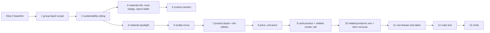

# Plan: Tailwind phase T2, product page (addendum)

Slug: `theme-evolution-tailwind-t2`
Parent: `docs/plans/theme-evolution-tailwind.md` (umbrella, Revision 2, approved; §9 defines T2 at summary level; owner decision Q6 requires this addendum and its own review)
Architect: Claude (for Junior Warner)
Date: 2026-10-22
Revision: 3 (folds in `docs/reviews/theme-evolution-tailwind-t2-review.md` `## Round 2`, verdict APPROVE WITH CHANGES: R2-1 and nits R2-N1 to R2-N4. Revision 2 folded in round 1 and recorded the owner decisions of 2026-10-23 in §14)
Tier: 2 (one page type, plus a global stylesheet change and two shared rules)
Builds on: T0 (live) and T1 (live push 2026-10-23, `docs/qa/theme-evolution-tailwind-t1-report.md` "Owner decision (2026-10-23)")

---

## Revision 3 changelog

Review round 2 (`docs/reviews/theme-evolution-tailwind-t2-review.md`, `## Round 2`): one required item and four nits. No ID was added, removed or renumbered.

| Review item | What changed | Sections |
|---|---|---|
| R2-1 (required) volume note misses Dawn's 750 px caption step | The note's class is now `text-[0.625rem] md:text-[0.75rem] tracking-[0.04375rem]`, the same mapping the plan already uses for the rating count's `.caption`. E2.25 now reads 16 px (19.2 px from 750) → 10 px (12 px from 768). The `.caption` citation is widened to `base.css:373-383`, which includes the media query. C2.19's static half also requires the `md:` token, so the omission can go red | §5.12, §8 E2.25, §9.1 C2.19, §9.2 C2.19 |
| R2-N1 price iff one clause short | C2.19's price condition now excludes Dawn's `price--no-compare` shape (`price_varies` false and `compare_at_price_varies` true), which §5.11 keeps for parity | §9.1 C2.19, §9.2 C2.19 |
| R2-N2 badge paint order | C2.19's badge half adds one `document.elementsFromPoint` assertion at the badge centre: the badge is in the list, ahead of every `img` of its card | §9.1 C2.19, §9.2 C2.19 |
| R2-N3 umbrella housekeeping | R-T2.4 and §14 now say "four places". §12's umbrella row now says the umbrella edit must be committed together with this plan (the orchestrator commits both) | §5.16 R-T2.4, §12, §14 |
| R2-N4 R12 needs a home | The Coder records R12 under a `## Follow-ups` heading in the impl notes. The plan chooses this over a `docs/bugs/` entry and creates no file | §11 R12, §13 preamble and Step 13 |

---

## Revision 2 changelog

Required changes (review "Required changes" list, R1-R9):

| Review item | What changed | Sections |
|---|---|---|
| R1 theme-check gates | The specified markup now passes its gates at every commit. Card: `section_id` dropped from every id, and the `lazy_load` block replaced by a plain `loading="lazy"` (parity: no caller passes `lazy_load`). Price: `product` documented as optional `[product]`, and the `available` assign (line 32) dropped because no new markup reads it. Related: the render-call edits (drop `skip_styles`, add `card_index`) and the two `skip_card_product_styles` assigns move from Step 10 into Step 9. **Found in this revision's own sweep, same defect class:** `material-spotlight.liquid:58` (`assign color_scheme`) is read only by the class string T2 deletes at line 81, so Step 3 deletes it too (otherwise `UnusedAssign`); `unit-price.liquid` keeps its `unless hide_accessibility_label` (otherwise `UnusedDocParam`); `specs-table`'s param type is `{object}`, matching `trust-badge`. §13 now states the expected theme-check offense list for every step. Risk R4 names the checks | D2.11, §5.4, §5.7, §5.11, §5.12, §5.13, §6, §7, §9.1 C2.1, §9.2, §11 R4, §13 |
| R2 badge clipped by shapes | The shape `clip-path` moves to an inner image box. The badge is a sibling of that box inside an unclipped media wrapper, as Dawn keeps it outside `.card__media` today. New check: no ancestor of a badge has a `clip-path`, for every shape | §5.12, §9.1 C2.19, C2.25, §9.2, §10 |
| R3 volume-pricing note | Kept and converted (`card-product.liquid:244-247` is reachable for products with quantity price breaks). §3.7's unreachable range corrected to 229-243 and 249-307. New Δ row E2.25 | §3.2, §3.7, §5.12, §8, §9.1 C2.19, §10 |
| R4 palette rule untested | New C2.27: a scratch-copy palette variant (`foreground_color` `#ee1188`, `background_color` `#112233`) checks both directions. Token surfaces must change and fixed surfaces must not | D2.5, §9.1 C2.27, §9.2, §10 |
| R5 umbrella budget bullet | Umbrella D12 budget bullet (`docs/plans/theme-evolution-tailwind.md`, the `B_rb(home)` sub-bullet) now limits the 1.15 × `B_rb0` allowance to T0 and T1 and points to the amended bullet and §17.4. A one-sentence pointer was added to the umbrella's §0 `B_rb` row | §5.16 R-T2.4; umbrella D12 and §0 |
| R6 R-T2.1 contradicts `CLAUDE.md:211` | Carve-out for the coincident names in `assets/base.css` (legacy layer). The example is now an unlayered rule (`.group`). N12 folded in | §5.16 R-T2.1 |
| R7 nested button states | D2.7 records the orchestrator's Tailwind 4.3.3 result: only `--minify` flattens `&:hover` inside `@utility`. Step 7 and C2.14 assert `.btn-primary:hover{` is present and `&:` occurs 0 times in `assets/tailwind.css`. The "fallback" is now a contingency note | D2.7, §5.1, §9.1 C2.14, §11 R2, §13 Step 7, §15 |
| R8 spinner display utility | C2.13 gains a static half: the spinner's class string has no unprefixed display token | §9.1 C2.13, §9.2, §11 R5 |
| R9 trust badge timing | Resolved by owner decision Q1: the trust badge stays at its current rendered size (22.4 px). No Δ row, step or criterion changes its size. Step 4 says so, so QA doesn't read 22.4 px as an oversight | D2.9, §5.6, §13 Step 4, §14 |

Nits:

| Nit | Disposition | Sections |
|---|---|---|
| N1 | Applied: the probe has no inline style. The second assertion is now `display` (the block rule sets `display: flex`), which can go red | C2.7, §9.2 |
| N2 | Applied: `performance.setResourceTimingBufferSize(1000)` via `addInitScript` | §0 M_css |
| N3 | Applied: inline sheets count; matches whose owner isn't a theme file are reported separately | C2.6 |
| N4 | Applied: the leading `!` form is matched too, excluding `!important` | C2.8 |
| N5 | Applied: E2.17's cause corrected | §8 E2.17 |
| N6 | Applied: the ban is on grid items (direct children of a grid) | §3.4 item 6, §5 conventions |
| N7 | Applied: C2.19's price assertion is exact | C2.19 |
| N8 | Applied: `text-[length:clamp(…)]` on the specs row | §5.7 |
| N9 | Applied: C2.1 supersedes umbrella C0.8 for T2 | §9 intro |
| N10 | Applied: `B_doc` recorded on `/` (no threshold) | C2.4, §13 Step 0 |
| N11 | Applied: blob variants per index are checked | C2.25 |
| N12 | Applied, inside R6 | §5.16 R-T2.1 |
| N13 | Applied: partial-rollback consequences are stated. After R1 the render-call change lives in Step 9, so reverting Step 9 restores `skip_styles` together with the old card | §12 |
| N14 | Applied: `fetchpriority="high"` and the preload go on the first image only when `section.index == 1`. On the landing-page template the product section is second, so its first image is `eager` with no priority hint | §5.10, §8 E2.20, C2.23 |
| N15 | **Declined.** Escaping `material.story.value` (material-info) and `story.value` (tooltip) changes how stored merchant HTML renders. That is a content behavior change with no fixture to check it, in a styling phase. It stays a separate fix (§11 R12) | none |

Owner decisions Q1 and Q2 (2026-10-23) moved from open questions to §14 "Owner decisions".

---

## 0. Referent table

Every figure in this plan cites a row here. Tags: `[measured]` read from a repo file during planning; `[derived]` computed from CSS read during planning (the arithmetic is shown); `[quoted]` taken from a named report, not re-measured; `[proposed]` a value this plan sets; `[provisional]` a hypothesis that Step 0 must confirm, never built on; `[to be measured]` Step 0 or QA measures it.

| Sym | What it measures | Units | Artifact | Extent or band | Value, method or threshold |
|---|---|---|---|---|---|
| `R_root` | Root font size | px | any page | `html` | 16 `[quoted]` umbrella §0 |
| `U_dawn` | Root size Dawn CSS was authored for | px | `assets/*.css` from Dawn | n/a | 10 `[quoted]` umbrella §0. So a Dawn literal `N rem` renders at `16N` px here and was designed as `10N` px |
| `K_q1` | Correction factor for Dawn literal rems (D2.9) | ratio | n/a | n/a | `U_dawn / R_root` = 10/16 = **0.625** `[derived]` |
| `BP_md`, `BP_lg` | Tailwind breakpoints | px | Tailwind 4.3.3 defaults | min-width | 768 and 1024 `[quoted]` (T1 impl notes: `--breakpoint-md` 48rem confirmed; `lg` 64rem is the default) |
| `BP_dawn` | Breakpoints in today's product-page CSS | px | `sections/product.liquid:118,138`, `sections/material-spotlight.liquid:43`, `sections/related-products.liquid:15`, `assets/base.css:105,993` | min-width | 750 and 990 `[measured]` |
| `G` | Box geometry of one element | px | rendered page | the element's border box (`getBoundingClientRect`), **not** its ink and not its content box | `x, y, w, h`. Pass: each within ±1 of baseline unless a Δ row in §8 names the change. `y` is taken **relative to the top of the element's own section wrapper** (`.shopify-section`), because the product section's height changes (E2.1, E2.5) and would shift every later section's absolute `y` |
| `X_page` | Page horizontal overflow | px | rendered page at width w | `document.documentElement` | `scrollWidth − innerWidth`. Pass: 0 |
| `X_off` | Overflow offenders | list | rendered page at width w | every element under `body` with `display` ≠ `none` | elements whose `getBoundingClientRect().right > innerWidth + 0.5`, deepest first. Pass: empty |
| `X_wax` | `X_page` on `selling-plans-ski-wax` at 375 | px | live T1 | page | 16 on load, 34 after the first add to cart `[quoted]` T1 QA "Regression A/B" and Re-run 3 "Info". Cause of the 16 attributed to `.product-container`, the 34 to `related-products` cards `[quoted]`; which element inside `.product-container` is `[provisional]` (§3.4) |
| `W_li` | Widths of the four related-product `li` at 1440 | px | `the-complete-snowboard`, pre-T0 | `ul.grid.product-grid > li` | 397.0 / 296.5 / 277.4 / 269.0 `[quoted]` T0 impl notes Step 0. Unequal because the Dawn widths are invalid (§3.4) |
| `B_rb0` | Head stylesheet bytes before T0 | bytes, compressed | live, pre-T0 | `<head>` `link[rel=stylesheet]` | 15,907 `[quoted]` T0 QA "`B_rb` against baseline" |
| `B_head` | Same measure as umbrella `B_rb`, renamed here | bytes, compressed | one page, method M_css below | `link[rel=stylesheet]` **inside `<head>` only** | T1: 18,409 on `/` and the 3p product `[quoted]` T1 QA "Gates" (tailwind 3,862 + base 10,813 + eco-tooltip 560 + accelerated-checkout 1,598 + styles 1,576). Recorded, no threshold (D2.1) |
| `B_body` | Stylesheet bytes linked from `<body>` | bytes, compressed | one page, method M_css | `link[rel=stylesheet]` outside `<head>`, **after related products have loaded** | `[to be measured]` Step 0 |
| `B_doc` | Whole-document stylesheet bytes | bytes, compressed | one page, method M_css | `B_head + B_body`, one entry per unique URL | `B_doc0` = Step 0 value per page. T2 budget guard: `B_doc ≤ B_doc0` on both product pages that render related products (D2.1) |
| `N_dawn` | Dawn or legacy stylesheet links T2 removes | count of `<link>` elements (not URLs) | one page, method M_css | whole document, after related products load | links whose path ends in `component-card.css`, `component-price.css`, `section-related-products.css`, `mask-blobs.css`, `component-rating.css`, `component-volume-pricing.css`, `quick-order-list.css`, `quantity-popover.css` or `eco-tooltip.css`. Expected before: 9 on a product page with related cards `[derived]` (3 tags at `related-products.liquid:1-3`, 5 at `card-product.liquid:33-38` emitted once because `skip_styles` is true from the second card, 1 at `layout/theme.liquid:30`; `mask-blobs` only when the shape is `blob`). Pass after: **0** |
| `S_tw` | Size of `assets/tailwind.css` | bytes | committed file | whole file | T1 final 14,929 minified / 4,247 gzip `[quoted]` T1 impl notes QA-fix round 3. Budget 60,000 / 12,000 (`CLAUDE.md` `### Performance & Core Web Vitals`) |
| `N_tc` | `shopify theme check` offenses | count | working tree | whole theme | 2 today `[quoted]` T1 QA Re-run 3 (`TranslationKeyExists` cart-drawer, `UnusedAssign` card-product). Expected **1** after Step 9 (D2.11) |
| `H1` | `<h1>` count | count | rendered page | document | Pass: 1 |
| `C_mix` | Rendered sRGB channel of a foreground-alpha color over the page background | 0-255 | dev and staging themes, where the repo's `config/settings_data.json` has `current: {}` `[quoted]` T1 QA C1.8, so `--color-foreground` = #333333 (51) and `--color-background` = #ffffff (255) | one channel | `a × 51 + (1 − a) × 255`, from Tailwind's `color-mix(in oklab, var(--color-foreground) a, transparent)` composited over white `[derived]`. Holds only at those defaults; live may differ |
| `ATC` | "Add to cart" button box after T0 | px | `selling-plans-ski-wax`, 1440 | the `<button name="add">` border box | 88 × 19 `[quoted]` T0 QA owner-acceptance item 2 |

**Method M_css** (CF1; replaces the head-only scope of umbrella §0 `B_rb` for T2):

1. Fresh Playwright context: empty cache, storefront password cookie only. Viewport 1440 × 900. Before navigating, `context.addInitScript(() => performance.setResourceTimingBufferSize(1000))`. The default buffer holds 250 entries, and the body stylesheets load last (after the scroll), so on a long page they would be the entries dropped (review N2).
2. Load the page and wait for `load`.
3. Scroll to the bottom in 600 px steps, 250 ms apart, so `product-recommendations` (IntersectionObserver, `assets/global.js:1141-1149`, 400 px root margin) fetches. Wait until `product-recommendations li` count ≥ 1, or 8 s. Record which. If no cards render, the product is unusable for this measure; record it and use the other product.
4. Wait for 2 s of network idle.
5. Collect every `link[rel="stylesheet"]` in the document. Split by `link.closest('head')`. Resolve each `href` to an absolute URL.
6. For each **unique** URL take the first `performance.getEntriesByType('resource')` entry whose `name` equals it.
7. Same-origin URLs (`new URL(href).origin === location.origin`; theme assets and `compiled_assets/styles.css` are served from the store origin `[quoted]` T0 QA): add `encodedBodySize` to `B_head` or `B_body` according to where the **first** link for that URL sits. Cross-origin URLs: list them, exclude them (review R2-N5).
8. **Invalid measurement** (report it, don't compare) if a same-origin URL has no entry, or its entry has `encodedBodySize === 0`.
9. `N_dawn` counts link **elements** matching the name list, so a URL linked twice counts twice (today `component-price.css` is linked from both `related-products.liquid:2` and `card-product.liquid:36`).

Readings that are easy to confuse, stated once: `B_*` are **compressed transfer** bytes; `S_tw` is **file** bytes. `G.y` is **section-relative**. `X_page` is a page figure; `X_off` names elements. `N_dawn` counts **elements**, `B_doc` counts **unique URLs**.

---

## 1. Problem statement and goals

T2 converts the product page to Tailwind. Today that page is the most Dawn-dependent surface left after T1:

- The main product section's buttons and inputs have been plain text since T0's Preflight (T0 QA N4; owner accepted it "until T2", T0 QA "Owner decisions" item 9).
- The product title renders at body size (16 px, regular). Dawn's `h1` size uses an undefined variable (`assets/base.css:298-308`), so it inherits.
- `sections/related-products.liquid` and `snippets/card-product.liquid` load eight Dawn stylesheets from `<body>`, and their grid is broken. Every Dawn width is invalid, so cards are as wide as their titles (`W_li`). On `selling-plans-ski-wax` at 375 the page overflows (`X_wax`).
- Three files style through unlayered ``, `` and `<style>` blocks. Under T0's layer model, unlayered CSS beats every utility.
- The T0/T1 measurement of render-blocking CSS cannot see body stylesheets (review CF1).

### Goals

1. Convert, file by file, every file the product template renders (§3.1) to Tailwind utilities, with custom CSS only inside `@layer components`. Schemas stay byte-identical.
2. Remove every Dawn stylesheet link from the product page (`N_dawn` = 0), and measure it with the whole-document method M_css (CF1).
3. Close the product-page horizontal overflow at 320 to 1440 (deferred item 5).
4. Restyle the "Add to cart" and "Share" buttons and the product inputs (deferred items 6, 7), using the T1 tokens. Adopt `font-heading` for the page's top-level headings (deferred item 3).
5. Preserve and test the product-page behaviors in §3.6.
6. Decide the eight deferred items (§4.1). Write the rule changes they need into `CLAUDE.md` and `AGENTS.md` as exact text (§5.16).
7. Keep the gates: `check:css`, `check:hidden`, theme check (D2.11), and the CSS budget.

---

## 2. Non-goals

- **No product-form behavior changes.** The variant `<select>` and the quantity input sit outside the `<form>`, so neither affects add to cart (`docs/plans/fix-single-variant-default-title-dropdown.md` §1 and Open question 2). The `picker_type` setting is ignored by the markup (`sections/product.liquid:63-74`), and so is `show_gift_card_recipient`. All three stay as they are, documented as pre-existing no-ops. Wiring them is a separate bug.
- **No sale price on the product page.** The main section prints `product.price | money` only (`sections/product.liquid:36`). Sale states exist only in the card's price snippet, and T2 preserves them there. Owner decision Q2 (§14) confirms the PDP stays price-only; nothing is removed.
- **No add-to-cart error UI.** `assets/product-form.js:113-126` looks for `.product-form__error-message-wrapper`, which `sections/product.liquid` never renders, so a 422 shows nothing. T2 keeps that and only tests that the page recovers (C2.13).
- **No rich-text styling.** The product description stays unstyled for T4's `prose` (umbrella §11).
- **No `blocks/button.liquid`.** It belongs to the homepage roadmap. T2 provides the shared button utilities it should use (D2.7).
- **No cart-drawer CSS conversion.** That is T4. T2 changes two JavaScript lines in `sections/cart-drawer.liquid` (D2.6).
- **No conversion of `snippets/quantity-input.liquid`, `snippets/loading-spinner.liquid` or `snippets/progress-bar.liquid`.** Their only callers are `card-product.liquid` branches that no caller can reach (§3.7). T2 removes those branches, which leaves the three snippets orphaned. T4 decides whether the cart uses them; otherwise T5 deletes them. **This departs from umbrella §9, which listed the first two in T2 scope.**
- **No deletion of Dawn CSS files.** After T2, the eight Dawn files in `N_dawn` have no reference (§3.3). T5 deletes them under its audit (umbrella §12). T2 deletes only `assets/eco-tooltip.css`, a project file that T2 converts.
- **No edits** to `config/settings_data.json`, `templates/*.json` or `sections/*-group.json`. None is needed.
- **Not touched:** header, footer, `sections/hello-world.liquid`, `sections/image-banner.liquid` (T3), collection, search, cart and the other T4 pages.

---

## 3. Current-state inventory

### 3.1 What the product template renders

`templates/product.json` order (124-129) `[measured]`: `main` (type `product`), `material-spotlight`, `related-products`, `custom_section_jxpfJF` (type `custom-section`, blocks `material_highlight` and `trust_badge`). `templates/product.landing-page.json` (102-105) renders `image-banner` and then the same `product` section. `templates/index.json` (57-85) renders `custom-section` on `/` with `material_highlight`, `specs_table` and `trust_badge`. With no `product` object on `/`, only the trust badge shows there.

| File | Rendered from | Pages |
|---|---|---|
| `sections/product.liquid` | product templates | every product page |
| `sections/material-spotlight.liquid` | `product.json` | product (content only with `custom.material_link`) |
| `snippets/sustainability-rating.liquid` | `material-spotlight.liquid:153`; after T2 also `material-info.liquid` | product |
| `sections/related-products.liquid` | `product.json` | product |
| `snippets/card-product.liquid` | **only** `related-products.liquid:41` `[measured]` (ripgrep for `render 'card-product'` over `sections`, `snippets`, `blocks`, `layout`, `templates`) | product only |
| `snippets/price.liquid`, `snippets/unit-price.liquid` | `card-product.liquid:227` (live), `:535,550,644` (unreachable), `price.liquid:116` | product |
| `sections/custom-section.liquid` with `snippets/material-info.liquid`, `trust-badge.liquid`, `specs-table.liquid` | `product.json`, `index.json` | product, `/` |
| `sections/material-tooltip.liquid` | Section Rendering API: `assets/eco-tooltip.js:48` fetches `/search?section_id=material-tooltip&q=<handle>` | inserted into product pages on hover |
| `assets/eco-tooltip.css` | `layout/theme.liquid:30` | **every** page, in `<head>` |

**Correction to umbrella §6 and §9 (review N9):** they say `card-product` also renders on `/collections/all` and `/search`. It doesn't. `sections/collection.liquid:15` and `sections/search.liquid:34` render `snippets/image.liquid` `[measured]`. Those pages still get T2's regression screenshots (§10), because T2 changes the global `` bundle and `layout/theme.liquid`.

### 3.2 File inventory `[measured]`

| File | Lines | Styling today | Behavior and hooks to keep |
|---|---|---|---|
| `sections/product.liquid` | 323 | `` 111-221, unlayered. Dawn `page-width` on 11 | Scripts 8-9 (`material-api-fetch.js`, `product-form.js`). Images 13-15 (`image_tag`, width 1000, no preload, no `loading`). `<h1>` 30-32. Price 35-37. Description 39-49 builds `.eco-tooltip-trigger` spans at 45. Accordion `#MaterialAccordion` and `#material-data-container` 51-61, with hardcoded English at 53 and 58. Variant picker guard `product.variants.size > 1` at 64. Quantity input 76-80. `<product-form>` 84-99: hidden `name="id"` 86, `<button type="submit" name="add">` 87-94 whose first `span` is the label 88 and whose child `.loading__spinner hidden` is 89-93; dynamic checkout 95-97. Share 102-105. Schema 223-323 (`picker_type` select at 258-273) |
| `sections/material-spotlight.liquid` | 355 | `` 38-49 (renders even when no material), `` 165-256. Dawn `page-width` 82 and `rte` 147. `color-{{ color_scheme }} gradient` 81 does nothing | Renders nothing without a material (51). Hero icon with `preload_icon`: `loading: 'eager'`, `fetchpriority: 'high'`, `preload: true` (88-100). Every `image_tag` passes `width`/`height`. `heading_tag` 140-142. Rating render 152-159. Schema 258-354 (`color_scheme` 293-298) |
| `snippets/sustainability-rating.liquid` | 131 | `<style>` 46-106 | Five `<span>` bars (123-128) because `base.css:470-484` hides `div:empty` (`docs/plans/material-spotlight-impl-notes.md:148,156-158`). `role="meter"` with `aria-valuenow` 115-122 |
| `sections/related-products.liquid` | 256 | 4 body `stylesheet_tag`s (1-3, 6), `` 9-21. Dawn `grid product-grid grid--N-col-desktop grid--N-col-tablet-down` 35, `page-width` and `isolate` 25, `inline-richtext {{ heading_size }}` 31 | `<product-recommendations>` with `data-url`, `data-section-id`, `data-product-id` (24-29), filled by `assets/global.js:1152-1162`. Arch mask SVG inlined at 56-58. Schema 61-255 (`color_scheme` 139-145) |
| `snippets/card-product.liquid` | 651 | 5 body `stylesheet_tag`s (33-38), a per-card `<style>` 66-70 and 200-206 and 610-614, about 40 Dawn classes | Live path, the only one reachable from `related-products` (no caller passes `quick_add`): 40-310 and 571-590, including the volume-pricing note at 244-247 (the `else` of `quick_add == 'bulk'`, shown for every product with quantity price breaks). Unreachable: quick add 311-570, the bulk popover 229-243 and 249-307, placeholder card 591-650. `page_width` assigned at 7, never read (theme check's `UnusedAssign` `[derived]`) |
| `snippets/price.liquid` | 130 | Dawn classes. `component-price.css` toggles the regular and sale branches with `display` (57-80) | Logic 19-45 |
| `snippets/unit-price.liquid` | 21 | Dawn `unit-price caption`, `visually-hidden` | `` present |
| `sections/custom-section.liquid` | 135 | `` 27-55 | Background `image_tag: preload: true` (4). Schema 57-135 |
| `snippets/material-info.liquid` | 174 | `<style>` 18-135 plus one `<style>` per bar inside the loop (161-165). `!important` throughout (91-123) | Its own bar markup on `<div>`s (166-168). English literals at 145, 156, 157. Story not escaped (150) |
| `snippets/trust-badge.liquid` | 38 | `` in a snippet with `` inside it (5-33), against `CLAUDE.md`'s `` rule | `#TrustBadge-{{ block.id }}` |
| `snippets/specs-table.liquid` | 39 | `` in a snippet (1-23), with block-level selectors, so two blocks would share the last block's colors | No `` header |
| `sections/material-tooltip.liquid` | 59 | none (styled by `assets/eco-tooltip.css`) | English literals at 36 and 42. **`{{ material_handle }}` at 42 is `search.terms`, a query parameter, printed unescaped.** That error branch renders only when the store has no `material` entries at all, because 17-19 fall back to the first entry |
| `assets/eco-tooltip.css` | 85 | unlayered | `.eco-tooltip` and `.is-visible` (1-41) are set by JavaScript on an element that `eco-tooltip.js:87-93` creates. Content rules 44-63 and 82-85, trigger rules 66-79 |
| `sections/cart-drawer.liquid` | 389+ | `<style>` 80+ (T4) | `renderContents` replaces only `innerHTML` of the header cart link (321), and `updateCart` does the same (380). So the link's own `aria-label` (`sections/header.liquid:96`, from `sections.header.cart_count`, "{{ count }} items") stays stale (T1 QA Re-run "N1" Info) |
| `blocks/group.liquid` | 106 | unlayered `` `.group { display: flex; flex-wrap: nowrap; overflow: hidden; width: 100% }` (26-31) | The block is never rendered: no section accepts `@theme` blocks `[measured]` (ripgrep for `@theme` finds only `blocks/group.liquid:50`). Its CSS still reaches every page (§3.4) |

### 3.3 Dawn CSS on the product page

| Asset | Linked from | After T2 |
|---|---|---|
| `component-card.css`, `component-price.css`, `section-related-products.css` | `related-products.liquid:1-3` (body) | unreferenced |
| `mask-blobs.css` | `related-products.liquid:6`, only when `image_shape == 'blob'` | unreferenced. Its polygon data moves into a conditional `<style>` (§5.13) |
| `component-rating.css`, `component-volume-pricing.css`, `component-price.css`, `quick-order-list.css`, `quantity-popover.css` | `card-product.liquid:33-38` (inside the HTML that `global.js` injects after scroll) | unreferenced |
| `eco-tooltip.css` | `layout/theme.liquid:30` (head) | file deleted |
| `base.css` (legacy layer) | `layout/theme.liquid:29` | unchanged (T5) |

A ripgrep for those nine names over `sections`, `snippets`, `blocks`, `layout`, `templates` and `assets/*.{liquid,js}` finds only the lines above `[measured]`.

### 3.4 Cascade facts that shape the design

1. **The `` bundle reaches every page.** T1 hit `.group` from `blocks/group.liquid` on the product page header (T1 impl notes deviation 1), and no page renders that block (§3.2). So this theme's `compiled_assets/styles.css` is not subset to the render tree, although Shopify documents subsetting for some themes ([Stylesheet content subsetting](https://shopify.dev/docs/storefronts/themes/best-practices/performance/stylesheet-subsetting)). Step 0 confirms by searching the served `styles.css` on a product page for `.group{`. Consequence: every unlayered rule in every section or block applies to T2 markup, wherever it lives.
2. **Unlayered beats layered.** In T1 the stray `.icon { width: 300px }` in `sections/hello-world.liquid` forced `!` on icon utilities until it was scoped (T1 impl notes deviation 2, QA-fix N3 at 161-163). T2 therefore moves all of its custom CSS into `@layer components` **in the same commit** that adds the utilities, and C2.6 sweeps the rendered page for any unlayered rule that matches T2 markup.
3. **Most Dawn declarations here are invalid at computed-value time.** They use variables this theme never defines, so the value is `unset` (umbrella §4.3). Examples on this surface: every `h1`-`h5` and `.h0`/`.hxl`/`.hxxl` size, so the related heading and the card titles render at 16 px whatever `heading_size` says. Also the grid gaps and `.grid__item` widths (`base.css:887-913`, `993-1028`), which make the cards content-sized (`W_li`) and let a long title push a `flex-shrink: 0` item past 375. `.badge` colors (2930-2932) leave a text-only badge, and the `.rating-star` gradient (`component-rating.css:21,38-42`) leaves the stars invisible.
4. **Dawn literal rems render 1.6× large** (`U_dawn`/`R_root`). On this surface: `.price` 1.6rem → 25.6 px `[derived]` (`component-price.css:2`); the sale compare-at price 1.3rem → 20.8 px (90); `.unit-price` 1.1rem → 17.6 px (95); `.badge` 1.2rem → 19.2 px (`base.css:2925`); `.card__information` padding 1.3rem → 20.8 px, and 1.7rem → 27.2 px from 750 (`component-card.css:137-140, 266-271`); `.related-products__heading` bottom margin 3rem → 48 px (`section-related-products.css:6`). D2.9 decides these.
5. **`X_wax` cause `[provisional]`.** At 375 the content column is 375 − 2 × page margin, and Dawn `.page-width` (`base.css:81-85`) takes 24 px off each side. The variant `<select>` sizes to its longest option ("… − $price"), and `.product-info` has `min-width: 0` only from 750 (`product.liquid:133`). That fits a 16 px overflow on the only product whose variant titles are long. Step 0 confirms with `X_off`; §13 Step 0 says what to do if it names a different element.
6. **Implicit grid rows grow to fit content** (T1 B1, T1 impl notes QA-fix round 3). T2 adds three grids: the related product list, the custom-section content grid and the specs rows. None has a fixed height and none of their grid items (direct children) uses `h-full` or a percentage height. §5 bans both on grid items in T2 (deeper descendants, such as the card's `size-full` images inside a positioned box, are not affected), and C2.17 checks that every grid child's box sits inside its container.
7. **Shopify's `<style>` processing dropped the property after a multi-line comment** (`docs/plans/material-spotlight-impl-notes.md:156`) `[quoted]`. T2's `<style>` blocks contain no CSS comments.

### 3.5 JavaScript hooks that must survive

| Script | Hook it reads | Kept as |
|---|---|---|
| `assets/product-form.js` (8-12, 29, 104-107, 139) | `product-form > form`, `[type="submit"]`, the button's first `span`, `.loading__spinner` with the `hidden` class toggled, `[name=id]` inside the form; adds `loading` and `aria-disabled` to the button | unchanged markup roles. The spinner keeps the classes `loading__spinner hidden` (§5.10) |
| `assets/material-api-fetch.js` (21-22, 43, 50, 57, 65) | `#MaterialAccordion` (toggle event), `#material-data-container`; injects `.material-accordion__thumbnail` and `.material-accordion__story` | ids kept. The injected classes are styled from the container with arbitrary child variants (§5.10) |
| `assets/eco-tooltip.js` (15, 48, 87-93) | `.eco-tooltip-trigger[data-material-handle]`; creates `div.eco-tooltip`, toggles `.is-visible` | trigger class and attribute kept; container CSS moves to `@layer components` (§5.9) |
| `assets/global.js` (1128-1178) | `<product-recommendations data-url data-section-id data-product-id>`; replaces its `innerHTML`; adds `product-recommendations--loaded` when the response has `.grid__item` | element and attributes kept. `grid__item` is dropped, so the `--loaded` class is no longer added; nothing styles it (ripgrep: only `global.js:1169` mentions it) `[measured]` |
| `sections/cart-drawer.liquid` (286-297) | `[data-header-cart-icon]` | unchanged (T1) |

### 3.6 Behavior contracts that must survive (tested in §9)

Single-variant: no picker and no "Default Title" (`fix-single-variant-default-title-dropdown.md` §2). Multi-variant: picker lists every variant, with the selected one preselected. Add to cart opens the drawer and updates the badge (umbrella C1.3). The 3p product returns 422 (`docs/dev-fixtures.md`). Spotlight renders nothing without a material and keeps the hero preload attributes. Sustainability bars visible, with the right number active and `role="meter"`. Related products load on scroll. Product JSON-LD comes from `snippets/meta-tags.liquid:67-70` (T2 doesn't touch it). One `<h1>`. CWV: every `` has `width`/`height` (`CLAUDE.md` `### Performance & Core Web Vitals`).

### 3.7 Unreachable code in `card-product.liquid`

`related-products.liquid:41-49` passes `card_product`, `media_aspect_ratio`, `image_shape`, `show_secondary_image`, `show_vendor`, `show_rating`, `skip_styles`. No caller passes `quick_add`, `section_id`, `extend_height`, `lazy_load`, `horizontal_class`, `horizontal_quick_add` or `placeholder_image`, and a recommendation is never empty. So the quick-add branches (311-570), the bulk popover (229-243 and 249-307, both gated on `quick_add == 'bulk'`) and the placeholder card (591-650) never render. Their JavaScript components (`quick-add-modal`, `bulk-modal`, `quantity-popover`, `modal-opener`) aren't loaded by any layout or section either. The homepage roadmap's featured-products strip deliberately avoids this snippet (`docs/plans/theme-evolution-homepage-phases.md:183`).

**The `` at 244-247 is reachable** (review R3): with `quick_add` unset it renders the volume-pricing note for every product whose `quantity_price_breaks_configured?` is true (B2B quantity price breaks). T2 keeps it (§5.12). No fixture has price breaks, so it is checked statically (C2.19).

---

## 4. Decisions

### 4.1 The eight deferred items

| # | Item | Decision | Where |
|---|---|---|---|
| 1 | CF1: `B_rb` sees only `<head>` | **Measure the whole document.** Method M_css gives `B_head`, `B_body`, `B_doc` and `N_dawn`. The T2 budget guard is `B_doc ≤ B_doc0`; removals are proven by `N_dawn = 0` plus a static check. `B_head` (the old `B_rb`) is recorded with no threshold. Umbrella D12's "falls phase by phase" sentence is corrected in place, with a pointer here | D2.1, C2.3, C2.4 |
| 2 | N4: bare `group` vs `blocks/group.liquid` | **Fix the source.** Scope that block's selector to `.group:is(.group--horizontal, .group--vertical)`. Both option values of its `layout_direction` select carry one of those classes (`blocks/group.liquid:57-60`), so the block keeps its styles. Tailwind markup never does, so bare `group` becomes safe and `CLAUDE.md`'s `group-aria-expanded:hidden` advice is correct again. Also add a `CLAUDE.md` rule that custom CSS never selects a Tailwind class name, `!` is a last resort, and named groups are preferred (exact text in §5.16) | D2.2, C2.7 |
| 3 | N5: Oswald preloaded, unused | **Adopt it.** `font-heading` goes on the product `<h1>`, the related-products `<h2>` and both shared button utilities. Keep the preload: from T2 every product page uses the face above the fold. The homepage still doesn't, until the roadmap hero or T3 | D2.8 |
| 4 | Stale cart `aria-label` | **Fix in T2**, as its own commit: two `setAttribute` lines in `sections/cart-drawer.liquid`. T2's add-to-cart test already exercises this path (C2.12), so the fix gets tested where it's visible. Alternative, T4 (the cart-drawer conversion), rejected because the bug would ship through two more phases for a JavaScript-only, CSS-free change | D2.6, C2.12 |
| 5 | Ski-wax overflow at 375 | **Fix.** `min-w-0` on the info column at every width, `w-full min-w-0` on the `<select>`, and a real CSS grid with `minmax(0, 1fr)` tracks for related products. Step 0 confirms the offender list first | D2.4, C2.9 |
| 6 | "Add to cart" and "Share" are bare text | **Restyle** with `btn-primary` and `btn-secondary` | D2.7, C2.14 |
| 7 | Buttons in general (E3) | **Shared `@utility btn-primary` / `btn-secondary` in `src/tailwind.css`.** T2 doesn't create `blocks/button.liquid`. The roadmap's button block renders an `<a>` with these utilities (coordination text in §5.16) | D2.7 |
| 8 | The shims layer | **Retire the D11 `.grid` shim** (`src/tailwind.css:173-181`) in the related-products commit, and delete the now-empty `@layer shims { }` block. **Keep `shims` in the layer statement** (both layouts, `templates/gift_card.liquid`, `src/tailwind.css:9`, `EXPECTED_LAYERS`) until T5, so no layout changes and C0.2 stays as is | D2.10, C2.18 |

### D2.1 Whole-document stylesheet measure (CF1)

The reviewer's two options were (a) count every `link[rel=stylesheet]` and (b) keep head-only, drop the D12 sentence, and add a static check. **This plan does both:** M_css counts head and body, and C2.3 also checks the source statically.

- **Why both.** The static check alone can't see a stylesheet that Liquid builds conditionally, or one injected with Section Rendering API HTML. The rendered count alone depends on related products rendering, which isn't deterministic (`selling-plans-ski-wax` was sometimes empty, T0 impl notes Step 0).
- **Why the budget compares `B_doc` with `B_doc0`, not with 1.15 × `B_rb0`.** T1 already shipped at `B_head` 18,409 = 1.157 × `B_rb0` `[derived]` from the `[quoted]` figures. T1 QA reported the number without comparing it. The head-only allowance had already gone, as CF1 predicted. T2 removes body links and grows a head link, so the honest guard is that the product page as a whole doesn't get heavier.
- **Expected direction `[provisional; not built on]`.** `B_head` rises (bigger `tailwind.css`, minus `eco-tooltip.css`, minus product and spotlight CSS in `styles.css`), and `B_body` falls to about 0.
- **What a breach means.** As umbrella D12: a breach on a valid measurement goes to the owner for sign-off. It is not a FAIL.
- **Umbrella amendment.** Applied in this revision, so readers of the umbrella aren't misled: D12's third bullet and the `B_rb` sentence in §17.4 now say the head-only measure doesn't fall, and point here.

Rejected: keeping the 1.15 × `B_rb0` head budget (already breached by T1; it would send every correct phase to sign-off and stay blind to a leftover body tag).

### D2.2 N4: scope the stray rule, then write the rule down

Options considered:

| Option | Effect | Verdict |
|---|---|---|
| A. Scope `blocks/group.liquid` to `.group:is(.group--horizontal, .group--vertical)` | Bare `group` safe everywhere. The block's markup, schema and option values are unchanged, and its own element still matches | **Chosen** |
| B. Rename the block's class (`group` → `theme-group`) | Same effect, but it changes block markup that T3 is about to convert | rejected: churn in another phase's file |
| C. Ban bare `group` by rule, require named groups | Leaves a global trap for apps and future files; contradicts `CLAUDE.md:208` | rejected as the fix; kept as a *preference* in the rule text |
| D. Wrap the block's CSS in `@layer components` | `CLAUDE.md:201` forbids wrapping the unlayered CSS of a file you aren't converting | rejected |

Scoping the selector isn't "converting" the file, and it doesn't move the rule's layer, so the `CLAUDE.md:201` rule holds. The header keeps `group/menu` (T1). Changing it back would be churn with no benefit.

### D2.3 Where T2's custom CSS lives

Utilities express nearly everything. These four things don't, and each goes in `@layer components`:

| CSS | Why a utility can't | Where |
|---|---|---|
| `.eco-tooltip`, `.eco-tooltip.is-visible` | `eco-tooltip.js` creates the element and toggles the class; `assets/*.js` isn't scanned | `sections/product.liquid` ``. Its triggers render only there. T0 Step 6 result A says the bundler keeps `@layer` blocks |
| `@keyframes sustainabilityFillReveal` | keyframes | one-line `<style>` in `snippets/sustainability-rating.liquid` (snippets use `<style>`, `CLAUDE.md:205`) |
| Blob polygon custom properties (`--shape--blob-1` … `-6`) | about 6 KB of data needed only when `image_shape == 'blob'` | conditional `<style>` at the top of `sections/related-products.liquid`, inside its `` |
| none for JavaScript-injected accordion content | n/a | utilities on the container: `[&_.material-accordion__story]:…` (the strings live in a scanned Liquid file) |

Rejected: putting section CSS in `src/tailwind.css` (`CLAUDE.md:196` forbids it), and editing `eco-tooltip.js` to add utility classes (a JavaScript change for no behavior gain; it would also need `@source` for an `assets/` file).

### D2.4 Overflow fixes (item 5)

`min-w-0` on the info column at every width, and `w-full min-w-0` on the `<select>`, so a long option is clipped in the closed control instead of widening the page. The related list becomes `grid grid-cols-1|2 lg:grid-cols-N` with Tailwind's `minmax(0, 1fr)` tracks, so a long title wraps. Both are harmless if Step 0 names other offenders. C2.9 tests the outcome at seven widths and C2.17 the mechanism (children inside their grid).

### D2.5 Colors: the surface decides

| Surface | Rule | Files |
|---|---|---|
| Transparent: the page background shows through | Neutral text and borders become foreground-relative tokens (`text-foreground`, `text-foreground/45`, `border-foreground/10`), so the owner's planned dark palette (umbrella §8.1 owner action) doesn't leave `#121212` text on a dark page | material spotlight, the product accordion, the sustainability snippet (inherits its label color and uses `border-current/8`) |
| Fixed: the element paints its own background | Exact hex kept as arbitrary values; the surface and its text stay self-consistent on any palette | `snippets/material-info.liquid` (white card), the tooltip box (white), bar track and fill (`#eeeeee`, `#2d5a27`), the brand teal trigger (`#00707c`) |
| Merchant color settings | Custom property on the element plus a variable utility (`text-(--badge-color)`) | trust badge, specs table |

Computed Δs at the default palette are in §8 (E2.13). Rejected: exact hex everywhere (parity, but breaks on the dark palette the owner intends), and tokens everywhere (would turn the white material-info card's text light-on-white on a dark palette).

At the default palette `text-foreground` and `text-[#333333]` compute identically, so no default-palette check can tell this rule from either rejected alternative (review R4). C2.27 renders a changed palette in a scratch copy and checks both directions: transparent surfaces must follow it, fixed surfaces must not. It also previews a non-default palette for the owner before one is set on live.

### D2.6 Cart `aria-label` (item 4)

In both header updates, also copy the new link's `aria-label` (exact code in §5.14). No other line in `sections/cart-drawer.liquid` changes.

### D2.7 Buttons (items 6, 7)

| Option | Single source | Fits a `<button type=submit>` with JavaScript-hooked children | Verdict |
|---|---|---|---|
| A. `@utility btn-primary` / `btn-secondary` in `src/tailwind.css` | yes | yes; it's just a class | **Chosen.** `CLAUDE.md:196` names `@utility` as a sanctioned kind of content for `src/tailwind.css`. Variants compose with it (`w-full`) |
| B. Same utility string repeated in every file | no (drift between PDP, cart, hero, CTA) | yes | rejected |
| C. `snippets/button.liquid` that renders the element | yes | poorly: the add-to-cart button's label span and spinner are JavaScript hooks, so the snippet would need captured HTML passed in | rejected |
| D. Create `blocks/button.liquid` now | it's a merchant-composable link block, not a form control | no | rejected: wrong primitive, and the roadmap owns it |

Names are `btn-*` because `CLAUDE.md:212` bans Dawn's `button` class on Tailwind markup. The utilities read the runtime variables that `snippets/css-variables.liquid:21-28` prints (`--color-accent`, `--color-accent-foreground`, `--font-heading--family`). Those variables exist whether or not Tailwind tree-shakes its own theme variables. Hover, focus and disabled states are nested inside the utility. Tailwind documents nesting inside `@utility` (its `scrollbar-hidden` example nests `&::-webkit-scrollbar`) `[quoted]` ([Adding custom styles](https://tailwindcss.com/docs/adding-custom-styles)).

**Nesting depends on `--minify` (review R7; `[quoted]` orchestrator build with Tailwind 4.3.3).**
- `@utility btn-primary { &:hover {…} }` compiles.
- Only the minified build (`--minify`, which runs Lightning CSS) flattens it to `.btn-primary:hover{…}`.
- Unminified output keeps native `&:hover` nesting. Tailwind's own browser floor (Chrome 111, Safari 16.4) doesn't support native nesting, so unminified output would lose every hover, focus and disabled state in those browsers.
- `build:css` and `watch:css` both pass `--minify`, and `check:css` rebuilds and diffs, so the committed file is minified today. **`--minify` must never be dropped from `build:css`.** The §5.1 source comment says so where the next editor will see it.
- Step 7 and C2.14 check the flattened form: `.btn-primary:hover{` present, and the string `&:` absent from `assets/tailwind.css`.

Contingency only, not a planned path: if a future Tailwind upgrade stops flattening, move the three states onto the markup as `hover:`/`focus-visible:`/`disabled:` utilities and record it.

### D2.8 Headings (item 3) and the one-`<h1>` rule

- The product `<h1>` (the only `<h1>` on the page) becomes `font-heading font-bold uppercase leading-tight text-3xl md:text-4xl`, so 16 → 30 / 36 px `[derived]` (Tailwind `text-3xl` = 1.875rem, `text-4xl` = 2.25rem `[quoted]` Tailwind defaults).
- The related-products `<h2>` takes `font-heading font-bold uppercase` plus the `heading_size` map (§5.13).
- Spotlight, material-info and card titles keep the body font (parity). Element-level heading typography for the whole site is T5's job (umbrella §12).
- Hierarchy on the product page: `h1` title → `h2` spotlight (setting default) → `h2` related → `h3` card titles → `h3` material-info title. No level is skipped at the defaults. The spotlight's `h3`/`h4` options remain the merchant's responsibility (`sections/material-spotlight.liquid:25-26`).

### D2.9 Dawn literal rems (owner question Q1)

Rule, by file origin:

1. **Project-authored files** (product section, spotlight, sustainability, material-info, custom section, trust badge, specs table, tooltip): **parity**. Their rem values were written against the 16 px root and are kept as authored, for example `text-[1.6rem]`.
2. **Dawn-derived files** (card, price, unit price, related products): literal rem values are **multiplied by `K_q1`**, to the size Dawn designed. This is the bug class behind `docs/bugs/mobile-horizontal-overflow.md` root cause 2. It applies only to the values in §3.4 item 4 and their siblings (§8 E2.9).
3. **Invalid-variable values keep what they render today** (for example card titles inherit 16 px). There is one exception: `heading_size` must visibly apply (`CLAUDE.md` `### QA`, last bullet), so it maps to Dawn's sizes at heading scale 1.
4. **Values are written as arbitrary rem font sizes** (`text-[0.75rem]`) wherever a named Tailwind size would also set a line height that isn't there today. This is the T1 F10 lesson: `text-xs` and `text-sm` carry line heights.

**Owner decision Q1 (2026-10-23, §14): adopted as recommended.** The Q1 rows in §8 (E2.8, E2.9, E2.25) use their "after" values. `trust-badge`'s `font-size: 1.4rem` (22.4 px) looks like the same Dawn habit, but the file is project-authored, so **it stays at its current rendered size of 22.4 px**. No Δ row, step or criterion changes it, and C2.10 and C2.26 expect it unchanged on `/` and on product pages (review R9).

### D2.10 The shim (item 8)

The `.product-grid.grid` rule exists only for `related-products.liquid:35`, which T2 rewrites without `grid`, `product-grid` or `grid__item`. Delete the rule and the empty `@layer shims { }`. The layer name stays declared until T5, which already plans to drop `legacy` and `shims` together (umbrella §12). Rejected: dropping `shims` from the statement now. That would need edits to three Liquid files, `EXPECTED_LAYERS` and C0.2, a cross-phase change with no benefit.

### D2.11 Card snippet scope, LiquidDoc and the theme-check baseline

`card-product.liquid` is rewritten to its live path only (§3.7), with a `` header documenting exactly the parameters its one caller passes, plus a new `card_index` (D2.12). Removing `page_width` (line 7) removes the baseline's `UnusedAssign`, so `N_tc` goes from 2 to 1. `CLAUDE.md:68` is updated in the same phase (§5.16), or QA would read the old "two offenses" text against a new baseline.

**What a `` header switches on (review R1).** `.theme-check.yml` extends `theme-check:recommended`. Once a snippet has a `` header, these checks apply to it or to its callers `[quoted]` (shopify.dev theme-check and LiquidDoc references, via the review):

| Check | Fires when | How T2 satisfies it |
|---|---|---|
| `UndefinedObject` | the snippet reads a variable that is neither assigned, documented, nor a Shopify object available there (skipped for snippets without a doc header) | The new card reads no `section_id`, `lazy_load`, `block` or `section`. Ids become `CardLink-{{ card_product.id }}` / `Badge-{{ card_product.id }}`: today `section_id` is never passed, so they render as `CardLink--<id>`; uniqueness rests on the product id either way, because only one section renders cards. The images' `` becomes a plain `loading="lazy"`, which is what renders today. `specs-table` reads `product`, a template object; theme-check is expected to treat it as available `[unverified]`. If Step 4's run reports `UndefinedObject` for it, add `@param {product} [product]` (optional, so the caller needn't change; the template's `product` still resolves at runtime) and record the deviation |
| `MissingRenderSnippetArguments` | a caller omits a required `@param` | `price`'s `product` is documented as optional `[product]`: the placeholder call (`card-product.liquid:644`) omits it until Step 9 deletes that branch, and the `placeholder` path genuinely works without it |
| `UnrecognizedRenderSnippetArguments` | a caller passes an argument the doc doesn't declare | `related-products.liquid:48` passes `skip_styles`. The render-call edit (drop `skip_styles`, add `card_index`) and the deletion of the `skip_card_product_styles` assigns (38, 51) move into Step 9, the commit that adds the card's doc |
| `UnusedDocParam` | a documented param is never read | every documented param in §5.7, §5.11 and §5.12 is read. `unit-price` keeps `` |
| `ValidDocParamTypes` | a param type isn't `string`, `number`, `boolean`, `object` or a non-global Liquid object | `specs-table` documents `block` as `{object}`, as `trust-badge.liquid:2` already does |

`UnusedAssign` applies with or without a doc header, and T2 can trigger it by deleting the only read of an assign. Two such reads are deleted: `price.liquid:32` (`assign available`, read only by the `price--sold-out` class at 52) and `material-spotlight.liquid:58` (`assign color_scheme`, read only by the class string at 81). Both assigns are deleted in the same commit. The §13 preamble lists the expected offenses after every step.

Rejected: converting the unreachable branches. They can't be rendered, so they can't be QA'd, and their JavaScript isn't loaded.

### D2.12 Card details that need a decision

- **Aspect ratio.** `style="--card-aspect: {{ ratio }}"` with `aspect-(--card-aspect)` replaces the per-card `<style>` (66-70). `ratio` is already width ÷ height (1, 0.8 or the media's aspect ratio, 41-51). Section Rendering API HTML carries the attribute, so lazily loaded cards keep it.
- **Price.** Branched in Liquid (only the sale or the regular branch is rendered) instead of rendering both and hiding one with CSS (`component-price.css:57-80`). The card is server-rendered and never updated by JavaScript, so this is equivalent, and C2.19 can tell the two approaches apart.
- **Badges** get real backgrounds: sale `bg-accent text-accent-foreground`, sold out `bg-foreground text-background`. Today the background is invalid (`base.css:2930`), so the badge is bare text over the image. This is Dawn's intent (a colored badge) using T1's tokens.
- **Blob shape.** Dawn picks the polygon by `.grid__item:nth-child(...)` (`component-card.css:529-551`, hover 572-594). T2 drops `grid__item`, so the caller passes `card_index: forloop.index` and the card looks the variant up (§5.12).
- **No-media card.** Today the title is shown inside a tinted ratio box. T2 renders the same media box with a `placeholder_svg_tag` and the title below, as for media cards (E2.19). Step 0 records whether any recommended product lacks media.
- **Focus ring.** Today the stretched link's focus outline uses invalid variables (`component-card.css:363-371`), so it shows nothing. T2 gives the link's `::after` a visible `outline-2 outline-current` on `:focus-visible` (accessibility fix, E2.11).

### Alternatives rejected (summary)

| Alternative | Why rejected |
|---|---|
| Keep head-only `B_rb` with 1.15 × allowance | already breached by T1; blind to body tags (D2.1) |
| Ban bare `group` instead of scoping the block | leaves a global trap (D2.2) |
| `blocks/button.liquid` now, or a button snippet | wrong primitive for form buttons (D2.7) |
| Convert card quick-add, popover and placeholder code | unreachable and untestable (D2.11) |
| Exact hex everywhere | breaks on the dark palette (D2.5) |
| Dawn-intent sizes for project-authored rems | those were authored against 16 px (D2.9) |
| Fix stale `aria-label` in T4 | ships the bug two more phases (D2.6) |
| Drop `shims` from the layer statement now | cross-file churn before T5 (D2.10) |

---

## 5. Proposed design, file by file

Conventions for every table: "Current" cites today's rule; "Δ" names the visible change, or `none`. Breakpoints: Dawn 750 → `md` (768), Dawn 990 → `lg` (1024), D10 (E2.6). No bare `hidden` next to a display utility anywhere (`CLAUDE.md:208`). No Dawn class names on converted markup (`CLAUDE.md:212`), with three exceptions that are JavaScript hooks: `loading__spinner hidden`, `eco-tooltip-trigger` and the `product-recommendations` element. No `h-full` or percentage heights on T2 grid items, i.e. direct children of a grid (§3.4 item 6; descendants inside a positioned box may use `size-full`). No `!` modifier (C2.8). Every `<style>` block contains no comments (§3.4 item 7).



### 5.1 `src/tailwind.css`

Add after the `@theme inline` block (before `@layer base`), in Step 7:

```css
/*
 * Shared button styles (docs/plans/theme-evolution-tailwind-t2.md D2.7). Also used by the
 * roadmap's blocks/button.liquid. Named btn-* because Dawn's .button rules still match
 * `.button`. They read the runtime variables printed by snippets/css-variables.liquid.
 * The nested &:hover / &:focus-visible / &:disabled states are flattened only by
 * `--minify` (Lightning CSS); never drop --minify from build:css.
 */
@utility btn-primary {
  display: inline-flex;
  align-items: center;
  justify-content: center;
  gap: 0.5rem;
  min-height: 3rem;
  padding-inline: 1.5rem;
  border: 1px solid var(--color-accent);
  background-color: var(--color-accent);
  color: var(--color-accent-foreground);
  font-family: var(--font-heading--family);
  font-weight: 700;
  font-size: 1rem;
  line-height: 1.25;
  letter-spacing: 0.05em;
  text-transform: uppercase;
  text-decoration-line: none;
  transition: filter 150ms ease, opacity 150ms ease;
  &:hover {
    filter: brightness(0.95);
  }
  &:focus-visible {
    outline: 2px solid currentColor;
    outline-offset: 2px;
  }
  &:disabled,
  &[aria-disabled="true"] {
    opacity: 0.6;
    cursor: not-allowed;
  }
}

@utility btn-secondary {
  display: inline-flex;
  align-items: center;
  justify-content: center;
  gap: 0.5rem;
  min-height: 3rem;
  padding-inline: 1.5rem;
  border: 1px solid currentColor;
  background-color: transparent;
  color: inherit;
  font-family: var(--font-heading--family);
  font-weight: 700;
  font-size: 1rem;
  line-height: 1.25;
  letter-spacing: 0.05em;
  text-transform: uppercase;
  text-decoration-line: none;
  transition: background-color 150ms ease;
  &:hover {
    background-color: color-mix(in oklab, currentColor 8%, transparent);
  }
  &:focus-visible {
    outline: 2px solid currentColor;
    outline-offset: 2px;
  }
  &:disabled,
  &[aria-disabled="true"] {
    opacity: 0.6;
    cursor: not-allowed;
  }
}
```

The 48 px minimum height and the 1rem / 700 / uppercase / 0.05em type are `[proposed]`, matching the Ride "FIND YOUR BOARD" button's look (accent `#e3fc01` was sampled from it, T1 impl notes "Accent sampling"). Step 10 deletes lines 173-181 (the comment and the `@layer shims { .product-grid.grid … }` block). Line 9's layer statement is unchanged.

### 5.2 `blocks/group.liquid`

One selector change, line 26: `.group {` → `.group:is(.group--horizontal, .group--vertical) {`. Nothing else in the file changes: markup, the two other rules and the schema stay byte-identical. Add a Liquid comment above the ``: "Scoped so Tailwind's `group` class on other markup doesn't get this rule (docs/plans/theme-evolution-tailwind-t2.md D2.2)." (Outside the stylesheet, so no CSS comment is involved.)

### 5.3 `snippets/sustainability-rating.liquid`

`` (1-27) keeps its content. Update the "Note" paragraph (6-8) to: "Bar fill keyframes are in a one-line `<style>` because snippets can't use ``; everything else is utilities." The Liquid block (29-44) is unchanged. Add after it:

```liquid

```

The `<style>` (46-106) is replaced by exactly: `<style>@layer components{@keyframes sustainabilityFillReveal{0%{transform:scaleX(0)}100%{transform:scaleX(1)}}}</style>`

| Element | Current (line) | Utilities | Δ |
|---|---|---|---|
| wrapper `div` | 47 | `border-t border-current/8 pt-6` | border color: `rgba(0,0,0,.08)` → 8% of the inherited text color (E2.13) |
| header | 48-53 | `mb-3 flex items-end justify-between` | none |
| label `span` | 54-59 | `text-[0.8rem] font-bold uppercase` (color inherits from the caller) | spotlight: `#121212` → foreground; material-info: none (its card sets `#121212`) |
| score `span` | 60-64 | `text-[0.9rem] font-semibold text-[#2d5a27]` | none |
| bars `div` (keeps `role`, `aria-*`) | 65-71 | `mt-3 flex h-2 w-full gap-1` | none |
| each bar `span` | 72-80, 124-127 | `relative block h-2 flex-1 overflow-hidden rounded-sm bg-[#eeeeee]` plus `{{ active_bar_classes }}` when `i <= rating_int`; `style="--bar-delay: {{ forloop.index0 | times: 150 }}ms"`; `data-sustainability-bar` and, when active, `data-active` | none (still a `<span>` with explicit `block`, `CLAUDE.md:210`) |
| fill | 81-100 | the `after:` utilities above; the delay sits inside the `animation` shorthand, so no ordering between two utilities matters | none |

### 5.4 `sections/material-spotlight.liquid`

Lines 1-36 and 52-79 are unchanged, **except line 58** (`assign color_scheme = …`), which is deleted: its only read is the `color-{{ color_scheme }}` class at 81 that this step removes, so keeping it would add an `UnusedAssign` offense (D2.11, review R1 class). Delete the `` (38-49), so nothing renders without a material: the section wrapper becomes empty (C2.16). Inside the `liquid` block at 52-79 add:

```liquid
case icon_style
  when 'hero'
    assign header_classes = 'mb-8 flex flex-col gap-6'
    assign icon_wrap_classes = 'aspect-video w-full overflow-hidden rounded-xl bg-foreground/5'
  else
    assign header_classes = 'mb-8 flex items-center gap-6'
    assign icon_wrap_classes = 'size-15 shrink-0 overflow-hidden rounded-xl border border-foreground/5 bg-foreground/5'
endcase
```

| Element | Current (line) | Utilities | Δ |
|---|---|---|---|
| wrapper (81) | 39-48, 166-168 | `w-full pt-(--spotlight-pt-mobile) pb-(--spotlight-pb-mobile) md:pt-(--spotlight-pt) md:pb-(--spotlight-pb)`, `style="--spotlight-pt-mobile: {{ padding_top_mobile }}px; --spotlight-pb-mobile: {{ padding_bottom_mobile }}px; --spotlight-pt: {{ section.settings.padding_top }}px; --spotlight-pb: {{ section.settings.padding_bottom }}px"`, `data-material-spotlight`; drop `material-spotlight*`, `color-*`, `gradient`, `section-*-padding` | switch 750 → 768 |
| inner (82) | `base.css:81-85,105-108` | `mx-auto w-full max-w-page px-6 md:px-20` | switch 750 → 768 |
| card (83) | 170-177 | `mx-auto rounded-2xl border border-foreground/6 p-10 shadow-[0_10px_30px_-10px_rgb(0_0_0/0.05)]` (no background: today's is invalid, so transparent) | border `C_mix` 240 → 243 (E2.13) |
| header (84) | 180-185 / 204-209 | `{{ header_classes }}` | none |
| icon wrap (86) | 187-195 / 211-217 | `{{ icon_wrap_classes }}` | bg 244 → 245; border 242 → 245 (E2.13) |
| icon `img` (three branches) | 197-201 / 219-224 | change only `class:` to `'size-full object-cover'`; every other `image_tag` argument byte-identical | none |
| placeholder wrap and svg (128-130) | 226-231 | wrap `{{ icon_wrap_classes }}`; `placeholder_svg_tag: 'size-full object-cover opacity-40'` | none |
| heading group (133) | none | `min-w-0` | none unless a long name overflowed |
| subtitle (135) | 233-241 | `mb-1 block text-[0.75rem] font-extrabold uppercase tracking-[0.1em] text-foreground/45` | 161 → 163 (E2.13) |
| title (140) | 243-248 | `m-0 text-[1.6rem] font-semibold text-foreground` | `#121212` → `#333333` (E2.13) |
| story (147) | 250-255 | `mb-8 text-[1.05rem] leading-[1.8] text-foreground/95`; drop `rte` | none (61 → 61) |
| stylesheet | 165-256 | deleted | none |
| schema | 258-354 | byte-identical; `color_scheme` stays a documented no-op | none |

### 5.5 `snippets/material-info.liquid`

`` kept; add the sentence: "Bars come from `snippets/sustainability-rating.liquid`." Delete both `<style>` blocks (18-135 and the per-bar 161-165). Markup:

| Element | Current (line) | Utilities | Δ |
|---|---|---|---|
| card (137) | 19-26 | `my-10 rounded-2xl border border-black/6 bg-white p-10 text-[#121212] shadow-[0_10px_30px_-10px_rgb(0_0_0/0.05)]` | none |
| header (138) | 27-32 | `mb-8 flex items-center gap-6` | none |
| icon wrap (140) | 33-41 | `size-15 shrink-0 overflow-hidden rounded-xl border border-black/5 bg-[#f4f4f4]` | none |
| icon `img` (141) | 42-46 | `class: 'size-full object-cover'` (rest unchanged) | none |
| subtitle (145) | 47-55 | `mb-1 block text-[0.75rem] font-extrabold uppercase tracking-[0.1em] text-[#a1a1a1]`; text `{{ 'sections.material_info.subtitle' | t }}` | text "Primary Composition" → "Primary composition" (sentence case, `CLAUDE.md` translation rules) |
| title (146) | 56-61 | `m-0 text-[1.6rem] font-semibold text-[#121212]` | none |
| story (150) | 62-67 | `mb-8 text-[1.05rem] leading-[1.8] text-[#3d3d3d]` (story stays unescaped, as today; see §11 R12) | none |
| sustainability (153-172) | 68-134, 159-170 | ``, with the three strings assigned from the existing `sections.material_spotlight.rating_label`, `.rating_score_text`, `.rating_aria_label` keys exactly as `material-spotlight.liquid:66-68` does | label "Sustainability Score" → "Sustainability score"; score text unchanged ("{{ rating }} of 5"); gains `role="meter"`. Bar visibility: Step 0 records whether today's `<div>` bars render (E2.17) |

### 5.6 `snippets/trust-badge.liquid`

Delete the `` (5-33). Add before the markup:

```liquid

```

Wrapper (35): keep `id` and `{{ block.shopify_attributes }}`; `class="inline-flex items-center gap-3 py-2 text-[1.4rem] leading-none text-(--badge-color) transition-opacity duration-300 hover:opacity-80 {{ badge_style_classes }}"`; `style="--badge-color: {{ block.settings.text_color }}"`. Spans 36-37 lose their classes. Δ none for all three styles (option values `minimal`, `pill`, `underline` unchanged). `text-[1.4rem]` (22.4 px) is the current rendered size, kept by owner decision Q1 (§14): parity, not an oversight. The existing `` (`@param {object} block`) is unchanged.

### 5.7 `snippets/specs-table.liquid`

Add a `` header ("Renders `product.metafields.custom.technical_specs` as label/value rows." `@param {object} block - The specs_table block`; `{object}` as in `trust-badge.liquid:2`, D2.11). The only caller, `custom-section.liquid:15`, passes `block: block`. Delete the `` (1-23).

| Element | Current | Utilities | Δ |
|---|---|---|---|
| table `div` (26) | 2-5 | `my-8 border-t border-(--specs-color)/10`; `style="--specs-color: {{ block.settings.text_color }}"` | none; two blocks with different colors no longer share the last one's |
| row (29) | 6-12 | `mb-0 grid grid-cols-[1fr_2fr] border-b border-(--specs-color)/10 py-3 text-[length:clamp(0.9rem,1vw,1.1rem)]` (the `length:` hint as in §5.13; `mb-0` cancels Dawn `.grid`'s 2rem, `CLAUDE.md:211`) | none |
| label (30) | 13-19 | `text-[0.8em] font-semibold uppercase tracking-[0.05em] text-(--specs-color)` | none |
| value (33) | 20-22 | `text-(--specs-color)/80` | none |

Renders nowhere on the fixtures (no `specs_table` block on `product.json`; `/` has no `product`). QA checks it statically and with the proxy method (§10).

### 5.8 `sections/custom-section.liquid`

Delete the `` (27-55). Schema 57-135 byte-identical.

| Element | Current | Utilities | Δ |
|---|---|---|---|
| wrapper (1) | 28-32, `full-width` | `relative col-span-full w-full overflow-hidden` | none |
| background (3) | 33-39 | `absolute -z-1 size-full overflow-hidden` | none |
| background `img` (4) | 40-47 | `image_tag: preload: true, class: 'absolute top-1/2 left-1/2 h-auto w-full -translate-x-1/2 -translate-y-1/2'` | none |
| content (8) | 48-54 | `mb-0 grid grid-cols-(--content-grid) [&>*]:col-start-2` | none |

### 5.9 Tooltip (Step 6, one commit)

1. **`sections/product.liquid` ``**: replace lines 111-221 in Step 7. In Step 6, first append this block inside the existing tag, after line 220; Step 7 then deletes the old unlayered rules around it:
   ```css
   @layer components {
     .eco-tooltip {
       position: absolute;
       top: 0;
       left: 0;
       z-index: 9999;
       display: block;
       visibility: hidden;
       opacity: 0;
       pointer-events: none;
       min-width: 200px;
       max-width: 320px;
       padding: 1.25rem;
       border: 1px solid #e0e0e0;
       border-radius: 4px;
       background-color: #ffffff;
       box-shadow: 0 10px 25px rgb(0 0 0 / 0.1);
       transform: translateY(5px);
       transition: opacity 0.2s ease, visibility 0.2s ease, transform 0.2s ease;
     }
     .eco-tooltip.is-visible {
       visibility: visible;
       opacity: 1;
       pointer-events: auto;
       transform: translateY(0);
     }
   }
   ```
2. **Trigger** (`product.liquid:45`): the span literal becomes `'<span class="eco-tooltip-trigger cursor-help font-medium text-[#00707c] underline decoration-dotted underline-offset-4 transition-colors duration-200 hover:text-[#004c55] hover:decoration-solid" data-material-handle="'`. Δ none.
3. **`sections/material-tooltip.liquid`** markup (22-45):
   - Inner div: `font-sans text-left text-[0.875rem]/[1.5] text-[#121212]`. Font Δ: system stack → Work Sans (E2.15, `CLAUDE.md:197` forbids hardcoded stacks).
   - `material-info-content` divs lose the class.
   - Title: `mb-2 text-[1rem] font-semibold tracking-[0.02em] text-black`.
   - Description: `m-0 text-[#4a4a4a]`.
   - Score: `mt-3 border-t border-[#f0f0f0] pt-3 text-[0.75rem] uppercase`, text `<strong>{{ 'sections.material_tooltip.score_label' | t }}</strong> {{ material_metaobject.sustainability_rating.value }} / 5`.
   - Error: `italic text-[#856404]`. Assign `escaped_handle = material_handle | escape` first, then print `{{ 'sections.material_tooltip.unavailable_html' | t: handle: escaped_handle }}`. **The `escape` closes a reflected-markup hole: `search.terms` is a query parameter** (§11 R11).
   - Schema byte-identical.
4. **`layout/theme.liquid:30`**: delete the `eco-tooltip.css` line. Line 38 (`eco-tooltip.js`) stays.
5. **`git rm assets/eco-tooltip.css`**.

### 5.10 `sections/product.liquid` (Step 7)

| Element | Current (line) | Utilities | Δ |
|---|---|---|---|
| container (11) | 112-123; `page-width` | `mx-auto flex w-full max-w-page flex-col gap-8 px-6 md:flex-row md:items-start md:gap-0 md:px-20` | switch 750 → 768 |
| media (12) | 125-128, 139-142 | `md:max-w-[50%] md:flex-[1_1_50%] lg:max-w-[55%] lg:flex-[1_1_55%]` | switch 990 → 1024 |
| images (14) | 151-156 | inside the loop, `forloop.first` (nested `if`): when `section.index == 1`, `image_tag: class: 'block h-auto w-full rounded-lg', loading: 'eager', fetchpriority: 'high', preload: true`; otherwise (the landing-page template, where `image-banner` is section 1 and owns the LCP preload, and every context where `section.index` is nil: editor, Section Rendering API) `class: 'block h-auto w-full rounded-lg', loading: 'eager'`. Later images: `class: 'block h-auto w-full rounded-lg', loading: 'lazy'`. `image_url: width: 1000` unchanged. The nil case falls to eager, as Shopify's [section.index guidance](https://shopify.dev/docs/storefronts/themes/best-practices/performance/never-lazy-load-lcp-image) requires (review N14) | no visual change; CWV (E2.20) |
| info (18) | 130-135, 144-148 | `flex min-w-0 flex-col gap-4 md:max-w-[50%] md:flex-[1_1_50%] md:pl-20 lg:max-w-[45%] lg:flex-[1_1_45%] lg:pl-16` | 16 px gap between blocks (E2.5); `min-w-0` at every width (D2.4) |
| text block (25), price (35), description (40) | none | none | none |
| title `<h1>` (30) | `base.css:298-308` (invalid) | `font-heading text-3xl leading-tight font-bold uppercase md:text-4xl` | E2.1 |
| accordion `details` (51) | 158-163 | `group/acc my-4 border-y border-foreground/10 py-6` | border 230 → 235 (E2.13). Distance to neighbors unchanged: 32 = 16 gap + 16 margin |
| `summary` (52) | 165-179 | `flex cursor-pointer list-none items-center justify-between text-[1.1rem] font-semibold select-none [&::-webkit-details-marker]:hidden`; text `{{ 'sections.product.material_specs' | t }}` | text "Material Specs" → "Material specs" |
| icon (54) | 181-190 | `text-[1.5rem] font-normal transition-transform duration-300 group-open/acc:rotate-45` | none |
| content (56, id kept) | 192-197, 207-220 | `flex items-start gap-6 pt-6 [&_.material-accordion__thumbnail]:h-auto [&_.material-accordion__thumbnail]:max-w-[100px] [&_.material-accordion__thumbnail]:shrink-0 [&_.material-accordion__thumbnail]:rounded-lg [&_.material-accordion__thumbnail]:border [&_.material-accordion__thumbnail]:border-foreground/5 [&_.material-accordion__story]:m-0 [&_.material-accordion__story]:grow [&_.material-accordion__story]:leading-[1.6] [&_.material-accordion__story]:text-foreground` | none |
| loading (57-59) | 199-205 | `flex items-center gap-2 italic text-foreground/75`; text `{{ 'sections.product.material_specs_loading' | t }}`; delete the empty `<span class="spinner">` (an empty inline span: no box today) | none |
| picker `select` (66) | none (base layer) | `h-11 w-full min-w-0 rounded-input border border-current bg-background px-3` | E2.4 |
| quantity wrapper (77) | none | `flex items-center gap-3` | E2.4 |
| quantity `input` (79) | D6 parity border | `h-11 w-20 rounded-input border border-current bg-transparent px-3` | E2.4 |
| form (85) | none | `` | dynamic checkout 12 px below the button |
| submit `button` (87) | bare (E3) | `btn-primary relative w-full [&.loading>span]:invisible` | E2.2 |
| spinner wrapper (89) | `base.css:3504-3513`, flying `position: absolute` | `class="loading__spinner hidden absolute inset-0 size-full"`. **No display utility**, so nothing competes with `hidden` (`CLAUDE.md:208`, T5-safe) | E2.12 |
| spinner `svg` (90) and `circle` (91) | `.spinner`/`.path` (`base.css:3515-3529`; stroke invalid, so invisible) | svg `class="absolute inset-0 m-auto size-5 animate-spin"`; circle `class="stroke-current"`, plus `stroke-dasharray="140 200" stroke-linecap="round"` | E2.12 |
| share `button` (104) | bare | `type="button" class="btn-secondary"` | E2.3 |
| stylesheet | 111-221 | only the `@layer components` tooltip block (§5.9) | none |
| schema | 223-323 | byte-identical | none |

### 5.11 `snippets/price.liquid` and `snippets/unit-price.liquid` (Step 8)

`price.liquid`:

- Replace the comment header (5-18) with `` documenting `[product]`, `[placeholder]`, `[use_variant]`, `[price_class]` and `[show_compare_at_price]`. **All five are optional** (review R1): `product` is omitted by the placeholder call at `card-product.liquid:644` until Step 9 removes it, and the `placeholder` path works without it. Drop the `show_badges` parameter (no caller passes it, §3.7) and the two settings assigns (1-4) that only served it.
- Logic 19-45 stays verbatim **except line 32** (`assign available = …`), which is deleted: its only read is the `price--sold-out` class at 52, which the new markup drops (D2.11, `UnusedAssign`). Every other assign in 19-45 is still read: `target`, `compare_at_price`, `price` and `money_price` by both branches, and `price_min`/`price_max`/`money_price_min`/`money_price_max` by the volume-pricing branch.
- Markup 47-129 becomes server-branched:

```liquid

  
  <div class="text-[1rem] tracking-[0.0625rem] {{ price_class }}" data-price>
    
      
        <span class="sr-only">{{ 'products.product.price.regular_price' | t }}</span>
        <s class="mr-2.5 text-[0.8125rem]" data-compare-at>{{ compare_at_price | money_with_currency }}{{ compare_at_price | money }}</s>
      
      <span class="sr-only">{{ 'products.product.price.sale_price' | t }}</span>
      <span>{{ money_price }}</span>
    
      … today's `price__regular` branch (66-95), with `visually-hidden visually-hidden--inline` → `sr-only`, `price-item*` classes removed, and the volume-pricing `<s>` given `mr-2.5` …
    
    
      
    
  </div>

```

Sizes are Q1 values (E2.9): 25.6 → 16 px, compare 20.8 → 13 px, item gap 16 → 10 px. Color inherits, as today.

`unit-price.liquid`: `<small class="mt-0.5 block text-[0.6875rem] tracking-[0.025rem]">`; `visually-hidden` → `sr-only`, still inside `` (the param must stay read, D2.11); the inner span loses its classes. Its `` is unchanged. E2.9: 17.6 → 11 px, margin-top 3.2 → 2 px, letter-spacing 0.64 → 0.4 px.

### 5.12 `snippets/card-product.liquid` (Step 9)

Replace the whole file. Structure (class strings are complete; the Coder writes the exact Liquid):

```liquid

  Renders a product card for sections/related-products.liquid.

  @param {product} card_product - The product to render
  @param {string} [media_aspect_ratio] - 'adapt', 'portrait' or 'square' (default square)
  @param {string} [image_shape] - 'default', 'arch', 'blob', 'chevronleft', 'chevronright', 'diamond', 'parallelogram' or 'round'
  @param {boolean} [show_secondary_image] - Show the second media on hover
  @param {boolean} [show_vendor] - Show the vendor
  @param {boolean} [show_rating] - Show the reviews-app rating when the product has one
  @param {number} [card_index] - 1-based position in the list; picks the blob variant

  @example
  

```

The doc declares exactly these seven parameters. The file reads no other free variable: no `section_id`, `lazy_load`, `skip_styles`, `quick_add`, `block` or `section` (D2.11, review R1). Every `assign` in the new file is read; in particular, don't copy the rating's `rating_decimal`/`decimal` assigns (186-194), which the new star markup doesn't use.

- **Liquid prelude.** Keep the ratio logic from lines 41-51 verbatim; drop the duplicate line 52 and the settings assigns 1-9. Then compute:
  - `shape_classes` with `case image_shape`:
    - `arch` → `[clip-path:url(#Shape-Arch)]`
    - `blob` → `[clip-path:polygon(var(--card-blob))] motion-safe:transition-[clip-path] motion-safe:duration-500 motion-safe:ease-in-out motion-safe:group-hover/card:[clip-path:polygon(var(--card-blob-hover))]`
    - `chevronleft` → `[clip-path:polygon(100%_0%,85%_50%,100%_100%,15%_100%,0%_50%,15%_0%)]`
    - `chevronright` → `[clip-path:polygon(85%_0%,100%_50%,85%_100%,0%_100%,15%_50%,0%_0%)]`
    - `diamond` → `[clip-path:polygon(50%_0%,100%_50%,50%_100%,0%_50%)]`
    - `parallelogram` → `[clip-path:polygon(15%_0,100%_0%,85%_100%,0%_100%)]`
    - `round` → `[clip-path:ellipse(45%_45%_at_50%_50%)] motion-safe:transition-[clip-path] motion-safe:duration-500 motion-safe:group-hover/card:[clip-path:ellipse(47%_47%_at_50%_50%)]`
    - else `''`.
    
    Polygons are copied from `base.css:3215-3236`.
  - The blob pair from `card_index` (default 1). Base map `1,2,3,4,5,3,6,1,3,5`; hover map `5,6,1,2,3,1,4,5,1,3`. `[derived]` from `component-card.css:529-551` and `572-594` for indexes 1-10 (`products_to_show` max is 10): the later rule wins at equal specificity, and the `:hover` nth rules (0,5,0) beat the plain hover rule (0,3,0).
  - The two image class strings: with a secondary image, `img1 = 'absolute inset-0 size-full object-cover transition-opacity duration-[400ms] motion-reduce:transition-none lg:group-hover/card:opacity-0'` and `img2 = 'absolute inset-0 size-full object-cover opacity-0 transition duration-500 motion-reduce:transition-none lg:group-hover/card:scale-[1.03] lg:group-hover/card:opacity-100'`. Without one, `img1 = 'absolute inset-0 size-full object-cover motion-safe:transition-transform motion-safe:duration-500 lg:group-hover/card:scale-[1.03]'`.
  - The badge. Sold out (`available == false`) → `bg-foreground text-background` and `products.product.sold_out`; on sale (`compare_at_price > price and available`) → `bg-accent text-accent-foreground` and `products.product.on_sale`.
- **Shape and badge placement (review R2).** `clip-path` clips every descendant of the element it sits on. Today Dawn puts the shape on `.card__media` (75) and the visible badge in the sibling `.card__inner > .card__content` (141-157), so no shape clips it. T2 keeps that relationship: the shape goes on an inner **image box**, and the badge is a **sibling** of that box inside an unclipped **media wrapper**:

  ```
  div[data-related-card]                 group/card relative
    div  media wrapper                   relative aspect-(--card-aspect)        (no clip, no overflow-hidden)
      div  image box                     absolute inset-0 overflow-hidden {{ shape_classes }}
        img, img | placeholder svg
      span#Badge-…  badge                absolute bottom-2.5 left-2.5 …          (sibling of the image box)
    div  info …
  ```

  The badge follows the image box in source order, so it paints above the images without a `z-index`. The stretched link's `::after` (`z-1`) still covers the whole card, transparently, so a click on the badge goes to the product as today.
- **Markup:**

| Element | Current (lines; Dawn rule) | Utilities | Δ |
|---|---|---|---|
| wrapper | 53, 54-65; `component-card.css:1-17` | `group/card relative` + `data-related-card` | none |
| media wrapper | 71-76; `base.css:2953-2964`, `component-card.css:76-114` | `relative aspect-(--card-aspect)` + `data-card-media`; `style="--card-aspect: {{ ratio }}"`, plus `; --card-blob: var(--shape--blob-{{ b }}); --card-blob-hover: var(--shape--blob-{{ h }})` when blob (inherited by the image box). **No `clip-path` and no `overflow-hidden` here** | none; per-card `<style>` gone |
| image box | 75 `.card__media.shape--*` | `absolute inset-0 overflow-hidden {{ shape_classes }}` + `data-card-image-box`; holds the images or the placeholder, nothing else | none |
| images | 78-119; `component-card.css:292-297, 383-402` | srcset, src, sizes, alt, `width`, `height` and the `theme-check-disable/enable ImgLazyLoading` comments kept byte-for-byte. `loading`: the first image's `loading="lazy"` (92-94) becomes a plain `loading="lazy"` (parity: no caller passes `lazy_load`; D2.11); the second image already has `loading="lazy"` (115). `class` per prelude | hover switch 990 → 1024 (E2.23) |
| no media | 57 `card--text`, 410-416 | inside the image box: `{{ 'product-apparel-2' | placeholder_svg_tag: 'absolute inset-0 size-full' }}` | E2.19 |
| badge | 141-157 (visible copy), 571-587 (hidden copy holding `id="Badge-…"`); `base.css:2921-2934` | one `<span id="Badge-{{ card_product.id }}" data-card-badge class="absolute bottom-2.5 left-2.5 border border-transparent px-[0.8125rem] pt-[0.3125rem] pb-[0.375rem] text-center text-[0.75rem] leading-none tracking-[0.0625rem] {{ badge_color_classes }}">`, a child of the media wrapper and a **sibling of the image box** (R2) | E2.9, E2.10 |
| info | 160-161; `component-card.css:137-140, 266-271, 422-429` | `py-[0.8125rem] md:py-[1.0625rem]` | E2.9 |
| title `h3` + `a` | 162-176; `component-card.css:303-310, 349-381, 404-407` | `h3 class="m-0"` (the `title-{{ section_id }}-…` id at 165 is dropped: nothing references it on the live path); `a` keeps `href`, with `id="CardLink-{{ card_product.id }}"` and `aria-labelledby="CardLink-{{ card_product.id }} Badge-{{ card_product.id }}"` (no `section_id`, D2.11; the badge id is absent when there is no badge, as today); `class="block no-underline after:absolute after:inset-0 after:z-1 focus-visible:outline-none focus-visible:after:outline-2 focus-visible:after:outline-offset-2 focus-visible:after:outline-current lg:group-hover/card:underline lg:group-hover/card:underline-offset-[0.1875rem]"` | E2.11, E2.23 |
| information list | 177; 464-499 | `flex flex-col gap-[0.4375rem]` | E2.9 |
| vendor | 178-181; `base.css:385-390, 466-468` | `<span class="sr-only">`; `div class="text-[0.625rem] tracking-[0.08125rem] uppercase opacity-70"` | E2.9 |
| empty caption span | 183 (`block.settings.description`, undefined in a snippet) | deleted | none (empty span) |
| rating | 185-225; `component-rating.css` (stars invisible today, §3.4) | `div role="img"` kept with its `aria-label`; star `span aria-hidden="true" class="inline-block font-[Times] text-[0.875rem] leading-none tracking-[0.4375rem] before:bg-[linear-gradient(90deg,var(--color-foreground)_var(--rating-percent),color-mix(in_oklab,var(--color-foreground)_15%,transparent)_var(--rating-percent))] before:bg-clip-text before:text-transparent before:content-['★★★★★']" style="--rating-percent: {{ percent }}%"`, with `percent` = rating ÷ scale_max × 100, rounded; the count `p` → `m-0 inline-block text-[0.625rem] md:text-[0.75rem]`. Dawn shows the `rating-text` paragraph only in forced-colors mode and hides the stars there (`component-rating.css:47-49, 56-64`), so: text `p` → `m-0 text-[0.625rem] not-forced-colors:hidden`; stars `div` adds `forced-colors:hidden`. Never write bare `hidden` with a display variant (`CLAUDE.md:208`) | stars become visible; unexercised (no review data, §10) |
| price | 227 | `` | E2.9 |
| volume-pricing note (review R3) | 228 and 244-247; `component-card.css:146-150` (sets no font size), `base.css:373-383` (`.caption`: 1rem, and 1.2rem from 750) | inside the information list, after the price: `<div class="text-[0.625rem] md:text-[0.75rem] tracking-[0.04375rem]" data-volume-pricing-note>{{ 'products.product.volume_pricing.note' | t }}</div>`, with the `<div>` tag on one line (C2.19's static half reads it). The size pair maps `.caption` exactly as the rating count above does (review R2-1). The key already exists (the baseline's `TranslationKeyExists` doesn't name `card-product`). Color inherits, as today: Dawn's `rgba(var(--color-foreground), 0.75)` is invalid because `snippets/css-variables.liquid:26` prints a hex value `[derived]` | E2.25 (Q1) |
| everything else | 32-39, 66-70, 123-158, 200-206, 229-243, 248-570, 591-650 | deleted | none (unreachable or hidden) |

### 5.13 `sections/related-products.liquid` (Step 10)

Delete lines 1-7 (tags and the `mask-blobs` condition) and the `` 9-21. New top:

```liquid
{%- liquid
  assign rp_pt_mobile = section.settings.padding_top | times: 0.75 | round: 0
  assign rp_pb_mobile = section.settings.padding_bottom | times: 0.75 | round: 0
  case section.settings.heading_size
    when 'h2'
      assign heading_classes = 'text-xl leading-tight md:text-2xl'
    when 'h0'
      assign heading_classes = 'text-[2.5rem] leading-tight md:text-[3.25rem]'
    when 'hxl'
      assign heading_classes = 'text-[3.125rem] leading-tight md:text-[3.875rem]'
    when 'hxxl'
      assign heading_classes = 'text-[length:clamp(3.5rem,14vw,4.5rem)] leading-[1.1]'
    else
      assign heading_classes = 'text-3xl leading-tight md:text-[2.5rem]'
  endcase
  if section.settings.columns_mobile == '1'
    assign mobile_columns = 'grid-cols-1'
  else
    assign mobile_columns = 'grid-cols-2'
  endif
  case section.settings.columns_desktop
    when 1
      assign desktop_columns = 'lg:grid-cols-1'
    when 2
      assign desktop_columns = 'lg:grid-cols-2'
    when 3
      assign desktop_columns = 'lg:grid-cols-3'
    when 5
      assign desktop_columns = 'lg:grid-cols-5'
    when 6
      assign desktop_columns = 'lg:grid-cols-6'
    else
      assign desktop_columns = 'lg:grid-cols-4'
  endcase
-%}

  <style>@layer components{:root{ …lines 2-7 of assets/mask-blobs.css, verbatim… }}</style>

```

The `heading_size` map (Dawn's sizes at heading scale 1, `base.css:272-320`) `[derived]`: `h2` 20 / 24 px, `h1` 30 / 40, `h0` 40 / 52, `hxl` 50 / 62, `hxxl` clamp(56, 14vw, 72) px. Below `md` / from `md`. The `else` branch serves `h1`, the schema default.

| Element | Current (line) | Utilities | Δ |
|---|---|---|---|
| outer `div` (23) | `color-* gradient` (no effect) | no class | none |
| `product-recommendations` (24-29, attributes kept) | 25; `base.css:81-85,146-149`; `section-related-products.css:1-3` | `relative z-0 mx-auto block w-full max-w-page px-6 pt-(--rp-pt-mobile) pb-(--rp-pb-mobile) md:px-20 md:pt-(--rp-pt) md:pb-(--rp-pb)`; `style="--rp-pt-mobile: {{ rp_pt_mobile }}px; --rp-pb-mobile: {{ rp_pb_mobile }}px; --rp-pt: {{ section.settings.padding_top }}px; --rp-pb: {{ section.settings.padding_bottom }}px"`. The undefined-setting `scroll-trigger` branch is dropped (`settings.animations_reveal_on_scroll` doesn't exist in `config/settings_schema.json` `[measured]`) | switch 750 → 768 |
| heading (31) | 31; `section-related-products.css:5-7` | `mb-7.5 font-heading font-bold uppercase {{ heading_classes }}` | E2.8 |
| list (34-37) | 35; `base.css:881-914, 993-1028`; shim | `mb-0 grid {{ mobile_columns }} {{ desktop_columns }} gap-4`, `role="list"` kept | E2.7. Gap 16 px `[proposed]` |
| `li` (40) | `grid__item` | no class | E2.7 |
| render (41-49) | | drop `skip_styles`; add `card_index: forloop.index`. **Done in Step 9, not here** (D2.11, review R1), so Step 10 finds it already changed | none |
| `skip_card_product_styles` (38, 51) | | deleted **in Step 9** with the render-call change (otherwise `UnusedAssign`) | none |
| arch SVG (56-58) | | unchanged | none |
| schema | 61-255 | byte-identical; `color_scheme` stays a documented no-op | none |

### 5.14 `sections/cart-drawer.liquid` (Step 11)

After line 321, inside the same `if`:

```js
          if (section.id === 'header') {
            // Why: the cart link's own aria-label carries the count; innerHTML alone left it stale.
            const label = newContent.getAttribute('aria-label');
            if (label !== null) sectionElement.setAttribute('aria-label', label);
          }
```

After line 380, inside its `if`:

```js
              // Why: keep the link's own aria-label in step with its badge.
              const label = newHeaderIcon.getAttribute('aria-label');
              if (label !== null) currentHeaderIcon.setAttribute('aria-label', label);
```

No other change to the file.

### 5.15 `locales/en.default.json`

Add inside `"sections"`, after `"material_spotlight"` (253-257). The Coder first confirms none of these keys exists:

```json
"product": {
  "material_specs": "Material specs",
  "material_specs_loading": "Loading material specs..."
},
"material_info": {
  "subtitle": "Primary composition"
},
"material_tooltip": {
  "score_label": "Sustainability score:",
  "unavailable_html": "Definition for <strong>{{ handle }}</strong> currently unavailable."
}
```

### 5.16 Rules text and coordination

**R-T2.1 `CLAUDE.md`, `### CSS architecture (Tailwind CSS v4)`**: insert as a new bullet directly after the bullet that starts `- **Cascade layers (do not reorder).**` (line 201). **`AGENTS.md`**: same, after its line 196.

```markdown
- **Custom CSS never selects a Tailwind class name.** A rule such as `.group { overflow: hidden }` in a `` or `<style>` block also styles every element that uses that utility or variant marker, and unlayered CSS beats every utility. Scope custom CSS to a namespaced class or to a dedicated `data-` attribute that isn't a JS hook (JS hooks carry no CSS, see `### JavaScript Performance & Integration Directives`). When an existing unlayered rule collides, fix it at its source (scope the selector) in the same commit; don't out-rank it with the `!` important modifier. Use `!` only when the colliding rule can't be changed, and add a Liquid comment naming that rule. Prefer named groups and peers (`group/menu` with `group-aria-expanded/menu:hidden`), so nested groups can't interfere. This doesn't apply to the coincident names in `assets/base.css` (legacy layer, retired in phase T5), such as `.grid` and `.hidden`: don't edit that file, and handle them as the bullets under "While `assets/base.css` still loads" say.
```

(Review R6: the Revision 1 text used `.grid` in an `assets/` file as its example, which is Dawn's `base.css:881` rule that `CLAUDE.md:211` deliberately handles with `mb-*` rather than at its source.)

**R-T2.2 `CLAUDE.md:68`** (`### QA`): replace the whole bullet with:

```markdown
- When running `shopify theme check`, one pre-existing offense is expected and is not a regression: `TranslationKeyExists` in `cart-drawer.liquid`. Any other offense is a blocker. (Phase T2 removed the former `UnusedAssign` offense in `card-product.liquid`.)
```

`AGENTS.md` has no such bullet; nothing to change there.

**R-T2.3 Roadmap coordination (operator applies it; this plan doesn't edit the roadmap).** Proposed item 5 under `### Styling: Tailwind-native` in `docs/plans/theme-evolution-homepage-phases.md`:

```markdown
5. **Buttons use the shared `btn-primary` / `btn-secondary` utilities** that Tailwind phase T2 adds to `src/tailwind.css` (`docs/plans/theme-evolution-tailwind-t2.md` §5.1). `blocks/button.liquid` renders an `<a>` with one of them and adds no button CSS of its own. If a roadmap feature ships before T2, it adds the two `@utility` blocks exactly as written there, and T2's Step 7 then skips that edit.
```

**R-T2.4 Umbrella amendments (applied by the Architect; text only):** in `docs/plans/theme-evolution-tailwind.md`:
- Revision 1 of this plan amended D12's third bullet ("Sections stop adding `stylesheet_tag`s…") and §17.4's `B_rb` clause to state the CF1 correction and point here (§4.1 item 1).
- Revision 2 (review R5) amended D12's budget sub-bullet ("`B_rb(home)` and `B_rb(product)` ≤ 1.15 × `B_rb0`…") to limit the allowance to the end of T0 and T1, with a pointer to the amended bullet and §17.4. It also appended one pointer sentence to the §0 `B_rb` row. The four places now agree (§0's `B_rb` row, D12's third bullet, D12's budget sub-bullet, §17.4; Revision 3, review R2-N3): head-only `B_rb` is budgeted at 1.15 × `B_rb0` for T0 and T1, T2-T4 budget `B_doc` per addendum, and T5 requires `B_rb` < `B_rb0`.

---

## 6. Affected files and modules

| Path | Action | Step |
|---|---|---|
| `blocks/group.liquid` | one selector (§5.2) | 1 |
| `snippets/sustainability-rating.liquid` | convert | 2 |
| `sections/material-spotlight.liquid` | convert | 3 |
| `snippets/material-info.liquid`, `snippets/trust-badge.liquid`, `snippets/specs-table.liquid` | convert | 4 |
| `sections/custom-section.liquid` | convert | 5 |
| `sections/product.liquid` (stylesheet block, trigger), `sections/material-tooltip.liquid`, `layout/theme.liquid` (line 30 deleted), `assets/eco-tooltip.css` (deleted) | tooltip move | 6 |
| `src/tailwind.css` (btn utilities), `sections/product.liquid` | convert | 7 |
| `snippets/price.liquid`, `snippets/unit-price.liquid` | convert | 8 |
| `snippets/card-product.liquid`; `sections/related-products.liquid` render call and lines 38, 51 only (D2.11) | rewrite to live path | 9 |
| `sections/related-products.liquid` (the rest), `src/tailwind.css` (shim deleted) | convert | 10 |
| `sections/cart-drawer.liquid` | two `setAttribute`s | 11 |
| `locales/en.default.json` | 5 keys (Steps 4, 6, 7 add them as their files need them) | 4, 6, 7 |
| `CLAUDE.md`, `AGENTS.md` | R-T2.1, R-T2.2 | 12 |
| `assets/tailwind.css` | rebuilt with every step that changes classes | each |
| `docs/plans/theme-evolution-tailwind-t2-impl-notes.md` | Coder | 13 |

**Not edited:** `config/settings_data.json`, every `templates/*.json` and `sections/*-group.json`, `snippets/meta-tags.liquid`, `snippets/css-variables.liquid`, every `assets/*.js`, the three orphaned snippets, the eight Dawn CSS files.

---

## 7. Data model and API changes

| Change | Merchant impact |
|---|---|
| Section and block schemas (`product`, `material-spotlight`, `related-products`, `custom-section`, `material-tooltip`, `blocks/group`) | none: byte-identical (C2.2) |
| Saved option values | none renamed. `heading_size`, `columns_mobile`, `columns_desktop`, `image_ratio`, `image_shape`, `icon_style`, `heading_tag` and trust-badge `style` are mapped in Liquid (D8) |
| Settings that remain no-ops, documented, exempt from the `CLAUDE.md` `### QA` "each option must visibly apply" rule | `material-spotlight` and `related-products` `color_scheme`; product `picker_type`, `show_gift_card_recipient` |
| Settings that start to apply | `related-products` `heading_size` (all five options rendered 16 px before) |
| `snippets/card-product.liquid` parameters | new `card_index`; `skip_styles`, `quick_add` and six others (`section_id`, `lazy_load`, `extend_height`, `horizontal_class`, `horizontal_quick_add`, `placeholder_image`) removed. The only caller stops passing `skip_styles` (§3.7). Ids lose the empty `section_id` segment (`CardLink--<id>` → `CardLink-<id>`) |
| `snippets/price.liquid` parameters | `show_badges` removed (never passed); all five remaining parameters documented as optional |
| Locale keys | 5 new, in `en.default.json` only (§5.15) |
| New shared utilities | `btn-primary`, `btn-secondary` |
| Section Rendering API | `[data-header-cart-icon]` unchanged; the link's `aria-label` now updates too. The `material-tooltip` response markup changes classes only |

---

## 8. Expected diffs (Δ)

Baselines tagged `[derived]` come from the CSS read during planning. Step 0 measures every row on the pre-T2 tree, and QA compares with that measurement, not with these figures. "Q1" marks the rows governed by owner decision Q1 (§14, adopted 2026-10-23): they ship with their "after" values. Were Q1 ever reversed, those rows would take their "current" values as arbitrary rems, a class-string swap only. No row changes the trust badge, which Q1 keeps at 22.4 px.

| ID | Where | Current | After | Cause |
|---|---|---|---|---|
| E2.1 | Product `<h1>` | 16 px, body font, weight 400, as typed `[derived]` | 30 px below 768, 36 px from 768; Oswald 700; uppercase; line height 1.25 | D2.8 |
| E2.2 | "Add to cart" | bare text, `ATC` 88 × 19 `[quoted]` | full-width accent button, min-height 48, Oswald 700 uppercase 16 px | D2.7 |
| E2.3 | "Share" | bare text | outline button, min-height 48 | D2.7 |
| E2.4 | Variant select, quantity input | about 21 px tall (T0 QA owner item 3) `[quoted]`; select as wide as its longest option | 44 px tall; select full width; input 80 px wide; quantity label and input on one row with 12 px gap | D2.4, E3 fix |
| E2.5 | Product info column | blocks touch (0 gap) except the accordion's 32 px margins | 16 px between blocks; accordion distance unchanged | §5.10 |
| E2.6 | Breakpoint bands | switches at 750 and 990 `BP_dawn` | at 768 and 1024. 750-767: product stacks, spotlight and related use mobile padding. 990-1023: related uses mobile columns, product 50/50 split | D10 |
| E2.7 | Related grid | content-width `li`s (`W_li`); at 375 a long title overflows (`X_wax` 34) | equal columns: `columns_mobile` below 1024, `columns_desktop` from 1024; 16 px gaps; no overflow | D2.4 |
| E2.8 | Related heading | 16 px body font (all sizes invalid); 48 px bottom margin `[derived]` | `heading_size` map (product.json `h2`: 20 / 24 px), Oswald 700 uppercase; margin 30 px (Q1) | D2.8, D2.9 |
| E2.9 (Q1) | Card and price sizes | price 25.6 px, letter-spacing 1.6; compare 20.8, gap 16; unit price 17.6, margin-top 3.2, spacing 0.64; vendor 16, spacing 2.08; badge 19.2, padding 8 / 20.8 / 9.6, spacing 1.6, offset 16; info padding 20.8 (27.2 from 750); list gap 11.2; hover underline offset 4.8; rating star 22.4, spacing 11.2 — all `[derived]` = Dawn rem × 16 | each × `K_q1`: 16, 1; 13, 10; 11, 2, 0.4; 10, 1.3; 12, 5 / 13 / 6, 1, 10; 13 (17 from 768); 7; 3; 14, 7 | D2.9 |
| E2.10 | Card badges | text only (background invalid) | sale: accent background; sold out: foreground background | D2.12 |
| E2.11 | Card link focus | no visible focus (invalid outline) | 2 px `currentColor` outline around the card, offset 2 | D2.12 |
| E2.12 | Add-to-cart spinner | invisible (stroke invalid; flies to an ancestor) | visible, spinning, centred in the button while loading; label hidden while loading | §5.10 |
| E2.13 | Neutral colors on transparent surfaces (`C_mix`, channel at defaults) | spotlight title `#121212` (18); subtitle 161; story 61; card border 240; icon wrap 244 / 242 (border); accordion border 230; sustainability border (spotlight) 235 | 51; 163; 61; 243; 245 / 245; 235; 239 | D2.5 |
| E2.14 | Spotlight on a product without a material | wrapper contains a `<style>` element | wrapper empty | §5.4 |
| E2.15 | Tooltip text | system font stack | Work Sans (`font-sans`) | D2.5, `CLAUDE.md:197` |
| E2.16 | Text case | "Material Specs", "Primary Composition", "Sustainability Score" (material-info), "Sustainability Score:" (tooltip) | "Material specs", "Primary composition", "Sustainability score", "Sustainability score:" | `CLAUDE.md` translation rules |
| E2.17 | Material-info bars | `[to be measured]`: visible or hidden. They are empty `<div>`s, which `base.css:470-484` hides (`div:empty`) unless their `display: block !important` (`material-info.liquid:107`, after `height: 8px !important;`) wins; no comment precedes it, so the §3.4 item 7 failure doesn't apply (review N5), but no run has confirmed the outcome | visible, via the shared snippet, with `role="meter"` | §5.5 |
| E2.18 | `X_page` on `selling-plans-ski-wax` at 375 | 16, 34 after add (`X_wax`) | 0 | D2.4 |
| E2.19 | Card without media | title inside a tinted ratio box | placeholder art in the media box, title below | D2.12 |
| E2.20 | First product image | no `loading`, no `fetchpriority`, no preload | `product.json` (section 1): `loading="eager"`, `fetchpriority="high"`, preload Link header. `product.landing-page.json` (section 2, after `image-banner`): `loading="eager"` only, so it doesn't compete with the banner's LCP preload (review N14). Later images `loading="lazy"` | `CLAUDE.md:98-101` |
| E2.21 | Header cart link `aria-label` | stale after drawer changes | follows the count | D2.6 |
| E2.22 | Theme check | 2 offenses | 1 | D2.11 |
| E2.23 | Card hover effects (image zoom, crossfade, title underline) | from 990 | from 1024 | D10 |
| E2.24 | Every other element in §5 tables marked "none" | | within ±1 px `G`, same computed color | |
| E2.25 (Q1) | Card volume-pricing note (products with quantity price breaks only) | 16 px (19.2 px from 750) (`.caption` 1rem, 1.2rem from 750, `base.css:373-383`), letter-spacing 1.12, margin-top 9.6 `[derived]` = Dawn rem × 16 | 10 px (12 px from 768), letter-spacing 0.7 (unchanged across the breakpoint, as in Dawn); distance to the price 7 px (the information list's gap, E2.9) instead of Dawn's 0.6rem × `K_q1` = 6 | §5.12, reviews R3 and R2-1. Not exercisable on the fixtures. The 750-767 band follows E2.6: 19.2 px today, 10 px after |

---

## 9. Acceptance criteria

"T2 roots" = on product pages, the four `.shopify-section` elements whose `id` starts `shopify-section-template` (main, spotlight, related, custom), plus `div.eco-tooltip` once shown. On `/`, the custom-section wrapper. Excluded everywhere: descendants of `.shopify-payment-button` (Shopify's own markup and CSS) and app blocks (`[id^="shopify-block-"]`).

**C2.1 supersedes umbrella C0.8 for T2** (review N9). Umbrella §17.4 applies C0.8 ("offenses = Step 0's `N_tc`, same files and checks") in every phase, but T2 intentionally goes from 2 offenses to 1. QA judges theme check by C2.1 and doesn't mark C0.8 red for the removed `UnusedAssign`.

### 9.1 Criteria

| ID | Criterion | Method | Kind |
|---|---|---|---|
| C2.0 | Build under test is the committed build | Clean tree: `npm ci && npm run check:css` exits 0 | gate |
| C2.1 | Gates | `npm run check:hidden` exits 0. `shopify theme check` reports **exactly one** offense, `TranslationKeyExists` in `cart-drawer.liquid`. QA also reads the impl notes' per-step record: every T2 commit reported exactly the offenses the §13 preamble lists for that step | test |
| C2.2 | Schemas round-trip | For `sections/product.liquid`, `material-spotlight.liquid`, `related-products.liquid`, `custom-section.liquid`, `material-tooltip.liquid` and `blocks/group.liquid`: the text between `` and `` is byte-identical to the Step 0 commit (`shasum`) | test |
| C2.3 | Dawn stylesheets gone (CF1) | (a) Static: `rg -n "stylesheet_tag" sections/product.liquid sections/material-spotlight.liquid sections/related-products.liquid sections/custom-section.liquid sections/material-tooltip.liquid snippets/card-product.liquid snippets/price.liquid snippets/unit-price.liquid snippets/sustainability-rating.liquid snippets/material-info.liquid snippets/trust-badge.liquid snippets/specs-table.liquid` prints nothing; `rg -n "'eco-tooltip.css'" layout templates` prints nothing; `assets/eco-tooltip.css` doesn't exist. (b) Rendered: `N_dawn` = 0 by M_css on `the-3p-fulfilled-snowboard` and `the-complete-snowboard` with related cards rendered (also with a proxy variant at `image_shape: blob`, §10) | test |
| C2.4 | Whole-document CSS budget | M_css: `B_doc ≤ B_doc0` on both products. Validity rules of M_css first; an invalid run is reported, not compared. `B_head` and `B_body` recorded. On `/`: `B_doc` and `B_head` recorded against Step 0's `/` figures, **no threshold** (review N10); a rise is reported to the owner with its cause, since head growth on `/` is otherwise bounded only by `S_tw` | budget guard |
| C2.5 | Size budget | `S_tw` ≤ 60,000 bytes minified and ≤ 12,000 gzip (`gzip -9`) | budget guard |
| C2.6 | No unlayered rule styles T2 markup | In the page: walk every same-origin `document.styleSheets` rule recursively. **Inline sheets count** (review N3): a sheet with `href === null` (``, `<style>`, anything Shopify injects) is same-origin. A match whose owner node isn't theme output (for example a sheet injected by `content_for_header` or an app) is reported in a separate list with its owner node, not as a T2 defect. Skip `CSSLayerBlockRule`s. Enter `CSSMediaRule`/`CSSSupportsRule` only when the condition currently matches. For each `CSSStyleRule`, strip pseudo-elements from the selector and test `el.matches()` against every element under the T2 roots (also hover a tooltip trigger first). **Pass: no match.** Report each match as selector + stylesheet href + element. Run on all three products at 1440 and 375 | test |
| C2.6b | No Dawn class names on T2 markup | Collect the class names used as selectors inside `base.css`'s `legacy` layer, and intersect with the classes on elements under the T2 roots. **Pass:** the intersection is a subset of {`hidden`, `loading__spinner`, `grid`, `uppercase`, `overflow-hidden`}. These are JavaScript hooks plus the utility names that `base.css` also defines (umbrella §4.3); T2 uses `relative z-0` instead of `isolate`. Every element under the roots with class `grid` has computed `margin-bottom` 0 | test |
| C2.7 | N4 fixed at its source | On a product page, append `<div id="t2-group-probe" class="group">x</div>` to `body` (no inline style, review N1): computed `overflow` is `visible` and `display` is `block`. Then the same with `class="group group--vertical"`: `overflow` is `hidden` and `display` is `flex` (the block still matches its own markup). The block's rule sets `display: flex; overflow: hidden` (`blocks/group.liquid:26-31`), so both properties go red on an unscoped selector | test |
| C2.8 | No `!` utilities in T2 files | Both print nothing over the 13 files in C2.3(a): `rg -nP '(?<=[\w\])%])!(?=[\s"\x27])'` (the v4 `!` suffix) and `rg -nP '(?<=[\s"\x27:])!(?!important)(?=[a-z\[(-])'` (the leading v3-style `!mb-0`, also after a variant such as `md:!mb-0`; review N4). Liquid `!=`, JavaScript `!x` after `(` and `!important` in `<style>` don't match. A match inside JavaScript (for example `return !x`) is inspected and is not a finding | guard |
| C2.9 | No overflow | `X_page` = 0 and `X_off` empty at 320, 375, 390, 430, 768, 1024, 1440 on all three products, in three states: after load; after scrolling related cards into view; and on `selling-plans-ski-wax` and `the-complete-snowboard` after one add to cart with the drawer closed again | test |
| C2.10 | Geometry matches the mapping | `G` (section-relative `y`) for every element named in §5's tables, base (staging #187953643616 before the T2 push) vs head (dev theme), at 375 and 1440: within ±1 px except the §8 rows. For the info column, check each block's `w`, `h`, `x` and the 16 px gaps instead of absolute `y` | test |
| C2.11 | Variant picker | 3p: no `select[name="id"]` in the main section and no text "Default Title" in it. Ski wax and complete snowboard: the select exists, its `option` count equals the product's variant count (from `/products/<handle>.js`), and the selected option matches `selected_or_first_available_variant` | test |
| C2.12 | Add to cart flow and `aria-label` | On ski wax and complete snowboard at 1440 and 375: click "Add to cart" → `POST /cart/add` 200 → drawer opens → badge shows the new count without reload → `[data-header-cart-icon]` `aria-label` equals the new count's string ("1 item", "3 items") → change the quantity in the drawer → badge and `aria-label` follow → remove → badge hidden, `aria-label` "0 items". After each step the spinner has class `hidden` and the button has no `aria-disabled` | test |
| C2.13 | 422 recovers; spinner carries no display utility | (a) Rendered: 3p: click "Add to cart". The request returns 422, the drawer stays closed, the badge doesn't change, and within 3 s the button has no `aria-disabled` and the spinner has `hidden`. No uncaught console error. (b) Static (review R8): the spinner class-string check in §13 Step 7 (exact command there; it contains pipes, so it isn't repeated in this table) finds exactly one spinner class string and no unprefixed display token in it (`block`, `flex`, `grid`, `inline`, `inline-block`, `inline-flex`, `inline-grid`, `inline-table`, `contents`, `table`, `flow-root`). During T2, Dawn's `.hidden { display: none !important }` (`base.css:196`) hides the spinner whatever display utility it has, so no rendered check can see one; `check:hidden` flags only variant-prefixed display utilities. This half is what goes red | test |
| C2.14 | Buttons styled from tokens | Add to cart: computed `background-color` equals the computed `--color-accent` on `:root` (as `rgb()`); `color` equals `--color-accent-foreground`; `font-family` starts with `Oswald`; height ≥ 48; `text-transform` `uppercase`. Share: `border-top-width` 1px, `background-color` transparent. Compiled form (review R7): `grep -cF '.btn-primary:hover{' assets/tailwind.css` ≥ 1, `grep -cF '.btn-secondary:hover{' assets/tailwind.css` ≥ 1, and `grep -cF '&:' assets/tailwind.css` = 0. (Escaped arbitrary-variant selectors such as `.\[\&_\.x\]` always put a backslash between `&` and `:`, so a literal `&:` can only be unflattened nesting.) | test |
| C2.15 | One `<h1>`, in the heading font | `H1` = 1 on every page in §10. Product `<h1>` `font-family` starts with `Oswald`; `font-size` 30px at 375 and 36px at 1440 | test |
| C2.16 | Spotlight contract | 3p: `[data-material-spotlight]` exists, and its heading tag equals the `heading_tag` setting (h2) and text equals the material name. Ski wax and complete snowboard: the spotlight section wrapper has **no element children** (no `<style>` either). Every spotlight `img` has `width` and `height`. Proxy variant `icon_style: hero, preload_icon: true` (§10): the icon `img` has `fetchpriority="high"`, `loading="eager"`, and the response has a preload `Link` header or `link[rel=preload][as=image]` for it | test |
| C2.17 | Bars visible; grids contain their children | In spotlight and material-info on 3p: 5 `[data-sustainability-bar]`; each computed `display` `block`, height 8, width > 0; `[data-active]` count = rating; an active bar's `::after` `background-color` is `rgb(45, 90, 39)` and `animation-name` is `sustainabilityFillReveal`; the meter's `aria-valuenow` = rating. For every grid container under the T2 roots, each child's box lies within the container's box (±0.5 px) | test |
| C2.18 | Related grid and shim | At 1440 the first row holds `columns_desktop` (4) cards whose widths differ by ≤ 1 px; at 375, 2 per row (`columns_mobile` "2"); at 1023 still 2; at 1024, 4. No element has class `product-grid` or `grid__item`. `grep -c 'product-grid' assets/tailwind.css` = 0 and `src/tailwind.css` has no `@layer shims {` block | test |
| C2.19 | Card behavior | The card count equals the recommendations response's product count. `elementFromPoint` at a card image's centre returns the card's `a`, or an element whose closest `a` is it, and clicking navigates to that product's URL. No `<style>` element inside `product-recommendations`. **Price, exact (review N7):** for each card, read its product's `/products/<handle>.js`; the card has a `[data-compare-at]` element **if and only if** `compare_at_price > price` **and not** (`price_varies` is false and `compare_at_price_varies` is true) (review R2-N1: that second shape is Dawn's `price--no-compare`, which §5.11 keeps, so the card is on sale but shows no `<s>`; no fixture has quantity price breaks, which would suppress the sale branch), and an on-sale card's `[data-price]` has exactly one direct-child `span` without `sr-only` (the sale price) besides the `s`. **Badge not clipped (review R2):** for every `[data-card-badge]`, no ancestor up to `[data-related-card]` has computed `clip-path` other than `none`, and the badge's box lies inside its `[data-card-media]` box (±0.5 px). **Paint order (review R2-N2):** `document.elementsFromPoint(x, y)` at the centre of the badge's box contains the badge, at a lower index (painted higher) than every `img` of the same card that the list contains. **Volume note kept (review R3), static:** `rg -n "products.product.volume_pricing.note" snippets/card-product.liquid` finds exactly one line, inside an `if card_product.quantity_price_breaks_configured?`, and `rg -n 'data-volume-pricing-note' snippets/card-product.liquid` finds exactly one line whose class string contains both `text-[0.625rem]` and `md:text-[0.75rem]` (review R2-1) (rendered half not exercisable: no fixture has price breaks). If a card's product has a second media, hovering at 1440 makes the second `img` `opacity` 1 | test |
| C2.20 | Tooltip | No request for `eco-tooltip.css` on any page. On a product page, if the description has no trigger, inject one exactly as `product.liquid:45` builds it (handle `organic-cotton`). Hover it: within 2 s a `div.eco-tooltip` has computed `opacity` 1, `visibility` visible, `position` absolute, `z-index` 9999, `background-color` white, and contains a title. Mouse out: `opacity` returns to 0. Static: `rg -n "material_handle \| escape" sections/material-tooltip.liquid` finds the assignment (the error branch can't render on this store, §3.2, so the escape is checked by reading) | test (escape half: guard) |
| C2.21 | Accordion | Click the summary: `details` gets `open`, the icon's computed transform is a 45° rotation, a `?view=api` request is made, and `#material-data-container` children are replaced. With a material, `.material-accordion__thumbnail` `max-width` is 100px | test |
| C2.22 | JSON-LD unchanged | Exactly one `script[type="application/ld+json"]` in `<head>`; its JSON `@type` is `Product` | guard (T2 doesn't touch `meta-tags.liquid`) |
| C2.23 | CWV | On each product (`product.json`): the first main-section `img` has `fetchpriority="high"`, no `loading="lazy"`, and a preload `Link` header for its URL. On `/products/the-complete-snowboard?view=landing-page`: that `img` has `loading="eager"`, no `fetchpriority`, and no preload `Link` header for its URL (review N14). Every other main-section `img` has `loading="lazy"`; every `` that Liquid renders under the T2 roots has `width` and `height` attributes. The JavaScript-created accordion thumbnail is excluded and listed (§11 R13). Preload `Link` headers ≤ 10 | test |
| C2.24 | Breakpoint mapping | Product container `flex-direction` `column` at 767 and `row` at 768; related columns as in C2.18 at 1023 / 1024 | test |
| C2.25 | Settings apply | Every `select`, `checkbox` and `range` in the converted schemas, through the editor (operator) or the proxy method (QA, §10), except the documented no-ops (§7). Each option visibly changes the render. `heading_size` gives the five sizes in §5.13; `image_shape` gives eight distinct outlines; `columns_desktop` 1-6 gives 1-6 per row at 1440. **Blob per index (review N11):** with `image_shape: blob` and 4 or more cards, cards 1-4 compute four different `clip-path` values on `[data-card-image-box]`. **Badge per shape (review R2):** for each of the eight `image_shape` values, C2.19's "badge not clipped" assertion holds and a screenshot of one badged card is recorded. If no recommended product is on sale or sold out, the scratch copy also forces the sale-badge condition to true in its `snippets/card-product.liquid` (a scratch-only edit to the condition, not to the markup under test; recorded as a proxy) | test (editor half BLOCKED for QA) |
| C2.26 | Regression set | Umbrella C0.2, C0.13 (dynamic checkout on ski wax looks as at baseline), C0.15, C0.17 (T1-T4), C1.3, C1.4 hold. Screenshots of `/`, `/collections/all`, `/search?q=snowboard`, `/cart`, `/pages/the-material-archive`, 404 and `/password` at 375 and 1440 match staging pre-T2, apart from §8 rows. `X_page` on `/` at 320 / 375 / 390 / 430 is unchanged (76 / 21 / 6 / 0 `[quoted]` T1 QA Re-run 3, the banner, T3) | regression |
| C2.27 | Palette rule D2.5, both directions (review R4) | Scratch-copy proxy (§10), two runs at 1440 against the same build, on 3p (spotlight, material-info, tooltip) and on the complete snowboard (variant `select`): **default** (the scratch copy's `config/settings_data.json` as in the repo) and **palette** (the scratch copy's `config/settings_data.json` sets `current.foreground_color` `#ee1188` and `current.background_color` `#112233`; the repo file is never edited). Validity: before measuring each run, `getComputedStyle(document.documentElement).getPropertyValue('--color-foreground').trim()` equals the run's value (`#333333` default, `#ee1188` palette), or the run is invalid. Read each element's computed `color`, `border-top-color` or `background-color` (as named) in both runs. **Must change (token surfaces):** spotlight title `color` (palette run: exactly `rgb(238, 17, 136)`), spotlight subtitle `color`, spotlight card `border-top-color`, sustainability label `color` inside the spotlight, accordion `details` `border-top-color`, accordion summary `color`, the variant `select` `background-color` (ski wax or complete snowboard, `bg-background`, palette run `rgb(17, 34, 51)`), "Share" `color`; a sold-out badge's `background-color` if one renders. **Must not change (fixed surfaces):** material-info card `color` and `background-color`, material-info sustainability label `color` (inherits the card's `#121212`), a shown tooltip's `background-color` and title `color`, an active bar's `::after` `background-color` (`rgb(45, 90, 39)`), a bar's track `background-color`, the trigger `color` (`rgb(0, 112, 124)`), and "Add to cart" `background-color` (accent, unchanged in this variant). Screenshots of both runs are attached for the owner as a preview of a non-default palette | test |

### 9.2 Criteria sweep (all at once, both directions)

| ID | Red on | Reachable? | Caught upstream? | Green on a correct build? |
|---|---|---|---|---|
| C2.0 | stale or unstaged CSS | yes | no | yes |
| C2.1 | `page_width` kept (count stays 2); a new doc-param or translation-key offense: `section_id`/`lazy_load` left in the card (`UndefinedObject`), `product` required in `price` before Step 9 (`MissingRenderSnippetArguments`), `skip_styles` still passed at Step 9 (`UnrecognizedRenderSnippetArguments`), `available` or `color_scheme` assign left after its read is deleted (`UnusedAssign`), `hide_accessibility_label` no longer read (`UnusedDocParam`) | yes: Revision 1's own markup reached five instances across four checks (three in review R1, the two `UnusedAssign`s found in this revision's sweep) | no | yes: the §13 preamble lists the expected offenses per step, and the final one is the cart-drawer offense alone |
| C2.2 | any schema edit | yes | no | yes |
| C2.3 | a tag left in `related-products` or `card-product`; layout link kept; file not deleted; a conditional tag only (b) can see | yes | (a) and (b) catch different builds | yes on 3p and complete snowboard (related render, T0 impl notes Step 0). If recommendations come back empty, M_css step 3 switches product rather than reporting a false green |
| C2.4 | docs scanned (bloat); a stylesheet double-linked | partly (C2.0 and C2.5 catch some) | partly | likely, not guaranteed (D2.1 direction is `[provisional]`): **labelled a budget guard**, so a breach goes to sign-off. The `/` half has no threshold, so it is a record, not a test (N10) |
| C2.5 | unminified output; huge arbitrary-value bloat | yes | C2.0 | yes: T1 at 14,929 `[quoted]`; T2 adds utilities only, with the blob data outside the bundle |
| C2.6 | any T2 file's old unlayered stylesheet kept; a new `<style>` without `@layer` (inline sheets are walked, N3); a stray global rule (`.group`, `.icon`) matching T2 markup | yes | no | yes, if every T2 custom rule sits in `@layer components` (§5) and no other file's unlayered rule targets T2 class names. A Shopify- or app-injected match goes to the separate list, so it can't turn a correct build red. Step 0 lists today's matches, so the Coder can see what must disappear |
| C2.6b | Dawn class left on converted markup (`page-width`, `rte`, `price-item`, `visually-hidden`); `grid` without `mb-0` | yes | partly C2.10 | yes: the allowlist names every coincident class the design uses |
| C2.7 | block selector not scoped (first probe gets `overflow: hidden` and `display: flex`); scoped too narrowly (second probe shows `visible` and `block`) | yes, both. Revision 1's `width` half couldn't go red, because the probe's inline style beat the rule (review N1); `display` replaces it | no | yes |
| C2.8 | `!` used to beat a stray rule (the T1 path), in the v4 suffix form or the leading `!mb-0` form (N4) | yes | C2.6 doesn't see it (layered utility vs unlayered rule, still fixed by `!`) | yes; **guard**, since it can't tell a justified `!` from an unjustified one |
| C2.9 | select or info missing `min-w-0`/`w-full`; grid with `auto` tracks | yes; it is today's state | no | yes, if Step 0's `X_off` names only the select and the cards. If it names something else, Step 0 says how that's resolved before the criterion runs |
| C2.10 | wrong spacing step; missing `md:` prefix | yes | no | yes, with the §8 list and section-relative `y` (absolute `y` would go red on correct builds because of E2.1 and E2.5) |
| C2.11 | guard dropped; select options built from the wrong object | yes | no | yes |
| C2.12 | hook renamed; aria lines missing (stays "0 items") | yes; the aria half is red on today's build | no | yes |
| C2.13 | (a) `aria-disabled` left set, or `hidden` not restored, after a 422. (b) The spinner given an unprefixed display utility (`block`, `flex`, …), which T2 can't render red (Dawn's `.hidden !important` hides it) but which would keep it visible over the label once T5 retires `base.css` | (a) yes; (b) yes, by the static check (review R8) | `check:hidden` doesn't catch (b): it flags only variant-prefixed display utilities | yes: `product-form.js:104-107` resets both on every path, and §5.10's spinner string is `loading__spinner hidden absolute inset-0 size-full` |
| C2.14 | hex instead of the token; utility not generated; nested states left unflattened (an unminified build: `&:` count > 0 and no `.btn-primary:hover{`) | yes | C2.5 catches an unminified build by size only if it is large enough | yes: the committed build is minified (`build:css` passes `--minify`; orchestrator build, R7) |
| C2.15 | title kept 16 px; second `<h1>` (for example a card title written as `h1`) | yes | no | yes |
| C2.16 | wrapper renders outside the `if`; `` kept; preload arguments edited | yes | C2.3 doesn't | yes |
| C2.17 | bar written as `div` without `block`; delay outside the shorthand making all bars animate together (not red, see C2.10 screenshots); a grid child with `h-full` overflowing | yes | no | yes |
| C2.18 | Dawn classes kept; shim kept; `md:` instead of `lg:` for desktop columns (red at 1023) | yes | C2.24 partly | yes |
| C2.19 | CSS-toggled price (both branches in the DOM: red); a sale branch on a product that isn't on sale, or none on one that is; per-card `<style>` kept; stretched link missing; badge inside the clipped box (R2: an ancestor with a `clip-path`); badge placed before the image box in source order, so the images paint over it (R2-N2: an `img` ahead of the badge in `elementsFromPoint`); volume note deleted (R3, static); volume note without its `md:` size (R2-1, static) | yes. The badge half needs a badged card at a non-default shape, which C2.25's proxy supplies | no | yes; the second-media half runs only if a recommended product has two media (recorded). The badge half is green on §5.12's structure: the badge's ancestors (media wrapper, card) carry no `clip-path`, and the badge follows the image box with neither carrying a `z-index`, so it paints above the images. The stretched link's `::after` hit-tests as its `a`, which may come first in the list; the assertion only compares the badge with `img`s. A shape that clips the image away at the badge centre leaves no `img` in the list, which passes, as it should. The price half is green on the `price--no-compare` shape (R2-N1) |
| C2.20 | container CSS lost (tooltip static and visible at the page bottom); file still linked; `escape` missing (static half) | yes for the rendered half. The escape half can't be rendered red here (materials exist), so it's a **guard** | no | yes |
| C2.21 | ids changed; `group/acc` missing | yes | no | yes |
| C2.22 | n/a: `meta-tags.liquid` untouched | **no** | n/a | **guard** |
| C2.23 | preload args lost; a raw `` without dimensions; the high priority applied on the landing-page template too (`section.index` guard missing, N14) | yes | no | yes |
| C2.24 | wrong breakpoint prefix | yes | no | yes |
| C2.25 | a class string built from Liquid (never generated); every blob card using one variant (N11); a badge clipped at some shape (R2) | yes | no | yes (proxy can't prove editor persistence: BLOCKED half) |
| C2.26 | global bundle change breaks another page; `group` scope breaks a block that is never rendered (not observable) | partly | no | yes. The trust badge on `/` and product pages is expected unchanged (22.4 px, owner Q1), so a correct build doesn't differ there |
| C2.27 | a token surface hardcoded to its default hex (`text-[#333333]`: unchanged in the palette run, red); a fixed surface given a token (`text-foreground` on the material-info card: changes, red) | yes, both directions | no: every other color check runs at the default palette, where both builds compute identically | yes, if the palette run is valid (the `--color-foreground` precheck) |

**Can the criteria tell the chosen designs from the rejected ones?**

- C2.6 separates "custom CSS in `@layer components`" from "keep it unlayered and patch with `!`": the latter passes C2.10 visually and fails C2.6. C2.8 catches the `!` half.
- C2.7 separates scoping the block (D2.2 A) from a rules-only ban (C): under C the bare-`group` probe still gets `overflow: hidden`.
- C2.3(b) separates whole-document measurement from head-only: a build that leaves the card's five tags has `N_dawn` 5 and would pass any head-only check.
- C2.19 separates server-branched prices from CSS-toggled ones (both branches in the DOM).
- C2.18 at 1023/1024 separates the `lg` mapping from `md` or `xl`.
- C2.14's `grep` is the only check that the shared utility exists rather than inline strings (D2.7 B), and only partly. **Labelled partial**: B would pass C2.14's computed checks.
- C2.27 separates D2.5's surface rule from both rejected alternatives: exact hex everywhere fails its "must change" list, and tokens everywhere fails its "must not change" list (review R4).
- C2.19's badge half separates "shape on an inner image box" from "shape on the box that also holds the badge" (review R2).

---

## 10. QA checklist

**Setup.** `npm ci && npm run check:css` (C2.0). `shopify theme dev` on the private development theme (the T1 runs used #187953938528). Base for A/B: staging #187953643616 *before* DevOps pushes T2 (it holds T1 as on live; record its commit). Head: the dev theme. One server at a time, stopped at the end. Use the `?preview_theme_id=` URL; use `127.0.0.1:9292` only for `/password` (T0 QA N1). Viewport height **800 or more** for any click test: the Shopify preview bar iframe covers the bottom of a 700 px viewport (T1 QA Re-run 2, item 3). Reuse `docs/qa/harness/t0-lib.mjs` (password from `docs/dev-fixtures.md`, never printed) and the `t1r3q-measure.mjs` pattern (x, y, w, h plus computed styles). Write new scripts as `docs/qa/harness/t2-*.mjs`.

**Widths.** 375 × 667 and 1440 × 900 for everything. Also:

- 320, 390, 430: the overflow widths from `docs/bugs/mobile-horizontal-overflow.md` (C2.9).
- 767 / 768: the `md` switch (product layout, page-width padding, spotlight and related padding).
- 1023 / 1024: the `lg` switch (related columns, 55/45 split, card hover).

| Page | URL | What it exercises |
|---|---|---|
| Single variant, spotlight, material-info, 422 | `/products/the-3p-fulfilled-snowboard` | C2.11 (no picker), C2.13 (422 only, never as a cart-flow test), C2.16, C2.17, C2.19-C2.21, M_css |
| Multi variant, selling plans, add to cart, overflow | `/products/selling-plans-ski-wax` | C2.9 (the `X_wax` case), C2.11, C2.12, C0.13 dynamic checkout, spotlight absent (C2.16). Related may be empty (T0 impl notes) |
| Clean multi variant, add to cart | `/products/the-complete-snowboard` | C2.11, C2.12, C2.18, C2.19, M_css |
| Alternate product template | `/products/the-complete-snowboard?view=landing-page` | smoke: main section renders, buttons styled, one `<h1>` from the product (`image-banner` renders `h2`, `sections/image-banner.liquid:130`); first product image eager without priority hint (C2.23, N14) |
| Home | `/` | trust badge geometry unchanged, 22.4 px text (C2.10; owner Q1 keeps it), `X_page` unchanged (C2.26), `B_doc` recorded (C2.4) |
| Regression only | `/collections/all`, `/search?q=snowboard`, `/cart`, `/pages/the-material-archive`, `/pages/tailwind-qa-missing`, `/password` | C2.26 screenshots |
| Tooltip endpoint | `/search?section_id=material-tooltip&q=organic-cotton` (markup and classes of the response) | C2.20 |

**Step-0 facts QA needs** (from the impl notes): which related products render and in what order; whether any is on sale, sold out, without media, with two media, with a unit price, or with a reviews metafield; whether any test description contains a tooltip material name; whether any product has `custom.technical_specs`. Paths that no fixture exercises are reported as "not exercisable", not as passes: rating stars, unit price, specs table, sale or sold-out badges if absent.

**Settings proxy (editor BLOCKED for QA, as in T0/T1).** In a scratch copy outside the repo (`git archive` into the scratchpad, as T1 QA did with `t1-variant.py`), edit `templates/product.json` and serve it with `shopify theme dev --path`. Render one variant per option:

- related: `heading_size` (5), `columns_desktop` (1-6), `columns_mobile` (2), `image_ratio` (3), `image_shape` (8), `show_secondary_image`, `show_vendor`, `show_rating`, `products_to_show` (2 and 10), `padding_top`/`padding_bottom` (0 and 100)
- spotlight: `heading_tag` (3), `icon_style` (2), `preload_icon`, `show_rating`, padding
- custom section: trust badge `style` (3) and `text_color`; add a `specs_table` block
- product: `show_dynamic_checkout`, `share_label`
- `image_shape` variants also carry C2.25's blob-per-index and badge-per-shape checks; if no recommended product is on sale or sold out, force the sale-badge condition in the scratch copy's `snippets/card-product.liquid` (C2.25)
- **palette variant (C2.27, review R4):** in the scratch copy only, set `config/settings_data.json` to `{"current": {"foreground_color": "#ee1188", "background_color": "#112233"}}`. Never edit the repo's `config/settings_data.json` (`CLAUDE.md` "What NOT to change"). `shopify theme dev --path` syncs the scratch copy, settings included, to the **private development theme only**; never point it at live (`CLAUDE.md` Deploy targets). Run this variant last. Afterwards restart `shopify theme dev` from the repo and confirm `--color-foreground` reads `#333333` again before any further measurement

The proxy proves the render path, not the editor. **Operator, on staging:** the same list in the theme editor (save, reload, persist, live update), plus `accent_color` and `type_heading_font` changing the buttons and the title.

**Record:** `S_tw` (min, gzip); M_css figures per page (with validity notes); `N_dawn`; every C2.x result; screenshots `docs/qa/screenshots/t2-{base,head}-<page>-<width>.png`. For the owner-acceptance list: every §8 row as observed, plus anything unlisted.

---

## 11. Risks and edge cases

| # | Risk | Likelihood | Impact | Mitigation |
|---|---|---|---|---|
| R1 | An unlayered rule in some other file still matches T2 markup (global bundle, §3.4 item 1) | medium | a utility "doesn't work" | C2.6 names it; R-T2.1 says to scope it at the source |
| R2 | `@utility` nesting (`&:hover`) left unflattened. Confirmed behavior (orchestrator, Tailwind 4.3.3): only `--minify` flattens it; unminified output keeps native nesting, which Tailwind's browser floor doesn't support | low while `build:css` keeps `--minify` | no hover, focus or disabled styles in older browsers | `--minify` must stay in `build:css` (D2.7, §5.1 comment). Step 7 and C2.14 assert `.btn-primary:hover{` present and zero `&:`. Contingency only: states as markup variants (D2.7) |
| R3 | Recommendations empty or nondeterministic | medium | M_css, C2.18 and C2.19 can't run | M_css step 3 picks the other product; record which |
| R4 | A `` header switches on `UndefinedObject` (free variables in the snippet), `MissingRenderSnippetArguments` (a required param a caller omits), `UnrecognizedRenderSnippetArguments` (an argument the doc doesn't declare) and `UnusedDocParam`; deleting the only read of an assign triggers `UnusedAssign` | was high in Revision 1 (review R1); low after D2.11 | a commit fails its gate; C2.1 red | D2.11's table: the card reads no undocumented variable, `price`'s params are all optional, the `skip_styles` removal moves into Step 9, and the two orphaned assigns are deleted. §13 lists the expected offenses per step. An offense the plan didn't predict is fixed in the file (document or drop the variable), never suppressed, and recorded |
| R5 | `hidden` plus a display utility on the spinner | low (designed out) | spinner stuck visible after T5 | §5.10 forbids it; C2.13(b)'s static check catches it (no T2 rendered check can, because Dawn's `.hidden !important` still hides the spinner; review R8) |
| R6 | Brand hexes (`#2d5a27` score and fill, `#00707c` trigger) on a dark palette | medium, once the owner sets dark colors | low contrast | kept for parity (D2.5); listed for the owner; a token for them is a later design call |
| R7 | Section Rendering HTML for related products loses something the old `<style>` provided | low | cards without aspect ratio | the aspect ratio is an inline custom property, which travels with the HTML; C2.19 checks no `<style>` is needed |
| R8 | Breakpoint bands 750-767 and 990-1023 look different from before | certain, minor | mixed layouts in narrow bands | D10 (owner Q4); E2.6 lists them |
| R9 | The hero plan ships first and adds its own button CSS | low | two button systems | R-T2.3 text; whichever ships first adds the two `@utility` blocks |
| R10 | `heading_size` options now render large (`hxxl` 56-72 px) where merchants chose them while they had no effect | low (product.json uses `h2`) | larger heading than the merchant expected | E2.8; editor check |
| R11 | `search.terms` reflected without escaping in the tooltip section (today) | present now, but reachable only on a store with no `material` entries (§3.2) | markup injection in a store-origin response | `escape` in §5.9; C2.20 static half |
| R12 | `material-info` prints `material.story.value` unescaped (150); the tooltip prints `story.value` raw (30) | low (merchant data) | merchant-supplied markup renders | out of scope; flagged for a separate fix (the spotlight already escapes). **Home (review R2-N4):** the Coder records R12 under a `## Follow-ups` heading in `docs/plans/theme-evolution-tailwind-t2-impl-notes.md` (§13), naming both lines and the proposed `escape` (before `newline_to_br` in material-info). The impl notes were chosen over a `docs/bugs/` entry because the Coder writes them anyway and QA reads them; the owner can promote it to a bug report. Also flagged earlier in `docs/plans/material-spotlight-impl-notes.md` (`## Out-of-scope observations`, item 1, material-info only) |
| R13 | The accordion thumbnail is created by JavaScript without `width`/`height` | present now | small CLS on open | out of scope (`assets/material-api-fetch.js`); excluded from C2.23 and listed |
| R14 | Live pushes upload template JSON (`CLAUDE.md` Deploy targets) | standing | theme-editor changes on live lost | DevOps pulls live's template JSON first, as `CLAUDE.md` requires; T2 changes no template |
| R15 | Removing the unreachable quick-add code removes a capability a future caller might want | low | rebuild needed later | featured products deliberately avoids this snippet (roadmap:183); git history keeps it |
| R16 | Blob `<style>` (about 6 KB uncompressed `[derived]` from `assets/mask-blobs.css` lines 2-7) inline when blob is chosen | low | HTML weight on blob pages only | conditional; the alternative (bundle) would cost every page |
| R17 | Shopify `<style>` comment stripping | low (designed out) | a dropped property | no comments in `<style>` (§5 conventions) |

---

## 12. Rollback

| Scope | How |
|---|---|
| Live | Publish the backup theme DevOps creates before the push (`.claude/agents/devops.md` § Rollback) |
| Code, one step | `git revert` that step's commit, then `npm run build:css`, stage, `npm run check:css`. Every step is its own commit (§13), so the tooltip, cart-drawer and rules commits revert independently |
| Tooltip | Reverting Step 6 restores the `<link>` and the file. On live, `nodelete = true` means `assets/eco-tooltip.css` never left, so even a partial file rollback finds it |
| Card and related | Revert Steps 10, 9 and 8 together, in that order. Partial reverts aren't supported, and they look like regressions (review N13): reverting Step 9 alone restores the old card **and** its `skip_styles` render argument (both live in Step 9 after R1), so the old card emits its five Dawn links once, but without the three section-level Dawn sheets that Step 10 removed it renders as an unstyled Dawn card. Reverting Step 8 alone (with Step 10 in place) puts the CSS-toggled price markup back with no `component-price.css` to toggle it, so both price branches show |
| Rules text | Revert Step 12. `CLAUDE.md:68`'s two-offense text comes back only if Step 9 is also reverted; revert them as a pair |
| Umbrella amendment | Text only; reverting this plan's commit restores §0's `B_rb` row, D12 and §17.4. **This holds only if the umbrella edit (`docs/plans/theme-evolution-tailwind.md`) is committed in the same commit as this plan.** At Revision 3 it is modified but uncommitted in the working tree; the orchestrator commits both together (review R2-N3). If they ever land separately, reverting requires both commits |

---

## 13. Step-by-step implementation checklist for the Coder

Before every commit: `npm run build:css`, stage `assets/tailwind.css` with the change, `npm run check:css` (exit 0), `npm run check:hidden` (exit 0), `shopify theme check` with **exactly** the offenses below for that step. One step = one commit. Impl notes go to `docs/plans/theme-evolution-tailwind-t2-impl-notes.md`; record each step's theme-check output there (C2.1 reads it). The impl notes end with a `## Follow-ups` heading, which must list at least risk R12 (§11: `material-info.liquid:150` prints `material.story.value` unescaped, `sections/material-tooltip.liquid:30` prints `material_metaobject.story.value` raw; proposed fix `escape` on both, placed before `newline_to_br` in material-info; out of T2's scope; review R2-N4). Don't open a `docs/bugs/` file for it; the owner decides whether to promote it.

**Expected theme-check offenses after each step (review R1).** Each commit must pass on its own.

| After step | Offenses (exactly) | Why this step can't add one |
|---|---|---|
| 0-8 | 2: `TranslationKeyExists` in `cart-drawer.liquid`; `UnusedAssign` (`page_width`) in `card-product.liquid` | Step 3 deletes `material-spotlight.liquid:58` with its only read. Step 4: `specs-table`'s new doc declares `{object} block`, and its caller passes `block`. Step 8: `price`'s doc params are all optional, so `card-product.liquid:644` (no `product`) passes, and 227/535/550 pass only documented arguments; `price.liquid:32` is deleted with its only read; `unit-price` still reads `hide_accessibility_label` |
| 9-13 | 1: `TranslationKeyExists` in `cart-drawer.liquid` | Step 9 rewrites the card (no `page_width`, `section_id`, `lazy_load` or `block`), and in the same commit drops `skip_styles` from `related-products.liquid`'s render call, adds `card_index`, and deletes the `skip_card_product_styles` assigns at 38 and 51. Steps 10-13 add no doc header and remove no read of a kept assign |

If a step shows an offense not in this table, fix it in that step's file (document or drop the variable, or delete the orphaned assign), never suppress it, and record it as a deviation. The one case the plan anticipates is `UndefinedObject` for `product` in `specs-table` (D2.11).

**Step 0: Baseline (no edits; the tree as pushed live for T1).**

1. Record the commit, `N_tc` with its offense list, and `S_tw`.
2. On the dev theme, fetch the product page's `compiled_assets/styles.css` and record whether it contains `.group{` (§3.4 item 1).
3. On the three products and `/`, at the §10 widths, dump `G` and these computed properties for every element under the T2 roots: `display, position, margin, padding, font-family, font-size, font-weight, line-height, letter-spacing, text-transform, color, background-color, border-*-width, border-*-color, border-radius, box-shadow, opacity, clip-path`. Record `X_page` and `X_off` in the three C2.9 states.
4. **Gate on `X_off`.** If it names an element other than the variant `<select>` (or an ancestor that only contains it) and the related cards, add `min-w-0`/`max-w-full` to that element if it is in a T2 file and record it as a deviation. Otherwise stop and write `docs/plans/theme-evolution-tailwind-t2-coder-questions.md`.
5. M_css on the 3p product, the complete snowboard and `/`: `B_head0`, `B_body0`, `B_doc0`, `N_dawn0`, with validity notes.
6. Run the C2.6 sweep script and record today's matches (expected: the product, spotlight and custom-section stylesheets; trust-badge and specs ``; material-info and sustainability `<style>`; `component-*.css`).
7. Record the §10 fixture facts.
8. Record whether the material-info bars render (E2.17). Record the sustainability `aria-valuenow` and the spotlight's `heading_tag`.
9. Record `shasum` of each schema block (C2.2) and of `blocks/group.liquid`'s schema.

**Step 1.** `blocks/group.liquid` (§5.2). Run C2.7 on the dev theme.

**Step 2.** `snippets/sustainability-rating.liquid` (§5.3). Check the bars in the spotlight on 3p.

**Step 3.** `sections/material-spotlight.liquid` (§5.4), including the deletion of line 58 (`assign color_scheme`). Compare with the Step 0 dump; check C2.16 on 3p and ski wax.

**Step 4.** `snippets/material-info.liquid`, `snippets/trust-badge.liquid`, `snippets/specs-table.liquid` (§5.5-5.7), and the `sections.material_info` locale key. One commit is acceptable here: the three are rendered only by `custom-section` and are small. Split it if the diff is hard to read. The trust badge keeps `text-[1.4rem]` (22.4 px): owner decision Q1 (§14) keeps it at its current size. Write that in the impl notes, so QA doesn't read it as an oversight (review R9).

**Step 5.** `sections/custom-section.liquid` (§5.8). Check `/` and 3p.

**Step 6.** Tooltip (§5.9) with the `sections.material_tooltip` keys. Check C2.20.

**Step 7.** Add the two `@utility` blocks to `src/tailwind.css` (§5.1; skip if a roadmap commit already added them identically). Convert `sections/product.liquid` (§5.10) with the `sections.product` keys. Then check the compiled form (review R7), on the freshly built, minified file:

```sh
grep -cF '.btn-primary:hover{' assets/tailwind.css     # >= 1
grep -cF '.btn-secondary:hover{' assets/tailwind.css   # >= 1
grep -cF '&:' assets/tailwind.css                      # = 0 (no unflattened nesting)
```

A failure means `--minify` was lost from `build:css` or Tailwind changed. Restore `--minify`; only if that doesn't fix it, use D2.7's contingency and record it. Then the spinner check (C2.13(b), review R8):

```sh
rg -o 'class="[^"]*loading__spinner[^"]*"' sections/product.liquid
# exactly one line
rg -o 'class="[^"]*loading__spinner[^"]*"' sections/product.liquid \
  | rg -P '(?<![\w:\[/-])(inline-block|inline-flex|inline-grid|inline-table|flow-root|contents|block|flex|grid|inline|table)(?![\w-])'
# prints nothing
```

Check C2.11 to C2.15, C2.21 and the `product.json` / landing-page halves of C2.23.

**Step 8.** `snippets/price.liquid`, `snippets/unit-price.liquid` (§5.11): every `price` param optional, line 32 deleted, `unit-price`'s `unless hide_accessibility_label` kept. Theme check still shows the 2 baseline offenses (the old card's placeholder call at 644 omits `product`, which is now allowed).

**Step 9.** `snippets/card-product.liquid` (§5.12), **plus** in `sections/related-products.liquid` only: drop `skip_styles: skip_card_product_styles` from the render call, add `card_index: forloop.index`, and delete the two `skip_card_product_styles` assigns (38, 51). Leave the rest of that file for Step 10. Theme check must now show exactly 1 offense. Check the card's structure on 3p: the badge (if any card has one) is a sibling of `[data-card-image-box]` (C2.19 badge half).

**Step 10.** `sections/related-products.liquid` (§5.13), apart from the render-call change already made in Step 9. Delete the shim lines 173-181 in `src/tailwind.css`. Check C2.3, C2.18 and C2.19.

**Step 11.** `sections/cart-drawer.liquid` (§5.14). Check C2.12.

**Step 12.** `CLAUDE.md` and `AGENTS.md`: R-T2.1, and R-T2.2 in `CLAUDE.md` only. Rebuild and run `check:css`: these files aren't scanned, so the output must not change.

**Step 13: Verify.** Run C2.0 to C2.27. For each, record the result, the method and the evidence path, plus every Δ row as observed and every unlisted difference. Confirm the impl notes' `## Follow-ups` lists R12 (§13 preamble). Then stop. Don't push; DevOps pushes staging after QA.

---

## 14. Owner decisions and open questions

### Owner decisions (2026-10-23)

The owner said to go with the Architect's recommendations. Recorded here from Revision 1's open questions:

1. **Q1: Dawn literal rems (D2.9). Adopted as recommended.**
   - The related-product cards (card, price, unit price, related heading margin) are corrected to Dawn's intended sizes: × `K_q1` = 0.625. For example, price 25.6 → 16 px, badge 19.2 → 12 px, vendor 16 → 10 px. The affected rows are E2.8, E2.9 and E2.25.
   - The trust badge (`snippets/trust-badge.liquid`, project-authored) **keeps its current rendered size, 22.4 px** (`text-[1.4rem]`). No Δ row, step or criterion changes it. C2.10 and C2.26 expect it unchanged on `/` and on product pages.
   - This resolves review R9. The orchestrator's earlier summary said Q1 also corrected the trust badge. It doesn't, so there is no deadline before Step 4 and no trust-badge E-row.
2. **Q2: No sale or compare-at price on the product page. Adopted as recommended.**
   - The main section's price is `{{ product.price | money }}` and nothing else (`sections/product.liquid:34-37`, confirmed by the reviewer). It has never rendered a compare-at or sale price, so **nothing is removed**.
   - `snippets/price.liquid` renders only from `card-product.liquid`. The cards keep their server-branched sale state (D2.12, C2.19).
   - A variant-aware price on the product page belongs with a later feature that wires the variant picker to the form (§2).

### Open questions

None for the owner. For information, not a question: T1 shipped with head stylesheet bytes at 1.157 × the T0 baseline, above the 1.15 allowance, unrecorded at the time. D2.1 replaces that measure, and the umbrella now says so in all four places: §0's `B_rb` row, D12's third bullet, D12's budget sub-bullet and §17.4 (R-T2.4).

---

## 15. Self-check manifest

**Verified while writing:**

- **Rules re-read.** `CLAUDE.md` (whole of 1-222 plus heading index) and `AGENTS.md` (1-217). `learn_shopify_api` (liquid) called once. The anchors used: `CLAUDE.md` 68, 98-105, 118, 196, 197, 201, 205, 208, 210-212; `AGENTS.md` 196, 203.
- **Every `file:line` here was taken from a Read in this session:**
  - Theme files: `sections/product.liquid`, `sections/material-spotlight.liquid`, `snippets/sustainability-rating.liquid`, `sections/related-products.liquid`, `snippets/card-product.liquid`, `snippets/price.liquid`, `snippets/unit-price.liquid`, `snippets/quantity-input.liquid`, `snippets/loading-spinner.liquid`, `sections/custom-section.liquid`, `snippets/specs-table.liquid`, `snippets/trust-badge.liquid`, `snippets/material-info.liquid`, `sections/material-tooltip.liquid`, `layout/theme.liquid`, `blocks/group.liquid`, `snippets/css-variables.liquid`, `src/tailwind.css`, `templates/product.json`, `templates/product.landing-page.json`, `templates/index.json`.
  - Assets: `assets/eco-tooltip.css`, `assets/eco-tooltip.js`, `assets/material-api-fetch.js`, `assets/product-form.js`, `assets/component-card.css`, `assets/component-price.css`, `assets/component-rating.css`, `assets/section-related-products.css`, `assets/mask-blobs.css`.
  - Excerpts: `sections/cart-drawer.liquid` 280-389, `assets/global.js` 1125-1180, `snippets/meta-tags.liquid` 60-79.
  - `assets/base.css`: 1-160, 196-615, 876-1175, 2915-2974, 3040-3244, 3500-3529. These are the current numbers, two lines below the umbrella's because of the T0 wrapper; for example `.grid` is 881-900 here and 879-898 there.
- **Docs re-read for this plan:**
  - umbrella §0, §1-§9, §14-§21, D11, D12;
  - review Round 2 (CF1 at 281-292, R2-N5 at 306);
  - T0 and T1 impl notes (whole);
  - T0 QA (84-298) and T1 QA (whole);
  - `fix-single-variant-default-title-dropdown.md` (whole);
  - `material-spotlight-impl-notes.md` (130-167);
  - `docs/dev-fixtures.md`;
  - roadmap 130-199 and 350-410.
- **Range value counts recomputed:**
  - `products_to_show` 2-10 step 1 = 9;
  - `columns_desktop` 1-6 = 6 (all six mapped in §5.13, `else` covering 4);
  - spotlight and related `padding_top`/`padding_bottom` 0-100 step 4 = 26 each;
  - `blocks/group` `padding` untouched.
- **Select option values counted from the schemas:**
  - `heading_size` 5 (`h2`, `h1`, `h0`, `hxl`, `hxxl`; default `h1`);
  - `columns_mobile` 2 (`"1"`, `"2"`);
  - `image_ratio` 3;
  - `image_shape` 8;
  - `heading_tag` 3;
  - `icon_style` 2;
  - `picker_type` 2;
  - trust badge `style` 3;
  - group `layout_direction` 2.
  
  Every value is mapped with its exact string; none renamed.
- **Arithmetic:**
  - `K_q1` rows in E2.9: each "after" = "current" ÷ 1.6;
  - `C_mix` rows in E2.13: `a × 51 + (1 − a) × 255`;
  - 18,409 ÷ 15,907 = 1.157;
  - blob maps derived rule by rule for indexes 1-10.
- **Tailwind sizes used:**
  - `size-15` 60, `gap-4` 16, `gap-6` 24, `gap-8` 32, `p-10` 40, `mb-7.5` 30, `bottom-2.5` 10, `h-11` 44, `w-20` 80, `md:pl-20` 80, `lg:pl-16` 64;
  - `rounded-sm` 4, `rounded-lg` 8, `rounded-xl` 12, `rounded-2xl` 16;
  - `text-xl` 20, `text-2xl` 24, `text-3xl` 30, `text-4xl` 36.
  
  All from Tailwind v4 defaults as recalled `[quoted]`. T1 impl notes confirm the `text-xs`/`text-sm`/`text-2xl` line heights and `md`.
- **Criteria sweep:** §9.2 covers every C2.x in one pass, both directions. Labelled as guards: C2.8, C2.22 and C2.4 (budget guard; its `/` half is a record). Labelled partial: C2.14's `grep`.

**Revision 2 checks (2026-10-23):**

- **Rules re-read before editing:** `CLAUDE.md` (the `### Coder` and `### QA` blocks 55-71, `### Performance & Core Web Vitals` 96-105, `### CSS architecture (Tailwind CSS v4)` 191-212, 222), `AGENTS.md` 186-217. Every `CLAUDE.md` line cited in this plan was re-read against the current file: 68 (theme-check bullet), 196, 197, 201 (Cascade layers), 205, 208, 210, 211 (`grid` margin), 212, 222 (JS hooks). `learn_shopify_api` (liquid) called once; Shopify docs searched for LiquidDoc theme checks (`UnusedDocParam`, `ValidDocParamTypes`) and `section.index` (nil in the editor, static sections and the Section Rendering API).
- **Files re-read for R1-R3:** `snippets/card-product.liquid` 1-260, 296-325, 560-651; `snippets/price.liquid` (whole); `snippets/unit-price.liquid` (whole); `sections/related-products.liquid` 1-60; `sections/material-spotlight.liquid` 1-80 plus every line using its prelude assigns; `snippets/material-info.liquid` 100-109, 136-174; `snippets/specs-table.liquid` 23-39; the `render`/`@param` lines of `custom-section`, `trust-badge`, `material-info`, `sustainability-rating`; `config/settings_schema.json` color ids (67-98); `snippets/css-variables.liquid:25-26`; `assets/component-card.css:146-150`; `assets/base.css:373-377`; umbrella §0 `B_rb` row, D12 (370-380), §17.4 (1654).
- **Gate sequencing, step by step:** for every step 1-13 I listed the files it touches and asked which checks a new ``, a deleted read, or a changed render call could trigger. Results are in the §13 preamble table. Beyond the review's three, the sweep found two more instances of the same defect: `price.liquid:32` and `material-spotlight.liquid:58` (`UnusedAssign`). The one prediction I couldn't make is whether `UndefinedObject` treats `product` as available in a documented snippet (`specs-table`). The plan says what to do if it doesn't.
- **Anchors and numbering:** steps 0-13 unchanged in number. Criteria C2.0-C2.26 kept their IDs; C2.27 is new and appended (§9.1, §9.2, §13 Step 13). Δ rows E2.1-E2.24 unchanged in number; E2.25 appended. Section numbers §0-§15 unchanged; §14 is retitled "Owner decisions and open questions".
- **Superseded-term sweep.** Range: the whole plan file, lines 1 to end, prose first, then tables. No exclusions. Terms were derived from this revision's diff: `section_id`, `lazy_load`, `229-307`, `228-570`, `byte-for-byte`, `fallback`, `before Step`, `{block}`, `text-[clamp`, `width:10px`, `inside the media box`, `C2.0 to C2.26`, `rejects Q1`, `Open questions`, `unreachable`, `h-full`, `2 offenses`, `exactly 1`, `fetchpriority`, `nested`, `trust badge`/`trust-badge`, `C2.26`. Every surviving hit is either the new text or a correct historical reference (the changelog, and "Revision 1" mentions). One survivor was fixed: §2's "Adding them to the PDP is Q2". Also checked: §3.7's sentence order after the R3 insertion.
- **Trust badge at parity (R9):** no Δ row, step or criterion changes `trust-badge` sizes. E2.1-E2.25 were searched for "trust": none. §5.6 says `text-[1.4rem]` is the current size, and C2.10, C2.26, §10 `/` and Step 4 state parity.
- **Umbrella consistency (R5):** after the edits, D12's third bullet, D12's budget sub-bullet, §0's `B_rb` row and §17.4 all give the same schedule: 1.15 × `B_rb0` for T0-T1, `B_doc` per addendum for T2-T4, `B_rb` < `B_rb0` at T5.
- **Facts from the review, reused rather than re-derived:** the CF1 measure is sound; `N_dawn` before = 9; live's `settings_data.json` is `{"current": {}}` after the T1 push; the §3 inventory.

**Revision 3 checks (2026-10-22, targeted edits only, no rewrite):**

- **Rules:** `CLAUDE.md` and `AGENTS.md` unchanged in what this revision touches (plan text only, `docs/plans/` only). `learn_shopify_api` (liquid) called once.
- **R2-1 source re-read:** `assets/base.css:373-383`: `.caption` is `font-size: 1rem; letter-spacing: 0.07rem`, and `font-size: 1.2rem` inside `@media screen and (min-width: 750px)`. Arithmetic: 1rem × 16 = 16 px, 1.2rem × 16 = 19.2 px; × `K_q1` = 10 px and 12 px, which are `text-[0.625rem]` and `text-[0.75rem]`; letter-spacing 0.07 × 16 = 1.12 px, × 0.625 = 0.7 px = `tracking-[0.04375rem]` (no step at 750). The rating count's mapping in the same §5.12 table is `text-[0.625rem] md:text-[0.75rem]`, so the two `.caption` uses now match.
- **Other citations re-read:** umbrella `docs/plans/theme-evolution-tailwind.md` lines 62, 374, 378 and 1654 each contain `B_rb` (grep). `snippets/material-info.liquid:150` (`material.story.value | newline_to_br`) and `sections/material-tooltip.liquid:30` (`material_metaobject.story.value`), for R12. `docs/plans/material-spotlight-impl-notes.md` `## Out-of-scope observations` item 1. §5.11's `show_compare` condition (`product.price_varies == false and product.compare_at_price_varies`), for R2-N1.
- **Criteria sweep for the edited criterion (C2.19), both directions:** the price half goes red on a CSS-toggled price or a wrong sale branch, and is now green on the `price--no-compare` shape. The paint-order half goes red when the badge precedes the image box (an `img` ahead of it in the list) or is clipped (absent from the list), and is green on §5.12's structure; the `a::after` entry doesn't affect it, because only `img`s are compared. The volume-note static half goes red on a missing `md:` token, and is green on §5.12's one-line `<div>`. No other criterion changed.
- **Superseded-term sweep.** Range: the whole plan file, lines 1 to end, prose first, then tables; exclusions: the Revision 2 changelog and Revision 2 checks (historical, they keep `base.css:373-377` as what was read then). Terms from this revision's diff: `three umbrella`, `three places`, `all three`, `373-377`, `0.625rem] tracking`, `current 16`, `1rem), letter`, `if and only if`, `elementFromPoint`. Survivors: `all three` (three hits, about the trust badge styles and the three products, unrelated); `0.625rem] tracking` (the vendor row, which maps `.caption-with-letter-spacing`, 1rem with no 750 step, `base.css:385-390`, so it is correct); `elementFromPoint` (C2.19's click-through check, a different assertion, kept); `if and only if` (the corrected text). None needed a fix.
- **Anchors and IDs:** no step, criterion, Δ row, risk or section was added, removed or renumbered. Steps 0-13, C2.0-C2.27, E2.1-E2.25, R1-R17 and §0-§15 are as in Revision 2. The new "Revision 3 changelog" sits above the Revision 2 changelog.

**Not checked (honest gaps):**

- **No shell.** Nothing was built, rendered or measured. Every `[to be measured]` figure is open, and the `X_wax` culprit is `[provisional]`.
- **Theme check baseline not re-run.** It is quoted from T1 QA Re-run 3. That `UnusedAssign` is `page_width` is `[derived]` by reading, not from the tool's output.
- **Nested `&:hover` inside `@utility`:** no longer a gap. The orchestrator confirmed it with Tailwind 4.3.3: it is flattened only under `--minify` (D2.7), and Step 7 and C2.14 assert the flattened form.
- **Tailwind behaviors confirmed only from documentation or memory, not by building:**
  - `aspect-(--x)`;
  - `bg-(--var)/5`;
  - `text-[length:clamp(...)]`;
  - `after:animate-[…var(--bar-delay)…]`;
  - `forced-colors:` / `not-forced-colors:`;
  - `font-[Times]`;
  - `-z-1`;
  - the 16 px `gap-4` choice is `[proposed]`.
- **Shopify behaviors not verified:**
  - whether `search.terms` is already escaped. `escape` is applied regardless, and C2.20 tests the result;
  - whether the bundle is subset (Step 0 item 2);
  - whether `image_tag: preload: true` inside a `` with `forloop.first` emits the Link header only once (C2.23 checks it).
- **Live data:** the reviewer verified that live's saved colors are the repo defaults (`current: {}` after the T1 push), so `C_mix` holds on live today; C2.27 covers a future non-default palette. Not inspected: whether any related product is on sale, sold out, media-less, reviewed or has quantity price breaks; whether any description contains a tooltip material name.
- **Theme-check behavior of the new markup:** predicted by reading the check definitions, not by running theme check (no shell). The open prediction is `product` in `specs-table` (D2.11). Also unverified: whether `ValidRenderSnippetArgumentTypes` accepts `placeholder: placeholder` (a Liquid-assigned boolean) against `[placeholder]` typed `boolean` at Step 8. If it doesn't, the fix is in the doc type, recorded as a deviation.
- **The palette proxy (C2.27)** assumes `shopify theme dev --path` uploads the scratch copy's `config/settings_data.json` to the development theme. Its validity precheck (`--color-foreground`) turns a wrong assumption into an invalid run rather than a false pass.
- **The cart-drawer code** in §5.14 was written from the excerpt read; not run.
- **Liquid snippets in §5** weren't passed through `validate_theme`. They're planning text, not files; the Coder validates the real files with `shopify theme check`.
