# Plan: Tailwind phase T3, homepage legacy sections (addendum)

Slug: `theme-evolution-tailwind-t3`
Parent: `docs/plans/theme-evolution-tailwind.md` (umbrella, Revision 2, approved). §10 defines T3 at summary level; owner decision Q6 requires this addendum and its own review; owner decision Q10 (2026-10-22) adds the `color_scheme` removals.
Model: `docs/plans/theme-evolution-tailwind-t2.md` (Revision 3, approved), its review, impl notes and QA report.
Architect: Claude (for Junior Warner)
Date: 2026-10-22
Revision: 3.1 (round-3 review text edits R3-1, R3-2). Revision 3 folded in `docs/reviews/theme-evolution-tailwind-t3-review.md` `## Round 2`, verdict APPROVE WITH CHANGES: R2-1 to R2-3 and nits R2-N1, R2-N2. Revision 2 folded in round 1 and applied umbrella edits U1-U6)
Tier: 2 (one page type, plus schema edits to two product-page sections)
Builds on: T0, T1 and T2, all live (`docs/qa/theme-evolution-tailwind-t2-deploy.md`, commit `5b1bfc7`)

---

**Revision 3.1 (round-3 review):** R3-1: §4.5 and E3.11 measure the 554 px threshold on the box's content box (w − 104), not the content area (now w wide on mobile); §4.4's padding sentence no longer contradicts the mobile box inset. R3-2: E3.7 also covers the content area (column 2 → 0..w), so C3.12 stays green on a correct build.

## Revision 3 changelog

Review round 2: three required items and two nits. No step, criterion, Δ row or risk was added, removed or renumbered. The umbrella is not touched in this revision.

| Review item | What changed | Sections |
|---|---|---|
| R2-1 (required) the content's mobile inline padding shrinks the adapt ratio box | **Option (a) chosen:** the header-edge inset moves, below 768, from the content area to the box. The content area carries `md:px-[calc((100%-var(--content-width))/2+2rem)]` (desktop only, where it positions the shrink-to-fit box); the box carries `max-md:px-[calc((100%-var(--content-width))/2+2rem)]` instead of `max-md:px-0`. The content's mobile `::before` then measures the root's full width, as Dawn's does. The box's text still sits on `E_L` (52) and its content box is still 271 / 216 px, so R4's alignment, E3.13's text figures, C3.6 and the button widths are unchanged. New §5.5.2 note on the percentage basis. Rows re-checked: E3.9, E3.13 (box border box is now 0..`w` on mobile, its content box 52..`w − 52`), C3.6, C3.13 (box edges are measured on the box's **content box**), C3.15 (adapt half made explicit; button widths unchanged), C3.27 | §4.4, §5.5.2, §8 E3.9, E3.13, §9.1 C3.13, C3.15, §9.2 |
| R2-2 (required) C3.27(c) compared ratio boxes with base in px | The ratio clause is width-relative: each `::before` `padding-bottom` = its containing box's width / `r1` ±1 px (for C2 the image ratio of the image that sets it). Base is no longer the reference for ratio boxes | §9.1 C3.27, §9.2 |
| R2-3 (required) §15.2 provenance | The paragraph names its source (the orchestrator session https://claude.ai/code/session_01HgvJcq8mzjepibyn7tosWw), its timing (the same turn that launched round-1 review, 2026-10-23 UTC, 2026-10-22 local) and the owner's later "keep going", recorded as not an explicit approval. "Before the review" is gone | §15.2 |
| R2-N1 | Step 4's order check now compares only the two box rules (`max-width:56.25rem` after `max-width:44.375rem`) | §13 Step 4 |
| R2-N2 | Risk R2 says committing a live pull is the `CLAUDE.md` Deploy-targets sync, not a T3 template edit, matching §15 | §11 R2 |

**Why option (a), not (b).** (a) is one change that fixes every mobile case, including C2 (stacked + adapt), where the content's absolute overlay had the same shrinkage. It keeps the ratio box on the element Dawn uses (the content's `::before`, set by the `` at `sections/image-banner.liquid:12-19`, which Step 4 deletes), and the text edge and box width the plan already measures don't move. (b) would put a mobile `::before` on the root, where Dawn hides it with `!important` (`section-image-banner.css:260-262`). It would apply only in the non-stacked, not-below case, so it adds a third ratio placement and a branch that C3.27 would also have to cover.

---

## Revision 2 changelog

No step, criterion, Δ row or risk was renumbered. One criterion (C3.27) and one Δ row (E3.22) were appended.

| Review item | What changed | Sections |
|---|---|---|
| R1 (required) `min-[1400px]:` sorts before `md:` | The box step is `min-[87.5rem]:max-w-[56.25rem]`. New §5 convention: arbitrary breakpoints are written in rem. Q3.6's parity fallback is `min-[68.8125rem]:`. C3.15's V5 half checks the box `max-width` (710 at 1024, 900 at 1440). R4 no longer calls the px form safe. Step 4 adds a compiled-order self-check | §0 `BP_box`, §5 conventions, §5.3, §5.5.2, §9.1 C3.15, §9.2, §11 R4, §13 Step 4, §15 Q3.6, §16 |
| R2 (required) push behavior measured; "dropped on save" unverified | R1 is now the orchestrator's measured result (2026-10-23, dev theme #187953938528), with its push-rejection fallback removed. "Drops them on the next editor save" becomes "may drop them (unverified)" everywhere; owner check 2 records the outcome. The four values persist in the repo and on live (§15). R7 gains the "theme check flags template values: stop, don't edit templates" branch. Step 0 gains an early theme-check run on a scratch copy with the deletions applied | §2, §5.6, §7, §10, §11 R1, R2, R7, §13 Step 0, §15, §16 |
| R3 (required) buttons at 554-767 px; the 375 grow check can't see the min-width | E3.11 states the 554-767 band (two 220 px buttons side by side). C3.15 adds button-width checks at 430 and 767. §9.2's bullet and §4.5 are reworded. Step 0 records the labels' natural widths | §4.5, §8 E3.11, §9.1 C3.15, §9.2, §13 Step 0 |
| R4 (required) landing page on mobile | E3.13 gets the mobile figures; E3.19 covers the landing page. Decision stated: the mobile box has **no** inline padding in every case (`max-md:px-0`), so the landing page's text below the image sits on `E_L`, consistent with D3.2; Dawn's 35 px indent is dropped and listed as a Q3.2 cost. §14.3's bug note mentions the landing page if Step 0 confirms its overflow | §4.4, §5.5.2, §8 E3.13, E3.19, §14.3, §15 Q3.2 |
| R5 (required) combination variants never judged | New C3.27: at 375, C1-C4, V6 and V8 match base in element order and `position`, with heights at base × 0.625 (ratio-driven cases compare `::before`); C5 is checked at 1440 | §9.1, §9.2, §10, §13 Step 6 |
| R6 (required) owner visibility of Q3.1-Q3.3 | §15 records that the orchestrator showed the owner Q3.1, Q3.2 and Q3.3 on 2026-10-23, with no objection so far (not recorded as approval). The staging review (owner check 3) is their checkpoint; a later "no" costs a class swap plus a QA re-run of the named criteria. No stop-and-wait before Steps 3 or 4 | §10 owner check 3, §15 |
| R7 (required) owner checks gate the live push | Owner checks 1 (C3.4) and 2 (the editor settings sweep) must pass before `shopify theme push -e production`, not before staging. If C3.4 fails: no live push, the Architect investigates, and T3 may ship live with Step 5 reverted | §10, §12, §13 Step 7 |
| R8 (required) U1 selector | U1 uses `[data-banner-buttons] > a`; `X_btn` (§0) is aligned to it. U6 added. U1-U6 are now **applied** to the umbrella in this revision (orchestrator instruction), so they're committed with this plan | §0, §14.1 |
| N1 | `placeholder_classes` is defined in §5.5.1 | §5.5.1 |
| N2 | hello-world links keep `link_to` and pass `class:`, so whatever attributes `link_to` emits today (`rel="nofollow"` per shopify.dev) are kept; Step 0 records them | §5.3, §13 Step 0 |
| N3 | The banner text `div` gets the same scaled `[&_a]` underline strings as the heading; new E3.22 records the offset and thickness change in both | §5.5.2, §8 E3.22 |
| N4 | "Exempt from the `CLAUDE.md` `### QA` rule" wording dropped: `zoom-in` applies as a fixed background; the zoom isn't implemented (Q3.7) | §7 |
| N5 | §14.2 item 4 is "item 5 or 6, after R-T2.3" | §14.2 |
| N6 | `hidden` removed from C3.11's allowlist | §9.1 C3.11 |
| N7 | Step 0 matches the selectors (`.welcome`), not the brace | §13 Step 0 |
| N8 | hello-world's literal schema name noted for the hero plan | §2 |

---

## 0. Referent table

Every figure in this plan cites a row here. Tags: `[measured]` read from a repo file during planning; `[derived]` computed from CSS or settings read during planning (the arithmetic is shown); `[quoted]` taken from a named report, not re-measured; `[proposed]` a value this plan sets; `[provisional]` a hypothesis that is never built on; `[to be measured]` Step 0 or QA measures it.

| Sym | What it measures | Units | Artifact | Extent or band | Value, method or threshold |
|---|---|---|---|---|---|
| `R_root` | Root font size | px | any page | `html` | 16 `[quoted]` umbrella §0 |
| `U_dawn` | Root size Dawn CSS was authored for | px | Dawn-derived `assets/*.css` | n/a | 10 `[quoted]` umbrella §0. A Dawn literal `N rem` renders at `16N` px here and was designed as `10N` px |
| `K_q1` | Correction factor for Dawn literal rems | ratio | n/a | n/a | `U_dawn / R_root` = 0.625 `[derived]`; rule from T2 D2.9, owner decision Q1 (2026-10-23) |
| `BP_md`, `BP_lg` | Tailwind breakpoints | px | Tailwind 4.3.3 defaults | min-width | 768, 1024 `[quoted]` T2 §0 |
| `BP_dawn` | Banner breakpoint today | px | `assets/section-image-banner.css` (`max-width: 749px` / `min-width: 750px`, e.g. lines 18, 28, 54, 83) | media queries | 749 / 750 `[measured]` |
| `BP_box` | Banner box width step | px | `assets/section-image-banner.css:430` | min-width | 1400 `[measured]`; written `min-[87.5rem]:` (1400 / 16), because Tailwind sorts breakpoint variants by unit before number and this project's `md`/`lg` compile in rem (review R1, `[quoted]` from the installed comparator) |
| `BP_hw` | Hello-world card column switch | px | `sections/hello-world.liquid:92` | max-width | 1100 `[measured]` |
| `PW`, `PM` | `--page-width`, `--page-margin` at the repo settings | px | `config/settings_schema.json:48,58` (defaults, `current: {}`), `snippets/css-variables.liquid:23-24` | `:root` | 1440 (90rem), 20 `[measured]` |
| `CW(w)` | Content column width at viewport width w | px | `src/tailwind.css:192-195` (`--content-width`) | the `.shopify-section` grid's column 2 | `min(PW − 2·PM, w − 2·PM)` `[derived]`: 280 at 320, 335 at 375, 1400 at 1440 and 1920 |
| `CL(w)` | Left edge of column 2 | px | same | column 2, **box edge** | `(w − CW)/2` `[derived]`: 20 at every w ≤ 1440, 260 at 1920 |
| `E_L(w)`, `E_R(w)` | Header content edges | px | `sections/header.liquid:23-24` (`col-start-2 … px-8`) | the header's inner row: logo link left, cart icon right (**box edges**) | `E_L = CL + 32`, `E_R = w − E_L` `[derived]`: 52 / 268 at 320, 52 / 323 at 375, 52 / 1388 at 1440, 292 / 1628 at 1920. Matches T1's logo left 52 at 375 and 1440 and cart right 1388 at 1440 `[quoted]` T1 impl notes QA-fix rounds 2-3 |
| `G` | Box geometry of one element | px | rendered page | the element's **border box** (`getBoundingClientRect`), not its ink, not its content box | `x, y, w, h`. `y` relative to the top of the element's own `.shopify-section` wrapper (T2 §0). Pass: each within ±1 of baseline unless a §8 row names the change |
| `X_page` | Page horizontal overflow | px | rendered page at width w | `document.documentElement` | `scrollWidth − innerWidth`. Pass: 0 |
| `X_off` | Overflow offenders | list | rendered page at width w | every element under `body` with `display` ≠ `none` | elements whose `getBoundingClientRect().right > innerWidth + 0.5`, deepest first. Pass: empty |
| `X_btn` | Banner button overflow | px | rendered page at width w | every `[data-banner-buttons] > a` (the buttons, not links inside the heading or text) | `max(a.right) − innerWidth`, and `min(a.left)`. Pass: `X_btn ≤ 0` and `min(a.left) ≥ 0` |
| `X_home0` | `X_page` on `/` today | px | live after T2 | page, at 320 / 375 / 390 / 430 | 76 / 21 / 6 / 0 `[quoted]` T1 QA Re-run 3 item 4; unchanged by T2 (T2 QA C2.26) |
| `W_box375` | Banner box inner width today at 375 | px | live | `.banner__box` content box | 287 = 335 − 2 × 24 `[quoted]` `docs/bugs/mobile-horizontal-overflow.md` `## Actual behavior` |
| `B_head`, `B_body`, `B_doc`, `N_dawn` | Stylesheet transfer and Dawn-link count | bytes compressed / count of `<link>` elements | one page, method M_css of T2 §0 (unchanged) | head, body, whole document | `/` after T2: `B_head` 20,939, `B_body` 1,412 (`section-image-banner.css`), `B_doc` 22,351 `[quoted]` T2 impl notes "Key measurements" and Step 0 baseline. `N_dawn` names for T3: `section-image-banner.css` plus T2's nine names. `N_dawn(/)` before = 1 `[derived]` (the one tag at `sections/image-banner.liquid:8`), after = 0 |
| `S_tw` | Size of `assets/tailwind.css` | bytes | committed file | whole file | 35,990 minified / 7,963 gzip after T2 `[quoted]` brief and T2 impl notes step table. Step 0 re-measures. Budget 60,000 / 12,000 (`CLAUDE.md` `### Performance & Core Web Vitals`) |
| `ΔS_tw` | T3's growth of `S_tw` | bytes | estimate | whole file | +5,400 to +8,900 minified, +1,000 to +1,650 gzip `[provisional]` (§5.8). Used only in §11 R13; no criterion is built on it |
| `N_tc` | `shopify theme check` offenses | count | working tree | whole theme | 1 (`TranslationKeyExists`, `cart-drawer.liquid`) `[quoted]` `CLAUDE.md` `### QA`. Expected 1 after every T3 step |
| `H1` | `<h1>` count | count | rendered page | document | Pass: 1 |
| `Hdawn` | Dawn banner heights | rem | `assets/section-image-banner.css:55-98` | mobile media height / mobile content min-height; desktop root min-height | mobile small 28, medium 34, large 39; desktop 42, 56, 72 `[measured]`. Today ×16 px, after ×10 px (§4.3) |
| `r1` | Aspect ratio of the homepage banner's first image | ratio | `shopify://shop_images/person-cuts-through-the-snow-on-skis.jpg` (`templates/index.json:43`) | image | `[to be measured]` Step 0 (`section.settings.image.aspect_ratio`, printed in a scratch copy). Needed only by the adapt-mode check C3.15 |

Readings that are easy to confuse, stated once: `E_L`/`E_R` are **box edges of header elements** (logo link, cart icon), not text ink. `G.y` is **section-relative**. `B_*` are **compressed transfer** bytes; `S_tw` is **file** bytes. `X_page` is a page figure; `X_btn` is a figure for the banner's buttons only; `X_off` names elements. Heights in §4.3 are **computed style values** (`min-height`, `height`), which equal the box height only when content is shorter.

---

## 1. Problem statement and goals

The homepage (`templates/index.json`: `hello-world`, `image-banner`, `custom-section`) is the last page whose main content still depends on Dawn and Skeleton CSS:

- `sections/image-banner.liquid` loads `assets/section-image-banner.css` from `<body>` (unlayered, so it beats every utility) and renders Dawn classes whose `base.css` rules mostly use undefined variables. Its literal rems render 1.6× large: button `min-width: 22rem` is 352 px, wider than the 287 px text box at 375 (`W_box375`). That is the open banner half of `docs/bugs/mobile-horizontal-overflow.md` (`X_home0` = 76 / 21 / 6 / 0).
- `sections/hello-world.liquid` styles itself with an unlayered `` that reaches every page (the bundle isn't subset, T2 §3.4 item 1). Its text is hard-coded English, its heading hierarchy skips from `h1` to `h3`, and its illustration has no `alt`.
- `blocks/text.liquid` and `blocks/group.liquid` carry unlayered ``s. Neither is rendered anywhere today (§3.7).
- T1 QA deferred to T3 "the alignment of the hello-world band, cards and image banner on the homepage" (T1 impl notes, end of QA-fix round 2). Today the band's text sits at x = 44, the card boxes at 20, the banner at 20 to `w − 20`, and the header content at `E_L` = 52 (§3.5).
- The theme editor shows "To preview your changes, color schemes must be defined in settings_data and settings_schema files" on any template with a section that has a `color_scheme` setting. Three sections have one (owner decision Q10).

### Goals

1. Convert the four T3 files (umbrella §10) to Tailwind utilities, with custom CSS only inside `@layer components`. Every schema stays byte-identical, except the `color_scheme` removals of Q10.
2. Close the banner half of the overflow bug: `X_page` = 0 on `/` at 320, 375, 390 and 430, and every banner button inside the viewport (umbrella §10) **and inside its text box** (C3.6, the mechanism).
3. Align the homepage: one content edge shared with the header, and full-bleed backgrounds (Q3.2).
4. Remove the no-op `color_scheme` settings from `sections/image-banner.liquid`, `sections/material-spotlight.liquid` and `sections/related-products.liquid` (Q10), and delete `assets/section-image-banner.css` once nothing references it (Q3.5).
5. Bring the converted files up to the project rules they currently break: translated strings, sequential headings, image `alt`, hero preload at `section.index == 1`.
6. Keep the gates: `check:css`, `check:hidden`, theme check at `N_tc` = 1, the CSS budget, and `B_doc(/)` no heavier than before.

---

## 2. Non-goals

- **No roadmap hero.** The `<h1>` stays in `sections/hello-world.liquid`. The hero plan still resolves the one-`<h1>` question (roadmap Standing directive 4).
- **No change to `templates/*.json`, `config/settings_data.json` or `sections/*-group.json`.** Q10 says the saved `color_scheme` values stay in the templates. They persist after a push and Shopify ignores them (measured 2026-10-23, §11 R1); an editor save may drop them (unverified; owner check 2 records it).
- **Hello-world's schema name stays literal** (`"name": "Hello world"`, not a `t:` key), under the byte-identical rule. The roadmap hero plan, which replaces this section, can drop it (review N8).
- **No edit to `locales/en.default.schema.json`.** After Q10 its `sections.all.colors.label` and `.has_cards_info` keys are unused. `CLAUDE.md` "What NOT to change" protects every `locales/*.json` except `en.default.json`, and theme check has no unused-key check. They stay until T5 or an owner-approved cleanup.
- **No new image-banner behavior.** `image_behavior: zoom-in` depends on `assets/animations.js`, which no layout loads (ripgrep for `animations.js` outside `docs/` finds nothing `[measured]`), so it behaves like `fixed` today. T3 keeps that (Q3.7). `settings.animations_reveal_on_scroll` doesn't exist in `config/settings_schema.json` (T2 §5.13 `[quoted]`); its five occurrences (`image-banner.liquid:63, 66, 93, 98, 125`) are dropped as unreachable.
- **No alignment of other pages.** The product page content edge (44 / 100 px, T2 impl notes geometry), the footer content (24 / 32 px from the viewport edge, `sections/footer.liquid:36`) and the custom-section trust badge (x = 20 on `/` and product pages, T2 impl notes "home @ 1440") stay as they are. §15 Q3.2 lists them as a follow-up.
- **No deletion of other Dawn CSS files.** The eight T2 leftovers stay for T5 (T2 §2). Only `section-image-banner.css`, whose single reference T3 removes, is deleted (Q3.5).
- **No `CLAUDE.md` or `AGENTS.md` edit.** T3 needs no new rule; the Text and Group examples in `CLAUDE.md` `## Examples per kind of asset` become the literal code (§5.1, §5.2).

---

## 3. Current-state inventory

### 3.1 What `/` renders `[measured]`

`templates/index.json` order (87-91): `main` (type `hello-world`), `image-banner`, `custom-section`. The header and footer come from section groups. So on `/`, `image-banner` has `section.index` 2 and `fetchpriority: 'auto'` (`image-banner.liquid:55-58`). With no `product` on `/`, `custom-section` shows only its trust badge (T2 §3.1).

Saved image-banner settings on `/` (`templates/index.json:16-56`), called **B0** in this plan: two images; `image_overlay_opacity` 0; `image_height` `large`; `image_behavior` `none`; `desktop_content_position` `bottom-center`; `desktop_content_alignment` `center`; `show_text_box` false; `color_scheme` `scheme-3`; `stack_images_on_mobile` false; `mobile_content_alignment` `center`; `show_text_below` false. Blocks: heading "Browse our latest products" (`heading_size` `h1`) and buttons ("Shop all", outline; "Button label", solid; both links blank, so both render `role="link" aria-disabled="true"`). No text block.

The other user of `image-banner` is `templates/product.landing-page.json:3-43`, as section 1: no images (placeholder art), `medium`, `middle-center`, `show_text_box` true, `stack_images_on_mobile` true (no effect: it needs two images), `show_text_below` true, a text block (`body`) and a buttons block whose only saved setting is `button_label_1` "Shop now". `button_label_2` therefore falls back to its schema default, "Button label" (`locales/en.default.schema.json:210`), so two buttons render `[derived]`; Step 0 confirms.

### 3.2 File inventory `[measured]`

| File | Lines | Styling today | Behavior and hooks to keep |
|---|---|---|---|
| `sections/hello-world.liquid` | 146 | unlayered `` 55-133, with a scoped `.welcome-content .icon` (79-83, the T1 fix) and `@media (max-width: 1100px)` (92-96). `.highlight { height: 100% }` on grid items (101) | `<h1>` 8 (the homepage's only one); `<h3>` 28, 37, 46; three `link_to` links to shopify.dev (33, 42, 51); `` 21 with `width`/`height`, no `alt`. All text is literal English. Schema 135-146 (no settings) |
| `sections/image-banner.liquid` | 514 | body `stylesheet_tag` (8); `` for adapt ratio (10-31) and overlay opacity (33-37); Dawn classes throughout (`banner*`, `media`, `placeholder`, `page-width`, `content-container`, `color-{{ color_scheme }} gradient` at 126, `inline-richtext`, `h0`…`hxxl`, `rte`, `button`, `button--primary/secondary`) | `#Banner-{{ section.id }}` (62). Prelude 39-59 (`sizes`/`widths` per behavior; `fetch_priority` high when `section.index == 1`). Two `image_tag`s with `width`, `height`, `sizes`, `widths`, `fetchpriority` (80-90, 112-122), no `preload`. Heading always `<h2>` (130). Blank button links get `role="link" aria-disabled="true"` (147-151, 159-163). Schema 176-514: `color_scheme` object 327-332; presets 497-512 |
| `assets/section-image-banner.css` | 492 | unlayered, loaded only by `image-banner.liquid:8` (ripgrep outside `docs/`) | no JS reads any `banner*` class (ripgrep over `assets/*.js` for `banner`: none) |
| `blocks/text.liquid` | 59 | unlayered `` 16-27 (`.text`, `.text--title` 2rem / 700, `.text--subtitle` 1.5rem); inline `style="--text-align: …"` (10) | `` 1-6. Schema 29-59; `text_style` values `text--title`, `text--subtitle`, `text--normal` (44-46) |
| `blocks/group.liquid` | 108 | unlayered `` 28-48, scoped by T2 Step 1 to `.group:is(.group--horizontal, .group--vertical)` (29); Liquid comment 25-27 | `` 1-12, `` 22. Schema 50-108; `layout_direction` `group--horizontal`/`group--vertical`, `alignment` `flex-start`/`center`/`flex-end` |
| `sections/material-spotlight.liquid` | 260 | converted in T2 | schema 164-260; `color_scheme` object 199-204, not read by the markup (ripgrep `color_scheme` finds only the schema lines) |
| `sections/related-products.liquid` | (T2) | converted in T2 | `color_scheme` object 152-158 (with an `info` key), not read by the markup |
| `templates/index.json`, `product.json`, `product.landing-page.json` | | read only | saved `"color_scheme"`: `index.json:51`, `product.json:74, 90`, `product.landing-page.json:37` |
| `layout/theme.liquid` | 95 | no T3 change: it doesn't link `section-image-banner.css` (29 is `base.css`) | |

### 3.3 Cascade facts that shape the design

1. **`section-image-banner.css` is unlayered**, so today it beats `base.css` (legacy layer). Example: `.banner__content { padding: 0 }` (`section-image-banner.css:270`) beats `.page-width { padding: 0 1.5rem }` (`base.css:84`), so the banner content has no inline padding on mobile and `5rem` (80 px) from 750 (`:281`).
2. **Most Dawn declarations on this markup are invalid at computed-value time** (undefined variables): every `h0`…`hxxl` and `h1`/`h2` size (`base.css:272-320`, so the banner heading renders 16 px whatever `heading_size` says); `.button` colors, min sizes and the `::after` border (`base.css:1205-1274`); `.gradient` (`2936-2940`); `.content-container` border and shadow (`2966-2983`); `.media` and `.placeholder` backgrounds (`1111`, `557-559`: `rgba(var(--color-foreground), …)` with a hex value). So the "text box" never paints a background, whatever `show_text_box` says, and the buttons are bare text.
3. **The valid Dawn values that do render**: `.button` padding 0 3rem (48 px) and font-size 1.5rem (24 px) (`base.css:1220, 1223`), `[aria-disabled='true']` opacity 0.5 (`1337-1346`), `a:not([href])` cursor not-allowed (`523-525`); every banner size in `section-image-banner.css`.
4. **The bundle is not subset** (T2 §3.4 item 1, confirmed in T2 Step 0). The ``s of `hello-world`, `text` and `group` reach every page's `compiled_assets/styles.css`; deleting them shrinks it everywhere.
5. **Dawn's `.grid`** gives any element with the `grid` utility `margin-bottom: 2rem` (`base.css:881-900`; `CLAUDE.md` "While `assets/base.css` still loads"). Both new grids in hello-world take `mb-0`.
6. **`div:empty` is hidden** (`base.css:470-484`). T3 renders no intentionally empty element: the overlay and the adapt ratio box are pseudo-elements.
7. **Implicit grid rows grow to fit content** (T1 B1, T2 §3.4 item 6). The hello-world card grid's items drop `height: 100%` (101); stretch already fills the row. No `h-full` or percentage height on a grid item.
8. **Tailwind turns `_` into a space inside arbitrary values and variants** (T2 impl notes deviation 2). T3's arbitrary variants (`[&_a]`) use `_` as the intended descendant space and select no BEM class, so nothing needs escaping. If the Coder ever writes `[&_.x__y]`, the `__` must be escaped as `\_\_`.

### 3.4 How the banner sizes itself today `[measured]` from `assets/section-image-banner.css`

| Rule (line) | Dawn rem | Today px (× 16) | Dawn intent px (× 10) |
|---|---|---|---|
| mobile media height, `mobile-bottom` or `stacked`, not adapt: small / medium / large (55-68) | 28 / 34 / 39 | 448 / 544 / 624 | 280 / 340 / 390 |
| mobile content `min-height`, not `mobile-bottom`, not adapt (70-80) | 28 / 34 / 39 | 448 / 544 / 624 | 280 / 340 / 390 |
| desktop root `min-height`, not adapt (88-98) | 42 / 56 / 72 | 672 / 896 / 1152 | 420 / 560 / 720 |
| desktop content padding (281) | 5 | 80 | 50 |
| box padding (342) | 4 / 1.5 | 64 / 24 | 40 / 15 |
| box padding, `mobile-bottom` (353) and desktop (358) | 4 / 3.5 | 64 / 56 | 40 / 35 |
| box padding, desktop transparent (362) | 4 / 0 | 64 / 0 | 40 / 0 |
| box `max-width` desktop (425), from 1400 (432) | 71, 90 | 1136, 1440 | 710, 900 |
| box `min-width` desktop (426) | 45 | 720 | 450 |
| box `max-width`, desktop transparent (364) | 89 | 1424 | 890 |
| box `max-width`, desktop transparent and (align left or right, or height medium) (37-41) | 68 | 1088 | 680 |
| block gap `> * + *` (408-410) | 1 | 16 | 10 |
| heading `+ *` (440-442) | 1 | 16 | 10 |
| `* + .banner__text`, mobile / desktop (398-406) | 1.5 / 2 | 24 / 32 | 15 / 20 |
| `* + .banner__buttons` (474-476) | 2 | 32 | 20 |
| buttons gap, max-width (447-448) | 1, 45 | 16, 720 | 10, 450 |
| two buttons, centered: `min-width` and `flex-grow: 1` (457-467) | 22 | 352 | 220 |

Precedence notes, from specificity and order: the transparent `max-width: 89rem` (0,2,0) beats the base and 1400 px rules (0,1,0); the 68rem rule (0,3,0) beats it. After a heading, a text block gets 1rem, not 1.5rem/2rem (line 441 comes after 398-406 at equal specificity); a buttons block gets 2rem (474 comes last).

### 3.5 Alignment today (box edges, B0, at w ≤ 1440) `[derived]` from §0 and the CSS

| Element | Left | Right at 1440 | Right at 375 | Source |
|---|---|---|---|---|
| header logo link / cart icon | 52 (`E_L`) | 1388 (`E_R`) | 323 | `header.liquid:23-24` |
| hello-world band background | 0 | 1440 | 375 | `.welcome.full-width` spans the section grid |
| hello-world band text and illustration | 44 (`CL` + 24) | 1396 | 331 | `.welcome-content { padding: 0 24px }` (70) |
| hello-world card boxes | 20 (`CL`) | 1420 | 355 | `.highlights` sits in column 2, no padding (85-90) |
| image-banner root | 20 | 1420 | 355 | `.banner` is a column-2 child of the section grid |
| banner box text at 375 | 44 | | 331 | content padding 0, box padding 24 (`W_box375`) |

So the band text and the card boxes are 24 px apart, both are off the header edge by 8 and 32 px, and the banner is inset by 20 px between a full-bleed band above and a full-bleed footer below.

### 3.6 Behavior contracts that must survive (tested in §9)

One `<h1>` on `/` (hello-world). The banner heading is always `<h2>`. Blank button links render `role="link" aria-disabled="true"` and no `href`. `#Banner-{{ section.id }}` stays. Every `` has `width` and `height`. Saved option values are mapped, never renamed (umbrella D8). The theme editor re-renders the section on a setting change, so inline custom properties update live.

### 3.7 Blocks that no page renders

No section accepts theme blocks: ripgrep for `@theme` finds only `blocks/group.liquid:53` `[measured]`, and `custom-section.liquid` lists its own block types (`trust_badge`, `specs_table`, `material_highlight`, `@app`). So `blocks/text.liquid` and `blocks/group.liquid` render nowhere and can't be added in the editor. Their conversion is checked only through a scratch-copy proxy section that accepts `@theme` blocks (§10). The `"type": "text"` blocks in `templates/product*.json` are `sections/product.liquid`'s own block type, not `blocks/text.liquid`.

---

## 4. Decisions

### 4.1 Summary

| # | Decision | Owner question | Where |
|---|---|---|---|
| D3.1 | Dawn literal rems in `image-banner` are multiplied by `K_q1` (T2 D2.9 rule 2: Dawn-derived file). Hello-world, text and group keep their values (Skeleton or project CSS, authored against 16 px) | **Q3.1** | §4.3, §5.5 |
| D3.2 | One homepage content edge, `E_L`/`E_R` (the header's), for the band text, the card boxes and the banner's content area. The band and the banner media are full bleed | **Q3.2** | §4.4, §5.3, §5.5 |
| D3.3 | Two centered banner buttons use the Dawn grow-and-min-width rule with `min(13.75rem, 100%)`, inside a **definite-width** wrapper on mobile, so no percentage is cyclic | none (mechanism) | §4.5 |
| D3.4 | Banner buttons use T2's shared `btn-primary` / `btn-secondary` (T2 D2.7); "Outline style" maps to `btn-secondary` | none | §5.5 |
| D3.5 | `show_text_box` paints the desktop box with `bg-background` (Dawn intent, through the page token; Q5 has no schemes) | **Q3.3** | §5.5 |
| D3.6 | Hello-world `<h1>` and the banner heading take the heading font, as T2 D2.8 did for the product `<h1>` (same class string). `heading_size` uses T2's map (T2 §5.13), so all five options apply | **Q3.4** | §5.3, §5.5 |
| D3.7 | `assets/section-image-banner.css` is deleted in the step that removes its only reference | **Q3.5** | §5.7 |
| D3.8 | Hello-world's 1100 px column switch maps to `lg` (1024), extending owner decision Q4 (Tailwind default breakpoints) | **Q3.6** | §5.3 |
| D3.9 | `zoom-in` keeps rendering exactly like `fixed` (no zoom, because `animations.js` isn't loaded): it applies as a fixed background; the zoom isn't implemented | **Q3.7** | §5.5 |
| D3.10 | Colors follow T2 D2.5 ("the surface decides"): the hello-world band and cards paint their own background, so they keep exact hex **and get a fixed text color**; banner text sits on the image or the page and inherits the token | none | §5.3, §5.5 |
| D3.11 | Files T3 converts are brought up to the rules they break: hello-world strings move to `locales/en.default.json` in sentence case, its card headings become `<h2>` (no level skip), its illustration gets `alt=""`; the banner preloads its images when `section.index == 1` | none (binding rules) | §5.3, §5.4, §5.5 |
| D3.12 | `blocks/text.liquid` and `blocks/group.liquid` become exactly the `CLAUDE.md` Text and Group examples (markup, Liquid and class strings), with their current schemas kept byte for byte | none | §5.1, §5.2 |
| D3.13 | Q10: remove the three `color_scheme` setting objects in one commit, deletion-only, nothing else in those schemas | (owner Q10, decided) | §5.6 |

### 4.2 Why one commit per file, and the step order

Text and group first (small, isolated, unrendered), then hello-world (it fixes the alignment edge the banner reuses), then the banner, then Q10 as its own commit so it can be reverted alone (§12). Each step must pass its own gates (§13).

### 4.3 D3.1: Dawn literal rems in the banner (Q3.1)

`image-banner` and its CSS file are Dawn's. Under T2 D2.9 rule 2, adopted by the owner on 2026-10-23 for the Dawn-derived card files, literal rems become `rem × K_q1`, Dawn's designed size. This is the bug report's hypothesis 2 for the banner: "`min-width: 22rem` renders at 352px instead of 220px". The values are in §3.4's last column and written as arbitrary rems in §5.5 (T2 D2.9 rule 4: no named size that would add a line height).

Consequence on `/` (B0, `large`): the banner's desktop `min-height` goes 1152 → 720 px and its mobile content `min-height` 624 → 390 px (E3.8). The page gets shorter by 432 px at 1440.

Rejected: parity (keep `rem × 1.6`). The overflow would still be fixable with the `min()` cap (D3.3), but the banner would stay taller than a 900 px viewport at `large`, and the project would carry two rem rules for Dawn files. If the owner chooses parity, the Coder uses §5.5's "parity" column, a class-string swap.

### 4.4 D3.2: homepage alignment (Q3.2)

Rule for T3's sections on `/`:

- **Bleed**: the hello-world band and the banner (root, media and overlay) span the viewport, like the header and footer bars (T1). `col-span-full` on the element that is a direct child of the section wrapper.
- **Content edge**: text and card boxes start at `E_L` and end at `E_R`, the header's inner edges. Two ways to get there, both already used in the theme:
  - inside a `grid grid-cols-(--content-grid)` container, a `col-start-2 px-8` child (the header pattern, `header.liquid:23-24`);
  - on a full-bleed element, `px-[calc((100%-var(--content-width))/2+2rem)]` (the T1 mobile panel, T1 impl notes QA-fix round 2). In the banner it sits on the content area from 768 and on the text box below 768 (§5.5.2).
  - on an element that already sits in column 2, `px-8`.

`E_L` is `CL + 32` at every width (52 up to 1440, 292 at 1920), so the alignment holds when the page-width cap engages. C3.13 tests it against the rendered header, not against a number.

**The banner box's inline padding follows the same rule (review R4).** The box gets Dawn's inner padding (`md:px-[2.1875rem]`) only where it paints a background, which is on desktop with `show_text_box`; apart from that, its only inline padding is the header-edge inset below 768. On mobile the box never paints one (Dawn makes it transparent unless it sits below the image, and below the image `bg-background` would equal the page color), so its only mobile inline padding is the header-edge inset itself, `max-md:px-[calc((100%-var(--content-width))/2+2rem)]`, and its text sits on `E_L` in every case. Below 768 the inset lives on the box, not on the content area (Revision 3, review R2-1): the content area keeps its full width there, so the adapt ratio box on it (`::before`) measures the root's width, as Dawn's does. This drops Dawn's 35 px mobile indent for `show_text_below` (Dawn's `4rem 3.5rem`, `section-image-banner.css:353`), which only the landing page uses today. Rejected: keeping that indent, which would put the landing page's text at `E_L` + 35 = 87, off the header edge, for no visible box. The cost is listed under Q3.2.

Rejected: (a) align to Dawn's `page-width` edge (44 px below 768, 100 px from 768, the product page's edge). The header would then be the one element off the line on `/`, and the banner content area would need Dawn's `page-width` logic. (b) Leave alignment alone and only fix the overflow. That leaves the T1 deferred item open. Both are cheaper to implement; the class strings for (a) are in §5.3 and §5.5's "parity" column, if the owner prefers it.

### 4.5 D3.3: the button-width mechanism

Dawn makes two centered buttons `flex-grow: 1; min-width: 22rem` inside an `inline-flex` wrapper. Three failure modes have to be avoided:

1. A plain `min-w-[13.75rem]` (220 px) overflows its box when the box is narrower than 220. With D3.2, the box's content box at 320 is `E_R − E_L` = 216 px wide, so each button would stick out 4 px past `E_R`. The page wouldn't overflow (272 < 320), so `X_page` can't see this. C3.6 (containment) does.
2. `min-w-[min(13.75rem,100%)]` inside a **shrink-to-fit** (`inline-flex`) wrapper makes the percentage cyclic during intrinsic sizing, where it resolves against zero. The wrapper could then size to the buttons' text and wrap two buttons onto two rows even where they fit `[provisional]` browser behavior.
3. `min-w-0` (dropping Dawn's rule) never overflows but loses the full-width phone buttons Dawn intends.

Chosen: on mobile, when Dawn's condition holds (two buttons, mobile alignment `center`), the wrapper becomes `max-md:flex max-md:w-full max-md:mx-auto` with its `max-w-[28.125rem]` (Dawn's 45rem × `K_q1`), so it has a definite width, and the buttons get `max-md:grow max-md:min-w-[min(13.75rem,100%)]`. On desktop the box shrink-to-fits around its content with a 450 px minimum (`md:min-w-[28.125rem]`) and a maximum of at least 680 px, and the wrapper's max-content is exactly 220 + 10 + 220 = 450 px (as Dawn's 720 = 352 + 16 + 352). The `px` minimum contributes to the box's intrinsic width, so two buttons stay on one row (the box grows to 520 px when it has 35 px padding) and `md:grow md:min-w-[13.75rem]` needs no cap. The narrowest desktop content area's content box (inside its `md:` inset), 768 − 2 × 52 = 664 px, holds that box. C3.6 goes red on mode 1 at 320. C3.15's button-width checks at 430 and 767 go red on mode 3 and on a build that keeps `grow` but drops the minimum; at 375 such a build can't be told apart, because the two labels wrap anyway (review R3).

Consequence in the 554-767 px band (review R3): on mobile the box's content box (`[data-banner-box]` minus its header-edge inset; the content area itself is w wide) is w − 104, so from w = 554 it is at least 450 px, and the two buttons (220 + 10 + 220 = 450) sit side by side, each 220 px, in the 450 px wrapper. Dawn shows one per row at every mobile width today, because 352 + 16 + 352 = 720 is more than its widest mobile box (749 − 40 − 48 = 661). E3.11 lists it.

### 4.6 D3.10: colors

| Surface | Today | T3 | Why |
|---|---|---|---|
| hello-world band | `#f6f6f7` background; text inherits `--color-foreground` | `bg-[#f6f6f7] text-[#333333]` | fixed surface: on the dark palette the owner plans, inherited light text on `#f6f6f7` would be unreadable. `#333333` is today's computed value at the defaults, so nothing changes now |
| hello-world cards | `#eef3ff`, text `rgb(92,95,98)`, titles `rgb(32,34,35)`, link pill colors | the same values as hex arbitrary values | fixed surface, already self-consistent |
| banner text, heading, `btn-secondary` | inherit the foreground, over the image or the page | unchanged (inherit) | transparent surface |
| banner box with `show_text_box` (desktop) | transparent (invalid scheme) | `md:bg-background` (Q3.3) | the box paints the page color; its text inherits the foreground, so the pair stays readable on any palette |
| overlay | `#000` at the opacity setting | `after:bg-black` at `--banner-overlay` | parity |

C3.23 renders a changed palette in a scratch copy and checks both directions, as T2 C2.27 did.

### 4.7 D3.11: preload rule for the banner

`CLAUDE.md` `### Performance & Core Web Vitals`: above-the-fold hero imagery is preloaded. The banner already sets `fetchpriority: 'high'` at `section.index == 1` (`image-banner.liquid:55-58`) but doesn't preload. T3 adds `preload: true` in the same condition, to each rendered image (one or two). It is written as a **literal** `preload: true` in its own `image_tag` call inside an `if`, not as a variable: in T2 the literal form produced a preload `Link` header (C2.23) while the spotlight's variable-driven preload never showed one (T2 impl notes C2.16 and "Not verified") `[quoted]`. On `/` the banner is section 2, so nothing changes there; on the landing page it is section 1 but has no images, so C3.21 uses a proxy.

### Alternatives rejected (summary)

| Alternative | Why rejected |
|---|---|
| Move `section-image-banner.css` into a layered `` | ~490 lines of section CSS for what Liquid can resolve into utilities from known settings; `CLAUDE.md` says utilities first |
| Keep the Dawn button styles for the banner | two button systems; T2 D2.7 made `btn-*` the shared buttons |
| Parity rems for the banner | see §4.3 |
| Dawn `page-width` edge for alignment | see §4.4 |
| Load `animations.js` to make `zoom-in` zoom | a JavaScript change in a styling phase (Q3.7) |
| Leave hello-world text literal | `CLAUDE.md` translation rules; T2 moved literals in the files it converted |

---

## 5. Proposed design, file by file

Conventions for every table: "Current" cites today's rule; "Δ" names the visible change or `none`. Breakpoints: Dawn 750 → `md` (768), hello-world 1100 → `lg` (1024), Dawn 1400 → `min-[87.5rem]:` (no Tailwind default sits there). **Arbitrary breakpoints are written in rem** (review R1): Tailwind's `min` variant group sorts breakpoint values by unit first, then by number (`node_modules/tailwindcss/dist/lib.mjs`, `[quoted]` review R1), and this project's `md`/`lg` compile as `min-width:48rem`/`64rem`. A `min-[…px]:` rule would therefore be emitted before every `md:` and `lg:` rule and lose to them at equal specificity. No bare `hidden` next to a display utility (`CLAUDE.md` "While `assets/base.css` still loads"); `max-md:after:hidden` is prefixed. No Dawn class names on converted markup. No `!` modifier. No `h-full` or percentage height on a grid item. No CSS comments inside `` (T2 §3.4 item 7). Class strings are complete and single-line; strings that contain `['']` are double-quoted Liquid strings, because Liquid strings have no escape character. Every `style` attribute sets custom properties only. Measurement hooks are `data-` attributes that carry no CSS. Inside tables, `\|` is a Liquid filter pipe escaped for Markdown; write it as `|`.



```mermaid
flowchart LR
  S0["Step 0 baseline + base proxy matrix"] --> S1["1 blocks/text.liquid"]
  S1 --> S2["2 blocks/group.liquid"]
  S2 --> S3["3 hello-world + locale keys"]
  S3 --> S4["4 image-banner + delete section-image-banner.css"]
  S4 --> S5["5 Q10: three color_scheme removals"]
  S5 --> S6["6 verify, impl notes"]
  S6 -. after the T3 live deploy .-> S7["7 bug-report pointer (DevOps)"]
```

### 5.1 `blocks/text.liquid` (Step 1)

Replace lines 8-27 (markup and ``) with the `CLAUDE.md` `#### Text` example's Liquid block and markup, character for character: the `case block.settings.text_style` map (`text--title` → `font-heading text-3xl font-bold`, `text--subtitle` → `text-2xl`, else `text-base`), the `case block.settings.alignment` map (`center` → `text-center`, `right` → `text-right`, else `text-left`), and `<div class="{{ style_classes }} {{ align_classes }}" {{ block.shopify_attributes }}>{{ block.settings.text }}</div>`. Lines 1-6 (``) and 29-59 (schema) stay byte-identical. The inline `--text-align` property goes.

| Element | Current | Utilities | Δ |
|---|---|---|---|
| wrapper, `text--title` | 2rem (32 px), 700, line-height `normal` (D6 parity) | `font-heading text-3xl font-bold` | 32 → 30 px; body → heading font; line-height → 36 px (`text-3xl` carries 2.25rem) (E3.16) |
| `text--subtitle` | 1.5rem (24 px) | `text-2xl` | line-height `normal` → 32 px |
| `text--normal` | inherits 16 px | `text-base` | line-height `normal` → 24 px |
| alignment | `text-align: var(--text-align)` | `text-left` / `text-center` / `text-right` | none |

Why the example and not parity: the example was written in T0 (umbrella R11) as the target for this very block, and the block renders nowhere (§3.7), so no merchant sees the Δ. Keeping code and the rules document identical avoids a second "correct" version.

### 5.2 `blocks/group.liquid` (Step 2)

Replace lines 14-48 (markup, the T2 comment and the ``) with the `CLAUDE.md` `#### Group` example's Liquid block and markup: `group--horizontal` → `flex-row items-center justify-between px-(--padding)`; otherwise by `alignment`: `center` → `flex-col items-center py-(--padding)`, `flex-end` → `flex-col items-end py-(--padding)`, else `flex-col items-start py-(--padding)`; wrapper `class="flex w-full flex-nowrap overflow-hidden {{ layout_classes }}" style="--padding: {{ block.settings.padding }}px" {{ block.shopify_attributes }}`, containing ``. Lines 1-12 and 50-108 stay byte-identical.

| Element | Current (line) | Utilities | Δ |
|---|---|---|---|
| wrapper | 29-34: flex, nowrap, overflow hidden, width 100% | `flex w-full flex-nowrap overflow-hidden` | none |
| horizontal | 36-41 | `flex-row items-center justify-between px-(--padding)` | none |
| vertical | 43-47: `align-items: var(--alignment)`, padding block | `flex-col items-start\|center\|end py-(--padding)` | none |

The markup no longer carries `group`, `group--horizontal` or `group--vertical`, and no rule selects them. That retires T2's D2.2 fix along with the rule it scoped: Tailwind's `group` stays safe because nothing styles `.group` at all. **T2's C2.7 is retired**: its second probe (`class="group group--vertical"` → `overflow: hidden`) turns `visible` by design. C3.24 replaces it.

### 5.3 `sections/hello-world.liquid` (Step 3)

Delete the `` (1-3) and the `` (55-133). Schema (135-146) byte-identical. Text comes from `sections.hello_world.*` (§5.4). Links keep the `link_to` filter and pass the class string with its `class:` parameter, so the attributes `link_to` emits today (shopify.dev's example output carries `rel="nofollow"`, `[quoted]` review N2) are kept. Step 0 records the rendered attributes; C3.18 compares them.

| Element | Current (line; rule) | Utilities | Δ | Parity column (Q3.2 rejected) |
|---|---|---|---|---|
| band `div` (5) | 56-61: grid, `--content-grid`, `#f6f6f7`, padding 72 0; `full-width` | `col-span-full mb-0 grid grid-cols-(--content-grid) bg-[#f6f6f7] py-18 text-[#333333]` + `data-hello-band` | text color fixed (D3.10; none at defaults) | same |
| content row (6) | 63-71: column 2, flex, space-between, center, gap 1rem, width 100%, padding 0 24px | `col-start-2 flex w-full items-center justify-between gap-4 px-8` | text and illustration edges 44 → 52 and 1396 → 1388 at 1440 (E3.1) | `px-6` |
| `<h1>` (8) | none valid (`base.css:252-308` invalid; Preflight inherit): 16 px, 400 | `font-heading text-3xl leading-tight font-bold uppercase md:text-4xl` (the product `<h1>` string, T2 §5.10); text `{{ 'sections.hello_world.heading' \| t }}` | E3.2 (Q3.4) | no classes (inherit 16 px) |
| paragraphs (10, 15) | 73-77: max 80ch, line-height 1.4, margin-top 1.5rem | `mt-6 max-w-[80ch] leading-[1.4]` | none | same |
| illustration `div` (20) | 79-83: width 300px | `w-[300px]` | none | same |
| `` (21) | `width`/`height` 300, no `alt` | add `alt=""` (decorative); nothing else | a11y only (E3.20) | same |
| cards grid (26) | 85-96: grid, gap 2rem, 3 equal columns, margin-top 50px, 1 column ≤ 1100 | `mt-12.5 mb-0 grid grid-cols-1 gap-8 px-8 lg:grid-cols-3` + `data-hello-cards` | box edges 20 → 52 (E3.3); switch 1101 → 1024 (E3.4, Q3.6) | no `px-8`; `min-[68.8125rem]:grid-cols-3` (1101 / 16) instead of `lg:grid-cols-3` if Q3.6 is rejected |
| card (27, 36, 45) | 98-111: flex column, padding 24, radius 8, `#eef3ff`, `rgb(92,95,98)`, line-height 1.4, `> * + *` margin-top 1rem; `height: 100%` | `flex flex-col gap-4 rounded-lg bg-[#eef3ff] p-6 leading-[1.4] text-[#5c5f62]` + `data-hello-card` (no height: stretch fills the row, §3.3 item 7) | none | same |
| card title (28, 37, 46) | `<h3>`; 113-116: 1rem, `rgb(32,34,35)` | `<h2 class="m-0 text-[1rem] text-[#202223]">`; text from the `*_title` keys | `h3` → `h2` (no skip after the `<h1>`, `CLAUDE.md` SEO); "Key Concepts" → "Key concepts", "Best Practices" → "Best practices" (E3.5) | same |
| card description | 118-120: `flex: 1 1` | `flex-1` | none | same |
| link `<p>` | none | `m-0` | none | same |
| link (33, 42, 51) | 122-132: flex, fit-content, `rgb(250,251,251)`, inset shadows, 1px `rgb(140,145,150)`, radius 4, `rgb(92,95,98)`, padding 3 10 5, no underline | `{{ 'sections.hello_world.concepts_link' \| t \| link_to: '<same URL>', class: 'flex w-fit rounded-sm border border-[#8c9196] bg-[#fafbfb] px-2.5 pt-[3px] pb-[5px] text-[#5c5f62] no-underline shadow-[inset_0_-3px_0_0_rgb(0_0_0/0.2),inset_0_2px_0_0_rgb(255_255_255/0.9)]' }}` (and the `liquid_link`, `practices_link` keys for the other two); the class string is one single-quoted string on one line | none; attributes other than `class` unchanged (N2) | same |

Hex conversions `[derived]`: `rgb(92,95,98)` = `#5c5f62`, `rgb(32,34,35)` = `#202223`, `rgb(250,251,251)` = `#fafbfb`, `rgb(140,145,150)` = `#8c9196`. Spacing: `py-18` = 72 px, `mt-12.5` = 50 px, `gap-8` = 32, `p-6` = 24, `px-8` = 32, `rounded-sm` = 4, `rounded-lg` = 8 (Tailwind v4 defaults `[quoted]` T2 §15). Card width at 1440 after: (1400 − 64 − 2 × 32) / 3 = 424.0 px (today 445.3) `[derived]`.

### 5.4 `locales/en.default.json` (Step 3)

Add inside `"sections"`, after `"material_tooltip"` (265-268). The Coder first confirms no `hello_world` key exists (ripgrep finds none today `[measured]`). Paragraph text is the current text, with its line breaks joined by single spaces.

```json
"hello_world": {
  "heading": "Hello, world!",
  "description_intro": "The Skeleton theme is a minimal, carefully structured Shopify theme designed to help you quickly get started. Designed with modularity, maintainability, and Shopify's best practices in mind.",
  "description_themes": "Themes shape the online store experience for merchants and their customers. Build fast, flexible themes at scale using Liquid, Shopify's theme templating language, along with HTML, CSS, JavaScript, and JSON.",
  "concepts_title": "Key concepts",
  "concepts_text": "Shopify themes are a package of template files, building blocks, and supporting assets. Use these building blocks to create modular, customizable themes.",
  "concepts_link": "Learn more about key concepts",
  "liquid_title": "Liquid",
  "liquid_text": "The Liquid templating language is the backbone of Shopify themes, and is used to load dynamic content on storefronts. Extend Liquid objects to store and present custom data using metafields.",
  "liquid_link": "View the Liquid reference",
  "practices_title": "Best practices",
  "practices_text": "To optimize your theme development experience, Shopify has established a set of best practices that you can refer to when developing your theme and setting up your toolchains and processes.",
  "practices_link": "Follow best practices"
}
```

12 keys, three levels deep (`sections.hello_world.<key>`). "Hello, World!" becomes "Hello, world!" (sentence case); with D3.6 it renders uppercase either way.

### 5.5 `sections/image-banner.liquid` (Step 4)

**Delete:** line 8 (the `stylesheet_tag`), both `` blocks (10-37), every Dawn class, the five `settings.animations_reveal_on_scroll` conditions, `color-{{ section.settings.color_scheme }} gradient` (126). **Keep byte-identical:** the schema (176-514) in this step (Q10 is Step 5); the `full_width`/`widths`/`half_width`/`stacked_sizes`/`fetch_priority` assigns (40-58); each `image_tag`'s `width`, `height`, `sizes`, `widths`, `fetchpriority` arguments and the `image_height`/`image_height_2`/`sizes` assigns that feed them; `id="Banner-{{ section.id }}"`; the block loop and its `case`; the `<h2>`; the button `href`/`role`/`aria-disabled` logic and `| escape` on labels. **Remove** the `image_class` / `image_class_2` assigns (their replacement strings are below; keeping them would add `UnusedAssign`).

#### 5.5.1 Liquid prelude (added after line 58)

Booleans (each one `if` with at most one logical operator, nested otherwise; `CLAUDE.md` Liquid rules):

| Variable | True when | Dawn equivalent |
|---|---|---|
| `has_image_1`, `has_image_2` | `section.settings.image != blank`, `image_2 != blank` | |
| `is_two` | both | `banner__media-half` (66, 98) |
| `is_stacked` | `stack_images_on_mobile` and `is_two` | `banner--stacked` (63) |
| `is_bottom` | `show_text_below` | `banner--mobile-bottom` |
| `is_adapt` | `image_height == 'adapt'` | the `banner--{{ image_height }}` class, present even with no image, which disables every `:not(.banner--adapt)` size rule |
| `has_ratio` | `is_adapt` and `has_image_1` | the `` at 10-31 and the second `banner--adapt` class |
| `is_boxed` | `show_text_box` | not `banner--desktop-transparent` |
| `is_preload` | `section.index == 1` | new (D3.11) |
| `is_multiple` | per buttons block: both labels non-blank | `banner__buttons--multiple` (142) |

Size strings by `image_height` (`adapt` → all three empty):

| Value | `size_desktop` (root) | `size_mobile_media` | `size_mobile_content` | Parity column (Q3.1 rejected) |
|---|---|---|---|---|
| `small` | `md:min-h-[26.25rem]` | `max-md:h-[17.5rem]` | `max-md:min-h-[17.5rem]` | `md:min-h-[42rem]`, `max-md:h-[28rem]`, `max-md:min-h-[28rem]` |
| `medium` | `md:min-h-[35rem]` | `max-md:h-[21.25rem]` | `max-md:min-h-[21.25rem]` | `…[56rem]`, `…[34rem]` |
| `large` | `md:min-h-[45rem]` | `max-md:h-[24.375rem]` | `max-md:min-h-[24.375rem]` | `…[72rem]`, `…[39rem]` |

Image strings by `image_behavior` (complete strings, so no element carries two `position` utilities at the same variant):

| Behavior | `img_classes` (single image, or image 1) | image 2 when `is_two` | media extra |
|---|---|---|---|
| `none` | `absolute top-0 left-0 block size-full object-cover object-center` | same | none |
| `ambient` | the `none` string + ` motion-safe:animate-[theme-banner-ambient_30s_linear_infinite]` | same | none |
| `fixed`, `zoom-in` | single: `fixed top-0 left-0 block h-screen w-full object-cover object-center`; image 1 of two: `fixed top-0 left-0 block h-screen w-1/2 object-cover object-center`, plus `max-md:w-full` when `is_stacked` | `fixed top-0 left-1/2 block h-screen w-1/2 object-cover object-center`, plus `max-md:left-0 max-md:w-full` when `is_stacked` | `[clip-path:inset(0)]` |

Dawn sources: `.media > *` and `.media > img` (`base.css:1120-1135`); `.animate--fixed` and `> img` (`base.css:3240-3248`), `.banner__media.animate--zoom-in` (`section-image-banner.css:44-52`, the same effect because `--zoom-in-ratio` stays 1 without `animations.js`); half and stacked overrides (`section-image-banner.css:178-199`); `.animate--ambient > img` (`base.css:3263-3276`). `placeholder_classes` (the placeholder SVG's class string, review N1) is assigned in the same `case`: the `none` string for `none` and `ambient` (Dawn's ambient rule matches only `> img` and `> .svg-wrapper`, so the bare SVG doesn't move), and the single-image `fixed` string for `fixed` and `zoom-in` (Dawn's `.animate--fixed > svg` is fixed, `base.css:3244-3248`).

Box, content and button strings are written inline in the tables below; each is a single complete string chosen by `if`/`case`.

#### 5.5.2 Structure and mapping

```
div#Banner-…  data-image-banner       root: full-bleed flex container, overlay ::after, adapt ::before (desktop)
  div  data-banner-media (× 0-2)       media 1, placeholder, media 2
    img | placeholder svg
  div  data-banner-content             content area: position, content edge, adapt ::before (mobile)
    div  data-banner-box               text box: padding, width, alignment, optional background
      h2 | div>p | div data-banner-buttons > a, a
```

| Element | Current (lines; rule) | Utilities | Δ |
|---|---|---|---|
| root | 61-64; `section-image-banner.css:1-7, 84-86, 88-98, 146-150`; overlay 33-37 and `:386-396` | always: `relative z-0 col-span-full flex flex-col md:flex-row after:absolute after:top-0 after:left-0 after:z-1 after:size-full after:bg-black after:opacity-(--banner-overlay) after:content-['']` (written in the markup, not an `assign`). Plus: `max-md:flex-row max-md:flex-wrap` unless `is_stacked`; `max-md:after:hidden` when `is_bottom` (`:380-383`); `{{ size_desktop }}`; when `has_ratio`, `"md:before:block md:before:pb-(--banner-ratio) md:before:content-['']"` (desktop only: Dawn hides `.banner::before` below 750 with `!important`, `:260-262`). `style="--banner-overlay: {{ section.settings.image_overlay_opacity \| divided_by: 100.0 }}"` and, when `has_ratio`, `; --banner-ratio: {{ 1 \| divided_by: section.settings.image.aspect_ratio \| times: 100 }}%` (the expression of line 16, verbatim). `relative z-0` replaces Dawn's `isolation: isolate` (`CLAUDE.md`: prefer `relative z-0` to `isolate`) | full bleed (E3.7, Q3.2); heights (E3.8, Q3.1); switch 750 → 768 (E3.12) |
| media, one image | 66; `.media` (`base.css:1109-1114`), `.banner__media` (`:161-167`) | `absolute top-0 left-0 block h-full w-full overflow-hidden` + media extra + mobile string + adapt string + `data-banner-media` | none |
| media 1 of two | 66; `.banner__media-half` (`:169-171`) | `absolute top-0 left-0 block h-full w-1/2 overflow-hidden` + … | none |
| media 2 of two | 98; `:173-176` | `absolute top-0 right-0 block h-full w-1/2 overflow-hidden` + …; plus `max-md:order-1` when `is_stacked` (`:205-207`) | none |
| media, mobile string | `:222-225, 256-258` (relative), `:55-68` (height), `:201-203` (stacked width) | `max-md:relative` when `is_bottom` or `is_stacked`; `{{ size_mobile_media }}` when (`is_bottom` or `is_stacked`) and not `is_adapt`; `max-md:w-full` on both medias when `is_stacked` | heights (E3.8) |
| media, adapt string | 13-14, 23-24 (``) | when `has_ratio`: `"before:block before:pb-(--banner-ratio) before:content-['']"` | none |
| placeholder | 92-96; `.placeholder` (`base.css:556-560`, colors invalid), `.placeholder-svg` (`:705-708`) | media `absolute top-0 left-0 block h-full w-full overflow-hidden` + mobile string; `{{ 'hero-apparel-1' \| placeholder_svg_tag: placeholder_classes }}` | none |
| `` | 80-90, 112-122 | `class: img_classes` / `img2_classes`; when `is_preload`, the same `image_tag` call with `preload: true` added, in its own `if` branch (D3.11) | landing-type banners at index 1 gain a preload `Link` header (E3.14) |
| content | 125; `.banner__content` (`:269-277`), desktop padding and positions (`:279-328`), `page-width` (`base.css:81-85`) | `relative z-2 flex w-full items-center justify-center md:px-[calc((100%-var(--content-width))/2+2rem)] md:py-[3.125rem]` + `data-banner-content` + the position string + the mobile string. **No inline padding below 768** (Dawn's mobile content padding is 0 too, `:269-270`); the mobile edge is on the box (§4.4, review R2-1) | inline edge (E3.9, Q3.2); padding-block 80 → 50 (Q3.1) |
| content, position string | `:100-143` and `:284-327` | `top-left` `md:items-start md:justify-start`; `top-center` `md:items-start md:justify-center`; `top-right` `md:items-start md:justify-end`; `middle-left` `md:items-center md:justify-start`; `middle-center` `md:items-center md:justify-center`; `middle-right` `md:items-center md:justify-end`; `bottom-left` `md:items-end md:justify-start`; `bottom-center` `md:items-end md:justify-center`; `bottom-right` `md:items-end md:justify-end` | none |
| content, mobile string | `:70-80` (min-height), `:331-333` (order), `:245-254` (stacked), `:227-229` | `{{ size_mobile_content }}` unless `is_bottom`; `max-md:order-2` when `is_bottom` and not `is_stacked`; when `is_stacked` and not `is_bottom` and not `is_adapt`: `max-md:absolute max-md:h-auto`; when `is_stacked` and `is_adapt`: `max-md:h-auto`, plus `max-md:absolute max-md:max-h-full max-md:overflow-hidden` unless `is_bottom`; when `has_ratio` and not `is_bottom`: `"max-md:before:block max-md:before:pb-(--banner-ratio) max-md:before:content-['']"` (15) | heights (E3.8) |
| box | 126; `.banner__box` (`:9-11, 341-350, 422-434`), transparent (`:361-368`), mobile (`:231-239`), `.content-container` (`base.css:2966-3000`, invalid) | `relative z-1 h-fit w-full py-10 text-center [overflow-wrap:break-word] md:w-auto md:min-w-[28.125rem]` + `data-banner-box`; inline padding: `max-md:px-[calc((100%-var(--content-width))/2+2rem)]` in every case (the header-edge inset; with no padding on the content, the box's `100%` and `--content-width` resolve against the root's width, so its text sits on `E_L` and its content box is `w − 104`; §4.4, reviews R4 and R2-1); `md:px-[2.1875rem]` when `is_boxed`, else `md:px-0`; width: when `is_boxed`, `md:max-w-[44.375rem] min-[87.5rem]:max-w-[56.25rem]` (rem breakpoint, §5 conventions); when not, `md:max-w-[42.5rem]` if desktop alignment is `left`/`right` or height is `medium`, else `md:max-w-[55.625rem]`; `md:bg-background` when `is_boxed` (Q3.3); alignment: `max-md:text-left` / `max-md:text-right` from `mobile_content_alignment`, `md:text-left` / `md:text-right` from `desktop_content_alignment` (`center` adds nothing) | padding 64 → 40 block; widths (E3.9); background (E3.13) |
| block spacing | `:398-414, 440-442, 474-476` | in the loop: first block none; `buttons` `mt-5`; `text` after a `heading` `mt-2.5`, after anything else `mt-[0.9375rem] md:mt-5`; `heading` `mt-2.5`. Tracked with an `assign previous_block_type` at the end of each iteration | gaps × `K_q1` (E3.9) |
| heading `<h2>` | 130-135; `.banner__heading` (`:436-438`), `inline-richtext` (`base.css:595-618`), `h1`… (`base.css:272-320`, invalid) | `m-0 font-heading font-bold uppercase` + the T2 §5.13 `heading_size` map (`h2` `text-xl leading-tight md:text-2xl`; `h0` `text-[2.5rem] leading-tight md:text-[3.25rem]`; `hxl` `text-[3.125rem] leading-tight md:text-[3.875rem]`; `hxxl` `text-[length:clamp(3.5rem,14vw,4.5rem)] leading-[1.1]`; else (`h1`) `text-3xl leading-tight md:text-[2.5rem]`) + spacing + `[&_a]:text-current [&_a]:underline-offset-[0.1875rem] [&_a]:decoration-[0.0625rem] [&_a:hover]:decoration-[0.125rem]` | E3.10 (Q3.4) |
| text `div` + `<p>` | 136-139; `rte`, `.subtitle` (`base.css:863-868`), `.caption-with-letter-spacing` (`385-390`) | `div` by `text_style`: `body` none (no Dawn `.body` rule exists); `subtitle` `text-[1.125rem] tracking-[0.0375rem]`; `caption-with-letter-spacing` `text-[0.625rem] tracking-[0.08125rem] uppercase` (T2's vendor mapping); on every text `div`, the heading's link strings `[&_a]:underline-offset-[0.1875rem] [&_a]:decoration-[0.0625rem] [&_a:hover]:decoration-[0.125rem]` (Dawn's `.rte a` and `.rte a:hover`, `base.css:3179-3189`: 0.3rem / 0.1rem / 0.2rem × `K_q1`; its colors use an undefined variable, so links inherit, as today; review N3); `<p class="m-0">` | `subtitle` 28.8 → 18 px, `caption` 16 → 10 px (Q3.1); links E3.22 |
| buttons wrapper | 141-144; `:444-450, 452-472` | `inline-flex max-w-[28.125rem] flex-wrap gap-2.5 [word-break:break-word]` + spacing + `data-banner-buttons`; when `is_multiple` and mobile alignment `center`: `max-md:mx-auto max-md:flex max-md:w-full` (D3.3); when `is_multiple` and mobile `right`: `max-md:justify-end`; when `is_multiple` and desktop `right`: `md:justify-end` | gap 16 → 10, max 720 → 450 |
| button `a` | 146-155, 158-167; `.button` (`base.css:1205-1308`) | `btn-secondary` when `button_style_secondary_N`, else `btn-primary`; when `is_multiple` and mobile `center`: `max-md:grow max-md:min-w-[min(13.75rem,100%)]`; when `is_multiple` and desktop `center`: `md:grow md:min-w-[13.75rem]` | E3.11 |

Overlay and ratio checks for `div:empty`: no empty `div` is added; both are pseudo-elements.

**Percentage basis (review R2-1).** A percentage on a descendant of an element with inline padding resolves against that element's **content box**, not its border box. Every ratio `::before` (`pb-(--banner-ratio)`) must therefore sit on an element with no inline padding at the width where it applies: the root (desktop), each media (both widths) and the content area (mobile, where it has none). Likewise the box's own `px-[calc((100%-…)…)]` is correct on mobile only because the content area around it has no inline padding there. A future edit that adds inline padding to the content area below 768, or to the root or a media, breaks both; C3.15's adapt half and C3.27(c) catch it.

#### 5.5.3 The only custom CSS

At the end of the file, outside any Liquid logic, after the schema-free markup and before ``:

```liquid

  @layer components {
    @keyframes theme-banner-ambient {
      0% {
        transform: rotate(0deg) translateX(1em) rotate(0deg) scale(1.2);
      }
      100% {
        transform: rotate(360deg) translateX(1em) rotate(-360deg) scale(1.2);
      }
    }
  }

```

The frames are Dawn's `animateAmbient` (`base.css:3269-3276`), renamed so they survive T5's deletion of `base.css` and can't collide with it. Utilities can't express keyframes (`CLAUDE.md` "Utilities first"). The name has no `_` (it sits inside an arbitrary `animate-[…]` value, §3.3 item 8). `motion-safe:` keeps Dawn's `prefers-reduced-motion: no-preference` gate. T0 Step 6 result A: the bundler keeps `@layer` blocks (T2 D2.3 `[quoted]`).

### 5.6 Q10 schema removals (Step 5)

Deletion only, nothing added, nothing else touched:

| File | Delete lines | Content | What precedes / follows (stays valid JSON) |
|---|---|---|---|
| `sections/image-banner.liquid` | 327-332 (numbers as of Step 0; Step 4 leaves the schema unchanged, so they shift only by the markup change, and the Coder locates them by content) | `{ "type": "color_scheme", "id": "color_scheme", "label": "t:sections.all.colors.label", "default": "scheme-1" },` | `show_text_box` object ends `},`; the next object is the mobile `header` |
| `sections/material-spotlight.liquid` | 199-204 | same shape | the Layout `header` `},` / `icon_style` |
| `sections/related-products.liquid` | 152-158 | same shape plus `"info": "t:sections.all.colors.has_cards_info"` | `columns_mobile` `},` / the `header__2` header |

None of the three sections reads the setting after Step 4 (ripgrep `color_scheme` over `sections`, `snippets`, `blocks`, `layout`: only these schema lines `[measured]` for spotlight and related; image-banner's read at 126 is gone after Step 4). No preset or `default` in these schemas sets `color_scheme` (image-banner's preset 497-512 lists blocks only; the other two set none), so theme check's `ValidSettingsKey`, which reads presets and defaults only `[quoted]` shopify.dev, has nothing to flag. Saved values in the four template lines (§3.2) stay; a push keeps them and the page renders (measured 2026-10-23, §11 R1).

### 5.7 `assets/section-image-banner.css` (Step 4)

`git rm` it in the same commit that deletes its only tag (`image-banner.liquid:8`). Before the commit: `rg -n "section-image-banner" layout sections blocks snippets templates assets config` prints nothing. Live keeps the file (`nodelete`), so a partial rollback still finds it. Rationale and cost: Q3.5.

### 5.8 CSS budget estimate `[provisional]`

| Step | New utility strings (estimate) | Δ minified | Δ gzip |
|---|---|---|---|
| 1 text | `text-base`, `text-right` (most others exist) | +100 to +200 | +30 to +60 |
| 2 group | `px-(--padding)`, `py-(--padding)`, `flex-nowrap`, `items-end` | +100 to +200 | +30 to +60 |
| 3 hello-world | about 35 (hex colors, shadow, `py-18`, `mt-12.5`, `w-[300px]`, `max-w-[80ch]`, `lg:grid-cols-3`) | +1,200 to +2,000 | +250 to +450 |
| 4 image-banner | about 90 (sizes, `max-md:`/`md:` pairs, pseudo-element utilities, nine positions, widths) | +4,000 to +6,500 | +700 to +1,100 |
| **Total** | | **+5,400 to +8,900** (to about 41,400-44,900) | **+1,000 to +1,650** (to about 9,000-9,600) |

Method: T2's per-step growth for comparable files (product section +5,305, card +5,125, spotlight +3,754 minified; gzip about 0.18 × minified), T2 impl notes step table `[quoted]`. Both totals stay under 60,000 / 12,000; the gzip headroom left for T4 (`prose`) is about 2,400-3,000 bytes (§11 R13). The compiled `styles.css` bundle loses three stylesheets (hello-world about 1,480 bytes, text about 170, group about 330, unminified source) and gains the keyframes (about 250).

---

## 6. Affected files and modules

| Path | Action | Step |
|---|---|---|
| `blocks/text.liquid` | markup and Liquid from the `CLAUDE.md` example; stylesheet deleted | 1 |
| `blocks/group.liquid` | same; T2 comment and stylesheet deleted | 2 |
| `sections/hello-world.liquid`, `locales/en.default.json` (12 keys) | convert; translate | 3 |
| `sections/image-banner.liquid`, `assets/section-image-banner.css` (deleted) | convert | 4 |
| `sections/image-banner.liquid`, `sections/material-spotlight.liquid`, `sections/related-products.liquid` | `color_scheme` objects deleted (schema only) | 5 |
| `assets/tailwind.css` | rebuilt with every step that changes classes | 1-4 |
| `docs/plans/theme-evolution-tailwind-t3-impl-notes.md` | Coder | 6 |
| `docs/bugs/mobile-horizontal-overflow.md` | dated pointer and "Regression risk areas" text (§14.3), after the T3 live deploy | 7 (DevOps) |

**Not edited:** `config/settings_data.json`, every `templates/*.json`, `sections/*-group.json`, `locales/en.default.schema.json`, `layout/*`, `src/tailwind.css` (the `btn-*` utilities already exist), `snippets/*`, `assets/*.js`, `CLAUDE.md`, `AGENTS.md`, the other Dawn CSS files.

---

## 7. Data model and API changes

| Change | Merchant impact |
|---|---|
| `image-banner`, `material-spotlight`, `related-products` schemas | the `color_scheme` setting disappears from the editor. Saved values stay in the templates; they persist after a push and are ignored (measured, §11 R1); an editor save may drop them (unverified; owner check 2 records it). Every other setting byte-identical (C3.2) |
| `hello-world`, `blocks/text`, `blocks/group` schemas | byte-identical |
| Saved option values | none renamed. `image_height`, `image_behavior`, `desktop_content_position`, `desktop_content_alignment`, `mobile_content_alignment`, `heading_size`, banner `text_style`, block `text_style`, `layout_direction`, `alignment` are mapped in Liquid (umbrella D8) |
| Settings that start to apply | banner `heading_size` (all five rendered 16 px before); `show_text_box` paints a box (Q3.3) |
| Applies, with part of its intent missing | `image_behavior: zoom-in` applies as a fixed background, visibly different from `none`; the zoom isn't implemented (Q3.7) |
| Locale keys | 12 new in `en.default.json` (`sections.hello_world.*`) |
| Theme editor | the color-scheme warning disappears from every template (C3.4, owner check) |

---

## 8. Expected diffs (Δ)

"Base" is the Step 0 dev theme (the live T2 tree); every row is re-measured there, and QA compares with Step 0's measurement, not with these figures. Rows marked with a question ship with their "after" value if the owner adopts the recommendation; otherwise the parity columns of §5.3/§5.5 apply and the row becomes `none`.

| ID | Where | Current | After | Cause |
|---|---|---|---|---|
| E3.1 | hello-world band text and illustration | left 44, right 1396 at 1440 (331 at 375); 284 at 1920 | 52, 1388 (323 at 375); 292 at 1920 | Q3.2 |
| E3.2 | hello-world `<h1>` | 16 px body font, 400, "Hello, World!" | 30 px below 768, 36 px from 768; Oswald 700, uppercase, line-height 1.25; text "Hello, world!" (renders uppercase). The band grows by the heading's extra height | Q3.4, D3.11 |
| E3.3 | hello-world card boxes | x 20, grid width 1400, card 445.3 wide at 1440; x 20, 335 wide at 375 | x 52, grid content 1336, card 424.0 at 1440; x 52, 271 wide at 375 | Q3.2 |
| E3.4 | card columns | 1 column up to 1100, 3 from 1101 | 1 column up to 1023, 3 from 1024 (at 1024: 285.3 px cards) | Q3.6 |
| E3.5 | card titles | `<h3>`; "Key Concepts", "Best Practices" | `<h2>`, same size; "Key concepts", "Best practices" | D3.11 |
| E3.6 | band text color | inherits `--color-foreground` | fixed `#333333` (identical at the defaults) | D3.10 |
| E3.7 | banner root, media and content area | root x 20, w 1400 at 1440 (20 / 335 at 375); half media 700 (167.5) wide; content area `[data-banner-content]` in column 2: 20..355 at 375, 20..1420 at 1440, 260..1660 at 1920 | x 0, w 1440 (0 / 375); half media 720 (187.5); content area 0..w at every width (its inset is padding: on the box below 768, on the content area from 768) | Q3.2, R2-1 |
| E3.8 | banner heights | desktop `min-height` small / medium / large 672 / 896 / 1152; mobile content `min-height` and mobile media `height` 448 / 544 / 624. On `/` (B0, large): 1152 tall at 1440, 624 at 375 | 420 / 560 / 720; 280 / 340 / 390. On `/`: 720 at 1440, 390 at 375 (when the content is shorter) | Q3.1 |
| E3.9 | banner content and box | content padding-block 80 (desktop); box padding-block 64; box max-width 1424 (B0: transparent), min-width 720; box text at 375 x 44 (inline padding 24) | 50; 40; 890, 450; at 375 the box's border box spans 0..375 (base 20..355) and its content box 52..323, so its text starts at x 52 = `E_L` (on mobile the box carries the header-edge inset and the content area has none; from 768 the content area carries it; §4.4) | Q3.1, Q3.2 |
| E3.10 | banner heading | 16 px body, 400 | `h1` map: 30 px below 768, 40 px from 768; Oswald 700 uppercase; line-height 1.25 | Q3.4 |
| E3.11 | banner buttons | bare text, 24 px, opacity 0.5, Dawn padding 0 48, `min-width` 352, gap 16; heading-to-buttons 32. At 320 / 375 / 390 the second button overflows (`X_home0`) | "Shop all" `btn-secondary`, "Button label" `btn-primary`: 48 px tall, Oswald 700 16 px uppercase, padding-inline 24, opacity 0.6 (blank links); at ≥ 768 side by side, each ≥ 220 px. Below 768 it depends on the box's content box (w − 104; the content area itself is w wide): under 450 px (w < 554) one per row, each as wide as the box (216 at 320, 271 at 375, 326 at 430); **from 554 to 767 side by side, 220 px each, in a centred 450 px wrapper** (Dawn shows one per row at every mobile width, because 352 + 16 + 352 = 720 > 661, its widest mobile box; review R3). Gap 10; heading-to-buttons 20. `X_page` 0 | D3.3, D3.4, Q3.1 |
| E3.12 | banner breakpoint | desktop layout from 750 | from 768; 750-767 gets the mobile layout | D10 |
| E3.13 | landing-page banner (section 1, no images, `medium`, boxed, `show_text_below`) | **Desktop:** transparent box, padding 64 / 56, min-width 720; two Dawn `.button` links (bare text). **Mobile, at 375** `[derived]` (review R4): placeholder height 544; box below it, 335 px wide from x 20, padding 64 / 56 (`section-image-banner.css:353`), so the text starts at x 76 and is 223 px wide; both buttons `min-width` 352, right edge 76 + 352 = 428 | **Desktop:** from 768 a page-colored box (`bg-background`), padding 40 / 35, min-width 450; two `btn-primary` buttons (label 2 falls back to "Button label", §3.1). **Mobile:** placeholder height 340; box border box 0..`w`, padding-block 40, inline padding = the header-edge inset (§4.4), so the text starts at x 52 and is 271 px wide at 375 (216 at 320); each button as wide as the box (271 / 216) | Q3.1, Q3.2, Q3.3, D3.4 |
| E3.14 | banner images at `section.index == 1` | `fetchpriority="high"`, no preload | also a preload `Link` header per image. `/` (index 2): unchanged | D3.11 |
| E3.15 | theme editor | "Color scheme" field in three sections; color-scheme warning on the homepage and product templates | both gone | Q10 |
| E3.16 | `blocks/text.liquid` (rendered nowhere) | title 32 px / 700 / line-height `normal`; subtitle 24 / `normal`; normal 16 / `normal` | title 30 px Oswald 700, line-height 36; subtitle 24 / 32; normal 16 / 24 | D3.12 |
| E3.17 | `blocks/group.liquid` (rendered nowhere) | | none | D3.12 |
| E3.18 | `compiled_assets/styles.css` on every page | includes hello-world, text and group rules | without them, plus the keyframes; smaller (record bytes) | §5.8 |
| E3.19 | `X_page` on `/` and on the landing page | `/`: 76 / 21 / 6 / 0 at 320 / 375 / 390 / 430. Landing page: about 108 at 320 and 53 at 375 `[derived]` from E3.13 (428 − w), less from 390 up; Step 0 measures it | 0 at every width on both | D3.3 |
| E3.20 | hello-world `` | no `alt` | `alt=""` | D3.11 |
| E3.21 | every other element in the §5 tables marked "none" | | within ±1 px `G`, same computed color | |
| E3.22 | links inside the banner heading and text blocks (`inline_richtext`) | underline offset 4.8 px, thickness 1.6 px (3.2 on hover) (`base.css:595-618`, `3179-3189`) | 3 px, 1 px (2 on hover) | Q3.1 (review N3) |

---

## 9. Acceptance criteria

"T3 roots" = on `/` and on the landing page, the `.shopify-section` wrappers of `hello-world` and `image-banner` (ids starting `shopify-section-template`); in the proxy, the proxy section that holds the text and group blocks. Excluded everywhere: app blocks (`[id^="shopify-block-"]`).

### 9.1 Criteria

| ID | Criterion | Method | Kind |
|---|---|---|---|
| C3.0 | Build under test is the committed build | Clean tree: `npm ci && npm run check:css` exits 0 | gate |
| C3.1 | Gates | `npm run check:hidden` exits 0. `shopify theme check` reports exactly one offense, `TranslationKeyExists` in `cart-drawer.liquid`. The impl notes record exactly that one offense after every step (§13) | test |
| C3.2 | Schemas round-trip | (a) `blocks/text.liquid`, `blocks/group.liquid`, `sections/hello-world.liquid`: the text between `` and `` is byte-identical to Step 0 (`shasum`). (b) `image-banner`, `material-spotlight`, `related-products`: a Node one-off parses the Step 0 and HEAD schema JSON; Step 0's `settings` with every object whose `type` is `color_scheme` filtered out deep-equals HEAD's `settings`, and every other top-level key deep-equals. (c) `git diff <step0> -- sections/material-spotlight.liquid sections/related-products.liquid` shows only deletions, 6 and 7 lines; for `image-banner`, the diff of the extracted schema text shows only 6 deleted lines | test |
| C3.3 | Q10, static | `rg -n '"type": "color_scheme"' sections blocks` prints nothing; `rg -n -e color_scheme -e 'color-\{\{' sections blocks snippets layout` prints nothing; `rg -c '"color_scheme"' templates` gives `index.json` 1, `product.json` 2, `product.landing-page.json` 1; `git diff <step0> -- templates config sections/*-group.json` is empty | test |
| C3.4 | Q10, editor (**owner check**; QA can't drive the editor) | On staging #187953643616, open the theme editor on the homepage, the default product template and the `landing-page` product template. None shows "To preview your changes, color schemes must be defined in settings_data and settings_schema files". The image-banner, Material spotlight and Related products panels have no "Color scheme" field | owner check |
| C3.5 | Banner overflow closed (the bug's banner half, umbrella §10) | On `/` at 320, 375, 390, 430, 767, 768, 1024, 1440, 1920: `X_page` = 0, `X_off` empty, `X_btn` ≤ 0 and the minimum button left ≥ 0. Same on the landing page | test |
| C3.6 | Buttons stay inside their box (the mechanism, D3.3) | On `/`, the landing page and every proxy variant (§10) at 320 and 375, and on `/` at 768 and 1440: every `[data-banner-buttons] > a` box lies within its `[data-banner-box]` **content box** (border box minus padding), ±0.5 px | test |
| C3.7 | Dawn banner stylesheet gone | (a) `rg -n "section-image-banner" layout sections blocks snippets templates assets config` prints nothing; the file doesn't exist; `rg -n "stylesheet_tag" sections/image-banner.liquid sections/hello-world.liquid blocks/text.liquid blocks/group.liquid` prints nothing. (b) M_css (T2 §0) on `/`: `N_dawn` = 0 for the T3 name and T2's nine names | test |
| C3.8 | Whole-document CSS on `/` | M_css on `/`: `B_doc ≤ B_doc0(/)` (Step 0). Validity rules of M_css first. `B_head`, `B_body` recorded. On the 3p and complete snowboard: `B_doc` recorded against Step 0, **no threshold**; a rise is reported to the owner with its cause (T3's utilities in the shared `tailwind.css`, less the smaller `styles.css`) | budget guard |
| C3.9 | Size budget | `S_tw` ≤ 60,000 bytes minified and ≤ 12,000 gzip (`gzip -9`); record both | budget guard |
| C3.10 | No unlayered rule styles T3 markup | T2 C2.6's method (every same-origin sheet including inline ones; skip `CSSLayerBlockRule`; matching media/supports only; `el.matches()` on every element under the T3 roots; non-theme owners in a separate list), on `/` and the landing page at 375 and 1440, and on the proxy page. Pass: no match | test |
| C3.11 | No Dawn class names on T3 markup | T2 C2.6b's method: the intersection of `legacy`-layer selector class names with classes on elements under the T3 roots is a subset of {`grid`, `uppercase`, `overflow-hidden`} (T3 markup has no bare `hidden` token; review N6). Shopify's own wrapper class `section` (from the schema's `"class"`) is the wrapper, not T3 markup. Every element with class `grid` has computed `margin-bottom` 0 | test |
| C3.12 | Geometry matches the mapping | `G` for every element named in §5.3 and §5.5, base (Step 0) vs head, on `/` and the landing page at 375 and 1440 (and 320, 768, 1024 for the banner): within ±1 px except the §8 rows, whose "after" values are checked instead | test |
| C3.13 | Homepage alignment (Q3.2; the T1 deferred item) | On `/` at 320, 375, 768, 1024, 1440, 1920. Let L = the header logo link's left and R = `[data-header-cart-icon]`'s right (both rendered). Pass: `<h1>` left, first paragraph left and the first `[data-hello-card]` left are L ±1; the illustration `div`'s right and the last card's right are R ±1 (below 1024 the single card column spans L..R); `[data-hello-band]` and `[data-image-banner]` span 0..`innerWidth` ±0.5; with proxy variant V3 `top-left` (transparent box), the left of `[data-banner-box]`'s **content box** (rect left + computed `padding-left`) is L ±1, and with `bottom-right`, its content-box right is R ±1; at 320 and 375 the same holds on B0 (below 768 the box's border box is full width and its padding carries the inset, review R2-1). Sanity: L = `E_L(w)` ±1 | test |
| C3.14 | Banner sizes follow `K_q1` (Q3.1) | Proxy variants V1 (`small`, `medium`, B0 `large`, `adapt`) on base and head, computed styles: root `min-height` at 1440 head = base × 0.625 ±0.5 (420 / 560 / 720; `adapt`: no rule, so the computed value is `auto` on both); content `min-height` at 375 (not bottom) head = base × 0.625 (280 / 340 / 390); media `height` at 375 with `show_text_below` head = base × 0.625; at 1440 content `padding-top` 50 (base 80), box `padding-top` 40 (base 64), `[data-banner-buttons]` `column-gap` 10 (base 16), box `min-width` 450 (base 720), B0 box `max-width` 890 (base 1424) | test |
| C3.15 | Every banner option applies | Proxy, head, at 375 and 1440 unless stated, one variant per option value (§10): **adapt** (V1, single image): root `::before` resolved `padding-bottom` = root width / `r1` ±1 at 1440; at 375 (not bottom) the content `::before` `padding-bottom` = root width / `r1` ±1 (375 / `r1`, because the content area has no inline padding below 768; a build that keeps the inset on the content gives 271 / `r1`: red; review R2-1), and the root's height is at least that. **Position** (V3, 9; at 1440): box vertical placement inside the content area (top: box top = content top + 50 ±1; middle: centred ±1; bottom: box bottom = content bottom − 50 ±1) and horizontal (left: box left = L ±1; centre ±1; right: box right = R ±1). **Desktop alignment** (V4): box `text-align` at 1440 left / center / right. **Mobile alignment** (V7): box `text-align` at 375; with two buttons and `right`, wrapper `justify-content` `flex-end`. **`show_text_box`** (V5): box `background-color` at 1440 = computed `--color-background` (as `rgb()`) and `padding-left` 35; computed `max-width` 710px at 1024 and 900px at 1440 (a `min-[1400px]:` build stays at 710 at 1440: red; review R1); B0: transparent and 0. **`stack_images_on_mobile`** (V6): at 375 media 2 top ≥ media 1 bottom −1 and both widths = root width; B0: media 2 left = root width / 2 ±1. **`show_text_below`** (V8): at 375 content top ≥ media bottom −1 and the root `::after` `display` `none`. **Overlay** (V9): root `::after` `opacity` 0 / 0.5 / 1. **`heading_size`** (V10): font-size at 375 / 1440 = 20/24, 30/40, 40/52, 50/62, and `hxxl` 56/72 at 375 (clamped by 14vw = 52.5 → 56) and 1440. **Text style** (V11): `body` 16 px, `subtitle` 18 px with letter-spacing 0.6 px, `caption-with-letter-spacing` 10 px, 1.3 px, uppercase. **Button style** (V12): `btn-secondary` background transparent and `border-top-width` 1px, `btn-primary` background = computed `--color-accent`; with links set: `href` present, no `aria-disabled`, `opacity` 1. **Two centred buttons** (B0; review R3): at 375 and 430, one button per row (button 2 top ≥ button 1 bottom), each button's width = its wrapper's width ±1 (271 / 326); at 767, both on one row (equal tops), each 220 ±1. A grow-only build (minimum dropped) puts them side by side at 430 (labels' natural widths, recorded in Step 0, sum to less than 326 − 10) and at about 200 / 240 px at 767: red at both. A `min-w-0` build without `grow` is red at 375 and 430. **Images** (V13): only `image_2` renders one full-width media; neither renders the placeholder SVG filling the media | test (editor half: owner, §10) |
| C3.16 | Image behaviors | Proxy V2 at 1440: `none` and `ambient`: `img` `position` `absolute`; `ambient` `animation-name` `theme-banner-ambient` with `reducedMotion: 'no-preference'` and `none` with `'reduce'`; `fixed` and `zoom-in`: `img` `position` `fixed`, height = `innerHeight` ±1, media `clip-path` `inset(0px)`; with two images, `img` 2 left = `innerWidth` / 2 ±1. `zoom-in` and `fixed` render identically (Q3.7) | test |
| C3.17 | One `<h1>`, no level skip | `H1` = 1 on `/`, the landing page and every §10 page. On `/`, the heading levels in document order under `[id^="shopify-section-template"]` start at `h1` and never rise by more than one (expected: h1, h2, h2, h2, h2) | test |
| C3.18 | Hello-world strings translated | `rg -n -i -e 'hello, world' -e 'key concepts' -e 'skeleton theme' -e 'best practices' -e 'learn more about' sections/hello-world.liquid` prints nothing; the 12 `sections.hello_world.*` keys exist (theme check's `TranslationKeyExists`, C3.1); rendered `<h1>` text is "Hello, world!" and the card titles are "Key concepts", "Liquid", "Best practices"; each card link's attributes other than `class` (for example `rel`, `href`, `title`) equal Step 0's (N2) | test |
| C3.19 | Heading typography (Q3.4) | Hello-world `<h1>`: `font-family` starts with `Oswald`, `font-weight` 700, `text-transform` uppercase, 30 px at 375 and 36 px at 1440. Banner heading on `/`: Oswald, 30 px at 375, 40 px at 1440 | test |
| C3.20 | Banner buttons from the shared utilities | On `/` at 1440: "Shop all" has class `btn-secondary` (background transparent, `border-top-width` 1px), "Button label" `btn-primary` (background = computed `--color-accent`); both `aria-disabled="true"`, `role="link"`, no `href`, `opacity` 0.6, height ≥ 48, `font-family` Oswald. No element under the banner has class `button` | test |
| C3.21 | CWV | Every `` under the T3 roots has `width` and `height`; the hello-world `img` has `alt=""`. On `/` (banner at index 2): banner `img`s have `fetchpriority="auto"` and no preload `Link` header for their URLs. Proxy C6 (banner first, two images): both `img`s `fetchpriority="high"` and a preload `Link` header for each. Preload `Link` headers ≤ 10 on every page | test |
| C3.22 | Breakpoint mapping | Proxy V6 (stacked): root `flex-direction` `column` at 767, `row` at 768. B0: content `padding-top` 0 at 767, 50 at 768. Hello-world cards: 1 column at 1023, 3 at 1024 | test |
| C3.23 | Color rule D3.10, both directions | T2 C2.27's scratch palette (`foreground_color` `#ee1188`, `background_color` `#112233`), default and palette runs on the same build at 1440, with its `--color-foreground` validity precheck. **Must change:** banner heading `color` (palette: exactly `rgb(238, 17, 136)`), "Shop all" `color` and `border-top-color`, V5 box `background-color` (palette `rgb(17, 34, 51)`). **Must not change:** band `background-color` `rgb(246, 246, 247)`, band `<h1>` `color` `rgb(51, 51, 51)`, card `background-color` `rgb(238, 243, 255)`, card `color` `rgb(92, 95, 98)`, card title `color` `rgb(32, 34, 35)`, card link `background-color` `rgb(250, 251, 251)`, "Button label" background (accent, unchanged in this variant) | test |
| C3.24 | Text and group blocks (proxy only, §3.7) | Proxy section P (§10): text `text--title` font-size 30 px, Oswald, 700, line-height 36 px; `text--subtitle` 24 / 32; `text--normal` 16 / 24; alignment `left`/`center`/`right` → `text-align` the same. Group: `group--horizontal` → `display` flex, `flex-direction` row, `justify-content` space-between, `align-items` center, `padding-left` = the `padding` setting; `group--vertical` with `flex-start`/`center`/`flex-end` → `align-items` `flex-start`/`center`/`flex-end`, `padding-top` = the setting; always `flex-wrap` nowrap, `overflow` hidden, width = container width. Group values equal the base proxy's (E3.17). **Probe:** append `<div class="group group--vertical">x</div>` to `body` on any page: `overflow` `visible`, `display` `block` (the T2 rule is gone; T2 C2.7 retired, §5.2) | test |
| C3.25 | Custom CSS confined (static) | Over the four T3 files: every `style="` value contains only `--name: value` declarations; `rg -n '\{%-?\s*style' sections/image-banner.liquid sections/hello-world.liquid` prints nothing; only `sections/image-banner.liquid` has a ``, its whole content is one `@layer components { @keyframes … }` with no style rule; T2 C2.8's two `!` patterns print nothing | guard |
| C3.26 | Regression set | Umbrella C0.2, C0.13, C0.15, C0.17; T1 C1.3, C1.4; T2 C2.9 (`X_page` 0 on the three products), C2.12 (cart flow and `aria-label`). Screenshots of `/products/the-3p-fulfilled-snowboard`, `/products/selling-plans-ski-wax`, `/products/the-complete-snowboard`, `/collections/all`, `/search?q=snowboard`, `/cart`, `/pages/the-material-archive`, `/pages/tailwind-qa-missing` and `/password` at 375 and 1440 are pixel-identical to base apart from the preview bar | regression |
| C3.27 | Combination variants match Dawn's layout logic (review R5) | Proxy, base vs head. **At 375, for C1-C4, V6 and V8:** (a) the vertical order of media 1, media 2 and the content area (sorted by `G.y`) equals base's; expected for C1 (stacked + bottom): media 1, content, media 2 (Dawn gives media 2 `order: 1` and keeps the content at `order: 0`, because its `order: 2` is `:not(.banner--stacked)`, `section-image-banner.css:205-207, 331-333`); (b) each of the three elements' computed `position` equals base's (for C4 also each `img`'s); (c) media `height` and content `min-height` = base × 0.625 ±1, except in the ratio-driven cases (C2, C3). There, each ratio `::before` is checked **width-relative**, not against base (the banner widened from 335 to 375 px under Q3.2, so base's px values differ by about 375 / 335 on a correct build; review R2-2): its resolved `padding-bottom` = the width of its containing box / `r1` ±1 px. The containing box is the media for a media `::before` (C2: media 1 and media 2, each as wide as the root when stacked) and the content area for the content `::before` (C3 is `show_text_below`, so it has none; C2's content area is the root's full width after R2-1). `r1` is the first image's aspect ratio, which `--banner-ratio` is computed from in every case (§5.5.2 root row). **At 1440, C5** (boxed, `top-left`, alignment `left`): box left = L ±1, box `text-align` `left`, box `background-color` = computed `--color-background` | test |

**C3.1 and umbrella C0.8.** `N_tc` stays 1, so C0.8 ("offenses = Step 0's count, same files and checks") holds unchanged; no supersession is needed.

**T2's C2.7 is retired by T3** (§5.2): QA doesn't run it, and C3.24's probe takes its place. T2 C2.26's `/` expectations (`X_page` unchanged, trust badge unchanged) are superseded on `/` by T3's own criteria.

### 9.2 Criteria sweep (all at once, both directions)

| ID | Red on | Reachable? | Caught upstream? | Green on a correct build? |
|---|---|---|---|---|
| C3.0 | stale, watcher-built or unstaged CSS | yes | no | yes |
| C3.1 | a missing locale key; an `image_class` assign kept after its read is gone (`UnusedAssign`); broken JSON after a Q10 deletion (`JSONSyntaxError`/`ValidSchema`); `MissingAsset` if a tag survives the file deletion | yes, each | no | yes: §13's table predicts 1 at every step |
| C3.2 | any schema edit beyond Q10, a reordered key, a removed comma in the wrong place | yes | C3.1 catches invalid JSON, not a valid stray edit | yes: deletion-only edits keep the rest byte-identical |
| C3.3 | one of the three objects left; a template edited | yes | no | yes: no other file has a `color_scheme` setting (ripgrep §5.6) |
| C3.4 | a `color_scheme` setting left anywhere | yes | C3.3 statically | yes, if no other source raises that warning; owner check |
| C3.5 | today's build (76 / 21 / 6); a build that keeps Dawn's 352 px | yes | no | yes (E3.11) |
| C3.6 | plain `max-md:min-w-[13.75rem]` (at 320 the button ends at 272, the box content at 268: red, while C3.5 stays green); a wrapper with Dawn padding leaking past the box | yes | C3.5 can't see it | yes: with the definite-width wrapper the cap resolves to the wrapper width |
| C3.7 | tag left, file kept, a second reference | yes | C3.1 (`MissingAsset`) only for a tag left after deletion | yes |
| C3.8 | docs scanned; a stylesheet linked twice | partly | C3.9 for bloat | likely, not guaranteed (direction `[provisional]`): **budget guard** |
| C3.9 | unminified output; arbitrary-value bloat | yes | C3.0 | yes (§5.8 estimate) |
| C3.10 | a T3 file's old stylesheet kept; the CSS file still linked; a new unlayered `<style>` | yes | C3.7 for the link | yes: T3's only custom CSS is layered |
| C3.11 | Dawn classes kept (`banner__*`, `page-width`, `button`, `rte`, `h1`…); `grid` without `mb-0` | yes | C3.20 for `button` | yes: the allowlist names every coincident utility T3 uses |
| C3.12 | wrong spacing step, missing `md:` | yes | no | yes, with the §8 rows |
| C3.13 | today's build (44 / 20 / inset banner); `px-6` instead of `px-8`; the calc inset missing from the banner content area (desktop) or from the box (mobile) | yes | no | yes: both mechanisms produce `E_L`, which C3.13 measures against the rendered header, on the box's content box (border box at mobile is full width by design, R2-1) |
| C3.14 | parity sizes (`× 1.6`) if Q3.1 is adopted | yes | no | yes. If the owner rejects Q3.1, the expected ratio becomes 1.0 and the criterion is rewritten before QA (stated in §15) |
| C3.15 | a class string built from Liquid (never generated); a missing branch (e.g. `bottom-right`); `min-w-0` buttons or grow without the minimum (the 430 and 767 width checks; review R3); the px breakpoint `min-[1400px]:` (V5 `max-width` stays 710 at 1440; review R1); the inset left on the content area below 768 (adapt ratio box 271 / `r1` instead of 375 / `r1` at 375; review R2-1) | yes | no | yes; the editor half is BLOCKED for QA. Green at 767 needs the 450 px wrapper, which §5.5.2 sets |
| C3.16 | fixed strings missing; animation without `motion-safe:`; an `_` in the keyframe name (Tailwind splits it) | yes | no | yes |
| C3.17 | `<h3>` kept (today's skip); a second `<h1>` (e.g. banner heading written as `h1`) | yes, today's build | no | yes |
| C3.18 | literals kept; key misspelled | yes | C3.1 for a missing key | yes |
| C3.19 | heading classes omitted | yes | no | yes |
| C3.20 | Dawn `button` kept; inverted secondary mapping | yes | C3.11 | yes |
| C3.21 | preload missing at index 1; preload added unconditionally (red on `/`) | yes | no | yes; the index-1 half needs proxy C6 |
| C3.22 | `sm:`/`lg:` instead of `md:`; `xl:` for the cards | yes | no | yes |
| C3.23 | band text left inheriting (changes in the palette run: red); banner heading hardcoded `#333333` (doesn't change: red) | yes, both directions; **today's build is red** on the band text | no: every other check runs at the default palette | yes, if the palette run is valid |
| C3.24 | the T2 stylesheet kept (probe `hidden`); a group string with the wrong `items-*`; text strings not from the example | yes | no | yes |
| C3.25 | `style="text-align: …"`; Dawn's CSS moved into a layered `` (style rules present: red) | yes | C3.10 doesn't see layered rules | yes; **guard** (static) |
| C3.26 | Q10 or a bundle change breaking another page | partly | no | yes: T3 touches product pages only in schema text and the shared bundle |
| C3.27 | a wrong branch in the content or media mobile strings: `max-md:order-2` applied when stacked (C1's text drops below media 2), `max-md:absolute` missing for stacked (V6 and C2: the content stops overlaying the images), unscaled heights; a ratio box on an inset element (C2's content `::before` at 271 instead of 375 / `r1`) | yes: these are the four-branch strings no other criterion reads | no: C3.6 checks containment only, C3.12 runs only on `/` and the landing page | yes: §5.5.2's strings reproduce each Dawn rule, and base is rendered from the same proxy settings. The ratio clause is width-relative, so the banner's intended widening (Q3.2) can't turn a correct build red (review R2-2) |

**Can the criteria tell the chosen designs from the rejected ones?**

- `K_q1` vs parity rems: C3.14 (ratio 0.625 vs 1.0).
- Header edge vs Dawn `page-width` edge vs no change: C3.13 (only the header edge passes; Dawn's gives 44/100, today's 44/20).
- Definite-width capped buttons vs a plain 220 px minimum: C3.6 at 320. Vs `min-w-0`, or grow without the minimum: C3.15's button widths at 430 and 767. At 375 alone neither alternative can be told apart from the chosen build, because the two labels wrap anyway (review R3).
- Rem arbitrary breakpoint vs px: C3.15's V5 `max-width` at 1440 (review R1).
- Dawn's mobile branch logic vs a simplified one: C3.27.
- Utilities vs moving the Dawn CSS into a layered stylesheet: C3.25 (a layered stylesheet passes C3.10). **Labelled partial**: C3.25 is static.
- Fixed-hex band vs tokens or plain inheritance: C3.23 (must not change).
- Page-colored box (Q3.3) vs transparent parity: C3.15's `show_text_box` half.
- Deletion of the CSS file vs keeping it unreferenced: C3.7(a).

---

## 10. QA checklist

**Setup.** `npm ci && npm run check:css` (C3.0). `shopify theme dev` on the private development theme (#187953938528 in T2). Base: the dev theme at the Step 0 commit, recorded; head: the dev theme at HEAD; one server at a time, stopped at the end. Staging #187953643616 holds the live T2 tree and serves C3.26's screenshots before DevOps pushes T3. Use the `?preview_theme_id=` URL (`127.0.0.1:9292` only for `/password`). Viewport height 800 or more for any click (T1 QA: the preview bar covers the bottom of a 700 px viewport). Reuse `docs/qa/harness/t0-lib.mjs` (password from `docs/dev-fixtures.md`, never printed) and T2's `t2c-dump`, `t2c-diff`, `t2c-overflow`, `t2c-mcss`, `t2c-sweep` and `t2c-proxy` patterns. New scripts: `docs/qa/harness/t3-*.mjs`.

**Widths.** 375 × 667 and 1440 × 900 for everything; 320, 390, 430 (the bug's widths); 767 / 768 (`md`); 1023 / 1024 (`lg`); 1920 (page-width cap, C3.13).

| Page | URL | What it exercises |
|---|---|---|
| Home | `/` | everything on B0; C3.5, C3.13, C3.17-C3.20, M_css |
| Landing page | `/products/the-complete-snowboard?view=landing-page` | banner at index 1 with no images (placeholder), boxed, `show_text_below`, text block, two primary buttons; C3.5, C3.6, C3.12 |
| Product pages | `/products/the-3p-fulfilled-snowboard`, `/products/selling-plans-ski-wax`, `/products/the-complete-snowboard` | Q10 regression (spotlight and related render unchanged), C3.26 |
| Regression only | `/collections/all`, `/search?q=snowboard`, `/cart`, `/pages/the-material-archive`, `/pages/tailwind-qa-missing`, `/password` | C3.26 |

**Measurement protocol (x, y, w, h).** For each page, width and state: `getBoundingClientRect()` of each element below, `y` minus the top of its `.shopify-section` wrapper, rounded to 0.1 px; plus computed `display, position, margin-*, padding-*, width, height, min-height, max-width, min-width, font-family, font-size, font-weight, line-height, letter-spacing, text-transform, text-align, color, background-color, border-*-width, border-*-color, opacity, clip-path, animation-name, flex-direction, flex-wrap, justify-content, align-items, column-gap, order`, and for root, media and content the `::before` (`display, padding-bottom`) and `::after` (`display, opacity`). Elements, found by hook: header logo link and `[data-header-cart-icon]` (L, R); `[data-hello-band]`, its content row, `<h1>`, both paragraphs, the illustration `div` and `img`, `[data-hello-cards]`, each `[data-hello-card]` and its title, description and link; the banner section wrapper, `[data-image-banner]`, each `[data-banner-media]` and its `img`/`svg`, `[data-banner-content]`, `[data-banner-box]`, each block, `[data-banner-buttons]` and each `a`. Output: one table per page and width, `base x,y,w,h → head x,y,w,h` with a "moved > 1 px" column, as in the T2 impl notes. Pass/fail per C3.12: every difference beyond ±1 px is a §8 row, and its "after" value matches.

**Step-0 facts QA needs** (from the impl notes): `r1`; the landing page's rendered button count; whether the hello-world illustration ever forces a row overflow (Step 0 `X_off`); the Step 0 `styles.css` byte size on `/` and the 3p product.

**Settings proxy** (editor BLOCKED for QA, as in T0-T2). A scratch copy outside the repo (`git archive` into the scratchpad), served with `shopify theme dev --path` on the **private development theme only**; never the live theme. Each variant edits the scratch `templates/index.json` image-banner entry, starting from B0; **every variant is rendered twice**, on a scratch copy of the Step 0 commit (base) and of HEAD (head), so C3.14 can compare.

| Variant | Change from B0 |
|---|---|
| V1 | `image_height`: `adapt` (with `image_2` removed, so `has_ratio` holds), `small`, `medium` |
| V2 | `image_behavior`: `ambient`, `fixed`, `zoom-in` |
| V3 | `desktop_content_position`: the eight other values |
| V4 | `desktop_content_alignment`: `left`, `right` |
| V5 | `show_text_box`: true |
| V6 | `stack_images_on_mobile`: true |
| V7 | `mobile_content_alignment`: `left`, `right` |
| V8 | `show_text_below`: true |
| V9 | `image_overlay_opacity`: 50, 100 |
| V10 | heading `heading_size`: `h2`, `h0`, `hxl`, `hxxl` |
| V11 | add a text block with `text_style` `body`, `subtitle`, `caption-with-letter-spacing` |
| V12 | both `button_style_secondary_*` swapped; both links set to `/collections/all`; `button_label_2` blank |
| V13 | only `image_2`; no image (placeholder) |
| C1-C5 | combinations: C1 stacked + bottom; C2 stacked + adapt (two images, `adapt`); C3 bottom + adapt (one image); C4 `fixed` + two images + stacked; C5 boxed + `top-left` + desktop alignment `left`. Judged by C3.27 (and C3.6) |
| C6 | `order` with `image-banner` first, so it has `section.index` 1 (preload, C3.21) |
| P | a scratch-only `sections/t3-proxy.liquid` with `"blocks": [{ "type": "@theme" }]` and ``, added to the scratch `index.json` with: three text blocks (`text--title`, `text--subtitle`, `text--normal`) at `left`, `center`, `right`; a `group--horizontal` group (padding 100) and three `group--vertical` groups (`flex-start`, `center`, `flex-end`, padding 0 and 200), each holding one text block |
| Palette | last, per T2 C2.27: the scratch `config/settings_data.json` set to `{"current": {"foreground_color": "#ee1188", "background_color": "#112233"}}`; never the repo file. Afterwards restart `shopify theme dev` from the repo and confirm `--color-foreground` reads `#333333` before any further measurement |

The proxy proves the render path, not the editor.

**Owner-only checks (on staging #187953643616, after DevOps pushes T3).**

1. C3.4: no color-scheme warning on the homepage, the default product template and the `landing-page` template; no "Color scheme" field in image-banner, Material spotlight or Related products.
2. In the theme editor, image-banner on the homepage: change each `select`, `checkbox` and `range` once (`image_height`, `image_behavior`, `desktop_content_position`, `desktop_content_alignment`, `show_text_box`, `stack_images_on_mobile`, `mobile_content_alignment`, `show_text_below`, `image_overlay_opacity`; heading `heading_size`; a text block's `text_style`; both "Outline style" checkboxes). Each applies in the preview without a reload, persists after save and reload. After the save, **record** whether the staging theme's `templates/index.json` still holds `"color_scheme"` (pull it with `--store` and `--theme=187953643616` into the scratchpad). That measures whether an editor save drops the orphaned value, which is unverified (review R2).
3. **The owner's checkpoint for Q3.1-Q3.4** (§15): visual acceptance of E3.1-E3.13 on staging, at 375 and 1440, on the homepage and the landing page, from QA's screenshot set and the staging preview.
4. Not possible: the text and group blocks can't be added in the editor (§3.7).

**Live gate (review R7).** Checks 1 and 2 must pass before `shopify theme push -e production`. They don't gate the staging push, which is where they run. If check 1 (C3.4) fails, live isn't pushed: the Architect investigates (another trigger for the warning, or the orphaned template values) and records the finding. If T3 has to ship before that's resolved, revert Step 5 and push the rest of T3: Steps 1-4 don't depend on Q10, and the revert puts the three schemas back as they are on live today. A "no" at check 3 follows §15.2's rule (class swap, QA re-run of the named criteria).

**Record:** `S_tw` (minified, gzip); M_css figures with validity notes; `N_dawn(/)`; every C3.x result with method and evidence path; screenshots `docs/qa/screenshots/t3-{base,head}-<page>-<width>.png` and per proxy variant; every §8 row as observed, and anything unlisted.

---

## 11. Risks and edge cases

| # | Risk | Likelihood | Impact | Mitigation |
|---|---|---|---|---|
| R1 | Template JSON still holds `color_scheme` for a setting the schema no longer defines | **resolved, measured** `[quoted]` orchestrator, 2026-10-23: `sections/related-products.liquid` without its `color_scheme` setting was pushed with the unchanged `templates/product.json` to the private dev theme #187953938528. The push succeeded with no warning; a pull showed the server kept `"color_scheme": "scheme-1"`; the product page rendered 200 with the section present and no Liquid error; the dev theme was then restored | none on push or render | none needed for the push. Step 5 stays its own commit so it can be reverted alone if C3.4 fails (§10 live gate) or theme check surprises (R7) |
| R2 | Live template JSON differs from the repo (editor saves) | standing | live edits overwritten by `-e production` | `CLAUDE.md` Deploy targets: DevOps pulls live's template JSON first. The orphaned `color_scheme` values persist after a push; an editor save may drop them (unverified; owner check 2 records it). If a live pull shows them gone after an editor save, that diff is expected and may be committed: that is the `CLAUDE.md` Deploy-targets sync of live's copy, not a T3 template edit, so it doesn't conflict with §15's "until an owner-approved template edit removes them" (review R2-N2) |
| R3 | The `min(13.75rem,100%)` cap behaves differently in some browser | low (definite-width container, D3.3) | a button overflows its box at 320 | C3.6 at 320; fallback: `max-md:min-w-0` on the buttons with `max-md:w-full`, recorded as a deviation |
| R4 | `opacity-(--x)`, `pb-(--x)` with `before:`/`after:`, `[overflow-wrap:…]`, `text-[length:clamp(…)]` don't compile as expected; or an arbitrary breakpoint compiles in the wrong order | low for the syntax (`text-[length:clamp(…)]` shipped in T2; the rest is documented v4 syntax, not built here). The ordering hazard is real: a `min-[…px]:` variant is valid syntax but is emitted before every rem `md:`/`lg:` rule (review R1) | a setting appears to do nothing, or the 900 px box cap never applies | rem breakpoints only (§5 conventions); Step 4's compiled-order check; C3.15 (V5 `max-width`) and C3.16 render every one |
| R5 | `position: fixed` images inside a `clip-path` parent | present today (parity) | Safari repaint quirks on scroll | unchanged behavior; screenshots in C3.16 |
| R6 | The visible homepage changes are large (banner 1152 → 720 px tall, new type, full bleed) | certain if Q3.1-Q3.4 are adopted | owner surprise | the orchestrator showed the owner Q3.1-Q3.3 on 2026-10-23 (§15.2); §15 states each cost; owner-only check 3 on staging is the owner's checkpoint; every row has a parity column, so a later "no" is a class swap plus a QA re-run |
| R7 | A theme check not predicted here fires (e.g. a newer check on unused schema translation keys after Q10) | low | a step fails its gate | fix in the file at that step, never suppress; if it is the `sections.all.colors` keys, ask the owner before touching `en.default.schema.json` (`CLAUDE.md` "What NOT to change"). **If theme check flags the orphaned `color_scheme` values in the templates, don't edit `templates/*.json`:** stop and write `docs/plans/theme-evolution-tailwind-t3-coder-questions.md` (review R2). Step 0 item 10 runs this prediction early on a scratch copy |
| R8 | Bare `hidden` or a Dawn forced-hiding class slips in | low | content never shows | `check:hidden`; §5 uses only `max-md:after:hidden` |
| R9 | `grid` picks up Dawn's 2rem bottom margin | designed out | 32 px gap | `mb-0` on both hello-world grids; C3.11 |
| R10 | Hello-world is replaced by the roadmap hero soon after | medium | T3's hello-world work is short-lived | the conversion is small (§5.3); its strings and alignment rule carry over to the hero |
| R11 | The `` keyframes are dropped by the bundler | low (T0 Step 6 result A) | ambient banners stop moving | C3.16 |
| R12 | `getComputedStyle` on pseudo-elements returns `padding-bottom` as a percentage rather than px | low | C3.15's adapt half reads oddly | fall back to the root's box height at 1440 (content shorter than the ratio box), recorded |
| R13 | T3 leaves about 2,400-3,000 bytes of gzip headroom for T4, which adds `prose` (umbrella Q7) | medium `[provisional]` | T4 may breach 12,000 gzip | recorded in the T3 QA report for the T4 addendum; a breach is an owner sign-off, not a FAIL (umbrella D12) |
| R14 | The product page, footer and trust badge stay on other edges than `/` | certain (non-goal) | visible inconsistency between pages | §15 Q3.2 follow-up |
| R15 | T2's C2.7 is run by habit and goes red | low | false FAIL | §5.2 and §9.1 retire it |

---

## 12. Rollback

| Scope | How |
|---|---|
| Live | Publish the backup theme DevOps creates before the push (`.claude/agents/devops.md` § Rollback) |
| Code, one step | `git revert` that step's commit, then `npm run build:css`, stage, `npm run check:css`. Revert in reverse step order when reverting several |
| Q10 alone | Revert Step 5: the three `color_scheme` settings come back (and with them the editor warning); saved values in the templates apply again. This is also the path if owner check 1 (C3.4) fails and T3 must still ship live (§10 live gate) |
| Banner | Revert Step 5 first, then Step 4: Step 4's revert restores `section-image-banner.css` from git and the old markup, whose line 126 reads `color_scheme` again. Reverting Step 4 with Step 5 in place renders `color- gradient` (harmless, but untidy). On live, `nodelete` means the CSS file never left |
| Hello-world | Revert Step 3: the locale keys go with it (same commit) |
| Text, group | Revert Steps 1, 2: rendered nowhere, no visible effect. Reverting Step 2 restores T2's scoped rule |

---

## 13. Step-by-step implementation checklist for the Coder

Before every commit: `npm run build:css`, stage `assets/tailwind.css` with the change, `npm run check:css` (exit 0), `npm run check:hidden` (exit 0), `shopify theme check` with **exactly** the offenses below. One step = one commit. Impl notes: `docs/plans/theme-evolution-tailwind-t3-impl-notes.md`; record each step's theme-check output there (C3.1 reads it).

**Expected theme-check offenses after each step.** Each commit must pass on its own.

| After step | Offenses (exactly) | Why this step can't add one |
|---|---|---|
| 0-6 | 1: `TranslationKeyExists` in `cart-drawer.liquid` | Step 1 and 2 keep their `` headers and read every documented thing they read today; no snippet is rendered or orphaned (`OrphanedSnippet`: T3's files render no snippet). Step 3 adds its 12 keys in the same commit as their first use (`TranslationKeyExists`); its `` keeps `width`/`height` (`ImgWidthAndHeight`). Step 4 deletes the `image_class`/`image_class_2` assigns with their reads and reads every new assign (`UnusedAssign`); it deletes the CSS file in the same commit as its only tag (`MissingAsset`). Step 5 is deletion-only and leaves valid JSON (`JSONSyntaxError`, `ValidSchema`); no preset or default names `color_scheme` (`ValidSettingsKey`) |

If a step shows any other offense, fix it in that step's file (assign, key or markup), never suppress it, and record it as a deviation (R7).

**Step 0: Baseline (no edits; the live T2 tree).**

1. Record the commit, `N_tc` with its list, and `S_tw` (minified and gzip).
2. On the dev theme, fetch `/`'s `compiled_assets/styles.css`; record its size and that it contains the selectors `.welcome`, `.text` and `.group:is(` (match the selector, not a following brace, because the bundle's whitespace depends on Shopify's minifier; review N7) (§3.3 item 4). Same size check on the 3p product.
3. On `/` and the landing page at every §10 width, run the §10 measurement dump. Record `X_page`, `X_off`, `X_btn`.
4. **Gate on `X_off`.** On `/` and the landing page, offenders must be only the banner's buttons, their wrapper and box, and ancestors that only contain them. If anything else is named (for example the hello-world illustration row), add `min-w-0` to that element if it is in a T3 file and record a deviation; otherwise stop and write `docs/plans/theme-evolution-tailwind-t3-coder-questions.md`.
5. M_css on `/`, the 3p product and the complete snowboard: `B_head0`, `B_body0`, `B_doc0`, `N_dawn0`, with validity notes.
6. Run the C3.10 sweep on `/` and record today's matches (expected: hello-world's stylesheet rules, `section-image-banner.css`, the overlay ``).
7. Record `shasum` of the six schema blocks; save the three Q10 schemas' JSON for C3.2(b).
8. Build the base scratch copy of this commit and render the whole proxy matrix (§10, V1-V13, C1-C6, P); keep the dumps for C3.14, C3.15 and C3.24. Record `r1` and the landing page's button count.
9. Record the heading sequence on `/` (expected today: h1, h3, h3, h3, h2), and every attribute of the three hello-world card links (C3.18; review N2).
10. **Theme-check prediction for Q10, early** (review R2): in a second scratch copy of this commit, apply only the three §5.6 deletions and run `shopify theme check --path <scratch>`. Expect exactly the baseline offense. If anything names a template's `color_scheme` value, stop and write the coder-questions file (R7); don't edit templates.
11. Record `/`'s and the landing page's `X_page` at 320, 375, 390 and 430 (E3.19), and, at 16 px Oswald with `btn-*` padding, the natural widths of "SHOP ALL" and "BUTTON LABEL" (render each label once in a scratch `btn-primary` probe). Their sum plus 10 must be below 326 for C3.15's 430 check to discriminate (review R3); if it isn't, use the widest width below 554 at which it is, and record it.

**Step 1.** `blocks/text.liquid` (§5.1). Diff the markup and Liquid against the `CLAUDE.md` `#### Text` example: identical apart from indentation.

**Step 2.** `blocks/group.liquid` (§5.2), with the same diff against `#### Group`. Run C3.24's probe on the dev theme. Note in the impl notes that T2's C2.7 is retired.

**Step 3.** `sections/hello-world.liquid` (§5.3) and the `sections.hello_world` keys (§5.4). Check C3.13's hello-world half, C3.17 and C3.18 on the dev theme at 375 and 1440.

**Step 4.** `sections/image-banner.liquid` (§5.5) and `git rm assets/section-image-banner.css` (§5.7); schema unchanged (the image-banner schema `shasum` still equals Step 0's at this step; Step 5 changes it). Run `rg -n "section-image-banner" layout sections blocks snippets templates assets config` (prints nothing). Then the compiled-order self-check (review R1), on the freshly built file:

```sh
grep -c 'min-width:87.5rem' assets/tailwind.css          # >= 1
node -e "const c=require('fs').readFileSync('assets/tailwind.css','utf8');const wide=c.indexOf('max-width:56.25rem'),base=c.indexOf('max-width:44.375rem');process.exit(wide>base&&base>=0?0:1)"
# exits 0: the 900 px box rule is emitted after the 710 px one, so it wins from 1400 px
grep -c 'min-width:1400px' assets/tailwind.css           # = 0 (no px breakpoint)
```

The check compares only the two box declarations (each value occurs once in the theme), not whole media queries, so a future `md:` utility under a later-registered variant can't make it a false red (review R2-N1). If the minifier writes the values differently, adapt the strings and record the form seen. Check C3.5, C3.6 and C3.13 on `/` at 320, 375 and 1440, and the landing page at 375 and 1440.

**Step 5.** The three Q10 deletions (§5.6), one commit. Run C3.2(b)(c) and C3.3. Render the three product pages once at 1440 (no visual change expected).

**Step 6: Verify.** Run C3.0 to C3.27 (owner checks excluded) with the head proxy matrix. For each criterion record the result, method and evidence path; record every §8 row as observed and every unlisted difference. Then stop. Don't push; DevOps pushes staging after QA.

**Live push gate (DevOps).** Owner checks 1 and 2 (§10) pass on staging before `shopify theme push -e production`; §10's live gate says what happens if check 1 fails.

**Step 7 (DevOps or the operator, after the T3 live deploy).** Append §14.3's text to `docs/bugs/mobile-horizontal-overflow.md` and commit it by explicit path with the deploy audit trail (as umbrella T0 Step 10 did).

---

## 14. Edits outside this plan

**§14.1 is applied** in Revision 2 (orchestrator instruction; T2's R-T2.4 precedent), so the orchestrator commits the umbrella together with this plan (T2 review R2-N3). Each edit is minimal, and no owner-decision text was rewritten: U6 is a dated note under Q10, not a change to it. §14.2 and §14.3 stay proposals, applied by the operator and by DevOps (Step 7).

### 14.1 Umbrella `docs/plans/theme-evolution-tailwind.md` (applied 2026-10-23)

| # | Where | Text before | Text after | Why |
|---|---|---|---|---|
| U1 | §10, second paragraph | "and every `.banner` button's right edge ≤ `innerWidth`" | "and every image-banner button (`[data-banner-buttons] > a`, `docs/plans/theme-evolution-tailwind-t3.md` C3.5) has its right edge ≤ `innerWidth`; T3 C3.6 also keeps each button inside its text box" | T3 removes the `.banner` class, so the umbrella's criterion would select nothing; the selector matches the buttons, not links inside the heading or text (review R8) |
| U2 | §10, first paragraph | "(drop `section-image-banner.css`; schema byte-identical so `templates/index.json`'s saved settings still apply)" | "(drop and delete `section-image-banner.css`; schema byte-identical apart from the `color_scheme` removal of Q10, so `templates/index.json`'s other saved settings still apply)" | consistency with Q10 and Q3.5 |
| U3 | §17.4, "schemas byte-identical" | "schemas byte-identical;" | "schemas byte-identical (T3: except the three `color_scheme` objects removed by Q10, checked by `docs/plans/theme-evolution-tailwind-t3.md` C3.2);" | a QA reader of §17.4 would otherwise mark T3 red |
| U4 | §6, T3 row, "Converts" and "Pages most affected" | "Homepage legacy sections: … `blocks/group.liquid`" / "Home" | append "; Q10's schema-only removal in `sections/material-spotlight.liquid` and `sections/related-products.liquid`" / "Home; product templates (theme editor only)" | the phase table should list every file T3 commits |
| U5 | §0, `P_btn` row | ends "actual baseline `[to be measured]` in T0 Step 0" | append "From T3 the banner has no Dawn `.button`; `P_btn` and C0.5 are T0-only and aren't re-run" | the row names an element T3 deletes |
| U6 | §10, a new paragraph directly after the Q10 paragraph | (none) | "Verified 2026-10-23 (orchestrator, dev theme #187953938528): pushing `sections/related-products.liquid` without its `color_scheme` setting, with the unchanged `templates/product.json`, succeeds with no warning; the server keeps the orphaned `"color_scheme"` value and the page renders. Whether an editor save drops the value is unverified; T3 owner check 2 records it (`docs/plans/theme-evolution-tailwind-t3.md` §10)." | Q10 states "drops them on the next editor save" as fact; the owner-decision record stays as written, and the note qualifies it (review R2) |

### 14.2 Roadmap `docs/plans/theme-evolution-homepage-phases.md` (operator)

Conflicts with T3, checked as umbrella review N8 did: none blocks T3. Four pointers keep the roadmap accurate:

1. **Still pending from T2:** T2's R-T2.3 (item 5 under `### Styling: Tailwind-native`: buttons use `btn-primary`/`btn-secondary`) was never applied; the list still has four items. T3's banner now uses them too.
2. **Feature 2, "Why not extend `image-banner.liquid`":** its reason (the `section-image-banner.css` tag) no longer holds after T3. Proposed replacement: "`image-banner.liquid` is converted to Tailwind (phase T3) and stays available, but its layout is an image with an overlaid text box; the Ride hero is a 50/50 split with a block-composed text panel, so it gets its own section."
3. **Standing directive 4 (one `<h1>`):** unchanged in substance; add "After T3 the hello-world `<h1>` uses `font-heading text-3xl … md:text-4xl` (the product `<h1>` string); the hero should reuse it."
4. **If Q3.2 stands, add it as item 5 or 6** (6 once item 1's R-T2.3 text is applied as item 5; review N5): "Homepage sections align their content to the header edge: inside a `grid grid-cols-(--content-grid)` container use a `col-start-2 px-8` child; on a full-bleed element use `px-[calc((100%-var(--content-width))/2+2rem)]` (Tailwind phase T3 D3.2). Backgrounds and media are full bleed (`col-span-full`)."

### 14.3 Bug report `docs/bugs/mobile-horizontal-overflow.md` (Step 7)

Append at the end of `## Actual behavior`:

> 2026-MM-DD: after `theme-evolution-tailwind-t3` the banner half is resolved: on `/`, `X_page` is 0 at 320, 375, 390 and 430, and every image-banner button lies inside the viewport and inside its text box (`docs/qa/theme-evolution-tailwind-t3-report.md`, C3.5 and C3.6). With the header half closed in T1 (`docs/qa/theme-evolution-tailwind-t1-report.md`), this bug is resolved. Root cause 2 (Dawn literal rems at a 16 px root) still applies to the Dawn files that T4 and T5 convert or delete.

If Step 0 confirmed the landing page's overflow (E3.19, review R4), add to that note: "The same buttons overflowed `/products/<handle>?view=landing-page` (Step 0: `X_page` <measured> at 320 and <measured> at 375); it is 0 there too after T3."

Replace the placeholder under `## Regression risk areas` with:

> - `sections/image-banner.liquid` and every template that uses it (`templates/index.json`, `templates/product.landing-page.json`): T3 changed its heights, button layout and alignment (`docs/plans/theme-evolution-tailwind-t3.md` §8).
> - `sections/header.liquid` on every page: the T1 fix (44 px icon boxes) must keep `X_hdr` ≤ 0 at 320-430.
> - Any new section that sets a literal width inside a phone-width container: cap it with `min(…, 100%)` in a definite-width parent, as T3 D3.3 does.

---

## 15. Owner decisions and open questions

### 15.1 Prior owner decisions this plan applies

Q2 (T3 closes the banner half of the bug), Q3 (convert `image-banner` in place), Q4 (Tailwind default breakpoints), Q5 (no color schemes), Q10 (remove the three `color_scheme` settings, leave the templates), T2 Q1 (Dawn literal rems × `K_q1` in Dawn-derived files). None is reversed.

### 15.2 Open questions, each with a recommendation

The orchestrator applies each recommendation unless it reverses a prior owner decision; none does (confirmed by the review, R6). Each has a parity fallback in §5 that is a class-string swap.

**What the owner has seen (reviews R6 and R2-3).** Source: the orchestrator session https://claude.ai/code/session_01HgvJcq8mzjepibyn7tosWw, as confirmed by the orchestrator to the Architect for Revision 3. While review round 1 was running (2026-10-23 UTC, 2026-10-22 local), in the same turn that launched the reviewer, the orchestrator's message to the owner showed:

- Q3.1: the banner going 1152 → 720 px at 1440 and 624 → 390 at 375;
- Q3.3: an opaque box when "Show container on desktop" is on;
- Q3.2: full width, aligned to the header edge.

It said each fallback is a class swap and that the recommendations would be applied unless the owner objected. After review round 2 had started, the owner replied "keep going" without objecting. **That is recorded as no objection, not as an explicit approval of Q3.1-Q3.3.**

- **Checkpoint.** The owner's checkpoint for Q3.1-Q3.4 is the staging review (§10 owner check 3). There is no stop-and-wait before Steps 3 or 4.
- **A later "no" costs a class-string swap (the §5 parity column) plus a QA re-run of the affected criteria:** Q3.1: C3.12, C3.14 (expected ratio becomes 1.0), C3.15, C3.27 and E3.8, E3.9, E3.13, E3.22; Q3.2: C3.6, C3.12, C3.13, C3.27 (C5) and E3.1, E3.3, E3.7, E3.9, E3.13; Q3.3: C3.15 (V5), C3.23, C3.27 (C5) and E3.13; Q3.4: C3.19, C3.23 and E3.2, E3.10. Staging is re-pushed; the live gate (§10) still applies.

1. **Q3.1: Banner sizes at Dawn's intended scale (D3.1).** **Recommended: yes.** It extends T2 Q1's rule to the other Dawn-derived file and is the bug report's own hypothesis. It stretches T2 Q1's recorded scope (the related-product cards) to the homepage hero, which is why the owner was shown it (above). Cost: the homepage banner gets shorter (1152 → 720 px at 1440, 624 → 390 at 375), and its padding and gaps tighten (E3.8, E3.9). If rejected: C3.14's expected ratio becomes 1.0, and the overflow is still fixed by D3.3.
2. **Q3.2: Homepage alignment (D3.2).** **Recommended: full-bleed band and banner, and one content edge at the header's (`E_L`/`E_R`).** Cost: the banner images widen by 40 px and re-crop; the cards narrow by 32 px each side; the band text moves 8 px; on mobile the landing page's text below the image loses Dawn's 35 px indent and sits on the header edge (§4.4, review R4). Not covered, listed as a follow-up for T4 or a small site-wide plan: the product page content edge (44 / 100), the footer content (24 / 32 from the viewport edge) and the custom-section trust badge (x = 20). Alternatives: align `/` to Dawn's `page-width` edge (the product page's), or leave alignment and only fix the overflow.
3. **Q3.3: "Show container on desktop" paints a page-colored box (D3.5).** **Recommended: yes**, `md:bg-background`, Dawn's intent through the page token. Cost: the landing-page banner and every newly added banner (the setting defaults to on) show an opaque box over the image from 768; the homepage banner (setting off) is unchanged. If rejected, the checkbox changes only padding and width, as today.
4. **Q3.4: Heading font on `/` (D3.6).** **Recommended: yes**: the hello-world `<h1>` uses the product `<h1>` string and the banner heading takes `font-heading font-bold uppercase` with the `heading_size` map. Cost: "HELLO, WORLD!" at 30 / 36 px and the banner heading at 30 / 40 px in Oswald; the Oswald preload (T1 N5) is now used on `/`. If rejected: both keep the body font; the banner heading still takes the size map, because `heading_size` must visibly apply.
5. **Q3.5: Delete `assets/section-image-banner.css` in T3 (D3.7).** **Recommended: yes.** It has one reference, which Step 4 removes; no JavaScript reads its classes; live keeps the file (`nodelete`). This departs from T2's "Dawn CSS files wait for T5" (T2 §2, a plan choice, not an owner decision), because T5's audit concerns JavaScript-toggled `base.css` classes, which don't apply here. Cost: none visible; T5's list shrinks by one.
6. **Q3.6: Hello-world card breakpoint 1100 → `lg` (1024) (D3.8).** **Recommended: yes**, extending Q4. Cost: from 1024 to 1100 px the cards show three columns (285 px wide at 1024) instead of one. Alternative: parity with `min-[68.8125rem]:` (1101 px, written in rem per §5 conventions).
7. **Q3.7: `zoom-in` stays a fixed background without zoom (D3.9).** **Recommended: keep and document** it: it applies as a fixed background; the zoom isn't implemented. The option can't be removed (that would orphan saved values, umbrella D8), and making it zoom means loading `assets/animations.js`, a JavaScript change for a separate small plan if the owner wants it.

For information, not a question. Q10 leaves two kinds of leftovers, both harmless, both for T5 or an owner-approved cleanup:

- `locales/en.default.schema.json` keeps two unused keys (`sections.all.colors.label`, `.has_cards_info`). `CLAUDE.md` protects that file, and no theme check flags unused keys.
- The four saved `"color_scheme"` values (`templates/index.json:51`, `product.json:74, 90`, `product.landing-page.json:37`) persist in the repo, and `shopify theme push -e production` re-uploads them to live, until an owner-approved template edit removes them. Shopify keeps and ignores them (§11 R1); an editor save may drop them on the theme it saves (unverified, owner check 2), in which case a later live pull shows the diff (R2) (review R2).

---

## 16. Self-check manifest

**Verified while writing:**

- **Rules.** `CLAUDE.md` and `AGENTS.md` read in full this session (`AGENTS.md` 1-1279 of 1589; the remainder is the Examples section, which `CLAUDE.md` carries verbatim). The anchors used: `### CSS architecture (Tailwind CSS v4)` and its "While `assets/base.css` still loads" bullets, `### QA` (theme-check bullet: 1 offense), "What NOT to change" (`locales/*.json` except `en.default.json`), `### Performance & Core Web Vitals` (LCP preload, CSS budget), `#### Text` and `#### Group` examples. `learn_shopify_api` (liquid) called once. Shopify Dev MCP searched for theme-check `OrphanedSnippet`, `ValidSettingsKey` (presets and defaults only), `MatchingSchemaTranslations`, `ValidSchemaTranslations`, and the `section.index`/`fetchpriority` guidance.
- **Files read in full this session:** `sections/hello-world.liquid`, `sections/image-banner.liquid`, `assets/section-image-banner.css`, `blocks/text.liquid`, `blocks/group.liquid`, `templates/index.json`, `templates/product.landing-page.json`, `layout/theme.liquid`, `src/tailwind.css`, `snippets/css-variables.liquid`, `docs/bugs/mobile-horizontal-overflow.md`, `docs/plans/theme-evolution-homepage-phases.md`, `docs/plans/theme-evolution-tailwind-t2.md`, `docs/qa/theme-evolution-tailwind-t2-report.md`. In part: umbrella (1-844, 920-1048, 1571-1836), T2 review (1-320 and its heading index), T2 impl notes (1-468, 480-553), T1 impl notes (195-254), T1 QA (335-374 and ripgrep), `sections/material-spotlight.liquid` (160-260), `sections/related-products.liquid` (130-174), `locales/en.default.schema.json` (1-280), `locales/en.default.json` (240-289), `config/settings_schema.json` (36-59), `assets/base.css` (50-300, 299-408, 460-719, 858-907, 1105-1364, 2930-3009, 3236-3283).
- **Citations re-read when written:** every `image-banner.liquid` line in §3.2, §5.5 and §5.6 (8, 10-31, 15-16, 33-37, 39-59, 55-58, 61-64, 63, 66, 80-90, 92-96, 98, 112-122, 125, 126, 130-135, 136-139, 141-144, 142, 146-155, 147-151, 158-167, 176-514, 327-332, 497-512); every `section-image-banner.css` range in §3.4 and §5.5; hello-world 1-3, 5-24, 8, 10-17, 20-22, 26-53, 28/37/46, 33/42/51, 55-133, 70, 79-83, 85-96, 92, 98-111, 101, 113-132, 135-146; text 1-6, 8-14, 10, 16-27, 29-59, 44-46; group 1-12, 14-23, 22, 25-27, 28-48, 29, 50-108, 53; material-spotlight 164-260, 199-204; related-products 152-158; templates `index.json:16-56, 43, 51, 87-91`, `product.json:74, 90`, `product.landing-page.json:3-43, 37`; `header.liquid:23-24`; `footer.liquid:36`; `src/tailwind.css:51-113, 191-211, 192-195`; `locales/en.default.json:265-268`; `locales/en.default.schema.json:99-102, 210`; `config/settings_schema.json:48, 58`; `snippets/css-variables.liquid:23-24`; every `base.css` line in §3.3, §5.3 and §5.5.
- **Ripgrep facts:** `color_scheme` occurs only in the three schemas and four template lines; `sections.all.colors` only in those schemas; `section-image-banner` only at `image-banner.liquid:8`; `animations.js` is loaded nowhere; no `assets/*.js` mentions `banner`, `welcome`, `highlight`, `text--` or `group--`; `@theme` only in `group.liquid:53`; no `hello_world` locale key exists; `base.css` defines none of `fixed`, `relative`, `absolute`, `block`, `flex`, `text-center`, `text-left`, `text-right`, `grow`, `order-2` as a class (only `.left`, `.center`, `.right`, `.light` near them).
- **Option and range counts, from the schemas:** `image_overlay_opacity` 0-100 step 10 = 11 values (QA uses 0, 50, 100); `image_height` 4; `image_behavior` 4; `desktop_content_position` 9 (all mapped in §5.5); `desktop_content_alignment` 3; `mobile_content_alignment` 3; heading `heading_size` 5 (default `h1`); banner `text_style` 3 (`body`, `subtitle`, `caption-with-letter-spacing`); block `text_style` 3; `text_alignment` 3; group `layout_direction` 2, `alignment` 3, `padding` 0-200 step 2 = 101 values (QA uses 0, 100, 200). Checkboxes: `show_text_box`, `stack_images_on_mobile`, `show_text_below`, `button_style_secondary_1`, `_2`. Every value is mapped with its exact string; none renamed.
- **Arithmetic:** `E_L`/`E_R` at 320, 375, 768, 1440, 1920 from `CW`/`CL`; card widths 445.3 / 424.0 / 285.3; every §3.4 row (rem × 16 and × 10) and every arbitrary rem in §5.5 (e.g. 45rem × 0.625 = 28.125rem = 450 px; 22 × 0.625 = 13.75; 72 × 0.625 = 45; 39 × 0.625 = 24.375); hex conversions in §5.3; `W_box375` = 335 − 48; the box content at 320 = 320 − 2 × 52 = 216, and the plain-220 button's right edge 52 + 220 = 272 > 268 (C3.6's red case) while 272 < 320 (why C3.5 can't see it).
- **Criteria sweep:** §9.2 covers C3.0-C3.27 in one pass, both directions. Labelled: C3.8 and C3.9 budget guards, C3.25 a static guard (partial), C3.4 an owner check. Retired: T2 C2.7.
- **Prior-phase lessons applied:** escaped `__` (§3.3 item 8), orphaned snippets (none, §13), `div:empty` (§3.3 item 6), bare `hidden` (§5 conventions), Dawn `grid` margin (§5.3), the `.group` fix (retired with its rule, §5.2), `B_doc`/`N_dawn` with M_css unchanged (C3.7, C3.8), literal `preload: true` (§4.7).

**Not checked (honest gaps):**

- **No shell.** Nothing was built, rendered or measured. Every `[to be measured]` value is open. `S_tw`, `N_tc` and the `/` M_css figures are quoted, not re-measured; Step 0 re-measures them.
- **Tailwind syntax not built:** `after:opacity-(--banner-overlay)`, `before:pb-(--banner-ratio)` with `md:`/`max-md:` stacked variants, `min-[87.5rem]:` (its sort order is the reviewer's reading of the installed comparator; Step 4's self-check confirms it on the built file), `[overflow-wrap:break-word]`, `[word-break:break-word]`, `motion-safe:animate-[…]`, `min-w-[min(13.75rem,100%)]`, `z-1`/`z-2`, `py-18`, `mt-12.5`. `px-[calc((100%-var(--content-width))/2+2rem)]` and the `heading_size` strings shipped in T1/T2.
- **Browser behavior assumed, not tested:** that a percentage inside `min()` in `min-width` resolves against a definite flex container's width (D3.3; C3.6 tests it); that `getComputedStyle` resolves pseudo-element `padding-bottom` to px (R12).
- **Shopify behavior not verified:** whether an editor save drops the orphaned `color_scheme` values (owner check 2 records it; the push itself is now measured, §11 R1); that `link_to` with `class:` keeps today's other attributes (C3.18 checks it); that `image_tag: preload: true` emits one `Link` header per image when both images are preloaded; that the color-scheme editor warning has no other trigger (C3.4).
- **The Liquid in §5 was not passed through `validate_theme`**: it is planning text, not files; the Coder validates the real files with `shopify theme check`.
- **The CSS growth (§5.8) is an estimate** from T2's per-step figures; no criterion depends on it.
- **The landing page's second button** ("Button label" from the schema default) is derived from the schema, not observed; Step 0 records it.

**Revision 2 checks (2026-10-23, targeted edits, no rewrite):**

- **Rules re-read before editing:** `CLAUDE.md` (in context this session; the sections this revision touches: `### CSS architecture (Tailwind CSS v4)`, "What NOT to change", `### QA`, Deploy targets) and `AGENTS.md`. Nothing in the revision edits outside `docs/plans/`.
- **Review read in full** (`docs/reviews/theme-evolution-tailwind-t3-review.md`, 297 lines); every required item R1-R8 and nits N1-N8 mapped in the changelog.
- **Re-read for this revision:** `assets/base.css:3176-3191` (`.rte a`: 0.3rem offset, 0.1rem thickness, 0.2rem on hover; its color uses the undefined `--color-link`), for N3. The umbrella §0 `P_btn` row, §6 T3 row, §10 and §17.4 lines, before applying U1-U6.
- **Arithmetic added:** the 554 px threshold (450 + 104); content widths 326 at 430 and 663 at 767; the landing page today at 375: box 335 from x 20, padding 56, text at 76 and 223 wide, button right 428, so `X_page` ≈ 53 at 375 and 108 at 320; after: text at 52, 271 / 216 wide; rem breakpoints 1400 / 16 = 87.5 and 1101 / 16 = 68.8125; grow-only widths at 767 ≈ 200 / 240 (the review's estimate, which assumes labels of about 130 and 170 px; Step 0 item 11 measures them).
- **Superseded-term sweep. Range: the whole plan file, lines 1 to the end, prose first, then tables; exclusion: the Revision 2 changelog, which quotes the old terms on purpose.** Terms derived from this revision's diff: `min-[1400px]`, `min-[1101px]`, `drops them`, `dropped on the next`, `saving drops`, `if rejected, stop`, `exempt`, `[data-image-banner] a`, `max-md:px-[2.1875rem]`, `can't take a class`, `.welcome{`, `C3.0-C3.26`, `C3.0 to C3.26`, `Not applied by the Architect`. Survivors are listed in the hand-off report.
- **Criteria sweep for the changed and new criteria, both directions:** C3.15 (V5 `max-width`: red on the px build at 1440, green on rem; button widths at 430 / 767: red on grow-only and `min-w-0`, green on §5.5.2's strings, given Step 0 item 11's label widths); C3.18 (red if the link loses `rel`); C3.27 (red on a wrong mobile branch; green because base is rendered from the same proxy settings); C3.11 (narrower allowlist: still green, because T3 markup has no `hidden` token).
- **Umbrella edits U1-U6 applied** with targeted `Edit`s, each re-read before and after; owner-decision text unchanged.

**Revision 3 checks (2026-10-23, targeted edits, no rewrite):**

- **Review round 2 read in full** (`docs/reviews/theme-evolution-tailwind-t3-review.md` 300-427). Rules: `CLAUDE.md` in context this session, unchanged by this revision; nothing edited outside `docs/plans/`; the umbrella is untouched in Revision 3.
- **R2-1 re-derivation.** Option (a) at 375: the content area has no inline padding below 768, so its content box is 375 and its `::before` resolves to 375 / `r1`. The box is `w-full` of that (375), its padding is `(375 − 335) / 2 + 32` = 52 each side, so its content box is 52..323 (271), unchanged from Revision 2; at 320, 52..268 (216). From 768 the content carries the inset and the box shrink-to-fits as before. Rows re-checked against those numbers: E3.9 and E3.13 (wording and the box's border box), C3.6 (box content box unchanged), C3.13 (now measured on the content box), C3.15 (adapt half explicit; button widths 271 / 326 / 220 unchanged, because the wrapper sits inside the same content box), C3.27 (width-relative ratio). The only percentages inside the content area are the box's own padding and the ratio boxes (§5.5.2 note).
- **Superseded-term sweep. Range: the whole plan file, lines 1 to the end, prose first, then tables; exclusions: the Revision 2 and Revision 3 changelogs.** Terms from this revision's diff: `max-md:px-0`, `inline padding 0`, `content area inset to`, `box padding 40 / 0`, `justify-center px-[calc`, `before the review`, `first 87.5rem query`, `equal base's ±1 instead`. No survivors outside the changelogs.
- **Not re-checked:** the provenance in §15.2 is the orchestrator's confirmation; the Architect can't open the session.
