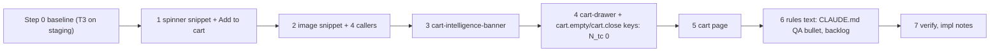

# Plan: Tailwind phase T4a, cart (addendum)

Slug: `theme-evolution-tailwind-t4a`
Parent: `docs/plans/theme-evolution-tailwind.md` (umbrella, Revision 2). §11 defines T4. Owner decision Q6 requires an addendum and its own review. This plan recommends splitting T4 into T4a (cart, this file) and T4b (content pages, outline in `docs/plans/theme-evolution-tailwind-t4b.md`). The index is `docs/plans/theme-evolution-tailwind-t4.md`.
Model: `docs/plans/theme-evolution-tailwind-t3.md` (Rev 3.1) and `docs/plans/theme-evolution-tailwind-t2.md` (Rev 3), with their reviews, the T2 impl notes and the T2 QA report.
Architect: Claude (for Junior Warner)
Date: 2026-10-22
Revision: 2.1. It addresses round 2 of `docs/reviews/theme-evolution-tailwind-t4a-review.md` (APPROVE WITH CHANGES; R2-1 to R2-3, N2-1 to N2-4). Revision 2 addressed round 1 and the orchestrator's `prose` measurement of 2026-10-23.
Tier: 2. It changes one section on every page (the cart drawer, rendered closed by `layout/theme.liquid:47`), the cart page, two shared snippets and one line of the product section.
Builds on: T0, T1 and T2, which are live. Also T3, which must be on staging #187953643616 before Step 1 (§13 Step 0 item 1).

---

## Revision 2.1 changelog (review round 2)

**What did not change.** No step, criterion, Δ row, decision or risk was added, removed or renumbered. The edits are targeted.

| Review item | What changed | Sections |
|---|---|---|
| **R2-1**: "size variants breach both budgets on their own" | Now: alone they breach **minified** (66,403 measured; gzip 11,642 stays under). With T4a's and T4b's growth they breach both. This matches the T4b outline §4 | §0 `S_prose`, §5.8 Reading, §15.2 Q4a.11; `docs/plans/theme-evolution-tailwind-t4.md` |
| **R2-2**: the sign-off threshold | Q4a.11 and §5.8 option 1 tag the 5,000 / 1,000 threshold `[proposed; not an owner decision]`. They restate that any breach needs the owner's sign-off (`CLAUDE.md`). They say that on current estimates (worst case 4,392 minified / 540 gzip over) the rule always selects "ship plain `prose` and ask for sign-off". They recommend trying option 3 first in any band. The index carries the same note | §5.8, §15.2 Q4a.11, index |
| **R2-3**: the "reused unchanged" scripts can't reach the T4a roots | Only `t0-lib.mjs` is reused unchanged. These are added: `t4ac-sweep` (§9's T4a roots and §10's drawer states), `t4ac-dump`, `t4ac-diff`, `t4ac-mcss` (with `/cart`, `L_style`, preload headers), `t4ac-proxy` (PX1-PX4, drawer and cart targets) and `t4ac-shots`. All import from `t4ac-lib.mjs`, and none from `t2c-lib`/`t3c-lib`; the note records that `t3c-lib` re-exports the old `overflowFn`. A criterion → script map covers C4a.0-C4a.22, PX1-PX4 and the owner checks | §10 Setup |
| N2-1 | The gzip baseline is T3's final 8,989, not 8,985. So the gzip headroom is 1,360, the plain-`prose` overshoot −360..+540, and the variants +646..+1,546 | §0, §5.8, R10, Q4a.11, index, T4b outline §4 |
| N2-2 | "The output doesn't grow with element count" is tagged `[derived]` | §0 |
| N2-3 | The umbrella `N_tc` row says "0 once T4a ships", and §14.1 U3 records the wording | umbrella §0, §14.1 |
| N2-4 | E4a.20 is explicitly observed-if-seen: no criterion exercises it, and no fixture lacks an image | §8 |

Rev 2.1 sweep. Range: the three T4 plan files, whole files, prose first, then tables. Terms: `1,364`, `8,985`, `536`, the old gzip rows (`9,385`, `9,785`, `9,985`, `10,885`, `11,636`, `12,536`, `12,642`, `13,542`, `642`, `1,542`), "both budgets on their own", "by themselves", "Reused unchanged". Deliberate survivors:

- `8,985` where it names the Steps 1-5 tree the `prose` build used (§0, T4b §4 table);
- the Revision 2 changelog and Revision 2 checks, which record that revision's figures.

## Revision 2 changelog

**What did not change.** No step was added, removed or reordered. No design decision changed. No criterion was renumbered. Two Δ rows were appended: E4a.20 (N1) and E4a.21 (R1).

| Review item | What changed | Sections |
|---|---|---|
| **R1** (required): the overlay click at 375 lands on the panel | C4a.5 now clicks the overlay only where `w − W_dr(w)` > 10: at 1440 and 430, with the click at x = 10. At 375 it asserts instead that the overlay has `display: block` and `opacity: 1`, and that `elementFromPoint(10, 400)` lies inside `[role="dialog"]`. Below 400 px the panel covers the backdrop, and E4a.1, the new E4a.21, Q4a.2 and R6 say so | §8, §9.1 C4a.5, §9.2, §11 R6, §15.2 Q4a.2 |
| **R2** (required): Q4a.2's "no stable parity option" was wrong | Q4a.2 is now a two-way choice. (a) Restore the backdrop (recommended). (b) Delete the overlay `div`: a permanent parity option, with no backdrop and no outside close, before and after T5. Omitting `block` is ruled out, because T5 would surface the backdrop anyway | §15.2 Q4a.2 |
| **R3** (required): wrong request URLs | The delays route `**/cart/change*` (the drawer posts to `routes.cart_change_url`, which renders `/cart/change`, `layout/theme.liquid:54`) and `**/cart/add*` (`product-form.js:46` posts to `routes.cart_add_url`, `/cart/add`). Step 0 records the URL actually requested | §9.1 C4a.6, C4a.7, §9.2, §10, §13 Step 0 item 6 |
| **R4** (required): the reused harness detects state by `is-open` | New helpers, `docs/qa/harness/t4ac-lib.mjs` and fixed copies `t4ac-*`. They detect "open" as `cart-drawer[data-state="open"]:not([hidden])` on head, and accept the `is-open` class on base. They close the drawer with Escape. The T1/T2 scripts are read as patterns, never edited or run against head. The QA report lists every adapted script | §10 Setup |
| **R5** (required): "`git status` is clean" can't be met | The precondition is now no tracked changes: `git status --porcelain` prints only lines starting `??`. `docs/qa/theme-evolution-tailwind-t3-deploy.md` must exist. Also, no untracked file under the theme or build directories | §11 R12, §13 Step 0 item 1 |
| **R6** (required): the minified budget risk was understated | §5.8 now uses the orchestrator's measured `S_prose` (2026-10-23, `@tailwindcss/typography@0.5.20`, on HEAD with T3 Steps 1-5): +12,591 minified / +1,651 gzip for plain `prose`, and +24,602 / +2,657 with size variants. It also uses the measured post-T3 baseline (41,801 / 8,985). Both budgets are projected. **Minified is now the likelier breach.** Size variants breach both on their own. Q4a.11, the index and the T4b outline's decision rule test both budgets, and allow plain `prose` only unless the owner signs off | §0, §5.8, §15.2 Q4a.11; `docs/plans/theme-evolution-tailwind-t4.md`; `docs/plans/theme-evolution-tailwind-t4b.md` §4 |
| **R7** (required): the Step 4 rollback row | A drawer-only rollback restores only `sections/cart-drawer.liquid` from the Step 0 commit and keeps the locale keys, which `cart.liquid` uses after Step 5. A full revert of Step 4 must take Step 5 (and Step 6) with it | §12 |
| N1: the item image `div` isn't `:empty` | §3.3 item 1 and D4a.12 are corrected: that `div` holds whitespace, so `:empty` doesn't match it, and it takes a 15 px gap. New Δ E4a.20: an image-less item's details move 15 px left | §3.3, §4.1, §5.4, §8 |
| N2: computed-value comparison | The §10 protocol states the method. Colors are compared as composited sRGB channels (±1), not as strings. Box shadows are compared by their one non-transparent layer | §10 |
| N3 | C4a.6 names the method: `fill('3')`, then dispatch `change` | §9.1 |
| N4 | C4a.4(a) runs at rest, not mid-load | §9.1 |
| N5 | C4a.15 asserts the checkout background is `rgb(227, 252, 1)` in both runs. The §9.2 claim cites C4a.8 / E4a.2 and C4a.15 | §9.1, §9.2 |
| N6: D4a.5 stretched T2 D2.5 | The text now says plainly that T4a **reclassifies** the panel, because neither D2.5 row fits it. It names the cost: the kept `#d32f2f` remove link is about 3.2:1 on the `#112233` test palette, below 4.5:1 | §4.1, §4.4, §15.2 Q4a.7 |
| N7 | Step 0 item 7 also records wax's material handle | §13 |
| N8 | C4a.9 says "header badge" | §9.1 |
| N9: the timer race leaves the scroll lock stuck | **Not folded in.** It is parity with today, and it would widen the script diff that C4a.17 pins. It is recorded in R1 for the `fix-cart-drawer-a11y` follow-up | §11 R1 |
| N10 | Native `<dialog>` with `showModal()` is noted for the a11y follow-up. A `@utility page-shell` is noted for T4b | §14.3, T4b outline §3 |
| N11 | The rules text is anchored by the bullet's text, not `CLAUDE.md:68` | §5.7 |
| N12 | One sentence notes the idle animation's negligible cost | §5.4 |
| Orchestrator: apply U1-U5 | **Applied** to the umbrella in this revision, minimal edits, with no owner-decision text rewritten | §14.1 |

---

## 0. Referent table

Every figure in this plan cites a row here. Tags:

- `[measured]`: read from a repo file during planning.
- `[derived]`: computed from CSS or settings read during planning, with the arithmetic shown.
- `[quoted]`: taken from a named plan or report, not re-measured.
- `[measured: orchestrator]`: measured by the orchestrator in a scratch build and passed to the Architect; not re-run by the Architect.
- `[proposed]`: a value this plan sets.
- `[provisional]`: a hypothesis that Step 0 confirms. Nothing is built on it.
- `[to be measured]`: Step 0 or QA measures it.

| Sym | What it measures | Units | Artifact | Extent or band | Value, method or threshold |
|---|---|---|---|---|---|
| `R_root` | Root font size | px | any page | `html` | 16 `[quoted]` umbrella §0 |
| `BP_md` | Tailwind `md` | px | Tailwind 4.3.3 | min-width | 768 (48rem) `[quoted]` T3 §0 |
| `CL(w)`, `E_L(w)`, `E_R(w)` | Column-2 left edge; header content edges | px | `src/tailwind.css:191-211`, `sections/header.liquid` | **box edges** | `E_L = CL + 32`. That gives 52 at every w ≤ 1440 and 292 at 1920. `E_R = w − E_L` `[quoted]` T3 §0 |
| `L`, `R` | Rendered header edges | px | any page, rendered | header logo link left; `[data-header-cart-icon]` right | measured per page and width (T3 C3.13 method) |
| `G` | Box geometry | px | rendered page | the element's **border box** (`getBoundingClientRect`), not its ink | `x, y, w, h`. For drawer elements, `y` is relative to the panel (`[role="dialog"]`) top. For cart-page elements, it is relative to the section wrapper. Pass: ±1 of base unless a §8 row names the change |
| `X_page`, `X_off` | Page overflow; offenders | px; list | rendered page at width w | document; every displayed element | as T3 §0. Pass: 0; empty |
| `W_dr(w)` | Drawer panel width when open | px | drawer | `[role="dialog"]` border box | `min(400, w)` `[derived]` from `max-width: 400px` and `width: 100%` (`sections/cart-drawer.liquid:111-115`) |
| `T_tr` | Drawer timings | ms | `sections/cart-drawer.liquid:270-284`, `:105`, `:118` | open/close | open: `is-active` set, then `is-open` 10 ms later. Close: `is-open` removed, then `is-active` 300 ms later. Transitions are 300 ms `[measured]`. QA waits 400 ms after a toggle before it measures |
| `B_head`, `B_body`, `B_doc`, `N_dawn` | Stylesheet transfer; Dawn link count | bytes compressed; count | method M_css (T2 §0, unchanged) | head, body, document | `[to be measured]` Step 0. `N_dawn` uses T2's nine names plus T3's `section-image-banner.css`. It is expected to be 0 on every T4a page before and after. No T4a file has a `stylesheet_tag` (ripgrep over `layout sections blocks snippets templates`: only the three layout/template `tailwind.css` tags and `base.css` `[measured]`) |
| `L_style` | Inline `<style>` bytes the drawer adds to every page | bytes, uncompressed | HTML of any `layout/theme.liquid` page | `<style>` elements inside `#shopify-section-cart-drawer` | Method: the sum of `textContent.length`. Base `[to be measured]`; source block `sections/cart-drawer.liquid:80-223` (144 lines `[measured]`). Head: one rule (§5.4) |
| `S_tw` | Size of `assets/tailwind.css` | bytes | committed file | whole file | After T2: 35,990 minified / 7,963 gzip `[quoted]` T2 QA "Gates and size". At T3's final commit: **41,801 / 8,989** `[measured: orchestrator]`, 2026-10-23. This plan uses 8,989 (review N2-1). The `prose` build below used the Steps 1-5 tree, at 8,985 gzip. T3's estimate was 41,390-44,890 / 8,963-9,613. Step 0 re-measures it on the staged T3 tree. Budget 60,000 / 12,000 (`CLAUDE.md` `### Performance & Core Web Vitals`) |
| `ΔS_a` | T4a's growth of `S_tw` | bytes | estimate | whole file | +2,000 to +4,000 minified, +400 to +800 gzip `[provisional]` (§5.8). Used only in §5.8 and R10. No criterion is built on it |
| `S_prose` | Cost of `@tailwindcss/typography`'s `prose` (T4b) | bytes | scratch build of HEAD (with T3 Steps 1-5) plus `@tailwindcss/typography@0.5.20` via `@plugin` after the `tailwindcss` import | whole file, against the 41,801 / 8,985 baseline | **Plain `prose`** on one element: 54,392 / 10,636, so **+12,591 minified / +1,651 gzip**. **`prose prose-sm md:prose-lg max-w-none`**: 66,403 / 11,642, so **+24,602 / +2,657** `[measured: orchestrator]` (2026-10-23). On their own, the size variants breach the minified budget (66,403 > 60,000) but not gzip (11,642 < 12,000). The output doesn't grow with the number of elements, because Tailwind emits each class once `[derived]` (review N2-2). The deltas are applied to the 8,989 final-T3 gzip baseline in §5.8. Gzip isn't additive, so T4b Step 0 re-measures on its own base. Nothing in T4a depends on it |
| `N_tc` | `shopify theme check` offenses | count | working tree | whole theme | 1 today: `TranslationKeyExists` `cart.empty`, `sections/cart-drawer.liquid:18` (`CLAUDE.md:68` and `docs/backlog/theme-check-cleanups.md:5`) `[quoted]`. Expected 1 after Steps 0-3 and **0** from Step 4 (§13) |
| `C_mix(a)` | sRGB channel of `color-mix(in oklab, var(--color-foreground) a, transparent)` over the page background | 0-255 | dev and staging (repo `config/settings_data.json` `current: {}`, so foreground #333333 = 51 and background #ffffff = 255) | one channel | `a × 51 + (1 − a) × 255` `[quoted]` T2 §0. It holds only at those defaults |
| `H1` | `<h1>` count | count | rendered page | document | Pass: 1 |
| `R_in` | Input corner radius setting | px | `config/settings_schema.json:79-85` | `--style-border-radius-inputs` | default 4 `[measured]` |

Readings that are easy to confuse:

- `G` and `L`/`R` are **border boxes**. Drawer `y` is **panel-relative**.
- `B_*` are **compressed transfer** bytes. `S_tw` is **file** bytes. `L_style` is **uncompressed inline text** in the HTML, not a stylesheet transfer. M_css doesn't count it.
- Tailwind v4's `translate-x-*` sets the CSS **`translate`** property, not `transform`. So the drawer's open state is measured by the panel's **rect**, not by a computed `transform` (§10 protocol).

---

## 1. Problem statement and goals

The cart is the last commerce surface still styled outside Tailwind:

- **The cart drawer.** `sections/cart-drawer.liquid` renders on every `layout/theme.liquid` page when `settings.enable_cart_drawer` is on (the default, `config/settings_schema.json:106-108`). It carries a 144-line unlayered `<style>` (80-223), which beats every utility. It uses Dawn's `button button--primary` (70), `button` (19) and `visually-hidden` (39). Its JavaScript toggles three state classes, and it scroll-locks the page by writing `document.body.style.overflow` (274, 280). Both go against `CLAUDE.md` "Toggle state, not styles". Its backdrop `<div class="cart-drawer__overlay">` (4) is empty, so `base.css`'s `div:empty { display: none }` (`assets/base.css:470-484`, legacy layer) hides it. The drawer has never shown a backdrop, and a click beside the panel lands on the transparent full-screen `.cart-drawer__inner` and does nothing `[derived]`; Step 0 confirms. Its strings "Close cart", "Quantity", "Quantity for …" and "Total" are hard-coded English (8, 40, 47, 66). `cart.empty` (18) is the theme's last theme-check offense.
- **The cart page.** `sections/cart.liquid` (39 lines) is Skeleton markup: an unclassed `<table>`, unclassed inputs, an unescaped product title (20) and no empty state. Dawn's `table:not([class])` rule (`base.css:417-430`) styles the table: `table-layout: fixed`, `font-size: 1.4rem` (22.4 px at `R_root`) and `padding: 1em` on every cell. Its border and shadow use an undefined variable and are invalid `[derived]`. The page renders full-size product images (`snippets/image.liquid` without `width`, so `width = image.width`, line 32).
- **The banner.** `snippets/cart-intelligence-banner.liquid` styles itself with an unlayered `<style>` (21-34).
- **The image snippet.** `snippets/image.liquid` has a `` in a snippet (51-64), where `CLAUDE.md` allows `<style>` only. That CSS reaches every page through the bundle (T2 §3.4 item 1).
- **The spinner.** Owner decision 2026-10-22 (umbrella §11): add a Tailwind `spinner` snippet built from the Add to cart SVG, and have the Add to cart button render it.

### Goals

1. Convert the drawer, the cart page, the banner and the image snippet to utilities. Custom CSS lives only inside `@layer components`. Schemas stay byte-identical.
2. Move the drawer's state to attributes (`hidden`, `data-state`, `aria-busy`) and its scroll lock to CSS. Keep its Section Rendering API contract exactly: `getSectionsToRender()`, `renderContents()`, the `.join(',')` at 340, and T2's `aria-label` sync at 323-327 and 386-388.
3. Add `snippets/spinner.liquid`, used by the Add to cart button and by the drawer's line updates.
4. Reach `N_tc` = **0** by adding `cart.empty` to `locales/en.default.json` (`docs/backlog/theme-check-cleanups.md:5`), and update the `CLAUDE.md` QA bullet.
5. Bring the converted files up to the rules they break: translated strings, escaped output, labelled inputs, no empty `div`s that rely on `base.css` to hide them.
6. Keep the gates: `check:css`, `check:hidden`, the CSS budget, the cart flow (umbrella C1.3, T2 C2.12).

---

## 2. Non-goals

- **No T4b content.** That covers collection, collections, search, page, blog, article, 404, password, gift card, the materials archive and recommendations, `prose`, and the removal of the D6 list, link and input parity rules. T4a touches `sections/collection.liquid`, `sections/collections.liquid` and `sections/search.liquid` only to rename one render argument (§5.2).
- **No drawer behavior changes** beyond the state mechanism (D4a.2), the scroll-lock mechanism (D4a.3) and the restored backdrop (D4a.4). Four pre-existing defects stay as they are and are listed as follow-ups (§11 R1-R3):
  - no focus management or trap in the `role="dialog"`;
  - a `keyup` listener added on every `bindEvents()`;
  - a close-then-reopen race in the 300 ms timer;
  - `item.product.title` instead of the variant title.
- **No cart-page JavaScript.** The cart page posts its form, as today. So the umbrella §11 phrase "cart page line updates" needs no spinner. §14 U2 records this.
- **No prices or total on the cart page.** Skeleton's page shows neither. Adding them is a feature (Q4a.6).
- **No change to the banner's logic.** It keeps its hard-coded handle list and its per-item metafield lookup (`snippets/cart-intelligence-banner.liquid:10-15`; `CLAUDE.md` loop rule; bounded by the cart's line count). Recorded in §11 R11.
- **The material tooltip keyboard nit (T2 QA nit 1) is not in T4a or T4b.** It needs JavaScript behavior in `assets/eco-tooltip.js` and the trigger in `sections/product.liquid:53` (focus, blur, Escape, `aria-describedby`). Neither is a styling change. A separate fix plan is recommended (Q4a.9).
- **No edits** to `config/settings_data.json`, `templates/*.json`, `sections/*-group.json`, `layout/*`, `src/tailwind.css` (the `btn-*` utilities exist), `assets/*.js`, or non-default locales.
- **T3-owned files.** `locales/en.default.json` and `assets/tailwind.css` are shared with T3. T4a edits them only after T3's last commit is on staging (§13 Step 0 item 1). In the locale file it adds keys only under `cart` (§5.6). Every other T3 file is untouched.

---

## 3. Current-state inventory

### 3.1 What renders where `[measured]`

| File | Rendered from | Pages |
|---|---|---|
| `sections/cart-drawer.liquid` | `layout/theme.liquid:47` (``) | every theme-layout page, closed, when `enable_cart_drawer` is on. Not on `/password` or the gift card page (other layouts) |
| `sections/cart.liquid` | `templates/cart.json` (section `main`) | `/cart` |
| `snippets/cart-intelligence-banner.liquid` | `cart-drawer.liquid:13`, `cart.liquid:10` | drawer and `/cart`, only when a cart item's material handle is `mycelium-bio-fabric` or `recycled-steel` (12) |
| `snippets/image.liquid` | `cart.liquid:17`, `collection.liquid:15`, `collections.liquid:21`, `search.liquid:34` | `/cart`, `/collections/all`, `/collections`, `/search` |
| `sections/product.liquid:97-101` (Add to cart spinner) | product templates | every product page |
| `assets/product-form.js` | `sections/product.liquid:9` | product pages. It calls the drawer's `getSectionsToRender()` (39), `setActiveElement()` (42) and `renderContents()` (96). It reads `cart.classList.contains('is-empty')` (105) and toggles `hidden` on `.loading__spinner` (29, 107) |

Dawn's `assets/cart.js`, `assets/cart-drawer.js`, `quick-add.js`, `quick-order-list.js` and `quick-add-bulk.js` also reference `cart-drawer`. No layout or section loads them (ripgrep for `asset_url` in Liquid: only `constants`, `pubsub`, `global`, `eco-tooltip`, `material-api-fetch` and `product-form` `[measured]`).

### 3.2 File inventory (T4a) `[measured]`

| File | Lines | Styling today | Behavior and hooks to keep |
|---|---|---|---|
| `sections/cart-drawer.liquid` | 406 | `<style>` 80-223, unlayered, inside `` (1-399). Dawn `button` (19), `button button--primary` (70), `visually-hidden` (39); classes `cart-drawer drawer`, `is-empty` (2) | `AjaxCartDrawer` 226-393, defined as `cart-drawer` (395-397). JS hooks: `[data-cart-drawer-trigger]` (234, set by `header.liquid:95`), `[data-cart-drawer-close]` (4, 8, 245), `.cart-drawer__quantity-input` (252), `.cart-drawer__item-remove` (258), `.cart-drawer__inner` (290, 369, 371), `#CartDrawer-Form` (24, 70), `data-index`. State classes on the host: `is-active` (271, 282), `is-open` (273, 279), `is-loading` (335, 354, 359). `document.body.style.overflow` (274, 280). Section Rendering API: `getSectionsToRender()` 286-297, `renderContents()` 303-332, `.join(',')` 340, `sections_url` 341, T2's aria-label sync 323-327 and 386-388, `updateCart()` fallback 364-392. Schema 401-406 (`"name": "Cart Drawer"`, no settings) |
| `sections/cart.liquid` | 39 | none of its own; Dawn `table:not([class])` (`base.css:417-430`) and the D6 parity rules (`src/tailwind.css:220-237`) | `<h1>` 8, banner 10, form `action="{{ routes.cart_url }}" method="post"` 12, `updates[]` 24, a per-row `<input type="submit">` 25, `name="checkout"` 31. Unescaped `{{ item.product.title }}` at 20. Schema 34-39 (`t:general.cart`, no settings) |
| `snippets/cart-intelligence-banner.liquid` | 35 | `<style>` 21-34 inside the `` | `` 1-6, count loop 8-15, `cart.intelligence_banner.sustainable_message` 19 |
| `snippets/image.liquid` | 64 | `` 51-64 in a snippet: `.image` block, relative, overflow hidden, width 100%, height auto; `.image > img` width 100%, height auto | `` 1-28 with `@param {string} [class]` (12). Wrapper `a`/`div` 42-49 |
| `sections/product.liquid` (97-101 only) | n/a (only these lines change) | utilities since T2 | `loading__spinner hidden` wrapper (97), toggled by `product-form.js:29,107`; inline SVG 98-100 |

No T4a file has a `select`, `range` or `checkbox` setting. The only global setting T4a reads is `enable_cart_drawer`, a checkbox (`config/settings_schema.json:106-108`, default `true`).

### 3.3 Cascade facts that shape the design

1. **`div:empty` is hidden** (`base.css:470-484`, legacy). It applies today to:
   - the drawer overlay (4), whose unlayered rule (97-107) sets no `display`;
   - the footer `div` when the cart is empty (63-75: the `` trims it to nothing).

   The first is a bug (no backdrop). The second hides an empty box by accident. Both would change at T5, when `base.css` goes. T4a removes the reliance (D4a.4, D4a.12).

   **Not `:empty` (review N1):** an item's image `div` (28-32) wraps a non-trimmed ``. With no image it still holds whitespace text, so it displays, 0 px wide, and takes the item's 15 px flex `gap`. T4a renders that `div` only when there is an image, so an image-less item's details move 15 px left (E4a.20).
2. **`table:not([class])`** (`base.css:417-430`) gives the cart page its 22.4 px text, fixed equal columns and 22.4 px cell padding. That is a Dawn literal rem (`U_dawn`, umbrella §0) on Skeleton markup. It stops matching as soon as the table gets a class, or is replaced (D4a.10).
3. **`.loading__spinner`** (`base.css:3504-3513`, legacy) gives the product spinner wrapper `display: inline-block` and `z-index: 1`. Its utilities override `position` and `width`. `.spinner` and `.path` (`:3515-3534`) are Dawn's spinner classes. The new snippet must not use either name. T5 note in §14.4.
4. **Unlayered rules in the bundle reach every page** (T2 §3.4 item 1). None of them selects a T4a class after Step 4. The bundle still holds T4b's `.collection-products`, `.collections`, `.collection-card`, `.search-results` and `.search-result*`, and `material-recommendations`' `.relational-rec__*` and `.product-mini-card*`. T4a markup uses none of those names (C4a.3).
5. **Coincident class names.** Of the utilities T4a uses, `base.css` defines only `.hidden` (product spinner wrapper, JS-toggled), `.overflow-hidden` (image snippet, same meaning) and `.uppercase` (same meaning). There is no `.block`, `.invisible`, `.visible`, `.fixed`, `.absolute`, `.relative`, `.underline` or `.sr-only` (ripgrep over `assets/base.css` `[measured]`).
6. **Preflight's `[hidden]` rule** is `display: none !important` in `base`. So a `block` utility can sit on an element that carries the `hidden` attribute, as T1's header panel does (`header.liquid:74-76`).
7. **Tailwind turns `_` into a space in arbitrary values.** T4a's only `_` is the intended space in `shadow-[-5px_0_15px_rgb(0_0_0/0.1)]`. No arbitrary variant selects a BEM class, so nothing needs escaping (T2 impl notes deviation 2).
8. **No arbitrary breakpoints.** T4a uses only `md:`. If one is ever added, write it in rem (T3 §5 conventions).

### 3.4 Behavior contracts that must survive (tested in §9)

- Add to cart on a working product opens the drawer and updates the header badge and its `aria-label` without a reload (umbrella C1.3, T2 C2.12).
- Quantity change and remove in the drawer update the drawer and the header.
- The 3p snowboard's 422 leaves the drawer closed, and the button recovers (T2 C2.13).
- Escape and the close button close the drawer. The header icon opens it.
- With the drawer disabled, the header icon links to `/cart`, and Add to cart navigates there (`product-form.js:65-67`).
- The cart page form posts quantities, its remove links work, and `name="checkout"` reaches checkout.
- One `<h1>` per page. Every `` has `width` and `height`.

### 3.5 Inventory of the whole T4 scope (input to the split, D4a.1) `[measured]`

| File | Lines | Styling today | Dawn classes | JS that toggles classes | Schema settings (option values) |
|---|---|---|---|---|---|
| `sections/cart-drawer.liquid` | 406 | `<style>` 80-223 | `button`, `button--primary`, `visually-hidden`, `drawer` | `is-active`, `is-open`, `is-loading` (own script) | none |
| `sections/cart.liquid` | 39 | none (Dawn table rule) | none | none | none |
| `snippets/cart-intelligence-banner.liquid` | 35 | `<style>` 21-34 | none | none | n/a |
| `snippets/image.liquid` | 64 | `` 51-64 | none (`.image` isn't in `base.css`) | none | n/a |
| `sections/collection.liquid` | 47 | `` 35-40 (`minmax(500px, 1fr)`) | none | none | none |
| `sections/collections.liquid` | 87 | `<style>` 10-14 keyed by `section.id`; `` 41-58 | none | none | `grid_item_width` select: `collections--compact`, `collections--full` (default); `grid_gap` range 0-50 step 5 (11 values, default 10) |
| `sections/search.liquid` | 70 | `` 53-63 (styles `default_pagination`'s `.prev`, `.page`, `.next`) | none | none | none |
| `sections/page.liquid` | 17 | none | none | none | none |
| `sections/blog.liquid` | 35 | none; `image_tag: preload: true` on every article image (14) | none | none | none |
| `sections/article.liquid` | 68 | none; comment form 39-60 | none | none | none |
| `sections/404.liquid` | 23 | none | none | none | none |
| `sections/password.liquid` | 35 | none (no `base.css` on this layout) | none | none | none |
| `templates/gift_card.liquid` | 76 | `` 18-25 in a template (`CLAUDE.md` allows `` only in `sections/` and `css-variables`) | none | none | n/a |
| `sections/main-material-archive.liquid` | 293 | `` 15-170 with `!important` (47-88) and a per-iteration `<style>` in the bar loop (234-238) | `page-width`, `center`, `h1`, `rte`, `placeholder-svg`; `mb-12` (a Tailwind utility) | none | `columns_desktop` range 1-4 step 1 (default 3); `padding_top`, `padding_bottom` range 0-100 step 4 (26 values, default 36). Literal schema strings |
| `sections/material-recommendations.liquid` | 138 | `` 7-19, `` 21-77 (contains the invalid `group: hover;` at 44) | `page-width`, `h1` | none | `padding_top`, `padding_bottom` as above. Literal strings. **No template uses it** (ripgrep `"type"` over `templates/` `[measured]`); merchants can add it through its preset |
| `templates/product.api.liquid` | 22 | JSON, `` | n/a | n/a | n/a. **Renders no markup**, so it is out of T4 (umbrella §11 "if it renders markup") |

Totals: 16 files, about 1,500 lines, 3 snippet or section `` blocks in T4b files plus 1 in `image.liquid`, 5 `<style>`/`` blocks, and one JS state machine. That is roughly twice T3's four files.

---

## 4. Decisions

### 4.1 Summary

| # | Decision | Owner question | Where |
|---|---|---|---|
| D4a.1 | Split T4 into T4a (cart) and T4b (content). Each has its own slug, review, QA and staging push | **Q4a.8** | §4.2 |
| D4a.2 | Drawer state moves to attributes. `hidden` replaces `is-active`, `data-state="open"\|"closed"` replaces `is-open`, `aria-busy="true"` replaces `is-loading`. Only the state lines of the script change | none (binding rule) | §5.4 |
| D4a.3 | The scroll lock moves from `document.body.style.overflow` to one layered `<style>` rule on `body:has(cart-drawer[data-state="open"])` | none (binding rule) | §5.4 |
| D4a.4 | The backdrop gets an explicit `block`, so it shows (50 % black) and a click on it closes the drawer | **Q4a.2** | §5.4 |
| D4a.5 | Colors. The drawer panel is **reclassified** as a page-colored surface. Its colors become page tokens (`bg-background`, `text-foreground`, `border-foreground/N`). Neither row of T2 D2.5 fits it today (review N6, §4.4). The banner is a fixed green surface and keeps its hex. The remove link keeps its red | **Q4a.7** | §4.4 |
| D4a.6 | Drawer checkout, both empty-state links and the cart page's checkout use `btn-primary`. The cart page's Update button uses `btn-secondary` (T2 D2.7) | **Q4a.1** | §5.4, §5.5 |
| D4a.7 | Headings take the heading font. The cart `<h1>` gets T2's product `<h1>` string (as T3 Q3.4 did). The drawer `<h2>` gets `font-heading font-bold uppercase` at its current size | **Q4a.3** | §5.4, §5.5 |
| D4a.8 | `snippets/spinner.liquid`: one SVG, `size` = `sm`/`md`/`lg`, plus `css_class`. Product renders it at `md`; the drawer at `lg`, inside a busy overlay shown by `group-aria-busy/drawer:visible` | none (owner note 2026-10-22) | §5.1 |
| D4a.9 | `snippets/image.liquid` becomes the `CLAUDE.md` `### snippet` example (without its placeholder ``). Its parameter `class` becomes `css_class`, and all four callers are updated in the same commit | none | §5.2 |
| D4a.10 | The cart page becomes a list (no table), with one Update button and an empty state, inside the page shell `flex flex-col gap-8 px-8 py-10 md:py-16`. The shell aligns content to `E_L`/`E_R`, and T4b reuses it | **Q4a.4**, **Q4a.5** | §5.5 |
| D4a.11 | Strings. Add `cart.empty` and `cart.close`. Reuse `products.product.quantity.label`, `products.product.quantity.input_label` and `sections.cart.headings.total`. Drop the dead `default:` fallbacks | **Q4a.12** | §5.6 |
| D4a.12 | No markup relies on `div:empty`. The footer renders only when the cart has items (today it is truly empty and hidden). The item image `div` renders only when there is an image (today it shows whitespace and takes a gap, §3.3 item 1) | none (T5-safe; E4a.20) | §5.4 |
| D4a.13 | Px values in the project-authored drawer and banner keep their sizes (T2 D2.9 rule 1). The Dawn table styles on the cart page are dropped, not converted | none | §5.4, §5.5 |
| D4a.14 | R12 (unescaped story HTML) and the tooltip nit stay out of T4a. R12 goes to T4b, which converts the archive; the tooltip gets its own plan | **Q4a.9**, **Q4a.10** | §15 |

### 4.2 D4a.1: why split

- **Size.** §3.5 lists 16 files and about 1,500 lines, against T3's four files and its 914-line plan, which took three review rounds. One addendum would carry about 25 steps. Its review would cover a JavaScript state machine, the Section Rendering API, a new npm dependency with a budget gate, and a dozen page templates.
- **Two different risk profiles.**
  - The cart is behavior. Its risks are the drawer's JS, the add-to-cart flow and Section Rendering, on every page.
  - The content pages are typography and budget. Their risks are `prose`'s size, the D6 parity removals, and merchant rich text.

  Each half ships to staging on its own, and a cart regression doesn't block content pages, or the reverse.
- **Order.** The cart goes first because it fixes the last theme-check offense, and because its spinner and image snippet are shared primitives that T4b's pages reuse (`image` on collection and search). The budget-heavy `prose` goes second, so the owner sees the measured T4a figure before the `prose` decision (§5.8).
- **Cost.** One more review, QA and staging cycle, and two umbrella pointers (§14.1 U1).

Rejected:

- One T4 plan: too big to review or implement safely.
- Three sub-phases (cart, content, materials): the materials archive is one file in T4b. T4b's outline keeps a T4c split as an option if its review finds it too big (`docs/plans/theme-evolution-tailwind-t4b.md` §6).

### 4.3 D4a.2 and D4a.3: the state mechanism

`CLAUDE.md` "Toggle state, not styles" says: change state with attributes, and style it with variants. The header already does this with `hidden` and `data-state` (`sections/header.liquid:75-76, 175-197`).

| Today (line) | After | Styled by |
|---|---|---|
| `classList.add('is-active')` (271), `remove` (282) | `this.drawer.hidden = false` / `true`; the markup starts with `hidden` | Preflight `[hidden]` (§3.3 item 6); the host carries `block` |
| `classList.add('is-open')` (273), `remove` (279) | `this.drawer.dataset.state = 'open'` / `'closed'`; the markup starts with `data-state="closed"` | `group-data-[state=open]/drawer:` on the overlay and panel |
| `classList.add('is-loading')` (335), `remove` (354, 359) | `setAttribute('aria-busy', 'true')` / `removeAttribute('aria-busy')` | `group-aria-busy/drawer:visible` on the busy overlay |
| `document.body.style.overflow = 'hidden'` (274) / `''` (280) | deleted | `body:has(cart-drawer[data-state="open"]) { overflow: hidden }` in `@layer components` |

**Why the host carries the state.** `renderContents()` and `updateCart()` replace only the `innerHTML` of `.cart-drawer__inner` (321, 371). The `<cart-drawer>` element and its attributes persist through every re-render, so state on the host survives. State on an inner element would be lost (§11 R8).

**Timing is unchanged** (`T_tr`): `hidden` is cleared, then `data-state="open"` is set 10 ms later. Close sets `closed`, then `hidden` 300 ms later. **`is-empty`** (2) is dropped. Nothing styles it in a loaded file, and `product-form.js:105` only removes it if present, which becomes a no-op.

Rejected: keep the classes and style them with `group-[.is-open]/drawer:`. It works, but it styles JS-toggled class names, which the rule forbids. C4a.5 tests the mechanism, so it can tell the two apart.

### 4.4 D4a.5: colors

| Surface | Today | T4a | Δ at the default palette |
|---|---|---|---|
| panel | `#ffffff` (116); text inherits `--color-foreground` | `bg-background`; text inherits | none |
| header and footer borders | `rgba(0,0,0,0.08)` (131, 191) → 234.6 on white | `border-foreground/10` → `C_mix(0.10)` = 234.6 | none `[derived]` |
| item border | `rgba(0,0,0,0.05)` (155) → 242.25 | `border-foreground/6` → 242.8 | +1 channel (E4a.6) |
| footer background | `#fafafa` = 250 (192) | `bg-foreground/2` → 250.9 | +1 channel (E4a.7) |
| quantity border | `#ccc` = 204 (181) | `border-foreground/25` → 204.0 | none |
| item title | `#121212` (171) | `text-foreground` (51) | 18 → 51 (E4a.5) |
| remove link | `#d32f2f` (186) | `text-[#d32f2f]` (semantic, fixed) | none |
| panel shadow | `rgba(0,0,0,0.1)` | the same, as an arbitrary shadow (neutral detail) | none |
| backdrop | `rgba(0,0,0,0.5)` (103) | `bg-black/50` | shows (E4a.1) |
| banner | `#e8f5e9` / `#4caf50` / `#2e7d32` | the same hex (fixed, self-consistent surface) | none |

**A reclassification, not D2.5 as written (review N6).** By T2 D2.5's own table, an element that paints its own `#ffffff` is a **fixed** surface: hex kept, like `material-info`'s white card. But today's panel mixes a fixed white background with inherited foreground text, so neither D2.5 row fits it. T4a chooses to treat it as a page-colored surface.

**Why tokens for the panel.** The drawer is page chrome over the page. With the owner's planned dark palette (umbrella §8.1), a fixed white panel with inherited light text would be unreadable. A fixed white panel with fixed dark text would ignore the palette. Tokens are identical at the defaults except the title, and C4a.15 renders a changed palette in both directions.

**Cost.** The kept `#d32f2f` remove link has a contrast of about 3.2:1 on the `#112233` test palette `[derived]` (WCAG relative luminance 0.161 vs 0.015). That is below 4.5:1 for its 0.85rem text. At the default palette it is about 4.98:1 on white. Owner check 2 shows the owner the palette behavior. If a dark palette is adopted, the follow-up is a token-relative or palette-chosen danger color, not part of T4a.

Rejected: exact hex everywhere (parity, but breaks on the dark palette).

---

## 5. Proposed design, file by file

**Conventions.** These apply to every block below.

- **Class strings.** Each is complete and on one line. There is no bare `hidden` next to a display utility (the busy overlay uses `invisible`/`visible`, which is visibility, not display). No Dawn class names: the JS hooks `cart-drawer__inner`, `cart-drawer__quantity-input` and `cart-drawer__item-remove` stay, carry no CSS, and aren't in `base.css`. No `!` modifier. No CSS comments inside `<style>` (T2 §3.4 item 7).
- **`style` attributes** set custom properties only. JavaScript sets no inline style.
- **Measurement hooks** are `data-` attributes with no CSS: `data-cart-page`, `data-cart-drawer-item`, `data-cart-drawer-footer` and `data-cart-drawer-busy`.
- **Breakpoints:** Tailwind defaults only.
- **Width with the `image` snippet.** Its wrapper carries `w-full`, so a caller never passes a width utility in `css_class`. Two width utilities on one element compete on Tailwind's sort order. The caller sizes the parent instead (§11 R5).
- **Markdown escaping.** Inside tables, `\|` is a Liquid filter pipe escaped for Markdown; write it as `|`.



### 5.1 `snippets/spinner.liquid` (Step 1, new) and `sections/product.liquid:98-100`

```liquid

  Renders an animated loading spinner: an SVG ring that spins with `animate-spin` and
  strokes in the current text color. It is decorative (hidden from assistive technology);
  announce the busy state on its container instead, for example with `aria-busy`.

  @param {string} [size] - 'sm' (16px), 'md' (20px, the default) or 'lg' (32px)
  @param {string} [css_class] - Extra Tailwind classes for the SVG, such as positioning

  @example
  
  




<svg aria-hidden="true" focusable="false" class="{{ size_class }} animate-spin {{ css_class }}" viewBox="0 0 66 66" xmlns="http://www.w3.org/2000/svg">
  <circle class="stroke-current" fill="none" stroke-width="6" stroke-dasharray="140 200" stroke-linecap="round" cx="33" cy="33" r="30"></circle>
</svg>
```

The SVG and circle attributes are copied from `sections/product.liquid:98-99`. In `product.liquid`, lines 98-100 become one line, inside the unchanged wrapper (97):

```liquid
                    
```

The rendered class token set is `size-5 animate-spin absolute inset-0 m-auto`, the same set as today's `absolute inset-0 m-auto size-5 animate-spin`, in another order. So there's no Δ. The wrapper's `loading__spinner hidden absolute inset-0 size-full` (97) stays byte-identical: `product-form.js:29,107` toggles its `hidden` class. Nothing else in `product.liquid` changes, including its schema. `animate-spin`'s keyframes already compile (T2).

### 5.2 `snippets/image.liquid` (Step 2)

Replace the whole file with the `CLAUDE.md` `### snippet` example, character for character: its ``, its `` block and its markup. **Omit** the example's trailing `` block. Its `doSomething()` is placeholder code; the example demonstrates the tag, not code this snippet needs. Result:

- `@param {string} [css_class]` replaces `[class]`.
- The wrapper is `class="relative block w-full overflow-hidden {{ css_class }}"`.
- The image is `image_tag: class: 'block h-auto w-full'`.
- The `` is gone.

| Element | Current (line) | Utilities | Δ |
|---|---|---|---|
| wrapper | 43; 52-58: block, relative, overflow hidden, width 100 %, height auto | `relative block w-full overflow-hidden` + `css_class` | none |
| `img` | 60-63: width 100 %, height auto; base layer `display: block` | `block h-auto w-full` | none |

**Callers, same commit.** Rename the argument and keep the value. T4b replaces the values.

| File:line | Before | After |
|---|---|---|
| `sections/cart.liquid:17` | `` | unchanged in Step 2 (Step 5 rewrites it) |
| `sections/collection.liquid:16` | `class: 'collection-product__image',` | `css_class: 'collection-product__image',` |
| `sections/collections.liquid:22` | `class: 'collection-card__image',` | `css_class: 'collection-card__image',` |
| `sections/search.liquid:34` | `class: 'search-result__image',` | `css_class: 'search-result__image',` |

Those three BEM names have no CSS anywhere (ripgrep over `sections`, `snippets`, `assets` for `collection-product__image`, `collection-card__image`, `search-result__image`: only the call sites `[measured]`).

### 5.3 `snippets/cart-intelligence-banner.liquid` (Step 3)

Delete the `<style>` (21-34). Lines 1-17 and 19 are byte-identical. Line 18 becomes:

```liquid
  <div class="mx-5 mb-6 rounded-lg border border-[#4caf50] bg-[#e8f5e9] px-5 py-3.75 text-center text-base font-semibold text-[#2e7d32]">
```

| Property (line) | Today | Utility | Δ |
|---|---|---|---|
| background, border, color (23-25) | `#e8f5e9`, 1px `#4caf50`, `#2e7d32` | `bg-[#e8f5e9] border border-[#4caf50] text-[#2e7d32]` | none |
| padding (26) | 15px 20px | `py-3.75 px-5` | none |
| radius (27) | 8px | `rounded-lg` | none |
| margin (28) | 0 20px 24px | `mx-5 mb-6` | none |
| weight, align, size, line-height (29-32) | 600, center, 1rem, 1.5 | `font-semibold text-center text-base` (`text-base` = 1rem / 1.5) | none |

The `<p>` (19) keeps no class. Preflight's margin is 0, as today. On the cart page the banner moves with the page shell (E4a.16).

### 5.4 `sections/cart-drawer.liquid` (Step 4)

**Markup.** Lines 1-78 become the block below. Line 1, the `` (399) and the schema (401-406) are byte-identical.

```liquid

  <cart-drawer class="group/drawer block" data-state="closed" hidden>
    <div id="CartDrawer" class="cart-drawer__inner fixed top-0 left-0 z-1000 flex h-screen w-screen justify-end">
      <div class="absolute top-0 left-0 block size-full cursor-pointer bg-black/50 opacity-0 transition-opacity duration-300 ease-[ease] group-data-[state=open]/drawer:opacity-100" data-cart-drawer-close></div>
      <div class="relative flex h-full w-full max-w-[25rem] translate-x-full flex-col bg-background shadow-[-5px_0_15px_rgb(0_0_0/0.1)] transition-transform duration-300 ease-[cubic-bezier(0.19,1,0.22,1)] group-data-[state=open]/drawer:translate-x-0" role="dialog" aria-modal="true" aria-label="{{ 'cart.title' | t }}">
        <div class="flex items-center justify-between border-b border-foreground/10 p-5">
          <h2 class="m-0 font-heading text-[1.25rem] leading-tight font-bold uppercase">{{ 'cart.title' | t }}</h2>
          <button class="text-[2rem] leading-none" type="button" data-cart-drawer-close aria-label="{{ 'cart.close' | t }}">
            &times;
          </button>
        </div>

        

        <div class="flex-1 overflow-y-auto p-5" id="CartDrawer-CartItems">
          
            <div class="flex flex-col items-start gap-4">
              <p>{{ 'cart.empty' | t }}</p>
              <a href="{{ routes.all_products_collection_url }}" class="btn-primary">
                {{ 'general.continue_shopping' | t }}
              </a>
            </div>
          
            <form action="{{ routes.cart_url }}" id="CartDrawer-Form" method="post">
              <div>
                
                  <div class="mb-5 flex gap-3.75 border-b border-foreground/6 pb-5" data-cart-drawer-item>
                    
                      <div>
                        
                      </div>
                    
                    <div class="flex min-w-0 flex-1 flex-col">
                      <a href="{{ item.url }}" class="mb-1.25 font-semibold text-foreground no-underline">{{ item.product.title | escape }}</a>
                      <div class="mb-2.5">
                        {{ item.final_line_price | money }}
                      </div>
                      <div>
                        <label class="sr-only" for="Drawer-quantity-{{ item.index | plus: 1 }}">
                          {{ 'products.product.quantity.label' | t }}
                        </label>
                        <input class="cart-drawer__quantity-input mb-2.5 w-15 rounded-input border border-foreground/25 p-1.25"
                          type="number"
                          name="updates[]"
                          value="{{ item.quantity }}"
                          min="0"
                          aria-label="{{ 'products.product.quantity.input_label' | t: product: item.product.title | escape }}"
                          id="Drawer-quantity-{{ item.index | plus: 1 }}"
                          data-index="{{ item.index | plus: 1 }}"
                        >
                      </div>
                      <a href="{{ item.url_to_remove }}" class="cart-drawer__item-remove text-[0.85rem] text-[#d32f2f] underline" data-index="{{ item.index | plus: 1 }}">
                        {{ 'cart.remove' | t }}
                      </a>
                    </div>
                  </div>
                
              </div>
            </form>
          
        </div>

        
          <div class="border-t border-foreground/10 bg-foreground/2 p-5" data-cart-drawer-footer>
            <div class="mb-3.75 flex items-center justify-between">
              <h3 class="m-0 text-[1.1rem]">{{ 'sections.cart.headings.total' | t }}</h3>
              <p class="m-0 text-[1.25rem] font-bold">{{ cart.total_price | money_with_currency }}</p>
            </div>
            <div>
              <button type="submit" id="CartDrawer-Checkout" class="btn-primary w-full" name="checkout" form="CartDrawer-Form">
                {{ 'cart.checkout' | t }}
              </button>
            </div>
          </div>
        

        <div class="invisible absolute inset-0 flex items-center justify-center bg-background/60 group-aria-busy/drawer:visible" data-cart-drawer-busy>
          
        </div>
      </div>
    </div>
  </cart-drawer>
```

**Mapping, element by element** (the `<style>` line it replaces, and the Δ):

| Element | Current | Utilities | Δ |
|---|---|---|---|
| host (2) | 81-86: `display: none`, `.is-active` block; classes `cart-drawer drawer is-empty` | `group/drawer block` + `hidden` + `data-state="closed"` | none (mechanism, D4a.2) |
| inner (3, hook and id kept) | 87-96 | `fixed top-0 left-0 z-1000 flex h-screen w-screen justify-end` | none |
| overlay (4) | 97-110; hidden by `div:empty` | `absolute top-0 left-0 block size-full cursor-pointer bg-black/50 opacity-0 transition-opacity duration-300 ease-[ease] group-data-[state=open]/drawer:opacity-100` | **E4a.1** (Q4a.2) |
| panel (5) | 111-125 | `relative flex h-full w-full max-w-[25rem] translate-x-full flex-col bg-background shadow-[…] transition-transform duration-300 ease-[cubic-bezier(0.19,1,0.22,1)] group-data-[state=open]/drawer:translate-x-0` (`max-w-[25rem]` = 400 px at `R_root`; `transition-transform` covers `translate` in v4) | E4a.8 (none at defaults) |
| header (6) | 126-132 | `flex items-center justify-between border-b border-foreground/10 p-5` | none |
| heading (7) | 133-136: margin 0, 1.25rem | `m-0 font-heading text-[1.25rem] leading-tight font-bold uppercase` | **E4a.4** (Q4a.3) |
| close (8) | 137-144: bare, 2rem, line-height 1, padding 0, cursor pointer | `text-[2rem] leading-none` (Preflight removes background, border and padding; cursor from the D6 rule `src/tailwind.css:238-241`) | none; `aria-label` translated (E4a.12) |
| body (15) | 145-149 | `flex-1 overflow-y-auto p-5` | none |
| empty state (17-21) | div with no CSS; `<p>`; Dawn `a.button` | `flex flex-col items-start gap-4`; `<p>`; `btn-primary` | **E4a.3**, E4a.9 |
| form (24), items wrapper (25) | no CSS (`cart-drawer__form` is styled only by the unloaded `component-cart-drawer.css:162`) | no class | none |
| item (27) | 150-156 | `mb-5 flex gap-3.75 border-b border-foreground/6 pb-5` (15 px = 3.75 × 4) | E4a.6 |
| item image wrapper (28) | no CSS. With no image it holds whitespace, so it isn't `:empty`: it displays 0 px wide and takes the 15 px gap | plain `<div>`, rendered only `if item.image` (D4a.12) | none with an image; E4a.20 without one |
| `img` (30) | 157-162: 80 px, auto, cover, radius 4 | `h-auto w-20 rounded-sm object-cover`; attributes unchanged | none |
| details (33) | 163-167 | `flex min-w-0 flex-1 flex-col` (`min-w-0` lets a long title wrap; T2 D2.4) | none at the fixtures |
| title (34) | 168-173: 600, no underline, `#121212`, margin-bottom 5 | `mb-1.25 font-semibold text-foreground no-underline` | E4a.5 |
| price (35) | 174-176: margin-bottom 10 | `mb-2.5` | none |
| label (39) | `visually-hidden` | `sr-only`; text from the existing `products.product.quantity.label` | none |
| quantity (42, hook kept) | 177-183: width 60, padding 5, margin-bottom 10, `#ccc`, radius 4 | `mb-2.5 w-15 rounded-input border border-foreground/25 p-1.25` | E4a.11 (none at `R_in` 4) |
| remove (52, hook kept) | 184-188: 0.85rem, `#d32f2f`, underline | `text-[0.85rem] text-[#d32f2f] underline` | none |
| footer (63) | 189-193; empty, so hidden, when the cart is empty | `border-t border-foreground/10 bg-foreground/2 p-5`, rendered only `if cart != empty` (D4a.12) | E4a.7 |
| totals (65) | 194-199 | `mb-3.75 flex items-center justify-between` | none |
| total label (66) | 200-203: margin 0, 1.1rem; literal "Total" | `m-0 text-[1.1rem]`; `sections.cart.headings.total` | none |
| total value (67) | 204-208 | `m-0 text-[1.25rem] font-bold` | none |
| checkout (70) | 209-222 + Dawn `button button--primary` | `btn-primary w-full` | **E4a.2** (Q4a.1) |
| busy overlay (new) | none | `invisible absolute inset-0 flex items-center justify-center bg-background/60 group-aria-busy/drawer:visible`, holding `spinner` at `lg` | **E4a.10** |

The busy overlay is the panel's last child, so it paints above the body and footer without a `z-index`. While invisible it isn't hit-testable, so it blocks nothing. `visibility: hidden` doesn't stop the animation, so the 32 px SVG keeps spinning while the drawer is open and idle. That cost is negligible (review N12).

**`<style>` (80-223)** becomes exactly:

```html
  <style>
    @layer components {
      body:has(cart-drawer[data-state='open']) {
        overflow: hidden;
      }
    }
  </style>
```

It stays a `<style>`, not a ``, because it sits inside the `` (`CLAUDE.md` "Where custom CSS goes"). It selects an element name and a state attribute, not a Tailwind class.

**Script.** Only these lines change. Everything from `getSectionsToRender()` to `updateCart()`, including 323-327, 340-341 and 386-388, stays byte-identical except the two `is-loading` lines in `updateLineItem()`.

```js
      open() {
        this.drawer.hidden = false;
        setTimeout(() => {
          this.drawer.dataset.state = 'open';
        }, 10);
      }

      close() {
        this.drawer.dataset.state = 'closed';
        setTimeout(() => {
          this.drawer.hidden = true;
        }, 300);
      }
```

- `this.drawer.classList.add('is-loading');` (335) becomes `this.drawer.setAttribute('aria-busy', 'true');`.
- Both `this.drawer.classList.remove('is-loading');` (354, 359) become `this.drawer.removeAttribute('aria-busy');`.

No other line of the `<script>` changes. In particular these are untouched: `bindEvents()` and its hook selectors, `setActiveElement()`, `getSectionsToRender()`, `renderContents()`, the fetch body with `.join(',')`, `updateCart()` and the `customElements.define` guard.

### 5.5 `sections/cart.liquid` (Step 5)

The comment (1-6) and the schema (34-39) stay byte-identical. Lines 8-32 become:

```liquid
<div class="flex flex-col gap-8 px-8 py-10 md:py-16" data-cart-page>
  <h1 class="font-heading text-3xl leading-tight font-bold uppercase md:text-4xl">{{ 'cart.title' | t }}</h1>

  

  
    <div class="flex flex-col items-start gap-4">
      <p>{{ 'cart.empty' | t }}</p>
      <a href="{{ routes.all_products_collection_url }}" class="btn-primary">{{ 'general.continue_shopping' | t }}</a>
    </div>
  
    <form action="{{ routes.cart_url }}" method="post" class="flex flex-col gap-6">
      <ul class="border-t border-foreground/10" role="list">
        
          <li class="flex gap-4 border-b border-foreground/10 py-6">
            
              <div class="w-20 shrink-0">
                
              </div>
            
            <div class="flex min-w-0 grow flex-col items-start gap-3">
              <p class="font-semibold">{{ item.product.title | escape }}</p>
              <label class="sr-only" for="CartPage-quantity-{{ item.index | plus: 1 }}">{{ 'products.product.quantity.input_label' | t: product: item.product.title | escape }}</label>
              <input id="CartPage-quantity-{{ item.index | plus: 1 }}" class="h-11 w-20 rounded-input border border-current bg-transparent px-3" type="text" name="updates[]" value="{{ item.quantity }}">
              {{ 'cart.remove' | t | link_to: item.url_to_remove, class: 'text-sm underline' }}
            </div>
          </li>
        
      </ul>
      <div class="flex flex-wrap justify-end gap-3">
        <button type="submit" class="btn-secondary">{{ 'cart.update' | t }}</button>
        <button type="submit" name="checkout" class="btn-primary">{{ 'cart.checkout' | t }}</button>
      </div>
    </form>
  
</div>
```

| Element | Current (line) | After | Δ |
|---|---|---|---|
| root | none; the section children sit in column 2 (x = `CL`) | page shell `flex flex-col gap-8 px-8 py-10 md:py-16` (D4a.10). Content runs from `E_L` to `E_R`, with 40 / 64 px top and bottom | E4a.13 (Q4a.4) |
| `<h1>` (8) | body font; size per Step 0 (`base.css` `h1` invalid; Preflight inherit) | T2's product `<h1>` string: 30 px below 768, 36 px from 768, Oswald 700 uppercase | E4a.13 (Q4a.3) |
| items (13-29) | `<table>`: 22.4 px font, fixed columns, 22.4 px cell padding (`base.css:417-430`) | `<ul role="list">` of `<li class="flex gap-4 …">`. The image sits in an 80 px column; details take the rest | E4a.13 (Q4a.5) |
| image (17) | full-size file (`width = image.width`) | `width: 160` (80 px at 2×), parent `w-20 shrink-0` | E4a.14 |
| title (20) | `<p>`, unescaped | `<p class="font-semibold">`, `\| escape` | E4a.15 |
| remove (21) | `link_to`, no class (D6 underline) | `link_to` with `class: 'text-sm underline'` | E4a.13 |
| quantity (24) | `type="text"`, no label | unchanged `type`, `name` and `value`; T2's product input string (`h-11 w-20 rounded-input border border-current bg-transparent px-3`); `sr-only` label from `products.product.quantity.input_label` | E4a.13, E4a.15 |
| per-row Update (25) | one `<input type="submit">` per row; all post the whole form | **one** `btn-secondary` Update button. Same request: any submit posts every `updates[]`. Enter in a quantity field still triggers the first submit in tree order, which is Update, as today | E4a.13 (Q4a.5) |
| checkout (31) | `<input type="submit" name="checkout">` | `<button type="submit" name="checkout" class="btn-primary">` (Dawn's form) | E4a.13 (Q4a.1) |
| empty cart | an empty table plus a checkout button | `cart.empty` text and a `btn-primary` link to all products | E4a.13 (Q4a.5) |

**Derived geometry at the defaults** `[derived]`, checked by C4a.10:

- **At 375.** Content runs from 52 to 323 (271 px). The image column is 80 px. Details are 271 − 80 − 16 = 175 px. The input is 80 × 44. The buttons are at least 48 px tall, and they share one row if their natural widths plus 12 fit in 271 (Step 0 item 12 records the widths).
- **At 320.** Content runs from 52 to 268 (216). Details are 120.
- **At 1440.** Content runs from 52 to 1388.

### 5.6 `locales/en.default.json` (Step 4)

Inside `"cart"` (17-25), after `"remove": "Remove",` (21). The Coder first confirms that neither key exists (ripgrep today: none `[measured]`).

```json
    "empty": "Your cart is empty.",
    "close": "Close cart",
```

The text of `cart.empty` follows `docs/backlog/theme-check-cleanups.md:5`. Reused existing keys:

- `products.product.quantity.label` "Quantity" (83);
- `products.product.quantity.input_label` "Quantity for {{ product }}" (84);
- `sections.cart.headings.total` "Total" (174);
- `general.continue_shopping` (361).

The two `| default:` fallbacks (18, 20) are deleted. Once the key exists, `default` only hides a misspelled key, which theme check catches anyway. After Step 4 the drawer has no literal user-facing text (C4a.11).

### 5.7 Rules text (Step 6)

**`CLAUDE.md`, `### QA`**: the bullet that starts "When running `shopify theme check`, one pre-existing offense is expected". It was at line 68 when planned; T3's rules text may move it, so find it by its text (review N11). Replace that bullet with:

```markdown
- When running `shopify theme check`, no offense is expected; any offense is a blocker. (Phase T2 removed the former `UnusedAssign` offense in `card-product.liquid`, and phase T4a the `TranslationKeyExists` offense in `cart-drawer.liquid`.)
```

`AGENTS.md`'s `### QA` has no theme-check bullet (umbrella §13; `AGENTS.md:58-66` `[measured]`), so it doesn't change.

**`docs/backlog/theme-check-cleanups.md`.** Append:

```markdown
Resolved: the `card-product.liquid` `UnusedAssign` in Tailwind phase T2; the `cart-drawer.liquid` `TranslationKeyExists` (`cart.empty` added, text "Your cart is empty.") in phase T4a (`docs/plans/theme-evolution-tailwind-t4a.md`). Theme check reports 0 offenses from T4a.
```

### 5.8 CSS budget `[provisional]`

| Item | New utilities (estimate) | Δ minified | Δ gzip |
|---|---|---|---|
| 1 spinner | `size-4`, `size-8` | +60 to +120 | +20 to +40 |
| 2 image | none (all exist) | 0 to +50 | 0 to +20 |
| 3 banner | about 6 (three hex colors, `py-3.75`, `mb-6`, `rounded-lg`) | +200 to +350 | +50 to +90 |
| 4 drawer | about 40 (`z-1000`, `w-screen`, `h-screen`, `max-w-[25rem]`, `translate-x-full`, the named-group `data-[state=open]` and `aria-busy` variants, two `ease-[…]`, the arbitrary shadow, `/2`, `/6`, `/25`, `/50`, `/60` color mixes, `gap-3.75`, `p-1.25`, `w-15`, `invisible`, `text-[0.85rem]`, `text-[1.1rem]`, `text-[2rem]`) | +1,500 to +2,800 | +300 to +550 |
| 5 cart page | about 10 (`py-10`, `md:py-16`, `gap-6`, `py-6`, `w-20`) | +250 to +700 | +50 to +120 |
| **Total** | | **+2,000 to +4,000** (`ΔS_a`) | **+400 to +800** |

Method: T3 §5.8's per-utility rate (T2's steps measured about 0.18 × minified in gzip) `[quoted]`.

**The T4 budget picture (owner visibility, risk R13 carried from T3):**

| After | Minified | Gzip | Source |
|---|---|---|---|
| T2 (live) | 35,990 | 7,963 | `[quoted]` T2 QA |
| T3 (final commit) | **41,801** | **8,989** | `[measured: orchestrator]` 2026-10-23; Step 0 re-measures |
| T4a | 43,801-45,801 | 9,389-9,789 | + `ΔS_a` `[provisional]` |
| T4b without `prose` | 46,801-51,801 | 9,989-10,889 | + about 3,000-6,000 / 600-1,100 for ten small content sections and the archive `[provisional]` |
| T4b with plain `prose` | **59,392-64,392** | **11,640-12,540** | + `S_prose` plain: +12,591 / +1,651 `[measured: orchestrator]` |
| T4b with `prose prose-sm md:prose-lg` | **71,403-76,403** | **12,646-13,546** | + `S_prose` with size variants: +24,602 / +2,657 `[measured: orchestrator]` |

**Reading (review R6, with the measured `S_prose`).**

- **The minified budget is the likelier breach.** With plain `prose`, T4a's and T4b's own utilities fit only if together they add at most 60,000 − 41,801 − 12,591 = **5,608 bytes** `[derived]`. Their estimate is 5,000-10,000, so the overshoot runs from 608 under to **4,392 over**. **A breach is more likely than not.** T4a's `ΔS_a` alone uses up to 4,000 of those 5,608.
- **Gzip is about even.** The headroom is 12,000 − 8,989 − 1,651 = **1,360 bytes**, against an estimate of 1,000-1,900. That runs from 360 under to **540 over**.
- **Size variants alone breach the minified budget** (66,403 measured, before any T4a or T4b growth). **With T4a's and T4b's growth they breach both**: 11,403-16,403 bytes over minified and 646-1,546 over gzip (review R2-1). So T4b uses **plain `prose` only** (no `prose-sm`, `prose-lg`, color modifiers or `prose-invert`) unless the owner signs off.
- The measured cost replaces Revision 1's estimate (+10-16 KB / +1.5-3.2 KB). Plain `prose`'s gzip sits near the low end of that estimate, and its minified cost near the middle.

Options, decided in T4b on its re-measured figures. Both budgets are tested (`docs/plans/theme-evolution-tailwind-t4b.md` §4, Q4b.1):

1. **Ship plain `prose` as owner decision Q7 says, and get sign-off on the breach** (umbrella D12: a breach isn't a FAIL). Recommended if the projected overshoot is at most about 5,000 bytes minified **and** 1,000 gzip `[proposed; not an owner decision]`. The owner still signs off any breach. On current estimates (worst case 4,392 / 540 over) this is always the row selected.
2. **Shrink `prose`.** Use the plugin's options (for example its `className` or legacy `target`, `[quoted from memory; T4b Step 0 verifies]`), or override only the variables. Keeps Q7.
3. **Cut incidental utilities** generated from plain words in Liquid (umbrella §16 risk 13) with `@source not inline(…)`. Keeps Q7.
4. **Replace `prose` with a project `@utility` covering only the elements merchant content uses**, at about 2-3 KB minified. **This reverses owner decision Q7**, so only the owner can choose it. The plan presents it; it doesn't apply it.

T4a's own figure stays well inside both budgets. C4a.13 is a budget guard.

---

## 6. Affected files and modules

| Path | Action | Step |
|---|---|---|
| `snippets/spinner.liquid` | new | 1 |
| `sections/product.liquid` | lines 98-100 → one `render` | 1 |
| `snippets/image.liquid` | the `CLAUDE.md` example; `class` → `css_class` | 2 |
| `sections/collection.liquid`, `sections/collections.liquid`, `sections/search.liquid` | one argument rename each | 2 |
| `snippets/cart-intelligence-banner.liquid` | utilities; `<style>` deleted | 3 |
| `sections/cart-drawer.liquid`, `locales/en.default.json` (2 keys) | convert; state attributes; translate | 4 |
| `sections/cart.liquid` | convert, restructure | 5 |
| `CLAUDE.md` (`### QA`, one bullet), `docs/backlog/theme-check-cleanups.md` | rules text | 6 |
| `assets/tailwind.css` | rebuilt with every step that changes classes | 1-5 |
| `docs/plans/theme-evolution-tailwind-t4a-impl-notes.md` | Coder | 7 |

**Not edited:**

- `config/*`, `templates/*`, `sections/*-group.json`, `layout/*`, `src/tailwind.css`, `assets/*.js` (including `product-form.js`), `AGENTS.md`;
- every non-default locale;
- every T3 file except the shared `locales/en.default.json` and `assets/tailwind.css` (§2).

---

## 7. Data model and API changes

| Change | Merchant or developer impact |
|---|---|
| Schemas | none: `cart-drawer`, `cart` and `product` schemas are byte-identical (C4a.2) |
| Locale keys | `cart.empty`, `cart.close` added to `en.default.json`. Translators see two new keys |
| Snippet API | `image`: `class` → `css_class` (all callers updated). `spinner`: new (`size`, `css_class`) |
| Drawer element API | the host's state is now `hidden`, `data-state` and `aria-busy`, no longer `is-active`, `is-open`, `is-loading` and `is-empty`. Nothing outside the file reads them (`product-form.js:105` tolerates the missing `is-empty`). The Section Rendering API (`getSectionsToRender`, `renderContents`, `setActiveElement`, the `.cart-drawer__inner` selector) is unchanged |
| Cart form | same fields (`updates[]`, `checkout`); one Update button instead of one per row |
| Theme check | 1 → 0 offenses |

---

## 8. Expected diffs (Δ)

"Base" is Step 0's dev theme (the T3 tree on staging). QA compares with Step 0's measurement, not with these figures. A row marked with a question ships its "after" value if the owner keeps the recommendation; §15.2 gives each fallback.

| ID | Where | Current | After | Cause |
|---|---|---|---|---|
| E4a.1 | drawer backdrop | `display: none` (`div:empty`) `[provisional]`; a click beside the panel does nothing | displayed. Opacity 0 → 1 over 300 ms when open, `rgba(0,0,0,0.5)` over the page. A click on it closes the drawer. **Visible only where w > 400** (`W_dr`): at 1440 a 1,040 px dimmed strip; at 430 a 30 px strip; **below 400 px the panel covers the backdrop**, so phones see no change (E4a.21) | Q4a.2 |
| E4a.2 | drawer checkout | `#121212` background, white text, 600, 16 px, padding 15, radius 4, full width | `btn-primary`: background accent (`rgb(227, 252, 1)` at the default accent), text `#111111`, Oswald 700, 16 px, uppercase, 0.05em tracking, min-height 48, padding-inline 24, 1 px accent border, radius 0; full width | Q4a.1 |
| E4a.3 | drawer empty state | message, then a Dawn `.button` link (values per Step 0) directly below it | message, then a 16 px gap, then a `btn-primary` link | Q4a.1 |
| E4a.4 | drawer heading | body font, 20 px, weight and line-height per Step 0 | Oswald 700, uppercase, 20 px, line-height 25 px | Q4a.3 |
| E4a.5 | drawer item title | `#121212` (channel 18) | `--color-foreground` (51 at the defaults) | Q4a.7 |
| E4a.6 | drawer item border | channel 242 | 243 | D4a.5 |
| E4a.7 | drawer footer background | 250 | 251 | D4a.5 |
| E4a.8 | drawer panel background | `#ffffff` fixed | `--color-background` (`#ffffff` at the defaults) | Q4a.7 |
| E4a.9 | drawer empty message text | `[to be measured]` Step 0. Possibly the missing-translation text rather than the `default:` fallback `[provisional]` | "Your cart is empty." | D4a.11 |
| E4a.10 | drawer during a line update | no visible change (`is-loading` unstyled) | the panel is covered by the page color at 60 % with a 32 px spinner, until the response arrives | D4a.8 |
| E4a.11 | drawer quantity radius | 4 px fixed | `--style-border-radius-inputs` (4 px at the default, `R_in`; follows the setting) | D4a.5 |
| E4a.12 | drawer close button name | "Close cart" (literal) | "Close cart" (translated) | D4a.11 |
| E4a.13 | cart page | table layout: 22.4 px text, fixed equal columns, 22.4 px cell padding, unstyled controls, per-row Update inputs, a checkout input, body-font `<h1>`, content at x = 20 with no vertical padding; an empty cart shows an empty table and a checkout button | page shell: content from `E_L` to `E_R`, top and bottom padding 40 below 768 and 64 from 768. `<h1>` 30 / 36 px Oswald uppercase. A list of rows with 24 px top and bottom padding and 10 % foreground borders. 80 px image column, 16 px text, an 80 × 44 bordered quantity field, one `btn-secondary` Update and one `btn-primary` Checkout, right-aligned. An empty cart shows the message and a "Continue shopping" `btn-primary` | Q4a.3-Q4a.5 |
| E4a.14 | cart page image request | the original file (`naturalWidth` per Step 0) | 160 px wide | D4a.10 |
| E4a.15 | cart page a11y and escaping | quantity field without an accessible name; title unescaped | `sr-only` label; title escaped (visible only for titles that contain `&`, `<`, `>` or quotes) | D4a.10 |
| E4a.16 | banner on `/cart` | x = `CL` + 20 | x = `E_L` + 20; the spacing around it follows the shell gap (32 px) plus its own 24 px bottom margin. In the drawer: none | D4a.10 |
| E4a.17 | every theme-layout page | the drawer adds `L_style` bytes of inline CSS; the bundle holds `image.liquid`'s rules | one rule of inline CSS; no image rules in the bundle | §5.2, §5.4 |
| E4a.18 | `body` while the drawer is open | inline `style="overflow: hidden"` | no `style` attribute; computed `overflow` hidden from the layered rule | D4a.3 |
| E4a.19 | every other element in §5 marked "none" | | within ±1 px `G`, same composited color (§10, comparison method) | |
| E4a.20 | drawer item without an image | a 0 px-wide, whitespace-only image `div` takes the 15 px `gap` (§3.3 item 1) | no image `div`; the details start at the item's left edge (15 px further left) | D4a.12 (review N1). **No criterion exercises this row.** Every fixture product has an image, so it is observed only if seen. QA doesn't need to hunt for a fixture (review N2-4) |
| E4a.21 | drawer at w ≤ 400 (375, 390, 320) | the panel spans 0..w | unchanged: the panel spans 0..w and covers the backdrop, so there's no dimming and nothing beside the panel to click | geometry (review R1) |

---

## 9. Acceptance criteria

"T4a roots":

- the `cart-drawer` element and its subtree;
- on `/cart`, the section wrapper whose id starts with `shopify-section-template` and ends with `__main`;
- on product pages, the Add to cart button's subtree.

Excluded everywhere: app blocks (`[id^="shopify-block-"]`).

### 9.1 Criteria

| ID | Criterion | Method | Kind |
|---|---|---|---|
| C4a.0 | Build under test is the committed build | Clean tree: `npm ci && npm run check:css` exits 0 | gate |
| C4a.1 | Gates and theme check per step | `npm run check:hidden` exits 0. The impl notes record `shopify theme check` after every step, and each matches §13's table exactly: 1 offense (`TranslationKeyExists`, `cart-drawer.liquid`) after Steps 1-3, and **0** after Steps 4-6. Final run on HEAD: 0 | test |
| C4a.2 | Schemas round-trip | `shasum` of the text between `` and `` in `sections/cart-drawer.liquid`, `sections/cart.liquid` and `sections/product.liquid` equals Step 0's | test |
| C4a.3 | No unlayered rule styles T4a markup | T2 C2.6's method: every same-origin sheet including inline ones; skip `CSSLayerBlockRule`; only matching media and supports; `el.matches()` on every element under the T4a roots; non-theme owners listed separately. Run on `/cart` (empty, one item) and on the wax product with the drawer open (one item, empty, busy) at 375 and 1440. Pass: no match | test |
| C4a.4 | No Dawn class names, no reliance on `div:empty` | (a) T2 C2.6b's method: the intersection of `legacy`-layer class names with classes under the drawer and cart roots ⊆ {`overflow-hidden`, `uppercase`}. Under the Add to cart root ⊆ {`loading__spinner`, `hidden`} (JS hooks, §5.1). Sweep **at rest**, not mid-load: during loading `product-form.js:28` adds `loading`, which `base.css` also uses in `.button.loading` (review N4). (b) Under the drawer and cart roots, no `div` with zero child nodes, except `[data-cart-drawer-close]`'s overlay, whose computed `display` is `block` | test |
| C4a.5 | Drawer state is attributes, scroll lock is CSS (D4a.2-D4a.4; the mechanism) | On wax at 1440 × 900, 430 × 812 and 375 × 812. **Closed:** the host has the `hidden` attribute, `data-state="closed"`, computed `display` `none`, and no class from {`is-active`, `is-open`, `is-loading`, `is-empty`}. **After a header-icon click, 400 ms:** no `hidden`; `data-state="open"`; the panel rect right = `innerWidth` ±1 and width = `W_dr(w)` ±1; the overlay's computed `display` `block` and `opacity` 1; `body`'s computed `overflow` `hidden` **and** `document.body.getAttribute('style')` is `null` or has no `overflow`. **Escape, 400 ms:** `hidden` again, `data-state="closed"`, `body` `overflow` back to its base value. **Overlay click**, only where the overlay is exposed (`w − W_dr(w)` > 10: at 1440 the strip is 1,040 px, at 430 it is 30 px). Click at (10, 400); it closes the same way. **At 375** the panel covers the overlay (`W_dr(375)` = 375, review R1), so there is no click. Instead assert that the overlay's computed `display` is `block` and `opacity` 1, and that `document.elementFromPoint(10, 400)` lies inside `[role="dialog"]`. **Close button:** closes the same way, at every width | test |
| C4a.6 | Cart flow end to end (T1 C1.3, T2 C2.12) | On wax and the complete snowboard, at 1440 and 375 × 812. Add to cart → the drawer opens with the item, the header badge shows the count, and its `aria-label` and the link's `aria-label` read the `sections.header.cart_count` text. Then delay the drawer's update request 1.5 s with `page.route('**/cart/change*', …)`. The drawer posts to `window.routes.cart_change_url`, which renders `/cart/change` (`layout/theme.liquid:54`), not `/cart/change.js` (review R3). Change the quantity to 3 with `locator.fill('3')`, then `dispatchEvent('change')` (the drawer listens for `change`, `cart-drawer.liquid:253`; `t1r-cart.mjs:45` precedent). **During the delay:** the host has `aria-busy="true"`, `[data-cart-drawer-busy]` has computed `visibility` `visible`, and its SVG is 32 × 32 ±1, centred in the panel ±1, with `animation-name` `spin`. **After:** no `aria-busy`, `[data-cart-drawer-busy]` has computed `visibility` `hidden`, and the badge and `aria-label` say 3. Remove → the empty state shows `cart.empty`'s text and a `btn-primary` link; the badge is hidden. The 3p product (422) leaves the drawer closed (T2 C2.13) | test |
| C4a.7 | Spinner snippet, static and rendered | (a) `rg -n 'animate-spin' sections snippets blocks layout templates` prints only `snippets/spinner.liquid`. `rg -n '<svg' sections/product.liquid` finds no match (exit 1). `rg -n "render 'spinner'" sections` prints `product.liquid` and `cart-drawer.liquid`. (b) On wax at 1440, with `page.route('**/cart/add*', …)` delaying the request 1.5 s (the form posts to `routes.cart_add_url`, `/cart/add`, `product-form.js:46`; T2's `t2c-misc.mjs:38` routes the same pattern): during loading, the wrapper has no `hidden` class; the SVG's attribute set (`aria-hidden`, `focusable`, `viewBox`, `xmlns`) and the circle's attributes equal Step 0's; its class token set equals {`size-5`, `animate-spin`, `absolute`, `inset-0`, `m-auto`}; its rect equals Step 0's ±1 (20 × 20, centred in the button) | test |
| C4a.8 | Drawer geometry matches the mapping | `G` and the §10 property list for every drawer element in §10's table, base vs head, one-item and empty states, at 375 and 1440. Within ±1 px and the same computed values, except the E4a rows, whose "after" values are checked instead. Colors and shadows are compared by §10's comparison method, not as strings | test |
| C4a.9 | Cart page structure and behavior | On `/cart` with two items (wax, complete snowboard). No `<table>` under the root. `[data-cart-page] ul > li` count = line count. Exactly two submit buttons, the second with `name="checkout"`. Set item 1's field to 2 and click Update: the page reloads with quantity 2 and the header badge says 3. Click item 2's remove link: one row remains. With an empty cart: no `form`, `cart.empty`'s text, and an `a.btn-primary` to `routes.all_products_collection_url`. The checkout button's form `action` is `routes.cart_url` and `method` `post` (static; checkout isn't completed) | test |
| C4a.10 | Cart page geometry and alignment | On `/cart` (one item) at 320, 375, 768, 1440 and 1920: the `<h1>` left and the first `li` left = `L` ±1; the `ul` right and the button row right = `R` ±1; the image column is 80 ±1 wide; the quantity field 80 × 44 ±1; each button height ≥ 48; the `<h1>` font-size 30 px below 768 and 36 px from 768, `font-family` starting `Oswald`, `text-transform` uppercase. The root's padding-top is 40 at 375 and 64 at 1440 | test |
| C4a.11 | Strings translated | `rg -n -e 'Close cart' -e '^\s*Quantity\s*$' -e 'Quantity for' -e '>Total<' -e 'currently empty' -e "default: '" sections/cart-drawer.liquid sections/cart.liquid` prints nothing. `cart.empty` and `cart.close` exist (theme check `TranslationKeyExists`, C4a.1). The rendered close button `aria-label` is "Close cart", the empty text is "Your cart is empty." and the total label is "Total" | test |
| C4a.12 | No overflow | `X_page` = 0 and `X_off` empty on `/cart` (empty, one item, two items) at 320, 375, 390, 430, 768, 1440. With the drawer open at 320 and 375, the panel rect is 0..w ±1 | test |
| C4a.13 | Size budget | `S_tw` ≤ 60,000 bytes minified and ≤ 12,000 gzip (`gzip -9`). Record both, and the growth since Step 0 against `ΔS_a` | budget guard |
| C4a.14 | Whole-document CSS and inline CSS | M_css on `/cart` (one item), wax and `/`: `B_head`, `B_body`, `B_doc` and `N_dawn` recorded against Step 0, with **no threshold**. A rise is reported with its cause (a larger `tailwind.css`, less the smaller bundle). `N_dawn` = 0. `L_style` on `/` head < base, recorded | budget guard |
| C4a.15 | Color rule D4a.5, both directions | T2 C2.27's scratch palette (`foreground_color` `#ee1188`, `background_color` `#112233`) with its `--color-foreground` precheck, drawer open with one item, at 1440. **Must change:** the panel `background-color` (palette `rgb(17, 34, 51)`), the item title `color` (`rgb(238, 17, 136)`), the header `border-bottom-color`. **Must not change:** the remove link `color` `rgb(211, 47, 47)`; the banner (PX3) `background-color` `rgb(232, 245, 233)` and `color` `rgb(46, 125, 50)`; the checkout `background-color`, which is `rgb(227, 252, 1)` (the default accent) in **both** runs. A parity black checkout fails this clause in both runs (review N5) | test |
| C4a.16 | CWV and headings | Every `` under the T4a roots has `width` and `height`. No preload `Link` header for any cart image URL. Preload `Link` headers ≤ 10 on `/cart`. `H1` = 1 on `/cart` and on wax with the drawer open. Under the drawer root the headings are `h2`, then `h3` (no skip) | test |
| C4a.17 | Section Rendering API contract | (a) Static, on Step 4's diff of `sections/cart-drawer.liquid`: the script's changed lines are exactly the `open()`/`close()` bodies and the three `is-loading` lines (§5.4). `getSectionsToRender()` (including its two ids and selectors), `renderContents()`, `.join(',')`, `sections_url`, and the aria-label lines at 323-327 and 386-388 are unchanged. (b) Dynamic: `fetch('/?section_id=cart-drawer')` returns HTML whose `.cart-drawer__inner` matches exactly one element | test |
| C4a.18 | Drawer disabled (proxy PX1) | Head proxy with `enable_cart_drawer` false: no `cart-drawer` element; the header cart link has no `data-cart-drawer-trigger`; Add to cart on wax navigates to `/cart` with the item | test |
| C4a.19 | Banner | With an eco-material item (real, or proxy PX3 per Step 0 item 7), on `/cart` and in the drawer at 375 and 1440, base vs head: the banner's `G` (except E4a.16 on `/cart`), `background-color`, `border-*-color`, `border-*-width`, `color`, `padding-*`, `border-radius`, `margin-*`, `font-weight`, `font-size`, `line-height`, `text-align` are equal ±1 | test |
| C4a.20 | Image snippet regression | On `/collections/all` and `/search?q=snowboard` at 375 and 1440: every image wrapper's and `img`'s `G` and computed `display`, `position`, `overflow`, `width`, `height` equal Step 0's. Every wrapper carries `relative block w-full overflow-hidden` plus the caller's `css_class` value | test |
| C4a.21 | Input radius follows the setting (PX4) | Head proxy with `input_corner_radius` 10: the drawer quantity field and the cart quantity field have `border-top-left-radius` 10px. On base the drawer field stays 4px (E4a.11's mechanism) | test |
| C4a.22 | Regression set | Umbrella C0.2, C0.13 (dynamic checkout on wax; on live, the app embed after deploy), C0.15, C0.17; T1 C1.4; T2 C2.9 and C2.14; T3 C3.5 on `/`. Screenshots of `/`, the three products, `/collections/all`, `/collections`, `/search?q=snowboard`, `/pages/the-material-archive`, `/pages/tailwind-qa-missing` and `/password` at 375 and 1440 are pixel-identical to base, apart from the preview bar | regression |

**Umbrella C0.8.** It reads "offenses = Step 0's count, same files and checks". T4a lowers the count from 1 to 0 by design. C4a.1 supersedes C0.8 for T4a. §14.1 U3 records the new baseline.

### 9.2 Criteria sweep (all at once, both directions)

| ID | Red on | Reachable? | Caught upstream? | Green on a correct build? |
|---|---|---|---|---|
| C4a.0 | stale, watcher-built or unstaged CSS | yes | no | yes |
| C4a.1 | a key not added in Step 4 (1 stays); the spinner committed before its caller (`OrphanedSnippet`); a caller still passing `class:` (`UnrecognizedRenderSnippetArguments`); an unread doc param (`UnusedDocParam`) | yes, each | no | yes: §13's table predicts every step |
| C4a.2 | any schema edit | yes | no | yes |
| C4a.3 | a leftover unlayered rule (the old `<style>`, the banner's `<style>`, the image ``); a new unlayered `<style>` | yes | no | yes: T4a's only custom CSS is layered |
| C4a.4 | `button`/`button--primary`/`visually-hidden` kept; the overlay without `block`; a footer or image `div` that can render empty | yes, each | (a) partly by C4a.3 for unlayered Dawn rules | yes: the allowlist names the coincident utilities T4a uses, and §5.4 renders no empty `div` except the overlay |
| C4a.5 | a class-based build (`group-[.is-open]/drawer:`) that still works; JS still writing `body.style.overflow`; the overlay still `display: none` (at 375 too, through the computed-style clause) | yes: each of these works for a user, so only this criterion sees them | no | yes. `hidden` plus the 400 ms waits match `T_tr`. The overlay click runs only where the overlay is exposed (1440, 430), so the full-width panel at 375 can't make it red (review R1) |
| C4a.6 | the busy overlay never shown (`hidden` class instead of `invisible`, or the wrong group name); the aria-label sync lost | yes | C4a.17(a) statically for the sync | yes. The route pattern `**/cart/change*` matches the request the drawer actually makes (review R3), and Step 0 item 6 records that URL. With the wrong pattern the "during" assertions would race the response |
| C4a.7 | a second inline SVG left in `product.liquid`; a size map typo (`size-6`) | yes | no | yes: the token set is order-free, and `**/cart/add*` matches `routes.cart_add_url` (R3) |
| C4a.8 | a spacing typo (`gap-4` for `gap-3.75`), a lost `min-w-0` | yes | no | yes, with the E4a rows |
| C4a.9 | the table kept; Update renamed or removed; checkout without `name` | yes | no | yes |
| C4a.10 | no shell padding (x = 20); the `<h1>` string omitted; `w-20` passed in `css_class` (width conflict, §11 R5) | yes | no | yes, measured against the rendered header, not a number |
| C4a.11 | a literal left; a key misspelled | yes | C4a.1 for a missing key | yes |
| C4a.12 | the panel missing `w-full` (width 400 at 320, overflow) | yes | no | yes |
| C4a.13 | unminified output; docs scanned | partly | C4a.0 | yes (§5.8): **budget guard** |
| C4a.14 | a stylesheet linked twice; `L_style` not shrinking (old `<style>` kept) | partly | C4a.3 for the old style | direction `[provisional]`: **budget guard** |
| C4a.15 | the panel left `bg-white` (doesn't change: red); the title left `text-[#121212]` (red); the remove link tokenised (changes: red) | yes, both directions; **base is red** on the panel and title | no: every other check runs at the default palette | yes, if the palette run is valid |
| C4a.16 | `preload: true` added to cart images; a second `<h1>`; `h4` in the drawer | yes | no | yes |
| C4a.17 | a refactor of `renderContents` or `getSectionsToRender`; `.join(',')` dropped; the hook class renamed | yes | C4a.6 dynamically for most | yes |
| C4a.18 | the `` moved or deleted | yes | no | yes |
| C4a.19 | a padding or colour typo in the banner | yes | no | yes; needs real data or PX3 |
| C4a.20 | the wrapper losing `block` or `overflow-hidden`; a caller's value dropped | yes | no | yes |
| C4a.21 | the quantity field with `rounded-sm` (stays 4 at 10: red) | yes | no | yes |
| C4a.22 | the bundle or a snippet change breaking another page | partly | no | yes: T4a changes other pages only through the closed drawer, the image snippet (C4a.20) and the bundle |

**Can the criteria tell the chosen designs from the rejected ones?**

- Attributes vs classes for drawer state, and CSS vs inline style for the scroll lock: C4a.5. Both rejected builds work for a user, so this mechanism criterion is the only one that sees them.
- Restored backdrop vs parity: C4a.5 (overlay `display` and the overlay click).
- Tokens vs fixed hex for the panel: C4a.15.
- One shared spinner vs a duplicated SVG: C4a.7(a).
- List vs table, and one Update button: C4a.9.
- The page shell at `E_L` vs today's column edge: C4a.10.
- `btn-primary` vs a parity black button: C4a.8 on E4a.2 (the "after" values), and C4a.15, whose checkout clause now asserts `rgb(227, 252, 1)` in both runs (review N5).
- `rounded-input` vs a fixed radius: C4a.21.
- Visibility-based busy overlay vs a bare-`hidden` build: C4a.6 renders it; `check:hidden` (C4a.1) flags the bare form.

---

## 10. QA checklist

**Setup.**

- `npm ci && npm run check:css` (C4a.0).
- `shopify theme dev` on the private development theme (#187953938528 in T2 and T3) at the Step 0 commit (base) and at HEAD (head). Run one server at a time and stop it at the end.
- Staging #187953643616 holds the T3 tree until DevOps pushes T4a.
- Use the `?preview_theme_id=` URL.
- **Viewport height 812 or more for any click** (the preview bar covers the bottom of shorter viewports, T3 §10).
- **Harness: new `t4ac-*` files; never edit or run the old drawer scripts against head (review R4).** The T1/T2 scripts detect drawer state by the `is-open` class, which T4a deletes. Against head they would skip or no-op silently:
  - `t2c-lib.mjs:43-44` (`overflowFn`) skips every drawer element unless the host has `is-open`. C4a.12's `X_off` would then never see an overflowing panel.
  - `t2c-overflow.mjs:30-31` "closes" the drawer by removing `is-open`. On head that does nothing, and the drawer stays open.
  - `t2c-behavior.mjs:58,68` and `t1-behavior.mjs:82` report `drawerOpen` from `is-open` and read the deleted `.cart-drawer__panel`.

  QA writes these instead:
  - **`docs/qa/harness/t4ac-lib.mjs`.** It exports:
    - `drawerOpen(page)`: on head, `cart-drawer[data-state="open"]:not([hidden])`; on base, `cart-drawer.is-open`. It accepts either, so one script serves both.
    - `openDrawer(page)`: click `[data-header-cart-icon]`, then wait 400 ms.
    - `closeDrawer(page)`: press Escape, then wait 400 ms, then assert `!drawerOpen`. It never edits classes or attributes.
    - `overflowFn`: copied from `t2c-lib.mjs`, with the drawer test replaced by `drawerOpen`.
    - `panel(page)`: `[role="dialog"]`, which both trees have.
  - **Fixed copies** built on `t4ac-lib.mjs`: `t4ac-overflow.mjs` (from `t2c-overflow.mjs`), `t4ac-behavior.mjs` (from `t2c-behavior.mjs` and `t1-behavior.mjs`) and `t4ac-cart.mjs` (from `t1r-cart.mjs`). The originals stay untouched.

  The QA report lists every script it adapted and from what. C4a.22's T2 regressions (C2.9, C2.14) run through the `t4ac-` copies.
- **Reused unchanged: only `docs/qa/harness/t0-lib.mjs`** (storefront login; password from `docs/dev-fixtures.md`, never printed). Review R2-3 found the others can't reach T4a:
  - `t2c-sweep.mjs:11-13` hard-codes template-section roots and product pages, and never opens the drawer, which lives in `#shopify-section-cart-drawer`.
  - `t2c-mcss.mjs` has no `/cart` page (`t2c-lib.mjs:6-11`).
  - `t2c-proxy.mjs` targets T2 elements.
  - **`t3c-lib.mjs:4-6` re-exports `t2c-lib`'s old `overflowFn`, the one with the `is-open` skip**, and `t3c-proxy.mjs:114` uses it.

  So **no `t4ac-` script imports from `t2c-lib.mjs` or `t3c-lib.mjs`.** Each imports `overflowFn`, `drawerOpen`, `openDrawer`, `closeDrawer` and `panel` from `t4ac-lib.mjs`. The T2 and T3 scripts are reused as **methods only**, copied into these new scripts:

  | New script | Method copied from | What it does |
  |---|---|---|
  | `t4ac-sweep.mjs` | `t2c-sweep.mjs` (T2 C2.6 / C2.6b) | Roots are exactly §9's T4a roots: the `cart-drawer` subtree, `/cart`'s `…__main` section wrapper, the Add to cart button subtree. States are §10's: drawer closed; open with one item, two items, empty; busy (with `**/cart/change*` held); Add to cart at rest. Pages: wax, the complete snowboard, `/cart`. It also runs C4a.4(b)'s empty-`div` check |
  | `t4ac-dump.mjs` | `t3c-dump.mjs` | The §10 element table and property list, base and head, per state and width; writes JSON. It also dumps the image wrappers on `/collections/all` and `/search?q=snowboard` |
  | `t4ac-diff.mjs` | `t3c-analyze.mjs` / `t1r-diff.py` | Compares two `t4ac-dump` outputs with §10's comparison method (composited channels, the shadow's one opaque layer, 0.1 px lengths). Prints the "moved > 1 px" tables |
  | `t4ac-mcss.mjs` | `t2c-mcss.mjs` (M_css) | Pages `/cart` (one item), wax, `/`. Also `L_style` on `/`, and each page's preload `Link` response headers |
  | `t4ac-proxy.mjs` | `t3c-proxy.mjs` (scratch copy, `shopify theme dev --path`, private dev theme only) | PX1-PX4 on base and head scratch copies. Its targets are the drawer elements (panel, title, header border, remove link, banner, checkout, quantity field) and the cart page quantity field and header link, never T2/T3 elements |
  | `t4ac-overflow.mjs`, `t4ac-behavior.mjs`, `t4ac-cart.mjs` | as above (round 1) | overflow; drawer mechanism, strings and API; cart flow |
  | `t4ac-shots.mjs` | `t3c-pixdiff.mjs` | C4a.22's screenshots and pixel diff, preview bar masked |

  **Criterion → script map** (the QA report repeats it, one line per criterion, with its evidence path):

  | Criterion | Run by |
  |---|---|
  | C4a.0, C4a.1, C4a.2, C4a.13 | shell: `npm ci && npm run check:css`, `npm run check:hidden`, `shopify theme check`, `shasum`, `wc -c` / `gzip -9 -c` |
  | C4a.3, C4a.4 | `t4ac-sweep` |
  | C4a.5 | `t4ac-behavior` (mechanism block: closed, open, Escape, overlay click at 1440 / 430, cover check at 375, close button) |
  | C4a.6, C4a.7(b), C4a.9 | `t4ac-cart` |
  | C4a.7(a), C4a.11 (static half), C4a.17(a) | shell: `rg`, `git diff` |
  | C4a.8, C4a.10, C4a.16 (image attributes, headings), C4a.20 | `t4ac-dump` + `t4ac-diff` |
  | C4a.11 (rendered half), C4a.17(b) | `t4ac-behavior` |
  | C4a.12 | `t4ac-overflow` |
  | C4a.14, C4a.16 (preload headers) | `t4ac-mcss` |
  | C4a.15 (PX2, with PX3 for the banner), C4a.18 (PX1), C4a.19 (PX3, or `t4ac-dump` on real data), C4a.21 (PX4) | `t4ac-proxy` |
  | C4a.22 | `t4ac-overflow` (T2 C2.9, T3 C3.5), `t4ac-behavior` (umbrella C0.2, C0.15, C0.17; T1 C1.4; T2 C2.14), `t4ac-shots`; C0.13 by review |
  | Owner checks 1-3 | owner, on staging |
- Put items into the cart with `fetch('/cart/add.js', …)` in page context (variant ids from `/products/<handle>.js`), then reload. This direct call to the Ajax endpoint is setup only. The delayed requests in C4a.6 and C4a.7 are the ones the theme makes (`/cart/change`, `/cart/add`). Open the drawer with the header icon. Wait 400 ms after every toggle (`T_tr`).

**Widths.** 375 × 812 and 1440 × 900 everywhere; 320, 390, 430, 768 and 1920 where a criterion names them.

| Page or state | How | Criteria |
|---|---|---|
| Drawer closed | any page | C4a.5 |
| Drawer open, 1 item / 2 items / empty / busy | wax, then the complete snowboard; remove all; `**/cart/change*` delayed | C4a.3-C4a.8, C4a.15, C4a.16 |
| Add to cart loading | wax with `**/cart/add*` delayed; 3p for the 422 | C4a.6, C4a.7 |
| `/cart` empty, 1 item, 2 items | `/cart` | C4a.3, C4a.9-C4a.12, C4a.16 |
| Regression | `/`, `/products/the-3p-fulfilled-snowboard`, `/products/selling-plans-ski-wax`, `/products/the-complete-snowboard`, `/collections/all`, `/collections`, `/search?q=snowboard`, `/pages/the-material-archive`, `/pages/tailwind-qa-missing`, `/password` | C4a.20, C4a.22 |

**Measurement protocol.** For each state and width, take `getBoundingClientRect()` of each element below, rounded to 0.1 px. Drawer `y` is relative to the panel top; cart `y` to the section wrapper top. Also record these computed properties:

`display, position, visibility, opacity, margin-*, padding-*, width, height, max-width, min-width, font-family, font-size, font-weight, line-height, letter-spacing, text-transform, text-align, text-decoration-line, color, background-color, border-*-width, border-*-color, border-*-radius, box-shadow, cursor, overflow, flex-direction, justify-content, align-items, gap, z-index, animation-name`.

| Element | Base selector | Head selector |
|---|---|---|
| host | `cart-drawer` | `cart-drawer` |
| inner | `#CartDrawer` | `#CartDrawer` |
| overlay | `.cart-drawer__overlay` | `#CartDrawer > [data-cart-drawer-close]` |
| panel | `[role="dialog"]` | `[role="dialog"]` |
| header, heading, close | `.cart-drawer__header`, `__heading`, `__close` | `[role="dialog"] > div:first-child`, `[role="dialog"] h2`, `button[data-cart-drawer-close]` |
| banner | `.cart-intelligence-banner` | `[role="dialog"] > div` whose text is the banner message (or PX3) |
| body | `#CartDrawer-CartItems` | `#CartDrawer-CartItems` |
| item, image, details, title, price, label, quantity, remove | `.cart-drawer__item` and its `__item-*` children | `[data-cart-drawer-item]` and its children in the same order (`img`, details `div`, `a:first-child`, the price `div`, `label`, `input`, `.cart-drawer__item-remove`) |
| footer, totals, total label, total value, checkout | `.cart-drawer__footer`, `__totals`, `__subtotal-title`, `__subtotal-value`, `#CartDrawer-Checkout` | `[data-cart-drawer-footer]` and its children, `#CartDrawer-Checkout` |
| busy overlay, spinner | none | `[data-cart-drawer-busy]`, its `svg` |
| cart page | section wrapper, `h1`, `table`, rows, cells, `img`, inputs | `[data-cart-page]`, `h1`, `ul`, `li`, image column, details, `p`, `input`, the remove `a`, the button row and both buttons |

**Comparison method for colors and shadows (review N2).** Strings are never compared directly.

- **Colors.** Token colors compute as `oklab(… / a)` or `color-mix(…)` strings, while base computes `rgba(0, 0, 0, a)` or hex. Resolve each one to sRGB channels composited over its rendered backdrop, then compare channel by channel, within ±1. A simple way: paint the computed value on a 1 × 1 canvas over the backdrop color and read the pixel. That is `C_mix` (§0) at the default palette.
- **Shadows.** Tailwind v4's `shadow-[…]` computes as five comma-separated layers, four of them transparent `0 0 0 0`. Compare the one layer that isn't transparent (offset, blur, spread, composited color) with base's single layer.
- **Rounding.** Lengths are compared rounded to 0.1 px.

T2's harness did the same under "same computed color". It is stated here so a fresh `t4ac-` script doesn't false-red.

Output: one table per state and width, `base x,y,w,h → head x,y,w,h`, with a "moved > 1 px" column (T2 impl notes format). The open state is judged by the panel's **rect** (Tailwind v4 animates `translate`, base animates `transform`; §0).

**Settings proxy** (QA can't drive the editor, as in T0-T3). Use a scratch copy outside the repo (`git archive` into the scratchpad), served with `shopify theme dev --path` on the **private development theme only**, never the live theme. Render every variant on a scratch copy of the Step 0 commit (base) and of HEAD (head).

| Variant | Change |
|---|---|
| PX1 | scratch `config/settings_data.json` `{"current": {"enable_cart_drawer": false}}` (C4a.18) |
| PX2 | palette, run last: `{"current": {"foreground_color": "#ee1188", "background_color": "#112233"}}` (C4a.15). Afterwards restart `shopify theme dev` from the repo and confirm `--color-foreground` reads `#333333` before any further measurement |
| PX3 | only if Step 0 item 7 finds no eco-material fixture: in the scratch `snippets/cart-intelligence-banner.liquid`, replace the condition on line 17 with ``, so the markup renders with any item. It proves the markup, not the count logic (C4a.19) |
| PX4 | `{"current": {"input_corner_radius": 10}}` (C4a.21) |

Never edit the repo's `config/settings_data.json`.

**Owner-only checks** (on staging #187953643616, after DevOps pushes T4a):

1. **Theme settings → `enable_cart_drawer`** (label "Enable slide-out cart drawer"): turn it off, check the preview (no drawer; the cart icon goes to `/cart`), and turn it on again. Don't save the off state.
2. **Theme settings → colors:** change `background_color` and `foreground_color` once with the drawer open in the preview. The panel follows without a reload. Revert without saving.
3. **Visual acceptance of Q4a.1-Q4a.5** (E4a.1-E4a.4, E4a.13) on staging at 375 and 1440, from QA's screenshot set and the staging preview.

**Live gate.** Owner checks 1-3 pass before `shopify theme push -e production`. They run on staging, so they don't gate the staging push. A "no" at check 3 follows §15.2's fallback for that question and a QA re-run of the criteria it names.

**Record:**

- `S_tw` (minified, gzip) and its growth;
- the M_css figures with validity notes, and `L_style`;
- theme check after every step;
- every C4a result with method and evidence path;
- screenshots `docs/qa/screenshots/t4a-{base,head}-<state>-<width>.png`;
- every §8 row as observed, and anything unlisted.

---

## 11. Risks and edge cases

| # | Risk | Likelihood | Impact | Mitigation |
|---|---|---|---|---|
| R1 | Close-then-reopen within 300 ms: the close timer sets `hidden` on a drawer that was just reopened | pre-existing (the same race with `is-active`) | the drawer vanishes after a fast double toggle. It is left `data-state="open"` but `hidden`, so `body` also stays scroll-locked with nothing visible, as today with `is-open` and the inline style (review N9) | unchanged behavior (§2). Follow-up: clear the timer in `open()` (about two lines). It is **not folded into T4a**: it would widen the script diff that C4a.17(a) pins to the state lines, and the fix belongs with R3's follow-up |
| R2 | `bindEvents()` adds a document `keyup` listener on every re-render | pre-existing | Escape runs `close()` N times; harmless but leaky | follow-up with R3 |
| R3 | The `role="dialog"` has no focus management or trap | pre-existing a11y gap | keyboard users stay behind the panel | follow-up: a small `fix-cart-drawer-a11y` plan (focus in, trap, return focus to the trigger, as the header menu does at `header.liquid:181-195`) |
| R4 | Someone measures the open state with computed `transform` | medium | false red (v4 uses `translate`) | §0 note; §10 protocol uses the rect |
| R5 | A caller passes a width utility in `css_class`; it competes with the snippet's `w-full` | medium | wrong image width | §5 convention; the cart page sizes the parent (`w-20` on the wrapper `div`); C4a.10 measures the column |
| R6 | The restored backdrop changes interaction: a click beside the panel now closes it, and the page dims. This happens only where w > 400; below that the panel covers it (E4a.1, E4a.21) | certain if Q4a.2 holds | merchant surprise, mainly on tablet and desktop | Q4a.2 owner visibility and its two-way choice (restore, or delete the overlay for permanent parity). Omitting `block` only defers the backdrop to T5 (§15.2) |
| R7 | A misspelled key once `default:` is gone | low | "translation missing" text | theme check (C4a.1), C4a.11 |
| R8 | A later edit moves drawer state onto an element inside `.cart-drawer__inner` | low | state lost on every Section Rendering update | §4.3 explains why the host carries it; C4a.6 exercises re-renders |
| R9 | No eco-material fixture | medium | C4a.19 runs on a markup proxy | Step 0 item 7 checks the complete snowboard's handle first; PX3 otherwise; QA records which |
| R10 | T4a's growth eats T4b's `prose` headroom: of the 5,608 minified and 1,360 gzip bytes left after plain `prose` (§5.8), `ΔS_a` uses up to 4,000 / 800 | likely (measured `S_prose`) | T4b breaches 60,000 minified (likelier) or 12,000 gzip | T4a adds no utility beyond §5. §5.8 picture; T4b re-measures `S_prose` before committing, applies the two-budget rule, plain `prose` only; options 1-4 |
| R11 | The banner's per-item metafield lookup (`CLAUDE.md` loop rule) and its hard-coded handles | standing | slower Liquid on large carts | non-goal; bounded by the line count; listed for the materials follow-up in T4b |
| R12 | T3 not yet on staging, or still editing `locales/en.default.json` | low | merge conflict; a wrong base | Step 0 item 1 stops until T3's deploy note exists and there are no tracked changes (untracked harness and design files are expected, review R5) |
| R13 | An app or app embed on live styles or scripts the cart page's old table, or the drawer's old classes | low, unknown | broken app UI on `/cart` | umbrella C0.13 review gate on live after deploy; the owner's live gate |
| R14 | Live's `templates/cart.json` differs (editor saves) | standing | overwritten by `-e production` | `CLAUDE.md` Deploy targets: DevOps pulls live's template JSON first |
| R15 | `ease-[ease]`, `group-aria-busy/drawer:`, `group-data-[state=open]/drawer:`, `z-1000`, `gap-3.75`, `p-1.25`, `w-15` compile differently than assumed | low (documented v4 syntax; not built here) | a state or spacing doesn't apply | C4a.5, C4a.6 and C4a.8 render each one; the Coder checks the compiled file for each selector in Step 4 |
| R16 | Removing per-row Update buttons changes which control Enter submits | low | none expected: the first submit in tree order is still Update | C4a.9 |

---

## 12. Rollback

| Scope | How |
|---|---|
| Live | Publish the backup theme DevOps creates before the push (`.claude/agents/devops.md` § Rollback) |
| Code, one step | `git revert` that step's commit, then `npm run build:css`, stage, `npm run check:css`. Revert several steps in reverse order |
| Drawer only, keeping the new cart page (the likeliest rollback; review R7) | **Don't `git revert` Step 4.** That would also remove `cart.empty`, which `sections/cart.liquid` renders from Step 5. Theme check would show 2 offenses, and `/cart`'s empty state would show missing-translation text. Instead restore only the drawer file: `git checkout <step0-commit> -- sections/cart-drawer.liquid`, then `npm run build:css`, stage both, `npm run check:css`, and commit. The locale keys stay. Theme check is expected to show **0**: the restored drawer's `cart.empty` call now has its key, and its restored `default:` fallbacks and literals are harmless to theme check. `CLAUDE.md`'s QA bullet (Step 6) then stays true. Record the count; if it isn't 0, restore the old bullet in the same commit |
| Drawer, full revert | Revert Steps 6, 5 and 4, in that order. Theme check returns to 1, and `CLAUDE.md`'s bullet returns to "one pre-existing offense" |
| Image snippet (Step 2) | The revert restores `class` and the callers together (one commit) |
| Spinner (Step 1) | The revert restores the inline SVG. Revert Step 4 first: the drawer renders the snippet |
| Cart page (Step 5) | independent of the others |

---

## 13. Step-by-step implementation checklist for the Coder

Before every commit:

1. `npm run build:css`, and stage `assets/tailwind.css` with the change.
2. `npm run check:css` (exit 0) and `npm run check:hidden` (exit 0).
3. `shopify theme check` with **exactly** the offenses below.

One step is one commit. Impl notes go to `docs/plans/theme-evolution-tailwind-t4a-impl-notes.md`. Record each step's theme-check output there (C4a.1 reads it).

**Expected theme-check offenses after each step.** Each commit must pass on its own.

| After step | Offenses (exactly) | Why this step can't add one |
|---|---|---|
| 0 | 1: `TranslationKeyExists` `cart.empty` in `cart-drawer.liquid` | baseline |
| 1 | 1 (the same) | The snippet and its first `render` share the commit (`OrphanedSnippet`). Both doc params are read in the snippet (`UnusedDocParam`). `product.liquid` passes only `css_class` (`UnrecognizedRenderSnippetArguments`). The types are `string` (`ValidDocParamTypes`) |
| 2 | 1 | All four callers move to `css_class` in the same commit (`UnrecognizedRenderSnippetArguments`). The snippet reads every documented param, as today (`UnusedDocParam`, `UndefinedObject`) |
| 3 | 1 | Markup only. The `` and its reads are unchanged |
| 4 | **0** | `cart.empty` and `cart.close` are added in the same commit as their first use (`TranslationKeyExists`). Every other key used already exists (§5.6). The `img` keeps `width`/`height` (`ImgWidthAndHeight`). The drawer renders `spinner` with documented args. No assign is added |
| 5 | 0 | It uses existing keys only. The `image` call passes documented args. Every `` comes from `image_tag` with dimensions |
| 6 | 0 | docs only |

If a step shows any other offense, fix it in that step's file, never suppress it, and record it as a deviation.

**Step 0: Baseline (no edits).**

1. **Precondition** (review R5). If any of these fails, stop: T4a starts only after T3 is on staging (orchestrator instruction).
   - T3 is on staging: `docs/qa/theme-evolution-tailwind-t3-deploy.md` exists and names #187953643616.
   - **No tracked changes:** every line `git status --porcelain` prints starts with `??`. Long-lived untracked files are expected: the `docs/qa/harness/*.mjs` scripts, `docs/designs/*.png` and these plan files.
   - No untracked file under `layout sections blocks snippets templates locales assets src config scripts`. Check with `git status --porcelain -- layout sections blocks snippets templates locales assets src config scripts` printing nothing.
2. Record the commit, `N_tc` with its list, and `S_tw` (minified, gzip).
3. Fetch `compiled_assets/styles.css` on `/cart`. Record its size, and whether it contains the `image.liquid` selector `.image` as a rule selector. Record the exact minified form; match the selector, not a following brace (T3 Step 0 item 2).
4. **Drawer.** On wax at 1440 × 900 and 375 × 812, closed and then open (one item, then two):
   - run the §10 dump;
   - record the overlay's computed `display` (`[provisional]` `none`);
   - record what a click at (10, 400) does;
   - record the host's classes and `body`'s `style` attribute while open.
5. **Empty drawer.** Remove every item. Record the empty message's exact text (E4a.9) and the continue link's computed `padding`, `font-size` and `display`.
6. **Busy and loading.**
   - **Record the URLs actually requested** (review R3): the drawer's quantity update and Add to cart, from `page.on('request')`. Expected: `/cart/change` and `/cart/add`, from `routes.cart_change_url` and `routes.cart_add_url`. If they differ, use the observed URLs in C4a.6 and C4a.7, and record that.
   - With `**/cart/change*` delayed 1.5 s, record the host's classes during the update.
   - With `**/cart/add*` delayed 1.5 s on wax at 1440, record the Add to cart spinner's wrapper and SVG rects, attributes and computed `display`, `position`, `animation-name` (C4a.7).
7. **Banner fixture.** Fetch `/products/the-complete-snowboard?view=api` and `/products/selling-plans-ski-wax?view=api`, and record each `has_material` and `material_data.system_handle` (review N7).
   - If either handle is `mycelium-bio-fabric` or `recycled-steel`, C4a.19 uses real data; otherwise it uses PX3. Record which.
   - If **wax** carries an eco handle, the banner appears in every one-item wax dump (C4a.3, C4a.5, C4a.8). Record it, so those dumps' banner rows are expected and not read as a Δ.
8. **`/cart`** (empty, one item, two items) at 320, 375, 390, 430, 768, 1440 and 1920:
   - the §10 dump;
   - `X_page` and `X_off`;
   - the table's computed `font-size` and `table-layout`;
   - every `img`'s `naturalWidth` and requested width (E4a.14);
   - the `<h1>`'s computed font.
9. M_css on `/cart` (one item), wax and `/`: `B_head0`, `B_body0`, `B_doc0`, `N_dawn0`, with validity notes. Also `L_style` on `/`.
10. Run the C4a.3 sweep on `/cart` and on the open drawer. Record today's matches (expected: the drawer `<style>`, the banner `<style>` if rendered, the image ``).
11. Record `shasum` of the three schema blocks (C4a.2).
12. Measure the natural widths of "UPDATE" and "CHECKOUT" in `btn-secondary`/`btn-primary` (a scratch probe). Record whether they share a row at 375 (sum + 12 ≤ 271).
13. Record image wrapper and `img` geometry on `/collections/all` and `/search?q=snowboard` at 375 and 1440 (C4a.20).
14. Build the base scratch copy of this commit and render PX1, PX3 (if needed) and PX4. Keep the dumps.
15. Take C4a.22's regression screenshots.

**Step 1.** `snippets/spinner.liquid` and `sections/product.liquid:98-100` (§5.1). Check C4a.7 on the dev theme.

**Step 2.** `snippets/image.liquid` and the three caller renames (§5.2). Diff the snippet against the `CLAUDE.md` `### snippet` example: it must be identical apart from the omitted `` block. Check C4a.20.

**Step 3.** `snippets/cart-intelligence-banner.liquid` (§5.3). Check C4a.19 (real data or PX3).

**Step 4.** `sections/cart-drawer.liquid` and the two locale keys (§5.4, §5.6). Then, on the freshly built `assets/tailwind.css`, confirm that each of these selectors compiled. Record the minified form seen.

- `group-data-[state=open]/drawer:opacity-100` and `:translate-x-0`;
- `group-aria-busy/drawer:visible`;
- `ease-[ease]` and `ease-[cubic-bezier(0.19,1,0.22,1)]`;
- `z-1000`, `w-15`, `gap-3.75`, `p-1.25`, `mb-1.25`, `mb-3.75`;
- `bg-foreground/2`, `border-foreground/6`, `border-foreground/25`, `bg-background/60`.

Check C4a.5, C4a.6, C4a.11 and C4a.17 at 375 and 1440. Theme check must report 0.

**Step 5.** `sections/cart.liquid` (§5.5). Check C4a.9, C4a.10 and C4a.12 at 375 and 1440.

**Step 6.** The rules text (§5.7). Theme check: 0.

**Step 7: Verify.** Run C4a.0 to C4a.22, except the owner checks, with the head proxy matrix. For each criterion record the result, method and evidence path. Record every §8 row as observed and every unlisted difference. Then stop. Don't push; DevOps pushes staging after QA.

**Live push gate (DevOps).** Owner checks 1-3 (§10) pass on staging before `shopify theme push -e production`.

---

## 14. Edits outside this plan

**§14.1 is applied** in Revision 2, on the orchestrator's instruction (T3's precedent), so the umbrella is committed with this plan. Each edit is minimal. No owner-decision text was rewritten: U2 is a dated note appended to the paragraph that records the owner's spinner decision. §14.2 is applied by the Coder in Step 6. §14.3 is for the operator.

### 14.1 Umbrella `docs/plans/theme-evolution-tailwind.md` (applied 2026-10-23)

| # | Where | Text before | Text after | Why |
|---|---|---|---|---|
| U1 | §6, T4 row | slug `theme-evolution-tailwind-t4`; "Converts" lists the whole scope | Split the row in two. **T4a** `theme-evolution-tailwind-t4a`: `sections/cart-drawer.liquid`, `sections/cart.liquid`, `snippets/cart-intelligence-banner.liquid`, `snippets/image.liquid`, a new `snippets/spinner.liquid` (rendered by `sections/product.liquid`); pages: every page (closed drawer), `/cart`, product pages. **T4b** `theme-evolution-tailwind-t4b`: the rest of §11, `prose` and the D6 removals; pages: collection, list-collections, search, page, blog, article, 404, password, gift card, materials. Both: "**Yes**" (addendum). Pointer: `docs/plans/theme-evolution-tailwind-t4.md` | D4a.1 |
| U2 | §11, second paragraph | "Where T4 needs a spinner (cart drawer and cart page line updates), …" | as applied, a new dated paragraph directly after it, leaving the owner-decision paragraph untouched: "Note 2026-10-23 (T4a, `docs/plans/theme-evolution-tailwind-t4a.md` §5.1): the cart page has no JavaScript line updates (it posts its form), so only the drawer and the Add to cart button render the spinner. `templates/product.api.liquid` renders JSON, not markup, so it is out of T4. T4 ships as T4a (cart) and T4b (content), §6." | the umbrella text would otherwise send T4b looking for a cart-page spinner |
| U3 | §0, `N_tc` row | ends "Re-recorded in T0 Step 0" | append: "1 from T2 (`TranslationKeyExists`); 0 once T4a ships (`cart.empty` added, `docs/plans/theme-evolution-tailwind-t4a.md` C4a.1). Once T4a ships, C0.8 means 0 offenses" (Revision 2.1 wording, review N2-3) | C0.8 compares with the Step 0 count, and T4a lowers it by design |
| U4 | §17.4 | "C1.5 (T1 to T4), C0.17 (T1 to T4)" | "C1.5 (T1 to T4b), C0.17 (T1 to T4b)" | the split |
| U5 | D6 table, "Removed in" column, three rows | "T4", "T4", "T4 (password section)" | "T4b", "T4b", "T4b (password section)" | the split. `src/tailwind.css:222-236` comments say `/* T4 */`; T4b edits them when it removes the rules |

### 14.2 `CLAUDE.md` and the backlog (Coder, Step 6)

These are the texts in §5.7.

### 14.3 Operator

1. **Tooltip keyboard access (Q4a.9).** Create `docs/bugs/material-tooltip-keyboard.md` from T2 QA nit 1 (`docs/qa/theme-evolution-tailwind-t2-report.md` "Issues / nits" item 1). Then plan it as `fix-material-tooltip-keyboard`.
2. **Drawer a11y follow-up (R1-R3).** One bug entry covering:
   - the focus trap;
   - the `keyup` listener;
   - the timer race, including the stuck scroll lock (review N9).

   Alternative to consider there (review N10): a native `<dialog>` opened with `showModal()`. It gives a focus trap, Escape, an inert background and `::backdrop`, and could reuse the existing `html:has(dialog[scroll-lock][open])` lock (`src/tailwind.css:127-129`).
3. **`docs/dev-fixtures.md`** is gitignored, so it is operator-maintained. T2 impl notes ("Out-of-scope observations") found it out of date (the complete snowboard has a material). Add the material handle Step 0 item 7 records.

### 14.4 T5 handoff (for the T5 addendum; nothing to do in T4a)

- **Legacy rules T4a markup still relies on.** `.loading__spinner` (`base.css:3504-3513`) gives the product spinner wrapper `display: inline-block` and `z-index: 1`. After T5 it is `display: block` (absolutely positioned, so blockified anyway) with no `z-index`. Its label `span` is `invisible` while loading, so nothing should change. T5 confirms by screenshot.
- **JS-toggled classes** (umbrella §12 precondition 3):
  - `product-form.js` toggles `hidden` (Tailwind's `hidden` utility exists because `sections/product.liquid:97` contains the token) and `loading` (styled by `[&.loading>span]:invisible`). It reads `is-empty`, which no markup sets after T4a.
  - The drawer's script toggles no class after T4a.
- **No T4a markup relies on `div:empty`** (C4a.4(b)).

---

## 15. Owner decisions and open questions

### 15.1 Prior owner decisions this plan applies

| Decision | Applied as |
|---|---|
| Q4, Tailwind default breakpoints | `md:` only |
| Q5, no color schemes | per-surface tokens or fixed hex |
| Q6, phase addenda | T4a and T4b each get an addendum and a review |
| Q7, `@tailwindcss/typography` | deferred to T4b, measured first (§5.8) |
| Owner note 2026-10-22, the spinner | §5.1 |
| T2 Q1, Dawn literal rems × `K_q1` | doesn't arise: the drawer and banner are project-authored, and the Dawn table rule is dropped, not converted |
| T3 Q3.2 alignment and Q3.4 heading font | extended to the cart, as recommended follow-ups (Q4a.3, Q4a.4) |

None is reversed. Q4a.11's option 4 would reverse Q7. It isn't recommended, and it needs the owner.

### 15.2 Open questions, each with a recommendation

The orchestrator applies each recommendation unless it reverses a prior owner decision. None does.

**Large merchant-visible changes are flagged ⚑.** The orchestrator should show Q4a.1, Q4a.2 and Q4a.5 to the owner, as it showed T3's Q3.1-Q3.3, before the staging push. The owner's checkpoint is owner check 3 on staging.

**A later "no" costs** the parity fallback below, plus a QA re-run of the criteria named for that question, plus a staging re-push. The live gate still applies.

1. **⚑ Q4a.1: Checkout and empty-state links use `btn-primary` (D4a.6).** **Recommended: yes.** It is the shared button from T2 D2.7, already on Add to cart, so add-to-cart and checkout look like one flow.
   - Cost: the drawer checkout changes from a black, white-text, rounded button to the lime accent, uppercase Oswald button (E4a.2). The empty-state link and the cart page get the same.
   - Fallback: `w-full rounded-sm bg-[#121212] p-3.75 text-base font-semibold text-white hover:bg-[#333333]` on the drawer checkout, a class swap. Re-run C4a.8 and C4a.15.
2. **⚑ Q4a.2: The drawer backdrop (D4a.4). A two-way choice (review R2).** `base.css`'s `div:empty` has hidden the backdrop since before T0 `[provisional; Step 0 confirms]`.
   - **(a) Restore it. Recommended.** The authored CSS asks for it. Cost: on screens wider than 400 px, opening the drawer dims the rest of the page to 50 % black, and a click beside the panel closes the drawer (E4a.1). Today that click does nothing. **Below 400 px the panel is full width and covers the backdrop**, so phones (320-390) see no change, and 430 gets a 30 px strip (E4a.21, review R1).
   - **(b) Delete the overlay `div`. Permanent parity.** No backdrop and no outside-click close, before and after T5. Re-run C4a.4 and C4a.5 (its overlay clauses drop out).
   - **Not an option: omit `block`.** The backdrop would stay hidden only until T5 deletes `base.css`, then appear unplanned.
3. **Q4a.3: Heading font on the cart `<h1>` and the drawer heading (D4a.7).** **Recommended: yes**, extending T2 D2.8 and T3 Q3.4, which drew no objection.
   - Cost: "CART" in Oswald uppercase: 30 / 36 px on the page, 20 px in the drawer (E4a.4, E4a.13).
   - Fallback: drop `font-heading … uppercase` from both strings. Re-run C4a.8 and C4a.10.
4. **Q4a.4: Content pages align to the header edge (D4a.10).** **Recommended: yes.** The page shell `flex flex-col gap-8 px-8 py-10 md:py-16` puts content on `E_L`/`E_R`, as T3 Q3.2 did for `/`, and T4b reuses the same string on every content page.
   - Cost: cart content moves from x = 20 to 52, and gains 40 / 64 px top and bottom padding.
   - Still off the line after T4: the product page (44 / 100) and the footer (24 / 32), as T3 listed.
   - Fallback: `flex flex-col gap-8 py-10 md:py-16`, without `px-8`. Re-run C4a.10.
5. **⚑ Q4a.5: The cart page becomes a list with one Update button and an empty state (D4a.10).** **Recommended: yes.**
   - Why: the table can't fit three columns with labelled controls at 320-375 px without Dawn's display tricks (at 375, 271 px for image, title and a 48 px-tall button column). The per-row Update buttons all post the same form. The empty cart today offers a checkout button with nothing to check out.
   - Cost: a different page structure (E4a.13). This is **not a class swap.** Reverting means Step 5's revert, which restores today's page, plus a QA re-run of C4a.9, C4a.10 and C4a.12.
6. **Q4a.6: Prices and a total on the cart page.** **Recommended: not in T4a.** Skeleton shows neither, and adding them is a content feature (line price, compare-at, subtotal, taxes note), like T2's "no sale price on the PDP" non-goal. Suggested follow-up: a `theme-evolution-cart-page` feature plan.
7. **Q4a.7: The drawer panel follows the page tokens (D4a.5).** **Recommended: yes.**
   - Cost: the item title lightens from `#121212` to `#333333` at the defaults (E4a.5); two neutral channels move by 1 (E4a.6, E4a.7). On a dark palette the drawer goes dark with the page.
   - This **reclassifies** the panel. T2 D2.5 would call a self-painted white panel a fixed surface; today's panel mixes fixed white with inherited text, so neither D2.5 row fits (§4.4, review N6).
   - Second cost: on a dark palette the kept red remove link falls to about 3.2:1 on `#112233`, below 4.5:1. Owner check 2 shows this.
   - Fallback: `bg-white` on the panel and `text-[#121212]` on the panel and title. Re-run C4a.15 with its directions reversed.
8. **Q4a.8: Split T4 into T4a and T4b (D4a.1).** **Recommended: yes.** Cost: one more review, QA and staging cycle. The umbrella edits are U1-U5.
9. **Q4a.9: The tooltip keyboard nit (T2 QA nit 1).** **Recommended: not in T4.** It needs JavaScript behavior (focus and blur handlers, Escape, `aria-describedby`) in `assets/eco-tooltip.js`, plus a `tabindex` and role on the trigger in `sections/product.liquid:53` (the `eco-tooltip-trigger` span literal). T4 converts styling. Cost: the WCAG 2.1.1 gap stays until a small `fix-material-tooltip-keyboard` plan ships (§14.3 item 1).
10. **Q4a.10: R12, unescaped story HTML.** **Recommended: T4b fixes `sections/main-material-archive.liquid:215` in its archive conversion.** The fix is `{{ material.story.value | truncate: 160 | escape }}`: truncate the plain text first, so `truncate` can't cut an entity that `escape` produced. `material.story` is multi-line text (`sections/material-spotlight.liquid:15`), and the spotlight already escapes it (147).

    T4b also takes the other three sinks as one separate, revertible commit:
    - `snippets/material-info.liquid:36`: `escape` before `newline_to_br`;
    - `sections/material-tooltip.liquid:32`: `escape`;
    - `assets/material-api-fetch.js:52`: `textContent` instead of `innerHTML`.

    These three are outside umbrella §11's file list, so this is a **scope addition, disclosed here.** Cost: four lines; a story that contains literal tags would show them as text, which is the intended behavior for a plain-text field.
11. **Q4a.11: `prose` and both budgets.** **Recommended: decide in T4b, on its re-measured figures.** T4b's rule must test **minified and gzip** (review R6).
    - The orchestrator measured plain `prose` at +12,591 minified / +1,651 gzip (§0 `S_prose`).
    - With that cost, T4a's and T4b's own utilities fit only within 5,608 minified bytes and 1,360 gzip bytes. **A minified breach is more likely than not** (up to about 4,400 over). Gzip is about even (up to about 540 over).
    - **Plain `prose` only.** Size variants (`prose-sm`, `md:prose-lg`) alone breach the minified budget (66,403 measured). With T4a's and T4b's growth they breach both (review R2-1). So they need explicit owner sign-off.
    - Take option 1 (keep Q7, owner sign-off on the breach) if the projected overshoot is at most about 5,000 minified **and** 1,000 gzip. Otherwise try options 2 and 3, which keep Q7.
      - **This threshold is `[proposed; not an owner decision]`** (review R2-2). It only decides what this plan *recommends*.
      - **Any breach of either budget still needs the owner's sign-off** in the plan or QA report (`CLAUDE.md` `### Performance & Core Web Vitals`). The threshold doesn't replace that sign-off.
      - **On current estimates the rule always lands on "ship plain `prose` and ask for sign-off".** The worst plain-`prose` projection is 4,392 minified and 540 gzip over, inside 5,000 and 1,000. Options 2 and 3 apply only if T4b's re-measure is worse than estimated. The owner signs off the actual figure at T4b.
      - Recommended in any band: T4b tries option 3 (`@source not inline(…)`, which keeps Q7 and changes no design) before asking for sign-off.
    - Option 4 reverses Q7 and is the owner's call (§5.8).

    Flagged now so the owner sees the risk before T4b. **T4a's own growth (`ΔS_a`) counts against the same headroom**, so the T4a Coder should not add utilities beyond §5.
12. **Q4a.12: `cart.empty` wording.** **Recommended: add `cart.empty` "Your cart is empty."** (the backlog text), not reuse `sections.cart.empty` ("Your cart is empty", no period). The drawer and page read `cart.*` throughout. Cost: one more key for translators.

---

## 16. Self-check manifest

**Verified while writing:**

- **Rules.** `CLAUDE.md` (in context) and `AGENTS.md` (1-1279 of 1589; the rest is the Examples section, which `CLAUDE.md` carries). Anchors used:
  - `### CSS architecture (Tailwind CSS v4)`: the "Where custom CSS goes" and "While `assets/base.css` still loads" bullets;
  - `### JavaScript Performance & Integration Directives`: Section Rendering API, `.join(',')`, "Toggle state, not styles", "JS hooks are not styling hooks";
  - `### QA` (`CLAUDE.md:68`);
  - "What NOT to change";
  - `### Performance & Core Web Vitals`;
  - the `### snippet` example.

  `learn_shopify_api` (liquid) was called once. There is no `validate` tool with a `liquid` api in this session; `validate_theme` validates files on disk, and this plan writes none (see "Not checked").
- **Plans and reports read:**
  - umbrella §0, §1-D14 (1-412), §6, §7.1-7.3, §9-§12, §16-§21;
  - T3 plan in full (914 lines);
  - T3 review round 1 (1-140);
  - T2 plan §0-§5.1, §5.9-§5.10, §5.14-§5.16;
  - T2 impl notes 500-553;
  - T2 QA report in full;
  - T2 coder questions (grep);
  - both backlog files;
  - `docs/dev-fixtures.md`.
- **Source files read in full:**
  - `sections/cart-drawer.liquid`, `sections/cart.liquid`, `snippets/cart-intelligence-banner.liquid`, `snippets/image.liquid`;
  - `sections/collection.liquid`, `sections/collections.liquid`, `sections/search.liquid`, `sections/page.liquid`, `sections/blog.liquid`, `sections/article.liquid`, `sections/404.liquid`, `sections/password.liquid`;
  - `templates/gift_card.liquid`, `templates/product.api.liquid`, `templates/cart.json`;
  - `sections/main-material-archive.liquid`, `sections/material-recommendations.liquid`;
  - `layout/theme.liquid`, `layout/password.liquid`, `src/tailwind.css`, `package.json`, `assets/product-form.js`, `locales/en.default.json`.

  In part: `sections/header.liquid` (60-209), `sections/product.liquid` (93-103 via grep), `assets/base.css` (410-439, 466-527, 3500-3534, and a selector ripgrep).
- **Citations re-read when written:**
  - cart-drawer 1-78, 2, 3, 4, 8, 13, 17-21, 18, 19, 20, 24, 27-32, 34-52, 39, 40, 47, 63-75, 66, 70, 80-223, 81-86, 87-96, 97-110, 103, 111-125, 116, 126-132, 131, 133-144, 145-208, 155, 171, 181, 186, 191, 192, 209-222, 226-393, 234, 245, 252, 258, 270-284, 271, 273, 274, 279, 280, 282, 286-297, 290, 303-332, 321, 323-327, 335, 340-341, 354, 359, 364-392, 369, 371, 386-388, 395-397, 399, 401-406;
  - cart 1-6, 8, 10, 12, 13-29, 17, 20, 21, 24, 25, 31, 34-39;
  - banner 1-6, 8-15, 12, 17-20, 19, 21-34;
  - image 1-28, 12, 30-40, 32, 42-49, 51-64;
  - product 95-102 (wrapper 97, SVG 98-100);
  - `product-form.js` 17-19, 28-29, 36-43, 39, 42, 65-67, 96, 104-107;
  - `header.liquid` 74-76, 91-105, 95, 175-197, 181-195;
  - `layout/theme.liquid` 28-29, 47;
  - `src/tailwind.css` 51-113, 191-211, 213-241;
  - `base.css` 196, 417-430, 470-484, 3504-3534;
  - `settings_schema.json` 79-85, 106-108;
  - `en.default.json` 17-25, 83-84, 160, 174, 361;
  - `backlog/theme-check-cleanups.md:5`;
  - `CLAUDE.md:68`;
  - umbrella §11 (1024-1030), D6 (296-306), §17.4 (1658-1660), §0 `N_tc` (63).
- **Ripgrep facts:**
  - `stylesheet_tag` appears only in the three layout and template `tailwind.css` lines and `base.css`;
  - no Liquid loads `cart.js` or `cart-drawer.js`;
  - `render 'image'` has four callers;
  - the three BEM argument values have no CSS;
  - `material-recommendations` is in no template;
  - `story` sinks are at the four lines in Q4a.10;
  - `base.css` defines no `.block`, `.invisible`, `.visible`, `.fixed`, `.absolute`, `.relative`, `.underline`, `.sr-only` or `.image`;
  - there is no `cart.empty` or `cart.close` key;
  - `animate-spin` is only in `product.liquid` today.
- **Arithmetic:**
  - `C_mix` for 0.10, 0.06, 0.02 and 0.25 (234.6, 242.8, 250.9, 204.0) against 234.6, 242.25, 250 and 204;
  - spacing steps 3.75 = 15 px, 1.25 = 5 px, `w-15` = 60, `w-20` = 80, `max-w-[25rem]` = 400;
  - the cart columns at 375 (271 − 80 − 16 = 175) and 320 (216 − 96 = 120);
  - `W_dr` at 320 and 375;
  - §5.8's sums.
- **Criteria sweep:** §9.2 covers C4a.0-C4a.22 in one pass, in both directions. Labelled guards: C4a.13 and C4a.14. Owner checks: §10 items 1-3.
- **Option and range counts.** T4a reads one checkbox (`enable_cart_drawer`); every §3.5 range and select was counted from its schema (`grid_gap` 0-50 / 5 = 11, archive and recommendation paddings 0-100 / 4 = 26, `columns_desktop` 4). None is renamed.
- **Prior-phase lessons applied:**
  - rem breakpoints (none needed, §3.3 item 8);
  - `_` escaping (§3.3 item 7);
  - theme check per step, including `OrphanedSnippet` (§13);
  - Δ rows for every intended move (§8);
  - owner visibility for big changes (§15.2 ⚑);
  - the scratch-copy proxy on the private dev theme (§10);
  - owner checks gate the live push (§10);
  - the T2 aria-label lines kept and tested (C4a.17).

**Not checked (honest gaps):**

- **No shell.** Nothing was built, rendered or measured. Every `[to be measured]` value is open. `S_tw` after T3, `N_tc` and the M_css figures are quoted or estimated; Step 0 re-measures them.
- **Tailwind syntax not built.** These were not compiled: `group-data-[state=open]/drawer:`, `group-aria-busy/drawer:`, `ease-[ease]`, `ease-[cubic-bezier(…)]`, `z-1000`, `w-15`, `gap-3.75`, `p-1.25`, `bg-foreground/2`, `max-w-[25rem]`, and the arbitrary shadow. Step 4 checks the compiled file (R15).
- **Browser behavior assumed:**
  - that the empty overlay is `display: none` today (`[provisional]`; Step 0 item 4);
  - that `translate-x-full` transitions under `transition-transform` in Chromium;
  - that `invisible` children aren't hit-testable.
- **Shopify behavior assumed:**
  - what a missing translation renders as today (E4a.9);
  - that `link_to` accepts `class:` on the remove link (T3 relies on the same, C3.18);
  - that `t: product: … | escape` escapes the whole interpolated string.
- **`S_prose` is the orchestrator's measurement (Revision 2), not the Architect's.** It was taken on HEAD with T3 Steps 1-5, not on the staged T3 tree or on T4a, and T4b re-measures it. The plugin options in §5.8 option 2 are still from memory and marked so.
- **The Liquid in §5 was not run through `validate_theme`.** It is planning text, not files on disk. The Coder validates the real files with `shopify theme check` at every step.
- **Line numbers of `assets/base.css`** are as read in the current file, which since T0 begins with the `@layer legacy {` wrapper. They match the umbrella's citations to within the two inserted lines, and they are used only as anchors.
- **`AGENTS.md`'s `### QA` bullets** (58-66) were read from the first page of the file. Its lack of a theme-check bullet matches umbrella §13.

**Revision 2 checks (2026-10-23, targeted `Edit`s, no rewrite):**

- **Rules re-read before editing:** `CLAUDE.md` (in context) and `AGENTS.md`. Nothing is edited outside `docs/plans/`. The umbrella edits are inside `docs/plans/`.
- **Review read in full** (`docs/reviews/theme-evolution-tailwind-t4a-review.md`, 335 lines). Every required item R1-R7 and nits N1-N12 is mapped in the changelog. N9 is declined, with its reason.
- **Citations added and re-read:**
  - `layout/theme.liquid:54` (`cart_change_url: '{{ routes.cart_change_url }}'`);
  - `assets/product-form.js:46` (`fetch(\`${routes.cart_add_url}\`, …)`) and `:28` (`classList.add('loading')`);
  - `sections/cart-drawer.liquid:253` (the `change` listener);
  - `src/tailwind.css:127-129` (the `dialog[scroll-lock]` lock).

  The harness cites (`t2c-lib.mjs:43-44`, `t2c-overflow.mjs:30-31`, `t2c-behavior.mjs:58,68`, `t1-behavior.mjs:82`, `t1r-cart.mjs:45`, `t2c-misc.mjs:38`) are **taken from the review**, not re-read by the Architect.
- **Arithmetic:**
  - the budget rows (41,801 + 2,000-4,000; + 3,000-6,000; + 12,591 or + 24,602, and the gzip equivalents);
  - the headroom: 60,000 − 41,801 − 12,591 = 5,608, and 12,000 − 8,985 − 1,651 = 1,364;
  - the overshoot ranges: −608..+4,392 minified, −364..+536 gzip, and +11,403..+16,403 / +642..+1,542 with size variants. These gzip figures were superseded in Revision 2.1 by the 8,989 baseline: headroom 1,360, −360..+540, and +646..+1,546;
  - the 1,040 px backdrop strip at 1440 (1440 − 400) and the 30 px strip at 430;
  - the contrast of `#d32f2f`: relative luminance 0.161; on `#112233` (0.015) that is 3.24:1, on white 4.99:1.
- **Superseded-term sweep.** Range: all three T4 plan files (`-t4.md`, `-t4a.md`, `-t4b.md`), whole files, prose first, then tables. Exclusion: the Revision 2 changelog, which names the old terms on purpose. Terms derived from this revision's own diff:
  - `41,390`, `44,890`, `8,963`, `9,613`, `43,390`, `48,890`, `10,413`, `46,400`, `54,900`, `11,500`, `56,400`, `70,900`, `11,460`, `14,700`;
  - `10,000 to`, `1,500 to +3,200`, `1.5 to 3.2`;
  - `cart/change.js`, `cart/add.js`;
  - "`git status` is clean", "tree is clean", "no stable parity", `t4a-*`, "at real risk", "probably holds", "Proposals only", "drawer badge", "under about 1,000", "One web search".

  Survivors, each deliberate:
  - §0's `S_tw` row quotes T3's old estimate as superseded.
  - C4a.6 names `/cart/change.js` to say it is *not* the requested URL.
  - §10 setup's `fetch('/cart/add.js')` is cart seeding, explicitly distinguished from the delayed theme requests.
  - `CLAUDE.md:68` remains in §0 and the manifest as the line read at planning time. §5.7 now anchors by text.
- **Criteria sweep re-run** for the changed criteria, in both directions:
  - **C4a.5:** red on the class build and the inline style; green at 375 because there is no click there.
  - **C4a.6 / C4a.7:** green, because the route matches the real request; red on the busy overlay or spinner never showing.
  - **C4a.15:** a black checkout is now red.
  - **C4a.4:** at rest, so `loading` can't false-red.
- **Umbrella U1-U5 applied:**
  - U1: §6, the T4 row becomes T4a and T4b rows;
  - U2: §11, a new dated paragraph after the owner's spinner paragraph, which itself is unchanged;
  - U3: the §0 `N_tc` row, appended;
  - U4: §17.4, "T1 to T4" becomes "T1 to T4b" twice;
  - U5: the D6 table, "T4" becomes "T4b" in three cells; the Q7 reference is kept.

  Each was located by a unique string before editing.
- **Not checked:** the orchestrator's `prose` build (taken as given); the review's harness line numbers; whether `git status --porcelain -- <dirs>` lists anything on the staged tree (Step 0 runs it).

## Sources

- [Tailwind CSS typography plugin](https://tailwindcss.com/docs/typography-plugin) (searched for a measured `prose` size; none found)
