# Plan: Tailwind phase T4b, content pages (addendum)

Slug: `theme-evolution-tailwind-t4b`
Parent: `docs/plans/theme-evolution-tailwind.md` (umbrella) §11. Split decision: `docs/plans/theme-evolution-tailwind-t4a.md` D4a.1. Index: `docs/plans/theme-evolution-tailwind-t4.md`.
Model: `docs/plans/theme-evolution-tailwind-t4a.md` (Rev 2.1, approved), its impl notes and its QA report.
Architect: Claude (for Junior Warner)
Date: 2026-10-23
Revision: 2.1. It addresses round 2 of the review (R2-1, R2-2, N2-1 to N2-3; all in C4b.29's live-probe method). Revision 2 addressed round 1 of `docs/reviews/theme-evolution-tailwind-t4b-review.md` (APPROVE WITH CHANGES; R1-R6, nits N1-N11). Revision 1 was the full addendum, replacing the outline of 2026-10-22; every outline fact was re-read against HEAD `de08107`. The review read HEAD `3770e14`, whose only change is `docs/qa/` files, so every theme citation still applies.
Tier: 2. It converts ten sections and one template, adds one snippet, edits `src/tailwind.css`, and touches the stylesheet bundle that every page loads.
Builds on: T0-T2 (live), T3 and T4a. **T4a must be on staging #187953643616 before Step 1** (§13 Step 0 item 1).

**Recommended split (D4b.1, Q4b.1).** Everything that needs `@tailwindcss/typography` moves to a new slug, **T4c** (`docs/plans/theme-evolution-tailwind-t4c.md`, outline): the plugin, `prose` on rich text, the product description, and the removal of the D6 **list and link** parity rules, which depends on `prose`. T4b converts every T4b page without `prose`. It stays far inside both CSS budgets (§5.15), so it can be implemented, QA'd and pushed to staging **without owner sign-off**. T4c is gated on its own re-measured projection: if that projection breaches either budget, T4c stops for the owner (§15.3).

---

## Revision 2.1 changelog (review round 2)

**What did not change.** No step, criterion, Δ row, decision or risk was added, removed or renumbered. Every edit is in C4b.29's method and its operator text.

| Review item | What changed | Sections |
|---|---|---|
| **R2-1** (required): the probe deleted Preflight's rule | §5.17's probe no longer matches by prefix. The compiled `@layer base` block has two rules beginning `input:where(`, and Preflight's `input:where([type=button],[type=reset],[type=submit]){appearance:button}` comes first. The D6 rule is now matched by selector (`input:where(`, `select` **and** `textarea`) and by declaration (only `border-width: 1px`), with **exactly one match asserted**. A **positive control** (an injected bare `<input type="text">`) must go from 1px to 0px, or the run is invalid. The fallback path asserts C4b.20(a)'s exact string occurs once, and uses the same control | §5.17 steps 4-7 and fallback, C4b.29, §9.2, the `t4bc-liveprobe` row |
| **R2-2** (required): the probe could render a preview theme | Each run logs in **fresh, without `preview_theme_id`**: never `T4BC_STATE`, which `t0-lib` makes in a preview session and which expires after 50 minutes. If preview persists, the page is loaded once with an empty `?preview_theme_id=`. Every probed page must show `Shopify.theme.id === 138872651872` and `role === 'main'`, or the run is invalid. Step 0 item 16 records each embed's container selector with an HTML excerpt. At the pre-live run, a recorded container not found is a **fail**, and "no embed" passes only after a theme-verified Step 0 found none | §5.17 steps 1-3, C4b.29, §9.2, §10 scripts row, §13 Step 0 item 16 |
| N2-1 | §15.1 names options 4 and 5 together as touching Q7 | §15.1 |
| N2-2 | The blank line that split C4b.29 from the §9.1 table is removed | §9.1 |
| N2-3 | Both live-gate texts (§10 and §13) say: revert Step 14, rebuild, commit, **re-push staging** (and re-run C4b.20), or record sign-off. Invalid runs are re-run, never counted | §10 live gate, §13 live push gate |

Rev 2.1 sweep. Range: this whole file, prose first, then tables. Terms: "begins `input:where(`", "uses the cached session", "passes vacuously", "On a 1 → 0 result, revert Step 14 or". No survivor.

## Revision 2 changelog (review round 1)

**What did not change.** No step was added, removed or reordered (still Step 0 + Steps 1-16). No design decision changed except D4b.10's archive frame (R1). No criterion was renumbered. **C4b.29 is appended** (R4). Step 0 gains item 16 (R4), and PX5 gains PX5c (R5).

| Review item | What changed | Sections |
|---|---|---|
| **R1** (required): the archive's "today" frame | Dawn's `.page-width` is 24 px below 750 and **80 px from 750** (`assets/base.css:105-108`), so the archive sits at x = 100 at 1440, not 44. **The archive now uses the 0-byte related-products wrapper `mx-auto w-full max-w-page px-6 md:px-20`** (the orchestrator's preference while the owner is asleep), so its frame keeps today's edges outside 750-767. New referent `W_a`. E4b.14 and E4b.15 are corrected (tracks 392 before and after at 1440). C4b.15 gains a frame-parity clause (a) and uses `(1240 − (N − 1) × 32) / N`. Aligning to `E_L` later is the new Q4b.14 (would be ⚑). No owner check is needed for an unchanged frame | §0, §4.1 D4b.10, §5.13, §8, §9.1 C4b.15, §9.2, §15.2 Q4b.14 |
| **R2** (required): pagination current-page test | Both sides normalized: `part.title \| append: ''` vs `paginate.current_page \| append: ''`. The variable is renamed `current_page_text`, so it no longer shadows the `current_page` global. RB3 is downgraded from "certain" to `[unverified]` | §5.2, §11 RB3 |
| **R3** (required): C4b.6's selector | `[data-page-shell] h1` (a descendant, so the article's nested `<h1>` is found). §5.3 says "first heading". `/password` is checked against the number `E_L(w)`, because it has no header | §5.3, §9.1 C4b.6, §9.2 |
| **R4** (required): the live-only Supercycle embed vs the D6 input rule | A read-only live probe: delete the D6 input rule in the page's CSSOM and compare `border-top-width` of the embed's controls. It runs at Step 0 item 16 (informational; it can stop Step 14) and **before any `-e production` push** (new gate C4b.29, script `t4bc-liveprobe.mjs`). A 1 → 0 result means revert Step 14 or get owner sign-off. RB5's fallbacks now cover before-Step-14, before-live and after-live; the rollback row adds the post-deploy revert | §5.17, §9.1 C4b.29, §9.2, §10 (scripts, map, live gate), §11 RB5, §12, §13 Step 0 item 16, Step 14, live push gate |
| **R5** (required): recommendations' range settings | PX5c sets `padding_top`/`padding_bottom` 0 and 100. C4b.18's settings clause expects 0 / 75 at 375 and 0 / 100 at 1440 | §9.1 C4b.18, §9.2, §10 PX5, §13 Step 12 |
| **R6** (required): the stale T4 index | `docs/plans/theme-evolution-tailwind-t4.md` updated: title and slug line (T4a/T4b/T4c); T4a approved, QA PASS WITH NITS, on staging since 2026-10-23 09:50 UTC, with its deploy note; a T4c row; the budget section points to T4b §15.3 and T4c §4; the starting conditions | §14.2; the index |
| N1 | `.contents` comes from the "The contents of this file are auto-generated" comment in `sections/header-group.json:3` / `footer-group.json:3`. So editor-saved section-group JSON is scanned, and C4b.22 diffs the repo tree only | §3.2 item 9, C4b.22 |
| N2 | C4b.17 reads hover values after the transition and normalizes `0px -5px` | C4b.17 |
| N3 | C4b.20(b) pairs controls by `name`/`id` and excludes submit inputs from the "none is 0" clause | C4b.20 |
| N4 | The search form takes `items-center` (0 bytes) to center the 44 px input against the 48 px button; `h-12` is rejected because it costs bytes and breaks the shared input string | §5.6 |
| N5 | Unescaped material names in `material-info.liquid:32` and `material-tooltip.liquid:28` go to the backlog; Step 13 isn't widened | §14.3 item 4 |
| N6 | `comment.content` stays raw, as a stated decision (Shopify sanitizes it; Dawn prints it raw) | §1 |
| N7 | `t4bc-lib` also copies `drawerOpen`, `openDrawer` and `closeDrawer` | §10 setup |
| N8 | Step 0's precondition requires this plan, the T4c outline, the index and the review to be committed first (the orchestrator commits them after approval) | §13 Step 0 item 1 |
| N9 | C4b.22 also lists **removed** selectors and checks that none matches rendered markup | C4b.22 |
| N10 | §15.3 option 5 (defer T4c) is flagged as touching Q7 when open-ended, like option 4 | §15.3 |
| N11 | The recommendations loop's missing `` is noted in the backlog entry, not changed | §14.3 item 2 |

---

## 0. Referent table

Every figure in this plan cites a row here. Tags:

- `[measured]`: read from a repo file during planning (2026-10-23, HEAD `de08107`).
- `[derived]`: computed from CSS or settings read during planning, with the arithmetic shown.
- `[quoted]`: taken from a named plan, report or doc page, not re-measured.
- `[measured: orchestrator]`: measured by the orchestrator in a scratch build; not re-run by the Architect.
- `[proposed]`: a value this plan sets.
- `[provisional]`: an estimate or hypothesis that Step 0 or QA confirms. **No decision in this plan rests on one.**
- `[unverified]`: a platform behavior the docs didn't settle; Step 0 tests it before anything depends on it.
- `[to be measured]`: Step 0 or QA measures it.

| Sym | What it measures | Units | Artifact | Extent or band | Value, method or threshold |
|---|---|---|---|---|---|
| `R_root` | Root font size | px | any page | `html` | 16 `[quoted]` umbrella §0 |
| `BP_md`, `BP_lg` | Tailwind breakpoints | px | Tailwind 4.3.3 defaults | min-width | 768 (48rem), 1024 (64rem) `[quoted]` umbrella §0, D10 |
| `BP_dawn` | Breakpoints the archive's CSS uses today | px | `sections/main-material-archive.liquid:21,34,40` | min-width | 750, 990 `[measured]` |
| `E_L(w)`, `L` | Content left edge; rendered header logo-link left | px | `src/tailwind.css:191-211` (column 2 starts at `CL` = 20 for w ≤ 1440); T3 | **box edges** | `E_L = CL + 32` = 52 for w ≤ 1440, 292 at 1920 `[quoted]` T3 §0, T4a §0 |
| `E_R(w)` | Content right edge | px | rendered page | box edge | `w − L`, **not** the rendered cart icon, which overflows the content edge at 320-390 (T4a impl notes deviation 3) `[quoted]` |
| `W_c(w)` | Width inside the page shell `px-8` | px | page shell (§5.3) | content box | `w − 104` for w ≤ 1440 (`2 × 52`): 216 at 320, 271 at 375, 286 at 390, 326 at 430, 664 at 768, 920 at 1024, 1336 at 1440; 1336 at 1920 (column 1400 − 64) `[derived]` |
| `W_0(w)` | Width of column 2 today (no shell) | px | `.shopify-section > *` | content box | `w − 40` for w ≤ 1440: 335 at 375, 728 at 768, 1400 at 1440 `[derived]` |
| `W_a(w)` | Width inside the archive frame, today and after (review R1) | px | today: Dawn `.page-width`, sides 1.5rem below 750 and 5rem from 750 (`assets/base.css:81-85, 105-108`); after: `px-6 md:px-20` | content box | today `w − 88` below 750 and `w − 200` from 750 (w ≤ 1440); after `w − 88` below 768 and `w − 200` from 768. So 287 at 375, 700 at 900, 1240 at 1440 and 1920 (column 1400 − 160) in both; they differ only in 750-767 `[derived]` |
| `N_t`, `T_w` | Track count and track width of an auto-fill grid | count; px | `grid-template-columns: repeat(auto-fill, minmax(min(m, 100%), 1fr))` with gap `g` over width `W` | the grid's content box | `N_t = max(1, ⌊(W + g) / (m' + g)⌋)` with `m' = min(m, W)`; `T_w = (W − (N_t − 1)·g) / N_t` `[derived]` (CSS Grid auto-fill). Tables in §5.4-§5.6 |
| `G` | Box geometry | px | rendered page | the element's **border box** (`getBoundingClientRect`), not its ink | `x, y, w, h`, `y` relative to the section wrapper. Pass: ±1 of base unless a §8 row names the change |
| `X_page`, `X_off` | Page overflow; offenders | px; list | rendered page at width w | document; every displayed element | `scrollWidth − innerWidth`; elements whose right edge passes `innerWidth` (T4a `overflowFn`). Pass: 0; empty. **Base at 320 / 375 / 390 / 430:** `/collections/all` 200 / 145 / 130 / 90; `/search?q=snowboard` 158 / 103 / 88 / 48 `[quoted]` T4a QA C4a.22 |
| `S_tw` | Size of `assets/tailwind.css` | bytes | committed file | whole file | **44,667 minified / 9,437 gzip -9** after T4a `[quoted]` T4a impl notes and QA C4a.13 (both measured there). Step 0 re-measures. Budget 60,000 / 12,000 (`CLAUDE.md` `### Performance & Core Web Vitals`) |
| `S_prose` | Cost of plain `prose` (T4c, not T4b) | bytes | scratch build of the T3 tree + `@tailwindcss/typography@0.5.20` via `@plugin` | whole file, vs 41,801 / 8,985 | **+12,591 minified / +1,651 gzip** plain; +24,602 / +2,657 with `prose-sm md:prose-lg max-w-none` `[measured: orchestrator]` 2026-10-23. Gzip isn't additive, so Step 0 item 8 re-measures it on the T4a tree (scratch) |
| `S_o3` | Saving from excluding incidental utilities (D4b.2) | bytes | scratch build | whole file | `[provisional]` −700 to −1,300 minified, −150 to −300 gzip. The `.filter` and `.transform` rules carry long `var(--tw-*)` stacks plus their `@property` and fallback declarations. Step 0 item 8 measures it |
| `S_par` | Bytes of the D6 parity rules in the compiled file | bytes, minified | `assets/tailwind.css` | the five rules T4b and T4c remove (one input, three list, one link) | input rule 95; list rules 129 (59 + 35 + 35); link rule 46 `[derived]` by counting the minified text in the committed file. Gzip `[to be measured]` |
| `ΔS_b` | T4b's own growth | bytes | estimate | whole file | §5.15: gross +610 to +1,470 minified, +135 to +340 gzip `[provisional]`; net of `S_o3` and the input rule −785 to +675 / −195 to +170 `[provisional]` |
| `N_tc` | `shopify theme check` offenses | count | working tree | whole theme | **0** after T4a ("72 files inspected with no offenses found") `[quoted]` T4a QA; `CLAUDE.md:68` says no offense is expected `[measured]`. Expected 0 after every T4b step |
| `C_mix(a)` | sRGB channel of `color-mix(in oklab, var(--color-foreground) a, transparent)` over white | 0-255 | dev and staging at default settings (foreground #333333 = 51) | one channel | `a × 51 + (1 − a) × 255` `[quoted]` T2 §0. `C_mix(0.75)` = 102 = `#666666` `[derived]` |
| `H1` | `<h1>` count | count | rendered page | document | Pass: 1 |
| `R_in` | Input corner radius | px | `config/settings_schema.json` | `--style-border-radius-inputs` | default 4 `[quoted]` T4a §0 |
| `P_arch` | Archive section padding as saved | px | `templates/page.materials.json:6-8` | `columns_desktop`, `padding_top`, `padding_bottom` | 3, 80, 80 `[measured]`. Below the breakpoint, × 0.75 rounded = 60 `[derived]` |
| `B_head`, `B_doc`, `N_dawn`, `K_bun` | Stylesheet transfer; non-Tailwind sheet count; bundle size | bytes compressed; count; bytes | method M_css (T2 §0, unchanged) | head, document; `compiled_assets/styles.css` | `[to be measured]` Step 0. `N_dawn` reads 2 on every page (Shopify's `accelerated-checkout.css` and the bundle) `[quoted]` T4a impl notes deviation 5 |
| `N_pre` | Preload `Link` response headers | count | HTTP response | document | `[to be measured]`. Shopify caps them at 10 (umbrella D12) `[quoted]` |
| `F_*` | Content fixtures: pages, blogs, articles, comments, policies, gift cards | list | `/sitemap.xml` and its children | store | `[to be measured]` Step 0 item 3. Known: `/pages/the-material-archive` (T4a QA), `/pages/tailwind-qa-missing` (404), `/password` |

Readings that are easy to confuse:

- `G`, `E_L`, `E_R` are **border-box edges**. `E_R` is `w − L`, not the cart icon's edge.
- `W_c` is **inside** the shell's padding; `W_0` is today's column 2 with no shell. Every grid table in §5 gives both.
- `S_tw`, `S_prose`, `S_o3` and `S_par` are **file bytes** of the compiled CSS. `B_*` are **compressed transfer bytes**. `K_bun` is Shopify's `` bundle, not `tailwind.css`.
- `S_prose` belongs to **T4c**. T4b re-measures it only so the owner and T4c have the real figure (§15.3).

---

## 1. Problem statement and goals

The content pages are the last Skeleton/Dawn-styled templates that every visitor can reach:

- **Two pages overflow on phones.** `/collections/all` is 145 px too wide at 375 because its grid track is `minmax(500px, 1fr)` (`sections/collection.liquid:38`). `/search` is 103 px too wide, probably from `<input size="50">` (`sections/search.liquid:13`) `[provisional; Step 0 item 4 records X_off]`.
- **Unlayered CSS beats utilities.** Three sections ship a `` that reaches every page through the bundle (`collection.liquid:35-40`, `collections.liquid:41-58`, `search.liquid:53-63`). `collections.liquid` prints a per-section `<style>` (10-14). The materials archive has a 156-line `` with `!important` (15-170) and a `<style>` inside the bar loop (234-238), five per card. The recommendations section has a `` (7-19) and a `` (21-77) with the invalid declaration `group: hover;` (44). `templates/gift_card.liquid` has a `` (18-25), which `CLAUDE.md` allows only in sections and `css-variables`.
- **Unescaped output.** `search.terms` is interpolated into two `_html` keys (`search.liquid:23, 25`). `result.title` (38), `collection.title` (`collections.liquid:31`, `collection.liquid:8`), `page.title`, `blog.title`, `article.title`, `article.author`, the comment form's echoed values, `shop.password_message`, `shop.name` in the gift card, the archive's material name (210) and story (215, R12) and the recommendations' product title (94) all print raw.

  **Exception, by decision** (review N6): `comment.content` (`article.liquid:31`) stays raw. It is visitor input, but Shopify sanitizes comment HTML, and Dawn prints it raw too. Escaping it would show a sanitized comment's paragraph tags as text.
- **Performance.** `blog.liquid:14` preloads every article image (up to five). `CLAUDE.md` preloads only above-the-fold hero imagery, and Shopify caps preload headers at 10 (umbrella D12).
- **Pagination** comes from `default_pagination`, whose spans and links can't take classes and have no accessible current-page marker (`collection.liquid:31`, `search.liquid:47`, `blog.liquid:26`, `article.liquid:35`).
- **Dawn class names and literals.** The archive uses `page-width`, `center`, `h1`, `rte` and `placeholder-svg` (173-177, 204) and hard-coded "Sustainability" and its meter label (222, 228). Recommendations use `page-width` and `h1` (82-83) and a literal heading (83).

### Goals

1. Convert collection, list-collections, search, page, blog, article, 404, password, the gift card template, the materials archive and the recommendations section to utilities. No unlayered CSS remains in them. Schemas stay byte-identical.
2. `X_page` = 0 on every T4b page at 320-1920, including `/collections/all` and `/search`.
3. One accessible pagination snippet, built from the `paginate` object, for all four lists.
4. Escape every merchant- or visitor-controlled value these files print, decided by a Step 0 probe of Shopify's `_html` interpolation (D4b.7), and fix R12 in the archive and its three sibling sinks.
5. Spend as few CSS bytes as possible, so T4c's `prose` has room: exclude incidental utilities, share one grid utility, reuse existing class strings and snippets, and remove the D6 input parity rule.
6. Keep the gates: `check:css`, `check:hidden`, theme check at 0, the CSS budget, and the cart flow regression.

---

## 2. Non-goals

- **No `prose` and no typography plugin** (T4c). Rich text keeps today's look: T4b only wraps it in an unstyled `<div data-rich-text>` (D4b.12).
- **The D6 list and link parity rules stay** (`src/tailwind.css:220-232` at planning time). They are removed in T4c, after `prose`. T4b removes only the input rule (233-237), which doesn't depend on `prose`. `html { line-height: normal }` and the cursor rule stay (T5 and permanent).
- **No product description, footer `about_text`, image-banner or related-products rich-text change** (T4c).
- **No logic changes.** The recommendations loop over `collections.all.products` stays (Q4b.4). No new features: no collection filters or sorting, no empty-state copy beyond what exists, no new card design for collection or search (Q4b.7).
- **No edits** to `config/settings_data.json`, `templates/*.json`, `sections/*-group.json`, `layout/*`, `locales/*` other than `en.default.json`, or any T1-T4a file except the three R12 sinks (Q4b.11).
- **`templates/product.api.liquid`** renders JSON, not markup (T4a §3.5). Out of scope.
- **The tooltip keyboard nit** stays with its own fix plan (T4a Q4a.9).

---

## 3. Current-state inventory

### 3.1 Files `[measured]` (lines as of HEAD `de08107`)

| File | Lines | Rendered from | Styling today | Settings (option values) |
|---|---|---|---|---|
| `sections/collection.liquid` | 47 | `templates/collection.json` | `` 35-40: `.collection-products` grid `repeat(auto-fill, minmax(500px, 1fr))` (38). `default_pagination` 31. `link_to` title 25 | none |
| `sections/collections.liquid` | 87 | `templates/list-collections.json` (`"settings": {}`, so the defaults apply) | `<style>` 10-14 keyed by `section.id` (`--grid-gap`); `` 41-58: grid `minmax(min(var(--collection-card-size), 100%), 1fr)`, `--collection-card-size` 160 / 280 px | `grid_item_width` select: `collections--compact`, `collections--full` (default); `grid_gap` range 0-50 step 5 = 11 values, default 10 |
| `sections/search.liquid` | 70 | `templates/search.json` | `` 53-63: grid `minmax(200px, 1fr)`; `.prev/.page/.next` span the grid. `<input size="50">` 11-17; `default_pagination` 47 | none |
| `sections/page.liquid` | 17 | `templates/page.json` | none. `{{ page.content }}` (10) prints straight into the section grid | none |
| `sections/blog.liquid` | 35 | `templates/blog.json` | none. `image_tag: preload: true` on every article image (14); `{{ article.excerpt }}` inside a `<p>` (21) | none |
| `sections/article.liquid` | 68 | `templates/article.json` | none. Hero `preload: true` (9-11); comments 20-61; `default_pagination: anchor: 'comments'` 35; comment form 39-60 with unclassed controls and an `<input type="submit">` (59) | none |
| `sections/404.liquid` | 23 | `templates/404.json` | none | none |
| `sections/password.liquid` | 35 | `templates/password.json` (layout `password`, no `base.css`) | none. The input relies on the D6 input rule for its border (umbrella C0.11) | none |
| `templates/gift_card.liquid` | 76 | gift card URLs | `` 18-25: `main { text-align: center }`, `main img { display: unset }` | n/a |
| `sections/main-material-archive.liquid` | 293 | `templates/page.materials.json` (`/pages/the-material-archive`) | `` 15-170 (padding × 0.75 below 750 at 17-18; `!important` 47-88; `columns_desktop` interpolated at 42; `height: 100%` on cards at 97); a `<style>` per bar 234-238 | `columns_desktop` range 1-4 step 1 (4 values, default 3); `padding_top`, `padding_bottom` range 0-100 step 4 (26 values, default 36) |
| `sections/material-recommendations.liquid` | 138 | **no template** (ripgrep `"type"` over `templates/`) | `` 7-19; `` 21-77 (`group: hover;` 44) | `padding_top`, `padding_bottom` as above |
| `snippets/image.liquid` | 49 | collection, collections, search, cart | utilities since T4a (`css_class` param, 12) | n/a |
| `src/tailwind.css` | 242 | build input | D6 parity block 213-241: `html` 217-219, lists 220-229, link 230-232, input 233-237, cursor 238-241 | n/a |

Everything above in sections and templates prints into `.shopify-section`, a three-column grid whose children sit in column 2 (`src/tailwind.css:191-211`).

### 3.2 Cascade facts that shape the design

1. **Coincident Dawn names.** Of the utilities T4b uses, `assets/base.css` (legacy layer) defines `.grid` (881-900: `display: flex`, `margin-bottom: 2rem`, invalid `column-gap`/`row-gap` from undefined variables), `.uppercase` (462) and `.overflow-hidden` (217) `[measured]`. Utilities beat `legacy`, so `grid` still wins, but Dawn's `margin-bottom: 2rem` leaks through: every T4b grid carries `mb-0` (`CLAUDE.md` "While `assets/base.css` still loads").
2. **`div:empty` is hidden** (`base.css:470-484`). T4b renders a rich-text wrapper only when its content isn't blank, and no T4b markup relies on an empty `div` being hidden.
3. **Dawn's `.h1` and heading rules are invalid** (`base.css:255-308`: `--font-heading-scale` and `--font-heading-family` are undefined). So today's archive `<h1 class="h1">` and every Skeleton `<h1>` inherit the body font and size `[derived]`; Step 0 item 4 records the computed values.
4. **`.rte`** (`base.css:3130-3197`) gives the archive description `list-style-position: inside`, `padding-left: 2rem` on lists, and Dawn link offsets. The list markers themselves come from the D6 list rule. Dropping `rte` hands the description to the D6 rules (E4b.14).
5. **`.section + .section`** (`base.css:151-159`) matches the recommendations wrapper (schema `"class": "section"`), but its margin uses undefined variables, so it computes to 0 `[derived]`.
6. **`.placeholder-svg`** (`base.css:705-708`) is only `height: 100%; width: 100%`, so `size-full` replaces it exactly.
7. **The page shell doesn't exist yet as a utility.** Its class string `flex flex-col gap-8 px-8 py-10 md:py-16` already compiles (`sections/cart.liquid`), as does T2's `<h1>` string `font-heading text-3xl leading-tight font-bold uppercase md:text-4xl`. Repeating them costs 0 bytes (D4b.3).
8. **Already compiled, so free to reuse** (ripgrep over `assets/tailwind.css` `[measured]`): `grid-cols-1`, `grid-cols-2`, `lg:grid-cols-1` to `lg:grid-cols-6`, `gap-1`/`2`/`3`/`4`/`6`/`8`, `mb-0`, `aspect-video`, `size-full`, `object-cover`, `bg-white`, `bg-[#f4f4f4]`, `rounded-xl`, `rounded-input`, `h-11`, `w-fit`, `min-w-0`, `grow`, `flex-1`, `inline`, `inline-flex`, `max-w-[28.125rem]`, `text-[1.25rem]`, `text-[0.9rem]`, `text-foreground/75`, `text-[#333333]`, `text-sm`, `text-2xl`, `opacity-70`, `transition`, `duration-300`, `ease-[ease]`, `underline`, `no-underline`, `hover:underline`, `sr-only`, `btn-primary`, `btn-secondary`, the spotlight padding variables `pt-(--spotlight-pt-mobile)`, `pb-(--spotlight-pb-mobile)`, `md:pt-(--spotlight-pt)`, `md:pb-(--spotlight-pb)`, and related-products' wrapper `mx-auto w-full max-w-page px-6 md:px-20`.
9. **Incidental utilities in the compiled file** (umbrella §16 risk 13). These single-word selectors compile but no scanned file uses them as a class `[measured]` (ripgrep for the word inside `class="…"` or a quoted class string over `layout sections blocks snippets templates`: none):
   - `.filter`, from "the `image_url` filter" (`snippets/image.liquid:7`) and "filter chain" (`snippets/sustainability-rating.liquid:13`);
   - `.transform`, from CSS text such as `transform: scaleX(1)` (archive 85, recommendations 60, `product.liquid:135`, `image-banner.liquid:483`, `sustainability-rating.liquid:47`);
   - `.truncate`, from `| truncate: 160` (archive 215);
   - `.capitalize`, from `| capitalize` (four files);
   - `.contents`, from the generated header comment "The contents of this file are auto-generated" in `sections/header-group.json:3` and `sections/footer-group.json:3` `[measured]` (review N1). `@source "../sections"` scans every file in the folder, JSON included. So editor-saved section-group JSON is scanned too: editor text there can generate utilities, although no setting in this theme takes a class. And live's copies of those files may differ from the repo, which is why C4b.22's set diff is taken on the repo tree only.

   `.inline` and `.visible` are also incidental, but `.inline` is reused by the gift card (D4b.17) and `visible` sits next to the drawer's `group-aria-busy/drawer:visible`, so both stay.

### 3.3 Behavior contracts that must survive (tested in §9)

- Each list paginates to the same URLs as `default_pagination` today, including `#comments` on article comments.
- The search form submits `GET` `q` to `routes.search_url`; the input keeps the terms.
- The comment form and the storefront password form post the same fields. The password page still logs in (umbrella C0.11).
- Collections' `grid_item_width` and `grid_gap`, and the archive's `columns_desktop`, `padding_top` and `padding_bottom`, all still apply.
- The archive's meter keeps `role="meter"`, `aria-valuenow`/`min`/`max` and a translated label.
- One `<h1>` per page; every `` has `width` and `height`; at most 10 preload headers.
- The T4a cart flow (drawer open, update, remove) still works on every page.

---

## 4. Decisions

### 4.1 Summary

| # | Decision | Question | Where |
|---|---|---|---|
| D4b.1 | **Split.** T4b ships everything that doesn't need `@tailwindcss/typography`. `prose`, the product description, the other rich-text sinks and the D6 list/link removal become **T4c**, gated on its own measured budget projection | **Q4b.1** ⚑ | §4.2, §15.3 |
| D4b.2 | **Byte hygiene first** (T4a §5.8 option 3). `src/tailwind.css` excludes the five incidental utilities of §3.2 item 9 with `@source not inline(…)`. It keeps owner decision Q7 and changes no design | **Q4b.10** | §5.1 |
| D4b.3 | **Page shell as a repeated string**, not a `@utility page-shell`. The string already compiles, so repeating it costs 0 bytes; a `@utility` would add about 150 (T4a review N10 weighed the two) | **Q4b.6** | §5.3 |
| D4b.4 | **One shared `@utility grid-fill`** for the collection, list-collections and search grids. Callers set `--grid-min` in an inline `style` (a custom property only), so each caller adds 0 bytes instead of about 145 for a per-section arbitrary `grid-cols-[…]` | none (byte saving, same computed tracks) | §5.1, §5.4-§5.6 |
| D4b.5 | **Grids keep today's tracks**, wrapped in `min(…, 100%)` so one track can't overflow. Collection and search gain a 16 px gap | **Q4b.7** ⚑ | §5.4, §5.6 |
| D4b.6 | **Pagination snippet** from the `paginate` object, with `aria-current="page"` and the existing `general.pagination.*` keys | **Q4b.2** | §5.2 |
| D4b.7 | **Escaping by probe.** Step 0 renders four combinations of `_html` and plain keys with a raw and a pre-escaped variable. T4b pre-escapes a variable only where Shopify doesn't | **Q4b.12** | §5.6, §13 Step 0 item 5 |
| D4b.8 | **Headings.** Every content-page `<h1>` gets T2's `<h1>` string; section `<h2>`s get `font-heading text-2xl leading-tight font-bold uppercase` (extends T4a Q4a.3) | **Q4b.8** | §5 |
| D4b.9 | **Forms and CTAs.** Inputs get T2's input string and an accessible label; submit controls become `btn-primary`/`btn-secondary` buttons; the 404 link becomes `btn-primary` | **Q4b.9** ⚑ | §5.6, §5.9-§5.11 |
| D4b.10 | **Archive.** The frame keeps today's edges with the 0-byte related-products wrapper `mx-auto w-full max-w-page px-6 md:px-20`, not the page shell (Revision 2, review R1). The bars render `snippets/sustainability-rating.liquid` with the spotlight's existing keys (no new keys, one bar implementation). The card is a fixed white surface with fixed `#333333` text. Padding reuses the spotlight's variable names | **Q4b.3**, **Q4b.13**, **Q4b.14** | §5.13 |
| D4b.11 | **Recommendations.** Cards render `snippets/card-product.liquid`; the heading is translated and escaped; the wrapper copies related-products'. The loop is unchanged | **Q4b.4**, **Q4b.5** | §5.14 |
| D4b.12 | **Rich text sits in `<div data-rich-text>`** with no classes, rendered only when not blank. It keeps today's look and gives T4c one hook. Without it, the shell's `gap-8` would space every merchant paragraph 32 px apart | none | §5.7-§5.9, §5.13 |
| D4b.13 | **Links in converted markup carry explicit decoration.** Plain links keep today's underline (`underline`); heading links use `no-underline hover:underline`. So T4c's link-rule removal can't change theme-owned markup | none | §5 |
| D4b.14 | **Blog preloads only the first article image**; the rest load lazily | none (binding rule) | §5.8 |
| D4b.15 | **R12** is fixed in the archive (Step 11). The three sibling sinks get one separate, revertible commit (Step 13): a disclosed scope addition (T4a Q4a.10) | **Q4b.11** | §5.13, §5.16 |
| D4b.16 | **The D6 input rule** goes in T4b's last code step, after every theme input carries `border` | none | §5.17 |
| D4b.17 | **Gift card: parity only.** The `` becomes `text-center` on `<main>` and `inline` on the images | none | §5.12 |

### 4.2 D4b.1: why split off T4c, and why not a gated tail inside T4b

**The measured situation.** After T4a, `S_tw` is 44,667 / 9,437. Plain `prose` measured +12,591 / +1,651 on the T3 tree, so T4a plus `prose` alone would be 57,258 / 11,088, leaving 2,742 minified and 912 gzip bytes `[derived]` for T4b's and T4c's own utilities. The itemized estimate (§5.15) says those fit, but it is `[provisional]`, and gzip isn't additive. **No decision may rest on a provisional figure**, so the plan is structured to be safe whichever way the measurement falls:

- T4b without `prose` ends at about 44,000-45,400 minified `[provisional]`, at least 14 KB under the minified budget. **It can't breach**, even if every estimate is off by a factor of five. So T4b ships to staging with no sign-off.
- T4c re-measures `S_prose` on T4b's shipped tree and applies the two-budget rule (§15.3). If the projection fits both budgets, T4c proceeds (`CLAUDE.md` asks for sign-off only for a breach). If it breaches either, T4c stops and asks the owner, with the measured figure.

**Why a separate slug.**

1. **T4b's QA and approval stay unconditional.** A gated tail would make T4b's criteria, QA verdict and `.approved` sentinel depend on a measurement taken mid-implementation.
2. **Separate risk and design profiles.** T4b is conversions at parity. T4c is the merchant-visible typography change (`prose` on product descriptions, pages and articles) and the parity-rule removal, which T4b's sweep (§13 Step 0 item 7) feeds.
3. **Rollback isolation.** Reverting `prose` means reverting T4c only.
4. **Size.** T4b is 16 commits. Adding T4c's six or seven would pass 20.

**Cost.** One more plan, review, QA and staging cycle. Until T4c ships, merchant rich text keeps today's unstyled look, and the D6 list/link rules stay. Neither is a regression.

**Rejected.**

- *A gated tail in T4b* (steps after a budget gate, skipped if it fails). It saves one review cycle, but it makes T4b's acceptance conditional and puts the typography design into a review that should focus on conversions.
- *Moving the archive and recommendations to T4c* (the outline's T4c). They fit the budget and share no file with `prose`, so splitting them buys nothing.

---

## 5. Proposed design, file by file

**Conventions** (apply to every block below):

- **Class strings** are complete. Each one assigned in Liquid is a single-line quoted string. No bare `hidden`. No Dawn class names. No `!` modifier. No `h-full` on grid items (T1 B1, T2 §3.4 item 6): grid items stretch by default.
- **`style` attributes** set custom properties only.
- **Measurement hooks** are `data-` attributes with no CSS: `data-page-shell`, `data-rich-text`, `data-pagination`, `data-search-summary`, `data-material-archive`, `data-material-recommendations`.
- **Words in comments and `` are scanned** and can generate utilities (T4a impl notes deviation 1: "ring" and "container" cost 546 bytes). New comments avoid single-word utility names (`container`, `ring`, `table`, `fixed`, `static`, `block`, `hidden`, `grid`, `flex`, `filter`, `transform`, `shadow`, `border`, `truncate`). C4b.22 checks every step's new selectors.
- **Breakpoints:** Tailwind defaults (`md` 768, `lg` 1024).
- **Markdown:** inside tables, `\|` is a pipe escaped for Markdown (a Liquid filter pipe or a regex alternation); write it as `|`.

```mermaid
flowchart LR
  S0["Step 0 baseline + probes + scratch budget"] --> S1["1 @source not inline: S_tw shrinks"]
  S1 --> S2["2 pagination snippet + collection + grid-fill"]
  S2 --> S3["3 collections"] --> S4["4 search, escaping"] --> S5["5 page"] --> S6["6 blog"] --> S7["7 article"]
  S7 --> S8["8 404"] --> S9["9 password"] --> S10["10 gift card"] --> S11["11 archive, R12 line"] --> S12["12 recommendations"]
  S12 --> S13["13 R12 sweep, 3 sinks"] --> S14["14 remove D6 input rule"] --> S15["15 rules text"] --> S16["16 verify"]
  S16 --> T4C["T4c (separate slug): measure prose on this tree; fits both budgets? proceed : ask owner"]
```



### 5.1 `src/tailwind.css` (Steps 1, 2, 14)

**Step 1.** After `@source "../templates/*.liquid";` (line 22), insert:

```css

/*
 * Words in scanned files also generate utilities: doc comments, Liquid filter names and
 * CSS text inside style tags. None of these five is used as a class, and two of them pull
 * in long variable stacks. Don't use these names as classes; see
 * docs/plans/theme-evolution-tailwind-t4b.md D4b.2.
 */
@source not inline("contents");
@source not inline("filter");
@source not inline("transform");
@source not inline("truncate");
@source not inline("capitalize");
```

One candidate per line, so no brace-expansion syntax is needed. `src/` isn't scanned, so the comment generates nothing. `@source not inline()` is Tailwind v4 syntax (umbrella §3.2 `[quoted]`); Step 1 confirms each selector is gone from the build. Expected saving: `S_o3`.

**Step 2.** Directly after the closing brace of `@utility btn-secondary` (line 113 at planning time; Step 1 moves it down), insert:

```css

/*
 * Auto-fill card grid shared by the collection, list-collections and search sections.
 * Callers set the minimum track width as an inline --grid-min (a constant, or a mapped
 * setting). min(..., 100%) lets one track shrink to the column on narrow screens.
 */
@utility grid-fill {
  grid-template-columns: repeat(auto-fill, minmax(min(var(--grid-min), 100%), 1fr));
}
```

**Step 14.** Find these by their text, not their line numbers: Steps 1 and 2 insert about 20 lines above them (planning-time lines 220-237).

- Delete the rule `input:where(:not([type="checkbox"], [type="radio"], [type="hidden"])), select, textarea { border-width: 1px; /* T4 */ }`, all five lines.
- In the four remaining D6 list and link declarations (`padding-inline-start: 1.5em;`, `list-style: disc;`, `list-style: decimal;`, `text-decoration-line: underline;`), change the comment `/* T4 */` to `/* T4c */`, so they name the phase that removes them.

Nothing else in the file changes.

### 5.2 `snippets/pagination.liquid` (Step 2, new)

```liquid

  Renders page navigation for a paginated list from the paginate object: previous and
  next links, page numbers and gaps. Renders nothing when there is only one page. The
  current page carries aria-current.

  @param {paginate} paginate - The paginate object of the enclosing paginate tag
  @param {string} [anchor] - Optional element id appended to every link, without the #

  @example
  
  



  
  <nav class="flex justify-center" aria-label="{{ 'general.pagination.label' | t }}" data-pagination>
    <ul class="flex flex-wrap items-center justify-center gap-2" role="list">
      
        <li>
          <a href="{{ paginate.previous.url }}{{ hash }}" class="{{ link_classes }}" aria-label="{{ 'general.pagination.previous' | t }}">&larr;</a>
        </li>
      
      
        
        <li>
          
            <a href="{{ part.url }}{{ hash }}" class="{{ link_classes }}" aria-label="{{ 'general.pagination.page' | t: number: part.title }}">{{ part.title }}</a>
          
            <span class="{{ item_classes }} border border-current font-bold" aria-current="page">
              <span class="sr-only">{{ 'general.pagination.page' | t: number: part.title }}</span>
              <span aria-hidden="true">{{ part.title }}</span>
            </span>
          
            <span class="{{ item_classes }}">{{ part.title }}</span>
          
        </li>
      
      
        <li>
          <a href="{{ paginate.next.url }}{{ hash }}" class="{{ link_classes }}" aria-label="{{ 'general.pagination.next' | t }}">&rarr;</a>
        </li>
      
    </ul>
  </nav>

```

Facts this relies on:

- **`paginate`** has `parts`, `previous`, `next`, `current_page` and `pages`; a `part` has `is_link`, `title` and `url` `[quoted]` shopify.dev `objects/paginate`, `objects/part`.
- **`paginate` is passed explicitly.** `render` isolates scope, and `paginate` exists only inside the paginate tag. `{paginate}` is a valid LiquidDoc type, because the check accepts "any liquid object that isn't exclusively a global object" `[quoted]` shopify.dev `ValidDocParamTypes`.
- **Both sides of the current-page test are normalized to strings** (Revision 2, review R2).
  - The runtime type of `part.title` is `[unverified]`. The docs list it as a string (example `"2"`), but Dawn's `snippets/pagination.liquid` compares `part.title == paginate.current_page` directly. Liquid's `==` is strict, so in practice the current part's title probably has `current_page`'s type `[quoted]` (review R2).
  - Comparing `part.title | append: ''` with `paginate.current_page | append: ''` is correct whichever it is `[derived]`. The gap part's title, the `&hellip;` entity, never equals a page number.
  - The variable is named `current_page_text`, not `current_page`, which would shadow the Liquid global of that name (`CLAUDE.md` `assign` caution). The snippet's isolated scope made the shadowing harmless; the rename is free.
- **`.is_link` guards** `previous` and `next`, so a missing part (nil) and a non-link part both skip `[derived]`.
- **Keys exist:** `general.pagination.label` "Pagination", `page` "Page {{ number }}", `next` "Next page", `previous` "Previous page" (`locales/en.default.json:364-369`) `[measured]`.
- **New bytes:** `min-w-11` only; every other class compiles today.

### 5.3 The page shell and the heading strings

Every content section's root is (D4b.3, T4a D4a.10):

```liquid
<div class="flex flex-col gap-8 px-8 py-10 md:py-16" data-page-shell>
```

with the `<h1>` as its first heading. It is the shell's first child everywhere except the article, where the hero image comes first and the `<h1>` sits in a title block (§5.9):

```liquid
  <h1 class="font-heading text-3xl leading-tight font-bold uppercase md:text-4xl">…</h1>
```

Section-level `<h2>`s (blog titles, comments) use `font-heading text-2xl leading-tight font-bold uppercase`. The archive and recommendations don't use the shell: their vertical padding is a merchant setting (§5.13, §5.14).

**Derived geometry** `[derived]`: content runs from `E_L` to `E_R`, width `W_c`; padding-top 40 below 768 and 64 from 768; 32 px between the shell's children. C4b.6 checks it against the rendered header, as T4a C4a.10 did. On `/password`, which has no header (`layout/password.liquid` renders only `content_for_layout`), it checks against the number `E_L(w)`.

### 5.4 `sections/collection.liquid` (Step 2)

The comment (1-6) and the schema (42-47) are byte-identical. Lines 8-40 become:

```liquid
<div class="flex flex-col gap-8 px-8 py-10 md:py-16" data-page-shell>
  <h1 class="font-heading text-3xl leading-tight font-bold uppercase md:text-4xl">{{ collection.title | escape }}</h1>

  
    <div class="mb-0 grid grid-fill gap-4" style="--grid-min: 31.25rem">
      
        <div class="flex min-w-0 flex-col gap-3">
          
            
          
          <div class="flex flex-col gap-1">
            <p>{{ product.title | escape | link_to: product.url, class: 'underline' }}</p>
            <p>{{ product.price | money }}</p>
          </div>
        </div>
      
    </div>

    
  
</div>
```

The `` (35-40) is deleted. The image call drops `css_class: 'collection-product__image'`, a BEM name with no CSS (T4a §5.2).

| Width | Today (`m` 500, `g` 0, `W_0`) | After (`m` 31.25rem = 500, `g` 16, `W_c`) |
|---|---|---|
| 375 | 1 track of 500 in a 335 column: `X_page` 145 | 1 track of 271 (`m'` = 271) |
| 768 | 1 × 728 | 1 × 664 |
| 1440 | 2 × 700 | 2 × 660 (`(1336 − 16) / 2`) |
| 1920 | 2 × 700 | 2 × 660 |

`[derived]` with `N_t`/`T_w`.

### 5.5 `sections/collections.liquid` (Step 3)

The comment (1-6) and the schema (60-87) are byte-identical. Lines 8-58 become:

```liquid


<div class="flex flex-col gap-8 px-8 py-10 md:py-16" data-page-shell>
  <h1 class="font-heading text-3xl leading-tight font-bold uppercase md:text-4xl">{{ 'collections.title' | t }}</h1>

  <div class="mb-0 grid grid-fill gap-(--grid-gap)" style="--grid-min: {{ grid_min }}; --grid-gap: {{ section.settings.grid_gap }}px">
    
      <a class="flex w-full flex-col" href="{{ collection.url }}">
        
          
        

        <div>
          <p>{{ collection.title | escape }}</p>

          
            <p>{{ collection.description | strip_html | truncatewords: 15 }}</p>
          
        </div>
      </a>
    
  </div>
</div>
```

- The option values `collections--compact` and `collections--full` are unchanged; `else` covers the default `full` and any unknown saved value.
- `grid_min` is a value, not a class, so it doesn't need a complete-class map. 10rem and 17.5rem are today's 160 and 280 px at `R_root`.
- The `<style>` (10-14) and the `` (41-58) are deleted. The card link already has a class today, so it has no underline before or after.
- New bytes: `gap-(--grid-gap)` only.

| Setting, width | Today (`W_0`) | After (`W_c`) |
|---|---|---|
| full, 10 px gap, 375 | 1 × 335 | 1 × 271 |
| full, 768 | 2 × 359 | 2 × 327 |
| full, 1440 | 4 × 342.5 | 4 × 326.5 |
| compact, 375 | 2 × 162.5 | **1 × 271** (2 × 160 + 10 = 330 > 271) |
| compact, 1440 | 8 × 166.25 | **7 × 182.3** |

`[derived]` with `N_t`/`T_w`. The compact rows change track count because the shell narrows the column by 64 px (E4b.6).

### 5.6 `sections/search.liquid` (Step 4)

The comment (1-6) and the schema (65-70) are byte-identical. Lines 8-63 become:

```liquid


<div class="flex flex-col gap-8 px-8 py-10 md:py-16" data-page-shell>
  <h1 class="font-heading text-3xl leading-tight font-bold uppercase md:text-4xl">{{ 'search.title' | t }}</h1>

  <form action="{{ routes.search_url }}" method="get" role="search" class="flex flex-wrap items-center gap-3">
    <label class="sr-only" for="SearchPage-q">{{ 'search.title' | t }}</label>
    <input
      id="SearchPage-q"
      class="h-11 min-w-0 grow basis-48 rounded-input border border-current bg-transparent px-3"
      type="search"
      name="q"
      value="{{ search.terms | escape }}"
      placeholder="{{ 'search.placeholder' | t }}"
    >
    <button type="submit" class="btn-secondary">{{ 'search.submit' | t }}</button>
  </form>

  
    
      <p data-search-summary>{{ 'search.no_results_html' | t: terms: escaped_terms }}</p>
    
      <p data-search-summary>{{ 'search.results_for_html' | t: terms: escaped_terms, count: search.results_count }}</p>

      
        <div class="mb-0 grid grid-fill gap-4" style="--grid-min: 12.5rem">
          
          
            <div class="flex min-w-0 flex-col gap-3">
              
              
                
              
              <p>
                {{ result.title | escape | link_to: result.url, class: 'underline' }}
                
                  {{ result.price | money_with_currency }}
                
              </p>
            </div>
          
        </div>

        
      
    
  
</div>
```

**Escaping (D4b.7).** Shopify's docs say translated content is escaped by default, and an `_html` suffix "prevents translated content from being escaped" `[quoted]` shopify.dev storefront locale files. They don't say whether interpolated **variables** are escaped inside an `_html` key `[unverified]`. Step 0 item 5 settles it with a probe:

- **If `_html` keys print variables raw** (expected `[provisional]`; that is why Dawn escapes `search.terms` first), the block above is correct.
- **If Shopify escapes them anyway,** pre-escaping would show `&lt;` as text. Then the Coder passes `search.terms` unescaped, deletes the `escaped_terms` assign, and records the deviation.

Either way, C4b.10 tests the outcome: no injected element, and the literal terms as text.

The input is `h-11` (44 px, T2's input string) and `btn-secondary` is at least 48 px tall. `items-center` (already compiled) centers them in the shared row, 2 px from either edge, rather than leaving the input 4 px short at the top. `h-12` would make them flush, but it costs about 25 bytes and breaks from the shared input string (review N4).

`size="50"` is dropped; it was presentational, and Step 0 records whether it is the 103 px offender. The input grows from a 12rem (192 px) basis, so the row wraps below 192 + 12 + the button's width (Step 0 item 14 measures it, about 110 px `[provisional]`). That puts the button on its own row on phones. Pagination now follows the grid instead of spanning grid rows. New bytes: `basis-48`.

| Width | Today (`m` 200, `g` 0) | After (`m` 12.5rem = 200, `g` 16) |
|---|---|---|
| 375 | 1 × 335 (page overflows from the input) | 1 × 271 |
| 768 | 3 × 242.7 | 3 × 210.7 |
| 1440 | 7 × 200 | 6 × 209.3 |

`[derived]` with `N_t`/`T_w`.

### 5.7 `sections/page.liquid` (Step 5)

The comment (1-6) and the schema (12-17) are byte-identical. Lines 8-10 become:

```liquid
<div class="flex flex-col gap-8 px-8 py-10 md:py-16" data-page-shell>
  <h1 class="font-heading text-3xl leading-tight font-bold uppercase md:text-4xl">{{ page.title | escape }}</h1>

  
    <div data-rich-text>{{ page.content }}</div>
  
</div>
```

Today each top-level element of `page.content` is a row of the section grid. Rows have no gap and Preflight zeroes paragraph margins, so a wrapper `div` in block flow renders the same `[derived]`. T4c adds `prose` to this wrapper.

### 5.8 `sections/blog.liquid` (Step 6)

The comment (1-6) and the schema (30-35) are byte-identical. Lines 8-28 become:

```liquid
<div class="flex flex-col gap-8 px-8 py-10 md:py-16" data-page-shell>
  <h1 class="font-heading text-3xl leading-tight font-bold uppercase md:text-4xl">{{ blog.title | escape }}</h1>

  
    
      <article class="flex flex-col gap-4">
        
          
            {{ article.image | image_url: width: 1000 | image_tag: preload: true }}
          
            {{ article.image | image_url: width: 1000 | image_tag: loading: 'lazy' }}
          
        
        <h2 class="font-heading text-2xl leading-tight font-bold uppercase">
          {{ article.title | escape | link_to: article.url, class: 'no-underline hover:underline' }}
        </h2>
        
        
        <p class="text-sm opacity-70">{{ 'blog.article_metadata_html' | t: date: date, author: author }}</p>
        
          <div data-rich-text>{{ article.excerpt }}</div>
        
      </article>
    

    
  
</div>
```

- **Preload (D4b.14):** only the first image can be the LCP element. The others move from preload and eager to `loading: 'lazy'`.
- **`date` must stay unescaped,** because it is the `<time>` element. Only `author` is pre-escaped, by the same probe rule as §5.6.
- The images keep their intrinsic width (at most 1000 px; `max-width: 100%` from the base layer), so nothing is upscaled.
- `{{ article.excerpt }}` is HTML. Inside today's `<p>` it produced invalid nested paragraphs; the wrapper `div` fixes that.
- `paginate.pages > 1` moves into the snippet.

### 5.9 `sections/article.liquid` (Step 7)

The comment (1-7) and the schema (63-68) are byte-identical. Lines 9-61 become:

```liquid
<div class="flex flex-col gap-8 px-8 py-10 md:py-16" data-page-shell>
  
    {{ article.image | image_url: width: 1000 | image_tag: preload: true }}
  

  <div class="flex flex-col gap-3">
    <h1 class="font-heading text-3xl leading-tight font-bold uppercase md:text-4xl">{{ article.title | escape }}</h1>
    
    
    <p class="text-sm opacity-70">{{ 'blog.article_metadata_html' | t: date: date, author: author }}</p>
  </div>

  
    <div data-rich-text>{{ article.content }}</div>
  

  
    <div class="flex flex-col gap-6" id="comments">
      <h2 class="font-heading text-2xl leading-tight font-bold uppercase">{{ 'blog.article_comments' | t }}</h2>

      
        
          <ul class="border-t border-foreground/10" role="list">
            
              <li class="flex flex-col gap-1 border-b border-foreground/10 py-6">
                <p class="font-semibold">{{ comment.author | escape }}</p>
                <p class="text-sm opacity-70">{{- comment.created_at | time_tag: format: 'date' -}}</p>
                <div data-rich-text>{{ comment.content }}</div>
              </li>
            
          </ul>
        

        
      
    </div>

    
      <h2 class="font-heading text-2xl leading-tight font-bold uppercase">{{ 'blog.comment_form_title' | t }}</h2>

      {{ form.errors | default_errors }}

      <div class="flex flex-col gap-2">
        <label for="author">{{ 'blog.comment_form_name' | t }}</label>
        <input class="h-11 w-full rounded-input border border-current bg-transparent px-3" type="text" name="comment[author]" id="author" value="{{ form.author | escape }}" required>
      </div>

      <div class="flex flex-col gap-2">
        <label for="email">{{ 'blog.comment_form_email' | t }}</label>
        <input class="h-11 w-full rounded-input border border-current bg-transparent px-3" type="email" name="comment[email]" id="email" value="{{ form.email | escape }}" required>
      </div>

      <div class="flex flex-col gap-2">
        <label for="body">{{ 'blog.comment_form_body' | t }}</label>
        <textarea class="min-h-32 w-full rounded-input border border-current bg-transparent px-3 py-2" name="comment[body]" id="body" required>{{ form.body | escape }}</textarea>
      </div>

      <button type="submit" class="btn-primary w-fit">{{ 'blog.comment_form_submit' | t }}</button>
    
  
</div>
```

- The hero keeps `preload: true`: it is the first thing on the page.
- `id="comments"` stays on the comments wrapper, so the pagination anchor still lands there.
- The submit `<input>` becomes a `<button>`. It still posts the same fields; neither control has a `name`.
- The `` tag takes `class:` as `sections/product.liquid:93` does.
- `w-fit` stops the button stretching in the flex column. New bytes: `min-h-32`.

### 5.10 `sections/404.liquid` (Step 8)

The comment (1-6) and the schema (18-23) are byte-identical. Lines 8-16 become:

```liquid
<div class="flex flex-col gap-8 px-8 py-10 md:py-16" data-page-shell>
  <h1 class="font-heading text-3xl leading-tight font-bold uppercase md:text-4xl">{{ '404.title' | t }}</h1>
  <p>{{ '404.not_found' | t }}</p>
  <a href="{{ routes.all_products_collection_url }}" class="btn-primary w-fit">{{ '404.back_to_shopping' | t }}</a>
</div>
```

### 5.11 `sections/password.liquid` (Step 9)

The comment (1-6) and the schema (30-35) are byte-identical. Lines 8-28 become:

```liquid
<div class="flex flex-col gap-8 px-8 py-10 md:py-16" data-page-shell>
  <h1 class="font-heading text-3xl leading-tight font-bold uppercase md:text-4xl">{{ 'password.title' | t }}</h1>

  
    <p>{{ shop.password_message | escape }}</p>
  

  
    
      {{ form.errors | default_errors }}
    

    <label for="password-input">{{ 'password.password' | t }}</label>
    <input class="h-11 w-full rounded-input border border-current bg-transparent px-3" type="password" name="password" id="password-input">

    <button type="submit" class="btn-primary w-fit">{{ 'password.enter' | t }}</button>
  
</div>
```

The input now has its own `border`, so it no longer depends on the D6 input rule (C4b.26 keeps umbrella C0.11 green). `layout/password.liquid` loads no `base.css`, so no Dawn rule can interfere here.

### 5.12 `templates/gift_card.liquid` (Step 10)

Line numbers are those before the deletion; apply all five edits in one pass.

- Delete lines 18-25 (the `` block).
- Line 31: `<main>` becomes `<main class="text-center">`.
- Line 48: `image_tag: alt: shop.name` becomes `image_tag: alt: shop.name, class: 'inline'`.
- Lines 50-55 and 65-70: add `class="inline"` to both `` elements.
- Line 59: `<h2>{{ shop.name }}</h2>` becomes `<h2>{{ shop.name | escape }}</h2>`.

`display: unset` on an `img` computes to `inline`, the initial value of the non-inherited `display` property `[derived]`, so `inline` is exact parity. Both utilities already compile. The layer statement (7) and the `tailwind.css` tag (13) are untouched (`check:css` checks the statement).

### 5.13 `sections/main-material-archive.liquid` (Step 11)

The schema (254-293) is byte-identical. The opening comment (1-13) is rewritten in prose that names no utility words, for example: "Renders every Material metaobject as a card with its icon, name, story and sustainability rating. The bars render snippets/sustainability-rating.liquid." Lines 15-252 become:

```liquid
{%- liquid
  assign padding_top_mobile = section.settings.padding_top | times: 0.75 | round: 0
  assign padding_bottom_mobile = section.settings.padding_bottom | times: 0.75 | round: 0

  case section.settings.columns_desktop
    when 1
      assign desktop_columns = 'lg:grid-cols-1'
    when 2
      assign desktop_columns = 'lg:grid-cols-2'
    when 4
      assign desktop_columns = 'lg:grid-cols-4'
    else
      assign desktop_columns = 'lg:grid-cols-3'
  endcase

  assign rating_label = 'sections.material_spotlight.rating_label' | t
-%}

 The frame copies the related-products wrapper, which keeps the archive's old side spacing; the padding variables reuse the material spotlight's names. Both already compile. 
<div
  class="mx-auto w-full max-w-page px-6 pt-(--spotlight-pt-mobile) pb-(--spotlight-pb-mobile) md:px-20 md:pt-(--spotlight-pt) md:pb-(--spotlight-pb)"
  style="--spotlight-pt-mobile: {{ padding_top_mobile }}px; --spotlight-pb-mobile: {{ padding_bottom_mobile }}px; --spotlight-pt: {{ section.settings.padding_top }}px; --spotlight-pb: {{ section.settings.padding_bottom }}px"
  data-material-archive
>
  <div class="mx-auto mb-16 max-w-[37.5rem] text-center">
    <h1 class="font-heading text-3xl leading-tight font-bold uppercase md:text-4xl">{{ page.title | escape }}</h1>
    
      <div class="mt-6 text-foreground/75" data-rich-text>{{ page.content }}</div>
    
  </div>

  <div class="mb-0 grid grid-cols-1 gap-8 md:grid-cols-2 {{ desktop_columns }}">
    
      
      
      <div class="flex flex-col overflow-hidden rounded-xl border border-black/8 bg-white text-[#333333] transition duration-300 ease-[ease] hover:-translate-y-1.25 hover:shadow-[0_10px_30px_rgb(0_0_0/0.05)]">
        <div class="relative aspect-video overflow-hidden bg-[#f4f4f4]">
          
            {{ material.icon.value | image_url: width: 600 | image_tag: loading: 'lazy', class: 'size-full object-cover' }}
          
            {{ 'image' | placeholder_svg_tag: 'size-full' }}
          
        </div>

        <div class="flex grow flex-col p-6">
          <h2 class="mb-2 text-[1.25rem] font-semibold">{{ material_name | escape }}</h2>

          
            <div class="mb-6 text-[0.9rem] leading-[1.6] text-[#444]">{{ material.story.value | truncate: 160 | escape }}</div>
          

          
            <div class="mt-auto">
              
            </div>
          
        </div>
      </div>
    
  </div>
</div>
```

| Element (current line) | Today | After | Δ |
|---|---|---|---|
| root (172-173) | `.section-…-padding` (× 0.75 below 750) + Dawn `.page-width`: `max-width: var(--page-width)`, `margin: 0 auto`, sides **24 px below 750 and 80 px from 750** (`assets/base.css:81-85, 105-108`; 1.5rem and 5rem at `R_root`). So x = 44 at 375 and **x = 100** at 1440 | `mx-auto w-full max-w-page px-6 md:px-20` (24 / 80 px, `max-width: var(--page-width)`, the wrapper of `sections/related-products.liquid:42` and §5.14) + the spotlight padding variables (× 0.75 below 768). **Frame parity** (D4b.10): the same edges at every width except 750-767 (`W_a`) | E4b.14 (750-767 only) |
| header (174) | `material-archive__header center mb-12`; unlayered margin `0 auto 4rem` wins over `mb-12`; max-width 600 | `mx-auto mb-16 max-w-[37.5rem] text-center` (64 px, 600 px) | none |
| `<h1>` (175) | Dawn `.h1` (invalid), so body font | T2 `<h1>` string | E4b.2 |
| description (177-179) | `rte`, `#666` | `mt-6 text-foreground/75` (`C_mix(0.75)` = `#666` at the defaults), no `rte` | E4b.14 |
| grid (188) | 1 / 2 / N columns at 750 and 990; gap 2rem | `grid-cols-1 gap-8 md:grid-cols-2` + the `lg:` map | E4b.15 |
| card (199) | white, 1 px `rgba(0,0,0,0.08)`, radius 12, `height: 100%`, hover lift −5 px with shadow, 0.3 s ease | the same values; equal heights from grid stretch; `hover:` applies only on hover-capable devices (Tailwind v4) | E4b.17 |
| card text color | inherited `--color-foreground` | fixed `text-[#333333]` (D4b.10: a self-painted white card is a fixed surface, T2 D2.5) | none at the defaults |
| image box (200) | 16:9, `#f4f4f4`, img cover | `aspect-video`, `bg-[#f4f4f4]`, `size-full object-cover` | none |
| placeholder (204) | `placeholder-svg` | `size-full` (§3.2 item 6) | none |
| title (209-211) | 1.25rem, 600, raw name | `mb-2 text-[1.25rem] font-semibold`, escaped | E4b.18 |
| story (214-216) | 0.9rem / 1.6, `#444`, raw `truncate: 160` (R12) | `| truncate: 160 | escape`: truncate the plain text first, so `truncate` can't cut an entity that `escape` produced (T4a Q4a.10) | E4b.18 |
| footer and bars (219-246) | own markup, literals "Sustainability" and the `aria-label`, five `<style>` per card | `sustainability-rating` snippet with the spotlight keys | E4b.16 |

- **Frame (Revision 2, review R1): parity, not the page shell.** Revision 1 gave the archive `px-8`, from a misread of Dawn's `.page-width` as 24 px at every width; it is 80 px from 750. At 1440 that would have moved the frame from x = 100 to 52 and grown the cards from 392 to 424: a merchant-visible change the owner hadn't been shown. The related-products wrapper reproduces Dawn's frame at 0 bytes, so the archive keeps its look while the owner is unavailable.
  - The cost is that the theme keeps two alignment systems: the content-page shell (`E_L` = 52) and the product-page sections (24 / 80 px).
  - Aligning the archive to `E_L` later is Q4b.14, a one-string change.
  - The only remaining frame difference is the 750-767 px band, where Dawn already uses 80 px and `md:` doesn't yet (umbrella D10, owner decision Q4).
- **Variables:** `rating_label` is assigned once, outside the loop. `rating_val`, `material_name` and the two per-rating strings are assigned per card and all used (`UnusedAssign`).
- **Bars:** the snippet's bars match today's geometry and timing: 8 px tall, a 4 px gap, `#eeeeee` track, `#2d5a27` fill, a 1 s `cubic-bezier(0.19,1,0.22,1)` reveal, 150 ms stagger (`snippets/sustainability-rating.liquid:44-82` vs archive 47-93, 236) `[measured]`.
- **Strings:** the meter's label text is identical ("Sustainability rating: {{ rating }} out of 5", `locales/en.default.json:258`) `[measured]`.
- **Bytes:** about 10 new utilities (§5.15).

### 5.14 `sections/material-recommendations.liquid` (Step 12)

The schema (105-138) is byte-identical, including `"tag": "section"`, `"class": "section"` and the preset. Lines 1-103 become:

```liquid

  Section: Material recommendations. Lists up to four other products that share the current
  product's Material metaobject, as product cards. The product loop is unchanged in phase
  T4b; see docs/plans/theme-evolution-tailwind-t4b.md Q4b.4.





  
  <div
    class="mx-auto w-full max-w-page px-6 pt-(--spotlight-pt-mobile) pb-(--spotlight-pb-mobile) md:px-20 md:pt-(--spotlight-pt) md:pb-(--spotlight-pb)"
    style="--spotlight-pt-mobile: {{ padding_top_mobile }}px; --spotlight-pb-mobile: {{ padding_bottom_mobile }}px; --spotlight-pt: {{ section.settings.padding_top }}px; --spotlight-pb: {{ section.settings.padding_bottom }}px"
    data-material-recommendations
  >
    <h2 class="mb-12 font-heading text-3xl leading-tight font-bold uppercase md:text-[2.5rem]">{{ 'sections.material_recommendations.heading' | t: material: material_name }}</h2>

    <ul class="mb-0 grid grid-cols-2 gap-8 lg:grid-cols-4" role="list">
      
      
        
          
            <li></li>
            
          
        
      
    </ul>
  </div>

```

- **New key** in `locales/en.default.json`, inside `"sections"`, after the `"material_tooltip"` object (267-270):

  ```json
      "material_recommendations": {
        "heading": "More items engineered with {{ material }}"
      },
  ```

- The key isn't `_html`, so Shopify escapes its output `[quoted]` docs. Step 0 item 5's probe confirms that this covers the variable. If it doesn't, the Coder passes `material_name | escape` and records it.
- `card-product` already renders the related-products cards. Its `<h3>` follows this `<h2>`, and it escapes the title. `card_index` is omitted: it is optional, and passing `count | plus: 1` as an argument would trip `UnsupportedFilterArguments`.
- The wrapper copies related-products' alignment (`sections/related-products.liquid:42`) instead of Dawn's `page-width`.
- The `` and `` are deleted. That removes `group: hover;`, the `.product-mini-card*` and `.relational-rec__*` rules, and their bundle bytes.
- New bytes: about 0.

### 5.15 CSS budget per step `[provisional]`

Method: T4a's measured rate. Its Step 4 added about 40 utilities for +2,362 / +364, about 59 B minified and 9 B gzip per utility. Its steps measured gzip at 0.15-0.19 × minified. Arbitrary values cost about 80-150 B. Utilities in §3.2 item 8 cost 0.

| Step | New utilities | Δ minified | Δ gzip |
|---|---|---|---|
| 1 `@source not inline` | none; removes 5 | `S_o3`: −700 to −1,300 | −150 to −300 |
| 2 pagination + collection | `grid-fill` (about 95), `min-w-11` | +150 to +300 | +35 to +70 |
| 3 collections | `gap-(--grid-gap)` | +40 to +80 | +10 to +20 |
| 4 search | `basis-48` | +30 to +120 | +10 to +30 |
| 5 page | none | 0 to +20 | 0 to +5 |
| 6 blog | none expected | 0 to +60 | 0 to +15 |
| 7 article | `min-h-32` | +40 to +120 | +10 to +30 |
| 8 404 | none | 0 | 0 |
| 9 password | none | 0 to +40 | 0 to +10 |
| 10 gift card | none | 0 to +20 | 0 to +5 |
| 11 archive | `md:grid-cols-2`, `mb-16`, `max-w-[37.5rem]`, `text-[#444]`, `leading-[1.6]`, `border-black/8`, `hover:-translate-y-1.25`, `hover:shadow-[0_10px_30px_rgb(0_0_0/0.05)]`, `mt-auto`, `p-6` exists | +350 to +650 | +70 to +140 |
| 12 recommendations | none expected | 0 to +60 | 0 to +15 |
| 13 R12 | none | 0 | 0 |
| 14 input rule | removes 95 B (`S_par`) | −95 | −20 to −30 |
| **Gross additions** | | **+610 to +1,470** | **+135 to +340** |
| **Net (`ΔS_b`)** | | **−785 to +675** | **−195 to +170** |

**T4b's end state:** about 43,900-45,350 minified and 9,250-9,600 gzip `[provisional]`. That is more than 14,000 bytes under the minified budget and about 2,400 under gzip. **T4b can't breach.** C4b.23 is a budget guard, and it also caps T4b's net growth at +1,500 / +350 `[proposed]`, to protect T4c's headroom.

**Byte-saving choices, all behavior-neutral:**

- Repeat the shell and heading strings (0 B), rather than a `@utility page-shell` (about +150).
- One `grid-fill` utility plus inline `--grid-min` (about 95 B), rather than four arbitrary `grid-cols-[repeat(…)]` (about 580).
- Reuse the spotlight's padding variable names in the archive and recommendations (0 B), rather than new `--archive-*` names (about +440 for both).
- Use `text-foreground/75` for `#666` (0 B, identical at the defaults).
- Reuse `card-product` and `sustainability-rating` (0 B).
- Exclude incidental utilities (`S_o3`).
- Remove the input parity rule (95 B).

**T4b's priority is protecting T4c's headroom.** Step 0 item 8 measures `S_o3` and `S_prose` on the T4a tree, so the owner sees real figures (§15.3).

### 5.16 R12 sweep of the three sibling sinks (Step 13, one commit)

| File:line | Before | After |
|---|---|---|
| `snippets/material-info.liquid:36` | `{{ material.story.value \| newline_to_br }}` | `{{ material.story.value \| escape \| newline_to_br }}` |
| `sections/material-tooltip.liquid:32` | `{{ material_metaobject.story.value }}` | `{{ material_metaobject.story.value \| escape }}` |
| `assets/material-api-fetch.js:51-52` | `// Using innerHTML to respect newline/br formatting from the metaobject` / `textContainer.innerHTML = story;` | `// The story is plain multi-line text; textContent keeps any markup in it from being parsed.` / `textContainer.textContent = story;` |

- `material.story` is multi-line text (`sections/material-spotlight.liquid:15`), and the spotlight already escapes it (147).
- `templates/product.api.liquid:15` sends the story through `| json` with no `newline_to_br`. So `innerHTML` never received `<br>`, and `textContent` renders a plain story identically: HTML collapses the newlines in both `[derived]`.
- This is a **scope addition**, outside umbrella §11's list (Q4b.11). It is one commit so it reverts on its own.

### 5.17 Removing the D6 input rule (Step 14)

After Steps 4, 7 and 9, every text input, `select` and `textarea` the theme renders carries `border`: search, the comment form and password in T4b; the cart drawer, cart page, product select and quantity from T2/T4a. **Precondition:** Step 0 item 7's sweep lists no unclassed control the theme or Shopify renders on any page in §10's page table. App-block and app-embed controls are listed separately, as a C0.13 review item. If the sweep finds a theme or Shopify control that would lose its border, Step 14 isn't run; the rule stays for T5 and the impl notes say why (§11 RB8).

**The live-only app embed (Revision 2, review R4).** The umbrella names one app embed, Supercycle (§16 risk 4, C0.13). It exists **only on live**: the repo's `config/settings_data.json` has no app embed, and dev and staging both receive that file. So Step 0's sweep, C4b.20(b) and owner checks 1-3 can't see it.

T4b therefore adds a **read-only probe on live before any `shopify theme push -e production`** (C4b.29). It works because the live theme still serves T2's `tailwind.css`, which contains the D6 input rule.

1. **A live session, never a preview** (Revision 2.1, review R2-2). The cached `T4BC_STATE` can't be used: `t0-lib.mjs` logs in at `/password?preview_theme_id=<dev theme>` (`t0-lib.mjs:13, 22`), Shopify keeps a storefront in preview by cookie, and the cache expires after 50 minutes anyway.
   - Each run starts a **fresh browser context** and logs in once at `/password` on the bare store domain, with no `preview_theme_id`. That is a single POST, within the 429 lessons. The session isn't cached.
   - If a preview still shows, load the page once with an empty `?preview_theme_id=` to leave preview.
2. **Assert the referent on every probed page.** In the page context, `window.Shopify.theme.id === 138872651872` (`CLAUDE.md` Deploy targets) and `window.Shopify.theme.role === 'main'`. If either fails, the run is **invalid**: not a pass, not a fail. Re-run from step 1.
3. Open each page Step 0 item 16 recorded as carrying the Supercycle embed (`/products/selling-plans-ski-wax` first). Find its container with the selector Step 0 recorded.
   - **If a recorded page's container isn't found, that page fails:** re-investigate, never pass vacuously.
   - "No embed anywhere" passes only when Step 0 item 16 found none on a run that passed step 2.
4. Inject a **positive control**, client-side only: append a bare `<input type="text">` to `body`, outside the embed.
5. Record `border-top-width` for the control and for every `input` (not hidden, checkbox or radio), `select` and `textarea` inside the embed's container.
6. **Find the D6 input rule by its selector and its declaration, not by a prefix** (Revision 2.1, review R2-1).
   - The compiled file has one `@layer base` block holding two rules whose selectors begin `input:where(`. **Preflight's `input:where([type=button],[type=reset],[type=submit]){appearance:button}` comes first.** A prefix match would delete it, and the probe would then pass without measuring anything.
   - In the loaded `tailwind.css` `CSSStyleSheet`'s `@layer base` `CSSLayerBlockRule`, match the rule whose `selectorText` contains `input:where(`, `select` **and** `textarea`, and whose only declaration is `border-width: 1px`. The CSSOM expands that shorthand into its four `border-*-width` longhands, so `style.borderWidth === '1px'` and the rule has no other property.
   - **Assert exactly one rule matches**; zero or two makes the run invalid. Delete it with that layer block's `deleteRule(index)`.
7. Record the widths again. **The run is valid only if the positive control went from 1px to 0px.** Otherwise the deletion didn't take effect, and the run is invalid, not a pass.

**Fallback,** if the sheet's `cssRules` can't be read (a cross-origin `SecurityError`; whether it can is `[unverified]`). Steps 1-5 still apply. Then:

- fetch the same CSS text;
- assert it contains C4b.20(a)'s exact minified string **exactly once** (Step 0 confirms that live's T2 build has the same string), and remove it;
- insert the result as a `<style>` in the same place, and set `disabled = true` on the original `<link>`;
- record the widths again. The same positive control must go from 1px to 0px, or the run is invalid.

Nothing is written to the theme, and a reload restores the page. The positive control and the substitute `<style>` exist only in that browser tab. **A 1 → 0 change on any control is a gate:** before the live push, either revert Step 14 (rebuild, stage, `check:css`, commit, and re-push staging), or get the owner's sign-off recorded in the QA report or deploy note. The probe runs once at Step 0 (item 16, informational, so the Coder knows before Step 14) and again immediately before the live push.

---

## 6. Affected files and modules

| Path | Action | Step |
|---|---|---|
| `src/tailwind.css` | `@source not inline` ×5 | 1 |
| `src/tailwind.css` | `@utility grid-fill` | 2 |
| `snippets/pagination.liquid` | new | 2 |
| `sections/collection.liquid` | convert | 2 |
| `sections/collections.liquid` | convert | 3 |
| `sections/search.liquid` | convert; escaping | 4 |
| `sections/page.liquid` | convert | 5 |
| `sections/blog.liquid` | convert; preload first only | 6 |
| `sections/article.liquid` | convert; comment form | 7 |
| `sections/404.liquid` | convert | 8 |
| `sections/password.liquid` | convert | 9 |
| `templates/gift_card.liquid` | `` → utilities | 10 |
| `sections/main-material-archive.liquid` | convert; R12 line | 11 |
| `sections/material-recommendations.liquid`, `locales/en.default.json` (1 key) | convert | 12 |
| `snippets/material-info.liquid`, `sections/material-tooltip.liquid`, `assets/material-api-fetch.js` | R12, one line each | 13 |
| `src/tailwind.css` | delete the input parity rule; `T4` → `T4c` in four comments | 14 |
| `CLAUDE.md`, `AGENTS.md` (one sentence each) | rules text | 15 |
| `assets/tailwind.css` | rebuilt with every step that changes classes or `src/` | 1-14 |
| `docs/plans/theme-evolution-tailwind-t4b-impl-notes.md` | Coder | 16 |

**Not edited:** `config/*`, `templates/*.json`, `sections/*-group.json`, `layout/*`, `package.json` and `package-lock.json` (no dependency in T4b), every non-default locale, `snippets/image.liquid`, `snippets/card-product.liquid`, `snippets/sustainability-rating.liquid`, and every T1-T4a file except the three R12 lines.

---

## 7. Data model and API changes

| Change | Merchant or developer impact |
|---|---|
| Schemas | none: the ten section schemas are byte-identical (C4b.2) |
| Locale keys | `sections.material_recommendations.heading` added. The archive reuses `sections.material_spotlight.*` (no new keys) |
| Snippet API | new `pagination` (`paginate`, optional `anchor`). `image` callers on collection, collections and search drop their no-op BEM `css_class` values |
| `src/tailwind.css` | new `@utility grid-fill` (reads `--grid-min`); five `@source not inline` exclusions (`contents`, `filter`, `transform`, `truncate`, `capitalize` never generate a utility); D6 input rule gone |
| Forms | search: same `GET q`. Comment form: same fields; the submit is a `<button>`. Password: same field |
| Hooks | `data-page-shell`, `data-rich-text`, `data-pagination`, `data-search-summary`, `data-material-archive`, `data-material-recommendations` (no CSS) |
| Theme check | 0 → 0 |

---

## 8. Expected diffs (Δ)

"Base" is Step 0's dev theme (the T4a tree). QA compares with Step 0's measurement, not with these figures. A row marked ⚑ has an owner question; §15.2 gives each fallback.

| ID | Where | Current | After | Cause |
|---|---|---|---|---|
| E4b.1 | every shell page: collection, list-collections, search, page, blog, article, 404, password | content from x = 20 to w − 20; no vertical padding; children touch | content from `E_L` to `E_R` (`W_c`); padding 40 / 64 top and bottom; 32 px between the shell's children | D4b.3 (T4a Q4a.4 precedent) |
| E4b.2 | every content `<h1>`, and the archive's | body font; size and weight per Step 0 (Dawn's heading rules are invalid, §3.2 item 3) | Oswald 700 uppercase; 30 px below 768, 36 px from 768; line-height 1.25 | Q4b.8 |
| E4b.3 | `/collections/all` grid | 1 × 500 at 375 (`X_page` 145); 2 × 700 at 1440; no gap; title and price flush under the image | 1 × 271 at 375 (`X_page` 0); 2 × 660 at 1440; 16 px gap; 12 px image-to-text gap, 4 px between title and price | D4b.5 ⚑ |
| E4b.4 | `/search` form | `size=50` input (D6 1 px border, browser height), bare Preflight button; `X_page` 103 at 375 | 44 px input with a 1 px current-color border and input radius, growing from 192 px; `btn-secondary` Search, on its own row when the row is too narrow; `sr-only` label; `X_page` 0 | D4b.9 ⚑ |
| E4b.5 | `/search` results | 7 × 200 at 1440, no gap; pagination spans grid rows | 6 × 209.3 at 1440 with 16 px gap; pagination below the grid | D4b.5 |
| E4b.6 | `/collections` | full: 4 × 342.5 at 1440, 1 × 335 at 375; compact: 8 × 166 at 1440, 2 × 162.5 at 375 | full: 4 × 326.5, 1 × 271; **compact: 7 × 182.3 at 1440 and 1 × 271 at 375** (the shell narrows the column) | E4b.1 |
| E4b.7 | pagination (PX1 proxy only; no fixture paginates) | `default_pagination` spans and links (Step 0 records whether a 1-page list prints anything) | centered `nav` list; targets at least 44 × 44; current page bordered and bold with `aria-current="page"`; ← / → with translated `aria-label`s; nothing when there is one page | D4b.6 |
| E4b.8 | search summary and every escaped value | raw (an `<i>` in the terms renders as italics `[provisional]`, Step 0 item 5) | literal text; visible only for values containing `&`, `<`, `>` or quotes | D4b.7 |
| E4b.9 | blog | articles touch; body-font `<h2>`, underlined links; every image preloaded and eager | 32 px between articles; Oswald 24 px uppercase `<h2>`, no underline until hover; meta 14 px at 70 % opacity; only the first image preloaded, the rest lazy (`N_pre` drops by up to 4) | D4b.8, D4b.14 |
| E4b.10 | article | stacked, unstyled; comment form with unstyled controls (PX2) | hero, title block (12 px gap), content; comments as bordered rows; 44 px inputs, a 128 px textarea, `btn-primary` Post | D4b.8, D4b.9 |
| E4b.11 | 404 | body-font "404", text, underlined link | `<h1>` string; 32 px gaps; "Back to shopping" `btn-primary` | Q4b.9 |
| E4b.12 | `/password` | body-font `<h1>`; D6-bordered input of browser height; bare button | `<h1>` string; form at most 450 px wide; 44 px input; `btn-primary` Enter | Q4b.9 ⚑ |
| E4b.13 | gift card | centered text, inline images | identical | D4b.17 |
| E4b.14 | archive frame and description | Dawn `.page-width`: sides 24 px below 750 and 80 px from 750, so x = 44 at 375 and 100 at 1440 (`W_a`). Padding × 0.75 below 750. Description `rte` (inside list markers, 2rem list padding, Dawn link offsets) | **frame unchanged** at every width outside 750-767 (`px-6 md:px-20` wrapper: x = 44 at 375, 100 at 1440). In 750-767 the sides are 24 px instead of 80 (inner width `w − 88` instead of `w − 200`), and the × 0.75 padding also applies there. Description lists get D6 outside markers and 1.5em padding, links D6's plain underline: visible only if `page.content` has lists or links (Step 0 item 11 records it) | D4b.10 (review R1) |
| E4b.15 | archive grid | 2 columns from 750, N from 990 | 2 from 768, N from 1024 (`BP_md`, `BP_lg`). Track widths unchanged outside the 750-767 and 990-1023 bands: at 1440 with N = 3, 392 before and after (`(1240 − 64) / 3`); at 900, 2 × 334 | umbrella D10 |
| E4b.16 | archive card footer ⚑ | label "SUSTAINABILITY" 0.7rem bold `#888`; score "3/5" 0.7rem bold `#888`; top border `rgba(0,0,0,0.05)`; 16 px above | snippet: label "SUSTAINABILITY SCORE" 0.8rem bold; score "3 of 5" 0.9rem 600 `#2d5a27`; border current color at 8 %; 24 px above. Bars identical; with reduced motion the fill doesn't animate | Q4b.3 |
| E4b.17 | archive card hover | lift and shadow on any `:hover`, including a tap | only on hover-capable devices | Tailwind v4 `hover:` |
| E4b.18 | archive name and story | raw; `truncate` could cut markup | escaped; a story with literal tags shows them as text | R12 |
| E4b.19 | recommendations (PX5 proxy only) | 16 px bold `<h2>` (Dawn `.h1` invalid) with literal English; mini cards | Oswald uppercase 30 / 40 px, translated; `card-product` cards as on related products; aligned with related products | Q4b.5 |
| E4b.20 | material story on the PDP (spotlight `material-info`, tooltip, accordion) | raw HTML | escaped, or `textContent` | Q4b.11 |
| E4b.21 | every theme-layout page | the bundle (`K_bun`) carries the four sections' unlayered rules; `S_tw` carries five unused utilities | neither; no visible change | §5.1, D4b.2 |
| E4b.22 | every input, `select`, `textarea` | 1 px border from the D6 rule or a utility | 1 px from a utility; no visible change | D4b.16 |
| E4b.23 | every other element in §5 marked "none" | | within ±1 px `G` and the same composited colors (T4a §10 comparison method) | |

---

## 9. Acceptance criteria

**T4b roots:**

- on every page in §10's page table, the section wrapper whose id starts with `shopify-section-template` and ends with `__main`;
- on the gift-card proxy, `main`;
- on PX5, the recommendations section wrapper.

Excluded everywhere: app blocks (`[id^="shopify-block-"]`) and app-embed containers, which are listed separately.

### 9.1 Criteria

| ID | Criterion | Method | Kind |
|---|---|---|---|
| C4b.0 | The build under test is the committed build | On a clean tree, `npm ci && npm run check:css` exits 0 | gate |
| C4b.1 | Gates and theme check per step | `npm run check:hidden` exits 0. The impl notes record `shopify theme check` after every step: 0 offenses each time (§13). Final run on HEAD: 0 | test |
| C4b.2 | Schemas round-trip | `shasum` of the text between `` and `` in the ten section files equals Step 0's | test |
| C4b.3 | No unlayered CSS in T4b files or on T4b markup | (a) `rg -n '\{%-?\s*(style\|stylesheet)\s*-?%\}\|<style' <the 11 T4b Liquid files>` prints only `templates/gift_card.liquid:7`, the layer statement. (b) T2 C2.6's sweep (every same-origin sheet including inline ones; skip `CSSLayerBlockRule`; matching media and supports only; `el.matches()` on every element under the T4b roots) on every page and proxy, at 375 and 1440: no match | test |
| C4b.4 | No Dawn class names; no reliance on `div:empty` | (a) T2 C2.6b's method: the intersection of legacy-layer class names with classes under the T4b roots ⊆ {`grid`, `uppercase`, `overflow-hidden`} (§3.2 item 1). (b) No `div` under the roots has zero child nodes | test |
| C4b.5 | No overflow | `X_page` = 0 and `X_off` empty on every page in §10's table at 320, 375, 390, 430, 768, 1440 and 1920, and on PX1 (paginated) and PX5. **Base reds expected:** `/collections/all` 145 and `/search?q=snowboard` 103 at 375 | test |
| C4b.6 | Shell alignment and headings | On every shell page at 320, 375, 768, 1440 and 1920: `[data-page-shell] h1` (a descendant, not a child: the article nests it, review R3; exactly one per page, C4b.13) has left = `L` ±1; the right edge of the shell's widest child = `E_R` ±1. **On `/password`** (no header, so no `L`): left = `E_L(w)` ±1 (52 for w ≤ 1440, 292 at 1920) and right = `w − E_L(w)` ±1. Padding-top 40 at 375 and 64 at 1440; `<h1>` font-size 30 px below 768 and 36 px from 768, `font-family` starting `Oswald`, `text-transform: uppercase`. Static: `rg -n 'page-shell' src/tailwind.css` finds nothing (D4b.3) | test |
| C4b.7 | Grid tracks and the mechanism (D4b.4, D4b.5) | (a) On `/collections/all`, `/collections` and `/search?q=snowboard` at 375, 768 and 1440: the track count and widths of the grid's computed `grid-template-columns` equal §5.4-§5.6's "After" columns ±1. (b) Mechanism: `assets/tailwind.css` contains `.grid-fill{` and no `grid-cols-\[repeat`; each of the three grids has class `grid-fill` and an inline `--grid-min` | test |
| C4b.8 | Collections settings apply (PX3) | `grid_item_width` compact and full × `grid_gap` 0, 10, 50, at 1440 and 375: `T_w` matches §5.5 (compact 182.3 / 271, full 326.5 / 271 at gap 10; recomputed with `N_t`/`T_w` for gaps 0 and 50), and the computed `column-gap` equals the gap | test |
| C4b.9 | Pagination (PX1) | On collection and search (page size 2) and on blog (page size 1, if a blog with at least 3 articles exists), at page 1, a middle page and the last page, base vs head: (a) head has exactly one `nav[data-pagination][aria-label="Pagination"]`; (b) the set of `href`s in it equals the set base's `default_pagination` printed; (c) one element with `aria-current="page"`, whose text is the current page number; (d) no ← on page 1 and no → on the last page; (e) every link and the current item are at least 44 × 44. With one page (the unpaginated fixtures), no `[data-pagination]`. Article comments (PX2 with PX1): every `href` ends `#comments` | test |
| C4b.10 | Search escaping (D4b.7) | Head, `/search?q=` + `encodeURIComponent('<i>zz</i> & "q"')` (the no-results branch), and the same terms prefixed with `snowboard ` (the results branch; if Shopify returns no results for it, record that, and PX8's `_html` rows cover the results key's behavior): `[data-search-summary]` has no `i` descendant; its `textContent` contains `<i>zz</i> & "q"` exactly; it contains no `&lt;` or `&amp;` text. The input's `value` equals the terms. Base result recorded | test |
| C4b.11 | Escaping, static | `rg -n` finds each of these on the expected line: `collection.title \| escape` (collection, collections), `result.title \| escape \| link_to`, `page.title \| escape`, `blog.title \| escape`, `article.title \| escape` (blog, article), `article.author \| escape` (2), `comment.author \| escape`, `form.author \| escape`, `form.email \| escape`, `form.body \| escape`, `shop.password_message \| escape`, `shop.name \| escape` (gift card), `material_name \| escape`, `truncate: 160 \| escape` | test |
| C4b.12 | Blog preload | On a blog with at least 2 imaged articles (a fixture from Step 0 item 3, or PX1): exactly one preload `Link` header for an article image, and it is the first article's image. Every other article `img` has `loading="lazy"` | test (fixture or proxy) |
| C4b.13 | CWV and headings | Every `` under the T4b roots has `width` and `height`. `N_pre` ≤ 10 on every T4b page. `H1` = 1 on every T4b page. Under the roots, heading levels never skip (blog `h1`→`h2`; article `h1`→`h2`; archive `h1`→`h2`; PX5 `h2`→`h3`) | test |
| C4b.14 | Strings | `rg -n -e '>Sustainability<' -e 'Sustainability rating:' -e 'More items engineered' sections/` prints nothing. The new key exists (`TranslationKeyExists` in C4b.1). Rendered: the archive meter's `aria-label` = "Sustainability rating: N out of 5"; the PX5 heading = "More items engineered with " + the material name | test |
| C4b.15 | Archive frame parity and settings (PX4) | (a) **Frame** (review R1), base vs head at 375, 768, 1024, 1440 and 1920: the grid's left and right edges equal base's ±1 (x = 44 at 375, 100 at 768-1440; inner width `W_a`). 760 is recorded, not compared: base and head differ there by design (E4b.14). (b) `columns_desktop` 1-4 at 1440: track count 1-4 with `T_w` = `(1240 − (N − 1) × 32) / N` ±1 (1240, 604, 392, 286). At 900: 2 tracks of 334. At 375: 1 of 287. (c) `padding_top`/`padding_bottom` 0 and 100: the root's padding-top is 0 / 75 at 375 and 0 / 100 at 1440 (`round(100 × 0.75)` = 75) | test |
| C4b.16 | Archive bars use the snippet (D4b.10, the mechanism) | On `/pages/the-material-archive`: every card with a rating has one `[role="meter"]` with `aria-valuenow` = its rating and five `[data-sustainability-bar]`, of which exactly that many carry `data-active`; the active bars' `::after` `animation-name` is `sustainabilityFillReveal`, with `--bar-delay` 0, 150, 300, 450, 600 ms. The HTML contains no `material-archive-card__sustainability` and no `fillBarReveal` | test |
| C4b.17 | Archive card geometry | At 1440 (3 columns): the cards in each row have equal bottom edges ±1; radius 12; border 1 px, composited channel 235 ±1 over white; the image box is 16:9 ±1. With `page.hover()` at 1440, read **after** the 300 ms transition (wait 400 ms): the computed `translate` is `0px -5px` (Tailwind v4 uses the `translate` property, not `transform`, T4a §0; Chromium serializes it with units, so normalize `0` and `0px` before comparing, review N2), and the shadow's non-transparent layer is `0 10px 30px` at 5 % black. No card has `height: 100%` from a class (`rg -n 'h-full' sections/main-material-archive.liquid` prints nothing) | test |
| C4b.18 | Recommendations (PX5) | Section added to the scratch product template on the complete snowboard (and on PX5b, forcing the match, so cards render): no `.product-mini-card`, `.relational-rec__*` or `page-width` class; at most four `li`, each holding `[data-related-card]`; the heading's text per C4b.14; its `font-family` starts `Oswald`. **Settings** (review R5; `CLAUDE.md` QA "change each `range` … at least once"): with the section's `padding_top`/`padding_bottom` saved at 0 and at 100 (PX5c), the root `[data-material-recommendations]` has `padding-top` and `padding-bottom` of 0 / 75 at 375 and 0 / 100 at 1440 (`round(100 × 0.75)` = 75). The owner can't do this check in the editor, because the section is in no template | test |
| C4b.19 | R12 | (a) Static: `rg -n 'innerHTML = story' assets/material-api-fetch.js` prints nothing; the three sinks of §5.16 match their "After". (b) PX9, a scratch head copy that replaces the story expression in the archive, `material-info` and the tooltip with the literal `'<b>zz</b> & y'`: in each, no `b` descendant, and the `textContent` contains `<b>zz</b> & y` | test |
| C4b.20 | D6 input rule removed safely (D4b.16) | (a) Static: `assets/tailwind.css` doesn't contain `input:where(:not([type=checkbox],[type=radio],[type=hidden])),select,textarea{border-width:1px}`. (b) Rendered, base vs head, on every page in §10's table and on PX2: every displayed `input` (not hidden, checkbox or radio), `select` and `textarea` outside app blocks has the same computed `border-top-width`, and none is 0 where base was 1. Pair base and head controls by `name`, then by `id` (review N3). Submit-type inputs are excluded from the "none is 0" clause, because the article's `<input type="submit">` becomes a `<button>` by design (§5.9). App-block controls are listed with their before and after widths for the C0.13 review | test |
| C4b.21 | Byte hygiene (D4b.2) | (a) Static: `assets/tailwind.css` contains none of `.contents{`, `.filter{`, `.transform{`, `.truncate{`, `.capitalize{`, and it does contain `group-aria-busy\/drawer\:visible` and `.inline{`. (b) Rendered, on every page in §10's table **including app blocks**: `querySelectorAll('.contents,.filter,.transform,.truncate,.capitalize').length` = 0 | test |
| C4b.22 | No incidental utilities added; no needed utility lost | For each step, on the **repo tree only** (review N1), the impl notes list the set diff of `assets/tailwind.css` selectors against the previous build, both ways. **Added:** each traces to a class in that step's diff. A selector traced only to a comment or doc word is fixed in the step by rewording, as in T4a deviation 1. **Removed** (review N9): Steps 11 and 12 delete a lot of CSS text, which may have been the only source of a utility that unscanned markup (`assets/*.js`, apps) uses. Each removed simple class selector is checked with `querySelectorAll` on every page in §10's table, app blocks included: 0 matches. A match means the utility is restored with `@source inline("…")` and recorded | test |
| C4b.23 | Size budget | `S_tw` ≤ 60,000 minified and ≤ 12,000 gzip. T4b's net growth since Step 0 ≤ +1,500 / +350 `[proposed]`. Record both and each step's growth against §5.15 | budget guard |
| C4b.24 | Whole-document CSS and the bundle | M_css on `/collections/all`, `/search?q=snowboard`, `/pages/the-material-archive` and `/`: `B_head`, `B_doc`, `N_dawn` and `K_bun` recorded against Step 0, **no threshold**. The bundle contains none of `.collection-products`, `.collections`, `.collection-card`, `.search-result`, `.relational-rec`, `.product-mini-card` as a selector | budget guard |
| C4b.25 | Gift card | (a) Static: `templates/gift_card.liquid` has no ``; `<main class="text-center">`; three images carry `inline`; `check:css`'s layer check passes for the file. (b) PX7 (the template copied to a scratch `page.tw-giftcard.liquid` alternate template, viewed with `?view=tw-giftcard`), base vs head: `main`'s `text-align` is `center`, each `img`'s `display` is `inline`, and their rects are equal ±1 | test |
| C4b.26 | Password page | In a new context without the storefront cookie: `/password`'s input has `border-top-width` 1px (umbrella C0.11) and height 44 ±1; the `<h1>` per C4b.6. Submitting the password from `docs/dev-fixtures.md` (read by `t0-lib.mjs`, never printed) reaches `/`. **One attempt only** (Cloudflare 429, §10) | test |
| C4b.27 | Regression set | Umbrella C0.2, C0.13 (dynamic checkout on wax; on live, the app embed after deploy), C0.15, C0.17; T1 C1.4; T3 C3.5 on `/`; T4a C4a.5 at 1440 and C4a.6 on wax (drawer open, update, remove) through `t4bc-` copies. Screenshots of `/`, the three products and `/cart` at 375 and 1440 are pixel-identical to base apart from the preview bar | regression |
| C4b.28 | Colors follow the rule in both directions (PX6) | T2 C2.27's scratch palette (`foreground_color` `#ee1188`, `background_color` `#112233`) with its `--color-foreground` precheck, at 1440. **Must change:** a shell `<h1>` `color` (`rgb(238, 17, 136)`), the archive description `color` (75 % of it over `#112233`), the collection title link `color`. **Must not change:** an archive card's `background-color` `rgb(255, 255, 255)` and `color` `rgb(51, 51, 51)`, and its story `rgb(68, 68, 68)` | test |
| C4b.29 | Live app embed vs the D6 input rule (reviews R4, R2-1, R2-2) | **Pre-live gate, read-only, on live**, by §5.17 steps 1-7. It runs at Step 0 item 16 and again immediately before `shopify theme push -e production`. **Validity, all required, or the run is invalid** (re-run; neither pass nor fail): a fresh non-preview login; `window.Shopify.theme.id === 138872651872` and `role === 'main'` on every probed page; exactly one rule matched by selector (`input:where(`, `select`, `textarea`) **and** declaration (only `border-width: 1px`; never Preflight's `input:where([type=button],[type=reset],[type=submit])` rule), or C4b.20(a)'s exact string found once on the fallback path; and the injected bare `<input type="text">` going from 1px to 0px. **Pass:** on every page Step 0 recorded as carrying the embed, its recorded container is found, and no control in it goes from ≥ 1px to 0. **Fail:** any control goes 1 → 0, or a recorded container isn't found. Then revert Step 14 before the live push, or record the owner's sign-off. "No embed anywhere" passes only if Step 0's theme-verified run found none | gate (pre-live) |

**Umbrella C0.8** ("offenses = Step 0's count") holds: the count is 0 before and after.

### 9.2 Criteria sweep (all at once, both directions)

| ID | Red on | Reachable? | Caught upstream? | Green on a correct build? |
|---|---|---|---|---|
| C4b.0 | stale or watcher-built CSS; unstaged output | yes | no | yes |
| C4b.1 | a key used before it is added; the snippet committed before its first caller (`OrphanedSnippet`); `card_index: count \| plus: 1` (`UnsupportedFilterArguments`); an unused assign | yes, each | no | yes: §13 predicts 0 at every step |
| C4b.2 | any schema edit, including reordering the archive's ranges | yes | no | yes |
| C4b.3 | a leftover ``, the per-bar `<style>`, the per-section `<style>` | yes | no | yes: T4b adds no custom CSS; the snippet's keyframe `<style>` is layered |
| C4b.4 | `page-width`, `center`, `h1`, `rte` or `placeholder-svg` kept; an always-rendered empty wrapper | yes | (a) partly by C4b.3 | yes: the allowlist names exactly the coincident utilities used |
| C4b.5 | a fixed `minmax(500px, 1fr)`; `size="50"` kept; a grid without `min()` | yes; **base is red** | no | yes: `W_c` ≥ every track minimum after `min()` |
| C4b.6 | no shell padding; the `<h1>` string omitted; a `@utility page-shell` (static clause) | yes | no | yes. It is measured against the rendered header, or `E_L(w)` on `/password`. The descendant selector finds the article's nested `<h1>`, so the article can't pass vacuously (Revision 1's child selector matched nothing there, review R3) |
| C4b.7 | a per-section arbitrary `grid-cols-[repeat(…)]`: same tracks, so only (b) sees it; a typo in `--grid-min` | yes | no | yes |
| C4b.8 | the select mapped the wrong way round; `gap-(--grid-gap)` missing | yes | no | yes, if PX3 renders |
| C4b.9 | `default_pagination` kept (no `nav`, no `aria-current`); the number-vs-string comparison (no current marker); a lost `#comments` | yes, each | no | yes: (b) compares with base's own URLs |
| C4b.10 | the terms raw in an `_html` key (an `i` element appears); a double escape (`&lt;` text shows) | yes, both: the probe picks the branch, and either wrong branch is red | no | yes, on the branch Step 0 item 5 picks |
| C4b.11 | an `escape` forgotten | yes | C4b.10 and C4b.19 for three of the sinks | yes |
| C4b.12 | `preload: true` left on every image | yes, **if a fixture or PX1 exists** | no | yes |
| C4b.13 | an `` without dimensions; a second `<h1>` (for example the archive's description holding one: merchant content, recorded, not red) | partly | no | yes |
| C4b.14 | a literal left | yes | C4b.1 for a missing key | yes |
| C4b.15 | `columns_desktop` interpolated into a class (no CSS: always 1 column); the 0.75 factor lost; **the Revision 1 `px-8` frame** (x = 52 instead of 100 at 1440: (a) red) | yes | no | yes: the wrapper reproduces Dawn's 24 / 80 px sides, and 760 is excluded from the comparison |
| C4b.16 | the archive's own bars kept, or rebuilt with utilities (no `data-sustainability-bar`) | yes; tells the chosen design from the rejected one | no | yes |
| C4b.17 | `h-full` kept; the shadow or radius typo'd | yes | no | yes; hover is emulated by Playwright on a hover-capable device profile |
| C4b.18 | the mini cards kept; the padding variables misnamed or the 0.75 factor lost (settings clause) | yes | no | yes, with PX5b and PX5c |
| C4b.19 | a sink not escaped; `innerHTML` kept | yes | no | yes |
| C4b.20 | Step 14 run while a theme input lacks `border`; an unexpected Shopify control | yes | (a) only shows the rule is gone | yes: §5.17's precondition |
| C4b.21 | the exclusions missing; an exclusion that also removed a used utility (`inline`) | yes | no | yes |
| C4b.22 | a doc or comment word generating a utility | yes (T4a deviation 1) | C4b.23 only if large | yes |
| C4b.23 | unminified output; docs scanned | partly | C4b.0 | **budget guard** |
| C4b.24 | a section `` left (bundle clause) | yes | C4b.3 | **budget guard** for the sizes; the selector clause is a test |
| C4b.25 | `inline` omitted (images become block: rects move); the `` kept | yes | (a) statically | yes |
| C4b.26 | the input without `border` after Step 14 | yes | C4b.20 | yes, with one login attempt |
| C4b.27 | the bundle or `src/tailwind.css` changes breaking another page | partly | no | yes |
| C4b.28 | the card left on tokens (changes: red); the description left `text-[#666]` (doesn't change: red) | yes, both directions | no | yes, if the palette run is valid |
| C4b.29 | an embed control with no border of its own, which the D6 rule bordered (1 → 0 once the rule is deleted in the CSSOM); a recorded embed container missing | yes, **only on live**: no other theme renders the embed | no: C4b.20(b) runs on dev, where the embed doesn't exist | yes: an embed whose controls carry their own border stays green. **The false greens are closed as invalid runs:** deleting Preflight's rule leaves the positive control at 1px; a preview session fails the theme-id check; "no embed" can't pass where Step 0 recorded one (Revision 2.1). It runs before Step 14 reaches live, so "revert Step 14" is still an option |

**Can the criteria tell the chosen designs from the rejected ones?**

- Pagination snippet vs styled `default_pagination`: C4b.9 (a)-(c).
- Shared `grid-fill` vs per-section arbitrary tracks: C4b.7(b). Both render the same tracks, so only the mechanism clause sees the difference.
- Repeated shell string vs `@utility page-shell`: C4b.6's static clause.
- Snippet bars vs the archive's own bars: C4b.16.
- Pre-escaped vs raw terms, either way round: C4b.10.
- Exclusions applied or not: C4b.21(a).
- Input rule removed vs kept: C4b.20(a); safe removal, C4b.20(b).
- `card-product` vs mini cards: C4b.18.
- Fixed white card vs tokens: C4b.28.
- Archive frame parity wrapper vs the page shell's `px-8`: C4b.15(a).

---

## 10. QA checklist

**Setup.**

- `npm ci && npm run check:css` (C4b.0).
- `shopify theme dev` on the private development theme (#187953938528 in T2-T4a) at the Step 0 commit (base) and at HEAD (head). One server at a time; stop it at the end. Staging #187953643616 holds the T4a tree until DevOps pushes T4b. Use the `?preview_theme_id=` URL. **Viewport height 812 or more for any click** (the preview bar covers the bottom, T3 §10).
- **Cloudflare 429 (T4a impl notes deviation 2; T4a QA).** Storefront password POSTs and the Ajax `.js` endpoints answer 429 with a challenge after bursts.
  - Log in once and cache the session in a scratch file named by `T4BC_STATE` (a cookie, never the password).
  - Seed the cart only through the product form.
  - Run C4b.26's password submission once, last, in its own context.
  - Never print, log or write the storefront password; `t0-lib.mjs` reads it from `docs/dev-fixtures.md`.
- **Harness: new `docs/qa/harness/t4bc-*.mjs`.** `t4bc-lib.mjs` **imports only `t0-lib.mjs`**. It copies, not imports, these from `t4ac-lib.mjs`: `loginState` (reading `T4BC_STATE`), `newPage`, `seedCart`, `drawerOpen`, `openDrawer` and `closeDrawer` (for `t4bc-regress`, review N7), the fixed `overflowFn` (which handles the T4a drawer state) and `PROPS`, plus the canvas `channel` helper from `measureDrawerFn`. **No `t4bc-` script imports `t2c-lib.mjs` or `t3c-lib.mjs`:** their `overflowFn` skips the drawer unless the host has `is-open` (T4a §10). Quantity changes, if any, use `fill()` then `blur()` (T4a impl notes deviation 4).

| Script | Method copied from | What it does |
|---|---|---|
| `t4bc-lib.mjs` | `t4ac-lib.mjs` | helpers above; `PAGES` (§10 page table), `rootsFn` (the T4b roots), `dumpFn` (geometry and `PROPS` per element under a root, rounded to 0.1 px, colors as channels) |
| `t4bc-facts.mjs` | `t4ac-facts.mjs` | Step 0 items 3, 9, 11, 14: fixtures from `/sitemap.xml`, M_css, `K_bun` and its selectors, `N_pre` per page, archive facts, the search button width, policy-page and `/account/login` markup snapshots |
| `t4bc-sweep.mjs` | `t4ac-sweep.mjs` | C4b.3(b), C4b.4, C4b.20(b), C4b.21(b), and Step 0 item 7's parity sweep (unclassed `a`, `ul`, `ol` and controls outside `[data-rich-text]` and app blocks, per page) |
| `t4bc-overflow.mjs` | `t4ac-overflow.mjs` | C4b.5 |
| `t4bc-dump.mjs`, `t4bc-diff.mjs` | `t4ac-dump.mjs`, `t4ac-diff.mjs` | C4b.6, C4b.7(a), C4b.13, C4b.16, C4b.17; every §8 row; the "moved > 1 px" tables (T4a §10 comparison method) |
| `t4bc-escape.mjs` | new | Step 0 item 5's probe page (PX8) and C4b.10 |
| `t4bc-proxy.mjs` | `t4ac-proxy.mjs` | PX1-PX9 (below) on base and head scratch copies |
| `t4bc-regress.mjs` | `t4ac-behavior.mjs`, `t4ac-cart.mjs` | C4b.27's T4a subset (drawer mechanism at 1440; open, update, remove on wax) |
| `t4bc-shots.mjs` | `t4ac-shots.mjs` | screenshots and pixel diff, preview bar masked |
| `t4bc-password.mjs` | `t0-lib.mjs` login flow | C4b.26, in a fresh context, once |
| `t4bc-liveprobe.mjs` | new (reviews R4, R2-1, R2-2) | C4b.29 on the **live** storefront, by §5.17 steps 1-7. In order, it:<br>(1) logs in once in a **fresh context without `preview_theme_id`** (its own login call, not `t0-lib`'s `withTheme` login; **never `T4BC_STATE`**, and nothing is cached);<br>(2) asserts `Shopify.theme.id === 138872651872` and `role === 'main'` per page;<br>(3) finds each recorded container, or fails that page;<br>(4) injects the bare-input positive control;<br>(5) records widths;<br>(6) deletes the one rule matched by selector and declaration (or uses the exact-string fallback);<br>(7) records again and checks the control went 1px → 0.<br>Outcomes are valid-pass, valid-fail or invalid. Read-only: it never pushes, edits or saves anything |

**Criterion → script map** (the QA report repeats it, one line per criterion, with its evidence path):

| Criterion | Run by |
|---|---|
| C4b.0, C4b.1, C4b.2, C4b.3(a), C4b.11, C4b.14 (static), C4b.19(a), C4b.20(a), C4b.21(a), C4b.22, C4b.23, C4b.25(a) | shell: `npm ci && npm run check:css`, `npm run check:hidden`, `shopify theme check`, `shasum`, `rg`, `wc -c` / `gzip -9 -c`, a selector set diff |
| C4b.3(b), C4b.4, C4b.20(b), C4b.21(b) | `t4bc-sweep` |
| C4b.5 | `t4bc-overflow` |
| C4b.6, C4b.7(a), C4b.13 (images, headings), C4b.14 (rendered), C4b.16, C4b.17 | `t4bc-dump` + `t4bc-diff` |
| C4b.7(b) | shell `rg` + `t4bc-dump` (class and inline style) |
| C4b.8 (PX3), C4b.9 (PX1, PX2), C4b.12 (fixture or PX1), C4b.15 (PX4), C4b.18 (PX5, PX5b, PX5c), C4b.19(b) (PX9), C4b.25(b) (PX7), C4b.28 (PX6) | `t4bc-proxy` |
| C4b.10 | `t4bc-escape` |
| C4b.13 (`N_pre`), C4b.24 | `t4bc-facts` |
| C4b.26 | `t4bc-password` |
| C4b.29 | `t4bc-liveprobe`: QA at Step 0 item 16; QA or DevOps again immediately before the live push |
| C4b.27 | `t4bc-regress`, `t4bc-shots`; C0.13 by review |
| Owner checks 1-3 | owner, on staging |

**Pages and widths.** 375 × 812 and 1440 × 900 everywhere; 320, 390, 430, 768, 900, 1024 and 1920 where a criterion names them.

| Page | URL | Criteria |
|---|---|---|
| Collection | `/collections/all` | C4b.3-C4b.7, C4b.13, C4b.24, C4b.28 |
| List-collections | `/collections` | C4b.3-C4b.7, C4b.13 |
| Search, results | `/search?q=snowboard` | C4b.3-C4b.7, C4b.13, C4b.24 |
| Search, probe and no results | `/search?q=` + the C4b.10 terms, with and without a match | C4b.10 |
| Page | a `/pages/*` URL from the sitemap, other than the archive and the 404 path | C4b.3-C4b.6, C4b.13 |
| Blog, article | URLs from the sitemap (Step 0 item 3). If none exist, PX1/PX2 can't render them: those criteria are recorded "no fixture", and C4b.11 still applies | C4b.3-C4b.6, C4b.9, C4b.12, C4b.13 |
| 404 | `/pages/tailwind-qa-missing` | C4b.3-C4b.6, C4b.13 |
| Password | `/password`, fresh context | C4b.6, C4b.26 |
| Materials archive | `/pages/the-material-archive` | C4b.3-C4b.5, C4b.13-C4b.17, C4b.24, C4b.28 |
| Product, spotlight and tooltip | `/products/the-3p-fulfilled-snowboard` | C4b.19, C4b.27 |
| Regression | `/`, `/products/selling-plans-ski-wax`, `/products/the-complete-snowboard`, `/cart` | C4b.20, C4b.21, C4b.27 |
| Shopify-owned | `/policies/refund-policy` (and the others the sitemap lists), `/account/login` if it renders theme markup | C4b.20(b), C4b.21(b); Step 0 item 7 for T4c |

**Settings and content proxies.** QA can't drive the editor, as in T0-T4a. Use scratch copies outside the repo (`git archive` into the scratchpad), served with `shopify theme dev --path` on the **private development theme only**, never the live theme. Render each on a scratch copy of the Step 0 commit (base) and of HEAD (head). Scratch template and settings JSON edits stay in the scratchpad; **the repo's `config/settings_data.json` and `templates/*.json` are never edited.**

| Variant | Change in the scratch copy |
|---|---|
| PX1 | page sizes: `collection.liquid` and `search.liquid` paginate by 2, `blog.liquid` by 1, article comments by 1 |
| PX2 | `article.liquid`: `` → `` (only if an article fixture exists) |
| PX3 | `templates/list-collections.json` `"settings"`: each of `{"grid_item_width": "collections--compact"}` / `"collections--full"` × `grid_gap` 0, 10, 50 |
| PX4 | `templates/page.materials.json`: `columns_desktop` 1-4; `padding_top`/`padding_bottom` 0 and 100 |
| PX5 | `templates/product.json`: add a `material-recommendations` section after `main`. **PX5b:** also replace the handle-equality condition with `other_product.id != product.id`, so cards render without a second product sharing a material (it proves the markup, not the logic). **PX5c** (review R5): the PX5 section's `"settings"` set to `{"padding_top": 0, "padding_bottom": 0}`, then `{"padding_top": 100, "padding_bottom": 100}` |
| PX6 | palette, **run last**: `config/settings_data.json` `{"current": {"foreground_color": "#ee1188", "background_color": "#112233"}}`. Afterwards restart `shopify theme dev` from the repo and confirm `--color-foreground` reads `#333333` before any further measurement |
| PX7 | `templates/page.tw-giftcard.liquid` = a copy of `templates/gift_card.liquid`; view any page with `?view=tw-giftcard`. The `gift_card` object is nil there, so only the `<main>` and image styling is meaningful |
| PX8 | Step 0 only: `templates/page.tw-probe.liquid` (§13 Step 0 item 5); view with `?view=tw-probe` |
| PX9 | head only: the story expression in the archive, `material-info` and `material-tooltip` replaced by the literal `'<b>zz</b> & y'` |

**Owner-only checks** (on staging #187953643616, after DevOps pushes T4b):

1. **Theme editor, section settings:** on `/collections`, change `grid_item_width` and `grid_gap`; on the materials page, change `columns_desktop`, `padding_top` and `padding_bottom`. Each applies in the preview. Revert without saving (`CLAUDE.md` QA bullet).
2. **Theme editor preview** of collection, search, page, 404 and the archive: they render as on the storefront.
3. **Visual acceptance of the ⚑ rows:** E4b.3, E4b.4, E4b.12 and E4b.16, from QA's screenshots and the staging preview at 375 and 1440.

**Live gate.** Before `shopify theme push -e production`:

- owner checks 1-3 pass;
- **C4b.29's read-only live probe gives a valid pass, re-run immediately before the push** (reviews R4, R2-1, R2-2). An invalid run is re-run, never counted. On a fail, revert Step 14 (rebuild, stage, `check:css`, commit) and re-push staging, or record the owner's sign-off first (review N2-3).

Neither gates the staging push. A "no" at check 3 follows §15.2's fallback and a QA re-run of the criteria it names.

**Record:**

- `S_tw` per step and its growth;
- the M_css figures, `K_bun`, `N_pre`;
- theme check after every step;
- every C4b result with its method and evidence path;
- screenshots `docs/qa/screenshots/t4b-{base,head}-<page>-<width>.png`;
- every §8 row as observed, and anything unlisted.

---

## 11. Risks and edge cases

| # | Risk | Likelihood | Impact | Mitigation |
|---|---|---|---|---|
| RB1 | Shopify's `_html` interpolation differs from the expectation (variables escaped after all), so pre-escaping double-escapes | low-medium `[unverified]` | `&lt;` shows in the search summary or the blog byline | Step 0 item 5 probe picks the branch before Step 4; C4b.10 is red on either wrong branch |
| RB2 | No fixture paginates, and blogs, articles or comments may not exist | likely | pagination, comments and blog preload can't be seen on real data | PX1/PX2 proxies; C4b.11 static; criteria recorded "no fixture" rather than skipped silently |
| RB3 | `part.title` and `paginate.current_page` may differ in type (docs: string; Dawn's direct comparison implies the same type) | `[unverified]` | no current-page marker if the comparison mixes types | both sides normalized with `\| append: ''` (§5.2, review R2); C4b.9(c) |
| RB4 | An app block, app embed or merchant `custom_liquid` uses a class `@source not inline` now excludes (`truncate`, `contents`, …) | low | that markup loses the Tailwind rule | C4b.21(b) sweeps app blocks too; Step 1 reverts on its own |
| RB5 | An app or Shopify control relied on the D6 input border. The Supercycle embed exists only on live (review R4) | low, unknown | a borderless field | §5.17 precondition; C4b.20(b) on dev; **C4b.29's read-only live probe before the live push**; C0.13 on live after it. Fallbacks: **before Step 14**, don't run it. **After Step 14, before live**, revert it (rebuild, stage, `check:css`, commit, re-push staging). **After a live deploy**, revert Step 14, `npm run build:css`, stage, `npm run check:css`, commit, and re-push with `shopify theme push -e production` |
| RB6 | Equal card heights without `h-full` | low | uneven archive cards | grid stretch is the default; C4b.17 measures the bottoms |
| RB7 | The archive's breakpoints move from 750/990 to 768/1024 | certain | layouts change one band later | umbrella D10 owner decision Q4; E4b.15 |
| RB8 | The Step 0 sweep finds a theme or Shopify control without classes that Step 14 would strip | low | Step 14 can't run | it isn't run; the rule stays for T5; the impl notes record why. T4b otherwise ships complete |
| RB9 | Merchant rich text in the archive description used `.rte` list and link styles | low (Step 0 item 11 records the content) | slightly different lists and links | E4b.14; T4c's `prose` restyles it |
| RB10 | `basis-48` and `grow` behave differently than derived in the search form | low | the button wraps at another width | C4b.5 and screenshots; Step 0 item 14 measures the button |
| RB11 | `@source not inline()` syntax, or its effect on variants (`group-aria-busy/drawer:visible` isn't excluded because `visible` isn't listed) | low | a utility is still generated, or a variant is lost | Step 1 checks the compiled file; C4b.21(a) asserts the drawer variant and `.inline` remain |
| RB12 | The recommendations loop sees only the first 50 products (`CLAUDE.md` loop rule) | standing | incomplete recommendations if it is ever placed | unchanged, unrendered today (Q4b.4); §14.3 follow-up |
| RB13 | `sustainability-rating` prints its keyframe `<style>` once per card | certain | about 100 bytes of inline HTML per card | still far less than today's five `<style>` per card (234-238); the T5 or a snippet follow-up can move it |
| RB14 | Live's `templates/*.json` differ from the repo (editor saves) | standing | overwritten by `-e production` | `CLAUDE.md` Deploy targets: DevOps pulls live's template JSON first |
| RB15 | Cloudflare 429 during QA | high without care | flaky runs | §10 setup: cached session, form seeding, one password attempt |
| RB16 | T4c isn't approved, or stops at its gate | possible | rich text keeps today's look; the D6 list/link rules stay | no regression; T5's addendum inherits the open item (§14.4) |
| RB17 | The search input's `basis-48` or the shell gap changes the Enter-to-submit behavior | none expected | | the form and its single submit button are unchanged in role and order |

---

## 12. Rollback

| Scope | How |
|---|---|
| Live | Publish the backup theme DevOps creates before the push (`.claude/agents/devops.md` § Rollback) |
| Code, one step | `git revert` that step's commit, then `npm run build:css`, stage, `npm run check:css`. Revert several steps in reverse order |
| Step 1 (exclusions) | independent: reverting it only regrows `S_tw` |
| Step 2 (pagination + collection + `grid-fill`) | Revert Steps 7, 6, 4 and 3 first: they render the snippet or use `grid-fill`. Or keep them and revert only `sections/collection.liquid` with `git checkout <step0-commit> -- sections/collection.liquid`, which keeps the snippet used by search |
| Steps 3-12 | each is independent of the others, except that Steps 3, 4, 6 and 7 need Step 2's snippet and utility |
| Step 12 (recommendations) | reverting it also removes the new key; nothing else uses it |
| Step 13 (R12 sweep) | independent |
| Step 14 (input rule) | independent; reverting restores the rule. **After a live deploy** (review R4): revert Step 14, `npm run build:css`, stage, `npm run check:css`, commit, then `shopify theme push -e production` |

---

## 13. Step-by-step implementation checklist for the Coder

Before every commit:

1. `npm run build:css`, and stage `assets/tailwind.css` with the change.
2. `npm run check:css` (exit 0) and `npm run check:hidden` (exit 0).
3. `shopify theme check` with **0** offenses.
4. The selector set diff for C4b.22. Record it in the impl notes with the step's `S_tw`.

One step is one commit. Impl notes go to `docs/plans/theme-evolution-tailwind-t4b-impl-notes.md`.

**Expected theme-check offenses after each step: 0.** Why each step can't add one:

| Step | Checks to watch | Why not |
|---|---|---|
| 1, 14 | none (CSS only) | |
| 2 | `OrphanedSnippet`, `UnusedDocParam`, `ValidDocParamTypes`, `UnrecognizedRenderSnippetArguments` | the snippet and its first caller share the commit; both params are read; `{paginate}` is a valid type (§5.2); the caller passes only `paginate` |
| 3-11 | `TranslationKeyExists`, `UnusedAssign`, `ImgWidthAndHeight`, `UnsupportedFilterArguments` | existing keys only; every assign is read; images come from `image_tag` or have attributes; no filter in a `render` argument |
| 12 | `TranslationKeyExists` | the key is added in the same commit |
| 13 | none | |
| 15 | n/a | docs only |

If a step shows any offense, fix it in that step, never suppress it, and record a deviation.

**Step 0: Baseline (no edits).**

1. **Precondition.** If any of these fails, stop.
   - T4a is on staging: `docs/qa/theme-evolution-tailwind-t4a-deploy.md` exists and names #187953643616.
   - **The plan and its review are committed** (review N8): this file, `docs/plans/theme-evolution-tailwind-t4c.md`, `docs/plans/theme-evolution-tailwind-t4.md` and `docs/reviews/theme-evolution-tailwind-t4b-review.md` show no ` M` and no `??` in `git status --porcelain`. The orchestrator commits them after approval; until then this check fails by design.
   - No tracked changes: every line of `git status --porcelain` starts with `??`.
   - `git status --porcelain -- layout sections blocks snippets templates locales assets src config scripts` prints nothing.
2. Record the commit, `N_tc` (expected 0) and `S_tw` (expected 44,667 / 9,437).
3. **Fixtures.** Fetch `/sitemap.xml` and its child sitemaps. Record:
   - the pages, blogs and articles: for each article, whether it has an image and whether its blog has comments;
   - the policies;
   - the product and collection counts;
   - whether `/account/login` renders theme markup or redirects to Shopify's hosted login.

   Don't create content. `docs/dev-fixtures.md` is operator-maintained (§14.3).
4. **Base dumps:** every page in §10's table at 320, 375, 390, 430, 768, 1440 and 1920. Record `X_page`/`X_off` (confirm `/search`'s offender), each `<h1>`'s computed `font-family`, `font-size` and `font-weight` (E4b.2), and the grid tracks (§5.4-§5.6).
5. **Escape probe (PX8, D4b.7).** In a scratch head copy, create `templates/page.tw-probe.liquid`:

   ```liquid
   
   
   
   {%- assign probe_time = 'now' | date: '%Y-%m-%d' | time_tag: format: 'date' -%}
   <p data-probe="html-raw">{{ 'search.no_results_html' | t: terms: probe }}</p>
   <p data-probe="html-escaped">{{ 'search.no_results_html' | t: terms: probe_escaped }}</p>
   <p data-probe="plain-raw">{{ 'general.pagination.page' | t: number: probe }}</p>
   <p data-probe="plain-escaped">{{ 'general.pagination.page' | t: number: probe_escaped }}</p>
   <p data-probe="html-time">{{ 'blog.article_metadata_html' | t: date: probe_time, author: probe }}</p>
   ```

   View any page with `?view=tw-probe`. For each `p`, record whether it has an `i` (or `time`) descendant and its `textContent`. **Decision:** pre-escape a variable for a key type exactly when that type's `raw` row shows an `i` element. Record the branch for §5.6, §5.8, §5.9 and §5.14. Also run C4b.10's URL on base and record it.
6. **Pagination base (PX1 on the base copy):** record each list's `default_pagination` HTML and `href`s at page 1, a middle page and the last; and whether an unpaginated list prints anything.
7. **Parity sweep** on every page in §10's table, including policies and `/account/login`: list every displayed `a:not([class])`, `ul:not([class])`, `ol:not([class])`, and unclassed text `input`, `select` and `textarea`, with its page and container. Mark which sit in rich text (`page.content` and the like), in Shopify markup (policy body, `default_errors`, `powered_by_link`), in T1-T3 inline rich text (image-banner, related-products heading, footer `about_text`) or in app blocks. Also snapshot one policy page's container classes. **This list feeds §5.17 and T4c.**
8. **Scratch budget measurements** (scratchpad copy, never committed; `npm install` there only):
   - (a) HEAD + §5.1's Step 1 lines: `S_tw`, `S_o3`, and that the five selectors are gone.
   - (b) HEAD + `@tailwindcss/typography@0.5.20` (or a newer patch, recorded) through `@plugin "@tailwindcss/typography";` after the `tailwindcss` import, plus one `class="prose"` element: `S_prose` on the T4a tree, in both units.
   - (c) (a) + (b).
   - (d) (c) + a sample `@utility prose-tokens { --tw-prose-body: currentColor; --tw-prose-headings: currentColor; }` used once: the per-variable cost of mapping `prose` colors (T4c).
   - Confirm `.prose` compiles into `@layer utilities` (`scripts/check-css-layers.mjs` passes).
   - Record every figure in the impl notes under "For T4c and the owner".
9. M_css on `/collections/all`, `/search?q=snowboard`, `/pages/the-material-archive` and `/`: `B_head0`, `B_doc0`, `N_dawn0`, `K_bun0` and the bundle's selector list. Also `N_pre` on every T4b page.
10. `shasum` of the ten schema blocks (C4b.2).
11. **Archive facts:**
    - material count, ratings and story presence;
    - whether `page.content` is blank, and whether it has lists or links;
    - card bottoms per row at 1440;
    - hover `transform` and `box-shadow` with `page.hover()`.
12. Build the base scratch copy of this commit and render PX1, PX3-PX7. Keep the dumps.
13. Take C4b.27's regression screenshots.
14. Measure the natural width of "SEARCH" in `btn-secondary` with a scratch probe, and record where §5.6's row wraps.
15. Count `.contents, .filter, .transform, .truncate, .capitalize` elements on every page, including app blocks. Expected 0. If not 0, drop that name from Step 1 and record it.
16. **Live embed probe (C4b.29, read-only; reviews R4, R2-1, R2-2).**
    - In a fresh, non-preview live session (§5.17 step 1), confirm `Shopify.theme.id === 138872651872` and `role === 'main'` on every page you open. Otherwise the run is invalid; fix the session first.
    - Find the product pages that render the Supercycle app embed: start with `/products/selling-plans-ski-wax` and the other two fixture products, and look for an app-embed or `[id^="shopify-block-"]` element.
    - **For each embed found, record in the impl notes:** the page URL, the container's selector, and an HTML excerpt as evidence (the container's opening tag and its first control, at most about 300 characters). This list is what the pre-live run checks against. If none is found on a theme-verified run, record "no embed" with the theme id as evidence.
    - Run `t4bc-liveprobe.mjs` on each recorded page. Record the positive control and every embed control, before and after deleting the matched rule, plus the matched rule's `selectorText`.
    - If any embed control goes 1 → 0, Step 14 isn't run (RB5), and the impl notes say so for the owner. If the run is invalid, Step 14 waits until a valid run. Nothing on live is changed.

**Step 1.** `src/tailwind.css`: the exclusions (§5.1). Confirm the five selectors are gone and `group-aria-busy\/drawer\:visible` and `.inline{` remain. Record `S_tw`.

**Step 2.** `src/tailwind.css` (`grid-fill`), `snippets/pagination.liquid`, `sections/collection.liquid` (§5.1, §5.2, §5.4). Check C4b.5 and C4b.7 on `/collections/all`; C4b.9 on PX1.

**Step 3.** `sections/collections.liquid` (§5.5). Check C4b.7 and C4b.8.

**Step 4.** `sections/search.liquid` (§5.6), on Step 0 item 5's branch. Check C4b.5, C4b.7, C4b.9 and C4b.10.

**Step 5.** `sections/page.liquid` (§5.7).

**Step 6.** `sections/blog.liquid` (§5.8). Check C4b.12 if a fixture or PX1 exists.

**Step 7.** `sections/article.liquid` (§5.9). Check C4b.9 (anchor) on PX2 if an article exists.

**Step 8.** `sections/404.liquid` (§5.10).

**Step 9.** `sections/password.liquid` (§5.11). Check C4b.26's border clause **without** submitting; the submission waits for Step 16.

**Step 10.** `templates/gift_card.liquid` (§5.12). Check C4b.25.

**Step 11.** `sections/main-material-archive.liquid` (§5.13). Check C4b.15-C4b.17 and C4b.28's card clauses.

**Step 12.** `sections/material-recommendations.liquid` and the locale key (§5.14). Check C4b.18 on PX5, PX5b and PX5c.

**Step 13.** The three R12 sinks (§5.16), one commit. Check C4b.19.

**Step 14.** `src/tailwind.css`: remove the input rule (§5.1, §5.17). Run it only if both Step 0 item 7's sweep and item 16's live probe show no control going 1 → 0. Check C4b.20.

**Step 15. Rules text.** In `CLAUDE.md` (line 199) and `AGENTS.md` (line 194), the bullet that starts "**Complete class names only.**": append this sentence to the end of the bullet, in both files.

```markdown
 Plain words in scanned files also generate utilities (doc comments, Liquid filter names such as `truncate`, CSS text): keep single-word utility names out of comments, and don't use the names `src/tailwind.css` excludes with `@source not inline(…)` as classes.
```

Nothing else in either file changes. Theme check: 0.

**Step 16: Verify.** Run C4b.0 to C4b.28, except the owner checks, with the head proxy matrix, and record Step 0 item 16's C4b.29 result. C4b.29 is re-run before the live push, not here. For each criterion, record the result, method and evidence path. Record every §8 row as observed, and every unlisted difference. Record Step 0 item 8's figures again next to the final `S_tw`, as the input to T4c. Then stop. Don't push; DevOps pushes staging after QA.

**Live push gate (DevOps).** Before `shopify theme push -e production`, in this order:

1. Owner checks 1-3 (§10) pass on staging.
2. C4b.29's read-only live probe gives a **valid** pass on the current live theme (§5.17). If the run is invalid, re-run it; an invalid run never counts as a pass. On a fail (1 → 0, or a recorded container missing), stop: revert Step 14, rebuild, stage, `check:css`, commit, re-push staging, and re-run QA's C4b.20; or record the owner's sign-off in the deploy note.
3. Live's template and section-group JSON is pulled first (`CLAUDE.md` Deploy targets).

---

## 14. Edits outside this plan

### 14.1 Umbrella `docs/plans/theme-evolution-tailwind.md`

These are applied by the Architect on the orchestrator's instruction after this plan's review, as T4a's §14.1 was. They are not the Coder's. Each is minimal, and no owner-decision text is rewritten. Each is located by its unique string.

| # | Where | Change | Why |
|---|---|---|---|
| U-b1 | §6, the T4b row | Narrow it to this plan's scope, and add a **T4c** row: slug `theme-evolution-tailwind-t4c`, "`@tailwindcss/typography` (`prose`) on rich text, the D6 list and link removals; pages: page, article, blog, materials, product"; addendum "**Yes**" | D4b.1 |
| U-b2 | §11, after the 2026-10-23 T4a note | Append: "Note 2026-10-23 (T4b, `docs/plans/theme-evolution-tailwind-t4b.md` D4b.1): `prose` and the D6 list/link removals ship as T4c, measured on T4b's tree first." | the umbrella's rich-text paragraph names T4 |
| U-b3 | D6 table, "Removed in" column | The list and link rows: "T4b" → "T4c". The input row stays "T4b (password section)" | D4b.16 |
| U-b4 | §17.4 | "C1.5 (T1 to T4b), C0.17 (T1 to T4b)" → "C1.5 (T1 to T4c), C0.17 (T1 to T4c)" | the split |
| U-b5 | §16 risk 13, Mitigation | Append: "T4b excludes `contents`, `filter`, `transform`, `truncate` and `capitalize` (`docs/plans/theme-evolution-tailwind-t4b.md` D4b.2)." | records the deviation the risk asked for |

### 14.2 `docs/plans/theme-evolution-tailwind-t4.md`

Revision 2 brought the whole index up to date (review R6), not just the T4b row:

- the title and slug line name T4a, T4b and T4c;
- the T4a row records approval, QA PASS WITH NITS, and staging since 2026-10-23 09:50 UTC, with its deploy note;
- a T4c row is added;
- the budget section summarizes the measured T4a figure and the T4b/T4c projections, and points to T4b §15.3 and T4c §4 for the rule;
- the starting conditions include committing this plan, its review and the index.

### 14.3 Operator

1. **`docs/dev-fixtures.md`** (gitignored): add the content fixtures Step 0 item 3 finds (pages, blog, article), and whether any paginate.
2. **Recommendations loop** (§11 RB12, Q4b.4): a backlog entry for rewriting the `collections.all.products` loop (for example as a product-recommendations or metaobject-reference query) before the section is ever placed. Include that today it keeps iterating all 50 products after the fourth match; a `` would fix that, but it is a logic change, so it belongs to that entry, not T4b (review N11).
3. **Collection card redesign** (Q4b.7): if the owner wants Tailwind-native product cards on collection and search, a `theme-evolution-collection-grid` feature plan can reuse `snippets/card-product.liquid`. That needs a heading-level parameter (its `<h3>` would follow the collection `<h1>`).
4. **Unescaped material names** (review N5): `snippets/material-info.liquid:32` and `sections/material-tooltip.liquid:28` print the metaobject name raw. This is the same class of issue as R12, but outside T4a Q4a.10's story-only list, so Step 13 isn't widened. A backlog line covers it.

### 14.4 T5 handoff

- **`.grid` margin.** Every T4b grid carries `mb-0` against Dawn's `.grid` margin. After T5 that utility is redundant, but harmless.
- **`sustainability-rating`'s per-render `<style>`** (§11 RB13).
- **No T4b markup relies on `div:empty`** (C4b.4(b)). T4b's JavaScript change, `material-api-fetch.js`, toggles no class.
- **Whatever T4c leaves:** the D6 list and link rules if T4c doesn't ship, and the policy-page `.rte` mapping, which T4c decides from Step 0 item 7's snapshot.

---

## 15. Owner decisions and open questions

### 15.1 Prior owner decisions this plan applies

| Decision | Applied as |
|---|---|
| Q4, Tailwind default breakpoints | `md:`/`lg:` only (E4b.15) |
| Q5, no color schemes | per-surface tokens or fixed hex (D4b.10, C4b.28) |
| Q6, phase addenda | T4b gets this addendum; T4c gets its own |
| Q7, `@tailwindcss/typography` | **kept**, deferred to T4c, and measured first (§15.3). D4b.2 widens its headroom without touching it |
| T4a Q4a.3 (heading font), Q4a.4 (page shell) | extended to every content page (D4b.3, D4b.8) |
| T4a Q4a.10 (R12) | §5.13, §5.16 |
| T4a Q4a.11 (`prose` and both budgets) | §15.3 |

None is reversed. §15.3's options 4 and 5 touch Q7: option 4 would reverse it, and option 5, if open-ended, would move `prose` out of T4. Both are presented, not recommended or applied; they are the owner's call (review N2-1).

### 15.2 Open questions, each with a recommendation

The orchestrator applies each recommendation unless it reverses a prior owner decision; none does. **⚑ marks large merchant-visible changes**, which the owner sees at owner check 3 on staging. A later "no" costs the fallback below, plus a QA re-run of the criteria named, plus a staging re-push.

1. **⚑ Q4b.1: Split `prose` and the D6 list/link removal into T4c (D4b.1).** **Recommended: yes.** T4b then can't breach, and T4c measures on the real tree. Cost: one more plan and review cycle; rich text keeps today's look until T4c. Rejected alternative: a gated tail inside T4b (§4.2).
2. **Q4b.2: Pagination as a snippet, not a styled `default_pagination` (D4b.6).** **Recommended: the snippet.** It gives complete class strings, translated labels, `aria-current`, and 44 px targets. Fallback: keep `default_pagination` and style `[data-pagination] .page` in `@layer components` (C4b.9 changes accordingly).
3. **⚑ Q4b.3: Archive bars render `sustainability-rating` (D4b.10).** **Recommended: yes.** One bar implementation, no duplicated keyframes, reduced-motion support, no new keys. Cost: E4b.16, the PDP's label and score style on the archive. Fallback: keep a utility copy of today's footer (about +250 B; label "Sustainability" needs one new key). Re-run C4b.14 and C4b.16.
4. **Q4b.4: Keep the recommendations loop over `collections.all.products`.** **Recommended: keep it**, convert the styling, and file the follow-up (§14.3 item 2). It is unrendered today, and rewriting it is a logic change.
5. **Q4b.5: Recommendations cards render `card-product` (D4b.11).** **Recommended: yes.** They look like related products, cost 0 bytes, and get a proper `<h3>`. Fallback: utility mini cards (about +300 B). Re-run C4b.18.
6. **Q4b.6: Repeat the page-shell string rather than add `@utility page-shell` (D4b.3; T4a review N10).** **Recommended: repeat it.** 0 bytes against about +150, and the string is documented once in §5.3. Cost: a future shell change touches nine files.
7. **⚑ Q4b.7: Collection and search grids keep their tracks, fixed with `min()`, plus a 16 px gap (D4b.5).** **Recommended: yes.** It fixes the overflow with the smallest visible change. Cost: E4b.3, E4b.5, and compact list-collections dropping a column (E4b.6). Alternative: `card-product` cards in a 2/4-column grid, a redesign for a feature plan (§14.3 item 3). Fallback for the gap: drop `gap-4` (`T_w` reverts to the gapless values). Re-run C4b.7.
8. **Q4b.8: Content-page headings take the heading font (D4b.8).** **Recommended: yes**, extending T2 D2.8, T3 Q3.4 and T4a Q4a.3, none of which drew an objection. Fallback: drop `font-heading … uppercase` from the strings. Re-run C4b.6.
9. **⚑ Q4b.9: Forms and CTAs use the shared buttons and inputs (D4b.9).** **Recommended: yes.** It covers the search form, comment form, password page and the 404 link. Cost: E4b.4, E4b.10, E4b.11 and E4b.12. The password page is the dev store's gate, so the owner sees it first. Fallback: `underline` on the 404 link; keep the controls' new borders (they replace the D6 rule) but drop `btn-*`.
10. **Q4b.10: Exclude incidental utilities in T4b (D4b.2).** **Recommended: yes.** It is T4a §5.8 option 3, keeps Q7 and changes no design, and T4a Q4a.11 recommended trying it first. Cost: five names can't be used as classes (rules text, Step 15).
11. **Q4b.11: R12 sweep of the three sibling sinks as one commit (D4b.15).** **Recommended: yes.** It is a disclosed scope addition (T4a Q4a.10). Cost: three lines; a story with literal tags shows them as text.
12. **Q4b.12: Escaping follows Step 0's probe (D4b.7).** **Recommended:** pre-escape a variable only for the key type whose raw probe row shows an injected element. Expected: `_html` keys, so search terms and the blog author.
13. **Q4b.13: The archive reuses the spotlight's keys** ("Sustainability score", "N of 5", "Sustainability rating: N out of 5"). **Recommended: yes.** No new keys, and the strings match the PDP. Cost: part of E4b.16.
14. **Q4b.14: Align the archive to the content-page edge later?** (Revision 2, review R1). T4b keeps the archive's Dawn frame (24 / 80 px sides) with the related-products wrapper, so nothing moves while the owner is unavailable (D4b.10).
    - **Recommended: decide after T4b, not in it.** Aligning to `E_L` would move the desktop frame from x = 100 to 52 and grow the 1440 cards from 392 to 424 px.
    - If the owner wants it: replace `mx-auto w-full max-w-page px-6 md:px-20` with `px-8` on the archive root, re-run C4b.15 with `W_c` instead of `W_a`, and add it to owner check 3 as ⚑.

### 15.3 Owner questions on the CSS budget (for T4c; T4b needs no sign-off)

**What the owner is asked:**

- **OQ1:** Approve this gating: T4c proceeds without asking if its re-measured projection fits **both** budgets, and stops for your sign-off if it breaches **either**. Recommended: yes.
- **OQ2:** If T4c breaches, which option do you pre-select?

**The numbers.**

| Figure | Minified | Gzip | Tag |
|---|---|---|---|
| `S_tw` after T4a | 44,667 | 9,437 | `[quoted]` T4a impl notes, QA |
| Plain `prose` (`S_prose`), measured on the T3 tree | +12,591 | +1,651 | `[measured: orchestrator]` |
| T4a + plain `prose`, before any T4b/T4c utility | 57,258 | 11,088 | `[derived]` (headroom 2,742 / 912) |
| T4b net (`ΔS_b`, including `S_o3` and the input rule) | −785 to +675 | −195 to +170 | `[provisional]` §5.15 |
| T4c's own net: color mapping +300 to +600; link and list utilities for the non-`prose` sinks +100 to +300; list and link rules −175 | +225 to +725 | +40 to +175 | `[provisional]` |
| **End of T4c, plain `prose`** | **≈ 56,700 to 58,700** | **≈ 10,900 to 11,450** | `[provisional]` |
| The same, if `S_o3` turned out 0 | ≈ 58,000 to 59,400 | ≈ 11,200 to 11,600 | `[provisional]` |
| `prose prose-sm md:prose-lg max-w-none` instead (+12,011 / +1,006 over plain, `[derived]` from `S_prose`; low end with `S_o3`, high end without) | ≈ 68,700 to 71,400 | ≈ 11,900 to 12,600 | `[derived]` on `[provisional]` inputs |

**Reading.** On these estimates, plain `prose` fits both budgets after T4b, with about 1,300-3,300 minified bytes to spare. Without the exclusion step, the margin drops to about 600 minified at worst. The size variants breach minified by about 8.7-11.4 KB, and can breach gzip as well. **None of this is a measurement of the final file:** T4b Step 0 item 8 measures `S_prose` and `S_o3` on the T4a tree tonight, and T4c measures again on T4b's shipped tree. Those figures, not the table, decide.

**Options if T4c's measured projection breaches either budget.** T4c presents the measured figures and stops.

1. **Ship plain `prose` and sign off the breach** (umbrella D12: a breach isn't a FAIL). Recommended when the overshoot is at most about 5,000 minified and 1,000 gzip. **That threshold is `[proposed; not an owner decision]`.** Any breach of either budget needs your sign-off in the plan or QA report (`CLAUDE.md`).
2. **Shrink `prose` through the plugin's options.** Keeps Q7. In v4 the `@plugin` block takes `className` (it renames `prose`, with no size change) `[quoted]` (tailwindcss.com typography docs, via search). Deeper trimming needs a JavaScript config loaded with `@config` that overrides `typography.DEFAULT.css`. Whether rules can be **removed** that way, not just changed, is `[unverified]`, and it adds a JS config to a CSS-first setup. **Expected saving: little or none.** Not recommended unless T4c's Step 0 spike shows at least 1 KB.
3. **Cut more incidental utilities** with `@source not inline(…)`. Keeps Q7. **Already applied in T4b** (D4b.2). T4c's selector audit may find a few more, worth tens to hundreds of bytes.
4. **Replace the plugin with a project `@utility rich-text`** covering only what merchant content uses (paragraph spacing, headings, lists, links, blockquote, images, tables, hr): about 2-3 KB `[provisional]`. **This reverses owner decision Q7.** It is presented for your decision only; the squad will not apply it.
5. **Defer T4c.** Rich text keeps today's look, the D6 list/link rules stay, and nothing regresses. T5 then has to solve rich text before it can delete the parity rules (umbrella §12). **Like option 4, an open-ended deferral touches owner decision Q7** (review N10): Q7 puts `prose` "in T4", and deferring indefinitely moves it out of T4. It is therefore the owner's call, not the squad's.

**Recommended pre-selection (OQ2):** option 1 if the measured overshoot is within the proposed threshold, otherwise option 5 while you consider option 4. **Not recommended in any case:** size variants (`prose-sm`, `prose-lg`, `prose-invert`, color modifiers).

---

## 16. Self-check manifest

**Verified while writing (2026-10-23, HEAD `de08107`):**

- **Rules.**
  - `CLAUDE.md`, re-read from disk. The QA bullet at line 68 now says no offense is expected (T4a Step 6); the in-context copy of the file was older, and the disk version was used.
  - `AGENTS.md` (1-1279 of 1589). Its `### QA` has no theme-check bullet.
  - Anchors used: "Complete class names only" (`CLAUDE.md:199`, `AGENTS.md:194`); "Settings to CSS"; "Where custom CSS goes"; "While `assets/base.css` still loads"; `### Performance & Core Web Vitals`; `### LiquidDoc`; "What NOT to change".
- **Plans and reports read:**
  - the T4b outline in full;
  - the T4 index;
  - the T4a plan in full (1,347 lines);
  - the T4a impl notes and QA report in full;
  - umbrella §0, §3.1-§3.2, §4.3-§4.4, D1-D14 (231-412), §11-§12 (1003-1051), §16-§17 (1576-1700), §20.
- **Source files read in full:**
  - the ten T4b sections, `templates/gift_card.liquid`, `snippets/image.liquid`, `snippets/sustainability-rating.liquid`, `snippets/card-product.liquid`, `blocks/text.liquid`;
  - `layout/theme.liquid`, `layout/password.liquid`, `src/tailwind.css`, `package.json`, `templates/product.api.liquid`;
  - `templates/page.materials.json`, `templates/list-collections.json`, `templates/password.json`, `docs/qa/harness/t4ac-lib.mjs`.

  In part:
  - `sections/product.liquid` 1-247;
  - `sections/footer.liquid` in full;
  - `sections/related-products.liquid` 40-94;
  - `sections/image-banner.liquid` 378-412;
  - `sections/material-spotlight.liquid` 40-79;
  - `sections/material-tooltip.liquid` 20-40;
  - `snippets/material-info.liquid` 28-39;
  - `assets/material-api-fetch.js` 30-59;
  - `locales/en.default.json` 1-60, 240-279 plus key greps;
  - `assets/base.css` 78-102, 146-161, 255-314, 450-489, 700-708, 881-900, 3125-3204 plus selector greps.
- **Citations re-read when written:**
  - collection 8, 15-22, 25, 31, 35-40, 38, 42-47;
  - collections 8, 10-14, 16, 19, 21-27, 31, 33-34, 41-58, 60-87;
  - search 8, 10-19, 13, 23, 25, 28-48, 38, 47, 53-63, 65-70;
  - page 8, 10, 12-17;
  - blog 8, 10-28, 14, 17, 20-21, 25-27, 30-35;
  - article 9-11, 13, 15-18, 20-61, 35, 39-60, 59, 63-68;
  - 404 8-16, 18-23;
  - password 8-28, 30-35;
  - gift card 7, 13, 18-25, 31, 33, 48, 50-55, 59, 64-70;
  - archive 15-170, 17-18, 21, 34, 40, 42, 47-93, 97, 172-252, 173-177, 188, 199-216, 204, 210, 215, 219-246, 222, 228, 234-238, 254-293;
  - recommendations 7-19, 21-77, 44, 79-103, 82-83, 87, 94, 105-138;
  - `src/tailwind.css` 22, 113, 191-211, 213-241, 217-237;
  - `locales/en.default.json` 2-6, 8-16, 36-38, 39-45, 46-50, 51-57, 255-259, 264-270, 364-369;
  - `material-info.liquid:36`, `material-tooltip.liquid:32`, `material-api-fetch.js:51-52`, `product.api.liquid:15`, `material-spotlight.liquid:15, 77-78, 147`, `related-products.liquid:42`, `product.liquid:93`;
  - `base.css` 151-159, 217, 255-308, 462, 470-484, 705-708, 881-900, 3130-3197;
  - `CLAUDE.md:68, 199`, `AGENTS.md:194`.
- **Docs consulted** (Shopify Dev MCP, `learn_shopify_api` called once for Liquid):
  - storefront locale files (escaping and `_html`; variables not stated → `[unverified]`, probe);
  - `objects/paginate` and `objects/part` (parts, previous, next, `is_link`, title, url);
  - `filters/default_pagination` (its span and link output);
  - `ValidDocParamTypes` (`{paginate}` valid);
  - input settings (`inline_richtext` gives no `<p>`, links allowed).

  WebSearch: the typography plugin's v4 `className` option and `@utility` color themes (the exact v4 snippet wasn't retrieved, so marked accordingly). Policy-page markup wasn't found in the docs, so Step 0 item 7 snapshots it.
- **Ripgrep facts:**
  - compiled utilities that already exist (§3.2 item 8);
  - the incidental utilities and their source words, none used as a class (§3.2 item 9);
  - the coincident Dawn names `grid`, `uppercase`, `overflow-hidden` (and `isolate`, not used);
  - every ``, `` and `<style>` in scanned files;
  - every unclassed `<a href`, `link_to`, `default_errors`, `default_pagination` and form control (§5.17's list);
  - the `richtext`/`inline_richtext` settings (footer, image-banner, related-products: T4c);
  - the rendered-from template for each section;
  - only `en` locales exist;
  - no `story` sink beyond the four named.
- **Arithmetic:**
  - `W_c` and `W_0` at each width;
  - every grid row in §5.4-§5.6 and §5.13 with `N_t`/`T_w` (for example search at 1440: ⌊1352 / 216⌋ = 6, (1336 − 80) / 6 = 209.3);
  - `C_mix(0.75)` = 102;
  - `S_par` byte counts (95; 59 + 35 + 35 = 129; 46);
  - the 0.75 paddings (80 → 60; 100 → 75);
  - §5.15's sums (gross 610-1,470; net −785..+675);
  - §15.3's rows (for example 44,667 + 12,591 = 57,258; 60,000 − 57,258 = 2,742; 12,000 − 11,088 = 912).
- **Option and range counts** (from each schema): `grid_item_width` 2 options; `grid_gap` 0-50 / 5 = 11 values; `columns_desktop` 1-4 = 4; the archive and recommendation paddings 0-100 / 4 = 26 each. No option value or setting id is renamed; every schema stays byte-identical.
- **Criteria sweep:** §9.2 covers C4b.0-C4b.29 in one pass, both directions (C4b.29 added in Revision 2). Labelled guards: C4b.23 and C4b.24's size clause. Criteria that can stay unexercised: C4b.12 and the article clauses of C4b.9 without a fixture; they are recorded "no fixture", not passed.
- **Prior-phase lessons applied:**
  - doc and comment words generate utilities (conventions, C4b.22);
  - Cloudflare 429 (form seeding, cached session, one password attempt);
  - `E_R = w − L`;
  - computed size over the rect for rotated elements (not needed here);
  - a fresh `t4bc-lib` that imports only `t0-lib.mjs`;
  - scratch-copy proxies on the private dev theme only;
  - owner checks gate the live push.

**Not checked (honest gaps):**

- **No shell.** Nothing was built, rendered or measured by the Architect. `S_o3`, `ΔS_b`, T4c's own figures and every rendered value are `[provisional]` or `[to be measured]`. In particular, Shopify's `_html` interpolation is unsettled until Step 0 item 5.
- **Tailwind syntax not compiled:** `@source not inline()` per line, `@utility grid-fill` with `var()`, `gap-(--grid-gap)`, `basis-48`, `min-w-11`, `min-h-32`, `hover:-translate-y-1.25`, the arbitrary shadow, `border-black/8`, `leading-[1.6]`. Steps 1-11 check the compiled file.
- **Shopify behavior assumed:**
  - `link_to` accepts `class:` (T4a's cart page relies on it);
  - `` and `` accept `class:` as the product form does;
  - `image_tag: preload: true` emits a `Link` header (umbrella D12);
  - `?view=` alternate page templates work for PX7 and PX8;
  - `article.comments.size` inside `paginate`.
- **Fixtures:** whether any page, blog, article, comment, gift card or second product sharing a material exists. Step 0 item 3 records it.
- **Policy pages and `/account/login`:** their markup wasn't inspected (Step 0 item 7; for T4c).
- **The archive's real content** (description lists and links, story markup) wasn't seen (Step 0 item 11).
- **The Liquid in §5 wasn't run through `validate_theme`.** It is planning text, not files on disk. The Coder validates the real files with `shopify theme check` at every step.

**Post-write checks (Revision 1).** The file was written in one pass, then corrected with targeted `Edit`s.

- **Structure.** Every section anchor §0-§16 and Sources is present (heading grep). §9.1 and §9.2 each have 29 rows, C4b.0-C4b.28 (row-count grep).
- **Corrections, swept across the whole file, prose first, then tables:**
  - line-number anchors that Steps 1-2 shift: `src/tailwind.css` Steps 2 and 14 are now anchored by text;
  - a Liquid keyword used as a variable in the probe (`when` → `probe_time`);
  - two gzip figures in §15.3 (`11,100` → `11,200`; `12,450` → `12,600`) and the size-variant breach range (now 8.7-11.4 KB);
  - C4b.16's bar-count wording;
  - the Markdown-pipe convention;
  - §11's risk IDs renamed `RB1`-`RB17`, so they can't be confused with R12, the story-escaping item inherited from T4a. Every reference was updated (§5.17, §14.3, §14.4).

  A final grep for each superseded term (`11,100`, `12,450`, `9-11 KB`, `line 113)`, `lines 222, 225`, `assign when`, `§11 R<n>`, bare `R1`-`R17` other than R12) finds no survivor.
- **Files written:** this plan; `docs/plans/theme-evolution-tailwind-t4c.md` (new outline); one row of `docs/plans/theme-evolution-tailwind-t4.md` (the T4b row). Nothing outside `docs/plans/`.

**Revision 2 checks (2026-10-23, targeted `Edit`s, no rewrite of this file).**

- **Rules re-read before editing:** `CLAUDE.md` (in context; disk lines 68 and 199 confirmed earlier in this session) and `AGENTS.md`. Nothing is edited outside `docs/plans/`.
- **Review read in full** (`docs/reviews/theme-evolution-tailwind-t4b-review.md`, 352 lines). R1-R6 and N1-N11 are all mapped in the Revision 2 changelog; no item was declined.
- **Facts re-verified, not taken from the review:**
  - `assets/base.css:105-108` (`@media screen and (min-width: 750px) { .page-width { padding: 0 5rem; } }`) and 81-85;
  - `sections/header-group.json:3` and `sections/footer-group.json:3` (the "contents" comment);
  - `docs/qa/theme-evolution-tailwind-t4a-deploy.md:3` (09:50 UTC) and :11 (#187953643616).
- **Arithmetic:**
  - `W_a` at 375 (375 − 88 = 287), 900 (900 − 200 = 700) and 1440 (1440 − 200 = 1240);
  - archive tracks at 1440 for N = 1-4: 1240, 604, 392, 286; at 900, (700 − 32) / 2 = 334;
  - the Revision 1 alternative: x 100 → 52 and 392 → 424.
- **Superseded-term sweep.**
  - Range: this whole file, prose first, then tables; plus the T4c outline and the T4 index.
  - Terms, derived from this revision's diff: `429.3`, `x = 52 (`, `24 px page-width`, `page-width padding`, `part.title == current_page`, `assign current_page =`, `[data-page-shell] > h1`, `1336 − (N`, `PX5/PX5b`, `class="flex flex-wrap gap-3"`, "source word not located", `` `px-8` + the spotlight ``, `C4b.0-C4b.28`, `29 rows`, and `px-8` near "archive".
  - Deliberate survivors:
    - Step 16's "C4b.0 to C4b.28": C4b.29 is the pre-live gate, run at Step 0 and before the live push;
    - the Revision 1 post-write checks, which record that revision;
    - `px-8` in §5.13's frame note and in Q4b.14, which describe the rejected or future alternative.
- **Structure:** §9.1 and §9.2 each have 30 rows, C4b.0-C4b.29. The RB IDs are unchanged.
- **Not checked:**
  - which live pages actually render the Supercycle embed, and whether its container is reachable by selector (Step 0 item 16 records it);
  - whether the live `tailwind.css` loads same-origin, so its `cssRules` are readable in the CSSOM. Shopify serves theme assets from the store's CDN path; if `cssRules` throws a security error, the probe instead loads a same-origin copy of the live CSS text into a constructed stylesheet with the rule removed and compares. That is `[unverified]`.
- **Files written in Revision 2:** this plan (edits), the T4 index (rewritten whole: 38 lines in Revision 1, with most of it changed; re-checked after writing), the T4c outline (unchanged).

## Sources

- [Shopify storefront locale files](https://shopify.dev/docs/storefronts/themes/architecture/locales/storefront-locale-files) (escaping, `_html`)
- [Liquid `paginate` object](https://shopify.dev/docs/api/liquid/objects/paginate), [`part` object](https://shopify.dev/docs/api/liquid/objects/part), [`default_pagination` filter](https://shopify.dev/docs/api/liquid/filters/default_pagination)
- [Theme check `ValidDocParamTypes`](https://shopify.dev/docs/storefronts/themes/tools/theme-check/checks/valid-doc-param-types)
- [Input settings (`inline_richtext`)](https://shopify.dev/docs/storefronts/themes/architecture/settings/input-settings)
- [Tailwind CSS typography plugin](https://tailwindcss.com/docs/typography-plugin), [tailwindlabs/tailwindcss-typography](https://github.com/tailwindlabs/tailwindcss-typography)
