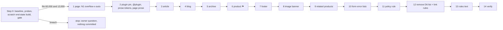

# Plan: Tailwind phase T4c, rich text (`prose`) and the D6 list/link removals (addendum)

Slug: `theme-evolution-tailwind-t4c`
Parent: `docs/plans/theme-evolution-tailwind.md` (umbrella) §11, owner decision Q7. Split decision: `docs/plans/theme-evolution-tailwind-t4b.md` D4b.1. Budget rule and owner questions: T4b §15.3. Index: `docs/plans/theme-evolution-tailwind-t4.md`.
Model: `docs/plans/theme-evolution-tailwind-t4b.md` (Revision 2.1, approved), its review `docs/reviews/theme-evolution-tailwind-t4b-review.md`, its impl notes and its QA report.
Architect: Claude (for Junior Warner)
Date: 2026-10-23
Revision: 2.1. It addresses round 2 of the review (R2-1, N2-1 to N2-5; changelog below). Revision 2 addressed round 1 of `docs/reviews/theme-evolution-tailwind-t4c-review.md` (APPROVE WITH CHANGES: R1-R11, nits N1-N13; changelog below). Revision 1 was the full addendum. It replaced the outline of 2026-10-23 (scope §1, direction §3, gate §4, steps §5, Q4c.1-Q4c.5) and adds T4b QA nit N1 (`/pages/data-sharing-opt-out` overflow). Every citation was re-read against HEAD `e21d0a3`, whose theme files equal `82dc6cf`, the commit DevOps pushed to staging #187953643616 on 2026-10-23 at 12:03 UTC (`docs/qa/theme-evolution-tailwind-t4b-deploy.md:3, 6`).
Tier: 2. One new dev dependency, one plugin, about 13 KB of CSS on every page, merchant-visible typography on the product page, and the removal of two site-wide parity rules.
Builds on: T0-T2 (live), T3, T4a and T4b (staging). **T4b must be on staging before Step 1** (§13 Step 0 item 1).

**Gate (§4).** T4c proceeds without asking only if Step 0's measured end-state build fits **both** budgets (60,000 minified and 12,000 gzip). If either is breached, T4c stops and presents T4b §15.3's options to the owner. This rule is the Architect's recommendation (T4b §15.3, OQ1), applied while the owner is away. It is **not** an owner decision, and the owner can reverse it at any time.

---

## Revision 2.1 changelog (review round 2)

**What did not change.** No step, criterion, Δ row, decision or risk was added, removed or renumbered. Every edit is a scoping or wording fix.

| Review item | What changed | Sections |
|---|---|---|
| **R2-1** (required): C4c.9(b) asserted `prose` values inside Shopify's widget | Step 0 item 3's outline and C4c.9(b)'s assertions **exclude the subtree of Step 0 item 5's widget selector**. Those elements are recorded under E4c.8, before and after, not judged. If the opt-out page has nothing outside the widget, only its wrapper metrics are asserted | C4c.9(b), §8 E4c.8, §13 Step 0 item 3 |
| N2-1 | §3.2 item 7 no longer says a layered utility "can't override unlayered CSS": only the **same property** needs `!`; it points to option C | §3.2 item 7 |
| N2-2 | `W_pc`'s Extent column and the "Readings" note use the subtree definition, not the border box | §0 |
| N2-3 | PXW uses `/products/the-complete-snowboard`; the clause is **invalid**, not green, if the parent width is ≤ `M_ch` + 2 | C4c.8(b), §10 PXW |
| N2-4 | The focus probe Tabs from the element just before the box and records each control **as it receives focus** (`document.activeElement`, `:focus-visible` matching), so each ring belongs to the control measured | §13 Step 0 item 5 |
| N2-5 | `RT_FIX` has no wrapper `div` any more: the marker `data-t4cc-fixture="rt-content"` goes on each PXR copy's `prose` wrapper, and `RT_FIX`'s first element carries `data-t4cc-fixture="rt-first"` (the only marker in PXP). The plugin's `> :first-child`/`> :last-child` resets then hit the content as they do on real pages | §10 PXR, `RT_FIX` |

Rev 2.1 sweep. Range: this whole file, prose first, then tables. Terms: "can't override unlayered CSS", "border box, not ink" (for `W_pc`), "is the widget's **border box**", "plus a Tab key press", `<div data-t4cc-fixture="rt-content">`. No survivor outside the changelogs.

## Revision 2 changelog (review round 1)

**What did not change.** No design decision changed except Q4c.6's option list (R6). No criterion was added, removed or renumbered (still C4c.0-C4c.22). No step was added or renumbered (Step 0 + Steps 1-14). Step 0 gains clauses in items 3, 5, 6, 8, 9 and 13 and no new item. One proxy variant is added (PXW, N1), and one umbrella edit (U-c5, R8).

| Review item | What changed | Sections |
|---|---|---|
| **R1** (required): Step 12 could run without the policy rule | Step 12 runs only if **Step 11 is committed**, or the owner has chosen Q4c.3 (b) **in writing**. Step 0 item 6 now says Steps 11 **and 12** wait while the selector is unresolved. The gate build uses the placeholder `.shopify-policy__body` if item 6 hasn't resolved (within a few bytes of any real selector) | §4.1, §13 Step 0 items 6 and 8, Step 12 |
| **R2** (required): the pre-push probe ignored new containers | On every run the target set is **Step 0's recorded containers plus every container this run discovers**. A new one is probed and recorded as new. "No embed" means **this run's** theme-verified discovery found none | §5.13 steps 3 and 7, C4c.22, §9.2, §13 Step 0 item 13, live gate |
| **R3** (required): PXR's shell copies were 311 px, not 271, at 375 | Each PXR copy sits inside a scratch `<div class="shopify-section">`, so it gets the real section grid. A precheck makes the run invalid unless the copy's parent content box equals `W_c(w)` ±1 | §10 PXR, C4c.8(a) |
| **R4** (required): C4c.9 couldn't go green on real pages | Per-element assertions run on PXR only. Real pages assert the wrapper's `font-size` and `line-height`, plus the elements in Step 0 item 3's tag outline, with its counts | C4c.9, §9.2, §13 Step 0 item 3 |
| **R5** (required): `templates/index.json` has no image-banner text block | PXS adds a `text` block `t4cc_text` to the scratch `index.json` and appends it to `block_order` after `heading`. Owner check 1 says the owner adds a text block in the editor and discards it | §10 PXS, owner check 1 |
| **R6** (required): Q4c.6's costs and the widget-sizing rejection had wrong referents | Theme link focus rings don't exist today (Dawn's `--focused-base-outline` is invalid with a hex `--color-foreground`). The rings that can clip are **the widget's own controls**, on **up to four sides**. Step 0 item 5 focuses each control and records its outline and box-shadow extent against the box edges. Q4c.6 states that the widget still needs sideways scrolling inside the box at 320-482 (it doesn't reflow, WCAG 1.4.10) and that touch browsers show no scrollbar. **Widget sizing** (a layered `max-width: 100%`) is now a conditional option: valid only if item 5 finds no unlayered `max-width`/`min-width` and no fixed-width descendant. The container fix stays recommended | §4.3, §5.2, RC9, Q4c.6, §13 Step 0 item 5 |
| **R7** (required): two merchant-visible rows lacked ⚑ | E4c.3 (archive line height moves the card grid down) and E4c.8 (`prose` inside the privacy widget) are ⚑ and in owner check 3 | §8, §10 owner check 3 |
| **R8** (required): T5 would reverse Q4c.7 | Q4c.7 and §14.4 say umbrella §12's planned `@layer base` heading rule (`font-heading`) would turn rich-text headings into Oswald; T5 must exclude `.prose` descendants or adopt Oswald deliberately. New U-c5 | Q4c.7, §14.1 U-c5, §14.4 |
| **R9** (required): §14.2's index claim was false | The T4 index's T4b row was already current (the orchestrator updated it). §14.2 and §16 now say so. The index header's date line is refreshed | §14.2, §16, the index header |
| **R10** (required): the rules-text bullet pointed the wrong way | "add `max-w-none` where the text must fill its column (product description, centered headers)"; "no base rule … outside store policy pages" | §13 Step 13 |
| **R11** (required): C4c.17 was absolute | Passes at `X_page` = 0, or at Step 0 item 4's non-zero base when every `X_off'` offender lies outside T4c's markup; such pages are recorded as pre-existing | C4c.17, §9.2 |
| N1 | `W_pd` is setting-dependent: with `max_page_width` `110rem` (`config/settings_schema.json:44`) it is 638 at 1920, above `M_ch`. New PXW variant, and C4c.8(b) adds that case | §0, §5.6, C4c.8(b), §10 PXW |
| N2 | Step 0 item 3 probes the standard policy handles directly (the sitemap doesn't list policies). C4c.15 covers every policy that renders | §13 Step 0 item 3, C4c.15 |
| N3 | C4c.15's `ol` count may be 0, as Step 0 item 6 records | C4c.15 |
| N4 | `W_pc` is the furthest right edge in the widget's subtree, relative to the box's content-left edge, measured on the end-state scratch | §0, §13 Step 0 item 5 |
| N5 | The `M_ch` probe goes in a separate `prose` box, never in the opt-out page's box | §0, §13 Step 0 item 9 |
| N6 | PXR takes the archive's outer string from the line before its `data-rich-text` line, and the product copy sits inside copies of `sections/product.liquid:11` and `:26`. Every proxy class must already be compiled; the PXR scratch copy is never rebuilt, and its `assets/tailwind.css` must equal head's | §10 PXR |
| N7 | PXS's related-products heading is read on `/products/the-complete-snowboard` after `product-recommendations h2` appears (10 s wait; then the other two fixtures; none → invalid) | §10 PXS |
| N8 | C4c.16(b)'s "no vertical scroll range" (and no horizontal one) also runs on the balanced-face page and PXR's page copy | C4c.16(b) |
| N9 | §3.1 records the unused `_html` locale keys with unclassed `<a>` | §3.1 |
| N10 | Step 10 stays one commit for two sections, with the reason stated | §13 Step 10 |
| N11 | On a gate breach, shipping Step 1 (N1) alone while the owner decides is listed as an option | §4.1 |
| N12 | One C4c.14 pass runs in a fresh context without consent cookies, so a Shopify overlay with unclassed links is compared too | C4c.14 |
| N13 | §5.2 says keeping the container fix page-only is a choice (C4c.16(d) enforces it) | §5.2 |

Rev 2 sweep: see §16 "Revision 2 checks".

## 0. Referent table

Every figure in this plan cites a row here. Tags (T4b §0):

- `[measured]`: read from a repo file during planning (2026-10-23, HEAD `e21d0a3`).
- `[derived]`: computed from CSS, settings or other rows, with the arithmetic shown.
- `[quoted]`: taken from a named plan, report or doc page, not re-measured.
- `[proposed]`: a value this plan sets.
- `[provisional]`: an estimate that Step 0 or QA confirms. **No decision or criterion rests on one.**
- `[unverified]`: a platform or library behavior the docs didn't settle; Step 0 tests it before anything depends on it.
- `[to be measured]`: Step 0 or QA measures it.

| Sym | What it measures | Units | Artifact | Extent or band | Value, method or threshold |
|---|---|---|---|---|---|
| `B_min`, `B_gz` | CSS budget | bytes | `assets/tailwind.css` | whole file | 60,000 minified, 12,000 gzip `-9` `[quoted]` `CLAUDE.md` `### Performance & Core Web Vitals` |
| `M_gz` | The gzip method every gate figure uses | n/a | shell | whole file | `gzip -9 -c assets/tailwind.css \| wc -c` (the project method, `CLAUDE.md:70`). T4b's scratch figures used stdin, which reads 13 B lower because no file name is stored `[quoted]` T4b impl notes, Step 0 "Scratch budget". **Deltas** are unaffected; totals must use `M_gz` |
| `S_tw` | Size of `assets/tailwind.css` | bytes | committed file | whole file | **43,803 / 9,253** after T4b (`M_gz`) `[quoted]` T4b impl notes "CSS sizes", T4b QA "Gates", T4b deploy note "Build gate". Step 0 re-measures |
| `S_prose` | Cost of plain `prose` | bytes | scratch build: T4a tree + T4b's exclusions + `@tailwindcss/typography@0.5.20` + one `class="prose"` | whole file | **+12,591 minified / +1,628 gzip** (T4b Step 0 (c) − (a): 55,451 − 42,860; 10,752 − 9,124). Without the exclusions +12,591 / +1,645 `[quoted]` T4b impl notes. Step 0 re-measures on the T4b tree |
| `S_tok2` | Cost of a two-variable `prose-tokens` | bytes | T4b scratch (d) − (c) | whole file | +76 / +19 `[quoted]` T4b impl notes |
| `S_tok` | Cost of the full `prose-tokens` (§5.1) | bytes | estimate | whole file | +700 to +950 / +130 to +230 `[provisional]` (15 variables, about 30 B each for `currentColor` and 62 B each for a `color-mix()`, plus two border-style lines) |
| `S_par` | The D6 list and link rules in the compiled file | bytes, minified | `assets/tailwind.css` (one line) | four rules | `ul:not([class]),ol:not([class]){padding-inline-start:1.5em}` 59 + `ul:not([class]){list-style:outside}` 35 + `ol:not([class]){list-style:decimal}` 35 + `a:not([class]){text-decoration-line:underline}` 46 = **175** `[measured]` (counted in the committed file) |
| `S_pol` | The policy-page rule (D4c.9) | bytes, minified | estimate | three rules | about +150 `[derived]` (46 + 49 + 55 characters for the three selector-and-declaration strings with `.shopify-policy__body`); the selector is fixed at Step 0 item 6 |
| `P_end` | **The gate figure**: the whole T4c end state built in scratch | bytes | scratch copy of HEAD with every §5 edit applied | whole file | `[to be measured]` Step 0 item 8, minified and `M_gz`. Estimate 57,214-57,559 / 11,026-11,226 `[provisional]` (§5.12) |
| `W_c(w)` | Width inside the page shell `px-8` | px | `[data-page-shell]` (T4b §5.3) | content box | `w − 104` for w ≤ 1440: **216** at 320, **271** at 375, **286** at 390, **326** at 430, 664 at 768, 1336 at 1440 and 1920 `[quoted]` T4b §0 |
| `E_L` | Content left edge in the shell | px | rendered page | box edge | 52 for w ≤ 1440 `[quoted]` T4b §0, confirmed by T4b C4b.6 |
| `W_pc` | Horizontal extent of Shopify's privacy widget on `/pages/data-sharing-opt-out` | px | `div.pc--show-email-field` and its subtree (T4b QA N1) | the furthest right **box edge** (border box, not ink) of any element in the widget's subtree, minus the rich-text box's content-left edge (Revision 2.1, review N2-2) | **379** `[derived]` from T4b QA N1: its right edge is at 431 when it starts at `E_L` = 52 (X = 56 at 375), and at 399 when it starts at 20 on the T4a tree (X = 24 at 375). QA called it "about 379". **Measured referent** (review N4): the furthest right edge of any box in the widget's subtree, minus the rich-text box's content-left edge, on the **end-state scratch** (Step 0 item 5). C4c.16 uses that measurement |
| `X_page` | Page overflow | px | rendered page at width w | document | `scrollWidth − innerWidth`. Pass: 0 |
| `X_off'` | Overflow offenders, scroll-aware | list | rendered page | every displayed element | T4b's `overflowFn` offenders, **minus** any element that has an ancestor below `body` whose computed `overflow-x` isn't `visible` and whose own right edge is ≤ `innerWidth` + 1 (it is clipped by a scroll box, not overflowing the page). Without this, a correct N1 fix would still list the widget. Pass: empty |
| `X_dso` | `X_page` on `/pages/data-sharing-opt-out` today | px | rendered page | 320 / 375 / 390 / 430 | T4b head (staging): **111 / 56 / 41 / 1**; T4a tree: 79 / 24 / 9 / 0 `[quoted]` T4b QA N1 |
| `X_in(w)` | Horizontal scroll range inside the page's rich-text box after the N1 fix | px | `[data-rich-text]` on `/pages/data-sharing-opt-out` | the box | `scrollWidth − clientWidth` = `max(0, W_pc − W_c(w))`: **163** at 320, **108** at 375, **93** at 390, **53** at 430, 0 from w = 483 (379 + 104) `[derived]`. C4c.16 recomputes it with Step 0's `W_pc` |
| `M_ch` | `prose`'s `max-width: 65ch` in px | px | a probe span of 65 "0" characters, `white-space: nowrap`, inside a **separate** `prose` box appended for the probe and removed after it (never inside the opt-out page's box, where it would create the overflow C4c.16 measures; review N5) | span width | `[to be measured]` Step 0 item 9. About 600 at 16 px Work Sans `[provisional]` |
| `R_vars` | The plugin's `--tw-prose-*` variable set and defaults | list | `node_modules/@tailwindcss/typography/src/styles.js` of the installed version | the `DEFAULT` modifier | `[to be measured]` Step 0 item 8. Expected for 0.5.x: body, headings, lead, links, bold, counters, bullets, hr, quotes, quote-borders, captions, kbd, kbd-shadows, code, pre-code, pre-bg, th-borders, td-borders, plus `--tw-prose-invert-*` `[quoted]` plugin README "Adding custom color themes" (via search; the exact list is read from the installed file) |
| `R_prose` | The plugin's default typography values | px, unitless | the same file | `DEFAULT` | `[to be measured]` Step 0 item 8: `.prose` font-size and line-height, `p` margins, `h2`/`h3` size and margins, `ul`/`ol` padding and type, `li` margins, `a` weight, `strong` weight, `blockquote` border width, `hr` width and margins, `table` font-size. Expected 16 px / 1.75, `p` 1.25em `[provisional]` |
| `C_mix(a)` | sRGB channel of `color-mix(in oklab, currentColor a, transparent)` over white with the default foreground #333333 (51) | 0-255 | dev, staging | one channel | `a × 51 + (1 − a) × 255` `[quoted]` T2 §0. 0.75 → **102**; 0.30 → **193.8**; 0.10 → **234.6** `[derived]` |
| `W_pd(w)` | Content width of the product description column | px | `sections/product.liquid:11, 26` | content box | at 1440: 1400 column − 160 (`md:px-20`) = 1240; × 45 % = 558; − 64 (`lg:pl-16`) = **494** `[derived]`, with the default `max_page_width` `90rem` (`config/settings_schema.json:40, 48`). With the schema's `110rem` option (`:44`), at 1920: (1720 − 160) × 0.45 − 64 ≈ **638** `[derived]` (review N1), above `M_ch`. So `65ch` binds only with the wide setting at wide viewports; C4c.5(c) tests the computed value, and C4c.8(b)'s PXW clause tests the width |
| `N_tc` | `shopify theme check` offenses | count | working tree | whole theme | **0** ("89 files inspected with no offenses found") `[quoted]` T4b QA "Gates"; `CLAUDE.md:68` says none is expected `[measured]`. Expected 0 after every T4c step |
| `H1` | `<h1>` count | count | rendered page | document | Pass: 1 (theme markup) |
| `F_*` | Content fixtures | list | sitemap | store | Pages `/pages/contact` (blank), `/pages/data-sharing-opt-out`, `/pages/the-balanced-face-test-page`, `/pages/the-material-archive`; blog `/blogs/news` with **no articles**; policy **`/policies/privacy-policy`** (renders `div.rte > div > ul`; `/policies/refund-policy` is a 404) `[quoted]` T4b impl notes "Fixtures", `docs/qa/evidence/t4bc-sweep-base.json` key `policy2-375`. Step 0 item 3 re-records them |

Readings that are easy to confuse:

- `S_*` and `P_end` are **file bytes** of the compiled CSS. Totals use `M_gz`; T4b's stdin gzip totals are 13 B low.
- `W_pc` is the **widget subtree's furthest right box edge**, measured from the rich-text box's content-left edge; it equals the widget's own border-box width only if no descendant sticks out. `X_page` is the **document's** overflow; `X_in` is the scroll range **inside** the rich-text box. After the fix, `X_page` is 0 while `X_in` is positive by design.
- `W_c` is the **shell's** content width; the rich-text box is `min(M_ch, W_c)` wide on pages, so it equals `W_c` at 320-430 and `M_ch` from 768.
- `C_mix` is for the **default** foreground. Under the scratch palette (PX6), recompute it with that palette's channels over its background.

---

## 1. Problem statement and goals

T4b converted every content page at parity, without `prose` (T4b D4b.1, D4b.12). Four problems are left:

1. **Merchant rich text is unstyled.** `page.content`, `article.content`, `comment.content`, `article.excerpt`, the archive description and `product.description` print into a classless `<div data-rich-text>` (T4b) or a bare `<div>` (PDP). They get Preflight's zero margins, the root's `line-height: normal` (D6) and the D6 list markers and link underline, and nothing else. Owner decision Q7 chose `@tailwindcss/typography` for this (umbrella §11).
2. **The D6 list and link parity rules are still global** (`src/tailwind.css:241-253`, marked `/* T4c */` by T4b Step 14). They exist only because merchant and Shopify markup has no classes (umbrella D6). The umbrella removes them "when every rich-text output is wrapped" (§11).
3. **Some rich text can't take `prose`** but still depends on D6: the footer's `about_text` (`richtext`: paragraphs, links, unordered lists `[quoted]` shopify.dev input settings), the image-banner heading and text blocks and the related-products heading (`inline_richtext`: bold, italic, links `[quoted]` same page), the `default_errors` lists in the comment and password forms, and Shopify's own `/policies/*` bodies.
4. **T4b QA nit N1.** `/pages/data-sharing-opt-out` overflows on phones, and T4b made it worse: `X_dso` went from 79 / 24 / 9 / 0 to 111 / 56 / 41 / 1 at 320 / 375 / 390 / 430. Shopify's privacy widget is `W_pc` = 379 px wide and starts at the shell's content edge (`E_L` = 52 instead of 20).

### Goals

1. Plain `prose` from the pinned plugin on page, article, comment, blog-excerpt, archive and product-description rich text, with colors that follow the surrounding text (no hex).
2. Explicit link and list utilities on every rich-text sink that doesn't take `prose`, so nothing visible depends on D6.
3. Policy pages keep their list markers and link underline (Q4c.3).
4. Remove the D6 list and link rules. Keep `html { line-height: normal }` (T5) and the cursor rule (permanent).
5. `X_page` = 0 on `/pages/data-sharing-opt-out` at 320-1920, without changing `prose`'s measure on any other page.
6. Fit both CSS budgets, decided by a measured end-state build before anything is committed.
7. Keep the gates: `check:css`, `check:hidden`, theme check at 0, schemas byte-identical, the cart flow.

---

## 2. Non-goals

- **No `prose` modifiers.** No `prose-sm`, `prose-lg`, `prose-invert`, color themes (`prose-gray`, …) or element modifiers (`prose-headings:…`). Size variants alone measured about +12 KB (T4b §15.3) and need the owner's sign-off.
- **No `prose` on the footer** (Q4c.4), the image banner, the related-products heading or the error lists: they keep today's look through explicit utilities.
- **No `prose` on policy pages.** Shopify renders them; the theme can't add classes. They get a scoped parity rule (D4c.9).
- **`html { line-height: normal }` stays** (T5). The cursor rule stays (permanent).
- **No layout edits** (`layout/*` untouched). No `config/settings_data.json`, `templates/*.json`, `sections/*-group.json` or non-default locale edits. No new locale keys.
- **No change to the product description's tooltip logic** (`sections/product.liquid:49-55`). Its keyboard gap stays with its own fix plan (T4a Q4a.9).
- **No store content.** Creating pages, articles or policies in the admin is an outward change that isn't authorized. Missing fixtures are covered by scratch proxies (§10), and the gaps are listed for the owner (§14.3).

---

## 3. Current-state inventory

### 3.1 Files `[measured]` (HEAD `e21d0a3`)

| File | Lines | Rich text today | T4c change |
|---|---|---|---|
| `package.json` | 21 | devDependencies `@tailwindcss/cli` 4.3.3, `concurrently` 10.0.6, `tailwindcss` 4.3.3 (16-20) | add `@tailwindcss/typography` exact |
| `src/tailwind.css` | 258 | `@import "tailwindcss" source(none);` (11); `@utility grid-fill` (132-134); `@layer base` (136-258) with the D6 block: comment 234-237, `html` 238-240, lists 241-250, link 251-253, cursor 254-257 | `@plugin` after 11; `@utility prose-tokens` after 134; the policy rule; delete 241-253 |
| `sections/page.liquid` | 21 | `<div data-rich-text>{{ page.content }}</div>` (12), inside the shell (8) | N1 fix, then `prose` |
| `sections/article.liquid` | 76 | content wrapper (22); comment content wrapper (36); `` (46); `{{ form.errors \| default_errors }}` (49) | `prose` ×2; list variants on the form |
| `sections/blog.liquid` | 42 | excerpt wrapper (28) | `prose` |
| `sections/main-material-archive.liquid` | 121 | `<div class="mt-6 text-foreground/75" data-rich-text>{{ page.content }}</div>` (37), inside the centered 600 px header (34) | nested `prose` |
| `sections/product.liquid` | 247 | description block `<div {{ block.shopify_attributes }}>` (48); the tooltip replace loop (49-55); output (56) | `prose` on 48 |
| `sections/footer.liquid` | 202 | about wrapper `theme-evolution-footer__about-text max-w-none text-sm/[1.6] md:max-w-lg [&_p]:mb-3 [&_p:last-child]:mb-0` (41); `{{ section.settings.about_text }}` (42); the copyright `<p>` already has `[&_a]:no-underline [&_a:hover]:underline` (104) | link and list variants on 41 |
| `sections/image-banner.liquid` | 824 | heading `<h2 class="m-0 font-heading font-bold uppercase [&_a]:text-current [&_a]:decoration-[0.0625rem] [&_a]:underline-offset-[0.1875rem] [&_a:hover]:decoration-[0.125rem] …">` (384-389); text `<div class="[&_a]:text-current …">` (401-406). Thickness and offset are set, **the underline line itself comes from D6** | `[&_a]:underline` on 385 and 402 |
| `sections/related-products.liquid` | 261 | `<h2 class="mb-7.5 font-heading font-bold uppercase {{ heading_classes }}">{{ section.settings.heading }}</h2>` (49-51) | `[&_a]:underline` on 49 |
| `sections/password.liquid` | 32 | `` (15); `default_errors` (17) | list variants on the form |
| `templates/gift_card.liquid` | 69 | `<a href="{{ gift_card.pass_url }}">` (56) holds only an image, so its D6 underline isn't visible (umbrella E14) | none |

**Other unclassed `a`, `ul`, `ol` in theme markup** (ripgrep over `sections snippets blocks layout templates` `[measured]`): the footer copyright's two Liquid-generated links (already `[&_a]:no-underline`), and the gift-card link above. Every other theme link and list carries a class. T4b's parity sweep found the same on rendered pages, **but it skipped the cart drawer** (`t4bc-sweep.mjs:72`), so Step 0 item 7 sweeps it open.

**Locale keys with unclassed links** (review N9): `locales/en.default.json:133` (`shipping_policy_html`) and `:165-171` (four `…_with_policy_html` keys) hold `<a href="{{ link }}">` with no class `[measured]`. None is used in theme markup today (ripgrep over the scanned folders: 0 hits), so nothing changes in T4c. A future use would print a link with no underline after Step 12; the Step 13 rules bullet covers it.

### 3.2 Cascade facts that shape the design

1. **`.prose` compiles into `@layer utilities`** `[quoted]` T4b impl notes. So it beats Preflight and D6 (`base`) and Dawn (`legacy`), and loses to unlayered CSS: Shopify's privacy widget CSS and the policy container's inline style.
2. **Same-element conflicts are decided by utility order.** `.prose` sets `color`, `max-width` and every `--tw-prose-*` variable on the element itself. The plugin's documented pairings (`prose max-w-none`, `prose prose-<theme>`) rely on Tailwind emitting the shorter utility later `[unverified]` for this build. Step 0 item 9 measures both, and §5.1 has a fallback for `prose-tokens`.
3. **`currentColor` in an unregistered custom property** resolves where the variable is **used**, not where it is declared. So `--tw-prose-body: currentColor` on `.prose` makes `.prose { color: var(--tw-prose-body) }` inherit its parent's color, and `--tw-prose-bullets: color-mix(in oklab, currentColor 30%, transparent)` mixes each marker's own color. That is how the tokens follow the surrounding text on any surface (Q4c.5) `[derived]` (CSS Variables spec: substitution happens at computed-value time of the using property).
4. **Dawn rules leak into `prose` where the plugin doesn't set the property** (`assets/base.css`, legacy layer) `[measured]`:
   - `hr { border: none; height: 0.1rem; … }` (536-542): the plugin sets `border-top-width` and `border-color` but, as far as the plan can tell, not `border-top-style`. So Dawn's `none` would win over Preflight's `solid`, and the rule would be invisible `[unverified]`.
   - `blockquote { border-left: 0.2rem solid rgba(var(--color-foreground), 0.2) }` (360-365): `--color-foreground` is a hex here, so the shorthand is invalid at computed-value time and its longhands become `unset`. `border-left-style` is then `none`, and the plugin's left border would be invisible `[unverified]`.
   - `h6` margins 1.67em (353-358) and `table:not([class]) td, th { padding: 1em }` (426-430) leak on the sides the plugin doesn't set. Minor; they go with `base.css` in T5.

   Step 0 item 9 measures the two border styles. D4c.11 adds two lines to `prose-tokens` only if they are `none`.
5. **The policy body is Shopify markup inside Dawn's `.rte`** (`docs/qa/evidence/t4bc-sweep-base.json`, key `policy2-375`: lists at `div.rte > div > ul`, links at `ul > li > a` and `div > p > a`). Today:
   - Dawn's `.rte ul, .rte ol { list-style-position: inside; padding-left: 2rem }` (3165-3169) sets position and padding (legacy beats D6);
   - D6 supplies the marker **type** (`disc`, `decimal`) and the link underline;
   - Dawn's `.rte a` color uses the undefined `--color-link` (3179-3184), so the link color inherits.

   After the D6 removal, Preflight's `list-style: none` and `text-decoration: inherit` win: no bullets, and links indistinguishable from text.
6. **`default_errors`** prints a list for the form's errors. Its exact markup isn't documented (shopify.dev `filters/default_errors` gives only the description) `[unverified]`; Dawn-era themes see `<div class="errors"><ul><li>…</li></ul></div>`. The variants in D4c.7 match any `ul` inside the form, so they don't depend on the wrapper's class.
7. **The privacy widget.** Its width source is unknown: it could be Shopify's unlayered CSS, an inline style, or the intrinsic width of its form controls `[unverified]`. A layered utility can't override the **same property** set by unlayered CSS without `!`, though it can constrain a different one (a layered `max-width` limits an unlayered `width`). The theme doesn't own the widget's class names. So the recommended fix changes the **container**, which works whatever sets the width (D4c.8); sizing the widget is the conditional Q4c.6 option C (§4.3), decided by Step 0 item 5 (Revision 2.1, review N2-1).

### 3.3 Behavior contracts that must survive

- The tooltip spans in the product description keep their color, dotted underline, weight and hover (T2 D2.x; `eco-tooltip.js` appends the tooltip to `body`, outside `prose` (`assets/eco-tooltip.js:70`)).
- The footer's `about_text` keeps its live editor preview: the setting stays the only child of its wrapper (shopify.dev theme editor "Text settings" `[quoted]`).
- Every escape T4b added stays (T4b C4b.11).
- One `<h1>` per page in theme markup; schemas byte-identical; the T4a cart flow.

---

## 4. The gate and the decisions

### 4.1 The gate (Step 0 item 8, before any commit)

1. In a scratch copy of HEAD (`git archive` into the scratchpad), run `npm ci`, then `npm install --save-dev --save-exact @tailwindcss/typography@0.5.20`. If 0.5.20 can't be installed, use the newest 0.5.x patch and record it as a deviation (umbrella D1: exact pins).
2. Apply **every** §5 edit to the scratch copy, as written: the end state, not an estimate.
3. Build with `npm run build:css` and measure `P_end` with `wc -c` and `M_gz`.
4. **Two-budget rule** (T4b §15.3 OQ1, the Architect's recommendation):
   - **`P_end` ≤ 60,000 minified and ≤ 12,000 gzip:** proceed. `CLAUDE.md` asks for sign-off only for a breach.
   - **Either is exceeded:** stop. Write the measured figures and T4b §15.3's options 1-5 into `docs/plans/theme-evolution-tailwind-t4c-coder-questions.md` for the owner, and commit nothing. Options 4 (a project `@utility` instead of the plugin) and 5 (an open-ended deferral) touch owner decision Q7; the squad presents them and never applies them.
   - **Also offered on a breach** (review N11): ship Step 1 alone (the N1 fix, about +25-40 B, no plugin) while the owner decides. The squad lists it; the orchestrator applies it only on the owner's or orchestrator's explicit instruction.
   - **The policy selector in this build** (review R1): Step 0 item 6's selector; if item 6 hasn't resolved one, the placeholder `.shopify-policy__body`. Any real selector differs by a few bytes, well inside the margin; C4c.20(b) records the difference.
5. The final committed file must equal `P_end` (C4c.20). The per-step figures are recorded but don't gate.

The estimate puts `P_end` at 57,214-57,559 / 11,026-11,226 (§5.12) `[provisional]`, about 2,400 minified and 770 gzip under. **Only the measurement decides.**

### 4.2 Decisions

| # | Decision | Question | Where |
|---|---|---|---|
| D4c.1 | **Plain `prose` from `@tailwindcss/typography`, pinned exactly** (0.5.20), loaded with `@plugin` right after the Tailwind import | Q7 (owner) | §5.1 |
| D4c.2 | **The gate measures the end state**, built in scratch with every edit, rather than adding estimates to a measured `prose` | none | §4.1 |
| D4c.3 | **`@utility prose-tokens`** maps the plugin's grays to `currentColor` and `color-mix()` of it. The code block keeps the plugin's dark surface | **Q4c.5** | §5.1 |
| D4c.4 | **Measure:** `prose`'s `65ch` stays on pages, articles, comments and blog excerpts. `max-w-none` on the product description and the archive description | **Q4c.1** | §5.2-§5.6 |
| D4c.5 | **Archive:** its 75 % color stays on the outer wrapper and `prose` goes on a new inner wrapper, so `.prose`'s own `color` can't fight `text-foreground/75` on one element | none | §5.5 |
| D4c.6 | **⚑ The product description takes `prose`** | **Q4c.2** ⚑ | §5.6 |
| D4c.7 | **Non-`prose` sinks get explicit utilities:** one shared `[&_a]:underline` (footer, image banner, related products); `[&_ul]:list-disc [&_ul]:ps-[1.5em]` on the footer wrapper and on the two forms' `class:` (no new wrapper element) | **Q4c.4**, **Q4c.9** | §5.7-§5.10 |
| D4c.8 | **N1: `overflow-x-auto` on the page section's rich-text box**, in its own commit before `prose` | **Q4c.6** ⚑ | §5.2 |
| D4c.9 | **Policy pages keep a scoped parity rule** in `@layer base`, on Shopify's policy container class (Step 0 item 6 fixes the selector); handed to T5 | **Q4c.3** | §5.11 |
| D4c.10 | **The D6 list and link rules go last**, after every sink is covered and the sweeps (Step 0 item 7) and the live probe (Step 0 item 13) show nothing else depends on them | none | §5.11 |
| D4c.11 | **Two legacy-leak lines in `prose-tokens`** (`hr` top-border style, `blockquote` start-border style), included only if Step 0 item 9 measures `none` | **Q4c.8** | §5.1 |
| D4c.12 | **Rich-text headings keep the body font** (the plugin's default), not Oswald | **Q4c.7** ⚑ | §5.1 |
| D4c.13 | **Rules text:** one bullet in `CLAUDE.md` and `AGENTS.md` | none | §13 Step 13 |
| D4c.14 | **No `@source not inline` guards for the modifiers.** C4c.4 checks statically that no `prose-*` modifier compiles | none | §5.1 |

### 4.3 Rejected alternatives

- **A project `@utility rich-text` instead of the plugin** (about 2-3 KB). It reverses owner decision Q7, so it is presented only if the gate fails (T4b §15.3 option 4).
- **`prose` on policy pages through a conditional wrapper in `layout/theme.liquid`** (`request.page_type == 'policy'`, a documented value `[quoted]` shopify.dev `objects/request`). It costs 0 CSS bytes and would make policies match pages. Rejected for T4c: it edits the layout every page renders, changes policy typography (⚑) while the owner is away, and puts `prose` on Shopify's title markup. It is offered to T5 as Q4c.3 option (c).
- **`@apply prose` on the policy container.** It would duplicate the plugin's whole rule set (about 12 KB). Rejected.
- **N1 by `min-w-0`.** The rich-text box is a column-flex item; `min-width: auto` applies to the main (vertical) axis only, and its width is already the stretched container width (`W_c`). It can't contain a 379 px child. C4c.16 is red on it.
- **N1 by a smaller inset below `sm`** (`px-5 sm:px-8` on the shell). It can at best return to base (X 24 at 375), since `W_pc` (379) is wider than the whole old column (335). It also moves the page's edge away from every other shell page. C4c.16 is red on it.
- **N1 by sizing the widget** (`[&_.pc--show-email-field]:max-w-full` on the page's rich-text box). **Not rejected: a conditional option** (Q4c.6 option C; Revision 2, review R6). A layered `max-width: 100%` constrains an unlayered `width: 379px`, because they are different properties and `max-width` wins over `width` by definition `[derived]` (CSS 2.1 §10.4). It fails only if Shopify's CSS also sets `max-width` or `min-width` on the widget (then `!` would be needed), or if a fixed-width descendant (an input) causes the overflow. Step 0 item 5 records exactly those facts. Real benefit: the field and button fit on phones, with no sideways scroll. Real cost: it depends on Shopify's class name (`pc--show-email-field`), which can change without notice, and costs about 60 B. The container fix stays recommended because it works whatever Shopify changes; option C can be added on top.
- **`@source not inline("prose-sm")` and the like as guards.** One line per name, and they wouldn't exclude variant-prefixed forms such as `md:prose-lg` (T4b RB11). C4c.4's static check is the guard instead.

---

## 5. Proposed design, file by file

**Conventions** (T4b §5, unchanged):

- Class strings are complete. No bare `hidden`, no Dawn class names, no `!`.
- `style` attributes set custom properties only. T4c adds none.
- **Words in scanned files generate utilities.** New Liquid comments avoid single-word utility names (T4b §5's list), and in T4c also **every `prose-` name other than `prose-tokens`**: a comment containing `prose-lg` would add about 12 KB. C4c.4 and C4c.19 check this. `src/` isn't scanned, so comments there are safe.
- Hooks: `data-rich-text` (T4b; no CSS) also goes on the product description wrapper.
- Markdown: inside tables, `\|` is an escaped pipe; write it as `|`.



### 5.1 `package.json`, `src/tailwind.css` (Steps 2, 11, 12)

**Step 2, dependency.** `npm install --save-dev --save-exact @tailwindcss/typography@0.5.20` (or the patch Step 0 recorded). `package.json` gains `"@tailwindcss/typography": "0.5.20",` between `@tailwindcss/cli` and `concurrently`; `package-lock.json` changes with it. Both are in `.shopifyignore` (35-36), so neither is ever pushed.

**Step 2, `@plugin`.** Directly after `@import "tailwindcss" source(none);` (line 11), insert:

```css

/*
 * Typography plugin (owner decision Q7): plain `prose` for merchant rich text. Its size,
 * invert and color modifiers are not used; they cost kilobytes each and need the owner's
 * sign-off against the CSS budget. See docs/plans/theme-evolution-tailwind-t4c.md.
 */
@plugin "@tailwindcss/typography";
```

**Step 2, `prose-tokens`.** Directly after the closing brace of `@utility grid-fill` (line 134 at planning time), insert:

```css

/*
 * Rich-text colors follow the text around them, so rich text works on any merchant palette
 * and surface: the plugin's grays become the current color, or a mix of it for muted text,
 * markers and hairlines. The code block keeps the plugin's dark surface (a neutral detail).
 * Always pair with prose. See docs/plans/theme-evolution-tailwind-t4c.md D4c.3.
 */
@utility prose-tokens {
  --tw-prose-body: currentColor;
  --tw-prose-headings: currentColor;
  --tw-prose-lead: color-mix(in oklab, currentColor 75%, transparent);
  --tw-prose-links: currentColor;
  --tw-prose-bold: currentColor;
  --tw-prose-counters: color-mix(in oklab, currentColor 75%, transparent);
  --tw-prose-bullets: color-mix(in oklab, currentColor 30%, transparent);
  --tw-prose-hr: color-mix(in oklab, currentColor 10%, transparent);
  --tw-prose-quotes: currentColor;
  --tw-prose-quote-borders: color-mix(in oklab, currentColor 10%, transparent);
  --tw-prose-captions: color-mix(in oklab, currentColor 75%, transparent);
  --tw-prose-kbd: currentColor;
  --tw-prose-code: currentColor;
  --tw-prose-th-borders: color-mix(in oklab, currentColor 30%, transparent);
  --tw-prose-td-borders: color-mix(in oklab, currentColor 10%, transparent);

  /* While assets/base.css loads, its hr and blockquote rules remove these border styles. T5 deletes these two rules. */
  & :where(hr) {
    border-top-style: solid;
  }
  & :where(blockquote) {
    border-inline-start-style: solid;
  }
}
```

- **The mapping** (Q4c.5): text-like variables are `currentColor`; muted text (lead, ol counters, captions) is 75 %, the same weight as `text-foreground/75` (`C_mix(0.75)` = 102 = #666 at the defaults); markers and header rules 30 % (`C_mix(0.30)` ≈ 194); hairlines 10 % (`C_mix(0.10)` ≈ 235, the T4b comment rows' `border-foreground/10`).
- **Unmapped on purpose:** `--tw-prose-pre-code`, `--tw-prose-pre-bg` (the dark code block is a neutral detail, `CLAUDE.md` "Use the theme tokens") and `--tw-prose-kbd-shadows` (it may be an RGB triplet rather than a color, depending on the version; Step 0 item 8 records which).
- **If `R_vars` differs from these 18 names** (Step 0 item 8), the Coder maps each extra text-like variable to `currentColor`, records it as a deviation, and C4c.5 uses the recorded list.
- **The two leak lines** (D4c.11) are included only if Step 0 item 9 measures `border-top-style: none` on a prose `hr` or `border-left-style: none` on a prose `blockquote` with `base.css` loaded. Each line is kept or dropped on its own measurement. The `@utility` nesting with a descendant selector is `[unverified]`; Step 0 item 8 compiles it (expected output `.prose-tokens :where(hr){border-top-style:solid}`).
- **Order fallback** (§3.2 item 2). If Step 0 item 9 shows that `.prose` overrides `prose-tokens` (the computed `--tw-prose-body` on a `prose prose-tokens` element isn't `currentColor`), wrap the fifteen declarations in `&.prose { … }` inside the same `@utility`, so they compile to `.prose-tokens.prose{…}` (specificity 0,2,0). Record it as a deviation. C4c.5 accepts either form.
- **`max-w-none`** is already compiled (`assets/tailwind.css`, `.max-w-none{` `[measured]`). If Step 0 item 9 shows `prose max-w-none` doesn't compute to `max-width: none`, that contradicts the plugin's documented usage: the Coder stops and writes a coder question. The plan doesn't guess a fix.
- **Headings** (Q4c.7): no font mapping. Rich-text headings use the body font at the plugin's sizes.

**Step 11, policy rule** (D4c.9). Insert directly before the D6 comment block (the line `   * Browser defaults that Preflight removes but unclassed Dawn, Shopify and merchant` and the `/*` above it), inside `@layer base`:

```css
  /*
   * Store policy pages (/policies/*) print Shopify's own markup, which takes no theme
   * classes. Keep their list markers and link underline. Dawn's .rte still sets the list
   * padding and inside position while base.css loads; T5 decides the final styling.
   * See docs/plans/theme-evolution-tailwind-t4c.md D4c.9.
   */
  .shopify-policy__body ul {
    list-style-type: disc;
  }
  .shopify-policy__body ol {
    list-style-type: decimal;
  }
  .shopify-policy__body a {
    text-decoration-line: underline;
  }
```

`.shopify-policy__body` is `[unverified]`. Step 0 item 6 fixes the selector: the **nearest ancestor of every policy `ul` and `a` whose class starts with `shopify-policy__`**. If no such class exists, the Coder stops and writes a coder question rather than selecting Dawn's `.rte`.

- **Specificity:** `.shopify-policy__body ul` (0,1,1) beats Preflight's `ul` (0,0,1) in the same layer `[derived]`. Dawn's `.rte li { list-style: inherit }` (legacy) passes the type down.
- **Nested `ul`** get `disc`, as D6 gave them.

**Step 12, D6 removal.** Find these by their text, not their line numbers (Steps 2 and 11 move them):

- delete the rules `ul:not([class]), ol:not([class]) { padding-inline-start: 1.5em; /* T4c */ }`, `ul:not([class]) { list-style: disc; /* T4c */ }`, `ol:not([class]) { list-style: decimal; /* T4c */ }` and `a:not([class]) { text-decoration-line: underline; /* T4c */ }` (planning-time lines 241-253);
- keep the D6 comment, `html { line-height: normal; … }` and the cursor rule unchanged. The comment's "Remove each in the phase noted" stays true.

### 5.2 `sections/page.liquid` (Steps 1, 2)

**Step 1 (N1, D4c.8).** Line 12 becomes:

```liquid
    
    <div class="overflow-x-auto" data-rich-text>{{ page.content }}</div>
```

**Step 2.** The same line becomes `<div class="prose prose-tokens overflow-x-auto" data-rich-text>{{ page.content }}</div>`. The comment stays.

Nothing else in the file changes. The comment's words are checked by C4c.19; none is a utility name to the plan's knowledge.

**Why `overflow-x-auto` is the least invasive fix** (Q4c.6):

- It changes only the container the theme owns. It works whatever sets the widget's width (§3.2 item 7) and doesn't depend on Shopify's class names.
- `X_page` becomes 0. The widget scrolls inside the box by `X_in` (163 / 108 / 93 / 53 at 320 / 375 / 390 / 430; 0 from 483).
- Measure and position don't change on any page: the box is still `min(M_ch, W_c)` wide.
- It also contains any wide merchant table or embed on pages.
- **Page-only is a choice** (review N13). The same reasoning would apply to `article.content`. T4c keeps the fix to `sections/page.liquid`, the only place an overflow is known, and C4c.16(d) enforces that. Extending it is a one-token change for a later plan.

**Costs, surfaced** (Revision 2, review R6):

- **It doesn't make the widget reflow.** At 320-482 px the widget is still wider than the box, so its right part (`X_in`: 108 px at 375; Step 0 item 5 records whether that is the email field or the button) needs a sideways swipe **inside the box**. That is still short of WCAG 1.4.10 (reflow) for that widget; the page itself no longer scrolls sideways.
- **Touch browsers show no scrollbar**, so nothing tells a phone visitor the box scrolls. The widget's cut-off right edge is the only hint.
- **Focus rings of the widget's own controls can be clipped, on up to four sides.** A scroll box clips at its padding edges, and `overflow-x: auto` makes `overflow-y` compute to `auto`, so the top and bottom clip too. The widget starts at the box's left content edge, so a ring drawn outside its first control is cut on the left, and on the top or bottom if the control touches those edges. Step 0 item 5 focuses each control and records its outline and box-shadow extent against the box edges, and Q4c.6 reports that measured cost.
- **Theme link rings aren't affected:** there are none today. Dawn's `*:focus-visible { outline: var(--focused-base-outline) }` (`assets/base.css:720-724`) resolves to `0.2rem solid rgba(var(--color-foreground), 0.5)` (`:8`), which is invalid at computed-value time because `--color-foreground` is a hex (`snippets/css-variables.liquid:26`), so the outline is `none` `[derived]` from `base.css:8, 720-722` and `css-variables.liquid:26`, re-read for Revision 2 (review R6).
- A pop-up that extends below the box would scroll instead of overlapping. C4c.16(b) checks that the box has no vertical scroll range.

**Alternatives:** §4.3 and Q4c.6. `max-sm:overflow-x-auto` (only below 640) would leave desktop exactly as today for about 10 more bytes, but it would leave wide merchant tables overflowing on tablets. The plan prefers one rule at every width. Sizing the widget (Q4c.6 option C) is conditional on Step 0 item 5.

### 5.3 `sections/article.liquid` (Steps 3, 10)

**Step 3.**

- Line 22: `<div data-rich-text>{{ article.content }}</div>` becomes `<div class="prose prose-tokens" data-rich-text>{{ article.content }}</div>`.
- Line 36: `<div data-rich-text>{{ comment.content }}</div>` becomes `<div class="prose prose-tokens" data-rich-text>{{ comment.content }}</div>`. `comment.content` stays unfiltered (T4b review N6).

**Step 10.** Line 46: the form's `class:` string `'flex max-w-[28.125rem] flex-col gap-4'` becomes `'flex max-w-[28.125rem] flex-col gap-4 [&_ul]:list-disc [&_ul]:ps-[1.5em]'`. Line 49 is unchanged.

### 5.4 `sections/blog.liquid` (Step 4)

Line 28: `<div data-rich-text>{{ article.excerpt }}</div>` becomes `<div class="prose prose-tokens" data-rich-text>{{ article.excerpt }}</div>`.

### 5.5 `sections/main-material-archive.liquid` (Step 5)

Line 37 becomes three lines (D4c.4, D4c.5):

```liquid
      <div class="mt-6 text-foreground/75">
        <div class="prose prose-tokens max-w-none" data-rich-text>{{ page.content }}</div>
      </div>
```

- **Color:** the outer wrapper keeps `text-foreground/75`. `.prose`'s `color: var(--tw-prose-body)` is `currentColor`, so the inner box inherits 75 %, with no same-element conflict. Bold text is 75 % too, as today.
- **Alignment:** `text-center` is inherited from the header block (34).
- **Measure:** `max-w-none`. The header is 600 px wide; if `M_ch` came out below 600, `65ch` would narrow the text box and push it left of center.
- **Schema** unchanged; no other line changes.

### 5.6 `sections/product.liquid` (Step 6, ⚑ Q4c.2)

Line 48 `<div {{ block.shopify_attributes }}>` becomes:

```liquid
          <div class="prose prose-tokens max-w-none" data-rich-text {{ block.shopify_attributes }}>
```

- **The tooltip spans keep their look** (§3.3). The plugin styles `a`, `strong`, `code` and the like, not `span`. Each trigger span declares its own color, weight and decoration as utilities on itself (line 53), and an element's own declarations beat any inherited value `[derived]`. So `prose` can't change them; C4c.10 is a guard that confirms it.
- **Measure:** with the default page width, `65ch` never binds here (`W_pd` 494 < `M_ch`). With the schema's `110rem` page width it binds at 1920 (`W_pd` ≈ 638; review N1), so `max-w-none` is load-bearing there and keeps the description full-width. PXW tests it.
- **Merchant-visible (⚑):** body text goes from 16 px with `line-height: normal` to 16 px / 1.75. Paragraphs get 1.25em margins (except the first and last). Headings, lists, quotes and tables take the plugin's sizes (`R_prose`), and links get weight 500. The accordion below (59) is unchanged.

### 5.7 `sections/footer.liquid` (Step 7, Q4c.4)

Line 41's class string gains three tokens at its end:

```liquid
            <div class="theme-evolution-footer__about-text max-w-none text-sm/[1.6] md:max-w-lg [&_p]:mb-3 [&_p:last-child]:mb-0 [&_a]:underline [&_ul]:list-disc [&_ul]:ps-[1.5em]">
```

- **D6 parity:** underline; `disc` markers outside; `1.5em` = 21 px at the wrapper's 14 px `[derived]`, exactly what D6 gives today.
- **No `prose`:** it would enlarge the text from 14 px and change the line height (Q4c.4).
- The setting stays the wrapper's only child (42), so its live preview still works.

### 5.8 `sections/image-banner.liquid` (Step 8)

In both class strings (heading 385, text 402), insert `[&_a]:underline` directly before `[&_a]:text-current`. The thickness and offset utilities after it already apply; the underline line itself was D6's. The `case` mappings (370-383, 391-400) and the schema don't change.

### 5.9 `sections/related-products.liquid` (Step 9)

Line 49: `class="mb-7.5 font-heading font-bold uppercase {{ heading_classes }}"` becomes `class="mb-7.5 font-heading font-bold uppercase [&_a]:underline {{ heading_classes }}"`.

### 5.10 `sections/password.liquid` (Step 10)

Line 15: `class: 'flex max-w-[28.125rem] flex-col gap-3'` becomes `class: 'flex max-w-[28.125rem] flex-col gap-3 [&_ul]:list-disc [&_ul]:ps-[1.5em]'`.

- `1.5em` = 24 px at 16 px, D6's value `[derived]`.
- The variants sit on the form, not on a new wrapper, so no empty `div` can appear when there is no error (`CLAUDE.md` `div:empty` bullet; T4b C4b.4(b)). The form contains no other `ul`.
- That the `` tag prints the `&` in `class:` intact is `[unverified]`; C4c.12 reads the rendered form's `classList`.

### 5.11 What the D6 removal leaves (Step 12)

| Markup | Today | After |
|---|---|---|
| merchant rich text in the six `prose` wrappers | D6 markers and underline | `prose` (E4c.1-E4c.4) |
| footer `about_text`, image banner, related heading, error lists | D6 | explicit utilities, same values (E4c.7) |
| policy bodies | D6 type, Dawn padding and position | the D4c.9 rule, Dawn unchanged (E4c.6) |
| footer copyright links | `[&_a]:no-underline` already wins | unchanged |
| gift-card wallet link | image only | unchanged |
| app blocks and embeds | none on dev, staging or live (T4b C4b.29) | re-checked by C4c.22 before live |

### 5.12 CSS budget per step `[provisional]`

Method: T4b's measured figures (`S_prose`, `S_tok2`) and T4a's rate of about 45-60 B per arbitrary-variant utility. Gzip isn't additive, so only `P_end` decides.

| Step | New CSS | Δ minified | Δ gzip |
|---|---|---|---|
| 1 | `overflow-x-auto` | +25 to +40 | +5 to +15 |
| 2 | `prose` (`S_prose`, measured) + `prose-tokens` (`S_tok`) | +13,291 to +13,541 | +1,758 to +1,858 |
| 3-6 | none (`prose`, `prose-tokens`, `max-w-none` compiled) | 0 | 0 to +10 |
| 7 | `[&_a]:underline`, `[&_ul]:list-disc`, `[&_ul]:ps-[1.5em]` | +130 to +180 | +25 to +50 |
| 8-10 | none (reused) | 0 | 0 to +5 |
| 11 | policy rule (`S_pol`) | +140 to +170 | +30 to +60 |
| 12 | D6 list and link rules (`S_par`) | −175 | −25 to −45 |
| **Net** | | **+13,411 to +13,756** | **+1,773 to +1,973** |
| **End (`S_tw` 43,803 / 9,253 +)** | | **57,214 to 57,559** | **11,026 to 11,226** |

Spare against `B_min` / `B_gz`: about 2,440-2,790 minified and 770-970 gzip `[provisional]`. This agrees with T4b §15.3's range (56,700-58,700 / 10,900-11,450).

**Byte-saving choices:**

- one `[&_a]:underline` for four sinks, and one list pair for the footer and two forms;
- variants on the forms instead of wrappers;
- reuse of the compiled `max-w-none`;
- `prose` only where merchant HTML prints.

### 5.13 The live-only check before T4c reaches live (C4c.22)

T4b's live probe (C4b.29) found no app block or embed on live (T4b QA "C4b.29"). Live still serves T2's `tailwind.css` with the D6 list and link rules, so the same read-only method can show whether any live-only markup depends on them. `t4cc-liveprobe.mjs` copies `t4bc-liveprobe.mjs` with every round-2 lesson:

1. A fresh context, one login at `/password` on the bare domain, no `preview_theme_id`, nothing cached.
2. On every page: `Shopify.theme.id === 138872651872` and `role === 'main'`, or the run is invalid.
3. Discover app blocks and embeds as `t4bc-liveprobe discover` does, **on every run**. Step 0 item 13 records each container's selector and an excerpt, or "none" with the theme id. **The target set is Step 0's recorded containers plus every container this run discovers** (Revision 2, review R2). A container found now and not at Step 0 is probed, and recorded as new with its selector and excerpt.
4. Inject positive controls into `body`: a bare `<ul><li>x</li></ul>` and a bare `<a href="#">x</a>`.
5. In the loaded `tailwind.css`'s `@layer base` block, match the four D6 rules by selector **and** declarations:
   - `ul:not([class]), ol:not([class])` with only `padding-inline-start: 1.5em`;
   - `ul:not([class])` with only `list-style-*` longhands and type `disc`;
   - `ol:not([class])` with only `list-style-*` longhands and type `decimal`;
   - `a:not([class])` with only `text-decoration-line: underline`.

   Exactly one rule each, or the run is invalid. Delete all four.
6. **Valid only if** the control `ul` went from `disc` / 24 px to `none` / 0 and the control `a` from `underline` to `none`.
7. **Pass:** every recorded container is found, and no `ul`, `ol` or `a` inside any target changes `list-style-type` or `text-decoration-line`. **Fail:** a change, or a recorded container that is missing. "No embed" passes only if **this run's** theme-verified discovery found none. The likely case is not an edge case: the 2026-10-22 incident disabled an app embed on live, and the owner may re-enable it between Step 0 and the live push.

**Fallback** if `cssRules` is unreadable: fetch the CSS text, assert each of the four `S_par` strings occurs exactly once, remove them, insert the result as a `<style>` after the link, disable the link, and apply the same controls.

**A fail is a gate:** before the live push, add explicit utilities for that markup in a new commit and re-push staging, or record the owner's sign-off. The probe is read-only: GETs, one login POST, in-page CSSOM changes only.

---

## 6. Affected files and modules

| Path | Action | Step |
|---|---|---|
| `sections/page.liquid` | `overflow-x-auto` + comment | 1 |
| `package.json`, `package-lock.json` | `@tailwindcss/typography` exact | 2 |
| `src/tailwind.css` | `@plugin`, `@utility prose-tokens` | 2 |
| `sections/page.liquid` | `prose prose-tokens` | 2 |
| `sections/article.liquid` | `prose` ×2 | 3 |
| `sections/blog.liquid` | `prose` | 4 |
| `sections/main-material-archive.liquid` | nested `prose` | 5 |
| `sections/product.liquid` | `prose` on the description | 6 |
| `sections/footer.liquid` | link and list variants | 7 |
| `sections/image-banner.liquid` | `[&_a]:underline` ×2 | 8 |
| `sections/related-products.liquid` | `[&_a]:underline` | 9 |
| `sections/article.liquid`, `sections/password.liquid` | list variants on the forms | 10 |
| `src/tailwind.css` | policy rule | 11 |
| `src/tailwind.css` | delete the four D6 rules | 12 |
| `CLAUDE.md`, `AGENTS.md` | one bullet each | 13 |
| `assets/tailwind.css` | rebuilt with every step that changes classes or `src/` | 1-12 |
| `docs/plans/theme-evolution-tailwind-t4c-impl-notes.md`, `docs/qa/harness/t4cc-*.mjs`, `docs/qa/evidence/t4cc-*` | Coder | 14 |

**Not edited:** `layout/*`, `config/*`, `templates/*` (JSON and Liquid), `sections/*-group.json`, `locales/*`, `snippets/*`, `blocks/*`, `assets/*.js`, `assets/base.css`, every section not listed.

---

## 7. Data model and API changes

| Change | Impact |
|---|---|
| Dependency | `@tailwindcss/typography` 0.5.20 (dev only; build-time). `npm ci` installs it |
| `src/tailwind.css` | `@plugin`; new `@utility prose-tokens`; policy rule; D6 list and link rules gone |
| Schemas, settings, option values | none (C4c.2) |
| Locale keys | none |
| Snippet API | none |
| Hooks | `data-rich-text` added on the product description (no CSS) |
| Theme check | 0 → 0 |

---

## 8. Expected diffs (Δ)

"Base" is Step 0's dev theme (HEAD `e21d0a3`, the T4b tree). QA compares with Step 0's measurements, not with the figures here. ⚑ rows go to owner check 3.

| ID | Where | Today | After | Cause |
|---|---|---|---|---|
| E4c.1 ⚑ | page rich text: `/pages/data-sharing-opt-out`, `/pages/the-balanced-face-test-page` if it has content, any merchant page | 16 px, `line-height: normal`; no paragraph spacing; D6 lists (1.5em, `disc` in the text color) and plain underlined links; full shell width | `prose`: 16 px / 1.75; `R_prose` margins and heading sizes in the body font; lists `R_prose` padding with 30 % markers; links weight 500, underlined; measure `min(M_ch, W_c)` | D4c.1, D4c.4, Q4c.1, Q4c.7 |
| E4c.2 ⚑ | product description, three fixture products | as E4c.1 today, full column width | as E4c.1, full column width (`max-w-none`); tooltip spans unchanged | Q4c.2 |
| E4c.3 ⚑ | archive description | 16 px / normal, 75 %, centered | 16 px / 1.75, 75 %, centered, no measure limit. The taller description **moves the whole card grid down** (by the line-height difference times the line count, plus any paragraph margins; Step 0 item 4 and C4c.21's archive screenshots record it) | D4c.5 (review R7) |
| E4c.4 | article content, comments, blog excerpts (no fixture; PXR only) | as E4c.1 today | as E4c.1 | D4c.1 |
| E4c.5 ⚑ | `/pages/data-sharing-opt-out` at 320-482 | the page scrolls sideways by `X_dso` | `X_page` 0; the widget scrolls inside the content box by `X_in` | D4c.8, Q4c.6 |
| E4c.6 | `/policies/privacy-policy` | `disc` inside markers, 2rem padding, underlined links | identical | D4c.9 |
| E4c.7 | footer `about_text` links and lists; image-banner and related-products heading links; error lists (PXS, PXR) | D6 underline and markers | identical, from utilities | D4c.7 |
| E4c.8 ⚑ | Shopify's privacy widget on `/pages/data-sharing-opt-out` | widget CSS + inherited 16 px / normal | where the widget's own CSS doesn't set them, `prose` margins, line height and link weight (500) apply **inside Shopify's widget**. Step 0 item 5 records the widget's computed text styles before and after; these elements are excluded from C4c.9(b) and recorded here, not judged (review R2-1) | D4c.1 (review R7) |
| E4c.9 | every page | `S_tw` 43,803 / 9,253 | `P_end`; no other visible change | D4c.1 |
| E4c.10 | every other element | | within ±1 px `G` and the same composited colors (T4b §10 comparison) | |

---

## 9. Acceptance criteria

**Roots.** Theme pages: the section wrapper whose id starts `shopify-section-template` and ends `__main`, plus the footer group and the cart drawer (open) where a criterion names them. Policy pages: `body`. Excluded everywhere: app blocks (`[id^="shopify-block-"]`) and app-embed containers, which are listed separately.

**Non-vacuity rule.** Every criterion that loops over elements first asserts the count it expects (at least 1, or the number named). **A zero count makes the run invalid**, never a pass. Every proxy carries a `data-t4cc-fixture` marker, and a missing marker invalidates that run.

### 9.1 Criteria

| ID | Criterion | Method | Kind |
|---|---|---|---|
| C4c.0 | The build under test is the committed build | On a clean tree, `npm ci && npm run check:css` exits 0 | gate |
| C4c.1 | Gates per step | `npm run check:hidden` exits 0; the impl notes record `shopify theme check` after every step, 0 offenses each time; a final run on HEAD: 0 | test |
| C4c.2 | Schemas round-trip | `shasum` of the text between `` and `` in the nine section files of §6 equals Step 0's | test |
| C4c.3 | Diff scope | For each Liquid file in §6, `git diff --word-diff <step0>..HEAD` shows only §5's insertions: page 12 (+ comment), article 22, 36, 46, blog 28, archive 37 (three lines), product 48, footer 41, image banner 385 and 402, related products 49, password 15. `rg -c '\| escape'` per file equals Step 0's | test |
| C4c.4 | Dependency and plugin mechanism; no modifiers | (a) `package.json` has `"@tailwindcss/typography": "0.5.20"` (or Step 0's patch) with no `^` or `~`, and `package-lock.json` resolves the same version. (b) `src/tailwind.css` has exactly one `@plugin "@tailwindcss/typography";`, after the `@import`. (c) `assets/tailwind.css` contains `.prose`'s rules, and its first `.prose` selector comes after the `@layer utilities{` opening (`scripts/check-css-layers.mjs` passes). (d) No compiled selector starts `.prose-` except `.prose-tokens`; `rg -n 'prose-' layout sections blocks snippets templates` prints only `prose-tokens` hits | test |
| C4c.5 | `prose-tokens` order and values | (a) Static: the first `.prose-tokens{` (or the fallback `.prose-tokens.prose{`) comes after the first `.prose{` in the compiled file. (b) Rendered on PXR, on each wrapper: each of the 15 mapped variables' computed value equals §5.1 (lowercased, spaces removed; `currentcolor` and `color-mix(in oklab,currentcolor 75%,transparent)` and so on), and each unmapped one equals its `R_vars` default. (c) On every `prose max-w-none` wrapper (PXR archive and product copies, the real archive and the three PDPs): computed `max-width` is `none` | test |
| C4c.6 | Colors follow the text, both directions (PX6 palette, PXR, PXP and the real archive) | Under `foreground_color` #ee1188 on `background_color` #112233 (with T2 C2.27's `--color-foreground` precheck), at 1440. **Must change:** a rich-text `p`, `h2`, `a`, `strong` and `blockquote` color is `rgb(238, 17, 136)`; an `li::marker` composites to 30 % of it over #112233 (±2 per channel, canvas method); `hr`'s top border to 10 %. **Archive:** the description `p` is 75 % of it over #112233 (with the default palette, `C_mix(0.75)` = 102). **Must not change:** `pre`'s background equals the `--tw-prose-pre-bg` default, resolved, under both palettes | test |
| C4c.7 | Every rich-text sink is wrapped | (a) Static, `rg -nF`: page `class="prose prose-tokens overflow-x-auto" data-rich-text`; article ×2 and blog ×1 `class="prose prose-tokens" data-rich-text`; archive `class="mt-6 text-foreground/75"` followed by `class="prose prose-tokens max-w-none" data-rich-text`; product `class="prose prose-tokens max-w-none" data-rich-text {{ block.shopify_attributes }}`. `rg -c 'prose prose-tokens'` over scanned files totals 6. (b) Rendered: on `/pages/data-sharing-opt-out`, the archive and the three PDPs, every `[data-rich-text]` carries `prose` and `prose-tokens` (at least 5 found) | test |
| C4c.8 | Measure | (a) Pages (`/pages/data-sharing-opt-out`, and the balanced-face page if it has content) and the PXR page, article, comment and excerpt copies, each inside the shell string **inside a scratch `.shopify-section` element** (review R3): the `[data-rich-text]` width is `M_ch` ±1 at 1440 and `W_c(375)` = 271 ±1 at 375. **PXR precheck:** each copy's parent content box is `W_c(w)` ±1 at both widths, else the run is invalid. (b) The archive and the PDP: their width equals the parent's content-box width ±1 at 375 and 1440 (and C4c.5(c)). **PXW** (review N1, `max_page_width` `110rem`), `/products/the-complete-snowboard` at 1920: the description width equals its parent's content width (≈ 638) ±1. **Precheck** (review N2-3): the parent content width must exceed Step 0's measured `M_ch` + 2, or the clause is **invalid** (it couldn't tell `max-w-none` from `65ch`), not green | test |
| C4c.9 | `prose` typography applies, and the leaks are closed | (a) **PXR only** (review R4), in every `prose` wrapper: the wrapper's `font-size` and `line-height` equal `R_prose`; a middle `p`'s margins, `ul` `list-style-type` `disc` and `padding-inline-start`, `ol` `decimal`, `a` `text-decoration-line` `underline` and weight, `h2` size: all equal `R_prose` ±0.5 px. With `base.css` loaded: a prose `hr` has `border-top-style` `solid` and width 1px; a prose `blockquote` has `border-left-style` `solid` and the `R_prose` width. (b) **Real pages** (the opt-out page, the archive, the three PDPs, the balanced-face page if it has content): the wrapper's `font-size` and `line-height` equal `R_prose`, and for each element type in Step 0 item 3's tag outline for that page, the count found equals the outline's count and each matches its `R_prose` values. A type the outline doesn't list isn't asserted. **The subtree of Step 0 item 5's widget selector is excluded** from the outline and from these assertions (Revision 2.1, review R2-1): the widget's unlayered CSS legitimately beats `prose`, so its elements are recorded under E4c.8, before and after, not judged. If the opt-out page has nothing outside the widget, only its wrapper metrics are asserted | test |
| C4c.10 | Tooltip spans in `prose` (PXP) | At least one `.eco-tooltip-trigger` inside the PDP's `[data-rich-text]`. Its computed `color` is `rgb(0, 112, 124)`, `text-decoration-line` `underline`, style `dotted`, `text-underline-offset` 4px, weight 500, also when it sits inside the fixture's `strong`. After `hover()` and 300 ms: color `rgb(0, 76, 85)`, and a `div.eco-tooltip.is-visible` exists | **guard** (the plugin has no `span` rule) plus a behavior regression test |
| C4c.11 | Non-`prose` rich-text sinks (PXS, after Step 12) | Base vs head, at 375 and 1440, at least one of each found: the footer `about_text` link's `text-decoration-line` is `underline`; its `ul` is `disc` with `padding-inline-start` 21 ±0.5 px and the wrapper's `font-size` 14px; the image-banner heading link and text link are `underline` with thickness 1px and offset 3px; the related-products heading link is `underline`. Every value equals base. **Settings clause:** in PXS's `footer_text` #ee1188 variant, the about link's `color` and `text-decoration-color` are `rgb(238, 17, 136)` | test |
| C4c.12 | Error lists | (a) Static: both `` tags' `class:` strings end with `[&_ul]:list-disc [&_ul]:ps-[1.5em]`. (b) Rendered on `/password` (theme page, logged-in session; T4b impl notes deviation 1): the form's `classList` contains `[&_ul]:list-disc` and `[&_ul]:ps-[1.5em]`. (c) PXR's form copies with an injected `<div class="errors"><ul><li>zz</li></ul></div>`: the `ul` is `disc` with `padding-inline-start` 24px | test |
| C4c.13 | D6 list and link rules removed | `assets/tailwind.css` contains none of the four `S_par` strings, and still contains `html{line-height:normal}` and `button:not(:disabled),[role=button]:not(:disabled){cursor:pointer}`. `rg -n 'T4c \*/' src/tailwind.css` prints nothing | test |
| C4c.14 | Nothing else depended on them (rendered sweep) | Base vs head, every page in §10's table plus the cart drawer open on `/`, at 375 and 1440: for every displayed `ul`, `ol` and `a` with text outside `[data-rich-text]`, the policy body and app blocks, `list-style-type`, `padding-inline-start` (±1) and `text-decoration-line` equal base. Elements are paired by tag, text and order. Head's count of compared elements equals base's. App-block elements are listed with both values. **One extra pass at 375 in a fresh context without consent cookies** (review N12), so any Shopify overlay (the consent banner) with unclassed links is compared too | test |
| C4c.15 | Policy pages (Q4c.3) | `/policies/privacy-policy` and **every other policy Step 0 item 3 found rendering** (review N2), base vs head, at 375 and 1440, with at least one `ul` and one `a` across the policy bodies (the `ol` count may be 0, as Step 0 item 6 records; review N3): every `ul` `list-style-type` `disc` and every `ol` `decimal`; `list-style-position` and `padding-left` equal base; every `a` `underline`. Static: the compiled file contains the three rules with Step 0 item 6's selector | test |
| C4c.16 | N1: `/pages/data-sharing-opt-out` (D4c.8) | (a) `X_page` = 0 and `X_off'` empty at 320, 375, 390, 430, 768, 1440 and 1920. **Base is red:** 111 / 56 / 41 / 1. (b) Mechanism: the page's `[data-rich-text]` computes `overflow-x: auto`; its `X_in(w)` = `max(0, W_pc − W_c(w))` ±1 with Step 0's `W_pc` (163 / 108 / 93 / 53 at 320-430 for 379; 0 at 768+); its `scrollHeight − clientHeight` ≤ 1. The same box on the balanced-face page (if it has content) and on PXR's page copy has `scrollHeight − clientHeight` ≤ 1 and `scrollWidth − clientWidth` = 0 at the seven widths (review N8). (c) The widget (Step 0 item 5's selector) is found inside that box, else the run is invalid. (d) Static: `overflow-x-auto` appears only in `sections/page.liquid` among T4c's wrappers | test |
| C4c.17 | No overflow anywhere else | At the seven widths on every page in §10's table and on PXR, PXP and PXS: `X_page` = 0 and `X_off'` empty, **or** (review R11) `X_page` equals Step 0 item 4's non-zero base value ±1 and every `X_off'` offender lies outside T4c's markup (not inside a `[data-rich-text]` box, the footer about wrapper, an image-banner heading or text block, the related-products heading, or the two forms). Such pages are recorded as pre-existing with their offenders. A head value above base, or any offender inside T4c's markup, is red | test |
| C4c.18 | Headings and images | `H1` = 1 on every theme page. Theme markup's heading order is unchanged from base. `` in theme markup has `width` and `height`. Merchant-content headings and images are recorded, not judged | test |
| C4c.19 | No incidental utilities added; none lost | For each step, on the repo tree, the impl notes list the selector set diff of `assets/tailwind.css` against the previous build, both ways. Every added selector traces to that step's class diff or to the plugin's `.prose` family (Step 2). A selector traced to a comment word is fixed in that step by rewording. Every removed class selector matches 0 elements on every page in §10's table | test |
| C4c.20 | Budget | (a) **Gate:** Step 0's `P_end` ≤ 60,000 and ≤ 12,000 (`M_gz`). (b) Final `S_tw` ≤ 60,000 / 12,000, **and equal to `P_end`**; a difference means the committed tree differs from the scratch end state, and the impl notes explain it as a deviation. Each step's growth is recorded against §5.12 | gate (a); budget guard (b) |
| C4c.21 | Regression set | T4a C4a.6 on wax (drawer open, update, remove, Escape) at 1440 and 375 through a `t4cc-` copy; header and footer render. Screenshots of `/`, `/cart`, `/collections/all` and `/search?q=snowboard` at 375 and 1440 are pixel-identical to base apart from the preview bar and the jitter bands T4b recorded. PDP screenshots differ only from the description block's top edge down | regression |
| C4c.22 | Live-only markup vs the D6 list and link rules | **Pre-live gate, read-only**, by §5.13 steps 1-7, at Step 0 item 13 and again immediately before `shopify theme push -e production`. Valid only with a fresh non-preview login, the theme id and role on every page, exactly one match for each of the four rules, and both positive controls flipping. **Target set on every run** (review R2): Step 0's recorded containers **plus every container this run discovers**; a container found now but not at Step 0 is probed and recorded as new. **Pass:** every recorded container found, and nothing in any target changes. **Fail:** any change, or a recorded container missing. "No embed" passes only if **this run's** theme-verified discovery found none | gate (pre-live) |

### 9.2 Criteria sweep (all at once, both directions)

| ID | Red on | Reachable? | Caught upstream? | Green on a correct build? |
|---|---|---|---|---|
| C4c.0 | stale or watcher-built CSS; an uncommitted lock | yes | no | yes |
| C4c.1 | a comment typo breaking Liquid; any new offense | yes | no | yes: §13 predicts 0 at every step |
| C4c.2 | any schema edit | yes | no | yes: no step touches a schema |
| C4c.3 | an extra edit (a removed `escape`, a reworded class) | yes | partly C4c.2 | yes |
| C4c.4 | a `^0.5.20` range; the plugin loaded twice or before the import; a comment with `prose-lg` (+12 KB); size variants used | yes, each | C4c.20 only for the size cases | yes |
| C4c.5 | `.prose` emitted after `prose-tokens` (the tokens lose: (a) and (b) red); a misspelled variable; `max-w-none` losing to `.prose` | yes: ordering is `[unverified]` | no | yes, with either §5.1 form |
| C4c.6 | no `prose-tokens` (plugin grays don't change: red); a hex or `--color-foreground` mapping (the archive reads 100 % instead of 75 %: red); the archive `prose` on the outer element losing to `.prose`'s color | yes, each | C4c.5 partly | yes. **This is the criterion that tells `currentColor` from a foreground mapping (Q4c.5)** |
| C4c.7 | a sink left unwrapped; `max-w-none` on a page; the archive not nested | yes | no | yes |
| C4c.8 | `max-w-none` on pages (1336 at 1440: red); `65ch` binding the archive; `max-w-none` dropped from the PDP (PXW at 1920: `M_ch` instead of ≈ 638: red) | yes | C4c.7 statically | yes. Revision 1's PXR copies sat outside a section grid and read 311 at 375 on a correct build; the `.shopify-section` wrapper and its precheck remove that false red (review R3) |
| C4c.9 | the plugin not loaded (no margins); the leak lines missing where Step 0 found `none` (hr and blockquote borders invisible) | yes | C4c.4 for the plugin | yes, on whichever branch Step 0 chose. Revision 1 asserted every element type on real pages that don't contain them, which made every run invalid; (b) now asserts only what Step 0's outline recorded (review R4) |
| C4c.10 | a `span` rule in a future plugin version; the trigger literal edited | **no reachable red in T4c**: labelled a guard. The hover clause is a behavior regression test | n/a | yes |
| C4c.11 | Step 7, 8 or 9 skipped while Step 12 runs (no underline or markers); `prose` on the footer (21 → 26 px padding, font-size 16: red) | yes, **only after Step 12**, which is why it runs on head after Step 12 | C4c.14 partly | yes |
| C4c.12 | the variants omitted; the form tag mangling the `&` | yes | no | yes |
| C4c.13 | Step 12 not run, or the wrong rules deleted (cursor rule gone: red) | yes | no | yes |
| C4c.14 | a sink this plan missed (for example in the cart drawer), whose markers or underline go with D6 | yes | no | yes: §3.1's inventory and Step 0 item 7 |
| C4c.15 | option (b) (no rule: `none`); a wrong selector (Step 0's chain not followed) | yes | no | yes |
| C4c.16 | no fix (base red); **`min-w-0`** (56 at 375: red); **a `px-5` inset** (44 at 375: red); `overflow-x-clip` ((b): computed `clip`, and no scroll range) | yes, each. **Tells the chosen fix from every rejected one** | no | yes: `X_off'` excludes the clipped widget; (b) uses the measured `W_pc` |
| C4c.17 | `prose` content overflowing (for example a wide table on the PDP); a head value above base; an offender inside T4c's markup | partly (fixtures) | no | yes, including pages whose base already overflows from markup outside T4c (recorded as pre-existing; review R11) |
| C4c.18 | a theme heading changed | low | C4c.3 | yes |
| C4c.19 | a comment word generating a utility | yes (T4a deviation 1) | C4c.20 if large | yes |
| C4c.20 | (a) a breach; (b) the committed tree differing from the scratch end state | yes | no | **(a) is the gate; (b) a budget guard** |
| C4c.21 | a `src/tailwind.css` change leaking into the cart or listing pages | partly | no | yes |
| C4c.22 | a live-only container with unclassed links or lists, **including one that first appears after Step 0** (for example the owner re-enabling the disabled app embed) | yes, **only on live** | no | yes; false greens are closed as invalid runs (wrong rule, preview theme, missing controls), and a newly discovered container is always probed (review R2) |

**Can the criteria tell the chosen design from the rejected one?**

- Plugin `prose` vs a project `@utility`: C4c.4(b)-(c).
- `currentColor` vs a foreground mapping: C4c.6 (archive clause).
- `prose-tokens` winning vs losing to `.prose`: C4c.5(a)-(b).
- `65ch` vs `max-w-none` on pages, and vs the archive: C4c.8.
- Nested archive wrapper vs one element: C4c.6 and C4c.7.
- Explicit footer utilities vs `prose` on the footer: C4c.11.
- `overflow-x-auto` vs `min-w-0`, a smaller inset or `overflow-x-clip`: C4c.16.
- Policy parity rule vs accepting the Δ: C4c.15.
- Form-level variants vs a wrapper `div`: C4c.12(a) and C4c.3.

---

## 10. QA checklist

**Setup.**

- `npm ci && npm run check:css` (C4c.0).
- `shopify theme dev` on the private development theme (#187953938528) at the Step 0 commit (base) and at HEAD (head), one server at a time. Use the printed `?preview_theme_id=` URL. Viewport height 812 or more for clicks.
- **Cloudflare 429** (T4a, T4b): log in once and cache the session in a scratch file named by `T4CC_STATE` (a cookie, never the password); one password submission at most; never print or write the password (`t0-lib.mjs` reads it).
- **Harness: new `docs/qa/harness/t4cc-*.mjs`.** `t4cc-lib.mjs` **imports only `t0-lib.mjs`**. It copies, not imports, from `t4bc-lib.mjs`: `loginState` (reading `T4CC_STATE`), `newPage`, `sleep`, `seedCart`, `overflowFn` (extended to `X_off'`), `dumpFn` and `PROPS` (plus `listStyleType`, `listStylePosition`, `paddingInlineStart`, `paddingLeft`, `textDecorationStyle`, `textDecorationColor`, `textUnderlineOffset`, `maxWidth`, `overflowX`, `borderTopStyle`, `borderLeftStyle`), and the canvas `channel` helper. No `t4cc-` script imports another phase's library.
- **CLI sync lag** (T4b deviation 6): after a scratch edit, wait until the page echoes the new setting before measuring.

| Script | Copied from | Does |
|---|---|---|
| `t4cc-lib.mjs` | `t4bc-lib.mjs` | helpers above; `PAGES`; `richFn` (per `[data-rich-text]`: classes, rect, `PROPS`, the 18 variables, `M_ch` probe) |
| `t4cc-facts.mjs` | `t4bc-facts.mjs` | Step 0 items 3-6: fixtures, content outlines, the widget investigation, the policy chain |
| `t4cc-rich.mjs` | new | C4c.5-C4c.10, C4c.18 on real pages and PXR, PXP |
| `t4cc-proxy.mjs` | `t4bc-proxy.mjs` | builds PXR's template from the head files (below), PXP, PXS, PX6 |
| `t4cc-sweep.mjs` | `t4bc-sweep.mjs` | C4c.14 (drawer open included), C4c.15 |
| `t4cc-overflow.mjs` | `t4bq-overflow.mjs` | C4c.16, C4c.17 with `X_off'` |
| `t4cc-regress.mjs`, `t4cc-shots.mjs` | `t4bc-regress.mjs`, `t4bc-shots.mjs` | C4c.21 |
| `t4cc-liveprobe.mjs` | `t4bc-liveprobe.mjs` | C4c.22 (§5.13). Read-only; never pushes or saves |

**Criterion → script map** (the QA report repeats it with evidence paths):

| Criterion | Run by |
|---|---|
| C4c.0-C4c.4, C4c.7(a), C4c.12(a), C4c.13, C4c.16(d), C4c.19, C4c.20 | shell: `npm ci && npm run check:css`, `check:hidden`, theme check, `shasum`, `git diff --word-diff`, `rg`, `wc -c`, `M_gz`, a selector set diff |
| C4c.5-C4c.10, C4c.18 | `t4cc-rich` (+ `t4cc-proxy` for PXR, PXP, PX6) |
| C4c.11, C4c.12(c) | `t4cc-proxy` (PXS, PXR) |
| C4c.12(b) | `t4cc-rich` on `/password` |
| C4c.14, C4c.15 | `t4cc-sweep` |
| C4c.16, C4c.17 | `t4cc-overflow` |
| C4c.21 | `t4cc-regress`, `t4cc-shots` |
| C4c.22 | `t4cc-liveprobe`: Step 0 item 13; again immediately before the live push |
| Owner checks 1-3 | owner, on staging |

**Pages and widths.** 375 × 812 and 1440 × 900 everywhere; 320, 390, 430, 768 and 1920 where a criterion names them.

| Page | URL | Criteria |
|---|---|---|
| Opt-out page | `/pages/data-sharing-opt-out` | C4c.7-C4c.9, C4c.14, C4c.16-C4c.18 |
| Other pages | `/pages/the-balanced-face-test-page`, `/pages/contact` (blank: no wrapper expected) | C4c.8, C4c.14, C4c.17 |
| Archive | `/pages/the-material-archive` | C4c.5-C4c.8, C4c.14, C4c.17 |
| Products | `/products/the-3p-fulfilled-snowboard`, `/products/selling-plans-ski-wax`, `/products/the-complete-snowboard` | C4c.5, C4c.7-C4c.9, C4c.14, C4c.17, C4c.21 |
| Policy | `/policies/privacy-policy`, and every other standard handle Step 0 item 3 finds rendering | C4c.15, C4c.17 |
| Lists and others | `/`, `/cart`, `/collections/all`, `/collections`, `/search?q=snowboard`, `/blogs/news`, `/pages/tailwind-qa-missing`, `/password` (logged-in theme page) | C4c.12(b), C4c.14, C4c.17, C4c.21 |

**Proxies.** Scratch copies outside the repo (`git archive` into the scratchpad), served with `shopify theme dev --path` on the **private development theme only**, base and head as needed. **The repo's `config/settings_data.json`, `templates/*.json` and `sections/*-group.json` are never edited.**

| Variant | Change in the scratch copy |
|---|---|
| **PXR**, the rich-text fixture page | `templates/page.tw-rt.liquid`, viewed at `/pages/contact?view=tw-rt` (theme layout, so `base.css` loads). **The harness generates it from the head files**: it extracts, by regex, the class attribute of every `data-rich-text` element and both `` `class:` strings, so the proxy can't drift from the files. It renders `RT_FIX` (below) in, each copy wrapped in a scratch `<div class="shopify-section">` so it gets the real section grid and `W_c` (review R3):<br>• page, article, comment and excerpt copies, each inside the shell string from `sections/page.liquid:8`;<br>• the archive's outer and inner pair: the inner string is the `data-rich-text` element's class, the outer string is the class on the line directly before it in `sections/main-material-archive.liquid` (review N6), inside the archive's own header string `mx-auto mb-16 max-w-[37.5rem] text-center`;<br>• a product copy inside copies of the wrapper strings at `sections/product.liquid:11` and `:26`, so its width is the real `W_pd` (review N6);<br>• two `<form>` copies holding `<div class="errors"><ul><li>zz</li></ul></div>`.<br>**Every class in the proxy must already be compiled in head's `assets/tailwind.css`.** The PXR scratch copy is never rebuilt (the template sits in scanned `templates/`, so a rebuild would change the CSS under test); its `assets/tailwind.css` must have the same `shasum` as head's, or the run is invalid. Root marker `data-t4cc-fixture="rt"`. Each copy's `prose` wrapper (or, for the forms, the `<form>`) also carries `data-t4cc-fixture="rt-content"` and holds `RT_FIX` **directly**, with no extra `div`, so the plugin's `> :first-child`/`> :last-child` margin resets and `> ul > li` rules hit the content as on real pages (Revision 2.1, review N2-5) |
| **PXP**, PDP description | `sections/product.liquid`: `assign description_with_tooltips = product.description` becomes `RT_FIX`, assigned above it in the scratch file. So the replace loop builds real trigger spans, one of them inside `strong`. Viewed on `/products/the-3p-fulfilled-snowboard` (visual only) |
| **PXS**, non-`prose` sinks | `sections/footer-group.json`: footer `about_text` = `<p>About <a href="#f">us</a></p><ul><li>One</li><li>Two</li></ul>`, then a second run with `footer_text` #ee1188. `templates/index.json` (it has only `heading` and `button` blocks, `block_order` `["heading","button"]`; review R5): set the `heading` block's `heading` to `Shop <a href="#b">now</a>`, **add** a block `"t4cc_text": {"type": "text", "settings": {"text": "Read <a href=\"#t\">more</a>", "text_style": "body"}}` to `image-banner.blocks`, and insert `"t4cc_text"` into `block_order` after `"heading"`. Viewed at `/`. `templates/product.json`: related-products `heading` = `You may <a href="#r">also</a> like`, read on `/products/the-complete-snowboard` **after** `product-recommendations h2` appears (wait up to 10 s; it renders only after the recommendations fetch returns products). If it doesn't appear, try the other two fixture products; if none renders, the clause is invalid and recorded (review N7). Base and head |
| **PXW**, wide page (review N1), **before PX6** | `config/settings_data.json` `{"current": {"max_page_width": "110rem"}}`; `/products/the-complete-snowboard` at 1920 for C4c.8(b), with its `M_ch` + 2 precheck. Afterwards restore as for PX6 |
| **PX6**, palette, **run last** | `config/settings_data.json` `{"current": {"foreground_color": "#ee1188", "background_color": "#112233"}}` with PXR and PXP. Afterwards restart `shopify theme dev` from the repo and confirm `--color-foreground` reads `#333333` |

`RT_FIX` (literal HTML, Revision 2.1: no wrapper `div`; the marker sits on the first element as an attribute, so it doesn't change which element is `:first-child`. In PXP it is the only marker, since the description wrapper is the real section's):

```html
<h2 data-t4cc-fixture="rt-first">Heading two</h2><p>First paragraph with <a href="#rt">a link</a>, <strong>bold Organic Cotton</strong>, <em>italic</em> and <code>code</code>.</p><p>Second paragraph about Recycled Polyester.</p><ul><li>One</li><li>Two<ul><li>Nested</li></ul></li></ul><ol><li>First</li><li>Second</li></ol><blockquote><p>A quote.</p></blockquote><hr><h3>Heading three</h3><table><thead><tr><th>A</th><th>B</th></tr></thead><tbody><tr><td>1</td><td>2</td></tr></tbody></table><pre><code>pre code</code></pre>
```

**Owner checks** (on staging #187953643616 after DevOps pushes T4c):

1. **Theme editor:** edit the footer `about_text` (add a link and a bullet list), the home image-banner heading with a link, and the related-products heading with a link. The home banner has **no text block** (review R5): add one in the editor, type text with a link, check it, then discard the block. Each shows an underline (and bullets) in the preview. Change the footer text color and one image-banner `heading_size` and, on the added text block, `text_style`; each applies. Revert without saving (`CLAUDE.md` QA bullet).
2. **Theme editor preview** of a page, a product and the archive: they render as on the storefront.
3. **Visual acceptance of the ⚑ rows** E4c.1, E4c.2, E4c.3 (archive: the card grid moves down), E4c.5 and E4c.8 (`prose` inside Shopify's privacy widget) (review R7) from QA's screenshots (`docs/qa/screenshots/t4c-{base,head}-<page>-<width>.png`, including PXR and PXP) and the staging preview at 375 and 1440. Q4c.7 (heading font) is judged on PXR's headings.

**Live gate.** Before `shopify theme push -e production`: owner checks 1-3 pass; T4b's C4b.29 **and** T4c's C4c.22 each give a valid pass, re-run immediately before the push; live's template and section-group JSON are pulled first (`CLAUDE.md` Deploy targets). An invalid run is re-run, never counted. None of this gates the staging push.

**Record:** `S_tw` per step; theme check per step; every C4c result with its method and evidence path; every §8 row as observed, and anything unlisted.

---

## 11. Risks and edge cases

| # | Risk | Likelihood | Impact | Mitigation |
|---|---|---|---|---|
| RC1 | Utility order: `.prose` emitted after `prose-tokens` or `max-w-none` | low `[unverified]` | grays instead of tokens; `65ch` where none was meant | Step 0 item 9 measures; §5.1 fallback for the tokens; a coder question for `max-w-none`; C4c.5 |
| RC2 | The plugin's variable set or defaults differ from the plan (a newer patch) | low | an unmapped gray | Step 0 item 8 reads `R_vars`; extra text-like variables are mapped and recorded; C4c.5 uses the recorded list |
| RC3 | `P_end` breaches a budget | low (≈ 2,400 / 770 spare `[provisional]`) | T4c stops | §4.1; nothing is committed; T4b §15.3's options go to the owner |
| RC4 | The widget isn't inside `[data-rich-text]`, or the opt-out page isn't rendered by `sections/page.liquid` | low (T4b QA: "inside page content") | the N1 fix misses it | Step 0 item 5 records the chain; if it's outside the box, the Coder writes a coder question instead of improvising |
| RC5 | Shopify renames the policy classes later | low | policy lists lose markers silently | the rule is in T5's handoff (§14.4); C4c.15 documents the selector |
| RC6 | Live-only markup (an app embed added later) relies on D6 lists or links | low (none today) | lost markers or underline | C4c.22 before the live push; fallback: explicit utilities in a new commit |
| RC7 | `prose` restyles the widget's own text where Shopify's CSS doesn't set it | likely, minor | spacing inside the widget changes | E4c.8; Step 0 item 5 records before and after; owner check 3 |
| RC8 | Other Dawn rules leak into `prose` (`h6` margins, table cell padding) | certain, minor | slightly different `h6` and table spacing | recorded for T5; the two visible border leaks are closed (D4c.11) |
| RC9 | The scroll box clips the **widget's own controls'** focus rings, on up to four sides (`overflow-y` computes to `auto` too). Theme link rings aren't affected: Dawn's outline is invalid today, so there are none (Revision 2, review R6) | likely for controls at the box's edges | part of a control's ring hidden | Step 0 item 5 measures each control's ring extent against the box edges; Q4c.6 reports it; option C (widget sizing) removes the overflow for the controls if item 5 allows it |
| RC10 | A word in a new comment generates a `prose-*` modifier | low | +12 KB | conventions (§5); C4c.4(d), C4c.19, C4c.20(b) |
| RC11 | Cloudflare 429 | high without care | flaky runs | cached session, one login per context, no password submission needed |
| RC12 | No article, blog, comment or error fixture | certain | those sinks are tested only through PXR | PXR is generated from the head files' own class strings; static C4c.7(a) and C4c.12(a) |
| RC13 | T4b's owner checks (E4b.1 shell, E4b.3, E4b.4, E4b.12, E4b.16) are still outstanding. A "no" on the shell would change `W_c`, `E_L` and so `X_in` | possible | C4c.8 and C4c.16 numbers move | their formulas take `W_c` from the rendered shell; T4b's fallback re-run comes first |
| RC14 | `npm ci` reproducibility with the new dependency tree (the plugin's own dependencies, such as `postcss-selector-parser`) | low | `check:css` differs between machines | the lock file is committed with Step 2; C4c.0 on a clean tree |
| RC15 | A material name inside a link in a real description | low | the link takes the plugin's link style; the span keeps its own | C4c.10 (PXP includes the `strong` case); no logic change |
| RC16 | `color-mix()` with `currentColor` in `::marker` | low (supported by Tailwind v4's browser floor) | default marker color | C4c.6 measures the marker |

---

## 12. Rollback

| Scope | How |
|---|---|
| Live | Publish the backup theme DevOps creates before the push (`.claude/agents/devops.md` § Rollback) |
| One step | `git revert` that step's commit, then `npm run build:css`, stage, `npm run check:css`. Revert several in reverse order |
| Step 1 (N1) | independent. Reverting it after Step 2 leaves `prose prose-tokens` on the box; edit the class string back instead |
| Step 2 (plugin) | Revert Steps 12 → 3 first: they use `prose` or depend on the sinks being covered. Reverting Step 2 removes the dependency, `@plugin`, `prose-tokens` and the page's `prose` |
| Steps 3-6 | independent of each other; each needs Step 2. **Before reverting any of them after Step 12**, the sink loses its D6 fallback, so revert Step 12 first |
| Steps 7-11 | independent of each other. **Revert Step 12 first**, or the sink loses its markers or underline |
| Step 12 | independent; reverting it restores the four rules. After a live deploy: revert, `npm run build:css`, stage, `npm run check:css`, commit, `shopify theme push -e production` |
| Step 13 | docs only |

---

## 13. Step-by-step implementation checklist for the Coder

Before every commit:

1. `npm run build:css`; stage `assets/tailwind.css` with the change.
2. `npm run check:css` (exit 0) and `npm run check:hidden` (exit 0).
3. `shopify theme check`: **0** offenses.
4. The C4c.19 selector set diff and the step's `S_tw` (`wc -c`, `M_gz`), recorded in the impl notes.

One step is one commit. Impl notes go to `docs/plans/theme-evolution-tailwind-t4c-impl-notes.md`.

**Expected theme-check offenses after each step: 0.**

| Step | Checks to watch | Why none fires |
|---|---|---|
| 1-10 | `LiquidHTMLSyntaxError`, `UnclosedHTMLElement` (Step 5 adds a nested `div`) | class strings and one balanced wrapper only; no new tags, filters, keys, assigns or snippets |
| 2 | none for `package.json` (theme check ignores it) | |
| 11, 12 | none (CSS only) | |
| 13 | n/a (docs) | |

A step that shows an offense is fixed in that step, never suppressed, and recorded.

**Step 0: baseline, probes and the gate (no commits).**

1. **Precondition.** If any fails, stop.
   - T4b is on staging: `docs/qa/theme-evolution-tailwind-t4b-deploy.md` names #187953643616 and SHA `82dc6cf`.
   - **This plan and its review are committed:** this file, `docs/plans/theme-evolution-tailwind-t4.md` and `docs/reviews/theme-evolution-tailwind-t4c-review.md` show no ` M` and no `??` (the orchestrator commits them after approval; until then this check fails by design).
   - `git status --porcelain -- layout sections blocks snippets templates locales assets src config scripts package.json package-lock.json` prints nothing.
2. Record the commit, `N_tc` (expected 0) and `S_tw` (expected 43,803 / 9,253 with `M_gz`).
3. **Fixtures.** Re-fetch `/sitemap.xml` and its children. Record the pages, blogs and articles. **Policies aren't in the sitemap** (why T4b recorded "no policy pages" while `/policies/privacy-policy` renders; review N2), so GET each standard handle directly: `/policies/refund-policy`, `privacy-policy`, `terms-of-service`, `shipping-policy`, `contact-information`, `legal-notice`, `subscription-policy`. Record which render (200 and a policy body); each feeds C4c.15. For each page with content, each fixture product's description and each rendering policy, record a **tag outline**: element names and counts inside the rich-text wrapper or policy body, not the text, **excluding the subtree of item 5's widget selector** (Revision 2.1, review R2-1; on the opt-out page, item 5 runs first so the selector is known). C4c.9(b) uses these counts (review R4); the widget's elements go to E4c.8's record instead. Also record whether a description contains "Mycelium Bio-Fabric", "Organic Cotton" or "Recycled Polyester". Create no content.
4. **Base dumps** on every page in §10's table at 320, 375, 390, 430, 768, 1440 and 1920: `X_page`, `X_off'`, and `richFn` for every `[data-rich-text]` and the PDP description block.
5. **The widget (N1, D4c.8).** On `/pages/data-sharing-opt-out` at 375 and 1440, record:
   - the ancestor chain from `.pc--show-email-field` (or whatever element `X_off` names) to `body`, with tag, id, classes, rect, `overflow-x` and whether it is inside `[data-rich-text]`;
   - whether the widget's markup is in the server HTML (`page.request.get` of the page, search for `pc--`) or injected by script;
   - **what sets its width**: its inline `style`; every readable CSS rule matching it that sets `width`, `min-width` or `max-width`, with the sheet, layer (or "unlayered") and selector; cross-origin sheets listed as unreadable;
   - for every descendant: whether it has a fixed `width` or `min-width` (inline or from a rule), so a fixed-width input causing the overflow is visible (review R6);
   - `W_pc` per §0 (the furthest right edge in the widget's subtree, minus the rich-text box's content-left edge), **on the end-state scratch** at 320, 375, 390 and 430 (review N4), and what sits at its right edge (a field, a button);
   - **focus rings** (review R6): on the end-state scratch, focus the element just before the rich-text box, then press Tab repeatedly; **record each control as it receives focus** (`document.activeElement`, with `matches(':focus-visible')` true, else that reading is invalid), so each ring belongs to the control measured (Revision 2.1, review N2-4). Stop when focus leaves the widget. For each, record its outline (`outline-style`, `-width`, `-offset`) and `box-shadow`, the ring's extent on each side, and how many px of it fall outside the rich-text box's padding edges on each of the four sides;
   - its descendants' computed font-size, line-height, margins and link weight, on base and on the scratch end state (E4c.8).

   **Decisions:**
   - If the widget is inside the page section's `[data-rich-text]`, Steps 1-2 apply as written. Otherwise write a coder question and skip Step 1; the rest of T4c proceeds.
   - **Q4c.6 option C is viable** only if no unlayered rule or inline style sets `max-width` or `min-width` on the widget, and no descendant has a fixed width that alone exceeds `W_c(320)` = 216. Record the verdict for the owner; the plan doesn't apply option C without the owner's or orchestrator's instruction.
6. **Policy chain (D4c.9).** On `/policies/privacy-policy`: for every `ul`, `ol` and `a` in the body, the ancestor chain to `body` with classes; the text of any inline `<style>` that styles `.shopify-policy__*`; base `list-style-type`, `list-style-position`, `padding-left` and `text-decoration-line`. **Choose the selector:** the nearest common ancestor of all of them whose class starts `shopify-policy__`. Record it; §5.1's rule uses it. Also record the `ol` count per policy (it may be 0; review N3). If none exists, write a coder question; **Steps 11 and 12 both wait** until a selector is resolved or the owner chooses Q4c.3 (b) in writing (review R1). The gate (item 8) still runs, with the placeholder `.shopify-policy__body`.
7. **Parity sweep** (C4c.14's base): on every page in §10's table, plus `/` with the cart drawer open, at 375 and 1440: every displayed `ul`, `ol` and `a`, classed or not, with `list-style-type`, `padding-inline-start`, `text-decoration-line`, and where it sits (rich text, policy, footer about, banner, related heading, form errors, app block, other theme markup). **Every unclassed one outside rich text and the policy body must be covered by a §5 step or be §5.11's two unchanged cases.** If the sweep finds another, write it into the impl notes and a coder question before Step 12.
8. **Scratch end-state build (the gate, §4.1).** In a scratchpad copy of HEAD: `npm ci`; install the plugin (record the resolved version); read the installed `package.json` version and `src/styles.js`, and record `R_vars` (every `--tw-prose-*` name and default under `DEFAULT`, and whether `--tw-prose-kbd-shadows` is a color or an RGB triplet) and `R_prose` (§0). Apply every §5 edit, with the Step 0 item 6 selector (or, if item 6 hasn't resolved one, the placeholder `.shopify-policy__body`; review R1) and **both** leak lines for now. Build and measure `P_end` (minified, `M_gz`). Also record:
   - (i) HEAD + plugin + one `class="prose"` element: `S_prose` on the T4b tree;
   - that `scripts/check-css-layers.mjs` passes and `.prose` sits inside `@layer utilities`;
   - the byte offsets of the first `.prose{`, `.prose-tokens{` and `.max-w-none{` in the output;
   - that `.prose-tokens :where(hr){border-top-style:solid}` and the `blockquote` line compiled.

   **Apply the two-budget rule.** Fits both: continue. Otherwise stop (§4.1 step 4).
9. **Order and leak probe** (scratch end state served on the dev theme, PXR):
   - computed `--tw-prose-body` on a `prose prose-tokens` wrapper (expect `currentColor`; otherwise use §5.1's fallback and repeat item 8);
   - computed `max-width` on `prose max-w-none` (expect `none`; otherwise a coder question);
   - `M_ch` with the 65-zero probe span, in a separate `prose` box appended to PXR's root and removed afterwards (review N5);
   - on a second scratch variant **without** the two leak lines: a prose `hr`'s `border-top-style` and a prose `blockquote`'s `border-left-style` with `base.css` loaded. **Keep each line only if its value there is `none`.** Re-run item 8 if a line is dropped, and record the final `P_end`.
10. `shasum` of the nine schema blocks (C4c.2); `rg -c '\| escape'` per §6 file (C4c.3).
11. **Base proxies:** render PXS and PXR on a scratch copy of HEAD (PXR's template generated from HEAD's files: classless wrappers, which shows today's D6 look). Keep the dumps.
12. C4c.21's base screenshots.
13. **Live probe (C4c.22, read-only).** `t4cc-liveprobe.mjs discover` on `/`, the three fixture products, `/cart`, `/pages/data-sharing-opt-out` and `/policies/privacy-policy`, in a fresh non-preview session with the theme id checked on every page. For each app block or embed found, record the page, container selector and a 300-character excerpt; otherwise "none" with the theme id. These are the **recorded containers**; every later run adds whatever it discovers itself (§5.13 step 3, review R2). Then one `probe` run on those targets (or the control-only run). Record the four matched rules and both controls. **A valid fail stops Step 12** until the markup is covered; an invalid run is repeated.

**Step 1.** `sections/page.liquid`: `overflow-x-auto` and the comment (§5.2). Check C4c.16 and C4c.17 on the opt-out page.

**Step 2.** `package.json`, `package-lock.json`, `src/tailwind.css` (`@plugin`, `prose-tokens` with Step 0's leak-line and fallback choices), and `sections/page.liquid` (`prose prose-tokens`) (§5.1, §5.2). Check C4c.4, C4c.5, C4c.8 and C4c.9 on the opt-out page and PXR.

**Step 3.** `sections/article.liquid` lines 22 and 36 (§5.3). Check PXR's article and comment copies.

**Step 4.** `sections/blog.liquid` (§5.4). Check PXR's excerpt copy.

**Step 5.** `sections/main-material-archive.liquid` (§5.5). Check C4c.6 (archive clause), C4c.7 and C4c.8(b).

**Step 6.** `sections/product.liquid` (§5.6). Check C4c.5(c), C4c.8(b), C4c.9 and C4c.10 on PXP.

**Step 7.** `sections/footer.liquid` (§5.7).

**Step 8.** `sections/image-banner.liquid` (§5.8).

**Step 9.** `sections/related-products.liquid` (§5.9).

**Step 10.** The two form `class:` strings (§5.3, §5.10). Check C4c.12. **One commit for two sections, by choice** (review N10; `CLAUDE.md:58` says "when possible"): it is the same two-token pair on the two `` tags, it introduces no new CSS (Step 7 compiled it), and reverting it as a pair keeps the forms consistent. Splitting would renumber Steps 11-14 for no independent value.

**Step 11.** `src/tailwind.css`: the policy rule with Step 0 item 6's selector (§5.1). Check C4c.15 (it passes before and after Step 12).

**Step 12.** `src/tailwind.css`: delete the four D6 rules (§5.1). **Run it only if all of these hold** (Revision 2, review R1):

- Steps 7, 8, 9, 10 **and 11 are committed**. If Step 11 is missing because Step 0 item 6 couldn't resolve the policy selector, Step 12 runs only after the owner has chosen Q4c.3 (b) **in writing** (in the coder-questions file or the impl notes, quoted). Without either, Step 12 waits and T4c goes to QA without it; the D6 rules stay, the impl notes say why, and C4c.13 is recorded "not run (gated)", not red;
- Step 0 item 7 found nothing uncovered;
- Step 0 item 13 gave a valid pass.

Check C4c.11, C4c.13, C4c.14 and C4c.15.

**Step 13. Rules text** (D4c.13). In `CLAUDE.md` (line 197) and `AGENTS.md` (line 192), directly after the bullet that starts "**Use the theme tokens.**", insert this bullet, identical in both files:

```markdown
- **Rich text.** Merchant HTML (`page.content`, `article.content`, `article.excerpt`, `comment.content`, `product.description`) renders inside a wrapper with `prose prose-tokens` (the `@tailwindcss/typography` plugin; `prose-tokens` makes its colors follow the surrounding text); add `max-w-none` where the text must fill its column (the product description, centered headers), since `prose` otherwise caps it at `65ch`. `richtext` and `inline_richtext` settings, and HTML from `_html` translation keys, style their own links and lists with variants such as `[&_a]:underline`: outside store policy pages (which keep a scoped rule in `src/tailwind.css`), no base rule underlines links or restores list markers any more. Use plain `prose` only: its size, `invert` and color modifiers cost kilobytes (about +12 KB for `prose-sm md:prose-lg`) and need the owner's sign-off against the CSS budget.
```

Nothing else in either file changes. Neither file is scanned (`src/tailwind.css` `@source` list), so the class names in the text generate nothing.

**Step 14: Verify.** Run C4c.0 to C4c.21 with the head proxies, and record Step 0 item 13's C4c.22 result (C4c.22 is re-run before the live push, not here). For each criterion, record the result, method and evidence path. Record every §8 row as observed and every unlisted difference, and `P_end` next to the final `S_tw`. Then stop. Don't push; DevOps pushes staging after QA.

**Live push gate (DevOps).** Before `shopify theme push -e production`, in order:

1. owner checks 1-3 (§10) pass on staging;
2. T4b's C4b.29 and T4c's C4c.22 each give a **valid** pass on the current live theme, re-run immediately before the push. An invalid run is re-run. On a C4c.22 fail: stop, cover the markup in a new commit (rebuild, stage, `check:css`, commit), re-push staging and re-run C4c.14; or record the owner's sign-off in the deploy note;
3. live's template and section-group JSON are pulled first (`CLAUDE.md` Deploy targets).

---

## 14. Edits outside this plan

### 14.1 Umbrella `docs/plans/theme-evolution-tailwind.md` (listed, not applied)

The Architect applies these on the orchestrator's instruction after this plan's review, as with T4b's U-b1 to U-b5. Each is minimal, located by its unique string, and rewrites no owner-decision text.

| # | Where | Change | Why |
|---|---|---|---|
| U-c1 | §6, the T4c row (string "`(outline: `docs/plans/theme-evolution-tailwind-t4c.md`)`") | "outline:" → "full addendum:" | the outline is replaced |
| U-c2 | D6 table, the list row and the link row, "Removed in" column | "T4c, when rich text gets `prose` (owner decision Q7)" → "T4c (removed; rich text uses `prose`, other sinks explicit utilities, policy pages a scoped rule: `docs/plans/theme-evolution-tailwind-t4c.md` D4c.7, D4c.9)"; the link row "T4c" → the same | records how they went |
| U-c3 | §11, after the 2026-10-23 T4b note | Append: "Note 2026-10-23 (T4c, `docs/plans/theme-evolution-tailwind-t4c.md`): page, article, comment, blog-excerpt, archive and product-description rich text use `prose prose-tokens`; the footer, image-banner and related-products rich-text settings and the form error lists use explicit link and list utilities; policy pages keep a scoped parity rule; the D6 list and link rules are removed." | §11's rich-text paragraph |
| U-c4 | §12 Steps, the clause "delete the remaining D6 parity rules except the cursor rule" | append: "; decide the T4c policy-page rule and the two `prose-tokens` border-style lines (`docs/plans/theme-evolution-tailwind-t4c.md` §14.4)" | T5 handoff |
| U-c5 | §12 Steps, the clause "add element-level typography (headings in `font-heading`) to `@layer base`" | append: "; exclude `.prose` descendants from that heading rule (for example `:where(h1, h2, h3, h4, h5, h6):not(.prose *)`), or adopt Oswald in rich text deliberately as an owner decision, because T4c Q4c.7 keeps rich-text headings in the body font (`docs/plans/theme-evolution-tailwind-t4c.md` §14.4)" | review R8: the plugin sets no heading `font-family`, so a base heading rule would silently reverse Q4c.7 |

### 14.2 `docs/plans/theme-evolution-tailwind-t4.md`

Revision 1 updated the T4c row's State cell (one line). Revision 2 (review R9) refreshes the header's date line to name T4c Revision 2. **Correction:** Revision 1 said the T4b row was stale and flagged it. That was wrong when the review read the working tree: the orchestrator had already updated it to "Revision 2.1, APPROVED … on staging … since 2026-10-23 12:03 UTC" (index line 12). The Architect didn't edit the T4b row in either revision.

### 14.3 Operator and owner

1. **Fixtures** (`docs/dev-fixtures.md`, operator-maintained): there is no article, blog post, comment, error state or merchant page with rich formatting. T4c tests those sinks only through PXR. **Creating them is an outward change the owner may choose to make:** a blog post with headings, lists, links, a table and a quote; one comment; a page with the same content. QA could then re-run C4c.7-C4c.9 on real content.
2. **The privacy widget** is Shopify's. If the owner prefers the whole page to scroll rather than the widget's box (Q4c.6), the fallback is one class. If Step 0 item 5 finds option C viable, the owner can also choose to size the widget so it fits phones (Q4c.6 option C).
3. **T4b's outstanding owner checks** (E4b.3, E4b.4, E4b.12, E4b.16, the editor preview) come first: T4c builds on the shell they review (RC13).

### 14.4 T5 handoff

- **The policy rule** (D4c.9) and Dawn's `.rte` list padding and inside position, which it relies on. When `base.css` goes, T5 restyles policies (Q4c.3 option (c), `prose` through a layout wrapper, is the obvious candidate) or extends the rule.
- **The two `prose-tokens` border-style lines** (D4c.11): delete them when `base.css` goes.
- **The other Dawn leaks into `prose`** (§3.2 item 4): `h6` margins and table cell padding disappear with `base.css`.
- **Rich-text heading font (Q4c.7; review R8).** Today rich-text headings get the body font only because the plugin sets no `font-family` on headings and Dawn's `font-family: var(--font-heading-family)` is invalid (the theme's variable is `--font-heading--family`, `snippets/css-variables.liquid:21`). Umbrella §12 plans to "add element-level typography (headings in `font-heading`) to `@layer base`". That rule would apply inside `prose` too and turn every rich-text heading into Oswald, silently reversing Q4c.7. **T5 must either exclude `.prose` descendants from the base heading rule, or adopt Oswald in rich text deliberately, as an owner decision** (U-c5).
- **`html { line-height: normal }`** (D6, T5) and the cursor rule (permanent) remain.
- T4b §14.4's items stand.

---

## 15. Owner decisions and open questions

### 15.1 Prior owner decisions this plan applies

| Decision | Applied as |
|---|---|
| Q7, `@tailwindcss/typography` (`prose`) in T4, checked against the budget | D4c.1, the gate (§4.1) |
| Q5, no color schemes | `prose-tokens` on `currentColor` (D4c.3) |
| Q6, phase addenda | this addendum |
| Q4, Tailwind breakpoints | no new breakpoint; `max-sm:` rejected (§5.2) |
| Q1, never publish staging #187953643616 | §10, §13 live gate |
| T4b D4b.12 (`data-rich-text` as T4c's hook) | §5.2-§5.6 |

None is reversed. Q2, Q3, Q8 and Q10 aren't touched. **The two-budget gate (T4b §15.3 OQ1) is the Architect's recommendation, applied while the owner is away, not an owner decision.** T4b §15.3's options 4 and 5 touch Q7 and stay the owner's call.

### 15.2 Open questions, each with a recommendation

The orchestrator applies each recommendation unless it reverses a prior owner decision; none does. ⚑ marks merchant-visible changes the owner sees at owner check 3. A later "no" costs the fallback, a QA re-run of the criteria named, and a staging re-push.

1. **Q4c.1: Measure on pages, articles, comments and excerpts.** **Recommended: keep `65ch`** (`M_ch`, about 600 px), for readability on wide screens. Product and archive descriptions use `max-w-none` (D4c.4). Fallback: `max-w-none` on those wrappers (0 bytes). Re-run C4c.8.
2. **⚑ Q4c.2: The product description in `prose`.** **Recommended: yes**, so PDP copy matches pages and gets readable spacing. Cost: E4c.2 (line height 1.75, paragraph spacing, plugin heading sizes). Fallback: drop `prose prose-tokens` from the wrapper and give it `[&_a]:underline [&_ul]:list-disc [&_ul]:ps-[1.5em] [&_ol]:list-decimal [&_ol]:ps-[1.5em]` (about +100 B), which reproduces today's D6 look. Re-run C4c.5, C4c.7-C4c.10.
3. **Q4c.3: Policy pages.**
   - **(a) A scoped parity rule** in `@layer base` (about 150 B; looks unchanged; T5 decides). **Recommended.**
   - (b) Accept the Δ: no bullets, and links indistinguishable from text. **Not recommended**: it fails WCAG 1.4.1 (links identified by color alone, and here not even by color).
   - (c) `prose` through a conditional wrapper in `layout/theme.liquid` (`request.page_type == 'policy'`): 0 CSS bytes and consistent typography, but a layout edit and a ⚑ change. **Recommended for T5**, not now.
4. **Q4c.4: Footer `about_text`.** **Recommended: no `prose`**; `[&_a]:underline [&_ul]:list-disc [&_ul]:ps-[1.5em]`, today's look exactly. `richtext` can produce unordered lists `[quoted]`, so the list pair is needed.
5. **Q4c.5: Token colors.** **Recommended: `currentColor`** and mixes of it, so rich text follows the 75 % archive text, the theme palette and any future dark section. The alternative, mixes of `--color-foreground`, behaves the same on today's page-colored sections but would print the archive description at 100 %. C4c.6 tells them apart.
6. **⚑ Q4c.6: The opt-out page fix** (rewritten in Revision 2, review R6).
   - **A (recommended): `overflow-x-auto` on the page's rich-text box.** The page no longer scrolls sideways (`X_page` 0 at every width). What it doesn't fix:
     - **the widget still doesn't fit a phone.** At 320-482 px its right part (108 px at 375) is reached by a sideways swipe **inside the box**; the widget itself doesn't reflow (WCAG 1.4.10);
     - **touch browsers show no scrollbar**, so nothing signals that the box scrolls;
     - **the widget's own controls' focus rings can be clipped, on up to four sides**, where a control touches the box's edges. Step 0 item 5 measures by how many px, and QA reports it here.

     It does not clip theme link focus rings: there are none today (Dawn's outline variable is invalid, §5.2). It works whatever Shopify changes in the widget, costs about 25-40 B, and contains any wide merchant table or embed on pages.
   - **B:** `max-sm:overflow-x-auto` (+10 B): desktop exactly as today, the same costs on phones.
   - **C (conditional on Step 0 item 5): size the widget** with `[&_.pc--show-email-field]:max-w-full` on the same box (about +60 B). A layered `max-width` constrains an unlayered `width`, because they are different properties. **Viable only if** item 5 finds no unlayered or inline `max-width`/`min-width` on the widget and no fixed-width descendant wider than the box. Benefit: the field and button fit on phones, with no swipe and no clipped rings. Cost: it depends on Shopify's class name, which can change without notice, and the widget's own layout must tolerate the narrower width (QA checks its controls at 320). It can be added on top of A, which then remains the safety net.
   - **D:** leave it (`X_dso` stays 111 / 56 / 41 / 1).
   - **Rejected:** `min-w-0` and a smaller inset (§4.3; neither reaches `X_page` 0).
   - **Recommended:** A now; C as well if item 5 finds it viable and the owner wants the widget to fit phones.
7. **⚑ Q4c.7: Rich-text headings.** **Recommended: the body font** at the plugin's sizes (0 bytes; matches the plugin's design and reads as content, not chrome). Alternative: Oswald uppercase through `[&_:is(h1,h2,h3,h4)]:font-heading [&_:is(h1,h2,h3,h4)]:uppercase` on the wrappers (about +150 B). The owner judges it on PXR's screenshots: today's fixtures have no headings in rich text. **T5 coupling** (review R8): umbrella §12 plans a `@layer base` rule that puts headings in `font-heading`. Because the plugin sets no heading font, that rule would turn rich-text headings into Oswald and reverse this choice without anyone deciding it. T5 must exclude `.prose` descendants or adopt Oswald deliberately (§14.4, U-c5). If the owner prefers Oswald, saying so now lets T5 simply keep its rule.
8. **Q4c.8: The two legacy-leak lines.** **Recommended: include each only where Step 0 measures `none`** (about 50-110 B), so quotes and rules are visible while `base.css` loads. Alternative: accept invisible `hr` and quote borders until T5.
9. **Q4c.9: Error lists.** **Recommended: list variants on the two forms** (0 extra bytes after Step 7). Alternative: accept unbulleted error lists (often a single line).

**Nothing needs the owner before coding**, provided Step 0's gate fits both budgets. The ⚑ items are reviewed on staging before live. If the gate fails, T4c stops with the figures and T4b §15.3's options.

---

## 16. Self-check manifest

**Verified while writing (2026-10-23, HEAD `e21d0a3`):**

- **Rules.** `CLAUDE.md` re-read from disk: the in-context copy is stale (its QA bullet still expects a `TranslationKeyExists` offense); disk line 68 expects none, which this plan uses. Anchors re-read: `:58` (one section per commit), `:68`, `:70` (`M_gz`), `:195-213` (CSS architecture, "Use the theme tokens" at `:197`, "Complete class names only" at `:199`, `div:empty` at `:211`). `AGENTS.md` 1-1275 (its "Use the theme tokens" bullet at `:192`). `.shopifyignore` (`package.json`, `package-lock.json`, `src/*`, `docs/*` ignored).
- **Plans and reports read:** the T4c outline (in full; its line cite "220-232" for the D6 rules is superseded by 241-253); the T4 index; the T4b plan (in full, 1,684 lines); the T4b review (all three rounds and the closeout); the T4b impl notes; the T4b QA report; the T4b deploy note; umbrella D6 (296-308), §11 (1026-1036), §12 (1040-1052), §20 (1764-1785), and the §6, §16 and §17.4 lines U-b1 to U-b5 changed (U-b1 to U-b5 are already applied: §6 has the T4c row at 438; `:1034`; D6 rows say T4c; `:1596`; `:1666`).
- **Source files read:** `sections/page.liquid`, `article.liquid`, `blog.liquid`, `password.liquid`, `footer.liquid` in full; `product.liquid` in full; `main-material-archive.liquid` 1-45; `image-banner.liquid` 360-419; `related-products.liquid` 1-95; `src/tailwind.css` in full; `layout/theme.liquid` in full; `templates/page.json`; `package.json`; `assets/base.css` 250-549 and 3125-3204; `docs/qa/harness/t0-lib.mjs`, `t4bc-lib.mjs`, `t4bc-sweep.mjs`, `t4bc-liveprobe.mjs`, `t4bq-dso.mjs`, `t4bq-overflow.mjs`, `t2c-tooltip.mjs`; `docs/qa/evidence/t4bc-sweep-base.json` 1150-1285.
- **Citations re-read when written:** page 8, 12; article 22, 36, 46, 49; blog 28; archive 34, 37; product 11, 26, 48, 49-55, 53, 56, 59; footer 41, 42, 104; image banner 370-383, 384-389, 391-400, 401-406; related products 49-51; password 15, 17; gift card 56; `src/tailwind.css` 11, 132-134, 136-258, 234-257; `base.css` 353-358, 360-365, 426-430, 536-542, 3165-3169, 3179-3184; `eco-tooltip.js:70`; `.shopifyignore:35-36`; `t4bc-sweep.mjs:72`; deploy note `:3, :6`.
- **Ripgrep facts:** every unclassed `a`, `ul`, `ol`, `link_to` and `default_errors` in scanned files (§3.1); every `richtext`/`inline_richtext` setting (footer, image banner ×2, related products); no `prose` or `lead` word in scanned files today; compiled `max-w-none`, `min-w-0`, `px-5`, `underline` exist and `overflow-x-auto`, `list-disc`, `ps-6`, `[&_a]:underline` don't; the exact compiled D6 text.
- **Docs consulted:** Shopify Dev MCP (`learn_shopify_api` once, Liquid): input settings (`richtext`: bold, italic, underline, link, paragraph, unordered list; `inline_richtext`: bold, italic, link), `filters/default_errors` (no markup given), `objects/request` (`page_type` includes `policy`). WebSearch: the typography plugin's v4 `@utility` color-theme pattern and its `--tw-prose-*` variables (README; the exact list wasn't retrieved, so Step 0 reads the installed file). Policy markup and the privacy widget aren't documented; Step 0 items 5 and 6 snapshot them. context7 wasn't available in this session.
- **Arithmetic:** `S_par` 59 + 35 + 35 + 46 = 175 (counted character by character); `S_pol` 46 + 49 + 55 = 150; `W_pc` = 431 − 52 = 379 = 399 − 20; `X_in` 379 − 216 = 163, − 271 = 108, − 286 = 93, − 326 = 53, threshold 483; `C_mix` 0.75 → 102, 0.30 → 193.8, 0.10 → 234.6; `W_pd` (1400 − 160) × 0.45 − 64 = 494; §5.12 sums (low 25 + 13,291 + 130 + 140 − 175 = 13,411; high 40 + 13,541 + 180 + 170 − 175 = 13,756; gzip 5 + 1,758 + 25 + 30 − 45 = 1,773 and 15 + 1,858 + 10 + 50 + 5 + 60 − 25 = 1,973; ends 57,214 / 57,559 and 11,026 / 11,226); `S_prose` 55,451 − 42,860 = 12,591 and 10,752 − 9,124 = 1,628; the 21 px and 24 px list paddings.
- **Option and range counts:** T4c adds and changes no setting, option or range. The selects whose class strings T4c touches (image-banner `heading_size` and `text_style`, related-products `heading_size`) keep every mapping; only a static token is appended.
- **Criteria sweep:** §9.2 covers C4c.0-C4c.22 in one pass, both directions. C4c.10 is labelled a guard. C4c.20(a) is the gate and (b) a budget guard. C4c.22 bites only on live. C4c.11 is placed after Step 12, where it can go red.
- **T4b review lessons applied:** box edges for every geometry figure, with `W_pd` and `W_c` derived from this theme's wrappers, not Dawn's `.page-width` (R1); no Liquid comparison is added (R2); descendant selectors and asserted counts, so nothing passes on an empty match (R3); the live probe matches rules by selector **and** declaration, uses positive controls and a theme-verified fresh session (R2-1, R2-2); every setting T4c's markup touches has a proxy clause or an owner check (R5).

**Not checked (honest gaps):**

- **Nothing was built or rendered by the Architect.** `S_tok`, `P_end`, `M_ch`, `R_vars`, `R_prose`, the utility order and the two leak behaviors are `[provisional]` or `[unverified]` until Step 0.
- **The privacy widget's width source** and its exact position: only T4b QA's numbers were used.
- **The policy container's class names:** only the `div.rte > div > ul` path from T4b's sweep; `.shopify-policy__body` is a placeholder until Step 0 item 6.
- **`default_errors` markup**, and whether the `` tag prints `[&_ul]` intact.
- **The fixture products' and pages' actual descriptions and contents** (Step 0 item 3).
- **Whether 0.5.20 is still the newest 0.5.x patch.**
- **The Liquid in §5 wasn't run through `validate_theme`**: it is planning text, not files on disk; the Coder runs `shopify theme check` at every step.
- **`docs/plans/theme-evolution-tailwind-t4c-coder-questions.md`** is named as the stop channel but doesn't exist yet.

**Post-write checks (Revision 1).** The file was written in one pass, replacing the outline, then corrected with targeted `Edit`s.

- **Structure:** every anchor §0-§16 and Sources is present (heading grep: 46 headings). §9.1 and §9.2 each have 23 rows, C4c.0-C4c.22 (row grep: 46, plus 2 rows in §10's map).
- **Corrections:** §3.1's line counts were first written from memory and are now the measured counts (`src/tailwind.css` 258, page 21, article 76, blog 42, archive 121, product 247, footer 202, image banner 824, related products 261, password 32, gift card 69).
- **Superseded terms** (range: this whole file, prose first, then tables): the outline's "220-232" survives only in §16 as the noted superseded cite; "Outline" only in the header's revision line; "750+", "140+", "271" (as a line count), "259", "203" none.
- **Files written:** this plan, and the T4c row of `docs/plans/theme-evolution-tailwind-t4.md`. Nothing outside `docs/plans/`. (Revision 1 also claimed the index's T4b row was stale; that claim was wrong, see §14.2 and the Revision 2 checks below.)

**Revision 2 checks (2026-10-23, targeted `Edit`s, no rewrite of this file).**

- **Rules re-read before editing:** `CLAUDE.md` from disk (`:58`, `:68`, `:70`, `:195-213`) and `AGENTS.md:192`. Nothing is edited outside `docs/plans/`; nothing is committed.
- **Review read in full** (`docs/reviews/theme-evolution-tailwind-t4c-review.md`, 216 lines). R1-R11 and N1-N13 are all mapped in the Revision 2 changelog; no item was declined. N10 is answered with a stated reason rather than a split.
- **Facts re-verified, not taken from the review:**
  - `templates/index.json:16-41`: the image banner has only `heading` and `button` blocks (R5); `templates/product.landing-page.json:13-19` has the only `text` block; `sections/image-banner.liquid:735-750`: `text_style` values `body`, `subtitle`, `caption-with-letter-spacing`, default `body` (PXS uses `body`);
  - `assets/base.css:8` (`--focused-base-outline: 0.2rem solid rgba(var(--color-foreground), 0.5)`) and `:720-722`; `snippets/css-variables.liquid:26` (`--color-foreground` is a hex) and `:21` (`--font-heading--family`) (R6, R8);
  - `config/settings_schema.json:36-48`: `max_page_width` options `90rem` (default) and `110rem` (N1);
  - `locales/en.default.json:133, 165-171`: unclassed `<a>` in five `_html` keys; ripgrep finds none of them used in scanned files (N9);
  - `templates/product.json:83`: the related-products section is in the product template (N7);
  - the index's T4b row at line 12 and its header line 5 (R9).
- **Arithmetic:** `W_pd` with `110rem` at 1920: section content width min(1760 − 40, 1920 − 40) = 1720; − 160 = 1560; × 0.45 = 702; − 64 = **638**. 483 = 379 + 104 unchanged.
- **Superseded-term sweep.** Range: this whole file, prose first, then tables. Terms derived from this revision's diff: "1-2 px", "three sides", "Step 11 waits", "only if Step 0 item 13", "first text block", "494 px box", "sizing the widget (§4.3)", "at every width, so", "never binds here today", "in narrow columns", "still reads", "E4c.1, E4c.2 and E4c.5", "probably unlayered", "even then". No survivor outside the changelog, which quotes Revision 1 deliberately.
- **Structure:** no criterion, step or E row was added or renumbered. §9.1 and §9.2 still have 23 rows each (C4c.0-C4c.22). New: the Revision 2 changelog section, PXW in §10, U-c5 in §14.1.
- **Not checked:** whether `` and the scratch `.shopify-section` wrapper behave as stated (Step 0 and C4c.8's precheck test them); the widget's focus-ring geometry (Step 0 item 5); whether `product-recommendations` returns products for any fixture (PXS records it).

## Sources

- [Shopify input settings (`richtext`, `inline_richtext`)](https://shopify.dev/docs/storefronts/themes/architecture/settings/input-settings)
- [Liquid `request` object (`page_type`)](https://shopify.dev/docs/api/liquid/objects/request)
- [Liquid `default_errors` filter](https://shopify.dev/docs/api/liquid/filters/default_errors)
- [Theme editor: live preview of text settings](https://shopify.dev/docs/storefronts/themes/tools/online-editor)
- [Tailwind CSS typography plugin](https://tailwindcss.com/docs/typography-plugin), [tailwindlabs/tailwindcss-typography README](https://github.com/tailwindlabs/tailwindcss-typography/blob/main/README.md)
