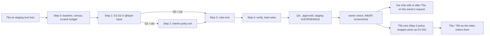

# Plan: T5a follow-up, rich-text spacing (owner request, E5a.6)

Slug: `theme-evolution-tailwind-t5a-spacing`
Parent: `docs/plans/theme-evolution-tailwind-t5a.md` (Revision 2.3.1), row **E5a.6** in §8; owner check 3 decisions at the end of `docs/qa/theme-evolution-tailwind-t5a-report.md`. Sibling plans it must not collide with: `docs/plans/theme-evolution-tailwind-t5b.md` (Revision 2.1), `-t6a.md`, `-t6b.md`.
Architect: Claude (for Junior Warner)
Date: 2026-10-26
Revision: 1.1.2. It applies the round 2 closeout's RC-1. Revision 1.1.1 applied round 2 of the review (R2-1; nits n1-n3) to Revision 1.1. Revision 1.1 applied round 1 of `docs/reviews/theme-evolution-tailwind-t5a-spacing-review.md` (APPROVE WITH CHANGES: R1-R5, nits N1-N10) and records the owner's answers to Q1-Q4 (2026-10-26).
Tier: 1. Four rules in `src/tailwind.css` (`@layer base`), one sentence of rules text in `CLAUDE.md` and `AGENTS.md`. No Liquid, schema, template, locale or settings change. Under the owner's answer to Q1 ((a)), Step 2 (the policy-body rule set) does not run; it stays written as the fallback named in Q1.
Builds on: T5a, repo HEAD `fcc1261` `[quoted: orchestrator, 2026-10-26]`. Staging #187953643616 was pushed from `905196f` (T5a deploy note). Since then the repo has taken live's `config/settings_data.json` and `templates/product.json` (`292c6e7`) and live's `sections/header-group.json` (`fcc1261`: the logo is now `evolution-logo-white-trimmed.svg` at width 180), so **staging's settings, product template and header group are older than HEAD's** (review R4). T5a is **not live**.

## Revision 1.1.2 changelog (round 2 closeout)

| Item | What changed | Sections |
|---|---|---|
| **RC-1** | The C-S.10 probe is appended to the end of `body`, not `main`: neither `layout/theme.liquid` nor `layout/password.liquid` renders a `<main>`; both print `content_for_layout` straight into `<body>`. Nothing else changed | §6.1 item 1 |

## Revision 1.1.1 changelog (review round 2)

| Item | What changed | Sections |
|---|---|---|
| **R2-1** (required): C-S.10's validity control existed only on the zoo page | Every C-S.10 page now carries its own control: a **probe** `<div data-rich-text><h5>a</h5><h6>b</h6></div>` appended after the `head` capture (the `h6`'s `margin-top` must read 24 px) and again after the `head-off` capture (must read 0), removed each time before the next capture, so it never appears in a screenshot. Both readings and the removal count must hold for the page's run to be valid. The zoo control stays for the zoo runs | §6.1 item 1, C-S.10 |
| n1 | C-S.10's displacement allowance is the **sum** of the listed deltas of every match before the element | C-S.10 |
| n2 | If `R_new` contains a modified existing rule (Lightning CSS merging a D1-D2 block into a neighbour), C-S.11 goes red and the Coder or QA **stops with a coder question**; it is not treated as a defect in D1-D2 | §6.1 item 1, C-S.11 |
| n3 | §9's "not read from the owner's screenshots" line now says the live values in §0 (since Revision 1.1) were read from the 1440 element screenshots at 1:1 CSS px | §9 |
| n4, n5 | No edit. n4: the orchestrator tells the owner that Q1 (a) puts T5b ahead of T6a/T6b. n5: `t6a.md:22` and `t6b.md:20` are historical changelog rows; §5.5's hand-off doesn't ask for them to change | none |

No design, step, decision or criterion number changed.

## Revision 1.1 changelog (review round 1, owner answers)

| Item | What changed | Sections |
|---|---|---|
| **Owner answers** | Q1 (a), Q2 (a), Q3 (a), Q4 (a), all 2026-10-26. Owner: "Go with your recommendation for the plan and check 6." `[quoted]` `docs/qa/theme-evolution-tailwind-t5a-report.md` "Owner check 3 decisions" (the "T5a spacing plan open questions" bullet). Step 2 does not run | header, §3.3, §7.1, §8 |
| **R1** (required): misattributed owner quote | "Otherwise close to live" was the plan's reading, not the owner's words; removed from §0 and §1.1 and replaced by the measured basis (the 1440 A pair differs by 62 px: the `h5`→`h6` gap, the `h6`→`p` gap and the header row; other gaps match within about 2 px `[quoted]` review "Summary"). Live's `G_56`, `G_6p`, `H_hdr` and `X_col` added to §0. §7.2 tells the owner head will not equal live, by design | §0, §1.1, §7.2 |
| **R2** (required): Q1 lacked its evidence | (i) **Policy-body census** (§3.1, `N_pol`): the one published policy body (`/policies/privacy-policy`; the other six handles 404) contains **0** `h5`, `h6`, `table`/`th`/`td`, `hr`, `blockquote`, `details`/`summary`, and 13 `h2` `[derived]` from T5a Step 0's toggle-diff reference (method in §0). Step 0 item 2a re-counts it directly on live, read-only. The live-vs-staging comparison of Shopify and app markup already made in owner check 3 is cited. Sample B is relabelled in the harness. (ii) Q1 (a)'s dependency on T5b Q5b.3 (b), which is ⚑ and restyles the policy title, and the fallback if the owner declines it at T5b. (iii) Q1 (a) puts T5b before T6a/T6b. **Q1 stays answered**: the count is 0 for every element type this plan fixes or Sample B shows | §0, §3.1, §3.3, §5.4, §6.1, §7.1, §8 |
| **R3** (required): the (b+) breach was put on the wrong gate | Under T5b (b+), T5b's own gate passes (about 59,704 to 59,808) and the later of T6a/T6b breaches (about 60,134 to 60,238). Named as a cost of D1-D2's 284 B; hand-offs added for the T6 index and T6a §5.6 | §5.3, §5.5 |
| **R4** (required): C-S.10 could go red on a correct build | The base is now the **same head page with D1-D2 removed in-page** (CSSOM same-page toggle), not staging. A base-vs-base noise capture is added for the open Supercycle picker. The displacement exception covers every element after a matched one in document order, and ancestors' heights, by the listed delta. "Builds on" corrected | header, §6.1, §6.2 C-S.10, §8 |
| **R5** (required): C-S.5 undefined on ZR, blind to D2c and `vertical-align` | C-S.5 states its measurands per fixture and adds computed-style assertions for every header-row and row-header `th` (four paddings by position, `vertical-align: baseline`) | §6.2 C-S.5 |
| N1 | §3.2 says why `@layer base`, not `components`; C-S.4's red column names "D1 in `@layer components`" | §3.2, C-S.4 |
| N2 | `H_hdr` compares with the **first** body row | §0, C-S.5 |
| N3 | **Declined, recorded as accepted:** `tfoot th` gets `vertical-align: baseline` where prose's `tfoot td` is `top`. Splitting it costs a fifth rule (about +50 B) for a `th` inside `tfoot`, which merchant tables rarely have, and the two values differ only for multi-line cells | §3.2 |
| N4 | D1-D2 don't honor `not-prose`; accepted (0 uses in the theme) | §3.2 |
| N5 | T5b's lower bound is −420 (`S_pol` = 396 at HEAD), not −515 | §5.3 |
| N6 | Q1 (b) + T5b Q5b.3 (a) + T6a + T6b: 60,030 to 60,134, not "about 60,054" | §5.3 |
| N7 | C-S.12 states numbers for zoo P | C-S.12 |
| N8 | §3.1 cites where the `inline_richtext` settings render, not their schema lines | §3.1 |
| N9 | §5.2's new sentence reworded as suggested; C-S.9's counts unchanged | §5.2 |
| N10 | T5b hand-off: a T5b census reusing `OWN_SHOP` would class the policy body (under `.shopify-policy__container`) as Shopify-owned | §5.5 |

Rev 1.1 sweep: see §9 "Revision 1.1 checks".

**Owner request (2026-10-26, verbatim):** "The spacing on the staging screenshots looks off, let's fix those."

**What this plan is, in one sentence.** Give the elements that the typography plugin leaves unstyled inside merchant rich text (`h5`, `h6`, and a header row of `th` cells without a `thead`) designed spacing, through rules scoped to `[data-rich-text]`, and leave bare (unwrapped) markup alone, because the only merchant-authored bare surface is the policy body, which T5b already plans to wrap in `prose` (Q1 (a), the owner's answer of 2026-10-26).

---

## 0. Referent table

Tags: `[measured]` read from a repo file while planning (2026-10-26); `[derived]` computed, arithmetic shown; `[quoted]` from a named file, not re-measured; `[provisional]` an estimate that Step 0 or QA confirms (**no decision or criterion rests on one**); `[to be measured]` Step 0 or QA measures it.

| Sym | What it measures | Units | Artifact | Extent or band | Value, method or threshold |
|---|---|---|---|---|---|
| `B_min`, `B_gz` | CSS budget | bytes | `assets/tailwind.css` | whole file | 60,000 minified, 12,000 gzip `-9` `[quoted]` `CLAUDE.md` "### Performance & Core Web Vitals" |
| `M_gz` | gzip method | n/a | shell | whole file | `gzip -9 -c assets/tailwind.css \| wc -c` `[quoted]` `CLAUDE.md` "### QA" |
| `S_0` | committed size before this plan | bytes | `assets/tailwind.css` at HEAD | whole file | **58,850 / 11,269** `[quoted]` T5a QA report "Gates" and deploy note "Gates". Step 0 item 1 re-measures |
| `S_A` | compiled bytes of D1-D2 (§3.2) | bytes, minified | the four rules as Lightning CSS prints them | four rules | **284** `[derived]`: 55 + 82 + 75 + 72, each the character count of the minified string in §3.2's "Compiled" column. Gzip delta `[provisional]` +90 to +130 |
| `S_P` | compiled bytes of the Q1 (b) policy set (§3.4) | bytes, minified | seven rules | seven rules | about **490** `[provisional]` (per-rule estimates in §3.4); only built under Q1 (b) |
| `P_sp` | **the gate figure**: this plan's end state built in scratch | bytes | scratch copy of HEAD with Step 1 (and Step 2 under Q1 (b)) | whole file | `[to be measured]` Step 0 item 5. Projection `S_0 + S_A` = **59,134** minified `[derived]`; gzip `[provisional]` 11,359 to 11,399 |
| `F_t` | font size of a prose table | px | rendered page | `table` inside the A box | 14 = 16 × 0.875em `[derived]` from the plugin's `table { font-size: em(14, 16) }` (`node_modules/@tailwindcss/typography/src/styles.js`, `base` modifier, `table`) `[measured]` |
| `P_td` | prose `tbody td` padding | em / px | compiled CSS | `.prose :where(tbody td,tfoot td)` | `.571429em` on all four sides `[measured]` in `assets/tailwind.css`, = 8 px at `F_t` `[derived]`; first child `padding-inline-start: 0`, last child `padding-inline-end: 0` `[measured]` `styles.js` |
| `M_h4` | prose `h4` margins | em | compiled CSS | `.prose :where(h4)` | `margin-top: 1.5em; margin-bottom: .5em` `[measured]` in `assets/tailwind.css` |
| `G_56` | **gap between `h5` and `h6`** in Sample A | px | rendered zoo, Sample A | `h5` border-box bottom to `h6` border-box top (border box, not ink) | live: **about 27** `[quoted]` review R1, read from `zoo-A-live-1440.png` (Dawn's `h6` `margin-top` 1.67em × 16 = 26.7 `[derived]`). Staging: **0** `[derived]` (Preflight's zero margins; the plugin styles no `h5`/`h6`). Head: **24 ±1** `[derived]` (`h6` `margin-top` 1.5em × 16 px = 24 collapses with `h5`'s `margin-bottom` 0.5em = 8; max = 24). Step 0 item 4 measures live and staging |
| `G_6p` | gap between `h6` and the paragraph after it, Sample A | px | as `G_56` | `h6` border-box bottom to `p` border-box top | live: **about 27** `[quoted]` review R1 (Dawn's 1.67em beats the `p`'s 20). Staging and head: **20 ±1** `[derived]`: the `p`'s prose `margin-top` 1.25em = 20 collapses with `h6`'s 0 (staging) or new 8 (head). A guard, not a test (§6.2) |
| `X_col(c)` | **column alignment**: for column `c`, the header-row `th`'s content-box left minus the content-box left of the `td`s in the same column | px | rendered zoo, the 3×3 table (header row of `th` inside the implicit `tbody`) | content box = border-box left + `padding-left` | live: c1 **about +14** (Dawn's `padding: 1em` at 14 px on the `th`; the first `td` is 0) `[quoted]` review R1, `[derived]` 1em × `F_t`; c2, c3 about +6 (14 − 8) `[derived]`. Staging: c1 **0**, c2 **−8**, c3 **−8** `[derived]` (`th` padding 0; `td` padding 8 except the first column's 0). Head: **0 ±1** for every `c` |
| `H_hdr` | header-row height minus the **first** body row's height (review N2: prose's `tbody tr:last-child` has no bottom border), same table | px | rendered zoo | `tr` border boxes | live: header row **about 52** `[quoted]` review R1, so about +12. Staging: **−16** `[derived]` (header 24 = one 24 px line at `F_t` × 1.714286 line height; body 8 + 24 + 8 = 40). Head: **0 ±1** |
| `X_tbl` | first column's content-box left minus the table's border-box left | px | rendered zoo | first `th` and first `td` of each row | **0 ±1** on both builds `[derived]` (prose's convention: the table aligns with the text column; Q3 decides) |
| `PT_th` | `padding-top` of a `thead th` | px | rendered fixture `ZT` (§6.1) | computed | **0 on both builds** `[derived]`: the plugin gives `thead th` no top padding |
| `M_nest` | `margin-top` of an `h5` that is the **first child of a nested `div`** in A, and `margin-bottom` of an `h6` that is its **last child** | px | rendered fixture `ZN` (§6.1) | computed | **0 and 0 on both builds** `[derived]`: the T0 trims `:is(p, h1, …, h6):first-child` / `:last-child` (`src/tailwind.css`, the two rules after `p:empty`) have specificity (0,1,1) and beat D1's (0,1,0) |
| `Δ_B` | computed-style differences in Sample B's subtree | count of (element, property) | zoo Sample B | every element in the bare box, `::marker` included, no custom properties | under Q1 (a): **0**, `head-off` vs `head` (§6.1 item 1) |
| `N_sel` | **census**: elements the new selectors match, by owner (theme, Shopify, app) | count | rendered pages | every page and state in §6.3 | `[to be measured]` Step 0 item 3. Expected: 0 outside the zoo `[provisional]` |
| `N_pol` | **policy-body census** (review R2): elements of each type inside `.shopify-policy__body` | count per tag | every published policy | `/policies/privacy-policy`, the only one: the six other standard handles return 404 `[quoted]` `docs/qa/evidence/t4cc-facts-base.json` "policies" | **`h5` 0, `h6` 0, `table`/`th`/`td` 0, `hr` 0, `blockquote` 0, `details`/`summary` 0; `h1`-`h4`: 13 `h2`, nothing else** `[derived]`. Method: T5a Step 0's toggle-diff reference for the policy container, `docs/qa/evidence/t5ac-liveprobe-ref.json` (467 entries under `div.shopify-policy__container`). Dawn's stylesheet gave every one of these element types at least one valid declaration that the toggle records (`h1`-`h5` `word-break`; `h6` `margin-block`; bare `table` `font-size`/`table-layout`, cells `padding`; `hr` `margin`; `blockquote` italic and padding; `summary` `list-style`, `[quoted]` T5a §3.4 rows 10, 13-15), so each one present would have entries. Entries exist only for `h1:1` (the title, outside the body), `h2:1`-`h2:13`, `ul`, `li`, `strong`, `a` and the body's `div`s. Policy content is store-level, so live serves the same body; the capture is from T5a Step 0 (2026-10-23/24). `[to be measured]` directly on live, read-only, at Step 0 item 2a |
| `G` | geometry tolerance | px | border box (`getBoundingClientRect`) | per edge | ±1 `[quoted]` T5a §0 |
| `W` | widths | px | viewport | n/a | 375 × 667 and 1440 × 900 `[quoted]` `CLAUDE.md` "### QA" |

Readings that are easy to confuse, stated once:

- **"Sample A" and "Sample B" are the owner-evidence fixtures**, not theme surfaces. A = the content inside `<div class="prose prose-tokens max-w-none" data-rich-text>`; B = the same content with no wrapper (`docs/qa/evidence/t5as-owner/zoo.mjs`). §2.3 maps each to the real places it stands for.
- **Live is a reference for A, not for B, and not a target for either.** Apart from D1-D2's elements, A on staging matches live: the 1440 A pair differs by 62 px in height, made up of the `h5`→`h6` gap, the `h6`→`p` gap and the header row, and every other gap matches within about 2 px `[quoted]` review "Summary" (the Architect's reading, not the owner's words; Revision 1 misattributed it, review R1). Head will still not equal live, by design (`G_56` 24 vs about 27, `G_6p` 20 vs about 27, header row 40 vs about 52, live's first header cell inset about 14 px from its column). B on live is Dawn's leftovers (a transparent `hr` with 80/112 px margins, 22.4 px table text, `[quoted]` T5a §3.4 rows 13-14); nothing here restores them.
- **The table in the zoo has no `<thead>`.** Its first `<tr>` holds `th` cells and lands inside the parser's implicit `<tbody>`. The plugin styles `thead th` and `tbody td`, never `tbody th`, which is the whole cause of the A table finding `[measured]` `styles.js` (`'thead th'`, `'tbody td, tfoot td'`; no `th` rule outside `thead`).

---

## 1. Problem statement and goals

### 1.1 Root cause

T5a removed `assets/base.css`. Two of its leaks reached elements inside `prose` that the typography plugin (v0.5.20, `package.json`) doesn't style at all `[quoted]` T5a §3.4 row 10 and row 13:

1. **`h6` had Dawn's `margin-block: 1.67em`.** The plugin has rules for `h1`-`h4` only. So on staging, inside `prose`, `h5` and `h6` keep Preflight's `margin: 0`: two consecutive minor headings touch (`G_56` = 0), where live shows about a line of space.
2. **Table cells had Dawn's `padding: 1em`.** The plugin pads `thead th` and `tbody td`. A header row written as `<tr><th>…</th></tr>` without a `<thead>` (what the zoo has, and what pasted or hand-written merchant tables often have) gets no padding: the header row is 16 px shorter than a body row (`H_hdr` = −16) and columns 2-3 sit 8 px left of their data (`X_col` = −8).

Everything else in A matches live within about 2 px per gap (§0 "Readings"; the Architect's and reviewer's reading of the 1440 pair, not the owner's words). The `summary` marker returning is not spacing (§2, Q4).

Sample B collapses because nothing styles bare elements at all: Preflight zeroes every margin and padding, and T5a deleted Dawn's partly broken bare-element rules on purpose (E5a.6).

### 1.2 Goals

1. **G1.** Inside merchant rich text, `h5` and `h6` get designed spacing that matches the plugin's own scale (prose's `h4` margins, `M_h4`), so `G_56` = 24.
2. **G2.** Inside merchant rich text, a row of `th` inside `tbody`/`tfoot` is padded like the `td`s around it, so columns align (`X_col` = 0) and the header row is as tall as a body row (`H_hdr` = 0).
3. **G3.** Nothing outside those elements changes: no theme section, no Shopify markup (policy page, privacy widget), no app markup (Supercycle), and, under Q1's recommendation, nothing in bare markup (`Δ_B` = 0).
4. **G4.** Sample B's real surfaces get a stated owner, sequence and decision (Q1), not a silent omission.
5. **G5.** Fit both CSS budgets with room for T5b, T6a and T6b (§5.3).

---

## 2. Non-goals

- **No global (unscoped) element rules** on `p`, `h1`-`h6`, `table`, `hr`, `blockquote` or `details` under the recommendation (Q1 (a)). Theme markup relies on Preflight's zero margins for `p` and `h1`-`h4`, and bare-element rules would reach Shopify and app markup the theme doesn't own.
- **No policy-page restyling** under the recommendation. Policy typography is T5b's Q5b.3 (recommended: `prose` through a layout wrapper). Q1 (b) is the alternative if the owner wants the policy body spaced before T5b.
- **No non-spacing changes** (Q4 (a), the owner's answer): the `summary` disclosure marker and its `cursor` (T5a QA nit 2), the cursor on a link without `href` (Q-C3), the bare `blockquote` being upright, the bare `hr`'s color, the bare table's 16 px text. They stay as staging shows them.
- **No font-weight for `h5`/`h6`** (Q2 (a), the owner's answer) (they render at body weight on live and on staging).
- **No `prose` modifiers** (`prose-sm` and friends) and no JS typography config: `CLAUDE.md` "Rich text" forbids the first without budget sign-off, and "One source, one output" forbids a second Tailwind source.
- **No edits** to Liquid, ``, `config/settings_data.json`, `templates/*.json`, `locales/*`, T5b, T6a or T6b. Hand-offs are listed in §5.5 for the orchestrator.

---

## 3. Proposed design

### 3.1 Where merchant HTML can appear, and what styles it

Measured by ripgrep over `layout`, `sections`, `blocks`, `snippets`, `templates`, and the default locale `[measured]` 2026-10-26.

| Source | Where it renders | Wrapper | Tags it can contain | Covered by |
|---|---|---|---|---|
| `page.content` | `sections/page.liquid:14`, `sections/main-material-archive.liquid:38` | `prose prose-tokens` + `data-rich-text` | full editor HTML (headings, lists, tables, `hr`, quotes) | **A**: D1-D2 apply |
| `article.content`, `comment.content` | `sections/article.liquid:22`, `:36` | same | same | **A** |
| `article.excerpt` | `sections/blog.liquid:28` | same | same | **A** |
| `product.description` | `sections/product.liquid:48` (`max-w-none`) | same | same | **A** |
| Shopify's privacy widget | inside `page.content` on `/pages/data-sharing-opt-out` (T4c E4c.8) | inside an A box | Shopify's own classed markup | **A** box, but Shopify-styled; census (`N_sel`) proves D1-D2 match nothing in it |
| `richtext` setting `about_text` | `sections/footer.liquid:42` | its own variants (`[&_p]:mb-3`, `[&_ul]:list-disc`, …) | `p`, `ul`, `a`, `strong`, `em`, `u` only `[quoted]` shopify.dev "Input settings", `richtext` | unaffected; can't hold `h5`/`h6`/tables |
| `inline_richtext` settings | printed at `sections/image-banner.liquid:388` (heading) and `:405` (text), `sections/related-products.liquid:50` (heading); schema at `:687`, `:728` and `:85` | each template's classes | bold, italic, link only `[quoted]` same page | unaffected |
| `_html` translation keys | `locales/en.default.json` (19 keys) | inline | theme-authored `a`, `span`, `strong` only `[measured]` | unaffected |
| plain `text` settings printed unescaped | `blocks/text.liquid:29`, `sections/product.liquid:34` | none | a merchant *could* type HTML into a `text` field; not an authoring path the theme supports | unaffected (noted in §6, risk R6) |
| `metafield_tag` | none (ripgrep: 0) | n/a | n/a | n/a |
| **Store policy bodies** | Shopify renders `div.shopify-policy__body > div.rte` on `/policies/*` (T4c impl notes, quoted in T5a §1) | **none** | full editor HTML. **On this store today (`N_pol`): one published policy, with 0 `h5`, `h6`, tables, `hr`, `blockquote` or `details`; 13 `h2`, paragraphs, lists, links** | **B**. Today only the scoped list/link rules (`src/tailwind.css`, "Store policy pages" block). Paragraphs and headings already have no spacing on live and staging (since T0's Preflight; T4c screenshot `docs/qa/screenshots/t4cq-head-policy-1440.png` `[measured]`). T5b Q5b.3 (b) wraps it in `prose prose-tokens` **with `data-rich-text`** (T5b §5.2), at which point D1-D2 reach it |
| Shopify-rendered pages and widgets | `/challenge`, accelerated checkout, privacy widget outside `prose` | none | Shopify's classed markup, Shopify-styled | **B**, owner-styled; not the theme's to space |
| App markup | Supercycle app block, `sections/product.liquid:30` (``, a sibling of the description, not inside it); app embed | none | the app's markup and CSS | **B**, owner-styled. Unlayered app CSS beats every theme layer anyway (`CLAUDE.md` "Cascade layers") |

**Conclusion.** The only merchant-authored HTML that can appear bare is the **policy body**. Every other bare element belongs to Shopify or an app, which style their own markup. Sample B is therefore "a policy body today" plus "third-party markup", and the second half overstates what B shows (review R2): the Shopify and app markup on this store was already compared live vs staging in owner check 3, with no bare-element spacing difference (the Supercycle date picker: widget, borders, radii and date fields match, the one difference being its "Close" control's Dawn `.button` look, which the owner kept plain; the opt-out widget: parity runs equal, the checkbox spacing confirmed) `[quoted]` T5a QA report "Owner check 3 decisions". What B's broken look (cells running together, the unspaced `hr` and `blockquote`) would affect on this store today is **nothing**: the one policy body has none of those elements (`N_pol`). What the policy body does show today is unspaced paragraphs and `h2`s, as on live since T0; no part of D1-D2 touches those, and T5b Q5b.3 (b) fixes them.

### 3.2 D1-D2: the A fix (unconditional)

Append to `src/tailwind.css`, in `@layer base`, as a new commented block directly after the rule that ends `display: none; /* merchant HTML: empty elements stay hidden (Q5a.5) */` and its closing `}`, before the comment starting `Browser defaults that Preflight removes`:

```css
  /*
   * Spacing for elements that prose leaves unstyled in merchant HTML (owner, 2026-10-26,
   * T5a E5a.6). h5 and h6 take prose's h4 margins. A row of th inside tbody or tfoot, a
   * header row without thead, takes the td padding, so its columns line up with the data.
   * :where keeps the h5/h6 rule below the first-child and last-child trims above.
   * See docs/plans/theme-evolution-tailwind-t5a-spacing.md.
   */
  [data-rich-text] :where(h5, h6) {
    margin-block: 1.5em 0.5em;
  }
  [data-rich-text] :where(tbody, tfoot) th {
    vertical-align: baseline;
    padding: 0.571429em;
  }
  [data-rich-text] :where(tbody, tfoot) th:first-child {
    padding-inline-start: 0;
  }
  [data-rich-text] :where(tbody, tfoot) th:last-child {
    padding-inline-end: 0;
  }
```

| ID | Rule | Compiled (minified, as Lightning CSS is expected to print it) | Bytes | Why this value |
|---|---|---|---|---|
| D1 | `h5`, `h6` margins | `[data-rich-text] :where(h5,h6){margin-block:1.5em .5em}` | 55 | `M_h4`: `h5`/`h6` render at the body size like prose's `h4`, so they share its rhythm. Live's 1.67em was Dawn's `h6` value, never designed for `prose` |
| D2a | `tbody`/`tfoot` `th` padding | `[data-rich-text] :where(tbody,tfoot) th{vertical-align:baseline;padding:.571429em}` | 82 | exactly `P_td` and prose's `tbody td { vertical-align: baseline }`: a `th` in a body row behaves like the `td`s beside it |
| D2b | first `th` | `[data-rich-text] :where(tbody,tfoot) th:first-child{padding-inline-start:0}` | 75 | prose's first-column convention (`X_tbl` = 0); Q3 |
| D2c | last `th` | `[data-rich-text] :where(tbody,tfoot) th:last-child{padding-inline-end:0}` | 72 | prose's last-column convention |

Sum `S_A` = **284** `[derived]`. If the build prints a different string (for example longhands for `margin-block`), Step 0's measurement wins and the difference is recorded; no criterion rests on 284.

**Why these selectors and this layer.**

- **`[data-rich-text]`, not `.prose`.** `CLAUDE.md` "Custom CSS never selects a Tailwind class name"; `data-rich-text` is the documented, non-JS marker of merchant-HTML wrappers and already carries the empty-element rule. All six wrappers carry it (§3.1), and T5b's policy wrapper will too.
- **`@layer base` works here because the plugin sets none of these properties on these elements.** `prose` lives in `@layer utilities` `[measured]` (compiled file: `.prose{` follows `.my-10{` inside the utilities layer) and would beat a base rule on any property it sets. It sets no `margin` on `h5`/`h6` and nothing on `tbody th` except `text-align` (`'th, td'`), so there is no contest. Base also beats Preflight's `*` reset (specificity (0,1,0) over (0,0,0), same layer, later).
- **`@layer base`, not `@layer components`** (review N1). `CLAUDE.md` "Cascade layers" requires `@layer components` for new section, block and snippet CSS, which would otherwise be unlayered; the "One source, one output" bullet assigns base element styles in `src/tailwind.css` to `@layer base`, and T5a's `[data-rich-text] … :empty` rule sits there. It also matters here: in `components`, D1 would beat T0's base-layer trims whatever their specificity, so a nested first-child `h5` would get 24 px (`M_nest` red, C-S.4).
- **`:where(h5, h6)` keeps D1 at (0,1,0)**, below T0's margin trims at (0,1,1), so an `h5` that starts or an `h6` that ends a nested block still trims (`M_nest`). At the top level of the box, prose's own `> :first-child` / `> :last-child` (utilities layer) trims too.
- **`:where(tbody, tfoot) th`, not `th`.** `thead th` keeps prose's design (no top padding, bottom-aligned, `PT_th` = 0).
- **Accepted limitation.** Prose zeroes the element after an `h2`/`h3`/`h4` (`h4 + * { margin-top: 0 }`); a base rule can't do that against `prose`'s utilities-layer `p` margin, so after an `h5`/`h6` the next block keeps its own top margin (`G_6p` = 20, not prose's 8 after `h4`). Reaching that would mean nesting rules inside `@utility prose-tokens` and relying on Tailwind's utility sort order (today `.prose-tokens{` compiles after every `.prose` rule `[measured]`, but that order is not a documented guarantee). Rejected as fragile for 12 px of rhythm.
- **Accepted: `tfoot th` gets `vertical-align: baseline`** where prose's `tfoot td` is `top` (review N3, declined as a change). Splitting D2a costs a fifth rule (about +50 B) for a `th` inside `tfoot`, which merchant tables rarely carry, and the two values differ only when a cell wraps to several lines.
- **Accepted: D1-D2 ignore prose's `not-prose` escape** (review N4). No theme markup uses `not-prose` (grep: 0); a merchant would have to type the class into the editor's HTML view, and inside such a block an `h5`/`h6` or `tbody th` would still get D1-D2's spacing, which is harmless.

### 3.3 Sample B: decision Q1

| Option | What ships here | Policy pages before T5b | Risk to Shopify/app markup | CSS | Recommended |
|---|---|---|---|---|---|
| **(a), the owner's answer (2026-10-26)** No bare-element rules. The policy body, B's only merchant surface, is spaced by T5b Step 3 under Q5b.3 (b), whose wrapper carries `prose` **and** `data-rich-text`, so D1-D2 reach it too. **Depends on T5b Q5b.3 (b)**, which is T5b's recommendation and needs no owner answer before coding, but is ⚑: it is reviewed on staging before live (T5b, the line after Q5b.3: "The ⚑ items are reviewed on staging before live"), and it carries more than spacing: **the policy title becomes the only page title not in the heading font** (T5b Q5b.3 (b), third cost). **Fallback:** if the owner declines Q5b.3 (b) at T5b (choosing (a), keep the scoped rule), no plan spaces the policy body; then this plan's §3.4 set is built as T5b's follow-up (a new small plan or a T5b revision), not left undone. **Order:** choosing (a) also puts T5b (at least its Step 3) ahead of T6a/T6b (§5.4) | D1-D2 only | unchanged (as on live since T0): paragraphs and its 13 `h2`s unspaced; none of B's broken elements present (`N_pol`) | none | +284 | **yes** |
| (b) Interim policy-scoped spacing now (§3.4), deleted automatically by T5b Step 3 under Q5b.3 (b) (it deletes every rule whose selector starts with `.shopify-policy__body`, T5b Revision 2 R6 coupling), or kept as the policy typography under Q5b.3 (a) | D1-D2 + Step 2 | spaced | none (scoped to Shopify's policy container) | +284 + about 490 | no |
| (c) Global rules on bare `h5`, `h6`, `blockquote`, `hr`, unclassed `table` cells, excluding `[data-rich-text]` descendants | D1-D2 + global rules (would return to the Architect for design) | partly: the paragraphs and `h1`-`h4` that make up most of a policy stay collapsed | **real**: any Shopify or app element of those types that leaves a property to the reset changes (the Supercycle picker's markup is unknown; Step 0 item 3 records it) | about +300 to +400 `[provisional]` | no |

Why (a): it fixes B where it matters (the policy body) with the mechanism the owner has already been offered in T5b, at no extra bytes, without touching markup the theme doesn't own, and without a throwaway rule set. Its cost is time: policy pages stay as they are until T5b Step 3 ships. Because (a) leaves Sample B unchanged in this plan, it narrows the owner's "fix those", so it needed the owner's explicit yes. **The owner gave it on 2026-10-26** (§7.1). The evidence review R2 asked for (`N_pol`) came afterwards and doesn't change the picture: the one policy body has none of the elements B shows broken, so (a) leaves nothing on the store visibly worse than the screenshots suggest; the policy body's unspaced paragraphs and `h2`s are pre-existing (since T0) and are T5b's subject under every option except (b) here.

### 3.4 Q1 (b) only: the interim policy set (Step 2)

**Not built in this plan:** the owner chose Q1 (a). Kept as written because it is Q1 (a)'s named fallback if T5b's Q5b.3 ends at (a). The text below is the spec for that case.

Only if the owner chooses Q1 (b). Insert in `src/tailwind.css` directly after the rule `.shopify-policy__body a:hover { text-decoration-thickness: 0.2rem; }`:

```css
  /* Interim policy-body spacing (Q1 (b), docs/plans/theme-evolution-tailwind-t5a-spacing.md); T5b Q5b.3 decides the final styling. */
  .shopify-policy__body :where(p, ul, ol, blockquote, table) {
    margin-block: 1.25em;
  }
  .shopify-policy__body :where(h1, h2, h3, h4, h5, h6) {
    margin-block: 1.5em 0.5em;
  }
  .shopify-policy__body :where(hr) {
    margin-block: 3em;
  }
  .shopify-policy__body :where(blockquote) {
    padding-inline-start: 1em;
  }
  .shopify-policy__body :where(th, td) {
    padding: 0.5em;
    text-align: start;
  }
  .shopify-policy__body :where(th, td):first-child {
    padding-inline-start: 0;
  }
  .shopify-policy__body :where(th, td):last-child {
    padding-inline-end: 0;
  }
```

Values are prose's own (`p` 1.25em, `hr` 3em, `blockquote` inset 1em, `h4`-like headings) so that a later move to `prose` changes as little as possible; the cell padding is 8 px at the bare table's 16 px. Spacing only: no font size, weight, color or style. `S_P` about 78 + 81 + 53 + 65 + 72 + 72 + 69 = **490** `[provisional]` (character estimates). Every selector starts with `.shopify-policy__body`, so T5b Step 3 deletes all seven under Q5b.3 (b) with no T5b edit; T5b's `S_pol` grows by `S_P` and its Step 0 re-measures.



---

## 4. Affected files and modules

| File | Change | Step |
|---|---|---|
| `src/tailwind.css` | D1-D2 block (§3.2), in `@layer base` | 1 |
| `src/tailwind.css` | interim policy set (§3.4), **only under Q1 (b)** | 2 |
| `assets/tailwind.css` | rebuilt by `npm run build:css`, committed with each source change | 1, 2 |
| `CLAUDE.md`, `AGENTS.md` | the "Rich text" bullet's `data-rich-text` sentence (§5.2) | 3 |
| `docs/qa/harness/t5as-zoo2.mjs` (new, by the Coder at Step 0; QA may copy it) | the zoo harness, extended (§6.1) | 0 |
| `docs/plans/theme-evolution-tailwind-t5a-spacing-impl-notes.md` | Coder's notes | 4 |

Not touched: every `.liquid` file, every ``, `config/*`, `templates/*.json`, `locales/*`, `scripts/check-css-layers.mjs` (no new layer), the other plans.

---

## 5. Data model and API changes

### 5.1 Data and schemas

None. No setting, block, section, template, locale key or metafield is added, renamed or removed. Theme check stays at 0 offenses `[quoted]` T5a QA "Gates".

### 5.2 Rules text (Step 3)

In both `CLAUDE.md` and `AGENTS.md` (the "Rich text" bullet under "### CSS architecture (Tailwind CSS v4)"), replace exactly:

> `` `data-rich-text` marks those merchant-HTML wrappers and carries one rule in `src/tailwind.css` (empty elements inside stay hidden); ``

with:

> `` `data-rich-text` marks those merchant-HTML wrappers and carries rules in `src/tailwind.css` for merchant HTML (empty elements stay hidden; `h5`, `h6` and `th` cells outside `thead` get spacing that `prose` doesn't give them); ``

The rest of the bullet stays byte-identical. In particular T5b Step 4's two replacement strings ("outside store policy pages (which keep a scoped rule in `src/tailwind.css`), no base rule underlines links or restores list markers any more" and "Use plain `prose` only:") must still match exactly once in each file after this edit (C-S.9).

### 5.3 CSS budget

| State | Minified | Gzip | Basis |
|---|---|---|---|
| `S_0` (T5a) | 58,850 | 11,269 | `[quoted]` §0 |
| + D1-D2 (Q1 (a)) | **59,134** | 11,359 to 11,399 | `[derived]` / `[provisional]` |
| + Q1 (b) policy set (not built: the owner chose (a)) | about 59,624 | about 11,520 to 11,580 | `[provisional]` |
| Q1 (a), then T5b (any option but (b+): −420 to +80; −420 because `S_pol` is 396 at HEAD, which has no policy-body `:empty` rule, review N5) | 58,714 to 59,214 | ≤ 11,449 | `[provisional]` T5 index rows, corrected |
| Q1 (a), then T5b (any option but (b+)), then T6a (≤ +210 / +85) and T6b (≤ +220 / +70) | ≤ 59,644 | ≤ 11,604 | `[provisional]` T6a §5.6, T6b RR2-2 |
| Q1 (a), then T5b with (b+) (owner's choice only, not recommended) | **59,704 to 59,808**: T5b's own gate **passes** | measured by T5b | `[derived]` review R3: 59,134 + 570 (rest of T5b recommended); 59,134 + 80 − 396 + 40 + 950 (Q5b.1 (b), Q5b.2 (a) or (b)) |
| same, then T6a and T6b at their upper bounds | about **60,134 to 60,238: over `B_min`**; the **later of T6a/T6b** stops at its Step 0 gate | | `[derived]` + 430. **A cost of D1-D2's 284 B:** before this plan the (b+) path ended at about 59,922 with 78 B spare (T6 index `:61`, `:65`; T6a §5.6 `:515`) |
| Q1 (b), T5b Q5b.3 (a) keeps the set, then T6a + T6b | **60,030 to 60,134**: over `B_min` over T5b's branches (review N6) | | `[provisional]`; a reason (b) was not recommended |

This plan's own gate: `P_sp` ≤ 60,000 and ≤ 12,000 (Step 0 item 5). Both projections above pass it with at least 376 B / 420 B spare.

**What the 284 B costs later (review R3).** On every path except T5b (b+), T5b + T6a + T6b still fit (≤ 59,644 / 11,604). With (b+), they no longer fit together unless T6a or T6b lands below its upper bound. Whoever asks the owner T5b's (b+) question must say so (§5.5).

### 5.4 Sequencing

1. **This plan** commits on top of T5a on `main`, goes through QA and `.approved`, and is pushed to staging #187953643616 (the `theme-evolution-tailwind-*` exception, `CLAUDE.md` "### DevOps"). Never publish that theme.
2. **Live:** with T5a or after it, never before, and only when the owner explicitly asks for T5a live. The pre-live checks are T5a's C5a.25 live probe plus this plan's C-S.8 census on live (both read-only).
3. **T5b next, ahead of T6a/T6b** (a consequence of Q1 (a), review R2 (iii); the project's earlier working order had T6a/T6b next). Its Step 0 starts from this plan's tree and re-measures the budget (T5b §4.1). Steps 1 and 3 don't wait for Q5b.1 (T5b §5 flow), so the policy wrapper (B's real fix under Q1 (a)) can ship before the line-height decision. If the owner declines Q5b.3 (b) there, §3.4's set follows as Q1 (a)'s fallback (§3.3).
4. **T6a, T6b** after T5b (at least its Step 3); their Step 0 measures on the tree they start from. No selector overlap: T6a is the collection grid, T6b the cart drawer, cart page and tooltip.

### 5.5 Hand-offs (for the orchestrator; this plan edits no other doc)

| To | Note |
|---|---|
| T5b §3 / Step 3 / V3 | After Step 3, D1-D2 apply inside the policy wrapper (it carries `data-rich-text`): policy `h5`/`h6` and `th` rows would gain spacing (the one policy body has none today, `N_pol`). T5b's V3 screenshots show it; not a new T5b decision. Q1 is (a), so `S_pol` stays T5b's own figure |
| T5b, any census reusing this plan's C-S.8 owner classes (review N10) | The policy body sits under `.shopify-policy__container`, which `OWN_SHOP` lists (`docs/qa/harness/t5ac-lib.mjs:271`). After the wrapper, a census of D1-D2's selectors would class merchant policy content as Shopify-owned and stop on a correct build. Treat matches inside `.shopify-policy__body` as merchant content |
| T5b Q5b.3 owner question | Q1 (a) depends on Q5b.3 (b); if the owner chooses (a) there, this plan's §3.4 set is the fallback (§3.3) |
| T5b (b+) owner question, T6 index `:61`/`:65`, T6a §5.6 `:515` (review R3) | Their "about 59,922 (78 B spare)" for the (b+) path no longer holds: after this plan, (b+) plus T6a and T6b at their upper bounds is about 60,134 to 60,238, over `B_min`. T5b's gate passes; the later of T6a/T6b stops. The (b+) question must say so |
| T5b §5.4 | The "Rich text" bullet changed in one sentence (§5.2); T5b's replacement strings are untouched |
| T5 index budget table | Add a row for this plan (59,134 / measured gzip) when `P_sp` is measured; correct the T5b lower bound to −420 (N5) |
| T5a §8 E5a.6 | The owner did not accept E5a.6; this plan restores spacing inside `prose`; under Q1 (a) bare markup is deferred to T5b's policy wrapper; E5a.6's non-spacing items are accepted (Q4) |
| Project order | Q1 (a) puts T5b (at least Step 3) ahead of T6a/T6b (§5.4) |

---

## 6. Risks, edge cases, verification and open questions

### 6.1 The harness `t5as-zoo2.mjs`

Copy `docs/qa/evidence/t5as-owner/zoo.mjs` with these changes:

1. **Builds:** `live` (no `preview_theme_id`) and `staging` (#187953643616, T5a) are **owner evidence only**: staging's settings, product template and header group are older than HEAD's (header line, review R4), so no criterion compares them pixel for pixel with head. `head` is the dev theme's preview id that `shopify theme dev` prints (or staging again after the push). **`head-off`** is the same head page, same load, with **`R_new`** deleted from the CSSOM of `tailwind.css`, as T5a's same-page toggle did. `R_new` = every rule of head's compiled `assets/tailwind.css` that the pre-Step-1 build (HEAD `fcc1261`'s committed file) lacks, by a rule-level diff of the two files (on a correct build, exactly D1-D2's four rules; C-S.11 checks that). Deleting the whole diff, not four named rules, means any rule built by mistake is toggled too, so C-S.7 and C-S.10 see its effects. The run is invalid unless the number of removals equals `|R_new|`. If `R_new` holds anything other than D1-D2's four rules, for example an existing rule that Lightning CSS merged with a D1-D2 block (deleting it would also remove that rule's original effect), C-S.11 is red and the run **stops with a coder question**; that is a build-output issue to rule on, not a defect in D1-D2 (review n2). **Controls, both required for a valid run** (review R2-1): on the zoo page, `head-off` reads `G_56` = 0 and `X_col(2)` = −8. On **every other page** (C-S.10's sweep, the picker page, the opt-out page), a probe: after the `head` capture, append `<div data-rich-text><h5>a</h5><h6>b</h6></div>` to the end of `body` (neither layout renders a `<main>`: both print `content_for_layout` straight into `<body>`), read the `h6`'s computed `margin-top` (must be 24 px), and remove the probe; delete `R_new` and capture `head-off`; append the probe again, read the `margin-top` (must be 0), and remove it. The probe is never present during a capture. A page whose probe readings don't both hold has no valid run. Every criterion that says "base" means `head-off`. Login through `t0-lib.mjs`'s `loginState` as today; never log or print the storefront password.
2. **Relabel Sample B** (review R2): "SAMPLE B: plain markup (store policy bodies today)". Sample A's label stays.
3. **Sticky header:** before each element screenshot, set `position: static` on the header section in the page (the same injected `<style>` in every build). The 375 owner shots are partly covered by the sticky header.
4. **Fixtures added to both samples** (after the existing content): `ZT`, a table with `<thead><tr><th>…</th></tr></thead><tbody><tr><td>…` (3 columns); `ZR`, a row-header table `<tr><th>Small</th><td>148 cm</td><td>45-60 kg</td></tr>` ×2; `ZN`, `<div><h5>Nested five</h5><p>x</p><h6>Nested six</h6></div>`.
5. **Measurements** written to JSON next to the PNGs, for `live`, `staging`, `head` and `head-off`: `G_56`, `G_6p`, `X_col(1..3)`, `H_hdr`, `X_tbl` (zoo table), `X_tbl` (ZR), `PT_th` (ZT), `M_nest` (ZN), the computed `padding-top/right/bottom/left` and `vertical-align` of every header-row `th` (zoo table) and row-header `th` (ZR), and Sample B's full computed-style snapshot (for `Δ_B`).
6. **Q1 (b) only** (not run; the owner chose (a)): a third sample `P`, the same content injected into the real `.shopify-policy__body` on `/policies/privacy-policy` (inserted before its first child), plus a full-page policy screenshot.

Outputs: `docs/qa/evidence/t5asp-<build>/zoo-{A,B[,P]}-<build>-{375,1440}.png` and `measure-<build>-<width>.json`.

### 6.2 Acceptance criteria and the pre-review sweep

"Red build" is a build this plan's text permits by mistake; "reachable" says whether the plan's other rules allow it; "upstream" names an earlier criterion that already catches it.

| ID | Criterion (pass) | Red on | Reachable? | Upstream? | Green on correct build? | Kind |
|---|---|---|---|---|---|---|
| C-S.1 | `npm ci && npm run check` exits 0; theme check 0 offenses | an uncommitted or stale `assets/tailwind.css`; a broken layer statement | yes | none | yes | gate |
| C-S.2 | `P_sp` ≤ 60,000 and ≤ 12,000 (`M_gz`); the committed file equals `P_sp` | Q1 (b) plus an unexpected size | unlikely (§5.3) | none | yes | gate |
| C-S.3 | Zoo A, 375 and 1440: `G_56` = 24 ±1 in `head` (0 in `head-off`) | D1 missing, wrong selector, or in a layer below Preflight | yes | none | yes | test |
| C-S.4 | Zoo `ZN`: `M_nest` = 0 and 0 | D1 written `[data-rich-text] h5, [data-rich-text] h6` (0,1,1), which out-orders T0's trim; **D1 placed in `@layer components`**, which beats the base-layer trims (review N1) | yes | not by C-S.3 (the top-level `h5` is trimmed by prose either way) | yes | **mechanism** test |
| C-S.5 | Measurands by fixture (review R5). **(a) Zoo A's 3×3 table** (a header row of `th`, then two `td` rows): `X_col(c)` = 0 ±1 for c = 1..3, `H_hdr` = 0 ±1 against the first body row, `X_tbl` = 0 ±1. **(b) `ZR`** (every row starts with a row-header `th`; there is no header row, so `X_col` and `H_hdr` don't apply): `X_tbl` = 0 ±1 for each row. **(c) Computed style, both fixtures:** every header-row `th` (a) and row-header `th` (b) has `vertical-align: baseline`; `padding-top` and `padding-bottom` 8 px (±0.1 at `F_t` 14 px); `padding-left` 0 on a row's first cell and 8 px otherwise; `padding-right` 0 on a row's last cell and 8 px otherwise | D2a missing (X = −8, H = −16, paddings 0, `vertical-align` `middle`); D2a without `vertical-align` (c red); D2b missing (`X_col(1)` = +8, `X_tbl` = +8, first `padding-left` 8); **D2c missing** (last `padding-right` 8; invisible to X and H in a full-width table) | yes | none | yes | test |
| C-S.6 | Zoo `ZT`: `PT_th` = 0 and every `thead th` computed padding equals `head-off`'s | D2 written as `[data-rich-text] th` (adds top padding to `thead th`) | yes | not by C-S.5 (no `thead` there) | yes | **mechanism** test |
| C-S.7 | Under Q1 (a): `Δ_B` = 0 (zoo B, `head-off` vs `head`, both widths) | any global element rule (option (c) built by mistake, or an unscoped D1) | yes | none | yes | test; distinguishes (a) from (c) |
| C-S.8 | Census `N_sel` on head: every match of D1's or D2's selectors is in the zoo or in merchant content on a fixture page, listed by page; **0 matches owned by Shopify or an app** (owners as T5a's `OWN_SHOP` / `OWN_APP`, `docs/qa/harness/t5ac-lib.mjs`), including the opt-out widget and the Supercycle block with its date picker open on `/products/the-rental-snowboard`. Pre-live: the same census on live (read-only) | a selector that reaches Shopify or app markup | only if the privacy widget or the app renders `h5`/`h6`/`tbody th` inside an A box | none | yes if the expectation holds; a nonzero Shopify/app count is a stop, not a pass | test |
| C-S.9 | Rules text: §5.2's new sentence occurs once in `CLAUDE.md` and once in `AGENTS.md`; the old sentence occurs 0 times; T5b Step 4's two old strings each occur exactly once per file | a mangled bullet | yes | none | yes | test |
| C-S.10 | Same-page sweep, `head-off` (base) vs `head`, one load per page and width (review R4: never staging, whose settings, product template and header group predate `292c6e7`/`fcc1261`): T5a's 18-page set at 375 and 1440 `[quoted]` T5a QA "Cross-build parity", plus `/products/the-rental-snowboard` with the Supercycle date picker open, and the opt-out page. Pass: 0 differing pixels and no rect moving beyond ±`G`, **except** (1) elements C-S.8 listed as matched, (2) every element after a matched one in document order, moved by exactly the **sum of the listed deltas of every match before it** (±`G`, review n1), and each ancestor's height grown by the sum of the deltas of the matches inside it (T5a review R11's rule), (3) on the picker page, pixels inside the regions a **base-vs-base noise capture** (two `head-off` screenshots of the open picker, same load) shows differing. Valid on a page only if the removal count equals `|R_new|` and that page's probe reads 24 px in `head` and 0 in `head-off` (§6.1 item 1, review R2-1) | any leak C-S.8's static count misses (for example an inherited effect); any extra rule in `R_new`, such as Q1 (b)'s set built by mistake (the policy page is in the set) | yes | partly C-S.8 | yes: same tree, same load, only `R_new` toggled | test |
| C-S.11 | Static: the new rules sit inside `@layer base` in `src/tailwind.css`; no new selector contains `.prose` or any other Tailwind class name; `R_new` (§6.1 item 1) is exactly D1-D2's four rules | `.prose :where(h5)`, a rule outside the layer, or any extra compiled rule (a global rule, Q1 (b)'s set). A modified existing rule in `R_new` (a Lightning CSS merge) also turns it red; that case is a stop with a coder question, not a D1-D2 defect (review n2) | yes | C-S.3 might still pass with `.prose` | yes | test |
| C-S.12 | Q1 (b) only (not applicable: the owner chose (a)): on the policy page, consecutive paragraphs are 20 ±1 apart (1.25em at 16 px); zoo `P`: `G_56` = 24, `X_col(c)` = 0, `H_hdr` = 0, `X_tbl` = 0 (each ±1; cells 8 px at the bare 16 px, review N7) | Step 2 missing or mis-scoped | only under (b) | none | yes | test |
| C-S.13 | `G_6p` = 20 ±1 on both builds | none reachable: D1's `margin-bottom` (8) can't exceed the `p`'s 20 | no | n/a | yes | **guard**, not a test: it documents the accepted limitation in §3.2 |
| C-S.14 | Owner evidence: zoo A and B (and P under (b)) at 375 and 1440 for live, staging and head, side by side in the QA report, with §0's live/staging/head figures for `G_56`, `G_6p`, `H_hdr`, `X_col` as measured | missing evidence | yes | none | yes | delivery |

**Can the criteria tell the chosen design from the rejected ones?** Global rules (Q1 (c)): C-S.7 and C-S.11 go red (the rules are in `R_new`, so `head-off` removes them and `Δ_B` ≠ 0). `.prose`-scoped or `@utility prose-tokens` rules: C-S.11 goes red. Higher-specificity heading rule: C-S.4. Unscoped `th` rule: C-S.6. Each rejected alternative has one criterion that fails it while D1-D2 pass all of them.

### 6.3 Risks and edge cases

| # | Risk or edge case | Likelihood | Effect | Handling |
|---|---|---|---|---|
| R1 | The privacy widget (inside the opt-out page's A box) or Supercycle renders `h5`/`h6` or a `tbody th` | low | Shopify/app spacing changes | C-S.8 census at Step 0 (stop and write `-coder-questions.md` if Shopify/app-owned matches exist) and before live |
| R2 | Real merchant content on fixture pages contains `h5`/`h6`/`tbody th` | unknown `[to be measured]` | those elements change, as intended | C-S.8 lists them; C-S.10 allows exactly them; QA screenshots them for the owner |
| R3 | A merchant table whose first column is meant to be indented, or a `th` in `tfoot` | low | flush first column | Q3 |
| R4 | Lightning CSS prints longer strings (longhands) | low | `S_A` above 284 | Step 0 measures; budget slack is ≥ 376 B |
| R5 | Policy pages stay unspaced until T5b Step 3 (Q1 (a)) | certain under (a) | as on live since T0 | Q1 states it; §5.4 puts T5b next |
| R6 | A merchant types HTML into a plain `text` setting (`blocks/text.liquid:29`, `sections/product.liquid:34`) | very low | bare markup, unspaced | out of scope; not a supported authoring path |
| R7 | Tailwind or the plugin is upgraded and starts styling `h5`/`h6` or `tbody th` | low | the plugin's utilities-layer value wins over D1-D2 silently | harmless (prose's own design); the rules text names them so an upgrade review finds them |
| R8 | T5b's Q5b.1 changes the root line height | planned | none here: D1-D2 are em-based and live inside `prose`, which sets its own 1.75 line height | none |
| R9 | The live push carries T5a too | certain | T5a's own live gate applies | §5.4 item 2; never push this alone to live |

### 6.4 Rollback

Revert Step 1's commit (and Step 2's under (b)), run `npm run build:css`, commit the output, push to staging. Nothing else depends on the rules. Step 3's text revert goes in the same commit.

---

## 7. Open questions for the owner, and the owner check

Prior owner decisions checked for conflicts: umbrella Q2, Q4, Q7 (plain `prose` only, modifiers need sign-off), T4c Q4c.1 (measure), Q4c.3 (policies on a scoped rule, handed to T5), Q4c.7 (rich-text headings in the body font), T5a Q5a.1-Q5a.5, and the 2026-10-26 owner check 3 decisions (E5a.1-E5a.5, E5a.18, Supercycle "keep the plain look", E5a.6 "fix the spacing"). None of the recommendations below reverses one, **except that Q1 (a) narrows the E5a.6 request**, so Q1 needed the owner's answer.

**All four are answered (2026-10-26).** Owner: "Go with your recommendation for the plan and check 6." `[quoted]` `docs/qa/theme-evolution-tailwind-t5a-report.md`, "Owner check 3 decisions", the "T5a spacing plan open questions" bullet, which records it as Q1 (a), Q2 (a), Q3 (a) and Q4 (a). The answer predates `N_pol` (review R2); the count found none of the elements Sample B shows broken in the store's one policy body, so the answer stands without re-confirmation (§3.3).

### 7.1 Questions

| Q | Question | Options | Recommendation | Status |
|---|---|---|---|---|
| **Q1** ⚑ | Sample B (bare markup): fix it here, or let T5b fix its only merchant surface? | (a) no bare rules here; the policy body gets `prose` (and D1-D2) from T5b Step 3, which **puts T5b (at least Step 3) ahead of T6a/T6b**; it **depends on T5b Q5b.3 (b)**, itself ⚑ and reviewed on staging, which also makes the policy title the only page title not in the heading font; **fallback** if the owner declines Q5b.3 (b): this plan's §3.4 set, built then. Shopify and app markup stay owner-styled (already compared live vs staging in owner check 3, no bare-element spacing difference). (b) interim policy-only spacing now (+about 490 B), removed by T5b Step 3. (c) global bare-element rules (risk to Shopify/app markup; leaves policy paragraphs collapsed). **Evidence (`N_pol`, review R2):** the store's one published policy body has 0 `h5`, `h6`, tables, `hr`, `blockquote`, `details`; it has 13 `h2`s and paragraphs, unspaced since T0, which only (b) here or T5b would space | **(a)** | **Answered (a), 2026-10-26**; no re-confirmation needed (`N_pol` is 0 for every element this plan fixes or Sample B shows). Step 0 item 2a re-counts on live; a non-zero count there goes back to the owner before QA |
| Q2 ⚑ | Should `h5`/`h6` in rich text also be semi-bold like prose's `h4`? | (a) spacing only (body weight, as on live). (b) add `font-weight: 600` to D1 (about +16 B) | **(a)**: the request was spacing, and live has never shown them bold | **Answered (a), 2026-10-26** |
| Q3 ⚑ | Table first column in rich text | (a) flush with the text edge for every row, header included (prose's convention; columns align). (b) every cell inset 8 px, header and body alike (needs rules that out-rank prose's `tbody td:first-child`, which a base-layer rule can't; would return to the Architect) | **(a)** | **Answered (a), 2026-10-26** |
| Q4 ⚑ | E5a.6's non-spacing items (bare `summary` marker and lost pointer cursor, link-without-`href` cursor, bare `blockquote` upright, bare `hr` color, bare table at 16 px) | (a) accept as staging shows them. (b) list the ones to change (a new plan) | **(a)**: browser defaults, and the marker is an affordance | **Answered (a), 2026-10-26** |

### 7.2 Owner check (after staging)

From C-S.14's screenshots and the staging preview at 375 and 1440:

1. Zoo A: `h5`/`h6` spacing and the table header row. **Head will not equal live, by design** (review R1): the `h5`→`h6` gap is 24 px against live's about 27; the `h6`→paragraph gap is 20 against about 27 (prose's paragraph margin sets it); the header row is 40 px, the same as a data row, against live's about 52; and live's first header cell sits about 14 px right of the data below it, where head aligns every column with its data. The values follow prose's own `h4` and table spacing, not Dawn's.
2. Zoo B unchanged (Q1 (a)), relabelled "plain markup (store policy bodies today)". The policy page itself is unchanged until T5b Step 3.

---

## 8. Step-by-step checklist for the Coder

Commit with `npm run build:css` before each commit, stage `assets/tailwind.css` with its source, then `npm run check:css` (exit 0), per `CLAUDE.md` "### Coder".

**Step 0 (no commits).**

1. On `main` (HEAD `fcc1261` or a later commit touching only `docs/`) with a clean working tree for theme files, `npm ci && npm run check` exits 0. Record `wc -c` and `M_gz` of `assets/tailwind.css` as `S_0'`; if it differs from 58,850 / 11,269, record why. Keep a copy of this compiled file in the scratchpad: it is the pre-Step-1 file `R_new` is diffed against (§6.1 item 1).
2. Q1-Q4 are answered (a) (§7.1): Step 2 does not run.
2a. **Policy-body census on live, read-only** (review R2): fetch every standard policy handle (`privacy-policy`, `refund-policy`, `terms-of-service`, `shipping-policy`, `contact-information`, `legal-notice`, `subscription-policy`) on live through the storefront login, and for each that returns 200 count the `h5`, `h6`, `table`, `th`, `td`, `hr`, `blockquote`, `details` and `summary` elements inside `.shopify-policy__body`; record the `h1`-`h4` counts too. Expected: one policy, all zero, 13 `h2` (`N_pol`). **If any of the listed counts is non-zero, stop before QA** and write the counts and the page to `docs/plans/theme-evolution-tailwind-t5a-spacing-coder-questions.md`: Q1 then goes back to the owner.
3. Start `shopify theme dev` (never at the live theme). Write `docs/qa/harness/t5as-zoo2.mjs` (§6.1). Run the census `N_sel` for D1's and D2's selectors on the dev theme with the selectors injected as a test `<style>@layer base{…}</style>`, over T5a's 18-page set at 375 and 1440, the opt-out page, and `/products/the-rental-snowboard` with the Supercycle date picker open. Also record, for the Supercycle container, the counts of `table`, `th`, `td`, `hr`, `blockquote`, `h5`, `h6`, `details`, `summary` and whether it uses a shadow root (input for Q1 (c), recorded only). **Stop** if any Shopify- or app-owned element matches.
4. Capture the zoo for `live` and `staging` at both widths (owner evidence, JSON included).
5. In a scratch copy of HEAD (`git archive` into the scratchpad), apply Step 1, `npm ci && npm run build:css`, run `node scripts/check-css-layers.mjs`, measure `P_sp`. **Stop** if over either budget.

**Step 1.** Add §3.2's block to `src/tailwind.css` exactly where §3.2 says. Build, check, commit (`style(css): space h5, h6 and tbody th rows in rich text (T5a follow-up)`).

**Step 2 (only if Q1 = (b)): not run.** The owner chose (a).

**Step 3.** Apply §5.2 to `CLAUDE.md` and `AGENTS.md`. Verify C-S.9 by grep. Commit (docs only; `assets/tailwind.css` unchanged).

**Step 4.** Compute `R_new` (rule-level diff of the committed `assets/tailwind.css` against Step 0 item 1's copy). Run the zoo for `head` and `head-off` (dev theme at HEAD, same load), compute C-S.3 to C-S.7 and C-S.13 from them, the census on head (C-S.8), and C-S.11 (the diff and `R_new`). Confirm the committed file equals `P_sp`. Write the impl notes: figures, census table, any deviation. Leave C-S.10 and C-S.14 to QA.

**QA.** `npm ci && npm run check:css` first; record sizes. Run C-S.1 to C-S.14 independently (own harness or `t5as-zoo2.mjs`), screenshot the owner set, check the theme editor if reachable (no schema changed). Report to `docs/qa/theme-evolution-tailwind-t5a-spacing-report.md`.

**DevOps.** After `docs/qa/theme-evolution-tailwind-t5a-spacing.approved`: build gate, push to staging #187953643616 as T5a was pushed, smoke test, deploy note. **No live push** until the owner asks for T5a live; then T5a's C5a.25 probe and C-S.8's live census first, and `shopify theme push -e production` only.

---

## 9. Self-check manifest

**Verified while writing (2026-10-26):**

- `CLAUDE.md` (project, in context) and `AGENTS.md` read; AGENTS.md read through line 1,295 of 1,584 (the rest is the shared Liquid/locale reference; the "Rich text" bullet at `AGENTS.md:193` was read). The §5.2 old sentence was copied from both files' text as read.
- The plugin's values: `node_modules/@tailwindcss/typography/src/styles.js` (`base` and `DEFAULT`: no `h5`/`h6`, no `tbody th`, no `details`); compiled values of `.prose :where(h4)`, `thead th`, `tbody td,tfoot td` grepped from `assets/tailwind.css`. Version 0.5.20 from `package.json`.
- Layer placement: `.prose{` sits in `@layer utilities` after `.my-10`, and `.prose-tokens{` compiles after every `.prose` rule (multiline grep, both directions).
- `src/tailwind.css` anchors for Step 1 and Step 2 (the `[data-rich-text] … :empty` rule, the `Browser defaults` comment, `.shopify-policy__body a:hover`, the T0 trim rules) re-read in the file.
- `data-rich-text` wrappers: 6 in 5 files (`page`, `main-material-archive`, `article` ×2, `blog`, `product`), all with `prose prose-tokens` (grep). `_html` keys in the default locale: 19 (grep). No theme `h5`, `h6`, `table`, `hr`, `blockquote` in scanned Liquid (grep); one theme `details`/`summary` (`sections/product.liquid:59-60`), not inside an A box. One `richtext` setting, three `inline_richtext`, 0 `metafield_tag` (grep).
- Shopify `richtext`/`inline_richtext` allowed formatting from shopify.dev "Input settings" (Dev MCP search).
- Budget figures `S_0` from T5a's QA report and deploy note; T5b/T6a/T6b deltas from the T5 index, T6a §5.6 and T6b RR2-2 as quoted there. `S_A` = 284 by counting the four minified strings in §3.2 by hand.
- The staging and head values of `G_56`, `G_6p`, `X_col`, `H_hdr`, `PT_th` and `M_nest` are `[derived]` from CSS values, not read from the owner's screenshots. The live values in §0 (since Revision 1.1) were read from the 1440 element screenshots, which are 1:1 CSS px at the default device scale factor (review n3); Revision 1 wrongly called that scale unknown.
- Policy body is unspaced today: T4c's head policy screenshot (paragraphs and headings with no spacing).
- Criteria sweep (§6.2) done for the whole table at once: every criterion has a reachable red build except C-S.13, labelled a guard; each rejected alternative fails a named criterion.

**Not checked:**

- The Supercycle picker's markup (needs a live browser; Step 0 item 3). The opt-out widget's heading tags (same).
- Whether real fixture content contains `h5`/`h6`/`tbody th` (Step 0 census).
- Lightning CSS's exact output strings and the gzip delta (Step 0 item 5).
- Whether Shopify's policy editor can insert tables or `hr`. Revision 1 called this irrelevant to Q1 (a); it is the evidence Q1 rests on (review R2). What matters is what the store's policy bodies contain, which `N_pol` answers from recorded evidence and Step 0 item 2a re-counts on live; what the editor *could* insert later is covered by T5b's wrapper.
- `docs/dev-fixtures.md` was not opened.

**Revision 1.1 checks (2026-10-26):**

- `N_pol`: derived from `docs/qa/evidence/t5ac-liveprobe-ref.json` (containers list, 467 `div.shopify-policy__container` entries). Grep for element paths ending `h1`-`h6`, `table`, `tbody`, `thead`, `tr`, `th`, `td`, `hr`, `blockquote`, `details`, `summary` under the policy body (`rel` starting `div:2`): only `h2:1` to `h2:13` (`word-break` entries). The title `h1:1` is under `div:1`, outside the body. Published handles from `docs/qa/evidence/t4cc-facts-base.json` "policies" (privacy-policy 200, six others 404). **Not a direct live DOM count**; the derivation relies on Dawn's stylesheet having a recorded, valid declaration for each element type (T5a §3.4 rows 10, 13-15). Step 0 item 2a counts directly.
- Owner quote copied from `docs/qa/theme-evolution-tailwind-t5a-report.md`'s "T5a spacing plan open questions" bullet (grep; the coordinator's paraphrase omitted "and check 6").
- T5b's ⚑ gating sentence and the policy-title cost re-read in `docs/plans/theme-evolution-tailwind-t5b.md` (Q5b.3 (b), third cost; the line after Q5b.3). The T6 index's (b+) figures are at `docs/plans/theme-evolution-tailwind-t6.md:61` and `:65` (the review cited `:63`); T6a's at `:515`.
- `inline_richtext` render lines re-read: `sections/image-banner.liquid:388`, `:405`; `sections/related-products.liquid:50` (setting id `heading` at `:86`).
- §5.3 arithmetic recomputed: 59,134 − 420 = 58,714; 59,134 + 570 = 59,704; 59,134 + 80 − 396 + 40 + 950 = 59,808; + 430 = 60,134 and 60,238; 59,624 − 24 + 430 = 60,030, 59,624 + 80 + 430 = 60,134.
- Criteria re-swept as a whole after moving the base to `head-off`: C-S.7 and C-S.10 would have gone blind to extra rules if `head-off` removed only D1-D2's four rules, so `head-off` removes the whole compiled diff `R_new` and C-S.11 pins `R_new` to the four rules. C-S.5's red column now names D2c and `vertical-align`. C-S.13 stays the only guard.
- Sweep for superseded terms. Range: the whole file, prose first, then tables; the Revision 1.1 changelog and this list are excluded because they quote the old values on purpose. Terms, from this revision's own diff: "otherwise close to live", "the owner's words", "`cf1d92f`", "−515", "58,619", "60,054", "own Step 0 gate stops", "staging (base)", "staging vs head", "Needs the owner?", "Yes, before QA", "Q1 decides", "irrelevant under Q1 (a)". Result after one fix (`Δ_B`'s row in §0 said "staging vs head"; now `head-off` vs `head`): none survives outside the excluded parts, except "otherwise close to live" in §0 "Readings" and "not the owner's words" there and in §1.1, both stating the misattribution.
