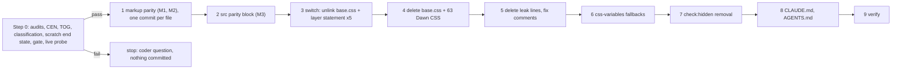

# Plan: Tailwind phase T5a, retire `assets/base.css` at parity (addendum)

Slug: `theme-evolution-tailwind-t5a`
Parent: `docs/plans/theme-evolution-tailwind.md` (umbrella) §12 (Phase T5), §17.4 (T5 criteria), §16 (risks), D6, D11. Index and split rationale: `docs/plans/theme-evolution-tailwind-t5-index.md`. Sibling: `docs/plans/theme-evolution-tailwind-t5b.md` (typography decisions).
Model: `docs/plans/theme-evolution-tailwind-t4c.md` (Revision 2.1, approved) and `docs/reviews/theme-evolution-tailwind-t4c-review.md`.
Architect: Claude (for Junior Warner)
Date: 2026-10-23
Revision: 2.2.2. It applies the round 3 closeout's RC-1 and NC-1 (changelog below). Revision 2.2.1 applied round 3 of `docs/reviews/theme-evolution-tailwind-t5a-review.md` ("Round 3 (Rev 2.2 delta)", APPROVE WITH CHANGES: R3-1 to R3-3, nits N3-1 to N3-3) to Revision 2.2. Revision 2.2 ruled on the Coder's Step 0 gate stop (`docs/plans/theme-evolution-tailwind-t5a-coder-questions.md`, Q-C1 to Q-C5; rulings appended there; changelog below). Revision 2.1 addressed round 2 of `docs/reviews/theme-evolution-tailwind-t5a-review.md` (APPROVE WITH CHANGES: R2-1 to R2-3, nits N2-1 to N2-5), closed out as APPROVE. Revision 2 addressed round 1 (B1, R1-R14, nits N1-N9). R6's coupling edit to `docs/plans/theme-evolution-tailwind-t5b.md` (its Step 3 deletion list) is made in T5b Revision 2, written in the same round.
Tier: 3. It changes the stylesheet set of every page that uses `layout/theme.liquid`, deletes 64 files, and touches Shopify-rendered and app markup that the theme doesn't own.
Builds on: T0 to T4c and the page-center follow-up, all **live** on #138872651872 at `0783033` (`docs/qa/theme-evolution-tailwind-t4-live-deploy.md:6`) and on staging #187953643616 at `65f945f` (`docs/qa/theme-evolution-tailwind-t4c-page-center-deploy.md:6`). `0783033` adds only `docs/` files to `65f945f`, and repo HEAD `cff6df4` adds only a deploy note, so the theme files are the same in all three `[quoted: git log]`.

**Gate (§4.1).** T5a commits nothing until Step 0 has (1) re-run the three umbrella preconditions with no new finding, (2) classified every difference the same-page toggle diff finds, and (3) built the end state in scratch and measured it within **both** CSS budgets (60,000 minified, 12,000 gzip). If any of the three fails, T5a stops and writes the figures or findings to `docs/plans/theme-evolution-tailwind-t5a-coder-questions.md` for the owner. This rule is the Architect's recommendation, applied as T4c applied its gate. It is **not** an owner decision, and the owner can reverse it.

**What T5a is, in one sentence.** Unlink and delete `assets/base.css` and the 63 unreferenced Dawn stylesheets, with every visible effect either restored by a measured parity rule or accepted by the owner (⚑), and without any deliberate design change. Line height, a heading-font base rule and policy-page typography are design decisions and live in T5b.

---

**Post-approval (2026-10-23):** umbrella edits applied, leftovers fixed (§6 and Step 8 now say T1-T8).

## Revision 2.2.2 changelog (round 3 closeout)

**RC-1:** in item 13's loads, every base reading comes before item 7b switches `base.css` off. Each base shot is valid only if the in-page control first reads `display: none`. After the off shot, the load either ends, or `base.css` goes back on and is re-confirmed before any further base reading. A toggled load is never reused for the next width. Sections: §13 items 7b and 13, §9 "Non-vacuity rule". **NC-1:** item 8 records what hides the widget's `.form__message` today; parity doesn't depend on it. Section: §13 item 8. No CSS, criterion or decision change.

## Revision 2.2.1 changelog (review round 3)

**R3-1** `PXN` is registered from an on/off survey over C5a.10's whole extent (item 13's loads), with a fifth condition (≤ 16 levels wherever the element differs, else Step 0 stops): §0, §13 item 7b. **R3-2** C5a.10's pixel exclusion covers only A-row elements that paint; E5a.18's parts stay in the pixel comparison: C5a.10, E5a.18, §9.2. **R3-3** item 7a takes a `base.css`-on reference; D5a.21's fallback triggers only on a point landing inside hCaptcha's container, or a new overflow offender inside it; any other mismatch is unexplained (stop): §13 item 7a, C5a.14(e), D5a.21, §5.3, §9.2. **N3-1 applied:** D5a.20 copies all of Dawn's valid declarations for its two selectors (175 B instead of 77): §4.5, §5.3, §5.10, E5a.19. **N3-2 applied:** 7a's overflow check runs at every `W_sw` width. **N3-3 applied:** summary figures refreshed in §4.1, §9.2 C5a.19 and the index. Projection: **58,850 to 58,932 / 11,264 to 11,344** `[provisional]`. No criterion, step or decision renumbered; no owner decision touched.

## Revision 2.2 changelog (Coder's Step 0 stop, Q-C1 to Q-C5)

The Coder stopped at the §4.1 gate with nothing committed. `P_end` passed (**58,675 / 11,219** `[measured]`, Revision 2.1's end state) and the live probe was a valid pass; two findings stopped the gate (Q-C1, Q-C2) and three needed rulings for Step 9 (Q-C3 to Q-C5). Rulings, reasons and the Step 0 items to re-run are in `docs/plans/theme-evolution-tailwind-t5a-coder-questions.md` § "Architect rulings (Rev 2.2)".

**What did not change.** Criteria keep their numbers (C5a.0-C5a.26); C5a.14 gains clauses (e) and (f). No owner question is added, and no ruling reverses a prior owner decision or Q5a.1-Q5a.5's recommendations. Steps keep their numbers; Step 1 loses one commit.

| Item | Ruling | Sections |
|---|---|---|
| **Q-C1** (gate): hCaptcha's popup container on the opt-out page has three empty `div`s that Dawn's `div:empty` hides; no mechanism covered them | **Option (a): accept**, new ⚑ row **E5a.18** (A allowed), new **D5a.21**. Safety precondition: C5a.14(e)'s hit test, and no new overflow offender, on the toggled base at Step 0. **If either is red**, D5a.21's pre-written fallback rule, scoped to hCaptcha's container (about 82 B), restores parity instead (P), with no new stop. C5a.21 and §4.2 step 3 name that fallback as an allowed scoped `:empty` rule, so it can't make them red | §3.4, §4.2 steps 3 and 9, §4.5, §5.3, §5.11, §8, C5a.14(e), C5a.21, §9.2, §10 owner check 3, §11 RA17, §13 |
| **Q-C2** (gate, plan error): the image-banner buttons wrapper was never hidden by Dawn (its `inline-flex` utility beats the `legacy` layer) | **Accepted as the Coder states.** Step 1 drops the `sections/image-banner.liquid` commit; C5a.12(a) becomes "head equals base"; the wrapper leaves E5a.9, D5a.9, §0, §3.4 row 2, §5.5 and §6. The vendor line's `empty:hidden` stays and now compiles the utility itself (same 34 B) | §0, §3.4, §4.5, §5.5, §5.10, §6, §8, C5a.12, §9.2, §10, §13, §14.3 |
| **Q-C3**: a bare `a` without `href` in merchant HTML loses Dawn's `cursor: not-allowed` | **Added to E5a.6 (A allowed: yes).** A cursor only; the theme's own `a:not([href])` buttons keep `btn-*`'s cursor (no entry) | §3.4 row 16, §8 |
| **Q-C4**: three groups the strict N rule doesn't name | (1) light-DOM "Buy it now" `::before`/`::after`, position and insets: **N** ("N-pseudo"); E5a.13 resolved. (2) the widget's error-state message and icon (`line-height`, `flex-shrink`, `width`; rendered only on an error): **not N but P** (the default), new **D5a.20** rule as Dawn wrote it (77 B), new row **E5a.19**, C5a.14(f). A text line height and an icon size change visibly once shown, so a 0 × 0 rect doesn't make them N. (3) transition-only differences: **N** ("N-timing"), provided no transitioned property differs between measured states | §0 `SZ`, §3.4 row 17, §4.4, §4.5, §5.3, §5.10, §8, C5a.14(f), §9.2, §11 RA19 |
| **Q-C5**: a deterministic sub-pixel difference (13 levels, two rows) on the landing page's dotted tooltip underline at 375, with no computed-style or rect difference | **A narrow tolerance, not a global one:** new referent `PXN` (pre-registered raster elements, registered only at Step 0 under strict conditions); C5a.10 allows ≤ 16 levels per channel inside a registered element's box and nowhere else | §0, C5a.10, §9.2, §11 RA18, §13 |
| Deviations | **Accepted:** `SZ` widened (logical insets; resolved `grid-template-*` tracks when the track count is unchanged); `html`/`body` height entries equal to the controls' own delta dropped as control artifacts; owner selectors `#pc--optOutFormContainer` and the hCaptcha container (the looser `body > div:has(iframe…)` form is forbidden); the per-file `EXPECT` sync marker. **Ruled:** the one invalid PXP run at 1440 is re-run (remedy in §13) | §0, §4.2 step 9, §5.11 step 4, §10, §13 |

**CSS.** `P_end` moves from the measured 58,675 / 11,219 by +77 (D5a.20, certain) and 0 to +82 (D5a.21, conditional) minified, +25 to +95 gzip: **58,752 to 58,834 / 11,244 to 11,314** `[provisional]`, re-measured at Step 0 item 12. (Superseded by Revision 2.2.1: D5a.20 is 175 B, projection 58,850 to 58,932 / 11,264 to 11,344.) Dropping the banner edit changes nothing (the vendor line keeps the `empty:hidden` candidate in the scan).

## Revision 2.1 changelog (review round 2)

**What did not change.** No step, criterion, decision or recommendation was added, removed or renumbered (still C5a.0-C5a.26). §5.9 gains one rules-text row (T8).

| Review item | What changed | Sections |
|---|---|---|
| **R2-1** (required): the `SZ` grouping missed causes in descendants | An `SZ` entry carries no class of its own: it is **explained if its (page, state, width) has at least one root-cause entry**, and geometry is judged by C5a.10. An `SZ` entry on a page, state and width with no root cause stays unexplained. The live probe uses the same grouping: only root-cause properties must match, and an `SZ` difference inside a target passes if that target has a matched root cause | §4.2, §5.11 step 9 |
| **R2-2** (required): C5a.21's `:empty` clause was red on every build | Restated: no `@layer base` rule whose subject is `:empty` sets `display`, other than `p:empty` and D5a.19's rule (and its twin). The T0 margin-trim rules (`:empty:first-child+:where(…)`, `:where(…)+:has(+:empty:last-child)`, `src/tailwind.css:235-243`) set margins, so they pass; a global `div:empty` port still goes red. §4.2 step 3's list names them | §4.2 step 3, C5a.21, §9.2 |
| **R2-3** (required): C5a.9's widget clause could be unreachable | Validity is now "the widget subtree was snapshotted: at least 1 element, including one `input[type=checkbox]`". `TOG` entries inside it are recorded, not required. E5a.3 says Q5a.3 is moot if there are none | C5a.9, E5a.3 |
| N2-1 | New rules-text row T8: the "Rich text" bullet says `data-rich-text` marks merchant HTML, carries the empty-element rule and isn't a JS hook. C5a.24(c) checks it | §5.9, C5a.24 |
| N2-2 | `TOG` records, for every Shopify- or app-owned entry, the owning container's selector and the container-relative path, so the live probe needn't re-derive them | §4.2 step 9 |
| N2-3 | The PXZ vendor copy sits at the zoo root, outside the `prose` / `[data-rich-text]` copy, so D5a.19 can't hide it and C5a.12(b) can't pass without `empty:hidden` | §10 PXZ |
| N2-4 | T5b Revision 2.1 puts `data-rich-text` on its policy wrapper, so T5a's `[data-rich-text]` rule keeps covering the policy body after T5b deletes the `.shopify-policy__body` twin; §5.3 states the coupling | §5.3 |
| N2-5 | E5a.16 states the boundary: `richtext` settings outside `[data-rich-text]` boxes (the text block, the image banner's text) lose Dawn's `:empty` hiding too, but they produce `p` almost exclusively, which `p:empty` still covers | §8 |

## Revision 2 changelog (review round 1)

**What did not change.** The design, the step sequence (Step 0 + Steps 1-9) and every decision except D5a.6 (it gains the hover rule) and a new D5a.19. Criteria C5a.0-C5a.25 keep their numbers; one is added at the end (C5a.26). The recommendations of Q5a.1-Q5a.4 stand; one owner question is added (Q5a.5).

| Review item | What changed | Sections |
|---|---|---|
| **B1** (blocker): the `class="hidden"` controls could never flip | Tailwind's own `.hidden` is compiled, so the control stayed hidden with `base.css` off. The controls are now an **empty `<div data-t5-ctl></div>`** (only Dawn's `div:empty` hides it: `none` → `block`) followed by **`<h6 data-t5-ctl2>x</h6>`** (`margin-top` 1.67em → 0), in `TOG` and in the live probe. The empty `div` sits before the `h6`, so `@layer base`'s `:empty:last-child` sibling rules can't touch the `h6` | §4.2 steps 3, 8; §5.11 steps 5, 7; C5a.25 |
| **R1**: PXZ produced entries nothing could classify | §8 gains an **"A allowed?"** column. E5a.6 is widened (bare tables 22.4 → 16 px and `table-layout`, the bare `summary` marker, a bare `hr` becoming a visible 1 px rule with no margins, PXZ's empty `div`/`a`/`ul` and the flex gap). New ⚑ row **E5a.16** and owner question **Q5a.5** for `:empty` in merchant HTML, with a scoped `[data-rich-text] …:empty` rule (about 90 B, recommended, M3) and a conditional policy-body twin | §4.4, §5.3, §5.10, §8, Q5a.5 |
| **R2**: a missed theme `:empty` sink | `snippets/card-product.liquid:142` (the vendor line, no whitespace, guarded only by `show_vendor`) gets `empty:hidden` (M1). PXZ carries a copy of that line built from the file under test. §0 and §16 corrected | §0, §5.5, PXZ, C5a.12, §16 |
| **R3**: `TOG` can't be valid without `base.css` | `TOG` and `CEN` run only on theme-layout pages; `/password` and PXG stay in the cross-build checks, C5a.5 and C5a.7 | §4.3, §13 Step 0 items 5, 7 |
| **R4**: entry volume and settling | Custom properties are excluded from every computed-style diff, except the `--shopify-*` properties on the accelerated-checkout hosts (N4); each `base.css`-only custom property gets one static N record. Size-derived entries (`SZ`) are grouped under their root cause, not classified one by one. A **settle step** precedes `D1` (fonts ready, images eager and decoded, a scroll pass, recommendations loaded) | §0 `SZ`, §4.2, §4.4 |
| **R5**: `CEN` dropped unparsable selectors | Top-level state pseudo-classes are stripped; a functional pseudo-class whose argument holds a state pseudo-class is removed whole (over-approximating matches, the safe direction for a census). A selector that still throws is recorded **"unparsed"**, counted and classified by hand, never as zero matches | §4.2 |
| **R6**: policy hover and transition | D5a.6 adds `.shopify-policy__body a:hover { text-decoration-thickness: 0.2rem }` and `transition: text-decoration-thickness 100ms ease` on the link (Dawn's `--duration-short: 100ms`, `base.css:582`, written as a literal because the variable goes with `base.css`). T5b's Step 3 now deletes every rule starting `.shopify-policy__body` | §5.3, §5.10, C5a.15, T5b §5.1 |
| **R7**: C5a.17's fixture couldn't go red | Fixture `<div class="flex w-20"><h2>…</h2></div>`: the width is on the parent, so without D5a.5 the `h2`'s min-content overflows it | PXZ, C5a.17 |
| **R8**: the parity-block comment named `base.css` | Reworded ("Dawn's stylesheet"), so C5a.4(c) can pass | §5.3 |
| **R9**: C5a.11 on PXZ | PXZ is out of the focus sweep, and both sequences drop elements whose `TOG` entry is A with a display change | C5a.11 |
| **R10**: owner attribution | Named Shopify and app selectors take precedence over the section-wrapper rule, in `TOG`, C5a.11, C5a.14 and C5a.25 | §4.2 step 9, C5a.11, C5a.14, §5.11 |
| **R11**: C5a.10 and downstream movement | Elements after an A-row element in the same flow may move by exactly that row's delta (±`G`), for example everything below the header on PXA under E5a.4 | C5a.10 |
| **R12**: the live probe's path matching | Paths are relative to each container root (plus the container's selector); the reference is "Step 0's `TOG` on the dev theme" (#187953938528), not staging | §5.11, C5a.25 |
| **R13**: no console criterion | New **C5a.26** (umbrella C0.15): no new console errors, head against base | §9, §10 |
| **R14**: two rows weren't ⚑ | E5a.6 ⚑; E5a.5 ⚑ if S8 shows a pixel difference; both in owner check 3 | §8, §10 |
| N1 | §3.1's split is 38 `component-*` + 14 `section-*` + 2 `template-*` + 9 others; §7 and D5a.15 say 37 variables and lines 30-72 | §3.1, §4.5, §7 |
| N2 | `.empty\:hidden:empty` is (0,2,0), so it beats `.inline-flex` whatever the order; the `[unverified]` and stop condition are dropped | §5.5 |
| N3 | The `B_rb` projection states that even at a wire-to-gzip ratio of 1.0 it stays under `B_rb0` | §5.10 |
| N4 | §3.4 row 17 states why diffing the accelerated-checkout host (with its custom properties) is enough | §3.4, §4.2 |
| N5 | C5a.9's validity needs an entry inside the privacy widget's subtree | C5a.9 |
| N6 | New state S6b: the consent banner's preferences panel at 375, if offered | §4.3 |
| N7 | §5.3's `sr-only` sentence no longer cites rules text Step 8 deletes; Step 5 also updates `src/tailwind.css:64-66` ("Named btn-* because Dawn's .button rules still match") | §5.3, Step 5 |
| N8 | `TOG` resizes within one load where the state allows, and requests are paced | §4.2, RA8 |
| N9 | §12 says reverting Step 3 with Steps 6-7 in is benign | §12 |

Rev 2 sweep: see §16 "Revision 2 checks".

---

## 0. Referent table

Tags (T4c §0): `[measured]` read from a repo file while planning (2026-10-23, theme files at `0783033`); `[derived]` computed, arithmetic shown; `[quoted]` from a named plan, report or doc, not re-measured; `[proposed]` a value this plan sets; `[provisional]` an estimate that Step 0 or QA confirms, **no decision or criterion rests on one**; `[unverified]` a platform or browser behavior Step 0 tests before anything depends on it; `[to be measured]` Step 0 or QA measures it.

| Sym | What it measures | Units | Artifact | Extent or band | Value, method or threshold |
|---|---|---|---|---|---|
| `B_min`, `B_gz` | CSS budget | bytes | `assets/tailwind.css` | whole file | 60,000 minified, 12,000 gzip `-9` `[quoted]` `CLAUDE.md:105` |
| `M_gz` | gzip method for every total | n/a | shell | whole file | `gzip -9 -c assets/tailwind.css \| wc -c` `[quoted]` `CLAUDE.md:70`. Stdin gzip reads 13 B low `[quoted]` T4c §0 |
| `S_tw` | size of the committed `assets/tailwind.css` | bytes | committed file | whole file | **58,366 / 11,104** `[quoted]` live deploy note `:13` (and the orchestrator's brief). Step 0 re-measures |
| `P_end` | **the gate figure**: the whole T5a end state built in scratch | bytes | scratch copy of HEAD with every §5 edit Step 0's classification selects | whole file | Revision 2.1's end state: **58,675 / 11,219** `[measured]` Step 0 item 12 (coder questions, "Gate figures"). Revision 2.2's end state: `[to be measured]` (item 12 re-run); projection in §5.10 `[provisional]` |
| `L_base` | lines of `assets/base.css` | lines | the file at `0783033` | whole file | **3,600** `[measured]` (line 1 the T0 comment, line 2 `@layer legacy {`, line 3,600 the closing `}`) |
| `K_base` | bytes of `assets/base.css` | bytes | same | whole file | 80,382 before T0's two-line wrap `[quoted]` umbrella §0; Step 0 records `wc -c` |
| `N_css` | CSS files in `assets/` | files | working tree | `assets/*.css` | **65** = `tailwind.css` + `base.css` + 63 Dawn component files `[measured]` (Glob; list in §3.1) |
| `B_rb0` | T0's render-blocking CSS baseline | bytes, compressed | live, pre-T0 | `<head>` stylesheets, `/` and the 3p product | **15,910**: `critical.css` 555 + `base.css` 10,803 + `eco-tooltip.css` 560 + accelerated-checkout 1,598 + compiled_assets 2,394 `[quoted]` `docs/plans/theme-evolution-tailwind-t0-impl-notes.md:37` |
| `B_rb` | render-blocking CSS transferred | bytes, compressed | one fresh load | every `link[rel=stylesheet]` in `<head>` | method umbrella §0 `B_rb` row (first resource entry per `href`, `encodedBodySize`; invalid on a missing or 0-byte entry). Fallback for a cross-origin 0-byte entry: `curl --compressed -o /dev/null -w '%{size_download}'` with the browser's `Accept-Encoding`, recorded, as T0 did (`t0-impl-notes.md:115`) `[quoted]` |
| `TOG(p,w,s)` | **toggle diff**: every computed-property difference caused by disabling `base.css` | list of (element or pseudo-element, property, on value, off value) | base build, one page load, **theme-layout pages only** (R3) | every element in `document` except `#preview-bar-iframe` and its subtree; pseudo-elements `::before`, `::after`, `::marker`, `::placeholder`; **no custom properties** except `--shopify-*` on `shopify-accelerated-checkout` and `shopify-accelerated-checkout-cart` hosts (R4, N4) | method §4.2. **Same build, same load, same DOM** |
| `SZ` | size-derived resolved values, grouped under their root cause rather than classified one by one | list | n/a | n/a | the computed `width`, `height`, `inline-size`, `block-size`, `top`, `right`, `bottom`, `left`, `inset-block-start`, `inset-block-end`, `inset-inline-start`, `inset-inline-end` (resolved values), `transform-origin`, `perspective-origin`, the resolved `grid-template-rows` and `grid-template-columns` **when the track count is the same on and off** (a changed count is a root cause), and the rect `[proposed]` (R4; widened in Revision 2.2 as the Coder found, deviation accepted). On an element that isn't rendered (a 0 × 0 rect from `display: none` on it or an ancestor), `width` and `height` compute as the declared values, not resolved ones; they stay grouped as `SZ`, but when a parity rule restores such an element (D5a.20), it restores the `width` or `height` Dawn declared there too. `html` and `body` `height`/`block-size` entries whose on-off delta equals the positive controls' own margin delta (±`G`) are control artifacts and are dropped; any other delta on them is an ordinary `SZ` entry |
| `CEN(p,w,s)` | **census**: `base.css` style rules that match at least one element | list of (rule index, selector, media, match count, three element paths, owner of the match) | base build | whole document | method §4.2 |
| `NZ(p,w,s)` | **noise set**: (element, property) pairs that differ between two loads of the **same** build | list | base build, loaded twice | as `TOG` | method §4.2. Used only to discard noise in cross-build comparisons |
| `G` | geometry tolerance | px | rendered page | **border box** (`getBoundingClientRect`), not ink | ±1 per edge `[quoted]` T4b |
| `PXN` | **pre-registered raster elements** (Revision 2.2, Q-C5): elements whose pixels differ between `base.css` on and off in the same load although nothing about them computes differently | list of (page, state, element path, the differing pixels' bounding box at each width where seen, largest channel difference, repeat count) | Step 0's on/off screenshots (base build, `base.css` disabled in the same load), over **C5a.10's whole extent**: every §4.3 page at every `W_sw` width in S0, and the states at 375 and 1440 (item 7b, in item 13's loads; Revision 2.2.1, review R3-1) | the element's **border box grown by 8 px vertically and 4 px horizontally** (a decoration paints below the inline box), not the diff tool's tile | registered **only at Step 0** and only if all hold: (1) identical on 3 repeats; (2) the element and its descendants have no `TOG` entry other than N; (3) their rects are equal ±`G`; (4) the differing pixels lie inside the grown box; (5) the largest channel difference is **≤ 16 levels at every page, width and state where the element differs** (R3-1). A raster-only difference that fails any condition is unexplained and Step 0 stops. Tolerance inside a registered element's grown box: **≤ 16 levels per channel** `[proposed]`. Step 0 found one: the landing page at 375, the "Recycled Polyester" tooltip trigger's dotted underline, 148 px on two rows (tile `[32, 1504, 160, 16]`), 13 levels `[quoted]` coder questions Q-C5 |
| `X_page`, `X_off'` | page overflow; scroll-aware offenders | px; list | rendered page | document | T4c §0 definitions `[quoted]`. Pass: 0 and empty. Known pre-existing: `/policies/privacy-policy` at 320 = **5**, offender `div.shopify-policy__container` `[quoted]` T4c QA "Overflow" |
| `W_tog` | widths for `TOG` and `CEN` | px | viewport | n/a | **320, 375, 749, 750, 989, 990, 1440, 1920** `[proposed]`: both sides of the 749/750 and 989/990 boundaries of `base.css`'s media queries (`@media` lines at 105, 129, 432, 438, 444 and others `[measured]`) |
| `W_sw` | widths for the cross-build sweep | px | viewport | n/a | `W_tog` plus 390, 430, 768, 1024 `[proposed]` |
| `N_tc` | theme-check offenses | count | working tree | whole theme | **0** `[quoted]` `CLAUDE.md:68`; T4c QA "Gates" (104 files, no offenses) |
| `H1` | `<h1>` count | count | rendered page | document | Pass: 1 (theme pages; proxies excluded) |
| `R_root` | root font size | px | rendered page | `html` | 16 `[quoted]` umbrella §0. Pass: 16 |
| `LH_root` | `html` line height | keyword | rendered page | `html` | `normal` (D6 parity rule, `src/tailwind.css:293-295` `[measured]`). T5a keeps it; T5b decides |
| `S_leak` | the two `prose-tokens` legacy-leak lines, compiled | bytes | `assets/tailwind.css` | two rules | `.prose-tokens :where(hr){border-top-style:solid}` 48 + `.prose-tokens :where(blockquote){border-inline-start-style:solid}` 65 = **113** `[derived]` (both strings found in the compiled file `[measured]`; characters counted) |
| `S_lay` | compiled layer statements that name `legacy` or `shims` | bytes | `assets/tailwind.css` | statements | `@layer legacy,components;` 25 and `@layer shims;` 13 `[measured]` (grep), `[derived]` (counts). How much of them the shorter statement removes is `[provisional]` (−13 to −38) |
| `S_par` | T5a parity CSS added | bytes | `src/tailwind.css` compiled | §5.3 rules | §5.10 `[provisional]` |
| `F_*` | content fixtures | list | store | n/a | pages `/pages/contact` (blank), `/pages/data-sharing-opt-out`, `/pages/the-balanced-face-test-page`, `/pages/the-material-archive`; blog `/blogs/news` with no articles; policy `/policies/privacy-policy` only (six other standard handles 404); no gift card `[quoted]` T4c impl notes `:37` and T4c §0 `F_*`. `/challenge` and `/account/login` `[to be measured]` Step 0 item 4 |

Readings that are easy to confuse, stated once:

- **`TOG` is a same-load diff** (`base.css` on, then off, in one page). It needs no noise handling. The **cross-build** comparisons (C5a.8 to C5a.10) load base and head separately, so they subtract `NZ` first.
- **Invalid is not absent.** Most of `base.css`'s declarations are invalid at computed-value time: `rgb(var(--color-foreground))` with a hex value (`snippets/css-variables.liquid:25-26` `[measured]`), and the undefined `--font-heading-*`, `--buttons-*`, `--color-link`, `--media-*` `[quoted]` umbrella §4.3. They still win the cascade and compute as `unset`. Removing one changes a value only where a lower layer or the UA gives a different one. Example: `blockquote { border-left: … }` (`base.css:363`) leaves `border-left-style: none`, while Preflight gives `solid` (T4c §3.2 item 4).
- **`:empty` ignores Liquid guards, not whitespace.** An element whose only child is a whitespace text node is **not** `:empty`. So an unguarded `{{ setting }}` printed between newlines (`sections/image-banner.liquid:384-389`, `blocks/text.liquid:28-30`, `sections/product.liquid:33-35`) never matched Dawn's `:empty` rule, even when the setting is blank `[derived]` (each has newlines and indentation around the output). Only output with no whitespace qualifies. **Two theme elements can be `:empty`** (Revision 2, review R2): the image-banner buttons wrapper, whose every tag uses `` (`:443-472`), and the product card's vendor line `<div class="…">{{ card_product.vendor }}</div>` (`snippets/card-product.liquid:142`), guarded only by `show_vendor` (default `false`, `sections/related-products.liquid:224-225`), not by `!= blank` `[derived]`. Every other no-whitespace single-output element is a `p` (still covered by `p:empty`), is guarded by `!= blank`, or prints a value that can't be blank `[quoted]` review R2.
- **`:empty` is not the same as hidden by Dawn** (Revision 2.2, Q-C2). Dawn's `div:empty` sits in `legacy`, below `utilities`, so an `:empty` element whose classes set `display` was never hidden. The buttons wrapper carries `inline-flex` (`sections/image-banner.liquid:444` `[measured]`): at base with both labels blank it is a 0 × 0 `inline-flex` box at (720, 1488) at 1440 with its `margin-top: 20px` (`mt-5`), and `TOG` has no entry for it `[measured]` Step 0 PXE. **Only the vendor line is a theme sink**: it has no display utility, and PXZ's copy goes from `display: none` to `block` without `empty:hidden` `[measured]` Step 0. Revisions 2 and 2.1 called the wrapper a sink; that was wrong.
- **File bytes vs transfer bytes.** `S_*` and `P_end` are uncompressed file bytes (with `M_gz` gzip figures). `B_rb` is compressed transfer bytes.

---

## 1. Problem statement and goals

`layout/theme.liquid:29` still links `assets/base.css`, 3,600 lines of Dawn CSS inside `@layer legacy`, on every page that uses the theme layout `[measured]`. Phases T1 to T4c converted every Liquid file, so no theme markup is *meant* to depend on it. Some still does, through rules that don't need a Dawn class:

- `*:focus { outline: 0; box-shadow: none }` (`base.css:715-718`) is valid, while `*:focus-visible`'s ring is invalid (`:720-724` with `:8-10`). So today **no element shows a keyboard focus ring** unless its own utilities draw one (`btn-primary`, `btn-secondary`, the product card link) `[derived]`. T4c QA recorded "`outline: none` computed" on the privacy widget's controls (T4c QA "Keyboard"); whether Dawn or Shopify's own CSS set it there wasn't established.
- Element and attribute rules that still apply to markup the theme can't add classes to: `input[type='checkbox']` (`:1811-1815`) on Shopify's privacy widget (T4c impl notes `:44`), Dawn's `.rte` (`:3130-3197`) on the policy body (chain `div.shopify-policy__body > div.rte`, T4c impl notes `:37`), and the dynamic checkout button rules (`:1190-1293`).
- Element rules that reach theme markup: `h1`-`h5 { word-break: break-word }` (`:269`, the one valid declaration in the heading block), the `:empty` hiding rules (`:470-484`), Dawn's `.grid { margin-bottom: 2rem }` (`:881-889`) on the announcement bar, and `.hidden { display: none !important }` (`:196-198`) on the product-form spinner.

It also costs every page about 10.8 KB of compressed render-blocking CSS (`B_rb0`'s `base.css` share), keeps two unused cascade layers in the statement, and keeps coexistence rules in `CLAUDE.md`, `AGENTS.md` and `scripts/check-bare-hidden.mjs` that exist only because of it.

### Goals

1. Unlink `assets/base.css`; delete it and the 63 unreferenced Dawn stylesheets.
2. **Every visible effect is accounted for**: each difference the toggle diff (`TOG`) finds is either restored by a parity rule or utility, or listed as an expected diff the owner accepts (⚑). A full-site cross-build comparison proves nothing else changed.
3. The layer statement becomes `properties, theme, base, components, utilities` in both layouts, `templates/gift_card.liquid`, `src/tailwind.css` and `scripts/check-css-layers.mjs`, and the gate rejects a re-introduced `legacy`.
4. Remove the leftovers: the two `prose-tokens` leak lines, the Dawn card fallbacks in `snippets/css-variables.liquid`, `scripts/check-bare-hidden.mjs` and the `check:hidden` script, and the coexistence text in `CLAUDE.md` and `AGENTS.md`.
5. Keep the gates: `check:css`, theme check at 0, schemas byte-identical, `H1` = 1, the cart flow, both CSS budgets, and `B_rb` below `B_rb0`.
6. Reach live safely: a read-only live probe shows what `base.css`'s removal does to live-only markup before the push.

---

## 2. Non-goals

- **No deliberate design change.** `html { line-height: normal }` stays. No heading-font base rule. Policy pages keep today's look. All three are T5b.
- **No unused JavaScript deleted.** 41 `assets/*.js` files are not loaded (only six are, §3.3). Deleting them is a separate cleanup.
- **No cleanup of now-redundant utilities** such as the `mb-0` on grids (T4b §14.4: "redundant, but harmless").
- **`snippets/sustainability-rating.liquid:47`'s keyframe `<style>` stays** (T4b RB13; a snippet follow-up).
- **No change to Shopify's privacy widget fix** (T4c D4c.8, Q4c.6) or to its width.
- **No edits** to `config/settings_data.json`, `templates/*.json`, `sections/*-group.json`, `locales/*` or any ``. No store content. Missing fixtures are covered by scratch proxies (§10).

---

## 3. Preconditions and inventory (the mechanical audit)

Umbrella §12 requires three preconditions. The Architect ran each by reading files (no shell). Step 0 item 3 re-runs them with ripgrep, and any new finding stops T5a.

### 3.1 Precondition 1: no CSS asset is referenced except `tailwind.css` and `base.css` — **PASS** `[measured]`

- Ripgrep `\.css['"]` over `layout`, `sections`, `blocks`, `snippets`, `templates`, `config`, `locales`: four hits. `'tailwind.css'` at `layout/theme.liquid:28`, `layout/password.liquid:11` and `templates/gift_card.liquid:13`, and `'base.css'` at `layout/theme.liquid:29`.
- Ripgrep `stylesheet_tag|asset_url|inline_asset_content` over the same folders: no other stylesheet. The `asset_url` hits are four scripts in the layout, two in `sections/product.liquid:8-9` and an SVG (`sections/hello-world.liquid:13`).
- The six loaded scripts (§3.3) contain no `.css` string and create no `<link>` (ripgrep `\.css|createElement\(['"](link|script)`: only `global.js:61`, which creates a `<script>`).

**Files T5a deletes** (Step 4): `assets/base.css` and the 63 Dawn stylesheets: `collage`, `collapsible-content`, `component-accordion`, `component-article-card`, `component-card`, `component-cart-drawer`, `component-cart-items`, `component-cart-notification`, `component-cart`, `component-collection-hero`, `component-complementary-products`, `component-deferred-media`, `component-discounts`, `component-facets`, `component-image-with-text`, `component-list-menu`, `component-list-payment`, `component-list-social`, `component-localization-form`, `component-mega-menu`, `component-menu-drawer`, `component-modal-video`, `component-model-viewer-ui`, `component-newsletter`, `component-pagination`, `component-pickup-availability`, `component-predictive-search`, `component-price`, `component-product-model`, `component-product-variant-picker`, `component-progress-bar`, `component-rating`, `component-search`, `component-show-more`, `component-slider`, `component-slideshow`, `component-swatch-input`, `component-swatch`, `component-totals`, `component-volume-pricing`, `customer`, `mask-blobs`, `newsletter-section`, `quantity-popover`, `quick-add`, `quick-order-list`, `section-blog-post`, `section-collection-list`, `section-contact-form`, `section-email-signup-banner`, `section-featured-blog`, `section-featured-product`, `section-footer`, `section-main-blog`, `section-main-page`, `section-main-product`, `section-multicolumn`, `section-password`, `section-related-products`, `section-rich-text`, `template-collection`, `template-giftcard`, `video-section` (each `.css`). 38 `component-*` + 14 `section-*` + 2 `template-*` + 9 others (`collage`, `collapsible-content`, `customer`, `mask-blobs`, `newsletter-section`, `quantity-popover`, `quick-add`, `quick-order-list`, `video-section`) = 63 `[derived]` (Revision 1 said 40 + 16 + 2 + 5; the total and the list were right, review N1).

### 3.2 Precondition 2: every Liquid file has been converted — **PASS** `[measured]`

All 40 `.liquid` files under the scanned folders, by the phase that converted them:

| Phase | Files |
|---|---|
| T0 (layer statement, `critical.css` folded in) | `layout/theme.liquid`, `layout/password.liquid` |
| T1 | `sections/header.liquid`, `sections/footer.liquid` |
| T2 | `sections/product.liquid`, `sections/material-spotlight.liquid`, `sections/related-products.liquid`, `sections/custom-section.liquid`, `sections/material-tooltip.liquid`, `snippets/sustainability-rating.liquid`, `snippets/card-product.liquid`, `snippets/price.liquid`, `snippets/unit-price.liquid`, `snippets/specs-table.liquid`, `snippets/trust-badge.liquid`, `snippets/material-info.liquid` |
| T3 | `sections/hello-world.liquid`, `sections/image-banner.liquid`, `blocks/text.liquid`, `blocks/group.liquid` |
| T4a | `sections/cart-drawer.liquid`, `sections/cart.liquid`, `snippets/cart-intelligence-banner.liquid`, `snippets/image.liquid`, `snippets/spinner.liquid` |
| T4b | `sections/collection.liquid`, `sections/collections.liquid`, `sections/search.liquid`, `sections/page.liquid`, `sections/blog.liquid`, `sections/article.liquid`, `sections/404.liquid`, `sections/password.liquid`, `sections/main-material-archive.liquid`, `sections/material-recommendations.liquid`, `snippets/pagination.liquid`, `templates/gift_card.liquid` |
| No styled markup | `snippets/css-variables.liquid` (`` only), `snippets/meta-tags.liquid` (head tags, no `class=` `[measured]`), `templates/product.api.liquid` (JSON, umbrella §11 note) |

2 + 2 + 12 + 4 + 5 + 12 + 3 = 40 `[derived]`.

**Static class check.** Ripgrep for whole class tokens (bounded by a quote or a space) that `base.css` styles, over every Liquid file: `page-width`, `rte`, `button`, `field`, `caption`, `title`, `h0`-`h6`, `visually-hidden`, the three `*-hide` classes, `list-unstyled`, `link`, `underlined-link`, `full-unstyled-link`, `gradient`, `grid__item`, `media`, `card`, `badge`, `price`, `loading__spinner`, `scroll-trigger`, `section`, `placeholder`, the `focus-*` classes, `svg-wrapper`, `icon`, `light`, `left`, `center`, `right`, `break`, `spinner`, `customer`, `inline-richtext`, `isolate`, `overflow-hidden`, `uppercase`, `hidden`, `grid`, `full-width`, `header`, `footer`, `errors` and others. The only hits that `base.css` can still style, each with its disposition:

| Token | Where | `base.css` rule | Disposition |
|---|---|---|---|
| `loading__spinner` | `sections/product.liquid:97` (a JS hook, `product-form.js:29, 107`) | `:3504-3513` gives `display: inline-block; z-index: 1` | The element is `absolute`, so it is blockified anyway, and it follows the label in DOM order, so it paints above it without `z-index` `[derived]` (T4a §14.4). Expected no visible change (E5a.11), proven by C5a.13 |
| `hidden` | `sections/product.liquid:97` | `.hidden { display: none !important }` (`:196-198`) | Tailwind's `.hidden{display:none}` is compiled `[measured]`, and that element has no other display utility `[measured]`. See §3.3 |
| `grid` without `mb-*` | `sections/header.liquid:18` (announcement bar) and `:23` (`<header>`) | `.grid { margin-bottom: 2rem }`, `.grid:last-child { margin-bottom: 0 }` (`:881-900`) | `<header>` (`:23`) is the wrapper's last child, so 0 `[derived]`. The announcement bar renders only when `show_announcement` is on (default `false`, `:251-253`; `sections/header-group.json:16-20` sets nothing). When on, it gets 32 px below it: E5a.4 ⚑ (Q5a.2), proxy PXA. The other 11 `grid` elements carry `mb-0` `[measured]` |
| `section-header` | Shopify prints it on the header wrapper (schema `"class"`, `sections/header.liquid:207`) | `:2315-2317` (`z-index: 3`), `:2332-2334`, `:2340-2342` | `sections/header.liquid:111-119` (`@layer components`, `position: sticky; top: 0; z-index: 10`) already wins. No change |
| `section` | schema `"class"` of `related-products`, `material-recommendations`, `image-banner` (`:78`, `:40`, `:496`) | `.section + .section { margin-top: var(--spacing-sections-mobile) }` (`:151-159`) | Undefined variable, so `unset`, which is 0, the same as without the rule `[derived]` |
| `shopify-section-group-header-group` | Shopify, on the header wrapper | `:2336-2338` (`z-index: 4`) | Beaten by the components rule above. No change |

No Liquid file uses `isolate`, `visually-hidden`, `rte`, `page-width`, `button` or any `*-hide` class `[measured]`. Step 0 item 5's census repeats this check on the **rendered** DOM of every page and state, which also covers class names that come from Shopify and apps.

### 3.3 Precondition 3: JS-toggled classes — **PASS** `[measured]`

**Loaded scripts:** `constants.js`, `pubsub.js`, `global.js`, `eco-tooltip.js` on every theme-layout page (`layout/theme.liquid:34-37`); `material-api-fetch.js`, `product-form.js` on product pages (`sections/product.liquid:8-9`). `layout/password.liquid` and `templates/gift_card.liquid` load none. No other `<script src>` or `script_tag` exists in scanned files. The inline scripts (`layout/theme.liquid:50`, `sections/header.liquid:121`, `sections/cart-drawer.liquid:92`) change only attributes (`hidden`, `aria-expanded`, `data-state`) and swap in server-rendered HTML from scanned Liquid (`cart-drawer.liquid:186, 236, 250`) `[measured]`.

Every class passed to `classList.add/remove/toggle/replace`, `className` or `setAttribute('class', …)`, or written in an `innerHTML` string, in the six loaded files (ripgrep `classList\.(add|remove|toggle|replace)|className|setAttribute\(\s*['"]class` and `innerHTML`):

| File:line | Class | Defined by `base.css`? | Disposition |
|---|---|---|---|
| `product-form.js:28, 104` | `loading` on the submit button | only as `.button.loading` (`:1353-1380`); the button carries `btn-primary`, not `button` (`sections/product.liquid:95`) | **Replacement exists:** `[&.loading>span]:invisible` (`product.liquid:95`) |
| `product-form.js:29, 107` | `hidden` on `.loading__spinner` | yes, `!important` (`:196-198`) | **Replacement exists:** Tailwind `.hidden{display:none}`, compiled because the token is in `product.liquid:97`; no competing display utility on that element |
| `product-form.js:61-62` | `hidden` on the label and `.sold-out-message` | yes | **Unused:** the code returns at `:59` because no `.sold-out-message` exists in markup (ripgrep: 0) |
| `product-form.js:105` | `is-empty` (removed from the cart element) | no | n/a |
| `eco-tooltip.js:41, 76, 83, 89` | `is-visible`, `eco-tooltip` | no (ripgrep: 0) | n/a; styled in `sections/product.liquid:117-145` (`@layer components`) |
| `material-api-fetch.js:43, 50, 57, 65` | `material-accordion__thumbnail`, `material-accordion__story` | no | n/a; styled by the arbitrary variants on `product.liquid:64` |
| `global.js:173, 178` | `focused` | yes (`:727-731`, `:743-747`, `:765-769`, `:1282`) | **Unused:** only `focusVisiblePolyfill()` adds it, which runs only if `document.querySelector(':focus-visible')` throws (`global.js:136-140`). Every browser at or above the floor `BF` supports `:focus-visible` `[quoted]` umbrella §0 `BF` |
| `global.js:270, 275` | `disabled` (`QuantityInput`) | as `.button.disabled`, `.quantity__button.disabled` | **JS not instantiated:** no `<quantity-input>` in markup |
| `global.js:474-526, 571-586` | `menu-opening`, `submenu-open`, `overflow-hidden-${breakpoint}`, `menu-open` (`MenuDrawer`, `HeaderDrawer`) | yes (`:2328`, `:2734-2738`, `:2903-2916`) | **JS not instantiated:** no `<menu-drawer>` or `<header-drawer>` |
| `global.js:630, 638` | `overflow-hidden` on `body` (`ModalDialog`) | yes (`:217-219`) | **JS not instantiated:** no `<modal-dialog>` |
| `global.js:929-983, 1040-1045` | slider and slideshow state classes | no | **JS not instantiated** |
| `global.js:1099-1102` | `swatch--unavailable` | no | **JS not instantiated** |
| `global.js:1169` | `product-recommendations--loaded` | no | **Unused:** `ProductRecommendations` is instantiated (`sections/related-products.liquid:41`) but adds the class only if the fetched HTML contains `.grid__item` (`global.js:1168`), which no markup has (ripgrep: 0) |
| `global.js:566, 609, 1164` | `classList.contains` reads | n/a | reads only |
| `constants.js`, `pubsub.js` | none | n/a | n/a |

The umbrella's own examples (`facets`, `quick-add`, `quick-order-list`, `share`, `search-form`, `localization-form`, `animations` with `scroll-trigger--offscreen`) are in files that are **not loaded** (`assets/facets.js` and the rest exist, but no Liquid references them). **No class lacks a disposition**, so precondition 3 doesn't block T5a.

### 3.4 What `base.css` still provides, by reading (Step 0 measures the complete list)

Reading 3,600 lines can't prove completeness, so the authoritative list is Step 0's `TOG` and `CEN` (§4.2). This table is the Architect's reading of the items the brief names. Each row names the measurement that settles it.

| # | Item | `base.css` | Valid declarations that still reach markup | Plan | Δ / criterion |
|---|---|---|---|---|---|
| 1 | `.hidden !important` | `:196-198` | the product spinner only | Tailwind `.hidden` | E5a.11, C5a.13 |
| 2 | `div:empty` and siblings | `:470-484` (`a, ul, dl, div, section, article, p, h1-h6`) | only elements with **no** text node **and no display set in a higher layer**: in theme markup, the card's vendor line when the vendor is blank (`snippets/card-product.liquid:142`) `[measured]` Step 0 (the image-banner buttons wrapper is `:empty` when both labels are blank but its `inline-flex` utility wins, so Dawn never hid it, Revision 2.2, Q-C2); **in merchant HTML** (`page.content`, `article.content`, descriptions) any empty `div`, `a`, heading or list the editor leaves; Shopify or third-party markup per `CEN` (Step 0: the hCaptcha popup's three empty `div`s on the opt-out page, Q-C1). `p:empty` stays in `@layer base` (`src/tailwind.css:231-233`) | theme: `empty:hidden` on the vendor line (M1, D5a.9); merchant HTML: Q5a.5 (scoped rule recommended, D5a.19); hCaptcha: accept (E5a.18, D5a.21) | E5a.9, E5a.16, E5a.18, C5a.12, C5a.14(e) |
| 3 | `.grid` margin | `:881-900` | the announcement bar (setting-dependent) | Q5a.2 | E5a.4, C5a.16 |
| 4 | `.isolate` | `:146-149` | none (no Liquid uses `isolate`) | none | n/a |
| 5 | Dawn focus styles | `:715-724`, `:8-10`, `:1280-1293` | `*:focus { outline: 0; box-shadow: none }` (valid) on every focused element; `*:focus-visible { outline-offset: 0.3rem }` (valid; the outline and box-shadow are invalid) | Q5a.1 | E5a.1, E5a.2, C5a.11 |
| 6 | Form elements | `.field*`, `.select*`, `.customer *` (`:1568-1860`) | none in theme markup. `input[type='checkbox'] { display: inline-block; width: auto; margin-right: 0.5rem }` (`:1811-1815`) reaches Shopify's privacy widget checkbox (T4c impl notes `:44`) | Q5a.3, parity rule D5a.8 | E5a.3, C5a.14 |
| 7 | `.rte` | `:3130-3197` | the policy body: `ul`/`ol` `list-style-position: inside; padding-left: 2rem`, `li { list-style: inherit }`, links `text-underline-offset: 0.3rem; text-decoration-thickness: 0.1rem` and `transition: text-decoration-thickness var(--duration-short) ease` (valid: `--duration-short: 100ms`, `:582`), hover `text-decoration-thickness: 0.2rem` (`:3186-3189`; the colors are invalid) | extend the T4c policy rule (D5a.6), hover and transition included (review R6) | E5a.8, C5a.15 |
| 8 | Policy-page markup | none: no `.shopify-policy__*` rule in `base.css` (ripgrep: 0) | container and title are Shopify's; the 5 px overflow at 320 is pre-existing | parity through row 7 | C5a.15, C5a.18 |
| 9 | `visually-hidden` | `:200-215` (`position: absolute !important`, …) | none in theme markup; possibly Shopify-generated markup (`CEN` decides) | conditional parity rule (D5a.7) | E5a.10, C5a.9 |
| 10 | Typography and headings | `:243-411` | every heading declaration is invalid except `word-break: break-word` on `h1`-`h5` (`:269`); `h6` margin-block `1.67em` (`:356-357`); `blockquote` italic and left padding (`:360-371`); the `.caption*`, `.h0`-`.h5`, `.hxl` classes match nothing | parity rule for `word-break` (D5a.5); `h6`, `blockquote`, `hr` and table leaks accepted (T4c §14.4 expected them to go) | E5a.6, C5a.17 |
| 11 | `html` and `body` | none: the only `body` selectors are two `body:has(...)` descendant rules for Dawn header classes (`:87`, `:2214`), which match nothing | body font, colors and `min-height` come from `@layer base` (`src/tailwind.css:180-185`, `:245-249`) | none | n/a |
| 12 | Color and background through Dawn variables | about every `color`/`background`/`border`/`box-shadow` with `var(--color-*)` | they compute as `unset`. For inherited properties that equals inheriting. For non-inherited ones it is the initial value, which `TOG` compares with what the lower layers give. `::selection { background-color: … }` (`:239-241`) is invalid too, and how Chromium paints a selection with it is `[unverified]` | `TOG` plus a selection screenshot (state S8) | E5a.5 |
| 13 | Tables | `:417-430` | `table:not([class])`: `table-layout: fixed`, `border-collapse`, `font-size: 1.4rem` (22.4 px), `border-style: hidden`; cells `padding: 1em`. Reaches merchant tables in `prose` where the plugin doesn't set the property, and unclassed tables outside `prose` (policy bodies, Shopify markup) in full | accept | E5a.6 ⚑ |
| 14 | `hr` | `:536-548` | `border: none; height: 0.1rem; display: block; margin: 5rem 0` (`7rem` from 750); its `background-color` is invalid, so a bare `hr` today is a **transparent** 1.6 px bar with 80 or 112 px margins. In `prose` the plugin sets the margins; the height leaks. Outside `prose`, after T5a, Preflight's `hr` is a **visible** 1 px rule with no margins | accept | E5a.6 ⚑ |
| 15 | `summary` | `:653-668` | `position: relative` on the product accordion's `summary` (`sections/product.liquid:60`), which has no positioned descendant (`:60-63`); cursor, list style and marker are already utilities there. A **bare** `summary` (merchant HTML, PXZ) loses `list-style: none`, so its disclosure marker reappears | theme: none expected (N); bare: accept | `TOG` classifies; E5a.6 |
| 16 | `a:not([href])` | `:523-525` (`cursor: not-allowed`) | the image-banner buttons without a link (`:451`, `:463`), which `btn-*`'s `&[aria-disabled="true"] { cursor: not-allowed }` (`src/tailwind.css:95-99`, `:127-131`) already covers; a **bare** anchor without `href` in merchant HTML (PXZ, both copies) | theme: none (Step 0: no entry); bare: accept, `cursor` `not-allowed` → `auto` (Revision 2.2, Q-C3) | E5a.6 |
| 17 | Dynamic checkout | `:1190-1293`, `:1323-1332`, `:3107-3115` | on every PDP (`show_dynamic_checkout: true` at `templates/product.json:42` and `product.landing-page.json:74`). The custom properties on `shopify-accelerated-checkout` resolve to the guaranteed-invalid value (undefined `--buttons-radius-outset`), the same as not set `[derived]`. Rules on a light-DOM `.shopify-payment-button__button--unbranded` (position, `::before`/`::after` boxes, focus) apply only if Shopify renders that button outside a shadow root `[unverified]`. Inside a shadow root, page CSS reaches the button only through properties the host passes down (inherited properties and custom properties), so diffing the **host**, custom properties included, is enough (review N4); `TOG` keeps `--shopify-*` custom properties on the two hosts for that reason. **Step 0 found the light-DOM button** on wax, p3p and snow: `position`, insets and `::before`/`::after` boxes change, page screenshots on/off are pixel-equal at 375 and 1440, hover shows 0 differences `[measured]` | N ("N-pseudo", §4.4, Revision 2.2, Q-C4); its focus outline is E5a.1 | E5a.13, C5a.14 |
| 18 | Captcha page | `.shopify-challenge__container` (`:180-183`), `.shopify-challenge__button` (`:1190-1308`) | `/challenge` (`request.page_type` `captcha` `[quoted]` shopify.dev `objects/request`), reached after a form submission Shopify challenges. The only theme form that could trigger it is the article comment form, and no article exists | Q5a.4 | E5a.12 |
| 19 | `@keyframes` | eight names (`:2292-3599`) | no theme or `src` reference (ripgrep: 0) | none | n/a |
| 20 | Dawn `:root` variables | `:3-11`, `:581-593`, `:3448` | no consumer in scanned files or `src` (ripgrep `--(duration\|ease-out-slow\|animation-\|alpha-\|focused-base)`: 0) | none | n/a |
| 21 | Other `!important` declarations | 15 lines (`:197, 201, 209, 434, 440, 446, 576-577, 755-756, 1984-1985, 2945, 3006, 3025`) | only `.hidden` reaches markup; `.motion-reduce` is a Dawn class, not Tailwind's `motion-reduce:` variant | none | n/a |

### 3.5 T5 handoffs from T4a, T4b and T4c

| Handoff | Where T5a handles it |
|---|---|
| T4a: `.loading__spinner` loses `inline-block` and `z-index: 1` | E5a.11, C5a.13(a) (in-flight state S7) |
| T4a, T4b: JS-toggled classes; no T4a or T4b markup relies on `div:empty` | §3.3; `TOG` and C5a.12 confirm |
| T4b: `mb-0` on grids is redundant after T5 | kept (§2) |
| T4b: `sustainability-rating`'s per-render `<style>` | kept (§2) |
| T4c: the policy rule and Dawn's `.rte` padding and inside position | D5a.6 (parity now); T5b decides the final styling |
| T4c: the two `prose-tokens` border-style lines | deleted in Step 5 (D5a.14) |
| T4c: `h6` margins and table cell padding leak into `prose` | E5a.6 (they go with `base.css`) |
| T4c: rich-text heading font (Q4c.7) | T5b (Q5b.2) |
| T4c: `html { line-height: normal }` and the cursor rule | both stay in T5a; T5b decides line height; the cursor rule is permanent |
| T4c QA nit 2 and RC9: no focus ring on the widget's controls; rings could clip in the scroll box | Dawn's `*:focus` is the likely cause of the first. If so, the rings appear after T5a (E5a.2); C5a.11(c) records which, and any clipping, for the owner |

---

## 4. The gate, the method and the decisions

### 4.1 The gate (Step 0 item 12, before any commit)

1. In a scratch copy of HEAD (`git archive` into the scratchpad): `npm ci`.
2. Apply **every** §5 edit, with the parity set Step 0 item 8's classification selects, and the options recorded for Q5a.1 to Q5a.5 (or their recommendations).
3. `npm run build:css`; measure `P_end` with `wc -c` and `M_gz`; run `node scripts/check-css-layers.mjs` (must exit 0).
4. **Proceed only if all hold:** `P_end` ≤ 60,000 minified **and** ≤ 12,000 gzip; Step 0 item 3 found no new precondition hit; item 8's table has no row marked "unexplained"; item 14's live probe is a valid pass, or its fail is covered by an allowed mechanism (§4.4) added to the scratch end state.
5. **Otherwise stop.** Write the figures and the open rows to `docs/plans/theme-evolution-tailwind-t5a-coder-questions.md` and commit nothing.
6. The final committed `assets/tailwind.css` must equal `P_end` (C5a.20(b)).

The estimate puts `P_end` at 58,662 to 58,922 / 11,174 to 11,369 (§5.10, Revision 2) `[provisional]`. That range is superseded: §5.10's Revision 2.2.1 table gives 58,837 to 59,179 / 11,219 to 11,494 `[provisional]` (review N3-3). Step 0 measured Revision 2.1's end state at **58,675 / 11,219** `[measured]`; Revision 2.2.1's rules project **58,850 to 58,932 / 11,264 to 11,344** `[provisional]` from that measurement (§5.10), and item 12 re-measures. **Only the measurement decides.**

### 4.2 Measurement methods

All in-page functions go in `docs/qa/harness/t5ac-lib.mjs` (§10).

**`TOG`, the toggle diff (same page, same load).**

`TOG` runs only on pages that use `layout/theme.liquid`, which is the only file that links `base.css` (review R3). `/password` and PXG don't load it; they are covered by the cross-build checks, C5a.5 and C5a.7.

1. Load the page (fresh context with the cached session cookie, §10), wait for `load`, then for the state's readiness condition (§4.3).
1a. **Settle** (review R4): `await document.fonts.ready`; set every `img` to `loading="eager"` and `await img.decode()` (a decode error is recorded, not fatal); scroll to the bottom of the document and back to the top in viewport steps, so every `IntersectionObserver` fires (the related-products loader uses a 400 px root margin, `global.js:1141-1148`); wait for `product-recommendations` to contain an `li` (up to 10 s, else recorded); wait 1 s.
2. Pause every running animation (`document.getAnimations().forEach(a => a.pause())`).
3. Inject the positive controls at the end of `body`, in this order (review B1): `<div data-t5-ctl></div>` (empty: only Dawn's `div:empty` hides it; the compiled CSS's other `:empty` rules are `p:empty`, the two T0 margin-trim rules `:empty:first-child+:where(p,h1,…)` and `:where(p,h1,…)+:has(+:empty:last-child)` (`src/tailwind.css:235-243`), the `empty:hidden` utility, D5a.19's rule scoped to `[data-rich-text]` and, under its fallback only, D5a.21's rule scoped to hCaptcha's container (Revision 2.2); none hides a classless `div` that is a direct child of `body` and not its last child, C5a.21) and then `<h6 data-t5-ctl2>x</h6>` (Dawn's `h6` margins). The empty `div` comes first so that `@layer base`'s `:empty:last-child` sibling rules (`src/tailwind.css:235-243`) can't reach the `h6`. The `div` must compute `display: none` and the `h6` a `margin-top` of 1.67 × its font size in px. (Revision 1's `<div class="hidden">` could never flip: Tailwind's own `.hidden` is compiled.)
4. Find the stylesheet: exactly one `link[rel=stylesheet]` whose `href` contains `/assets/base.css`, with a readable `sheet`. Otherwise the run is **invalid**.
5. Snapshot `D1`: for every element in `document` (skip `#preview-bar-iframe` and its subtree), the full `getComputedStyle(el)` (every property, by index) **except custom properties** (names starting `--`), which are skipped everywhere except `--shopify-*` on the `shopify-accelerated-checkout` and `shopify-accelerated-checkout-cart` hosts (review R4, N4); and for `::before`, `::after`, `::marker` (on `li` and `summary`) and `::placeholder` (on `input` and `textarea`) the full computed style of the pseudo-element. Chromium's iteration includes custom properties `[unverified]`; the exclusion makes the result the same either way. Each custom property that only `base.css` defines (§3.4 row 20) gets **one** static N record (no consumer outside `base.css`, ripgrep), not one entry per element.
6. Set `link.sheet.disabled = true`. Finish every new finite animation (`getAnimations().filter(a => a.playState === 'running' && Number.isFinite(a.effect.getComputedTiming().endTime)).forEach(a => a.finish())`), so transitions started by the change don't leave mid-values. Wait two animation frames. Snapshot `D2`.
7. Set `disabled = false`, finish the new animations again, wait two frames, snapshot `D3`.
8. **Valid only if** in `D2` the control `div` computes `display: block` and the control `h6` a `margin-top` of `0px`, and `D3` equals `D1` exactly (the toggle is reversible, so nothing else changed between snapshots).
9. `TOG` = every (element path, pseudo, property, `D1` value, `D2` value) with `D1` ≠ `D2`, computed in the page; only the differences are returned. Each entry also records the element's rect in `D1` and `D2`, and its owner, decided **in this order** (review R10): **app** if the element is inside `[id^="shopify-block-"]` or a discovered app-embed container (§5.11 step 4); else **Shopify** if it is inside the `.pc--show-email-field` widget, `#pc--optOutFormContainer` (the widget's form container, which holds Shopify markup outside `.pc--show-email-field`, with Dawn-named classes such as `form__message` and `icon`; Revision 2.2), the hCaptcha popup container `body > div[aria-hidden="true"]:has(> div > iframe[src*="hcaptcha"])` (appended to `body` by the widget; Revision 2.2: Step 0's evidence labels it `app`, and no criterion treats the two non-theme labels differently for it; the looser `body > div:has(iframe[src*="hcaptcha"])` matches the whole main section and must not be used), `.shopify-payment-button`, `shopify-accelerated-checkout` or `shopify-accelerated-checkout-cart` (host and descendants), `.shopify-policy__container`, the consent banner's root or `.shopify-challenge__container`; else **theme** (inside a `shopify-section-*` wrapper or theme layout markup). The Shopify and app selectors win over the section-wrapper rule, so the privacy widget inside the page section's `[data-rich-text]` and the payment button inside the product section are Shopify-owned. For every Shopify- or app-owned entry, `TOG` also records the **owning container's selector** and the element's **path relative to that container** (`tag:nth-of-type` from the container), so the live probe matches on them directly (review N2-2).
10. **Per width within one load** where the state allows (review N8): resize the viewport, settle again (step 1a's scroll pass and 1 s), and repeat steps 3-9, instead of a new page load per width. Loads and resizes are paced (one at a time, about 1 s apart, RA8).

Element paths are `tag:nth-of-type` chains from `html`, with the first 30 characters of the element's own text. The live probe uses paths relative to a container instead (§5.11).

**Grouping derived entries** (review R4; widened in Revision 2.1, review R2-1). An entry on an `SZ` property carries no class of its own. It is **explained if the same (page, state, width) has at least one root-cause entry** (any non-`SZ` property), and the resulting geometry is judged by C5a.10, which allows A-row displacement. A size change is as likely to come from inside a box (the header wrapper shrinking when the announcement bar loses its margin, on PXA) or from a later flex sibling (PXZ's `gap` row) as from an ancestor, so no locality test is applied. An `SZ` entry on a (page, state, width) with no root-cause entry is unexplained.

**`CEN`, the census (base build).** Walk `base.css`'s `CSSLayerBlockRule` (`legacy`) and everything inside: `CSSStyleRule`, `CSSMediaRule` (only when `matchMedia(media.mediaText).matches` at this width), `CSSSupportsRule` (only when `CSS.supports` holds). For each selector in the rule's list, strip pseudo-elements (`::before`, `::after`, `::selection`, `::placeholder`, `::marker`, `::-webkit-*`, legacy `:before`/`:after`) and **top-level** state pseudo-classes (`:hover`, `:focus`, `:focus-visible`, `:focus-within`, `:active`, `:visited`, `:checked`, `:disabled`, `:-webkit-autofill`, `:placeholder-shown`). A functional pseudo-class (`:not()`, `:is()`, `:where()`, `:has()`) whose argument contains a state pseudo-class is **removed whole**: `.button:focus:not(:focus-visible):not(.focused)` becomes `.button:not(.focused)`. That over-approximates the matches, which is the safe direction for a census (review R5). Then `document.querySelectorAll()` inside a `try`. Record the rule's index, the original selector, the media text, the match count, three element paths and their owners. **A selector that still throws is recorded as "unparsed"** with its rule index, never as zero matches; the evidence states the unparsed count, and each is classified by hand in Step 0 item 8. The census answers "which rules can still act here, including through `:hover` and `:focus`", which `TOG` can't see because it doesn't hover or focus.

**`NZ`, the noise set.** Load the base build twice per (page, width, state) and diff the full snapshots, as `TOG` does but across loads. Any (element, property) that differs is noise for that page, width and state only. A property in `NZ` is excluded **only for that element**, never globally.

**Cross-build comparison (C5a.8 to C5a.10).** Snapshot base and head (separate loads, same page, width and state, each settled as step 1a, custom properties excluded as in step 5, `SZ` entries grouped as above). Pair elements by path; the counts of paired and unpaired elements must match, and every unpaired element is listed. A difference is **explained** if it is in `NZ`, or in `TOG` with an "A" classification and the head value equals `TOG`'s off value, or in the E-row list of changes `src/tailwind.css` causes on purpose (none are expected in T5a apart from the parity rules themselves, which restore base values). Every other difference is **unexplained**.

**Focus sweep.** From the top of the page, press Tab repeatedly. For each element as it receives focus (`document.activeElement`, and `matches(':focus-visible')` must be true, else that reading is invalid), record `outline-style`, `outline-width`, `outline-offset`, `outline-color` and `box-shadow`, its rect, and, for elements inside an `overflow` box that isn't `visible`, how many px of the ring (`outline-width` + `outline-offset`, or the box-shadow spread) fall outside that box's padding edge on each side. Stop at the first repeated element or after 200 presses. Repeat with the cart drawer open and the mobile menu open.

**In-flight state (S7).** On `/products/selling-plans-ski-wax`, register `page.route(/\/cart\/add(\.js)?(\?|$)/, …)` that holds the request for 2,000 ms and then continues it. Click `button[name="add"]`. At 500 ms, snapshot the button, its label `span` and `.loading__spinner`. The run is **invalid** unless the route handler was hit at least once (T4a review R3: a delay on the wrong URL never applies).

**Screenshots.** Full-page, in a context with `reducedMotion: 'reduce'` (the banner's ambient animation is `motion-safe:` only, `sections/image-banner.liquid:125-126`), animations paused, the preview bar's rect masked. Pixel comparison per page and width; a base-versus-base pair gives the noise mask, as `NZ` does for properties.

### 4.3 Pages, widths and states

**Pages** (theme layout unless noted; `TOG` and `CEN` run only on the theme-layout ones, review R3): `/`; `/products/the-3p-fulfilled-snowboard`, `/products/selling-plans-ski-wax`, `/products/the-complete-snowboard`; `/products/the-complete-snowboard?view=landing-page` (`templates/product.landing-page.json`); `/collections/all`; `/collections`; `/search?q=snowboard`; `/search?q=zzqxv` (no results); `/cart` (empty, and with wax seeded); `/pages/data-sharing-opt-out`; `/pages/the-balanced-face-test-page`; `/pages/contact`; `/pages/the-material-archive`; `/blogs/news`; `/pages/tailwind-qa-missing` (404); `/policies/privacy-policy`; `/password` (logged-in theme page, password layout: no `base.css` today); `/challenge` and `/account/login` if Step 0 item 4 finds that they render with the theme layout; the proxies PXZ, PXE, PXA, PXP, PXR and PXG (§10).

**Widths:** `W_tog` for `TOG` and `CEN`; `W_sw` for the cross-build sweep (C5a.10).

**States:**

| State | Where | Readiness condition |
|---|---|---|
| S0 load | every page | `load`, then `product-recommendations` contains an `li` (up to 10 s; if none, recorded) on PDPs, then 1 s |
| S1 drawer open, empty | `/` | click `[data-header-cart-icon]`; `cart-drawer[data-state="open"]` |
| S2 drawer open, one item | `/` after seeding wax | same |
| S3 mobile menu open | `/` at 375 and 989 | click `.theme-evolution-header-menu__toggle`; panel `data-state="open"` and not `hidden` |
| S4 accordion open, content loaded | `/products/the-3p-fulfilled-snowboard` | `#MaterialAccordion` open; `#material-data-container .material-accordion__story` present (up to 10 s) |
| S5 tooltip open | PXP | hover the first `.eco-tooltip-trigger`; `.eco-tooltip.is-visible` present |
| S6 consent overlay | `/` at 375, fresh context **without** consent cookies (T4c N12) | 2 s after `load` |
| S6b consent preferences panel | as S6, after clicking the banner's preferences or "manage" control, **only if the banner offers one** (review N6; recorded "not offered" otherwise) | the panel is displayed |
| S7 add to cart in flight | wax | §4.2 |
| S8 text selected | PXZ, one paragraph selected with `getSelection().selectAllChildren()` | screenshot only (for `::selection`, row 12) |

`TOG` runs S0 on every theme-layout page at every `W_tog` width, and S1 to S7 at 375 and 1440 (S3 at 375 and 989; S6b at 375). The cross-build sweep runs S0 on every page, `/password` and PXG included, at every `W_sw` width, and the other states at 375 and 1440.

### 4.4 Classification rule (Step 0 item 8)

Each `TOG` entry gets exactly one class, recorded with its evidence in the impl notes:

- **P (parity, the default).** Head must equal base. Restored by one of the **allowed mechanisms**:
  - **M1:** `empty:hidden` on a theme element that `CEN` shows matching a Dawn `:empty` selector.
  - **M2:** a spacing utility that is **already compiled** on a theme element (for example `mb-8`, which is compiled `[measured]`).
  - **M3:** a rule from §5.3's pre-written parity block, used as written.
- **A (accepted).** Head takes `TOG`'s off value. Allowed only for an entry that falls under an E-row whose **"A allowed?"** column in §8 says yes (review R1), with the owner's answer (or the recommendation) recorded. A row whose column says "no" takes P; a row whose column names an owner question takes the class that question's answer selects.
- **Static N for custom properties.** A custom property that only `base.css` defines and nothing outside it consumes is N once, by ripgrep evidence (§3.4 row 20), not per element (review R4). (They are already excluded from the snapshots; this records why that is safe.)
- **`SZ` entries** carry no class: they are explained by any root-cause entry on the same (page, state, width), and C5a.10 judges the geometry (§4.2, Revision 2.1).
- **N (no visible effect).** Allowed only if the element's rect and every descendant's rect are unchanged in `TOG` (±`G`), and the screenshot crop of the element is pixel-equal base versus toggled. Example: `summary { position: relative }` with no positioned descendant. Revision 2.2 (Q-C4) states what this covers and what it doesn't:
  - **N-pseudo.** A `::before` or `::after` box that appears, disappears (`content: ""` → `none`) or changes is N when its host's rect is unchanged ±`G` and the host's crop is pixel-equal at rest **and** under RA1's hover and press. Example: the light-DOM "Buy it now" button (E5a.13). Its focus values are judged by E5a.1, not here.
  - **N-timing.** Differences only in `transition-*` (or `animation-*` timing) longhands are N when every property they would animate has equal values on and off in every state Step 0 measured on that element (rest, RA1's hover and press). Then no transition ever runs differently. Focus-state values belong to E5a.1 and E5a.2. A transition on a property that does change between states, such as the policy link's thickness on hover, is not N-timing: it is P (D5a.6). Examples: the privacy widget's button, the checkout button's `::after`.
  - **Not N: elements that aren't rendered.** A 0 × 0 rect (from `display: none` on the element or an ancestor) passes the rect test vacuously, so it proves nothing. Such an entry is N only if the property can't change the element's rendering once shown (for example `list-style-type` on an element that isn't a list item), or if a state that renders it was measured and shows no difference (S7 for the spinner, E5a.11). Otherwise it is **P by default**, as for the widget's error message (`line-height`, the icon's `flex-shrink` and `width`, D5a.20), or A only under an E-row that allows it.
- **Raster-only differences** (Revision 2.2, Q-C5) are not `TOG` entries: a pixel difference on/off with no computed difference is registered in `PXN` (§0) under its conditions, or, if it doesn't meet them, is unexplained.

An entry that none of these covers is **unexplained**. Step 0 stops with a coder question. The Coder doesn't invent a new mechanism.

### 4.5 Decisions

| # | Decision | Question | Where |
|---|---|---|---|
| D5a.1 | **Split T5 into T5a (removal at parity) and T5b (typography decisions)** | Index | `docs/plans/theme-evolution-tailwind-t5-index.md` |
| D5a.2 | **Parity first, then the switch.** Every parity edit lands before `base.css` is unlinked. While `base.css` loads, each is a no-op, because the Dawn rule it copies is in a higher layer (`legacy` beats `base`) or sets the same value. C5a.8 proves the no-op | none | §13 Steps 1-2 |
| D5a.3 | **One atomic switch commit:** unlink `base.css` and shorten the layer statement in all five places together. A statement without `legacy` is only correct when `base.css` isn't loaded: a loaded `@layer legacy { … }` block missing from the statement is appended **last**, above `utilities` (umbrella D4). C5a.6(d) checks every commit | none | §5.1-§5.4, Step 3 |
| D5a.4 | **Measure, don't read.** `TOG` plus `CEN` on every page, width and state decide the parity set; §3.4 is a reading aid | none | §4.2 |
| D5a.5 | **`h1`-`h5 { word-break: break-word }`** stays as a permanent `@layer base` rule (M3). Without it, a long unbroken word in a heading inside a flex or grid item can widen its min-content size and overflow at 320 (`overflow-wrap: break-word`, already in `@layer base`, doesn't shrink min-content) `[derived]` (CSS Text 3). About 37 B | none | §5.3 |
| D5a.6 | **Policy pages: extend T4c's scoped rule** with Dawn's `.rte` list position, list padding, link offset and thickness, link transition and hover thickness (M3; hover and transition added in Revision 2, review R6), so policies look and respond exactly as today. T5b decides their final typography | none (Q4c.3 option (a) continued) | §5.3 |
| D5a.7 | **`.visually-hidden` parity rule only if `CEN` finds Shopify or app markup using it** (M3). Theme markup uses `sr-only` | none | §5.3 |
| D5a.8 | **Checkbox margin parity** for Shopify's privacy widget, limited to the declarations `TOG` shows changing (expected: `margin-right`) | **Q5a.3** ⚑ | §5.3 |
| D5a.9 | **Empty sinks: `empty:hidden` per element** (M1), not a global port of Dawn's `:empty` rule. Step 0 found one theme sink, the card's vendor line; the image-banner buttons wrapper was never hidden and stays as it is (Revision 2.2, Q-C2) | none | §5.5 |
| D5a.10 | **Focus rings: the browser default** | **Q5a.1** ⚑ | §5.3 |
| D5a.11 | **Announcement bar: accept** losing the 32 px gap | **Q5a.2** ⚑ | §5.5 |
| D5a.12 | **Captcha page: accept** the unstyled Shopify button | **Q5a.4** ⚑ | §8 |
| D5a.13 | **Delete `base.css` and all 63 Dawn stylesheets in one commit after the switch.** Live keeps them as orphans (`nodelete`), which also helps a file-level rollback (umbrella §12) | none | Step 4 |
| D5a.14 | **Delete the two `prose-tokens` leak lines** after the switch: Preflight's `border: 0 solid` then gives the styles they restored `[derived]` (T4c §14.4) | none | Step 5 |
| D5a.15 | **Delete the 37 Dawn card fallback variables** (`snippets/css-variables.liquid:30-72`: the blank line 30, the comment 31, the variables through 72); their only consumers are `base.css` and the deleted Dawn files (ripgrep, §5.7) | none | Step 6 |
| D5a.16 | **Delete `scripts/check-bare-hidden.mjs`, the `check:hidden` script and the coexistence rules text** | none | Steps 7-8 |
| D5a.17 | **The budget gate is the Architect's recommendation** (§4.1), as in T4c | none | §4.1 |
| D5a.18 | **`html { line-height: normal }` stays** for T5b's decision; only its comment changes | none | §5.3 |
| D5a.19 | **Empty elements in merchant HTML keep Dawn's hiding**, through a rule scoped to `[data-rich-text]` (M3), and to the policy body only if `TOG` finds an empty element there. Umbrella D11's objection to a global `:empty` rule (intentionally empty theme bars and spacers) doesn't apply to merchant HTML (Revision 2, review R1) | **Q5a.5** ⚑ | §5.3 |
| D5a.20 | **The privacy widget's error message keeps Dawn's sizing** (Revision 2.2, Q-C4 item 2): `.form__message { align-items: center; display: flex; font-size: 1.4rem; line-height: 1; margin-top: 1rem }` and `.form__message .icon { flex-shrink: 0; height: 1.3rem; margin-right: 0.5rem; width: 1.3rem }` in the parity block (M3), **every valid declaration** Dawn gives the two selectors (`base.css:1824-1830`, `:1841-1847`). The message renders only when the opt-out form errors, which no fixture produces, but once shown a 16 → 28 px line height and a shrinkable icon are visible, so P (the default) rather than N. Revision 2.2 copied only the declarations `TOG` showed changing (77 B); Revision 2.2.1 copies all of them (review N3-1), because `TOG` measured an unrendered element, where a difference in the shown state's `display` (if the message is hidden by its own `display`) can't appear. Where Shopify's unlayered CSS already sets a declaration (`TOG` shows no entry for `align-items`, `font-size`, `margin-top`, the icon's `height` and `margin-right`), it still wins, exactly as it beat Dawn's `legacy` rule, so the extra declarations change nothing in any state; C5a.8 proves them no-ops while `base.css` loads. Unscoped as Dawn wrote it: no theme file uses either class (ripgrep `form__message` over the scanned folders and `src`: 0 `[measured]`). 175 B | none | §5.3 |
| D5a.21 | **hCaptcha's popup parts: accept** (Revision 2.2, Q-C1 option (a), E5a.18). The three empty `div`s in the container hCaptcha appends to `body` show as hCaptcha styles them; today Dawn hides them by accident. **Conditional fallback:** if Step 0 item 7a finds that, with `base.css` off, a hit-test point lands on an element **inside that container** (C5a.14(e) clause (ii)), or a new overflow offender lies **inside that container**, each judged against the same load's `base.css`-on reference, the pre-written rule in §5.3, scoped to that container, restores today's hiding (P). Any other mismatch is not hCaptcha's and is an unexplained entry: Step 0 stops (Revision 2.2.1, review R3-3). Neither is a global `:empty` port (§4.6), and neither touches merchant HTML (Q5a.5) | none (Architect's ruling; no owner decision reversed) | §5.3, §8 |

### 4.6 Rejected alternatives

- **One T5 plan.** The line-height change alters every text line on every page and would swamp T5a's diff, which is the same reason umbrella D6 kept line height at parity in T0. It also couples rollbacks: rejecting a typography choice would mean re-linking `base.css`. See the index.
- **Porting `base.css`'s still-matching rules wholesale into `@layer base`.** It would keep `*:focus { outline: 0 }` (a WCAG 2.4.7 failure), dozens of invalid declarations and Dawn's global `:empty` rule. Measured parity is smaller and explicit.
- **A global `:empty` rule** (`div:empty, a:empty, … { display: none }`). It would hide every future intentionally empty element in theme markup, which is the trap umbrella D11 documented. `empty:hidden` per theme element costs about 34 B once. Merchant HTML is different, and gets the scoped rule of D5a.19.
- **Liquid `!= blank` guards instead of `empty:hidden`.** A guard removes the element and its `{{ block.shopify_attributes }}`, so the editor can no longer highlight a blank block in the preview.
- **Keeping a slimmed `base.css`.** It keeps a second render-blocking request and the `legacy` layer, and the umbrella retires it.
- **`prose` on policy pages now** (Q4c.3 option (c)). A typography change, so T5b.
- **Leaving `legacy` in the statement.** Harmless with no `legacy` CSS, but then the layer gate couldn't catch a re-introduced legacy file (C5a.6(c) relies on that).
- **Deleting the Dawn stylesheets before the switch.** Harmless (nothing links them), but it would split the revert point; one deletion commit after the switch is simpler to reason about (§12).

---

## 5. Proposed design, file by file

**Conventions** (T4c §5): complete class strings; no bare `hidden` next to a display utility until Step 7 deletes the guard (`empty:hidden` is variant-prefixed and passes it); `style` attributes set custom properties only (T5a adds none); new Liquid comments contain no single-word utility names (T4b §5); `src/` isn't scanned, so its comments are safe.



### 5.1 `layout/theme.liquid` (Step 3)

- Line 5: `<style>@layer properties, theme, base, legacy, components, utilities, shims;</style>` → `<style>@layer properties, theme, base, components, utilities;</style>`.
- Line 27: `` → ``.
- Line 29: delete `{{ 'base.css' | asset_url | stylesheet_tag }}`.

Nothing else changes.

### 5.2 `layout/password.liquid`, `templates/gift_card.liquid` (Step 3)

The same statement change (`password.liquid:5`, `gift_card.liquid:7`) and the same comment change (`password.liquid:10`, `gift_card.liquid:12`). Neither loads `base.css` today, so the statement is their only CSS change. The three statements must be byte-identical (`scripts/check-css-layers.mjs` checks).

### 5.3 `src/tailwind.css` (Steps 2, 3, 5)

**Step 2, the parity block (M3).** Insert directly before the comment that starts `   * Browser defaults that Preflight removes` (and its `  /*` line), inside `@layer base`. The Coder includes **only** the rules Step 0's classification selects (§4.4), each exactly as written here:

```css
  /*
   * What Dawn's stylesheet gave markup that the theme can't add classes to, or gave every
   * page, kept after it went (T5a). Each matches Dawn's value exactly.
   * See docs/plans/theme-evolution-tailwind-t5a.md D5a.5-D5a.8, D5a.19-D5a.21.
   */
  h1,
  h2,
  h3,
  h4,
  h5 {
    word-break: break-word; /* permanent: long words in headings wrap at narrow widths */
  }
  .shopify-policy__body :is(ul, ol) {
    padding-left: 2rem;
    list-style-position: inside;
  }
  .shopify-policy__body a:hover {
    text-decoration-thickness: 0.2rem;
  }
  input[type="checkbox"] {
    margin-right: 0.5rem; /* Shopify's privacy widget (Q5a.3) */
  }
  .form__message {
    align-items: center; /* Shopify's privacy widget, error message (D5a.20) */
    display: flex;
    font-size: 1.4rem;
    line-height: 1;
    margin-top: 1rem;
  }
  .form__message .icon {
    flex-shrink: 0;
    height: 1.3rem;
    margin-right: 0.5rem;
    width: 1.3rem;
  }
  [data-rich-text] :where(div, a, ul, dl, section, article, h1, h2, h3, h4, h5, h6):empty {
    display: none; /* merchant HTML: empty elements stay hidden (Q5a.5) */
  }
```

(The comment says "Dawn's stylesheet", not the file name, so C5a.4(c)'s ripgrep for `base\.css` over `src` can pass; review R8.)

And extend the existing policy link rule (`src/tailwind.css:285-287`) to:

```css
  .shopify-policy__body a {
    text-decoration-line: underline;
    text-underline-offset: 0.3rem;
    text-decoration-thickness: 0.1rem;
    transition: text-decoration-thickness 100ms ease;
  }
```

- **Hover and transition** (review R6): Dawn's `.rte a:hover { text-decoration-thickness: 0.2rem }` (`base.css:3186-3189`) and `.rte a { transition: text-decoration-thickness var(--duration-short) ease }` (`:3183`, with `--duration-short: 100ms` at `:582`) are both valid. The transition is written with the literal `100ms`, because the variable goes with `base.css`. Both are no-ops while `base.css` loads (`legacy` sets the same values).
- **The merchant-HTML `:empty` rule** (D5a.19, Q5a.5) is included under the recommendation. `[data-rich-text]` marks every merchant rich-text box (page, article, comment, excerpt, archive, product description; T4b D4b.12, T4c), and no script reads the attribute (ripgrep over `assets/*.js` and every scanned folder: only the six wrappers carry it `[measured]`), so `CLAUDE.md:203`'s "a dedicated `data-` attribute that isn't a JS hook" allows it as a styling attribute. Until now it carried no CSS (T4b D4b.12, T4c); from T5a it carries this one rule, which styles only the **descendants** of the box, markup the theme doesn't author. QA's harnesses keep selecting it, which is reading, not hooking. Specificity (0,2,0) from the attribute and `:empty` (`:where()` adds nothing); `prose`'s element rules (utilities, a higher layer) don't override a `display: none`, since they set no `display` `[derived]`. **If `TOG` finds an empty element in the policy body**, the same rule is added with `.shopify-policy__body` in place of `[data-rich-text]` (conditional; T5b's Step 3 deletes it with the other policy rules, and T5b Revision 2.1 puts `data-rich-text` on its policy wrapper, so the `[data-rich-text]` rule takes over the policy body and parity holds; review N2-4). **Under Q5a.5's alternative (accept)**, neither rule is added.

- **Conditional rule, D5a.7** (only if `CEN` finds Shopify or app markup with `visually-hidden`). Append to the block, as Dawn wrote it (`base.css:200-210`), including its two `!important`s, so Shopify's unlayered CSS can't override `position` any more than it could before:

  ```css
    .visually-hidden {
      position: absolute !important;
      overflow: hidden;
      width: 1px;
      height: 1px;
      margin: -1px;
      padding: 0;
      border: 0;
      clip: rect(0 0 0 0);
      word-wrap: normal !important;
    }
  ```

  It is for Shopify markup only; theme markup uses Tailwind's `sr-only` (review N7: Revision 1 cited the rules text that Step 8 deletes).
- **Conditional rule, D5a.21's fallback** (Revision 2.2, Q-C1; only if Step 0 item 7a finds, with `base.css` off and against its `base.css`-on reference, a hit-test point landing inside hCaptcha's container (C5a.14(e) clause (ii)) or a new overflow offender inside it; Revision 2.2.1, review R3-3). Append to the block, with the container selector exactly as the harness uses it (§4.2 step 9):

  ```css
    body > div[aria-hidden="true"]:has(> div > iframe[src*="hcaptcha"]) div:empty {
      display: none; /* hCaptcha's popup parts, hidden as Dawn's stylesheet hid them */
    }
  ```

  About 82 B compiled (`body>div[aria-hidden=true]:has(>div>iframe[src*=hcaptcha]) div:empty{display:none}`, if Lightning CSS drops the quotes `[unverified]`; item 12 records the compiled text). Specificity (0,3,5) (`[aria-hidden]`, `[src*]` inside `:has()` and `:empty`; `body`, `div`, the `div` and `iframe` inside `:has()`, and the subject `div`), and hCaptcha sets no inline `display` on these parts (Dawn's lower-specificity rule hid them) `[derived]`. Without the fallback, nothing is added.
- **Conditional rule, Q5a.1 option (b) only:** `:focus-visible { outline: 2px solid currentColor; outline-offset: 2px; }`.
- **The checkbox rule** carries only the declarations `TOG` shows changing on the widget's checkbox. `display: inline-block` and `width: auto` are the UA defaults for a checkbox `[unverified]`, so they are expected **not** to appear in `TOG`; if they do, they're added.
- **Specificity in `@layer base`:** `.shopify-policy__body :is(ul, ol)` is (0,1,1) and beats Preflight's `ul`/`ol` (0,0,1); `input[type="checkbox"]` (0,1,1) beats Preflight's universal margin reset (0,0,0); `.form__message` sets `line-height` on the element itself, which beats the value it would otherwise inherit (28 px, `prose`'s 1.75 on the page's `[data-rich-text]` box `[derived]`), and `.form__message .icon` (0,2,0) beats Preflight's `svg` (0,0,1) `[derived]`. Utilities and unlayered CSS still beat all of them, as they beat Dawn's `legacy` rules.
- **No-op while `base.css` loads** (D5a.2): Dawn's `h1`-`h5`, `.rte ul`, `.rte a`, `.rte a:hover`, `input[type='checkbox']`, `.form__message`, `.form__message .icon` and `:empty` rules set the same values in the higher `legacy` layer. C5a.8 checks it.
- **`word-break: break-word`** is a deprecated value that Lightning CSS might rewrite `[unverified]`. Step 0 item 12 records the compiled text; C5a.17 tests the behavior, not the text.

**Step 3, the statement.** Line 9: `@layer properties, theme, base, legacy, components, utilities, shims;` → `@layer properties, theme, base, components, utilities;`. The header comment (lines 1-8) stays true.

**Step 5, cleanups after the switch.**

- Delete lines 166-172 of `@utility prose-tokens`: the comment `/* While assets/base.css loads, … T5 deletes these two rules. */` and the two nested rules `& :where(hr) { … }` and `& :where(blockquote) { … }`. Also delete the blank line before them (165), so the utility ends at `--tw-prose-td-borders`.
- The policy comment (`:274-277`): replace "Dawn's .rte still sets the list padding and inside position while base.css loads; T5 decides the final styling." with "It also keeps the list padding, inside markers and link offset that Dawn's .rte gave them before T5a; T5b decides the final styling."
- The D6 line-height comment (`:294`): `/* T5: Preflight sets 1.5; every page was built against normal */` → `/* T5b decides: Preflight sets 1.5; every page was built against normal */`.
- The `btn-*` comment (`:64-66`, review N7): "Named btn-* because Dawn's .button rules still match `.button`." → "Named btn-* so they stay clear of the plain `.button` class that Shopify and app markup use."

Find each by its text, not its line number (Step 2 moves them).

### 5.4 `scripts/check-css-layers.mjs` (Step 3)

- Line 7: `// Keep in step with the inline <style> in the files below. Phase T5 removes legacy and shims.` → `// Keep in step with the inline <style> in the files below.`
- Line 8: `const EXPECTED_LAYERS = ['properties', 'theme', 'base', 'components', 'utilities'];`

The rest is unchanged. The script now fails on any compiled `legacy` or `shims` layer.

### 5.5 Markup parity (Step 1, one commit per file)

Only what Step 0's `TOG` and `CEN` select, with M1 and M2. The Architect's reading predicts:

- **Not `sections/image-banner.liquid`** (Revision 2.2, Q-C2; Revisions 2 and 2.1 predicted an edit here). The buttons wrapper (`:444`) is `:empty` when both labels are blank, but its `inline-flex` utility beats Dawn's `div:empty` (`utilities` above `legacy`), so Dawn never hid it: at base it is a 0 × 0 box with its 20 px `mt-5` margin, and `TOG` has no entry for it `[measured]` Step 0 PXE. Adding `empty:hidden` would hide it and drop that margin, a visible change no E-row allows. The phantom margin is pre-existing and goes to the T6 backlog (§14.3). C5a.12(a) checks that the wrapper stays as base.
- **`snippets/card-product.liquid:142`**, the vendor line (review R2): append `empty:hidden` (`text-[0.625rem] tracking-[0.08125rem] uppercase opacity-70 empty:hidden`). With `show_vendor` on and a blank vendor it is empty today and hidden by Dawn (it has no display utility); without the utility it would add a 7 px `gap-[0.4375rem]` row in the card's column (`:139`) `[derived]`, confirmed on PXZ's copy (`display: none` → `block`) `[measured]` Step 0. This commit adds `.empty\:hidden:empty{display:none}` (about 34 B, the first `empty:` utility in the theme `[measured]`: not in the compiled file; `.empty\:hidden:empty` is (0,2,0), review N2). No fixture renders it (`show_vendor` is `false` in `templates/product.json:94`, and the fixture products have vendors `[unverified]`), so PXZ carries a copy (§10) and C5a.12(b) tests it.
- **The announcement bar** (`sections/header.liquid:18`): no change under Q5a.2's recommendation. Under its fallback, append `mb-8` (compiled, 0 B).

Any other element `TOG` selects for M1 or M2 gets the same treatment, one commit per file, recorded in the impl notes with its `TOG` evidence.

### 5.6 `assets/` (Step 4)

Delete `assets/base.css` and the 63 files listed in §3.1, in one commit. No `.liquid`, `.json` or `.js` file references any of them (§3.1).

### 5.7 `snippets/css-variables.liquid` (Step 6)

Delete lines 30-72: the blank line after `--style-border-radius-inputs` (29), the comment `/* Dawn Card Fallbacks */` (31) and every `--product-card-*`, `--collection-card-*`, `--blog-card-*`, `--text-boxes-*` and `--badge-corner-radius` variable through line 72. Line 73's `}` follows line 29.

**Consumers** (ripgrep `--(product-card|collection-card|blog-card|text-boxes)-|--badge-corner-radius` over the repo outside `docs/`): `snippets/css-variables.liquid`, `assets/base.css`, `assets/section-multicolumn.css`, `assets/component-slideshow.css`, `assets/component-image-with-text.css`, `assets/collapsible-content.css`, `assets/collage.css` `[measured]`. All six stylesheets are gone after Step 4, so nothing reads them. Umbrella §12 cites "25-66": stale; U-t5-3.

### 5.8 `package.json`, `scripts/check-bare-hidden.mjs` (Step 7)

- `package.json:13`: delete the `"check:hidden": "node scripts/check-bare-hidden.mjs",` line.
- `package.json:14`: `"check": "npm run check:css && npm run check:hidden && shopify theme check"` → `"check": "npm run check:css && shopify theme check"`.
- Delete `scripts/check-bare-hidden.mjs`.

`package-lock.json` doesn't change (no dependency change).

### 5.9 `CLAUDE.md` and `AGENTS.md` (Step 8)

Identical edits in both files. Line numbers are re-read on disk 2026-10-23 (`CLAUDE.md` / `AGENTS.md`); find each by its text.

| # | `CLAUDE.md` | `AGENTS.md` | Change |
|---|---|---|---|
| T1 | `:12` | `:12` | "`npm run check` runs `check:css`, `check:hidden` (the bare-`hidden` guard, `scripts/check-bare-hidden.mjs`) and theme check." → "`npm run check` runs `check:css` and theme check." |
| T2 | `:60` | `:56` | replace the bullet with "- Follow `### CSS architecture (Tailwind CSS v4)` below." |
| T3 | `:103` | `:98` | "`assets/` holds the compiled `tailwind.css`, static files needed on every page (icons, fonts, global JavaScript) and legacy Dawn CSS awaiting retirement." → "`assets/` holds the compiled `tailwind.css` and static files needed on every page (icons, fonts, global JavaScript)." |
| T4 | `:179` | `:174` | "… never edit it by hand. Legacy Dawn CSS files remain here only until they are retired (`docs/plans/theme-evolution-tailwind.md`); don't add new CSS files" → "… never edit it by hand. Don't add other CSS files" |
| T5 | `:202` | `:197` | "The order is `properties, theme, base, legacy, components, utilities, shims`," → "The order is `properties, theme, base, components, utilities`," |
| T6 | `:203` | `:198` | delete the sentence "This doesn't apply to the coincident names in `assets/base.css` (legacy layer, retired in phase T5), such as `.grid` and `.hidden`: don't edit that file, and handle them as the bullets under \"While `assets/base.css` still loads\" say." |
| T7 | `:209-214` | `:204-209` | delete the bullet "**While `assets/base.css` still loads** (until phase T5 …)" and its five sub-bullets |

| T8 | `:198` | `:193` | **Only under Q5a.5's recommendation** (Revision 2.1, review N2-1): append to the "Rich text" bullet: " `data-rich-text` marks those merchant-HTML wrappers and carries one rule in `src/tailwind.css` (empty elements inside stay hidden); it isn't a JS hook, so don't select it from scripts." |

Nothing else changes. The rest of the "Rich text" bullet (`CLAUDE.md:198`, `AGENTS.md:193`) stays true: the scoped policy rule still exists. Neither file is scanned, so the class names in them generate nothing. `.claude/agents/devops.md` names neither `check:hidden` nor `base.css` (ripgrep `[measured]`), so it doesn't change.

### 5.10 CSS budget per step `[provisional]`

Character counts of the compiled forms, minified as Lightning CSS writes them (`0.3rem` → `.3rem`). Gzip isn't additive, so only `P_end` decides.

| Step | Change | Δ minified | Δ gzip |
|---|---|---|---|
| 1 | `.empty\:hidden:empty{display:none}` (34), certain: compiled by the vendor line, the one theme sink (review R2; Revision 2.2, Q-C2: not the banner wrapper, which changes nothing here because the candidate is scanned either way); `mb-8` already compiled (0) | +34 | +10 to +15 |
| 2 | `h1,h2,h3,h4,h5{word-break:break-word}` (37) | +37 | +15 to +25 |
| 2 | `.shopify-policy__body :is(ul,ol){padding-left:2rem;list-style-position:inside}` (78); `;text-underline-offset:.3rem;text-decoration-thickness:.1rem` (60, review N2 of T5b: Revision 1 said 59) and `;transition:text-decoration-thickness .1s ease` (46) inside the existing link rule; `.shopify-policy__body a:hover{text-decoration-thickness:.2rem}` (62) (review R6) | +246 | +60 to +90 |
| 2 | `input[type=checkbox]{margin-right:.5rem}` (40) | +40 | +15 to +25 |
| 2 | `[data-rich-text] :where(div,a,ul,dl,section,article,h1,h2,h3,h4,h5,h6):empty{display:none}` (90; Q5a.5 recommended, review R1) | +90 | +30 to +45 |
| 2 | its policy-body twin (95), only if `TOG` finds an empty element in the policy body (Step 0: none found) | 0 to +95 | 0 to +40 |
| 2 | `.form__message{align-items:center;display:flex;font-size:1.4rem;line-height:1;margin-top:1rem}` (94) and `.form__message .icon{flex-shrink:0;height:1.3rem;margin-right:.5rem;width:1.3rem}` (81), D5a.20 (Revision 2.2, Q-C4; all of Dawn's declarations from Revision 2.2.1, review N3-1; Revision 2.2 had 29 + 48 = 77) | +175 | +45 to +70 |
| 2 | D5a.21's fallback (82), only if item 7a selects it (a point inside hCaptcha's container, or a new offender inside it; Revision 2.2, Q-C1; Revision 2.2.1, R3-3) | 0 to +82 | 0 to +55 |
| 2 | `.visually-hidden{…}` (about 140), only if `CEN` finds a use | 0 to +140 | 0 to +60 |
| 2 | Q5a.1 (b) only: `:focus-visible{outline:2px solid currentColor;outline-offset:2px}` (65) | 0 (recommended (a)) | 0 |
| 3 | `S_lay` remnants | −13 to −38 | −5 to −15 |
| 5 | `S_leak` | −113 | −30 to −45 |
| 6, 7, 8 | none (Liquid variables, scripts, docs) | 0 | 0 |
| **Net (recommended options)** | | **+471 to +813** | **+115 to +390** |
| **End (`S_tw` 58,366 / 11,104 +)** | | **58,837 to 59,179** | **11,219 to 11,494** |
| **Revision 2.2.1 projection from the measurement** (`P_end` 58,675 / 11,219 `[measured]` + D5a.20, + D5a.21 if needed) | | **58,850 to 58,932** | **11,264 to 11,344** |

Sums (Revision 2.2.1, adding D5a.20's full copy and D5a.21's fallback to Revision 2's rows): minified low 34 + 37 + 246 + 40 + 90 + 0 + 0 + 175 + 0 − 38 − 113 = +471, high 34 + 37 + 246 + 40 + 90 + 95 + 140 + 175 + 82 − 13 − 113 = +813; gzip low 10 + 15 + 60 + 15 + 30 + 0 + 0 + 45 + 0 − 15 − 45 = +115, high 15 + 25 + 90 + 25 + 45 + 40 + 60 + 70 + 55 − 5 − 30 = +390 `[derived]`. The measured anchor is tighter, because Step 0 found neither the policy twin nor a `visually-hidden` use: 58,675 + 175 = 58,850 and + 82 = 58,932; 11,219 + 45 = 11,264 and 11,219 + 70 + 55 = 11,344 `[derived]`. Spare against `B_min` / `B_gz` at the projection's worst case: 1,068 minified and 656 gzip (at the table's high end, 821 and 506). Superseded: Revision 2's figures (+296 to +556 / +70 to +265, ends 58,662 to 58,922 and 11,174 to 11,369, spare 1,078 / 631) and Revision 2.2's (+373 to +715 / +95 to +360, ends 58,739 to 59,081 and 11,199 to 11,464; anchor 58,752 to 58,834 / 11,244 to 11,314, spare 1,166 / 686). Q5a.1 (b) would add 65 / 25 to 35; Q5a.5's alternative (accept) would remove 90 to 185 / 30 to 85. Revision 1's range was 58,429 to 58,628 / 11,114 to 11,254.

**`B_rb` projection** `[provisional]`: T0 measured `tailwind.css` at 2,605 B on the wire against 2,855 B `M_gz` (ratio ≈ 0.91, `t0-impl-notes.md:115`) `[quoted]`. At about 11,370 `M_gz` that suggests about 10,350 on the wire, plus accelerated-checkout 1,598 and Shopify's `styles.css` bundle (1,576 in T1's report) ≈ 13,520, under `B_rb0` = 15,910 with no `base.css` (10,803) left. The ratio comes from a 2.8 KB file applied to an 11 KB one; even at a ratio of 1.0 the total is 11,370 + 1,598 + 1,576 = 14,544, still under `B_rb0` (review N3). Revision 2.2.1: at the table's new high end, 11,494 × 0.91 + 1,598 + 1,576 ≈ 13,634 (about 2.3 KB under `B_rb0`), and at a ratio of 1.0, 11,494 + 1,598 + 1,576 = 14,668 (about 1.2 KB under). C5a.19 measures.

### 5.11 The read-only live probe (C5a.25)

Live serves `base.css` today and will until the T5a push. The probe shows, on live, what disabling it does to markup that exists only there (the Supercycle embed if the owner re-enables it: "Supercycle decision deferred", live deploy note `:54`). `t5ac-liveprobe.mjs` copies `t4cc-liveprobe.mjs` with every lesson from T4b and T4c:

1. A fresh context, one login at `/password` on the bare domain, no `preview_theme_id`, nothing cached (T4b review R2-2: a cached session can render the dev theme).
2. On every page: `Shopify.theme.id === 138872651872` and `Shopify.theme.role === 'main'`, or the run is invalid.
3. Pages: `/`, the three fixture products, `/cart`, `/collections/all`, `/search?q=snowboard`, `/pages/data-sharing-opt-out`, `/pages/the-material-archive`, `/blogs/news`, `/policies/privacy-policy`, `/pages/tailwind-qa-missing`; plus `/` at 375 in a second fresh context without consent cookies.
4. **Discover containers on every run** (T4c R2): app blocks (`[id^="shopify-block-"]`), app embeds (`[id*="app-embed"]`, `[data-app]`, hosts of `script[src*="extensions"]`, `[id*="supercycle" i]`, `[class*="supercycle" i]`), and the Shopify surfaces `.shopify-payment-button`, `shopify-accelerated-checkout`, `.pc--show-email-field`, `#pc--optOutFormContainer`, the hCaptcha popup container (§4.2 step 9's selector), `.shopify-policy__container` and any consent banner root (the two Revision 2.2 additions are what Step 0's probe already used). Step 0 item 14 records each container's selector and a 300-character excerpt, or "none" with the theme id. **The target set is Step 0's recorded containers plus every container this run discovers**; a new one is probed and recorded as new.
5. Settle as §4.2 step 1a, then inject two positive controls at the end of `body`, in this order (review B1): `<div data-t5-ctl="1"></div>` (empty) and `<h6 data-t5-ctl="2">x</h6>`.
6. Exactly one `link[rel=stylesheet]` whose `href` contains `/assets/base.css`, or the run is invalid. Snapshot every element in every target (full computed style without custom properties, as §4.2 step 5, plus `::before`/`::after`), set `link.sheet.disabled = true`, finish the new animations, wait two frames, snapshot again.
7. **Valid only if** control 1 goes from `display: none` to `block` and control 2's `margin-top` goes from `1.67em` (in px) to `0px`. (Revision 1's `<div class="hidden">` control could never flip, because Tailwind's `.hidden` is compiled and live serves it too.)
8. **Matching** (review R12). Each target is identified by its container selector (step 4), and each element inside it by its path **relative to the container root** (`tag:nth-of-type` from the container), plus its own text's first 30 characters. Absolute paths from `html` differ between live and the dev theme (no preview bar, injected app scripts, different consent state), so they aren't used. Ownership inside a target follows §4.2 step 9's order (review R10). The reference is **Step 0's `TOG` on the development theme** (#187953938528), where `TOG` runs; staging isn't measured.
9. **Pass:** every recorded container is found, and every **root-cause** difference inside a target (any property not in `SZ`) matches a difference that Step 0's `TOG` recorded for the same container selector, the same relative path, the same property and the same two values, classified P, A or N. An `SZ` difference inside a target passes if that target has at least one matched root-cause difference (review R2-1): resolved sizes depend on live's own fonts and settings, which the dev theme doesn't share, so they aren't matched value for value. An `SZ` difference in a target with no root-cause difference is a fail. **Fail:** any other difference (always the case for a live-only container that changes at all), or a recorded container missing. "No embed" passes only if **this run's** theme-verified discovery found none.

**A fail is a gate.** Before the live push, cover the markup with an allowed mechanism in a new commit (rebuild, stage, `check:css`, commit), re-push staging and re-run the affected criteria, or record the owner's sign-off in the deploy note. The probe is read-only: GETs, one login POST per context, in-page CSSOM changes only.

---

## 6. Affected files and modules

| Path | Action | Step |
|---|---|---|
| `snippets/card-product.liquid` (and any other file Step 0 selects for M1/M2; not `sections/image-banner.liquid`, Revision 2.2, Q-C2) | `empty:hidden` on the vendor line | 1 |
| `src/tailwind.css` | parity block (with the policy hover rule, the merchant-HTML `:empty` rule and the widget's error-message rules, D5a.20; D5a.21's hCaptcha rule only under its fallback); policy link rule extended | 2 |
| `layout/theme.liquid` | statement, comment, `base.css` link removed | 3 |
| `layout/password.liquid`, `templates/gift_card.liquid` | statement, comment | 3 |
| `src/tailwind.css` | statement | 3 |
| `scripts/check-css-layers.mjs` | `EXPECTED_LAYERS`, comment | 3 |
| `assets/base.css` + 63 Dawn stylesheets | deleted | 4 |
| `src/tailwind.css` | leak lines deleted; two comments | 5 |
| `snippets/css-variables.liquid` | Dawn card fallbacks deleted | 6 |
| `package.json`, `scripts/check-bare-hidden.mjs` | script removed; file deleted | 7 |
| `CLAUDE.md`, `AGENTS.md` | T1-T8 (T8 only under Q5a.5's recommendation) | 8 |
| `assets/tailwind.css` | rebuilt with every step that changes classes or `src/` | 1-6 |
| `docs/plans/theme-evolution-tailwind-t5a-impl-notes.md`, `docs/qa/harness/t5ac-*.mjs`, `docs/qa/evidence/t5ac-*` | Coder | 9 |

**Not edited:** every ``, `config/*`, `templates/*.json`, `sections/*-group.json`, `locales/*`, `assets/*.js`, `.claude/agents/devops.md`, `.shopifyignore`, `.theme-check.yml`, `package-lock.json`.

---

## 7. Data model and API changes

| Change | Impact |
|---|---|
| Stylesheets | `base.css` no longer linked; 64 CSS files deleted from the repo (orphans on live) |
| Cascade layers | `properties, theme, base, components, utilities`; `legacy` and `shims` gone |
| `src/tailwind.css` | parity block (`@layer base`); policy link rule extended; leak lines gone |
| CSS custom properties | the 37 Dawn card fallback variables leave `:root` (10 product-card, 10 collection-card, 8 blog-card, 8 text-boxes, 1 badge; Revision 1 said 40, review N1) |
| `data-rich-text` | becomes a styling attribute for one rule (D5a.19); still no script reads it |
| npm scripts | `check:hidden` gone; `check` = `check:css` + theme check |
| Schemas, settings, option values, locale keys, snippet APIs, JS hooks | none |
| Theme check | 0 → 0 |

---

## 8. Expected diffs (Δ)

"Base" is Step 0's dev theme at the Step 0 commit. QA compares with Step 0's measurements, not with the figures here. ⚑ rows go to owner check 3. Rows marked "predicted" are the Architect's reading; Step 0's `TOG` confirms or removes them, and adds any it finds under the classification rule.

**"A allowed?"** (Revision 2, review R1) says whether a `TOG` entry under the row may be classified A (§4.4): **yes** (accepted as the row states), **no** (parity: P), or the owner question whose answer decides.

| ID | Where | Today | After | Cause | A allowed? |
|---|---|---|---|---|---|
| E5a.1 ⚑ | **Every page:** links, buttons, inputs, `select`, `summary`, the drawer's controls, anything focusable without its own focus utilities | no focus ring at all (`*:focus { outline: 0 }`) | the browser's default ring on `:focus-visible` (Chromium: `outline: auto`). Text inputs show it on mouse click too, because browsers match `:focus-visible` on any element that accepts keyboard input `[quoted]` Selectors 4, `:focus-visible` heuristics. `btn-primary`, `btn-secondary` and the product card link keep their own rings, which no longer get Dawn's `outline-offset: 0.3rem` where they don't set one (they all do `[measured]`, `src/tailwind.css:91-94`, `:123-126`, `snippets/card-product.liquid:133`) | D5a.10 | Q5a.1 ((a), (b): yes; (c): no) |
| E5a.2 ⚑ | Shopify's privacy widget on `/pages/data-sharing-opt-out` | no ring (T4c QA "Keyboard": `outline: none` computed; whether Dawn's `*:focus` or Shopify's own CSS set it was not established) | if Dawn caused it, rings appear on the checkbox and the button, and where a control touches the T4c scroll box's edge part of its ring may be clipped (T4c RC9); if Shopify's CSS did, nothing changes. C5a.11(c) records which, and the clipping per side | Q5a.1 | as E5a.1 |
| E5a.3 ⚑ | same widget's checkbox | `margin-right: 0.5rem` (8 px) from Dawn (predicted; T4c impl notes `:44`) | the same, from D5a.8's rule, under the recommendation. Fallback: the label moves 8 px closer. **If `TOG` finds no entry inside the widget** (Shopify's own CSS already sets the margin), Q5a.3 is moot and D5a.8's rule isn't added (review R2-3) | D5a.8 | Q5a.3 (keep: no; accept: yes) |
| E5a.4 ⚑ | header announcement bar, **only when `show_announcement` is on** (PXA) | 32 px of header background below the bar (Dawn `.grid` margin) | 0: the bar sits directly on the navigation row; the header is 32 px shorter, and everything below it moves up 32 px (C5a.10) | D5a.11 | Q5a.2 (accept: yes; `mb-8`: no) |
| E5a.5 ⚑ if S8 differs | text selection, every page (S8) | Dawn's `::selection` background is invalid, so it computes to `unset`, the initial `transparent`: today's highlight may be invisible `[unverified]` | the browser's default highlight | §3.4 row 12 | yes (review R14) |
| E5a.6 ⚑ | **Unclassed elements in merchant HTML and Shopify markup** (review R1, R14). Inside `prose`: `h6` margins `1.67em`; table cells `padding: 1em`, `border-style: hidden`; `hr` height `0.1rem`. Outside `prose` (policy bodies, Shopify markup, PXZ's bare copy): a bare **table** at 22.4 px text with `table-layout: fixed` and 1em cell padding; a bare **`hr`**, a transparent 1.6 px bar with 80 or 112 px margins; a bare **`blockquote`**, italic with 16 or 24 px left padding; a bare **`summary`**, with no disclosure marker; an **anchor without `href`** (`a:not([href])`, inside or outside `prose`; Revision 2.2, Q-C3) | as listed; the anchor shows Dawn's `cursor: not-allowed` | inside `prose`, the plugin's values; outside it, Preflight's: tables at the inherited 16 px, auto layout, no cell padding; `hr` a visible 1 px rule with no margins; `blockquote` upright with no padding; `summary` with its marker; the anchor shows the default cursor (`auto`), with no rendering change. No real fixture contains them; PXZ and PXR show them | T4c §14.4; `base.css:523-525` | yes |
| E5a.7 | `summary` of the material accordion | `position: relative` | `static`; nothing inside is positioned, so no visible change (predicted N) | §3.4 row 15 | n/a (N) |
| E5a.8 | `/policies/privacy-policy` | `disc`, inside markers, 32 px padding; links underlined with a 4.8 px offset and 1.6 px thickness, 3.2 px on hover with a 100 ms transition | identical (D5a.6) | D5a.6 | no |
| E5a.9 | a product card's vendor line with a blank vendor (PXZ) | hidden (`div:empty`) | identical (`empty:hidden`) | D5a.9 | no |
| E5a.9b | image-banner buttons block with both labels blank (PXE) (Revision 2.2, Q-C2) | **not** hidden: a 0 × 0 `inline-flex` box with a 20 px `mt-5` margin (its utility beats `div:empty`) `[measured]` Step 0 | identical: no change, no edit | none | no |
| E5a.10 | Shopify markup with `visually-hidden`, if `CEN` finds any | visually hidden | identical (D5a.7) | D5a.7 | no |
| E5a.11 | Add to cart in flight (S7) | spinner wrapper `inline-block`, `z-index: 1` | `block`, `z-index: auto`; same box (absolute, `inset-0 size-full`), painted above the invisible label (predicted N) | T4a §14.4 | n/a (N) |
| E5a.12 ⚑ | `/challenge`, Shopify's captcha page, if it renders with the theme layout | `.shopify-challenge__button`: transparent, 24 px text, 48 px side padding; container margin 112 px | Preflight's bare button: 16 px text, no padding; container margin 0 | Q5a.4 | Q5a.4 (accept: yes) |
| E5a.13 | dynamic checkout on PDPs | Step 0 found a light-DOM unbranded "Buy it now" button on wax, p3p and snow; Dawn gives it `position: relative`, insets and `::before`/`::after` boxes (`content: ""`) `[measured]` | `position: static`, no generated boxes; page screenshots on/off pixel-equal at 375 and 1440, hover 0 differences `[measured]`: no visible change (N-pseudo, Revision 2.2, Q-C4). Its focus outline is E5a.1 | §3.4 row 17 | no (N, measured) |
| E5a.14 | every page | `S_tw` 58,366 / 11,104 | `P_end` | §5.10 | n/a |
| E5a.15 | everything else | | unchanged: ±`G` and pixel-equal (C5a.9, C5a.10) | | no |
| E5a.16 ⚑ | **empty elements in merchant HTML** (`page.content`, `article.content`, comments, excerpts, the archive and product descriptions; PXZ's `prose` copy) and, if `TOG` finds them, in the policy body (review R1) | an empty `div`, `a`, `ul`, `dl`, `section`, `article` or heading is hidden (`display: none`), so it takes no space and adds no margin or flex gap | under Q5a.5's recommendation, identical (D5a.19's scoped rule). Under its alternative, they render: zero-height boxes that still add their margins (`prose` gives an empty `h2` its heading margins) and gaps. **Boundary** (review N2-5): `richtext` settings printed outside a `[data-rich-text]` box (`blocks/text.liquid`, the image banner's text, the footer's about text) lose Dawn's `:empty` hiding too, but they produce `p` almost exclusively, which `p:empty` still covers | D5a.19 | Q5a.5 (scoped rule: no; accept: yes) |
| E5a.17 | PXZ's **bare** empty `div`, `a`, `ul` and the empty flex item in `data-t5-zoo="gap"` (fixture markup outside `[data-rich-text]`; no real sink: the one real theme sink is E5a.9's vendor line) | hidden | visible: the `gap` copy gains one 16 px gap; the empty `a` becomes focusable (C5a.11 excludes PXZ, review R9) | §3.4 row 2 | yes |
| E5a.18 ⚑ | `/pages/data-sharing-opt-out` only: the hCaptcha popup container that Shopify's opt-out widget appends to `body` (§4.2 step 9's selector; inline `position: absolute; top: -10000px; opacity: 0; visibility: hidden; pointer-events: auto`), its three empty `div`s: the challenge mask and the arrow's two parts (Revision 2.2, Q-C1) | hidden by Dawn's `div:empty` (`display: none`, 0 × 0) `[measured]` Step 0, at all 8 `W_tog` widths | `display: block`: the mask fills the viewport (1440 × 812 at (0, 0) at 1440), the arrow's parts are 22 × 20 and 22 × 22 `[measured]` Step 0. While no challenge is open the container is invisible, so nothing paints (on/off screenshots pixel-equal) and C5a.14(e) shows no click is intercepted. When hCaptcha opens a challenge, the mask and the arrow show as hCaptcha styles them inline (expected: a faint wash over the page and a pointer next to the challenge `[unverified]`), where Dawn hid them by accident. C5a.10's geometry allows these rects (exception 1), but **they don't paint, so they stay inside C5a.10's pixel comparison**: the mask's rect is the whole viewport, and excluding it would blind the comparison to the opt-out page itself (Revision 2.2.1, review R3-2) | D5a.21 | yes; **no** if item 7a finds a point landing inside the container or a new offender inside it (then D5a.21's fallback, P) |
| E5a.19 | Shopify's privacy widget, **error state**: `small.form__message` and its `svg.icon.icon-error` (with `circle`, `path`) inside `#pc--optOutFormContainer`, rendered only when the opt-out form errors; no fixture produces it (Revision 2.2, Q-C4) | Dawn's `line-height: 1` (16 px) on the message, `flex-shrink: 0` and `width: 1.3rem` (20.8 px) on the icon `[measured]` Step 0 (computed on the unrendered elements); Dawn's other declarations for the two selectors (`align-items`, `display`, `font-size`, `margin-top`; `height`, `margin-right`) showed no entry | identical (D5a.20, which since Revision 2.2.1 copies all of Dawn's declarations for both selectors, so parity holds in the shown state too, review N3-1). Without it the message line would be 28 px tall (inherited from `prose` `[derived]`) and the icon could shrink, the first time the error showed | D5a.20 | no |

---

## 9. Acceptance criteria

**Roots.** Theme pages: the whole document, minus `#preview-bar-iframe`. Every element is attributed to its owner (theme, Shopify or app), as in `TOG`.

**Non-vacuity rule.** Every criterion that loops over elements first asserts the count it expects (at least 1, or the number named). **A zero count makes the run invalid**, never a pass. Every proxy carries a `data-t5-fixture` marker; a missing marker invalidates that run. Every toggle or probe run carries a positive control; a control that doesn't flip invalidates it. **Base readings in a load that is later toggled** (item 13 with item 7b; Revision 2.2.2, RC-1): every base reading (geometry, rects, computed styles, the base shot) is taken before `base.css` is switched off, and each base shot is valid only if the in-page control (an empty `div` created, read and removed) first reads `display: none`. After the off shot the load ends, or `base.css` is switched back on and the control re-confirmed (`none` again) before any further base reading. A toggled load is never reused for the next width.

### 9.1 Criteria

| ID | Criterion | Method | Kind |
|---|---|---|---|
| C5a.0 | The build under test is the committed build | On a clean tree, `npm ci && npm run check:css` exits 0 | gate |
| C5a.1 | Gates per step | Theme check 0 offenses after every step and on HEAD (recorded per step). `npm run check:hidden` exits 0 after Steps 1-6; from Step 7, `npm run check` exits 0 | test |
| C5a.2 | Schemas round-trip | `shasum` of the text between `` and `` in every file under `sections/` and `blocks/` equals Step 0's | test |
| C5a.3 | Diff scope | `git diff --stat <step0>..HEAD` lists only §6's files. `git diff --word-diff` on Liquid shows only §5's insertions (the M1/M2 tokens Step 0 selected, the statement, the comment, the deleted `base.css` line, the deleted variables). The deleted files are exactly the 64 of §3.1 | test |
| C5a.4 | No CSS but `tailwind.css` | (a) `rg -n "'[^']+\.css'" layout sections blocks snippets templates` prints exactly the three `'tailwind.css'` lines. (b) `ls assets/*.css` prints only `assets/tailwind.css`. (c) `rg -n 'base\.css' layout sections blocks snippets templates src scripts package.json CLAUDE.md AGENTS.md` prints nothing. (d) Rendered, every page in §4.3 at 375 and 1440: exactly one `link[rel=stylesheet]` whose `href` is a theme asset (`/assets/` under `/cdn/shop/t/`), and it is `tailwind.css`; no request URL contains `/assets/base.css` (`page.on('request')`). Shopify-injected stylesheets (accelerated checkout, `compiled_assets/styles.css`) are listed, not judged | test |
| C5a.5 | Layer statement rendered (umbrella C0.2, shorter list) | On `/`, `/products/the-3p-fulfilled-snowboard`, `/password`, `/policies/privacy-policy` and PXG: `document.styleSheets[0].cssRules[0]` is a `CSSLayerStatementRule` whose `nameList` is exactly `properties, theme, base, components, utilities` | test |
| C5a.6 | Layer gate works both ways; the switch is atomic | (a) `node scripts/check-css-layers.mjs` exits 0. (b) Temporarily insert `legacy, ` after `base, ` in `templates/gift_card.liquid`'s statement: exit 1, naming that file. Revert. (c) Temporarily append `@layer legacy { .tw-layer-probe { color: red; } }` to `src/tailwind.css` and `npm run build:css`: exit 1, naming `legacy`. Revert, rebuild, exit 0. (d) For every commit from the Step 0 commit to HEAD: `layout/theme.liquid` contains `'base.css'` **if and only if** its statement contains `legacy` (`git show <c>:layout/theme.liquid`) | test |
| C5a.7 | Root metrics unchanged | On `/`, `/password` and PXG: `R_root` = 16 px and `LH_root` = `normal` (umbrella C0.17 still applies) | test |
| C5a.8 | **Parity staged as no-ops** (D5a.2) | After Step 2 and before Step 3: the cross-build comparison of that commit against base, every page in §4.3, S0 at 375 and 1440 and the states at 375 and 1440, has **no** difference outside `NZ` | test |
| C5a.9 | **Every difference is accounted for** (end state) | Cross-build comparison of HEAD against base on the full matrix (§4.3): (a) every `TOG` entry classified P has head value = base value; (b) every entry classified A has head value = `TOG`'s off value (±`G` for lengths); (c) no head-versus-base difference is unexplained (§4.2). **Validity:** every `TOG` run behind it was valid (§4.2 step 8), and the **privacy widget's subtree was snapshotted** on `/pages/data-sharing-opt-out`: at least 1 element, including one `input[type=checkbox]` (Revision 2.1, review R2-3: whether any Dawn rule changes a value inside the widget is the unknown, so entries there are recorded, not required); and `TOG` has at least one entry on PXZ | test |
| C5a.10 | Full-site geometry and screenshots (catch-all) | Every page in §4.3 at every `W_sw` width, S0, and the states at 375 and 1440: every element's rect equals base ±`G`, except (1) elements under an A row that says they move, by the amount the row states (±`G`), and (2) **elements after an A-row element in document order and in the same flow**, displaced by exactly that element's measured size change (±`G`) (review R11: under Q5a.2's recommendation, everything below the header on PXA moves up 32 px; on PXZ, the content after each newly visible empty element). Screenshots are compared per region with the same offsets applied, and are pixel-equal to base outside the rects of **A-row elements that paint** (computed `visibility: visible` and no ancestor-or-self with computed `opacity: 0`; Revision 2.2.1, review R3-2: E5a.18's hCaptcha parts are exempt from the rect check under exception (1) but stay inside the pixel comparison), the preview bar and the base-versus-base noise mask, with one bounded allowance (Revision 2.2, Q-C5): inside the grown box (§0 `PXN`) of an element Step 0 registered in `PXN` for that page and state, at any width, a pixel may differ by **at most 16 levels per channel**. A larger difference there, or any differing pixel outside every registered box, is red; registration happens only at Step 0, never during QA | test |
| C5a.11 | Focus (Q5a.1) | Focus sweep (§4.2) on every page in §4.3 **except PXZ** (its fixture deliberately exposes an empty link, review R9) at 375 and 1440, plus the drawer and menu states. Before comparing, both sequences drop every element whose `TOG` entry is classified A with a `display` change (it is focusable at head only by design, for example an empty link in merchant HTML under Q5a.5's alternative). Head's remaining sequence must then have base's length and order (at least 1 element), else the run is invalid. (a) Under option (a): every focused **theme-owned** element (§4.2 step 9's order, review R10) without its own focus utility has `outline-style` ≠ `none`; under (b): `outline` computes to `2px solid` with the element's `color`, offset `2px`. Shopify- and app-owned elements are recorded, not judged: their own unlayered CSS may set `outline: none` (T4c QA saw `none` on the widget's controls, cause not established), and focus inside `shopify-accelerated-checkout` lives in its shadow tree while `document.activeElement` is the host. (b) The elements with their own focus utilities (`btn-primary`, `btn-secondary`, the card link's `::after`) compute exactly as at base. (c) On `/pages/data-sharing-opt-out` at 320, 375, 390 and 430: for each widget control, its outline and box-shadow, and the px of any ring outside the scroll box's padding edge on each side, recorded for the owner, not judged (E5a.2) | test (a), (b); record (c) |
| C5a.12 | Empty elements: the one theme sink, the one non-sink, merchant HTML (PXE, PXZ) | Base and head, at 375 and 1440. (a) **Buttons wrapper (PXE), head equals base** (Revision 2.2, Q-C2). **Precheck:** at base, the wrapper exists, `matches(':empty')` is true and `CEN` shows `div:empty` matching it (else the proxy didn't produce an empty element: invalid). Head: the wrapper computes base's `display` (`inline-flex`), a 0 × 0 border box ±`G`, base's `margin-top` (20 px on PXE), and the element after it (or the banner content's bottom edge) is at base's position ±`G`. (b) **Vendor line (PXZ's `data-t5-zoo="vendor"` copy, review R2).** Precheck: the copy's class string equals the build's `snippets/card-product.liquid` vendor line, and at base `CEN` shows `div:empty` matching it. Head: it computes `display: none`, and the next item's top is at base's position ±`G`. (c) **Merchant HTML (PXZ's `prose` copy, under Q5a.5's recommendation):** every empty `div`, `a`, `ul` and heading inside `[data-rich-text]` computes `display: none` (at least 3 found), and the element after each is at base's position ±`G` | test |
| C5a.13 | JS-class dispositions hold | (a) S7 on wax at 375 and 1440 (valid only if the route was hit): during the request `.loading__spinner` has `display` ≠ `none`, its rect equals the button's ±`G`, its SVG is visible, and the label `span` computes `visibility: hidden`; after the response the spinner computes `display: none`. (b) Static: the loaded-script set is exactly §3.3's six files, and ripgrep `classList\.(add\|remove\|toggle\|replace)\|className\|setAttribute\(\s*['"]class` over them prints exactly §3.3's sites. (c) In the page, `document.querySelector(':focus-visible')` doesn't throw | test (a), (b); guard (c) |
| C5a.14 | Shopify UI and app markup (umbrella C0.13) | Ownership by §4.2 step 9's order (Shopify and app selectors before the section wrapper, review R10). Base versus head at 375 and 1440: (a) the dynamic checkout element (`.shopify-payment-button` or `shopify-accelerated-checkout`, at least one found) on wax and the complete snowboard: rect ±`G`, crop pixel-equal, or the E5a.13 change Step 0 recorded; (b) the consent overlay (S6, if one shows): crop pixel-equal; (c) the privacy widget: every computed difference is E5a.2's ring, E5a.3's checkbox under Q5a.3's answer, or a Q-C4 N case; (d) app blocks and embeds: none on dev or staging (recorded), live covered by C5a.25; (e) **hCaptcha's popup parts** (E5a.18, Revision 2.2, Q-C1), on `/pages/data-sharing-opt-out` at 375 and 1440, head, and at Step 0 on the base build with `base.css` disabled in the page. **Precheck:** the container (§4.2 step 9's selector) exists, waited for up to 10 s, and holds at least 1 empty `div` (else invalid). Scroll each target into view (`block: 'center'`) and call `document.elementFromPoint` at the centre of the widget's checkbox, the widget's submit button (`#pc--optOutFormContainer button`) and `[data-header-cart-icon]`. Two clauses (Revision 2.2.1, review R3-3): **(ii)** the returned element is never inside the container; **(i)** it is the **expected element**: the target or a descendant, or, where the target fails that already with `base.css` on (a label or styled span over a native checkbox, a sticky header), the element the base build returns at that point with `base.css` on, recorded at Step 0 item 7a. At Step 0, (ii) with `base.css` off decides D5a.21's branch; (i) failing only with `base.css` off and outside the container is an unexplained entry (stop). At head, both clauses are judged. Record, not judged: each empty `div`'s inline `style` and computed `position`, `visibility`, `opacity`, `pointer-events`, `z-index` and rect. Under D5a.21's fallback the empty `div`s compute `display: none` instead and the hit test is still run; (f) **the widget's error state** (E5a.19, D5a.20): at least 1 `small.form__message` and 1 `svg.icon` inside `#pc--optOutFormContainer` (else invalid); at head they compute base's `line-height` (16 px), and the icon base's `flex-shrink` (0) and `width` (20.8 px), although neither is rendered | test |
| C5a.15 | Policy parity (D5a.6) | `/policies/privacy-policy` at 375 and 1440, at least one `ul` and one `a` in the body (the `ol` count may be 0, T4c impl notes `:37`): every `ul`/`ol` computes `list-style-type` `disc`/`decimal`, `list-style-position` `inside` and `padding-left` `32px`; every `a` computes `text-decoration-line` `underline`, `text-underline-offset` `4.8px`, `text-decoration-thickness` `1.6px` and a `transition-property` that includes `text-decoration-thickness` with a 0.1 s duration; **hovered** (`hover()`, then 200 ms), an `a` computes `text-decoration-thickness` `3.2px` (review R6); the container's and body's rects equal base ±`G` | test |
| C5a.16 | Announcement bar (PXA, Q5a.2) | Base and head at 375 and 1440, with the bar shown (precheck: `[role="note"]` inside the header exists, else invalid). Under the recommendation: the bar's `margin-bottom` is `0px` and `<header>`'s top is 32 ±1 px higher than base. Under the fallback: both equal base | test |
| C5a.17 | Heading word-break (D5a.5) | PXZ's long-word heading at 320: the fixture is `<div class="flex w-20" data-t5-zoo="longword"><h2>Supercalifragilisticexpialidocious12345</h2></div>`, the width on the **parent**, none on the `h2` (review R7). Base and head both compute `word-break: break-word` on the `h2`, and its border box's right edge is within the parent's ±1. Without D5a.5 the `h2`, a flex item with `min-width: auto`, can't shrink below the word's min-content width and overflows the 80 px parent: red. (Revision 1 put `w-20` on the `h2`, which bounds its width and stayed green without the rule) | test |
| C5a.18 | No overflow | Every page in §4.3 at every `W_sw` width: `X_page` = 0 and `X_off'` empty, **or** `X_page` equals base's non-zero value ±1 and every offender lies outside theme markup (recorded as pre-existing; today only the policy page at 320, 5 px). A head value above base, or a new offender, is red | test |
| C5a.19 | Render-blocking CSS (umbrella §17.4: `B_rb` < `B_rb0`) | On `/` and `/products/the-3p-fulfilled-snowboard`, fresh context: `B_rb` < 15,910 by the §0 method; the measurement is invalid on a missing or 0-byte entry unless the `curl` fallback is used and recorded. The number of `<head>` stylesheets is base's minus one | budget guard with a validity check |
| C5a.20 | CSS budget | (a) **Gate:** Step 0's `P_end` ≤ 60,000 and ≤ 12,000 (`M_gz`). (b) Final `S_tw` ≤ 60,000 / 12,000 **and equal to `P_end`**; a difference is a deviation the impl notes explain. Each step's size is recorded against §5.10 | gate (a); budget guard (b) |
| C5a.21 | No incidental utilities added or lost | Per step, the selector-set diff of `assets/tailwind.css` against the previous build, both ways. Every added selector traces to the step's class or `src` diff. Every removed selector matches 0 elements on every page in §4.3 (Steps 5 and 6 remove words from scanned or compiled text). No `@layer base` rule whose subject is `:empty` sets `display`, other than `p:empty`, D5a.19's rule scoped to `[data-rich-text]` (and its `.shopify-policy__body` twin if added) and, only under its fallback, D5a.21's rule scoped to hCaptcha's container (Revision 2.2); the T0 margin-trim rules (`:empty:first-child+:where(…)`, `:where(…)+:has(+:empty:last-child)`) set only margins, and the only other `:empty` selector in the file is the `empty:hidden` utility's (Revision 2.1, review R2-2) | test |
| C5a.22 | Regression set | Through `t5ac-` copies of T4c's scripts: the drawer flow on wax (add, update to 3, remove, Escape) at 1440 and 375; the header menu (open, close, Escape, outside click, focus into the panel and back) at 375; the material accordion opens and its API content renders (S4); the tooltip shows on hover (PXP, S5); the header count updates | regression |
| C5a.23 | Headings and images | `H1` = 1 on every theme page; theme heading order equals base; every theme `` has `width` and `height` | guard (T5a changes no heading or image) |
| C5a.24 | Leftovers removed | (a) ripgrep `--(product-card\|collection-card\|blog-card\|text-boxes)-\|--badge-corner-radius` outside `docs/`: 0 hits; on `/`, `getComputedStyle(document.documentElement).getPropertyValue('--product-card-image-padding')` is empty. (b) `scripts/` holds only `check-css-layers.mjs`; `package.json` has no `check:hidden`. (c) In `CLAUDE.md` and `AGENTS.md`, ripgrep -i `check:hidden\|check-bare-hidden\|While .assets/base.css. still loads\|coincident names\|legacy Dawn CSS\|utilities, shims` (case-insensitive, so §5.9 T4's "Legacy Dawn CSS files" is covered) prints nothing, and `properties, theme, base, components, utilities` occurs once in each; under Q5a.5's recommendation, T8's sentence occurs once in each, identical (review N2-1). (d) `assets/tailwind.css` contains neither `S_leak` string | test |
| C5a.25 | Live-only markup (pre-live gate, read-only) | §5.11 steps 1-9, at Step 0 item 14 and again immediately before `shopify theme push -e production`. Valid only with a fresh non-preview login, the theme id and role on every page, exactly one `base.css` link, and both controls flipping: the empty `div` from `display: none` to `block`, the `h6`'s `margin-top` to `0px` (review B1). Target set on every run: Step 0's recorded containers plus every container this run discovers. Differences are matched by container selector and **container-relative path** against Step 0's `TOG` on the dev theme (review R12) | gate (pre-live) |
| C5a.26 | No new console errors (umbrella C0.15; review R13) | On every page in §4.3 at 375 and 1440, base and head, the Playwright console log (`console` events of type `error`, and `pageerror`): every head error message also occurs at base on the same page. Messages are compared after removing URLs' query strings; Shopify's analytics beacon failures (`MonorailRequestError`, seen on live, live deploy note `:29`) are listed, not judged. A head-only error is red | test |

### 9.2 Criteria sweep (all at once, both directions)

| ID | Red on | Reachable? | Caught upstream? | Green on a correct build? |
|---|---|---|---|---|
| C5a.0 | stale or watcher-built CSS | yes | no | yes |
| C5a.1 | a Liquid typo; a new offense; a bare-`hidden` pair before Step 7 | yes | no | yes: §13 predicts 0 at every step |
| C5a.2 | any schema edit | yes | no | yes: no step touches a schema |
| C5a.3 | an extra edit; a Dawn file kept or an extra file deleted | yes | C5a.4(b) for kept files | yes |
| C5a.4 | the `base.css` link left (d); a Dawn file still on disk (b); a comment still naming `base.css` (c) | yes | C5a.6(d) for the link | yes. (d) counts only theme assets, so Shopify's own stylesheets can't make it red |
| C5a.5 | statement not changed in one file; `legacy` left in | yes | C5a.6(a) statically | yes |
| C5a.6 | (b), (c): a gate that still accepts `legacy`; (d): a statement changed in a different commit from the unlink (the trap D5a.3 names) | yes, each | no | yes; the four runs prove both directions |
| C5a.7 | the D6 `html` rule deleted early (T5b's job) | yes | C5a.10 also (every line moves) | yes |
| C5a.8 | a parity edit that isn't a no-op (for example a margin utility that adds to Dawn's value instead of equalling it) | yes | no | yes: §5.3's rules copy Dawn's values, and `legacy` outranks `base` |
| C5a.9 | a P item without its rule (the policy padding or hover, `word-break`, the checkbox margin, the merchant-HTML `:empty` rule, the widget's error-message rules); an A row whose head value isn't `TOG`'s off value (a parity rule added by mistake, such as D5a.21's fallback when item 7a didn't select it); an unexplained change from `src` (for example the leak lines deleted while `base.css` still loads) | yes, each | C5a.15, C5a.17, C5a.12 for their items | yes, given `NZ` from base twice. **This is the criterion that tells measured parity from reading-based parity** |
| C5a.10 | anything visible outside the property snapshots (pseudo-elements, `::selection`, painting order); an A row that moves more than it says; a registered `PXN` element changing by more than 16 levels (its dotted underline turned solid or recolored) or a raster difference anywhere else | yes | C5a.9 for most | yes, with the base-versus-base noise mask, downstream displacement allowed by the A row's measured delta (Revision 1 was red on PXA under the recommendation, review R11), and the `PXN` allowance (Revision 2.1 was red on every build at the landing page at 375, Q-C5). The allowance is confined to registered elements' boxes and to ≤ 16 levels, so it can't absorb a style change there or a difference elsewhere; registration surveys C5a.10's whole extent and requires ≤ 16 levels everywhere the element differs, so a correct build can't meet an unregistered artifact at QA (Revision 2.2.1, review R3-1). Only painting A-row elements are excluded from the pixel comparison, so E5a.18's viewport-sized mask rect can't blind it to the opt-out page (R3-2) |
| C5a.11 | `base.css` still loaded (no rings: (a) red); a leftover `*:focus { outline: 0 }` port; option (b) mis-written | yes | C5a.4(d) for the first | yes: PXZ is excluded and A-row display changes are dropped from both sequences (R9); (a) judges theme-owned elements only, with Shopify and app selectors taking precedence over the section wrapper (R10), so a Shopify widget's own `outline: none` can't make a correct build red, and the sequence-length check replaces a fixed minimum that `/password` (few controls) would fail. (c) is a record, not a test |
| C5a.12 | (a) `empty:hidden` (or any display change) **added** to the buttons wrapper, as Revisions 2 and 2.1 instructed: it hides and loses its 20 px margin, and the next element moves up (Revision 2.2, Q-C2); (b) `empty:hidden` missing on the vendor line (a 7 px gap); (c) D5a.19's rule missing under its recommendation | yes, **only with PXE and PXZ** | C5a.9 on the proxies; C5a.3 for (a) (the banner file isn't in §6) | yes; the prechecks prevent a vacuous pass when the proxy's element isn't really empty or the vendor copy drifted from the file. Revision 2.1's (a) ("head computes `display: none`") was red on a correct build |
| C5a.13 | (a) a display utility added next to `hidden` on the spinner (then it never hides), or the spinner moved inside the label; (b) a new loaded script that toggles classes | yes | no | yes. (c) can't fail in the supported browsers: **labelled a guard** |
| C5a.14 | a Shopify surface restyled by a lost Dawn rule that `TOG` classed wrongly; (e) an hCaptcha part, shown without Dawn's hiding, intercepting a click on the widget or the header (only if hCaptcha's inline styles allow it, `[unverified]`); (f) D5a.20 missing (28 px line height, `flex-shrink: 1`, `width: auto`) | yes; (e) clause (ii) reachable only through third-party markup, which is why Step 0 runs it on the toggled base before Step 1 and switches to D5a.21's fallback only if (ii) is red; a clause (i) red that D5a.21 can't fix (an overlay that isn't hCaptcha's) stops Step 0 instead, and a target that fails (i) with `base.css` on is replaced by base's returned element, so it can't make a correct build red (Revision 2.2.1, review R3-3) | C5a.9 for (f), and for (e)'s computed values but not its hit test | yes: (e) asserts a click target, not a style, so it is green under both D5a.21 branches when they are applied as the Step 0 result selects; (f) compares computed values, which exist on unrendered elements |
| C5a.15 | D5a.6 missing (padding 0, outside markers); the hover rule missing (1.6 px on hover); `prose` put on policies (T5b's option) | yes | C5a.9 | yes. **Tells the scoped extension from the `prose` wrapper** |
| C5a.16 | under the recommendation: an `mb-8` added anyway; under the fallback: `mb-8` missing | yes, **only with PXA** | C5a.9 on PXA | yes, on whichever branch Q5a.2 chose |
| C5a.17 | D5a.5 missing | yes, **only with PXZ's long word**, now that the width sits on the parent (review R7) | C5a.9 on PXZ | yes |
| C5a.18 | a lost `word-break` or margin widening a page | partly (fixtures) | C5a.17 for headings | yes, including the pre-existing policy 5 px |
| C5a.19 | `base.css` still linked; a Dawn file linked again | yes | C5a.4(d) | yes: the projection is under `B_rb0` with about 2.3 KB to spare at the 0.91 ratio and about 1.2 KB at 1.0, at §5.10's Revision 2.2.1 high end `[provisional]` (review N3-3). **Labelled a budget guard**: a breach on a valid measurement goes to the owner |
| C5a.20 | (a) a breach; (b) the committed tree differing from the scratch end state | yes | no | **(a) is the gate; (b) a budget guard** |
| C5a.21 | a comment word removed with the only source of a utility that unscanned markup uses; a global `:empty` port (an unscoped `div:empty` rule) | yes | C5a.9 partly | yes: the clause is about `:empty` rules that set `display`, so the T0 margin-trim rules can't make it red (Revision 2 was red on every build, review R2-2), and D5a.19's scoped rule, D5a.21's scoped fallback (if added; Revision 2.2) and the `empty:hidden` utility are named exceptions |
| C5a.22 | a `src` change breaking the drawer or menu | low | no | yes |
| C5a.23 | not reachable in T5a (no heading or image changes) | **no** | C5a.3 | **labelled a guard** |
| C5a.24 | a leftover variable, script or rules sentence | yes | no | yes |
| C5a.25 | a live-only container restyled by the removal, **including one that appears after Step 0** (the owner re-enabling Supercycle) | yes, **only on live** | no | yes: the controls can now flip (B1), and container-relative paths stop live's different DOM from failing a correct build (R12); invalid runs (preview theme, cached session, missing controls, two `base.css` links) are re-run, never counted |
| C5a.26 | a deleted asset still requested by a script; a layout edit breaking an inline script | yes | C5a.4(d) for requests | yes: base's own errors are subtracted, and Shopify's beacon failures are listed, not judged |

**Can the criteria tell the chosen design from the rejected one?**

- Measured parity vs reading-based parity: C5a.9(c) (unexplained differences) and C5a.10.
- Parity first vs switch first: C5a.8.
- Atomic switch vs a separate statement commit: C5a.6(d).
- `empty:hidden` per element vs a global `:empty` port vs Liquid guards: C5a.21 (no global `:empty` selector) and C5a.12 (the element still exists, so a guard is red).
- Measured sinks vs predicted sinks (Revision 2.2, Q-C2): C5a.12(a) goes red if the predicted-but-wrong banner edit is made.
- Accepting hCaptcha's parts vs restoring their hiding (D5a.21): C5a.14(e) decides which applies at Step 0; C5a.9 then checks the chosen value.
- Scoped policy extension vs `prose` on policies: C5a.15.
- Browser-default focus vs Dawn's suppression: C5a.11(a).
- Deleting the Dawn files vs keeping them: C5a.4(b).

---

## 10. QA checklist

**Setup.**

- `npm ci && npm run check:css` (C5a.0).
- `shopify theme dev` on the private development theme (#187953938528), at the Step 0 commit (base) and at HEAD (head), one server at a time. Use the printed `?preview_theme_id=` URL. Viewport height 812 or more for clicks.
- **Cloudflare 429** (T4a, T4b, T4c): one login per context, the session cookie cached in a scratch file named by `T5AC_STATE` (never the password); one password submission at most per run; the password is read only inside `t0-lib.mjs` and the live probe, never printed or written.
- **Harness: new `docs/qa/harness/t5ac-*.mjs`.** `t5ac-lib.mjs` **imports only `t0-lib.mjs`**. It copies, not imports, from `t4cc-lib.mjs`: `loginState` (reading `T5AC_STATE`), `newPage`, `sleep`, `seedCart`, `HANDLES`, `overflowFn2`, `WIDTHS`. New: `togFn`, `cenFn`, `snapFn` (full computed style), `diffFn`, `focusSweep`, `inflight`. No `t5ac-` script imports another phase's library.
- **CLI sync lag** (T4b deviation 6): after a scratch edit, wait until the page shows the change before measuring. Every scratch or proxy run also checks a per-file marker (`EXPECT` in `t5ac-lib.mjs`) proving the edited file reached the dev theme, and is invalid without it (Revision 2.2: in Step 0 a first sync skipped an edited `sections/product.liquid`, and the dev theme once reverted to the repo state mid-session).

| Script | Copied from | Does |
|---|---|---|
| `t5ac-lib.mjs` | `t4cc-lib.mjs` | helpers above; `PAGES`; `STATES` |
| `t5ac-facts.mjs` | `t4cc-facts.mjs` | Step 0 items 3-4: precondition re-run in the page, fixtures, `/challenge`, `/account/login` |
| `t5ac-cen.mjs` | new | `CEN` per page, width and state |
| `t5ac-tog.mjs` | new | `TOG` and `NZ`; writes `docs/qa/evidence/t5ac-tog-<page>-<w>-<state>.json` |
| `t5ac-cmp.mjs` | new | the cross-build comparison (C5a.8-C5a.10, C5a.12, C5a.14-C5a.17) against the classification file |
| `t5ac-focus.mjs` | new | C5a.11 |
| `t5ac-inflight.mjs` | new | C5a.13(a) |
| `t5ac-proxy.mjs` | `t4cc-proxy.mjs` | builds PXZ, PXE, PXA, PXP, PXR, PXG in scratch copies |
| `t5ac-overflow.mjs`, `t5ac-brb.mjs` | `t4cc-overflow.mjs`, T0's `B_rb` method | C5a.18, C5a.19 |
| `t5ac-regress.mjs`, `t5ac-shots.mjs` | `t4cc-regress.mjs`, `t4cc-shots.mjs` | C5a.22, C5a.10 screenshots |
| `t5ac-liveprobe.mjs` | `t4cc-liveprobe.mjs` | C5a.25 (§5.11). Read-only; never pushes or saves |

**Criterion → script map:**

| Criterion | Run by |
|---|---|
| C5a.0-C5a.4(a-c), C5a.6, C5a.13(b), C5a.20, C5a.21, C5a.24 | shell: `npm ci && npm run check:css`, `check:hidden`, theme check, `shasum`, `git diff`, `git show`, `rg`, `ls`, `wc -c`, `M_gz`, a selector-set diff |
| C5a.4(d), C5a.5, C5a.7 | `t5ac-facts` |
| C5a.8-C5a.10, C5a.12, C5a.14-C5a.17 | `t5ac-cmp` (+ `t5ac-tog`, `t5ac-cen`, `t5ac-shots`, `t5ac-proxy`) |
| C5a.11 | `t5ac-focus` |
| C5a.13(a), (c) | `t5ac-inflight` |
| C5a.18, C5a.19 | `t5ac-overflow`, `t5ac-brb` |
| C5a.22, C5a.23 | `t5ac-regress`, `t5ac-cmp` |
| C5a.25 | `t5ac-liveprobe`: Step 0 item 14; again immediately before the live push |
| C5a.26 | `t5ac-cmp` (console log recorded on every base and head load) |
| Owner checks 1-3 | owner, on staging |

**Pages, widths and states:** §4.3.

**Proxies.** Scratch copies outside the repo (`git archive` into the scratchpad), served with `shopify theme dev --path <scratch>` on the **private development theme only**. **The repo's `config/settings_data.json`, `templates/*.json` and `sections/*-group.json` are never edited.** Every class a proxy uses must already be compiled in that build's `assets/tailwind.css`; a proxy scratch copy is **never rebuilt** (its template sits in a scanned folder, so a rebuild would change the CSS under test), and its `assets/tailwind.css` must have the same `shasum` as the build it stands for, or the run is invalid (T4c N6).

| Variant | Change in the scratch copy |
|---|---|
| **PXZ**, the element zoo | `templates/page.t5-zoo.liquid`, viewed at `/pages/contact?view=t5-zoo` (theme layout, so `base.css` loads at base). Root `<div class="shopify-section" data-t5-fixture="zoo">` holding two copies of `ZOO_FIX` (below): one bare (`data-t5-fixture="zoo-bare"`) and one inside `<div class="prose prose-tokens" data-rich-text data-t5-fixture="zoo-prose">` with the `h1` changed to an `h2` (the `data-rich-text` attribute makes it a merchant-HTML box for D5a.19 and C5a.12(c)); plus the Shopify-markup models in `ZOO_SHOP` (below); plus the **vendor copy** (review R2), placed **at the zoo root, outside both `ZOO_FIX` copies and outside any `[data-rich-text]` box**, so D5a.19's rule can't hide it and C5a.12(b) can't pass without `empty:hidden` (review N2-3): `<div class="flex flex-col gap-[0.4375rem]" data-t5-zoo="vendor"><div>Title</div><div class="VENDOR_CLASSES"></div><div>Price</div></div>`, where the harness replaces `VENDOR_CLASSES` with the class string of the `{{ card_product.vendor }}` line read from **that build's** `snippets/card-product.liquid` (so base gets the string without `empty:hidden`, head with it; `gap-[0.4375rem]` is compiled) |
| **PXE**, blank buttons block (an `:empty` element that is **not** a sink, Revision 2.2, Q-C2; C5a.12(a)) | `templates/index.json`: the image-banner `button` block's `button_label_1` and `button_label_2` set to `""`. Viewed at `/` |
| **PXA**, announcement on | `sections/header-group.json`: add `"show_announcement": true, "announcement_text": "T5 announcement probe"` to the header's `settings`. Viewed at `/` and the 3p product |
| **PXP**, tooltip | `sections/product.liquid`: `assign description_with_tooltips = product.description` (`:50`) becomes `assign description_with_tooltips = '<p data-t5-fixture="pxp">Organic Cotton and Recycled Polyester.</p>'`. Viewed at `/products/the-3p-fulfilled-snowboard` (visual only) |
| **PXR**, rich-text shells | T4c §10's PXR generator (`t4cc-proxy.mjs gen`) run on HEAD's files, unchanged: page, article, comment and excerpt copies, the archive pair, a product copy and the two form copies, with T4c's `RT_FIX` |
| **PXG**, gift card | `templates/page.t5-gift.liquid`: a copy of `templates/gift_card.liquid` (with ``), with `gift_card.balance \| money` → `'$50.00'`, the `gift_card.enabled`/`expired`/`expires_on` branches → one literal expiry line, `gift_card.code \| format_code` → `'ABCD EFGH IJKL MNOP'` and `gift_card.pass_url` → `'#'`, and `data-t5-fixture="gift"` on `<main>`. Viewed at `/pages/contact?view=t5-gift` |

`ZOO_FIX` (literal HTML; every class is already compiled):

```html
<h1 data-t5-zoo="h1">Heading one</h1><h2 data-t5-zoo="h2">Heading two</h2><h3>Heading three</h3><h4>Heading four</h4><h5>Heading five</h5><h6 data-t5-zoo="h6">Heading six</h6><p>Paragraph with <a href="#z">a link</a> and <a data-t5-zoo="nohref">an anchor without href</a>.</p><blockquote data-t5-zoo="quote"><p>A quote.</p></blockquote><hr data-t5-zoo="hr"><table data-t5-zoo="table"><tr><th>A</th><th>B</th></tr><tr><td>1</td><td>2</td></tr></table><ul><li>One</li></ul><ol><li>One</li></ol><details data-t5-zoo="details"><summary>Summary</summary><p>Body</p></details><label data-t5-zoo="checkbox"><input type="checkbox"> Check</label><input type="text" placeholder="Text"><select><option>A</option></select><textarea></textarea><button type="button" data-t5-zoo="button">Bare button</button><div data-t5-zoo="empty-div"></div><a href="#e" data-t5-zoo="empty-a"></a><ul data-t5-zoo="empty-ul"></ul><h3 data-t5-zoo="empty-h"></h3><div class="flex flex-col gap-4" data-t5-zoo="gap"><div>One</div><div></div><div>Two</div></div><div class="flex w-20" data-t5-zoo="longword"><h2>Supercalifragilisticexpialidocious12345</h2></div>
```

Revision 2: the long-word fixture puts `w-20` on the parent, not the `h2` (review R7), and an empty `h3` is added for C5a.12(c).

`ZOO_SHOP` (models of Shopify markup, from Step 0 item 4's recorded HTML where it exists, otherwise as written; their result is `[unverified markup]`):

```html
<span class="visually-hidden" data-t5-zoo="vh">Hidden text</span><div class="shopify-challenge__container" data-t5-zoo="challenge"><p class="shopify-challenge__message">Message</p><button type="submit" class="shopify-challenge__button">Submit</button></div><div class="shopify-payment-button" data-t5-zoo="pay"><button type="button" class="shopify-payment-button__button shopify-payment-button__button--unbranded">Buy it now</button></div>
```

**Owner checks** (on staging #187953643616 after DevOps pushes T5a):

1. **Theme editor:** on the home page, add a buttons block to the image banner, clear both labels, and check that it looks as it does on live today (the blank block keeps its pre-existing 20 px top margin, E5a.9b; Revision 2.2, Q-C2); discard. Turn the header announcement on with some text and judge the bar's spacing (Q5a.2); discard. Tab through the header and a product page in the preview and judge the focus rings (Q5a.1). Revert without saving (`CLAUDE.md` QA bullet).
2. **Theme editor preview** of the home page, a product, the archive and a page: they render as on the storefront.
3. **Visual acceptance of the ⚑ rows** E5a.1 to E5a.4, E5a.5 (if S8 differs), E5a.6 (now including the anchor-without-`href` cursor, Q-C3), E5a.12, E5a.16 and **E5a.18** (hCaptcha's popup parts on the opt-out page, Revision 2.2, Q-C1; a challenge can't be forced, so the owner judges it from the row and, optionally and at the owner's discretion, by submitting the opt-out form on staging to see whether one appears) from QA's screenshots (`docs/qa/screenshots/t5a-{base,head}-<page>-<width>.png`, the focus-sweep crops, PXA, PXZ's bare and `prose` copies, the S8 selection crops) and from the staging preview at 375 and 1440 (review R14).

**Live gate.** Before `shopify theme push -e production`: owner checks 1-3 pass; C5a.25 gives a **valid** pass, re-run immediately before the push; live's template and section-group JSON are pulled first (`CLAUDE.md` Deploy targets). An invalid run is re-run, never counted. None of this gates the staging push.

**Record:** `S_tw` per step; theme check per step; the classification table; every C5a result with its method and evidence path; every §8 row as observed, and anything unlisted.

---

## 11. Risks and edge cases

| # | Risk | Likelihood | Impact | Mitigation |
|---|---|---|---|---|
| RA1 | A `base.css` effect that only shows under `:hover`, `:active` or `:visited` | medium | an unseen hover change | `CEN` lists every rule whose stripped selector matches; for each `:hover` or `:active` rule matching theme or Shopify markup, Step 0 item 7 hovers or presses up to three matched elements with `base.css` on and off and adds the differences to `TOG` |
| RA2 | Live-only markup (an app embed re-enabled after Step 0) relies on `base.css` | low (none today, T4c QA) | a broken widget on live | C5a.25, re-run immediately before the push; a fail is a gate |
| RA3 | The toggle doesn't remove the rules, or transitions leave mid-values | low | a vacuous or noisy `TOG` | positive control; `D3 = D1` reversibility; animations finished (§4.2) |
| RA4 | `/challenge` or `/account/login` are unreachable, so E5a.12 is judged on a model | likely | the captcha page's look is a guess | PXZ's `ZOO_SHOP` model; Q5a.4 is accept; listed as a gap (§14.3) |
| RA5 | Focus rings on the widget's controls are clipped by T4c's scroll box | likely | part of a ring hidden | C5a.11(c) measures per side; Q5a.1 reports it; T4c Q4c.6 option C remains the owner's lever |
| RA6 | `P_end` breaches a budget | very low (Revision 2.1's end state measured 58,675 / 11,219; Revision 2.2.1's projection leaves about 1,068 / 656 spare at its worst case `[provisional]`) | T5a stops | §4.1 |
| RA7 | Reverting Step 3 after Step 4 links a deleted file | medium during a rollback | 404 on `base.css`, `MissingAsset` | §12: revert Step 4 first; C5a.6(d) |
| RA8 | Cloudflare 429 during the long matrix (well over a thousand page states) | high without care | flaky runs | cached session; one login per context; GETs only; `TOG` resizes within one load per state where it can, and loads are paced about 1 s apart (review N8) |
| RA9 | Dawn's 750/990 media rules hide a difference at a width the matrix skips | low | a missed band | `W_tog` straddles both boundaries; the sweep adds 768 and 1024 |
| RA10 | Editor-only markup (a blank block's wrapper, placeholders) | possible | a gap only in the editor | owner check 1 |
| RA11 | No article, comment, gift card, error-state or captcha fixture | certain | those surfaces are tested through PXZ, PXR and PXG only | proxies; gap list (§14.3) |
| RA12 | `NZ` hides a real change (a property that also varies base to base) | low | a missed difference | `NZ` is per element and property; screenshots and geometry (C5a.10) are the catch-all |
| RA13 | Deleting the `css-variables` comment or the leak lines removes the only source of a utility | low | a utility lost | C5a.21 (removed selectors must match 0 elements) |
| RA14 | `::selection` rendering with Dawn's invalid rule is unknown | certain | can't predict E5a.5 | S8 screenshots, base and toggled |
| RA15 | Lightning CSS rewrites `word-break: break-word` | low | different compiled text | Step 0 records the compiled form; C5a.17 tests behavior |
| RA16 | T4b and T4c's outstanding owner checks (live editor round-trip, visual review, live deploy note `:53-56`) find something that T5a's baseline then carries | possible | a re-run | T5a compares with its own Step 0, so an earlier fix moves the baseline, not T5a's criteria |
| RA17 | hCaptcha's parts, no longer hidden by Dawn, catch clicks or widen the page (Revision 2.2, Q-C1) | low (the container is `visibility: hidden` until a challenge; the parts' own inline styles are expected to set `pointer-events: none` `[unverified]`) | the opt-out page, or every click on it, broken | C5a.14(e)'s hit test and the overflow check (every `W_sw` width) on the toggled base at Step 0, each against a `base.css`-on reference; if a point lands inside the container or a new offender appears inside it, D5a.21's fallback restores today's hiding; any other change stops Step 0 (Revision 2.2.1); C5a.14(e) and C5a.18 at head; C5a.25 on live |
| RA18 | The `PXN` allowance hides a real change (Revision 2.2, Q-C5) | low | a missed difference on one element | registered only at Step 0 under five conditions (§0), from a survey over C5a.10's whole extent (Revision 2.2.1, R3-1); confined to that element's grown box; ≤ 16 levels; C5a.9 still compares that element's computed style |
| RA19 | The widget's error state never renders in any fixture (Revision 2.2, Q-C4) | certain | D5a.20's effect is proved on computed values, not seen | C5a.14(f); listed as a gap (§14.3) |

---

## 12. Rollback

| Scope | How |
|---|---|
| Live | Publish the backup theme DevOps creates before the push (`.claude/agents/devops.md` § Rollback). On live, `base.css` and every Dawn stylesheet are still present as orphans (`nodelete`), so a files-only re-push of the backup also works |
| Steps 1-2 (parity) | `git revert`, then `npm run build:css`, stage, `npm run check:css`. Independent of each other. **After Step 3**, reverting a parity step re-exposes its difference: revert Step 3 first if the goal is parity |
| Step 3 (switch) | Reverting it restores the `base.css` link and the seven-name statement together. **If Step 4 is in, revert Step 4 first**, or the layout links a deleted file |
| Step 4 (deletions) | Reverting restores the 64 files. Independent of the later steps |
| Step 5 (leak lines) | Revert before reverting Step 3, or `prose` loses its `hr` and `blockquote` borders while `base.css` loads |
| Steps 6-8 | Independent; Step 7's revert brings back `check:hidden`, which then must pass. Reverting Step 3 (with Step 4 reverted first) while Steps 6 and 7 stay in is also benign: the deleted fallback variables are read only by Dawn classes that no markup uses (review N9) |

---

## 13. Step-by-step implementation checklist for the Coder

Before every commit:

1. `npm run build:css`; stage `assets/tailwind.css` with the change.
2. `npm run check:css` (exit 0); `npm run check:hidden` (exit 0) until Step 7, then `npm run check` (exit 0).
3. `shopify theme check`: **0** offenses.
4. The C5a.21 selector-set diff and the step's `S_tw` (`wc -c`, `M_gz`), recorded in the impl notes.

One step is one commit (Step 1 is one commit per file). Impl notes go to `docs/plans/theme-evolution-tailwind-t5a-impl-notes.md`.

**Expected theme-check offenses after each step: 0.** Step 1 adds one class token per element; Steps 2, 3, 5 change CSS and one Liquid line; Step 4 deletes unreferenced assets (no `MissingAsset`: §3.1); Step 6 deletes CSS variables; Steps 7-8 touch no theme file. A step that shows an offense is fixed in that step, never suppressed, and recorded.

**Step 0: audits, baseline, gate (no commits).**

1. **Preconditions.** If any fails, stop.
   - The live deploy note `docs/qa/theme-evolution-tailwind-t4-live-deploy.md` names `0783033`; staging's latest deploy note names `65f945f` or later with the same theme files.
   - This plan, T5b, the T5 index and T5a's review are committed (` M` and `??` absent for them).
   - `git status --porcelain -- layout sections blocks snippets templates locales assets src config scripts package.json package-lock.json` prints nothing.
2. Record the commit, `N_tc` (expected 0), `S_tw` (expected 58,366 / 11,104 with `M_gz`), `wc -c assets/base.css`, `ls assets/*.css | wc -l` (expected 65), and the `shasum` of every schema block (C5a.2).
3. **Re-run §3** with ripgrep: the precondition-1 patterns, the precondition-2 token list, and precondition 3's loaded-script list and class-mutation patterns. Any hit not in §3's tables: stop with a coder question.
4. **Fixtures.** Re-fetch `/sitemap.xml`; GET the seven standard policy handles; record which render. GET `/challenge` and `/account/login` (read-only): record status, final URL and host, whether the HTML links the theme's `tailwind.css`, and for `/challenge` the HTML of `.shopify-challenge__container` if present (it updates PXZ's `ZOO_SHOP` model). Create no content.
5. **`CEN`** on every **theme-layout** page and proxy (not `/password` or PXG, review R3) at every `W_tog` width (S0), and the states at 375 and 1440 (base build). Record the theme-markup matches (this is precondition 2's rendered evidence), every `visually-hidden` match (D5a.7), every empty element in the policy body (D5a.19's twin), and the **unparsed count** (review R5).
6. **`NZ`**: the base build loaded twice per page, width and state (all pages, for the cross-build checks). Record each load's console log (C5a.26's base).
7. **`TOG`** on the §4.3 matrix's theme-layout pages (base build), plus RA1's hover and press checks for each `:hover`/`:active` rule `CEN` found matching (the policy links' `:hover` among them, review R6). Every run must be valid (§4.2 step 8, with the B1 controls). Revision 2.2 adds, all on the base build:
   - **7a, hCaptcha safety** (Q-C1; Revision 2.2.1, review R3-3 and N3-2): on `/pages/data-sharing-opt-out`, in one load per width, take a **reference reading with `base.css` on**, then disable it and read again. The hit test (C5a.14(e)'s precheck, record and both clauses) runs at 375 and 1440; `X_page` and `X_off'` run at **every `W_sw` width** (C5a.18's extent). With the reference: a target that already fails clause (i) with `base.css` on is recorded and its expected element becomes the element base returns there. Then:
     - **D5a.21's fallback joins the end state** (P for the three entries; item 12 includes it; no coder question) **only if**, with `base.css` off, a hit-test point returns an element **inside the hCaptcha container** (clause (ii)), or an overflow offender **inside the container** appears that the reference doesn't have.
     - **Any other change** between the reference and the `base.css`-off reading (clause (i) failing outside the container, a new offender outside it) is an unexplained entry: stop with a coder question.
     - Otherwise E5a.18's A stands.
   - **7b, `PXN` registration** (Q-C5; Revision 2.2.1, review R3-1): the on/off raster survey covers **C5a.10's whole extent**: every §4.3 page at every `W_sw` width in S0, and the states at 375 and 1440. It runs **inside item 13's loads**, after every base reading of that load (geometry, rects, computed styles, the base shot), each base shot valid only if the in-page control first read `display: none`; after the off shot the load ends, or `base.css` is switched back on and the control re-confirmed (`none` again) before any further base reading, and a toggled load is never reused for the next width (Revision 2.2.2, RC-1; §9 "Non-vacuity rule"). After each base screenshot, in the same load, create an empty `div` at the end of `body`, read its `display`, remove it (the in-page positive control; it doesn't stay in the shot), disable `base.css`, confirm the control would now compute `block` (create, read, remove again), finish the new animations, wait two frames and shoot again. `t5ac-pixel`'s 32 existing pairs (16 pages at 375 and 1440, S0) count toward it. Every pixel-only on/off difference is checked against §0's five conditions, each registered element's worst page and width repeated 3 times. Each that meets them is registered with its element path, the boxes and largest channel difference at every page, width and state where it differs. One that fails any condition, including a difference above 16 levels anywhere, is unexplained: stop.
   - **7c, PXP at 1440** (S5): the invalid run is repeated, re-hovering the trigger after each toggle (before `D2` and before `D3`) so the tooltip's state is held; valid if `D3 = D1`. If it is still not reversible after 3 attempts, record `TOG` for every element outside `.eco-tooltip` and its trigger, and leave the tooltip at 1440 to C5a.10's S5 screenshots and C5a.22; record the deviation.
8. **Classification** (§4.4): each root-cause `TOG` entry gets P (with its mechanism), A (only where §8's "A allowed?" column allows it) or N (with its rect and crop evidence, and under §4.4's N-pseudo, N-timing and unrendered-element rules); `SZ` entries are grouped under their cause; each `base.css`-only custom property gets one static N record. Record the owner's answers to Q5a.1-Q5a.5, or their recommendations, and items 7a-7c's results. Also record (Revision 2.2.2, NC-1) what hides the widget's `small.form__message` today: its own computed `display`, whether it carries a `hidden` attribute, and which ancestor or Shopify rule hides it. This is a record; D5a.20's parity doesn't depend on it. An unexplained entry: stop with a coder question.
9. **Focus sweep** on the base build (C5a.11's base).
10. **S7** on the base build (C5a.13(a)'s base).
11. `B_rb` on the base build on `/` and the 3p product, for reference.
12. **Scratch end state and the gate** (§4.1). Also record the compiled forms of every §5.3 rule, and that `scripts/check-css-layers.mjs` passes in scratch.
13. **Base screenshots and geometry** on the full `W_sw` matrix (C5a.10's base), with the base-versus-base noise mask. Each load also takes item 7b's on/off pair (Revision 2.2.1, review R3-1). **Order within each load** (Revision 2.2.2, RC-1): all base readings first, each base shot valid only if the in-page control first reads `display: none`; then 7b's switch-off and off shot; then the load ends, or `base.css` goes back on and the control is re-confirmed (`none`) before any further base reading. A toggled load is never reused for the next width.
14. **Live probe** (C5a.25, read-only): `t5ac-liveprobe.mjs discover`, record the containers (or "none" with the theme id), then one `probe` run. A valid fail goes into the scratch end state as an allowed mechanism and item 12 is re-run, or stops with a coder question. An invalid run is repeated.

**Resuming Step 0 after Revision 2.2.** The Coder stopped at the gate on 2026-10-23 with items 1-5, 7, 12 and 14 run (coder questions, "Gate figures"). First check `git diff --stat 428094b..HEAD -- . ':(exclude)docs'` prints nothing (no theme, `src/`, `scripts/`, `assets/`, `config/` or package change since the stop); if it prints anything, re-run Step 0 from item 1. Otherwise:

- **Stand as run:** items 2-5; item 7's real-page runs and its proxy runs except PXP at 1440; item 14 (VALID-PASS; its hCaptcha root-cause differences now map to E5a.18, or to D5a.21's P under the fallback, either of which the probe accepts).
- **Re-run:** item 1 (this revision committed; record HEAD); item 12 (rebuild the scratch end state with D5a.20, with D5a.21 only if 7a selects its fallback, and without any `sections/image-banner.liquid` edit; re-measure `P_end` and re-apply the gate). If Revision 2.1's scratch carried the banner edit, confirm that removing it alone leaves `assets/tailwind.css` byte-identical (`shasum`) before adding D5a.20.
- **Run for the first time:** items 7a, 7c; item 6; items 9, 10, 11; item 13 with 7b inside its loads (Revision 2.2.1, R3-1); then the final item 8 table, which needs 7a-7c's results, before item 12.

Then Steps 1-9.

**Step 1. Markup parity (M1, M2).** One commit per file: `snippets/card-product.liquid` (`empty:hidden` on the vendor line, §5.5, review R2), and any other element item 8 selected. **No `sections/image-banner.liquid` commit** (Revision 2.2, Q-C2: the wrapper was never hidden, so parity is no change). The vendor-line commit compiles `.empty\:hidden:empty` (+34 B). Check C5a.8's comparison on that page (no difference outside `NZ`).

**Step 2. `src/tailwind.css`: the parity block** (§5.3), with only the rules item 8 selected (D5a.20's two rules among them; D5a.21's only if item 7a selected its fallback), and the extended policy link rule. Check C5a.8 on the whole matrix.

**Step 3. The switch** (§5.1, §5.2, §5.3 statement, §5.4), in one commit: `layout/theme.liquid` (statement, comment, link removed), `layout/password.liquid`, `templates/gift_card.liquid`, `src/tailwind.css` line 9, `scripts/check-css-layers.mjs`. Check C5a.4(d), C5a.5, C5a.6(a)-(c), C5a.7, C5a.9 and C5a.11.

**Step 4. Delete** `assets/base.css` and the 63 files (§3.1). Check C5a.4(a)-(b) and theme check.

**Step 5. `src/tailwind.css` cleanups** (§5.3 Step 5). Check C5a.9 on PXR and PXZ (the `hr` and `blockquote` borders must stay `solid`).

**Step 6. `snippets/css-variables.liquid`** (§5.7). Check C5a.24(a) and C5a.21.

**Step 7. `package.json`, `scripts/check-bare-hidden.mjs`** (§5.8). Check C5a.24(b); `npm run check` exits 0.

**Step 8. `CLAUDE.md`, `AGENTS.md`** (§5.9, T1-T8; T8 only under Q5a.5's recommendation). Check C5a.24(c).

**Step 9. Verify.** Run C5a.0 to C5a.24 and C5a.26 with the head proxies, and record Step 0 item 14's C5a.25 result (C5a.25 is re-run before the live push, not here). For each criterion record the result, method and evidence path; record every §8 row as observed and every unlisted difference, and `P_end` next to the final `S_tw`. Then stop. Don't push; DevOps pushes staging after QA.

**Live push gate (DevOps).** Before `shopify theme push -e production`, in order:

1. owner checks 1-3 (§10) pass on staging;
2. C5a.25 gives a **valid** pass on the current live theme, re-run immediately before the push. An invalid run is re-run. On a fail: stop, cover the markup in a new commit (rebuild, stage, `check:css`, commit), re-push staging and re-run C5a.9 and C5a.14; or record the owner's sign-off in the deploy note;
3. live's template and section-group JSON are pulled first (`CLAUDE.md` Deploy targets).

---

## 14. Edits outside this plan

### 14.1 Umbrella `docs/plans/theme-evolution-tailwind.md`

Listed in the index (`docs/plans/theme-evolution-tailwind-t5-index.md`, U-t5-1 to U-t5-10), not applied here. The Architect applies them on the orchestrator's instruction after review.

### 14.2 T5b

T5b starts from T5a's committed tree on staging, after owner check 3 (T5b §13 Step 0 item 1). T5a hands it: the D6 `html` rule (its comment now says "T5b decides"), the scoped policy rule with D5a.6's extension, and the focus decision (Q5a.1), which T5b doesn't reopen.

### 14.3 Operator and owner

1. **Fixture gaps** (`docs/dev-fixtures.md`): no article, comment, gift card, form error state (including the privacy widget's, E5a.19), hCaptcha challenge (E5a.18), captcha page or customer account page. T5a covers them only through PXZ, PXR and PXG. Creating content is an outward change the owner may choose to make; QA could then re-run C5a.9 and C5a.10 on it.
2. **Supercycle.** If the owner re-enables the app embed before the T5a live push, C5a.25 probes it automatically (it discovers on every run).
3. **Follow-ups outside T5:** delete the 41 unloaded `assets/*.js` files and trim `global.js` to what `ProductRecommendations` needs; move `sustainability-rating`'s keyframes (T4b RB13); style Shopify's system pages (captcha) if the owner wants them branded (Q5a.4); for the T6 backlog, the blank image-banner buttons block's phantom 20 px `mt-5` margin on an empty `inline-flex` box (pre-existing, measured in T5a Step 0, Q-C2; T5a keeps it for parity).

---

## 15. Owner decisions and open questions

### 15.1 Prior owner decisions this plan applies

| Decision | Applied as |
|---|---|
| Q1, never publish staging #187953643616 | §10, §13 live gate |
| Q2, the overflow bug's halves closed in T1 and T3 | untouched; C5a.18 keeps `X_page` at 0 |
| Q4, Tailwind breakpoints | T5a ends the 750-767 px band (umbrella §16 risk 16): no Dawn CSS is left |
| Q5, no color schemes | untouched |
| Q6, phase addenda | this addendum (split disclosed in the index) |
| Q7, `@tailwindcss/typography` | untouched |
| Q4c.3 (a), the scoped policy rule | continued and extended for parity (D5a.6); option (c) is T5b's question |
| Q4c.6 (A), the widget's scroll box | untouched; its focus-ring cost becomes measurable (E5a.2) |
| Q4c.7, rich-text headings in the body font | untouched in T5a; T5b keeps it unless the owner decides otherwise |
| Q4c.8, the leak lines while `base.css` loads | deleted when `base.css` goes, as T4c §14.4 planned (D5a.14) |

None is reversed. Q3, Q8 and Q10 aren't touched. **The budget gate and the split are the Architect's recommendations, applied while the owner is away, not owner decisions.**

### 15.2 Open questions, each with a recommendation

The orchestrator applies each recommendation unless it reverses a prior owner decision; none does. ⚑ marks merchant-visible changes the owner sees at owner check 3. A later "no" costs the fallback, a QA re-run of the criteria named and a staging re-push.

1. **⚑ Q5a.1: Keyboard focus rings** (E5a.1, E5a.2). Today none show, because Dawn's `*:focus { outline: 0 }` wins and its own `:focus-visible` ring is invalid. That fails WCAG 2.4.7 (Focus Visible).
   - **(a) Browser default (recommended).** 0 bytes and no new design in a parity phase. Chromium draws a two-tone ring that reads on light and dark grounds. Text inputs also show it on mouse click.
   - (b) A theme ring: `:focus-visible { outline: 2px solid currentColor; outline-offset: 2px }` in `@layer base` (+65 B), matching `btn-primary` and `btn-secondary`. Consistent, but a design choice; it can also be added later.
   - (c) Keep today's suppression with a parity rule. **Not recommended**: it keeps a WCAG failure on purpose.
   - Whichever applies, C5a.11(c) reports how much of the privacy widget's control rings the T4c scroll box clips at 320-430.
2. **⚑ Q5a.2: The announcement bar's 32 px gap** (E5a.4, only when the merchant turns the bar on). **Recommended: accept its removal.** The gap is Dawn's `.grid` margin leaking onto T1's markup, not part of T1's design (T1 never maps a margin there; umbrella §8.3). Fallback: `mb-8` on `sections/header.liquid:18` (compiled, 0 B). Re-run C5a.16.
3. **⚑ Q5a.3: The privacy widget's checkbox spacing** (E5a.3). **Recommended: keep it** with `input[type="checkbox"] { margin-right: 0.5rem }` (+40 B), so the label doesn't touch the box. Alternative: accept the 8 px change (0 B). The rule is global, like Dawn's: any future theme checkbox gets the same spacing unless a utility overrides it. Re-run C5a.14(c).
4. **⚑ Q5a.4: Shopify's captcha page** (E5a.12). **Recommended: accept** Preflight's bare button for now. Today's Dawn look is already unthemed (transparent, 24 px text), the page is reached only after a challenged form submission, and no fixture reaches it. Alternative: a scoped `@layer components` rule `.shopify-challenge__button { @apply btn-primary; }` (about +420 B; whether `@apply` accepts a project `@utility` is `[unverified]` and would be compiled in Step 0 first). Listed as a follow-up (§14.3).

5. **⚑ Q5a.5: Empty elements in merchant HTML** (E5a.16; Revision 2, review R1). Rich-text editors leave empty `div`s, links, lists and headings in page, article and product content. Dawn's `:empty` rule hides them today; without it, they take their margins and flex gaps (an empty `h2` inside `prose` gets the plugin's heading margins).
   - **(a) Keep them hidden with a scoped rule (recommended).** `[data-rich-text] :where(div, a, ul, dl, section, article, h1, h2, h3, h4, h5, h6):empty { display: none }` in `@layer base` (90 B), plus the same rule for `.shopify-policy__body` only if Step 0 finds an empty element there (95 B). Exact parity, limited to markup the theme doesn't author, so umbrella D11's objection to a global `:empty` rule doesn't apply. It makes `data-rich-text` a styling attribute (no script reads it).
   - (b) Accept: empty elements render. 0 B. Merchants who see a gap fix their content.

**Nothing needs the owner before coding**, provided Step 0's gate passes. The ⚑ items are reviewed on staging before live.

**Revision 2.2 (the Coder's Q-C1 to Q-C5).** No owner question is added. The rulings are the Architect's under the owner's standing instruction; none reverses a prior owner decision or Q5a.1-Q5a.5's recommendations (E5a.18 concerns hCaptcha's DOM, not merchant HTML (Q5a.5) or Shopify's `/challenge` page (Q5a.4); D5a.20 follows Q5a.3's "keep" for the same widget). One new ⚑ row, **E5a.18**, joins owner check 3, and E5a.6 gains the anchor cursor.

---

## 16. Self-check manifest

**Verified while writing (2026-10-23, theme files at `0783033`):**

- **Rules re-read.** `CLAUDE.md` on disk (the in-context copy is stale, as T4c §16 noted): `:12`, `:58`, `:60`, `:68`, `:70`, `:103-105`, `:179`, `:191-214`, `:223-224`. `AGENTS.md:12`, `:56`, `:98`, `:174`, `:193`, `:197-198`, `:204-209` (ripgrep for each string). `.claude/agents/devops.md` (ripgrep: no `check:hidden`, no `base.css`). `learn_shopify_api` (Liquid) called once; `search_docs_chunks` confirmed `request.page_type` includes `policy` and `captcha`.
- **Plans and reports read:** umbrella §0, §1-§7.7, §9-§12, §13 (R1-R12 headings and R8), §16, §17, §19-§21; T4c plan (all sections) and its review (all rounds); T4a, T4b and T4c §14.4; T4b review R1-R6 and round 2 headings; T4c impl notes (all); T4c QA report (all); the live deploy note (all); the page-center deploy note (`:4-31`); T0 impl notes `:37`, `:115`; T1 QA `:23`; the T4 index (all).
- **Source files read:** `layout/theme.liquid`, `layout/password.liquid`, `templates/gift_card.liquid`, `src/tailwind.css`, `scripts/check-css-layers.mjs`, `package.json`, `snippets/css-variables.liquid` (all, in full); `sections/product.liquid:1-160`; `sections/header.liquid:1-120`; `sections/cart-drawer.liquid:1-160`; `sections/image-banner.liquid:355-490`; `blocks/text.liquid:1-32`; `sections/header-group.json`; `assets/product-form.js` (all); `assets/global.js:80-184`, `:1128-1179`; `assets/base.css:1-1418`, `:1805-1834`, `:2308-2352`, `:3098-3202`, `:3585-3600`; `docs/qa/harness/t4cc-lib.mjs` (all), `t4cc-liveprobe.mjs:1-80`.
- **Ripgrep facts:** the precondition-1 patterns; the precondition-2 token list (whole tokens); every `grid`, `hidden` and `isolate` token; every heading tag; every `focus`/`outline` utility; every `classList`/`className`/`setAttribute('class')`/`innerHTML` site in the six loaded scripts and every inline script; every `customElements.define` and the custom-element tags in markup; `focusVisiblePolyfill`'s call site; the `base.css` `!important` lines and `@media`/`@keyframes` lines; the Dawn variable consumers; the `show_dynamic_checkout` values; the compiled `.hidden`, `.mb-8`, `.font-sans`, `.font-heading`, `S_leak`, `S_lay` and policy strings (and the absence of `.empty\:hidden`).
- **Arithmetic (Revision 1; its split and its §5.10 figures are superseded by the Revision 2 checks below):** `N_css` 65 = 1 + 1 + 63; 40 + 16 + 2 + 5 = 63 (wrong split, right total); the precondition-2 file count 2 + 2 + 12 + 4 + 5 + 12 + 3 = 40; `S_leak` 13 + 11 + 24 = 48 and 13 + 19 + 33 = 65; `S_lay` 25 and 13; the §5.10 rule lengths (34, 37, 78, 59, 40, 65) and sums (minified low −151 + 0 + 214 = +63, high −126 + 34 + 214 + 140 = +262, ends 58,429 and 58,628; gzip +10 to +150, ends 11,114 and 11,254); `B_rb` ≈ 11,200 × 0.91 + 1,598 + 1,576 ≈ 13,400.
- **Option and range counts:** T5a adds, removes or changes no setting, option or range. The settings whose rendering it affects (`show_announcement`, the buttons block's two labels) have proxies (PXA, PXE) and criteria (C5a.16, C5a.12).
- **Criteria sweep:** §9.2 covers C5a.0-C5a.25 in one pass, both directions. C5a.13(c) and C5a.23 are labelled guards; C5a.19 and C5a.20(b) budget guards; C5a.20(a) the gate; C5a.11(c) a record; C5a.12, C5a.16 and C5a.17 bite only with their proxies, which is why each has a precheck; C5a.25 bites only on live.
- **Review lessons from T4b and T4c applied:** geometry by box edge with Dawn's responsive values straddled (`W_tog`; T4b R1); no Liquid comparison added (T4b R2); descendant matching and asserted counts, so nothing passes on an empty match (T4b R3, T4c R4); a live probe with positive controls, a fresh non-preview session and discovery on every run (T4b R2-1, R2-2, T4c R2); every setting T5a's markup depends on has a proxy (T4b R5); criteria that could fail on a correct build were checked (the `:empty` whitespace trap in §0; the pre-existing policy overflow in C5a.18; the route check in S7, T4a R3).

**Corrections made while writing:** an early draft listed the image-banner heading, `blocks/text.liquid` and the product text block as `:empty` sinks. Re-reading their whitespace showed none can match `:empty` (§0 "Readings"). Revision 1 then concluded that only the buttons wrapper remained; that was wrong, the card's vendor line is a second sink (review R2, corrected in Revision 2). Umbrella §12's `css-variables.liquid` "25-66" is stale (now 31-72); U-t5-3. The first draft's gzip net in §5.10 (+15 to +125) and §4.1's end range (11,120 to 11,175) didn't match the step rows; recomputed as +10 to +150 and 11,114 to 11,254, and swept (range: this file and T5b, prose then tables; terms `11,119`, `11,229`, `11,120`, `11,175`, `+15 to +125`, `770`): no survivor.

**Revision 2 checks (2026-10-23, targeted `Edit`s, no rewrite of this file).**

- **Rules re-read before editing:** `CLAUDE.md` on disk `:191-214` (in particular `:200`, words in comments, and `:203`, "a dedicated `data-` attribute that isn't a JS hook", which D5a.19 relies on); `AGENTS.md:186-209`. Nothing outside `docs/plans/` is edited; nothing is committed. The one edit to another plan is T5b's Step 3 deletion list and its `S_pol` (review R6's coupling), done in T5b Revision 2.
- **Review read in full** (`docs/reviews/theme-evolution-tailwind-t5a-review.md`, 288 lines). B1, R1-R14 and N1-N9 are all mapped in the changelog; none was declined.
- **Facts re-verified, not taken from the review:** `snippets/card-product.liquid:139-143` (the vendor line, its `gap-[0.4375rem]` column, the `show_vendor` guard); `sections/related-products.liquid:224-225` and `templates/product.json:94` (`show_vendor` default and saved value `false`); ripgrep `rich-text|richText` over `assets/*.js` and the scanned folders (only the six wrappers; no script); the §3.1 split recounted from the Glob list (38 + 14 + 2 + 9); the fallback variables recounted from `snippets/css-variables.liquid:32-72` (10 + 10 + 8 + 8 + 1 = 37).
- **Arithmetic:** the new rule lengths (`.shopify-policy__body a:hover{text-decoration-thickness:.2rem}` 29 + 33 = 62; `;transition:text-decoration-thickness .1s ease` 1 + 11 + 25 + 4 + 5 = 46; the `[data-rich-text]` rule 16 + 1 + 7 + 45 + 1 + 6 + 14 = 90; its policy twin 21 + 1 + 7 + 45 + 1 + 6 + 14 = 95); §5.10's sums (+296 to +556; +70 to +265; ends 58,662 to 58,922 and 11,174 to 11,369; spare 1,078 / 631); `B_rb` at a ratio of 1.0: 11,370 + 1,598 + 1,576 = 14,544.
- **Superseded-term sweep.** Range: this whole file, prose first, then tables; the changelog quotes old terms deliberately. Terms derived from this revision's diff: `class="hidden"` (as a control), "40 `component-*`", "16 `section-*`", "5 others", "40 Dawn card", "31-72" (as the deletion range), "58,429", "58,628", "11,114", "11,254", "+63", "+262", "1,370", "745", "13,400", `h2 class="w-20"`, "What assets/base.css", "only the buttons wrapper", "on staging (same selector path", "§5.11 steps 1-8", "has no `:empty` rule but", "(0,1,1) from the attribute". **Result:** no survivor outside the changelog and this manifest except deliberate ones: Revision 1's control quoted as superseded in §4.2 and §5.11; Revision 1's §5.10 range quoted once in §5.10 as "Revision 1's range"; the labelled Revision 1 arithmetic bullet above; "31-72" only as the comment-and-variables block in the corrections line and U-t5-3 (the deletion range is 30-72). One survivor fixed: RA6's spare (now 1,078 / 631). Substring false hits: `11,370` contains `1,370`.
- **Criteria:** C5a.0-C5a.25 keep their numbers; C5a.26 is new; §9.1 and §9.2 each have 27 rows. The §9.2 rows of every changed criterion (C5a.9-C5a.12, C5a.15, C5a.17, C5a.21, C5a.25, C5a.26) were re-checked in both directions.

**Revision 2.1 checks (2026-10-23, targeted `Edit`s).**

- **Read:** the review's "Round 2 (Revision 2)" section in full (R2-1 to R2-3, N2-1 to N2-5). T5b Revision 2.1's policy wrapper (`data-rich-text` added) checked against N2-4: consistent. Nothing outside `docs/plans/` edited; nothing committed.
- **Index:** `docs/plans/theme-evolution-tailwind-t5-index.md:34` already carried Revision 2's 58,662-58,922 / 11,174-11,369 (updated with Revision 2); the T5b rows derived from it (58,147-58,542 / 11,004-11,269; 58,147-59,002 / 11,004-11,419) were re-checked and agree. Only the T5a row's revision label changes.
- **Sweep.** Range: this whole file, prose first, then tables. Terms from this revision's diff: "an earlier sibling's descendant", "inside the privacy widget's subtree", "has no `:empty` selector other than", "carry their root cause's class", "same two values". Results: none survives outside the changelogs, except "same two values" in §5.11 step 9, where it now applies to root-cause properties only.
- **Bytes:** no change (T8 is rules text; the vendor-copy placement and the recording of container paths are harness details).

**Not checked (honest gaps):**

- **Nothing was built, rendered or run by the Architect.** `TOG`, `CEN`, `NZ`, `P_end`, the compiled forms, the focus sweep and the live probe are all Step 0 measurements. §3.4 and §8's "predicted" rows rest on reading.
- **`base.css:1418-1805` and `:1834-2308`, `:2352-3098`** were not read line by line. They hold Dawn component classes (share button, fields, quantity, header internals, menus, cart, facets) that §3.2's token check found unused in markup; `CEN` is what proves it for rendered and Shopify markup.
- Whether Chromium's `getComputedStyle(el, '::selection')` reflects the rule (S8 uses a screenshot instead), and whether `link.sheet.disabled` toggles synchronously (the control and `D3 = D1` check it).
- Whether Shopify renders the unbranded "Buy it now" button in light DOM on this store, the consent banner's markup, and what `/challenge` and `/account/login` return.
- Whether `@apply btn-primary` works with a project `@utility` (Q5a.4's alternative only).
- The proxies' Liquid wasn't run through a validator: it is planning text in scratch files that never reach the repo; the Coder runs `shopify theme check` on the real files at every step.
- `docs/plans/theme-evolution-tailwind-t5a-coder-questions.md` is the stop channel; it now exists (Revision 2.2's input).

**Revision 2.2 checks (2026-10-23, targeted `Edit`s, no rewrite of this file).**

- **Rules re-read before editing:** `CLAUDE.md` (in context) and `AGENTS.md` on disk, in particular "Custom CSS never selects a Tailwind class name" (`.form__message` and `.icon` aren't Tailwind utilities), the layer rule (D5a.20 and D5a.21 sit in `@layer base` with the parity block), "Asset location" (no new file) and "What NOT to change". Only this file, the coder-questions file (rulings appended) and the index (date line, T5a state cell, T5a budget-row source) are edited; nothing is committed; no theme, `src/`, `assets/` or script file is touched.
- **Read:** the coder-questions file and impl notes in full; this plan in full; the index; the review's round 2 and closeout (so R2-1's `SZ` rule, R2-2's C5a.21 wording and R2-3's widget validity are kept as settled, not reopened).
- **Coder's claims verified against code and evidence:** `sections/image-banner.liquid:443-447` (the wrapper's class string starts `inline-flex`; `` tags make it `:empty` with both labels blank) and `:351-363` (`block_spacing` is `mt-5` in the default branch); `snippets/card-product.liquid:139-143` (the vendor `div` carries no display utility); `assets/base.css:1824-1830`, `:1841-1847` (`.form__message` and its `.icon`, the values D5a.20 copies); `docs/qa/evidence/t5ac-tog-groups-base.txt` (the hCaptcha container's 24 `display` entries; the widget's `line-height` 16 → 28 px, `flex-shrink` 0 → 1, button `transition-*`); `t5ac-pixel-base-l1.json` (landing 375: 148 px, tile `[32, 1504, 160, 16]`); ripgrep `form__message|pc--` over the scanned folders and `src`: 0.
- **Arithmetic:** D5a.20 compiled 29 + 48 = 77 (`.form__message` 14 + `{line-height:1}` 15; 14 + ` .icon` 6 + `{flex-shrink:0;width:1.3rem}` 28); D5a.21 82 (4 + 1 + 3 + 18 + 5 + 4 + 7 + 15 + 1 + 10 + 14); its specificity (0,3,5). §5.10: +373 to +715 / +95 to +360, ends 58,739 to 59,081 and 11,199 to 11,464, spare 919 / 536; measured anchor 58,752 to 58,834 / 11,244 to 11,314, spare 1,166 / 686; `B_rb` at a ratio of 1.0 and the new high end, 14,638.
- **Criteria sweep (changed ones, both directions):** C5a.10 (red: a > 16-level change on a registered element, any raster difference elsewhere; green: the landing page's 13-level underline); C5a.12(a) (red: the banner edit Revisions 2 and 2.1 asked for; green: no edit); C5a.14(e) (red: an hCaptcha part catching a click; green under either D5a.21 branch as Step 0 selects it); C5a.14(f) (red: D5a.20 missing; green: present, computed on unrendered elements). No criterion was renumbered; §9.1 and §9.2 still have 27 rows each.
- **Superseded-term sweep.** Range: this whole file, prose first, then tables; the changelogs and this manifest quote old terms deliberately. Terms derived from this revision's diff: "Two theme sinks", "two sinks", "two real theme sinks", "buttons wrapper" (as a sink or an edit), "image-banner.liquid:444" (as an edit), "once the banner commit", "computes `display: none`" (for the wrapper), "no gap appears", "1,078 / 631", "+296 to +556", "+70 to +265", "58,662", "58,922", "11,174", "11,369" (as current figures), "N if invisible", "Empty sinks (PXE", "PXE**, empty sinks". **Result:** survivors fixed in C5a.12's title and the §10 PXE row. The remaining hits are deliberate: §4.1 and §5.10 quote Revision 2's range as superseded, next to the new figures; the Revision 2 and 2.1 manifests and the corrections line are history. A further defect found while sweeping and fixed: D5a.21's fallback has an `:empty` subject that sets `display`, which would have made C5a.21 red on a correct build; C5a.21, its §9.2 row and §4.2 step 3 now name it.

**Revision 2.2.1 checks (2026-10-23, targeted `Edit`s).**

- **Read:** the review's "Round 3 (Rev 2.2 delta)" in full; `CLAUDE.md` and `AGENTS.md` CSS rules re-read (D5a.20's added declarations select no Tailwind class and stay in `@layer base`). Only this file, the coder-questions rulings and the index are edited; nothing committed.
- **Arithmetic:** D5a.20 compiled 94 (14 + 1 + 18 + 1 + 12 + 1 + 16 + 1 + 13 + 1 + 15 + 1) + 81 (20 + 1 + 13 + 1 + 13 + 1 + 18 + 1 + 12 + 1) = 175, i.e. +98 on Revision 2.2. §5.10: +471 to +813 / +115 to +390, ends 58,837 to 59,179 and 11,219 to 11,494, spare 821 / 506; measured anchor 58,850 to 58,932 / 11,264 to 11,344, spare 1,068 / 656; `B_rb` at the high end 13,634 at 0.91 (2,276 under) and 14,668 at 1.0 (1,242 under).
- **Criteria sweep (changed ones):** C5a.10 (red: a > 16-level change on a registered element, any unregistered raster difference, any visible change under E5a.18's rects; green: Step 0's opt-out shot, the registered underline); C5a.14(e) (red at head: a point inside the container, or a point returning anything but its expected element; green: a target that fails (i) at base too, via the recorded expected element; at Step 0 only (ii) selects the fallback).
- **Sweep.** Range: whole file, prose then tables, changelogs and manifests excluded as history. Terms from this diff: "four conditions", "7a is red", "7a was red", "7a was green", "C5a.14(e) or the overflow check is red", "+77", "58,752", "58,834", "11,244", "11,314", "1,166 / 686", "2.5 KB". Survivors fixed: §5.10's fallback row, Step 2, the item 12 re-run line, C5a.9's §9.2 row, RA6, RA17, RA18. Remaining hits are labelled history (Revision 2.2's changelog and manifest, D5a.20's note on Revision 2.2's 77 B, §5.10's superseded list).

**Not checked in Revision 2.2:** hCaptcha's inline styles (the `pointer-events: none` expectation is `[unverified]`; item 7a measures it); the compiled text of D5a.20 and D5a.21 (item 12 records it); the gzip deltas (estimates; only `P_end` decides); whether the widget's error state can be rendered at all (RA19).

## Sources

- [Liquid `request` object (`page_type`: `policy`, `captcha`)](https://shopify.dev/docs/api/liquid/objects/request)
- [Theme templates](https://shopify.dev/docs/storefronts/themes/architecture/templates)
- [Tailwind CSS Preflight](https://tailwindcss.com/docs/preflight)
- [CSS Text Module Level 3: `word-break: break-word`, `overflow-wrap`](https://www.w3.org/TR/css-text-3/)
- [Selectors Level 4: `:empty`](https://www.w3.org/TR/selectors-4/#the-empty-pseudo)
- [WCAG 2.2 SC 2.4.7 Focus Visible](https://www.w3.org/WAI/WCAG22/Understanding/focus-visible.html)
