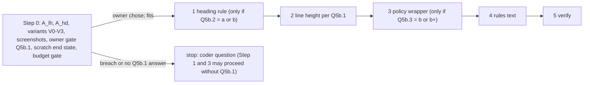

# Plan: Tailwind phase T5b, the typography decisions left by `base.css` (addendum)

Slug: `theme-evolution-tailwind-t5b`
Parent: `docs/plans/theme-evolution-tailwind.md` (umbrella) §12 (Phase T5 Steps: line height, element-level heading typography, the T4c policy rule), D6. Index: `docs/plans/theme-evolution-tailwind-t5-index.md`. Prerequisite: `docs/plans/theme-evolution-tailwind-t5a.md`.
Model: `docs/plans/theme-evolution-tailwind-t4c.md` (Revision 2.1) and its review.
Architect: Claude (for Junior Warner)
Date: 2026-10-23; revised 2026-11-06
Revision: 2.2.1 (2026-11-06). It folds in round 4 of `docs/reviews/theme-evolution-tailwind-t5b-review.md` (APPROVE WITH CHANGES on Revision 2.2: R12-R15, nits n6-n12; changelog below). Revision 2.2 (2026-11-06): the owner said "start T5b" on 2026-11-06 `[quoted: orchestrator brief]`. This revision makes the approved plan startable on today's tree: it applies every hand-off in `docs/plans/theme-evolution-tailwind-t5a-spacing.md` §5.5, re-derives every budget figure from 59,134 / 11,322, covers the store-side changes synced from live (Supercycle, the rental template, the white logo) and writes the last QA rounds' lessons into Step 0 and the criteria (changelog below). No step, criterion or decision is renumbered. Revision 2.1 addressed round 2 of `docs/reviews/theme-evolution-tailwind-t5b-review.md` (APPROVE WITH CHANGES: R10, R11, nits n1-n5; changelog below). Revision 2 addressed round 1 (R1-R9, N1-N10). T5a Revision 2 was written in the same round as T5b Revision 2 and already carries the corrected 60-character figure (T5a §5.10); this revision doesn't edit T5a.
Tier: 2. Three site-wide typography choices, each small in bytes and large in what the merchant sees. Every change in this plan is ⚑.
Builds on: HEAD `3774e29` (`.git/refs/heads/main`, 2026-11-06). T5a is **live** (`cc1b2e5`, `docs/qa/theme-evolution-tailwind-t5a-deploy.md` "Live deploy") and on staging #187953643616; its owner check 3 is complete (`docs/qa/theme-evolution-tailwind-t5a-report.md` "Owner check 3 decisions"). The T5a spacing follow-up (Rev 1.1.2) is **live** (`6a4f1c1`) and on staging (`a9f0d37`) (`docs/qa/theme-evolution-tailwind-t5a-spacing-deploy.md`). Later commits are docs only. (§13 Step 0 item 1.)
Order: **T5b, at least its Step 3, runs before T6a and T6b** (spacing plan §5.4: a consequence of the owner's spacing answer Q1 (a)). T5b and T6 are never implemented at the same time: both rebuild `assets/tailwind.css`.

**Gates.**

1. **Owner gate (Q5b.1).** Step 2 (line height) is committed only after the owner has chosen an option **in writing**, on Step 0's full-site screenshot pairs (now including the open states, R4). Umbrella §12 says T5's "full-site screenshot review [decides] the final line-height", so this plan doesn't let a recommendation stand in for that choice. Steps 1 and 3 follow the recommendations unless the owner says otherwise, and the owner reviews them on staging. (Revision 2.2) The owner's standing rule, that the Architect's recommendation applies unless it reverses a prior owner decision `[quoted: orchestrator brief, 2026-11-06]`, covers Step 1 under (c) and Step 3 under (b): neither reverses a prior decision, and Step 3 under (b) is what the owner's spacing answer Q1 (a) relies on (§15.2 Q5b.3). It doesn't open gates 1 or 2: Q5b.1 and Q5b.2 stay explicitly owner-gated.
2. **Owner gate (Q5b.2), before live** (Revision 2, review R1). Coding may proceed on Q5b.2's recommendation, but T5b doesn't go live until the impl notes or the coder-questions file quote the owner's own answer to Q5b.2, verbatim and dated. Under the recommendation nothing changes on staging, so without this gate the question could close unanswered.
3. **Budget gate (§4.1).** Step 0 builds, in scratch, the end state of exactly the steps that will be committed before QA; T5b proceeds only if it fits both budgets. The Architect's recommendation, as in T4c and T5a; not an owner decision.

---

**Post-approval (2026-10-23):** umbrella edits applied, leftovers fixed (§9.2's C5b.8 row now matches §5.2's offender wording).

## Revision 2.2.1 changelog (review round 4, 2026-11-06)

**What did not change.** No step, criterion, decision or recommendation was added, removed or renumbered; every edit is a rule, a label or a sentence. All four required changes and all seven nits are applied; none was declined.

| Review item | What changed | Sections |
|---|---|---|
| **R12** (required): S9 is a calendar, so path matching against Step 0 goes red on another day | At S9, app-owned (`OWN` = app) `line-height` and `font-family` differences are judged by §4.2's **mechanism allowance**, computed in the same load, not by a path in Step 0's lists; other app-owned S9 differences and unpaired app elements are **recorded, not counted red**. Applies to C5b.5 and to §5.6's pass rule (C5b.13). Optional extra rigour for C5b.5: S9 base and head loads in the same session with the browser clock pinned (`page.clock`) to one instant. A coder question (RB10) now arises only from a difference the mechanism doesn't explain | §4.2, §5.6, C5b.5, C5b.13, §9.2, §11 RB10, §13 Step 0 item 8 |
| **R13** (required): panel letters crossed the option letters | Panels are labelled in words: **"Today: normal"**, **"Proposed: 1.5"** and, if the owner names a value, **"Your value: <value>"**. The owner is asked to answer in words ("keep today", "proposed", or "another value: …"). **C5b.4(c) accepts only a word answer that names the option**; a letter alone ("A", "go with B") doesn't count, and the impl notes record which option the words map to before Step 2's commit | §4.2, §10, §13 Step 0 items 5a and 6, C5b.4, §9.2, §15.2 |
| **R14** (required): pairs chosen before the measurements; no header | The ten pairs in §4.2 are a starting set. After Step 0 items 3-4, the sheet must include **the header at 1440 and at 375** (scroll 0), **the element with the largest clipped or overflowing change**, and **the page with the largest `D_h`**; the least informative pairs are swapped out to stay at 10 or fewer, and each swap is recorded | §4.2, §13 Step 0 item 5a |
| **R15** (required): stale T6 hand-off text | §14 now says the T6 files were updated on 2026-11-06 (T6 index Revision 2.2 changelog; T6a and T6b "Update 2026-11-06" tables), and SP-4 cites them by heading, not line. The T5 index's order bullet says the same. T6a §5.6 now says only the top of its 59,629 to 60,259 range, above 60,000, is over budget | Revision 2.2 changelog SP-4, §14, T5 index, T6a §5.6 |
| n6 | The container used for §5.6's matching stays `.shopify-policy__container` (or the wrapper) whatever the owner label; `OWN` replaces all three owner functions in the copied library (`t5ac-lib.mjs:271-272`, `:338-340`, `:376-377`; the third lacked the Supercycle selectors) | §4.2, §5.6, §10 |
| n7 | Once Step 0 records where the `modal` picker attaches, its container selector is added to `OWN_APP` and named in S9's readiness rule | §4.2, §13 Step 0 item 5 |
| n8 | §3.4 gains a row for Shopify's shadow-DOM widgets (accelerated checkout, payment terms): inherited `line-height` crosses shadow boundaries, snapshots don't pierce shadow roots, so only screenshots show them | §3.4 |
| n9 | Sheet anchors sit at 80 px "or as close as the scroll range allows"; overlays (S2 drawer, S3 menu, S9 modal) aren't scrolled | §4.2 |
| n10 | RB10's coder question names the option the merchant already controls: the Supercycle block's own `custom_css` setting in the theme editor (not a T5b edit) | §3.4, §11 RB10 |
| n11 | Step 0 item 8 diffs live's CSSOM marker rules against the committed build's once before `SEL` is relied on | §13 Step 0 item 8 |
| n12 | C5b.6, C5b.7(b) and C5b.12 name the two rental products | §9.1 |

## Revision 2.2 changelog (2026-11-06, start on today's tree)

**What did not change.** No step, criterion or decision was added, removed or renumbered (Step 0 + Steps 1-5; C5b.0-C5b.14; D5b.1-D5b.6). The recommendations stand: Q5b.1 (a), Q5b.2 (c), Q5b.3 (b), and gates 1-3 are unchanged. Added without renumbering: Step 0 item 5a (the owner's Q5b.1 sheet), state **S9**, §3.4, referent rows, risks RB10-RB12.

| Item | What changed | Sections |
|---|---|---|
| **Base** | Builds on HEAD `3774e29`: T5a live and its spacing follow-up live, both on staging. `S_tw5a` is now **59,134 / 11,322** (the symbol keeps its name; it now means "before T5b"). Every budget figure and projection is re-derived from it | header, §0, §4.1, §5.5, §16 |
| **SP-1** (spacing §5.5, "T5b §3 / Step 3 / V3") | After Step 3 the spacing follow-up's D1-D2 (`h5`/`h6` margins, `th` padding in `tbody`/`tfoot`) reach the policy body through the wrapper's `data-rich-text`. The one policy body has none of those elements (`N_pol`), so nothing visible is expected; V3 records the match count. Not a new decision. `S_pol` stays T5b's own figure: spacing Q1 (a) added no policy rule | §0, §3.3, §5.2, §8 E5b.4, §13 Step 0 item 5 |
| **SP-2** (census owner classes, spacing review N10) | The T5b harness's owner function classes descendants of `.shopify-policy__body` as **merchant**, tested before the Shopify list (`OWN_SHOP` lists `.shopify-policy__container`, `docs/qa/harness/t5ac-lib.mjs:271`, `:338`, `:376`); the policy title stays Shopify. A rerun of the spacing census (C-S.8) goes through a `t5bc-` copy with that fix, so a correct build can't stop on merchant policy content | §0, §4.2, §10, C5b.11, §9.2 |
| **SP-3** (Q5b.3 dependency and fallback) | Q5b.3 now says that the owner's spacing answer Q1 (a) depends on (b), and that under (a) the spacing plan's §3.4 policy set is built as T5b's follow-up, not left undone | §11 RB12, §14, §15.2 |
| **SP-4** ((b+) budget wording) | T5b (b+)'s own gate still passes (**59,469 to 59,829** `[provisional]`), but (b+) plus T6a and T6b at their upper bounds ends at **about 59,900 to 60,260, over `B_min` on most of that range**; the later of T6a/T6b would stop at its Step 0 gate. The (b+) question says so. Same wording applied to the T6 index (§5, the "T6b after T6a" row and the paragraph after the table) and T6a §5.6 (the paragraph after its budget table) (citations by heading, Revision 2.2.1, R15) | §5.5, §15.2, T6 index, T6a |
| **SP-5** (§5.4 rules sentence) | The "Rich text" bullet changed in one sentence (spacing §5.2). Step 4's two replacement strings still occur exactly once in each of `CLAUDE.md:198` and `AGENTS.md:193` `[measured]`. The policy sentence now also names `data-rich-text`, since the wrapper carries it (R10) and D1-D2 key on it | §5.4 |
| **SP-6** (T5 index budget table) | A row for the spacing follow-up (59,134 / 11,322 `[measured]` QA C-S.2); T5b's rows re-derived. **T5b's lower bound is −415, not the hand-off's −420.** The hand-off used `S_pol` = 396, which carried T5a's estimate of 46 B for the link transition; the compiled rule prints `transition:text-decoration-thickness .1s` (41 B with its `;`; the default `ease` is dropped), so `S_pol` counted from the five compiled rules at HEAD is **391** | §0, §5.5, T5 index |
| **SP-7** (project order) | T5b (at least Step 3) before T6a/T6b; a late Step 2 may land after T6 and then re-baselines on that tree | header, §13, T5 index |
| **ST-1** (store-side changes synced from live) | In the repo: the Supercycle app embed (`config/settings_data.json`), the calendar block on `templates/product.json` (dropdown `left`), `templates/product.rental.json` (no dynamic checkout, the picker as a `modal`, the quantity selector `disabled`; used by `/products/the-rental-snowboard` and `/products/the-one-of-one-rental-snowboard`), and the white logo at width 180 (`sections/header-group.json`). Both rental products join the page set; **S9**, the rental product with its date picker open, joins the states at 375 and 1440 for every set, variant, screenshot, sweep and the live probe. New §3.4 says what each T5b rule can and can't reach in Supercycle's picker (it holds tables) and in the opt-out page's widgets | §3.4, §4.2, §8, C5b.5, C5b.8, C5b.13, §10, §11 RB10, §13 |
| **LQ-1** (preview cookie) | A browser context that opened `?preview_theme_id=` keeps being served the preview theme (the spacing QA's "live" column was the dev theme). Every live capture uses a **fresh context that never opened a preview URL** and asserts `Shopify.theme.id` 138872651872 with role `main` on every page; every dev or staging capture asserts its own id. A load with the wrong id is invalid, never relabelled | §0 `TH`, §4.2, §5.6, C5b.13, §10, §11 RB11, §13 Step 0 |
| **LQ-2** (CDN re-minifies) | Live served 59,081 B for the committed 59,134 B. Served CSS is compared **by selectors** (CSSOM rules), never by bytes or hashes | §0 `SEL`, §5.6, C5b.0, C5b.13, §13 |
| **LQ-3** (no `<main>`) | Neither layout renders `<main>` (`layout/theme.liquid:44`, `layout/password.liquid:20` print `content_for_layout` straight into `body`). Every injected control, probe and fixture is appended to `body` | §3.1, §4.2, §5.6, §13 |
| **OS-1** (owner sheet for Q5b.1) | Step 0 item 5a: at most 10 labelled side-by-side pairs ("A: today" / "B: proposed"), each with a one-line caption saying what to look at, anchored on the same element in both builds; the full screenshot set stays as evidence | §4.2, §10, §13, §15.2 |
| **F-1** (facts re-read at `3774e29`) | §3.1's anchors moved (`src/tailwind.css`: D6 block `:345-355`, policy rules `:265-283` and `:297-303`; `layout/theme.liquid:44`). `H_plain` is unchanged (30 heading lines; the same 12 without a font class). T5a committed no policy-body `:empty` rule, so C5b.7's empty-element clause takes its "not applicable" branch. §5.2's padding branch costs **56 B** (`px-(--page-margin)` isn't compiled today), not 40 | §3.1, §5.2, §5.5, C5b.7 |

Rev 2.2 sweep: see §16 "Revision 2.2 checks".

## Revision 2.1 changelog (review round 2)

**What did not change.** No step, criterion, decision or recommendation was added, removed or renumbered. Every edit is a scoping or wording fix.

| Review item | What changed | Sections |
|---|---|---|
| **R10** (required): Step 3 deleted T5a's policy-body `:empty` twin with nothing in its place | Option (a): the policy wrapper also carries **`data-rich-text`**, so T5a's surviving `[data-rich-text] :where(…):empty` rule (D5a.19) covers the policy body at 0 B; policy bodies are merchant HTML. §5.1's heading-rule comment no longer says the policy wrapper lacks the attribute. C5b.7(c) gains a check that every empty policy-body element T5a's Step 0 listed still computes `display: none`. Harnesses that count `[data-rich-text]` boxes now find one on the policy page | §5.1, §5.2, §5.6, C5b.7, §9.2 |
| **R11** (required): C5b.4(a)'s N1 clause failed under Q5b.1 (b) and (c) | The clause now exempts, under (b) or (c), the one D6 `html` rule that the same criterion requires; §9.2 says so | C5b.4, §9.2 |
| n1 | The flowchart's Step 3 node, §3.1's layout row and §5.2's heading name (b+) too | §3.1, §5, §5.2 |
| n2 | The header no longer says T5a's 60-character figure awaits T5a's review: T5a Revision 2 carries it | header |
| n3 | §9.2's C5b.7 row: on this store the discriminating width for a missing `w-full` is 320 (the privacy policy is long, so it fills 646.88 px at 1440 either way) | §9.2 |
| n4 | §5.2's 320 px bullet: with `w-full`, Shopify's container fills the 320 px wrapper, so any remaining offender is a Shopify descendant (a long word), or there is none | §5.2 |
| n5 | `SZ` adds the resolved `margin-left`/`margin-right` of auto-margined elements, and the harness records the scrollbar mode, so a classic scrollbar appearing on a page that grows past the viewport under 1.5 is recognized | §0, §10 |

## Revision 2 changelog (review round 1)

**What did not change.** No step was added or renumbered (Step 0 + Steps 1-5). No criterion was added, removed or renumbered (C5b.0-C5b.14). The recommendations stand: Q5b.1 (a), Q5b.2 (c), Q5b.3 (b). One option was added to Q5b.3 and is not recommended ((b+), R8).

| Review item | What changed | Sections |
|---|---|---|
| **R1** (required): the 9 headings aren't body font "by design" | Reworded everywhere: they are in the body font **for parity since T2 D2.8**, because Dawn's `var(--font-heading-family)` never resolved (the theme prints `--font-heading--family`); T2 handed the choice to T5. The recommendation (c) is now argued on its real merits (0 B, no restyling of Shopify or app headings, no restyling nobody has chosen). Q5b.2 needs an explicit, verbatim, dated owner answer before live (gate 2, C5b.6(d), §13 live gate) | gates, §1, §3.2, D5b.2, C5b.6, §10, §13, Q5b.2 |
| **R2** (required): the policy wrapper lacked `w-full` | The wrapper is `prose prose-tokens mx-auto w-full` (the page-center lesson, `docs/plans/theme-evolution-tailwind-t4c-page-center.md:18`, `sections/page.liquid:8`), here and in the live probe. Step 0 item 5 records the container's computed `margin`, `padding`, `max-width` and `width` on base and V3, and what sets its 325 px min-content at 320. **Precedence:** if the padding branch would raise `X_page` above base (5 ±1 at 320) or create a theme-markup offender, the Coder stops with a coder question; neither C5b.7(c) nor C5b.8 ships red. A fix the owner may approve (`wrap-break-word`) is named. C5b.7(c)'s width clause holds at every width, 320 included | §5.2, §5.6, C5b.7, §9.2, §13 Step 0 item 5, RB3 |
| **R3** (required): C5b.5's allowance sets were S0-only | `A_lh` and `A_hd` are measured on **every (page, state, width) C5b.5 compares** (T5a §4.3's states S0-S7 at 375 and 1440). An element Step 0 couldn't see (dynamic content) is allowed by **mechanism**: line height `normal` → 1.5 × its own font size ±0.01 px with no author `line-height`; heading font body → heading family on an element matching the rule. New Step 0 item: `NZ` from base loaded twice on the same matrix. The size-derived properties C5b.5 ignores are listed | §0, §4.2, C5b.5, §9.2, §13 Step 0 items 3, 4, 4a |
| **R4** (required): screenshots missed the open states | V0, V1, V2 and V2a screenshots add T5a's states S1-S6 at 375 and 1440 (drawer with the cart total, menu, accordion, tooltip with its title, consent overlay). A value the owner names under Q5b.1 (c) is rendered as **V1c** and shown before Step 2. V3 is limited to the policy page plus one control page | §4.2, §10 owner check 1, §13 Step 0 items 5-6, RB8 |
| **R5** (required): the budget figure and a late Step 2 | `P_endb` is built for exactly the steps committed before QA and rebuilt when Step 2 is added. New **late Step 2** path: Step 2 alone, `P_endb` rebuilt, named criteria re-run by QA, staging re-pushed, owner check 2 repeated for E5b.1, a fresh C5b.13 before live | §4.1, C5b.9, §13 "Late Step 2", RB1 |
| **R6** (required): the layout comment held `prose` | The comment now says "the typography plugin"; §5.2's claim is now true | §5.2 |
| **T5a review R6 (coupling)** | Step 3 deletes every rule whose selector starts with `.shopify-policy__body`, which covers T5a Revision 2's hover, transition and conditional `:empty` rules; `S_pol` and §5.5 follow | §0, §5.1, §5.5 |
| **R7** (required): the "any option" upper bound | +80 (the +40 padding exists only with Q5b.3 (b), which also deletes `S_pol`). Against Revision 1's T5a range the index's 58,748 becomes 58,708, as the review computed; T5a Revision 2 (written in the same round) moves T5a's own range, so the index now shows 59,002 = T5a Revision 2's high end 58,922 + 80. (b+) adds its measured cost on top, stated separately | §4.1, §5.5, §16, the index |
| **R8** (required): the policy title | Q5b.3 (b) and E5b.4 now say the policy title would be the only page title not set in `font-heading … uppercase`. The `prose-h1:` element variants are offered as (b+), **not recommended**: they conflict with `CLAUDE.md:198` ("Use plain `prose` only") and T4c's non-goal and C4c.4(d), so they need the owner's sign-off and a rules change; Step 0 renders V3h and measures the cost. "Weight 800" and the links' "500" render with the 700 and 400 faces | §5.2, E5b.4, Q5b.3, §10, §13 |
| **R9** (required): the convention wasn't written down | §5.4 adds rules text under Q5b.2 (c) (a heading without `font-heading` inherits the body font; no base rule) and under Q5b.1 (b) or (c) (where the root line height is set). C5b.14 checks every branch | §5.4, C5b.14 |
| N1 | C5b.4(a) also requires that no compiled rule other than Preflight's sets `line-height` on `html`, `:root` or `body`; §9.2's discrimination sentence corrected | C5b.4, §9.2 |
| N2 | T5a's link extension is 60 characters, not 59. With T5a Revision 2's hover and transition rules (T5a review R6) and its conditional policy-body `:empty` rule, `S_pol` = 396 to 491; Step 3 now deletes every rule whose selector starts with `.shopify-policy__body`, so its list follows T5a; §5.5 and the index updated | §0, §5.1, §5.5, §16, the index |
| N3 | Under Q5b.2 (a), the opt-outs commit **before** the rule (no-ops until it lands); reverting the rule commit alone is a clean rollback | §5.3, §12, §13 Step 1 |
| N4 | The wrapper uses one `if`/`else` around `content_for_layout`, with no dangling `div` | §5.2, §13 |
| N5 | The live probe's Q5b.3 control is the wrapper's computed `max-width` (646.88 px ±1), proving `prose` applies on live | §5.6 |
| N6 | C5b.7(c)'s "left edge" is the minimum `left` of the rects of the text-bearing elements under `.shopify-policy__title` and `.shopify-policy__body` | C5b.7 |
| N7 | The heading rule's comment says why `:not(.prose *)` names a plugin class | §5.1 |
| N8 | The coder-questions file writes each option's words next to its letter | §13 Step 0 item 6 |
| N9 | Owner answers are the owner's words, verbatim; a recommendation repeated by an agent doesn't count | gates, C5b.4(c), C5b.6(d), §13 |
| N10 | The logo wrapper (#5) may move its span by about a pixel under a rule; `A_hd` and the screenshots show it | §3.2 |

Rev 2 sweep: see §16 "Revision 2 checks".

---

## 0. Referent table

Tags as in T5a §0.

| Sym | What it measures | Units | Artifact | Extent or band | Value, method or threshold |
|---|---|---|---|---|---|
| `B_min`, `B_gz`, `M_gz` | CSS budget and gzip method | bytes | `assets/tailwind.css` | whole file | 60,000 / 12,000; `gzip -9 -c assets/tailwind.css \| wc -c` `[quoted]` `CLAUDE.md:70, 105` |
| `S_tw5a` | `assets/tailwind.css` **before T5b**: T5a plus its spacing follow-up (Revision 2.2; the symbol keeps its name) | bytes | the committed file at HEAD `3774e29` | whole file | **59,134 / 11,322** `[quoted]` `docs/qa/theme-evolution-tailwind-t5a-spacing-report.md` C-S.2 (T5a alone: 58,850 / 11,269, T5a QA "Gates"). The commits after that QA's tree touch only `templates/product.rental.json` and `docs/` `[quoted]` commit subjects. Step 0 item 2 re-measures |
| `P_endb` | **the gate figure**: the chosen T5b end state built in scratch | bytes | scratch copy | whole file | `[to be measured]` Step 0 item 7 |
| `LH_root` | `html` line height | keyword or px | rendered page | `html` | `normal` today (`src/tailwind.css`, the D6 rule `html { line-height: normal; }` `[measured]`). Preflight gives `1.5` `[quoted]` umbrella §3.2 |
| `LH_n` | used height of one line of 16 px body-font text at `normal` | px | a probe `<span>` with no classes, `display: inline-block`, one word | border box | `[to be measured]` Step 0 item 3. `normal` depends on the font's metrics (Work Sans by default, `config/settings_schema.json` `type_primary_font`) |
| `LH_15` | the same at `1.5` | px | same | border box | 24 `[derived]` (16 × 1.5) |
| `A_lh(p,s,w)` | **line-height affected set**: elements whose computed `line-height` changes when the compiled `html{line-height:normal}` rule is deleted in the page | list | T5a build, one load | every element; **every (page, state, width) C5b.5 compares** (Revision 2, R3) | method §4.2 |
| `D_h(p,s,w)` | document height change from that deletion | px | same | `document.documentElement.scrollHeight` | `[to be measured]` |
| `A_hd(p,s,w)` | **heading affected set**: elements whose computed `font-family` changes when the candidate heading rule is inserted in the page | list | T5a build, one load | every element; the same matrix as `A_lh` | method §4.2 |
| `NZ_b(p,s,w)` | noise set on the tree before T5b (T5a plus its spacing follow-up, Revision 2.2): (element, property) pairs that differ between two loads of the same build | list | base (HEAD before T5b), loaded twice | same matrix | method T5a §4.2 `NZ`, re-measured here (T5a's `NZ` was taken on a different base) |
| `SZ` | size-derived properties C5b.5 ignores when a line height or font changes box sizes | list | n/a | n/a | the rect (`getBoundingClientRect`), and the computed `height`, `block-size`, `width`, `inline-size`, `top`, `right`, `bottom`, `left` (resolved values of positioned elements), the resolved `margin-left` and `margin-right` of elements whose specified margin is `auto` (they change when a classic scrollbar narrows the body; review n5), `transform-origin`, `perspective-origin` `[proposed]`. The harness records the browser's scrollbar mode (overlay or classic) and, per load, whether the document scrolls vertically, so a shift caused by a scrollbar appearing is recognized as such |
| `H_plain` | theme headings with no font-family utility and a visible effect | **source lines** (a card title renders once per card, so rendered elements outnumber lines) | scanned Liquid | `<h1>`-`<h6>` tags and `<{{ heading_tag }}>` | **11 lines in 8 files** `[measured]` (ripgrep; 12 lines in 9 files minus the logo wrapper, §3.2) |
| `S_lh` | the D6 `html` rule, compiled | bytes | `assets/tailwind.css` | one rule | `html{line-height:normal}` = **24** `[derived]` |
| `S_hd` | the candidate heading rule, compiled | bytes | estimate | one rule | `:where(h1,h2,h3,h4,h5,h6):not(.prose *){font-family:var(--font-heading--family)}` = **80** `[derived]` (25 + 14 + 41 characters) |
| `S_pol` | the policy rules at HEAD | bytes | `assets/tailwind.css` at `3774e29` | every rule whose selector starts with `.shopify-policy__body` | **391** `[derived]`, counted character by character from the five compiled rules (Revision 2.2): `ul` 46, `ol` 49, `a` 156 (T4c's 55 + T5a's offset and thickness 60 + `;transition:text-decoration-thickness .1s` 41: the build drops the default `ease`, so T5a's estimate of 46 was 5 high), `:is(ul,ol)` 78, `a:hover` 62. T5a committed **no** policy-body `:empty` rule (no compiled selector `[measured]`), and the spacing follow-up added no policy rule (its Q1 (a)). Revision 2.1's 396 to 491 is superseded. Step 0 item 2 re-measures |
| `S_pm` | `px-(--page-margin)`, compiled, if §5.2's padding branch runs | bytes | estimate | one rule | `.px-\(--page-margin\){padding-inline:var(--page-margin)}` = **56** `[derived]` (21 + 35), in the form of the compiled `.px-\(--padding\){padding-inline:var(--padding)}` `[measured]`. Not compiled today `[measured]` (Revision 2.1's +40 was low) |
| `N_pol` | elements of each type inside the one policy body | count per tag | `/policies/privacy-policy` (the six other standard handles return 404) | `.shopify-policy__body` | 13 `h2`; 0 `h5`, `h6`, `table`/`th`/`td`, `hr`, `blockquote`, `details`/`summary` `[quoted]` spacing live deploy note, gate 2 (census on live, 2026-10-27) |
| `TH(load)` | the theme that served a load | id, role | `window.Shopify.theme` | every page load | dev **187953938528**, staging **187953643616** (role `unpublished`), live **138872651872, role `main`**. A load with another id is **invalid**, never relabelled. A context that has opened a `?preview_theme_id=` URL keeps being served the preview theme `[quoted]` spacing QA report "Orchestrator correction"; so a live capture runs in a fresh context that never opened one (Revision 2.2, LQ-1) |
| `SEL(load)` | the served `tailwind.css`, **compared by selectors** | set of (layer path, selector text, declaration text) | the page's CSSOM | whole sheet | the Shopify CDN re-minifies the file: live served 59,081 B for the committed 59,134 B `[quoted]` spacing live deploy note. Bytes and hashes never identify a build; a build is identified by the presence or absence of named rules read from the CSSOM (LQ-2) |
| `OWN(e)` | owner class of an element | app / merchant / Shopify / theme | harness `owner()` in `t5bc-lib.mjs` | tested in this order | **app**: `OWN_APP` (`docs/qa/harness/t5ac-lib.mjs:272`, which includes `[id*="supercycle" i]` and `[class*="supercycle" i]`); **merchant**: inside `.shopify-policy__body` (spacing hand-off, its review N10); **Shopify**: `OWN_SHOP` (`:271`), which lists `.shopify-policy__container`, so the policy title and container stay Shopify; else **theme** |
| `S_ph` | the (b+) `prose-h1:` element variants, compiled | bytes | scratch build | six variant rules | `[to be measured]` Step 0 item 5 (V3h). About 750 to 950 `[provisional]` (each compiles to a `:is(:where(h1):not(:where([class~=not-prose],…)))` selector of about 90 characters plus its declaration) |
| `M_ch` | `prose`'s `65ch` in px | px | T4c Step 0 | 16 px body font | **646.88** `[quoted]` T4c impl notes `:10` |
| `PT` | `request.page_type` on a policy page | string | Liquid | n/a | `policy` `[quoted]` shopify.dev `objects/request` (possible values include `policy` and `captcha`); Step 0 item 5 prints it in scratch before Step 3 depends on it |

Readings that are easy to confuse:

- `A_lh` and `A_hd` are **same-load** sets (one rule toggled in the page), like T5a's `TOG`, taken in every state the comparison uses, because content that exists only in a state (the drawer's line items, the tooltip, the accordion story, the consent overlay) is absent from an S0 load. The geometry consequences (`D_h`, moved elements) are recorded, not predicted element by element: a line-height change moves everything below the first affected line.
- `H_plain` is a **static** count of headings in theme Liquid. `A_hd` is the **rendered** set, which also contains Shopify and app headings and excludes headings a template doesn't render.
- **Served vs committed CSS** (Revision 2.2). `S_tw5a`, `P_endb` and C5b.9 are bytes of the **committed** file (`wc -c`, `M_gz`). Anything read from a **served** page (`SEL`, the `A_lh` rule lookup, the live probe) is matched by selector and declaration, never by size.
- **App and Shopify markup inherits what its own CSS doesn't set** (Revision 2.2). Supercycle's picker and Shopify's widgets carry unlayered CSS that beats every theme layer for the properties it sets, and inherit `line-height` and `font-family` from their ancestors for the ones it doesn't. Which case applies is measured (`A_lh`, `A_hd` at S9 and on the opt-out page), not assumed (§3.4).

---

## 1. Problem statement and goals

T5a removes `base.css` at parity and leaves three typography choices that umbrella §12 assigned to T5, each of which changes what merchants see on many pages:

1. **Line height.** `html { line-height: normal }` (umbrella D6) was added in T0 so Preflight's `1.5` wouldn't change every page while Dawn's CSS still loaded. Every page was QA'd against `normal` since. The rule says "T5b decides" after T5a.
2. **A heading base rule.** Umbrella §12 planned "element-level typography (headings in `font-heading`)" in `@layer base`, which `base.css` used to block. Since then every converted heading that should use the heading font declares `font-heading` itself, and **11 heading lines in 8 files have no font class** (§3.2). They are in the body font **for parity, not by anyone's choice**: Dawn's `h1`-`h5` rule asks for `var(--font-heading-family)` (`assets/base.css:252-263`), but the theme prints `--font-heading--family` (`snippets/css-variables.liquid:21`), so the declaration never resolved and those headings inherited the body font. Each conversion kept that to keep its diff clean, and T2 handed the decision on: "Spotlight, material-info and card titles keep the body font (parity). Element-level heading typography for the whole site is T5's job" (`docs/plans/theme-evolution-tailwind-t2.md:328`, D2.8). T4c Q4c.7 keeps rich-text headings in the body font, which **is** a decision. A base rule would restyle the 11 unless the plan opts them out.
3. **Policy pages.** T4c kept a scoped parity rule (Q4c.3 (a)) and recommended `prose` through a layout wrapper "for T5" (Q4c.3 (c)). T5a extended the rule for exact parity.

### Goals

1. The owner chooses each on full-site screenshots (Step 0); the plan implements the choices.
2. Rich-text headings stay in the body font unless the owner decides otherwise (Q4c.7).
3. Policy links stay underlined and lists keep markers whatever option is chosen (WCAG 1.4.1, T4c Q4c.3).
4. Keep the gates: `check:css`, theme check at 0, schemas byte-identical, `H1` = 1, both budgets, no new overflow.
5. A read-only live probe before the live push, as in T5a.

---

## 2. Non-goals

- **No focus-ring change** (T5a Q5a.1 decided it).
- **No other type-scale change:** sizes, weights, letter spacing and `text-*` utilities stay as they are. No `prose` modifiers, except the policy wrapper's `prose-h1:` variants if the owner chooses Q5b.3 (b+). No change to the rich-text measure (Q4c.1).
- **No change to the page section's centering** (the page-center follow-up, `docs/plans/theme-evolution-tailwind-t4c-page-center.md`), even if policy pages end up looking different from pages.
- **No edits** to schemas, `config/*`, `templates/*.json`, `sections/*-group.json` or `locales/*`; no store content.

---

## 3. Current state (after T5a and its spacing follow-up; Revision 2.2)

### 3.1 Files `[measured]` at `0783033`, re-measured at `3774e29` (Revision 2.2); every step finds its text, not a line number

| File | Today | T5b change |
|---|---|---|
| `src/tailwind.css` | the D6 block in `@layer base`: comment (`:345-348`, "Browser defaults that Preflight removes …"), `html { line-height: normal; … }` (`:349-351`), the cursor rule (`:352-355`); the policy rules: T4c's block with its comment (`:265-283`) and T5a's `:is(ul, ol)` and `a:hover` rules (`:297-303`); the `body` font rule (`:237-241`); the spacing follow-up's D1-D2 (`:324-343`), which T5b doesn't edit | Step 1 (if Q5b.2 adds a rule); Step 2; Step 3 (if Q5b.3 (b) or (b+)) |
| `layout/theme.liquid` | `{{ content_for_layout }}` (`:44`), printed straight into `<body>`: neither layout renders `<main>` (`layout/password.liquid:20` likewise) | Step 3 (if Q5b.3 (b) or (b+)) |
| 7 Liquid files (§3.2, §5.3) | headings without a font class | Step 1, only under Q5b.2 option (a) |
| `CLAUDE.md`, `AGENTS.md` | "Rich text" bullet (`CLAUDE.md:198`, `AGENTS.md:193`), the CSS architecture intro (`:193` / `:188`) | Step 4 |

### 3.2 Headings with no font-family utility (`H_plain`) `[measured]`

Ripgrep for heading tags in scanned Liquid, then the class strings read one by one (re-run at `3774e29`, Revision 2.2: the same 30 lines, the same 12 without a font class, at the same line numbers):

| # | Element | Where | Renders on |
|---|---|---|---|
| 1-2 | `<h1>` balance, `<h2>` shop name | `templates/gift_card.liquid:24`, `:51` | gift card (no fixture; PXG) |
| 3 | product card title `<h3 class="m-0">` | `snippets/card-product.liquid:129` | related products on PDPs |
| 4 | material name `<h3 class="m-0 text-[1.6rem] font-semibold …">` | `snippets/material-info.liquid:32` | material info |
| 5 | the logo wrapper `<h2 class="m-0 leading-none">` | `sections/header.liquid:25` | every page. Its visible content is an `` or a `<span class="font-heading …">` (`:42`), so a base rule changes nothing visible `[derived]`, except that the `h2`'s own strut changes font and may move the span by about a pixel (review N10); `A_hd` and the screenshots show it |
| 6 | archive card title `<h2 class="mb-2 text-[1.25rem] font-semibold">` | `sections/main-material-archive.liquid:62` | the archive |
| 7 | tooltip title `<h3 class="mb-2 text-[1rem] font-semibold …">` | `sections/material-tooltip.liquid:27` | PDP tooltip |
| 8 | cart total `<h3 class="m-0 text-[1.1rem]">` | `sections/cart-drawer.liquid:66` | the drawer, with items |
| 9-11 | three card titles `<h2 class="m-0 text-[1rem] text-[#202223]">` | `sections/hello-world.liquid:20`, `:32`, `:44` | home |
| 12 | spotlight title `<{{ heading_tag }} class="m-0 text-[1.6rem] font-semibold text-foreground">` | `sections/material-spotlight.liquid:139` | 3p product |

That is 12 source lines in 9 files, of which #5 has no visible effect: **11 lines in 8 files** (`H_plain`). None of the 11 was put in the body font by a design decision: T2 to T4b kept Dawn's (accidental) body font for parity, and T2 D2.8 said the site-wide choice belongs to T5 (§1 item 2). Every other theme heading declares `font-heading`: 19 lines (18 found by the ripgrep `<h[1-6][ >]`, plus `sections/image-banner.liquid:384-385`, whose tag and class are on separate lines). Shopify's policy title (`.shopify-policy__title h1`) and any app or consent-banner heading would also change; `A_hd` lists them.

### 3.3 Policy pages after T5a

Chain `div.shopify-policy__container > div.shopify-policy__body > div.rte > div > ul/a`, 5 `ul`, 0 `ol`, 4 `a` on `/policies/privacy-policy`, no inline style; the only rendering policy `[quoted]` T4c impl notes `:37`. Looks: `disc`, inside markers, 32 px list padding, links underlined with Dawn's offset and thickness (T5a D5a.6). The title is Shopify's `<h1>`, in the body font at the inherited size (Preflight resets heading sizes; Dawn's sizes were invalid) `[derived]`. A 5 px overflow at 320 from the container is pre-existing `[quoted]` T4c QA.

**After the spacing follow-up (Revision 2.2, SP-1).** The policy body is still bare: no `prose`, no `data-rich-text`, so paragraphs and its 13 `h2`s are unspaced, as on live since T0 (spacing plan §3.1). The owner chose to leave bare markup alone **because** T5b's wrapper would space it (spacing Q1 (a), 2026-10-26). The spacing follow-up's D1-D2 (`[data-rich-text] :where(h5, h6)` and `[data-rich-text] :where(tbody, tfoot) th`, with its first- and last-child rules) don't match here today, and will match inside the wrapper after Step 3; the body has none of those elements (`N_pol`). T5a committed no `.shopify-policy__body` `:empty` rule, so the wrapper's `data-rich-text` newly brings T5a's `[data-rich-text] … :empty` rule (Q5a.5) to the policy body rather than replacing a twin (§5.2).

### 3.4 Third-party and store-side markup on today's tree (Revision 2.2, ST-1)

Synced from live and committed: the Supercycle app embed (`config/settings_data.json:21`), the Supercycle "methods" block on `templates/product.json` (calendar dropdown `left`) and on `templates/product.rental.json` (dropdown `modal`; that template also hides the quantity selector, `"disabled": true`, and the dynamic checkout button, `show_dynamic_checkout: false`), and the header's white logo at width 180 (`sections/header-group.json:17-18`). The rental template is used by `/products/the-rental-snowboard` and `/products/the-one-of-one-rental-snowboard` `[quoted]` orchestrator brief; it also renders the spotlight (`H_plain` #12) and related products (#3).

What each T5b rule can reach, by mechanism `[derived]`; Step 0 measures every row:

| Markup | Where | Q5b.1 line height (Step 2) | Q5b.2 heading rule (Step 1, only (a)/(b)) | Q5b.3 wrapper (Step 3) |
|---|---|---|---|---|
| Supercycle block and its open date picker (tables: 1 at 375, 2 at 1440; 7 / 14 `th`, 35 / 77 `td`, no shadow root, `[quoted]` spacing QA C-S.8) | rental products (picker as a modal, so it may sit outside the product section); the block also renders on default-template products | **can change it.** The block sits outside `prose`; any element whose own (unlayered) CSS sets no `line-height` inherits the root value, so under (a) calendar rows and labels can grow. Under (b), nothing changes | only an `h1`-`h6` inside the app's markup whose own CSS sets no `font-family` (the census counted no `h5`/`h6`; `h1`-`h4` weren't counted). Tables, `th` and `td` are never selected | none: the wrapper renders only on `/policies/*` (C5b.7(b)) |
| Shopify's privacy widget (`#pc--optOutFormContainer`, `.pc--show-email-field`) | `/pages/data-sharing-opt-out`, inside `<div class="prose prose-tokens overflow-x-auto" data-rich-text>` (`sections/page.liquid:14`) | **not expected:** it inherits `prose`'s `line-height: 1.75` (`.prose{…font-size:1rem;line-height:1.75}` `[measured]` in the compiled file), not the root's. `.form__message` sets its own `line-height: 1` (`src/tailwind.css:307-313`) | none: inside `.prose`, excluded by `:not(.prose *)` (unless (d)) | none |
| The hCaptcha popup container (`body > div[aria-hidden="true"]:has(> div > iframe[src*="hcaptcha"])`) | appended to `body` on the opt-out page | can change the container's own text, if any (outside `prose`); the challenge itself is in an iframe and unaffected | none expected (no heading outside the iframe) | none |
| The consent banner (S6) | `/` in a context without consent cookies | can change it, where its own CSS sets no line height | can change any banner heading its own CSS doesn't set | none |
| Shopify's shadow-DOM widgets (accelerated checkout, payment terms: the "`DIV.flex` settling" the spacing QA saw) (Revision 2.2.1, n8) | default-template products (not the rental template, which hides dynamic checkout) | **can change them**: inherited `line-height` crosses shadow boundaries, where the widget's own styles set none. The snapshots don't pierce shadow roots, so only screenshots show it (owner sheet pair 4; the full set) | none expected: a heading inside a shadow root isn't matched by a document-level rule | none |
| The spacing follow-up's D1-D2 | inside every `[data-rich-text]` box | no: em-based margins and paddings inside `prose`, which sets its own 1.75 (spacing plan R8) | no: `:not(.prose *)` | they newly apply inside the policy wrapper (SP-1) |

So Supercycle's tables can only be reached through inherited line height, and only under Q5b.1 (a) or (c). That is a merchant-visible change to app markup the theme doesn't own: it appears in `A_lh` at S9, in the owner's Q5b.1 sheet (pairs 5 and 6, §13 Step 0 item 5a) and in the live probe. If the owner chooses (a) and dislikes the picker's new rhythm, the Coder stops with a coder question rather than picking a fix (RB10). There is no theme element around the app block today (`sections/product.liquid:29-30` prints `` straight into the product info column), and a wrapper with `leading-[normal]` there would reach markup inside the block but not a modal the app appends to `body`, which Step 0 item 5 records. Supercycle's own CSS and settings are not edited by T5b. The coder question names the option the merchant already controls: the Supercycle block's own `custom_css` setting in the theme editor (`templates/product.rental.json`, empty today), which the owner could use; that is a merchant edit, not a T5b change (Revision 2.2.1, n10).

---

## 4. The gates, the method and the decisions

### 4.1 Budget gate (Step 0 item 7)

In a scratch copy of HEAD (T5a plus its spacing follow-up, `3774e29` or later): `npm ci`, apply the §5 edits of **exactly the steps that will be committed before QA**, with the options chosen (the owner's, or the recommendations), `npm run build:css`, measure `P_endb` (`wc -c`, `M_gz`), run `scripts/check-css-layers.mjs`. If Q5b.1 is unanswered when QA starts, `P_endb` is built **without** Step 2; when Step 2 is added later, `P_endb` is rebuilt with it (§13 "Late Step 2"). Proceed only if `P_endb` ≤ 60,000 and ≤ 12,000. Otherwise stop with the figures in `docs/plans/theme-evolution-tailwind-t5b-coder-questions.md`. The final committed file must equal the `P_endb` of the committed step set (C5b.9(b)). §5.5 estimates −415 to +80 B against `S_tw5a` (59,134 / 11,322) over every option except (b+), an end of 58,719 to 59,214 `[provisional]`; (b+) adds its measured `S_ph` and ends at about 59,469 to 59,829 `[provisional]`, still inside both budgets (Revision 2.2). T5b's gate is its own; what (b+) leaves for T6a and T6b is in §5.5.

### 4.2 Methods

All in-page functions go in `docs/qa/harness/t5bc-lib.mjs` (§10), copied from `t5ac-lib.mjs`.

**Capture rules for every load in this plan** (Revision 2.2; LQ-1 to LQ-3, ST-1, SP-2):

- **Theme assertion.** Every load records `TH` and is invalid unless it is the theme the capture claims: the dev theme for base, variants and proxies; staging for owner check 2's harness checks; live (**138872651872, role `main`**) for anything labelled live. A **live** capture runs in a fresh browser context that has never opened a `?preview_theme_id=` URL, with its own single storefront-password login (never a storage state saved from a preview session). Dev and live loads never share a context.
- **Build identity by selectors.** Before a variant's captures, the harness reads `SEL` on one page and checks the variant's marker rules (V0 has the `html{line-height:normal}` rule and the `.shopify-policy__body` rules; V1 lacks the first; V2 has the heading rule; V3 lacks the policy rules). Bytes or hashes of a served file are never compared.
- **Injection target.** Every control, probe and fixture is appended to the end of `body`; neither layout has a `<main>`.
- **Pages and states.** T5a §4.3's pages and states, plus `/products/the-rental-snowboard` and `/products/the-one-of-one-rental-snowboard` at S0, and a new state **S9, the rental date picker open**, on `/products/the-rental-snowboard` at 375 and 1440. **S9 readiness:** settle as S0, click the first `input` inside `[id^="shopify-block-"]`, `[id*="supercycle" i]` or `[class*="supercycle" i]` (as `docs/qa/harness/t5as-sweep.mjs` does), then wait up to 10 s for a visible `table` containing a `td` inside a Supercycle container or a modal it appended to `body`, then 1.5 s. If none appears the S9 run is invalid and re-run, never recorded as "no change". Record where the picker sits (inside the block or appended to `body`). (Revision 2.2.1, n7) If the picker is a modal appended to `body` outside `[id^="shopify-block-"]` and without a `supercycle` id or class, Step 0 item 5 records its container's selector, which is then added to `OWN_APP` and named here, so the modal is app-owned and is what "a modal it appended to `body`" means.
- **Owner classes.** `OWN(e)` (§0): app, then **merchant** for anything inside `.shopify-policy__body`, then Shopify, then theme. A criterion that treats Shopify-owned differences specially never applies that to merchant content. (Revision 2.2.1, n6) `OWN` replaces **all three** owner functions copied from `t5ac-lib.mjs` (`:271-272`, `:338-340`, `:376-377`; the third, the focus sweep's, lacked the Supercycle selectors). The owner label doesn't choose the matching container: §5.6 matches policy elements under `.shopify-policy__container` (or, under (b), the wrapper) whatever their label.
- **S9 is date-dependent** (Revision 2.2.1, R12). The picker shows the current month, today's cell, past (disabled) dates and the app's availability, so its cells, classes and week rows change from day to day and paths recorded at Step 0 don't survive. **Rule for app-owned elements (`OWN` = app) at S9:** a `line-height` or `font-family` difference is judged by the **mechanism allowance** below, computed on the element in the same load, never by its path in Step 0's lists; any other app-owned difference at S9, and any unpaired app element, is **recorded, not counted red**. Theme-owned elements at S9 (the page around the picker) are judged as at every other state. C5b.5 and §5.6 apply this rule. Optional extra rigour for C5b.5 only: take the S9 base and head loads in the same session with the browser clock pinned to one instant (Playwright `page.clock`); it doesn't help §5.6, whose reference is Step 0.

- **`A_lh`, in-page.** In the loaded `assets/tailwind.css`'s `@layer base` block, find style rules whose `selectorText` is exactly `html` and whose only declaration is `line-height: normal`. Exactly one, or the run is invalid. Inject a positive control `<span data-t5b-ctl>x</span>` at the end of `body`; its computed `line-height` must be `normal`. Snapshot (T5a §4.2's full snapshot), `deleteRule` that rule, finish new animations, wait two frames, snapshot. **Valid only if** the control now computes `24px`. `A_lh` = elements whose `line-height` differs; also record every element whose rect changed and `D_h`. Run it on **every (page, state, width) that C5b.5 compares**: T5a §4.3's pages and the two rental products at S0, and T5a's states S1-S7 and S9 at 375 and 1440, each reached as T5a §4.3 (or the S9 readiness above) says before the toggle (Revision 2, R3; S9 and the rental pages, Revision 2.2).
- **Mechanism allowance** (for elements Step 0 can't have seen, such as a recommendation that loads only on one run). A `line-height` difference is allowed if base is `normal`, head is 1.5 × the element's own computed `font-size` ±0.01 px (or the Q5b.1 (c) value × `font-size`), so the element inherits the root value (an element with its own `leading-*`, `text-*` or `prose` line height doesn't read `normal` at base, so it can't pass this test by accident). A `font-family` difference is allowed if the element matches `:where(h1,h2,h3,h4,h5,h6):not(.prose *)`, carries neither `font-sans` nor `font-heading`, base is the body family and head the heading family.
- **`NZ_b`:** base (HEAD before T5b: T5a plus its spacing follow-up) loaded twice on the same matrix, as T5a §4.2 defines `NZ`.
- **`A_hd`, in-page.** Inject a positive control `<h3 data-t5b-ctl>x</h3>` and a `prose` control `<div class="prose"><h3 data-t5b-ctl2>x</h3></div>` at the end of `body`. Append `<style>@layer base{:where(h1,h2,h3,h4,h5,h6):not(.prose *){font-family:var(--font-heading--family)}}</style>` to `head`; the `base` layer is already declared, so the rule joins it `[quoted]` CSS Cascade 5 (layer blocks with an existing name append to that layer). **Valid only if** control 1's `font-family` changes to `--font-heading--family`'s value and control 2's doesn't. `A_hd` = every element whose `font-family` changes, with its owner (theme, Shopify, app) and whether it is in `H_plain`. Same matrix as `A_lh`: the tooltip title (#7) exists only in S5 and the cart total (#8) only in S2.
- **Variant builds** in scratch, served one at a time on the private dev theme: **V0** (T5a HEAD), **V1** (the `html` rule deleted), **V1c** (only if the owner names another value under Q5b.1 (c): that value, rendered and shown **before** Step 2, Revision 2, R4), **V2** (the heading rule added, Q5b.2 option (b), so the owner sees the full effect), **V2a** (option (a): V2 plus the opt-outs of §5.3), **V3** (the policy wrapper, §5.2, and the policy rules removed), **V3h** (V3 plus the (b+) `prose-h1:` variants, §5.2, R8).
- **Screenshots** for the owner, full page, `reducedMotion: 'reduce'`, animations paused (T5a §4.2):
  - V0, V1, V1c, V2 and V2a: every page in T5a §4.3, the two rental products, and the proxies PXR, PXG and PXZ at S0, at 320, 375, 768, 1440 and 1920; **and** T5a's states S1-S6 and **S9** at 375 and 1440 (the drawer empty and with an item, so the cart total shows; the open menu; the accordion with its story; the tooltip with its title; the consent overlay; the rental date picker open) (Revision 2, R4; S9, Revision 2.2);
  - V3 and V3h: `/policies/privacy-policy` and one control page (`/pages/data-sharing-opt-out`) at the five widths. The wrapper renders nowhere else (C5b.7(b)), so the other pages would repeat V0.
  - Names `docs/qa/screenshots/t5b-<variant>-<page>-<state>-<width>.png` (gitignored), with a table per variant: page, state, width, `D_h`, the number of elements in `A_lh` or `A_hd`. This full set is **evidence** for the Coder, QA and the Architect, and the owner can ask for any of it.
- **The owner's Q5b.1 sheet** (Revision 2.2, OS-1; Step 0 item 5a). The owner, who isn't technical, gets a small set of side-by-side pairs instead of the full set:
  - **At most 10 pairs**, each one PNG: two viewport-sized crops of the same page, width and state, **left "Today: normal" from V0, right "Proposed: 1.5" from V1**, with a **one-line caption underneath saying what to look at**. If the owner names a Q5b.1 (c) value, the same pairs get a third panel "Your value: <value>" from V1c. (Revision 2.2.1, R13: the panels carry **words, never letters**, because letters would cross the option letters; Revision 2.2's "A"/"B" panels meant options (b)/(a).)
  - **Same region in both panels.** Under 1.5 everything below the first changed line moves down, so each panel is scrolled to put the pair's anchor element at 80 px from the viewport top in its own build, **or as close as the scroll range allows** (the footer at the end of a page, the header at scroll 0); **overlays aren't scrolled** (the S2 drawer, the S3 menu, the S9 modal) (Revision 2.2.1, n9). Never cropped at a fixed page offset. Same viewport (1440 × 900 or 375 × 667), `reducedMotion: 'reduce'`, animations paused, dev theme asserted (`TH`) and the build checked by `SEL` for both panels.
  - Built by rendering a small local HTML page (two `` side by side, the labels above, the caption below) with Playwright; no new dependency.
  - The pairs, their anchors and their captions. **This is a starting set** (Revision 2.2.1, R14): after Step 0 items 3-4, the sheet must include (i) **the header at 1440 and at 375** (scroll 0; nav links, cart count, announcement bar if on), (ii) **the element with the largest clipped or overflowing change** (an element in `A_lh` whose `scrollHeight` exceeds its `clientHeight` by more than 1 px, or whose text crosses its own border box, on V1 but not V0, ranked by the overflow in px; RB2's badges, cart count and buttons are the likely ones; "none found" is recorded if there is none), and (iii) **the page with the largest `D_h`**. Each one not already shown by a pair replaces the **least informative** pair (fewest `A_lh` elements inside its crop on V1), keeping the total at 10 or fewer; every swap is recorded in the impl notes with both pairs' `A_lh` counts:

    | # | Page, width, state | Anchor | Caption ("what to look at") |
    |---|---|---|---|
    | 1 | `/`, 1440, S0 | first paragraph below the banner | "Home, desktop: look at the gap between the lines of the body text and the card text." |
    | 2 | `/`, 375, S0 | the same | "Home, phone: the same text on a narrow screen; does it feel too loose or too tight?" |
    | 3 | `/products/the-3p-fulfilled-snowboard`, 1440, S0 | the description | "Product page, desktop: look at the description and the material spotlight text." |
    | 4 | the same, 375, S0 | the price | "Product page, phone: price, option buttons and button labels; is any text cramped or cut off?" |
    | 5 | `/products/the-rental-snowboard`, 1440, S9 | the picker's first `table` | "Rental product, desktop, date picker open: the calendar is the rental app's; look at the height of the rows and dates." |
    | 6 | the same, 375, S9 | the same | "Rental product, phone, date picker open: does the calendar still fit, with every date inside its cell?" |
    | 7 | `/`, 375, S2 | the drawer's first line item | "Cart drawer with one item, phone: look at the item name, price and total." |
    | 8 | `/`, 375, S3 | the menu's first link | "Phone menu open: look at the spacing between the menu links." |
    | 9 | `/collections/all`, 1440, S0 | the first product card | "Collection page, desktop: look at product titles and prices under the images." |
    | 10 | `/`, 1440, S0 | the footer | "Footer, desktop: look at the footer text and links." |

  - Each pair's file is `docs/qa/screenshots/t5b-owner-q5b1/pair-NN-<slug>.png` (gitignored). The coder-questions file lists the files with their captions, says in words which option each panel shows ("Today: normal" is Q5b.1 (b), keep `normal`; "Proposed: 1.5" is Q5b.1 (a), Preflight's 1.5; "Your value" is (c)), and **asks the owner to answer in words**: "keep today", "proposed", or "another value: …" (Revision 2.2.1, R13; C5b.4(c) accepts nothing else). A pair whose anchor isn't found, or whose two panels show different states, is retaken, not dropped silently; if one can't be taken, the sheet says so.
  - The same format, at most 4 pairs each, may be used for Q5b.2 (V0 against V2 and V2a) and Q5b.3 (V0 against V3 and V3h); those questions aren't gated on it.

### 4.3 Decisions

| # | Decision | Question | Where |
|---|---|---|---|
| D5b.1 | **Line height: the owner chooses on V0/V1** (recommended: Preflight's `1.5`, by deleting the D6 rule) | **Q5b.1** ⚑ owner gate | §5.1 Step 2 |
| D5b.2 | **No heading base rule** (option (c)) is recommended, on its merits: 0 B, nothing restyled that nobody has chosen, and no Shopify or app heading changes font. It is **not** a claim that the 11 `H_plain` lines were designed in the body font: they are parity since T2 D2.8, and their font is the decision this question makes. The owner answers explicitly before live (gate 2) | **Q5b.2** ⚑ owner answer before live | §5.1 Step 1, §5.3 |
| D5b.3 | **If the owner adds a heading rule, it excludes `.prose` descendants** (`:not(.prose *)`), keeping Q4c.7, unless the owner explicitly adopts the heading font in rich text | **Q5b.2** | §5.1 Step 1 |
| D5b.4 | **Policy pages get `prose prose-tokens` through a `w-full` wrapper in `layout/theme.liquid`** when `request.page_type == 'policy'` (T4c Q4c.3 (c)); the scoped policy rules are deleted in the same commit. The title then takes `prose`'s `h1` style, so it is the one page title not in the heading font; the `prose-h1:` variants that would fix that are offered as (b+), not recommended (R8) | **Q5b.3** ⚑ | §5.1 Step 3, §5.2 |
| D5b.5 | **Rules text** on every branch: the root line height (whatever Q5b.1 chooses), the heading-font convention (whatever Q5b.2 chooses), and the "Rich text" bullet's policy clause (if D5b.4 ships) (Revision 2, R9) | none | §5.4 |
| D5b.6 | **The budget gate is the Architect's recommendation** | none | §4.1 |

### 4.4 Rejected alternatives

- **Line height on `body` instead of `html`.** Same inheritance for theme content; it would also leave `html`-level children of `head`-injected overlays at `normal`. No benefit.
- **Per-section `leading-*` utilities to keep `normal` in some places and `1.5` elsewhere.** Bytes and churn in 20+ files for a choice the owner can make globally.
- **A heading rule that sets weight and case too** (`font-bold uppercase`, the Oswald look). A larger redesign than umbrella §12 described; the owner can ask for it in a later plan.
- **`@apply prose` on `.shopify-policy__body`.** It would duplicate the plugin's whole rule set (about 12 KB; T4c §4.3).
- **Leaving policies on the scoped rule forever.** Option (a) of Q5b.3, offered, not rejected.
- **`prose-h1:` element variants on the policy wrapper by default.** They would give the policy title the template's `h1` look, but `CLAUDE.md:198` says "Use plain `prose` only", and T4c made "no `prose` modifiers, including element modifiers" a non-goal enforced by C4c.4(d) (no compiled `.prose-*` selector but `.prose-tokens`). So they are an owner option, (b+), with a rules change, not the recommendation.
- **A scoped `.shopify-policy__title h1 { … }` rule for the title.** It brings back the dependence on Shopify's class names that (b) removes.

---

## 5. Proposed design, file by file

**Conventions** as in T5a §5. After T5a, the bare `hidden` class works with display variants (`hidden md:flex`), but T5b adds no such pair.



Steps 1 and 3 don't depend on Q5b.1. If the owner hasn't answered Q5b.1 when they are ready, they may be committed and Step 2 waits (§13).

### 5.1 `src/tailwind.css` (Steps 1, 2, 3)

**Step 1 (only under Q5b.2 option (a) or (b)).** In `@layer base`, directly after the `body { font-family: …; }` rule (the one ending with `color: var(--color-foreground);`), insert:

```css
  /*
   * Headings use the heading font unless a utility says otherwise. Rich-text headings keep
   * the body font (docs/plans/theme-evolution-tailwind-t4c.md Q4c.7). The exclusion names
   * the typography plugin's .prose on purpose: the rule must follow exactly the boxes the
   * plugin styles, and .prose is what makes a box one of them.
   * See docs/plans/theme-evolution-tailwind-t5b.md D5b.2-D5b.3.
   */
  :where(h1, h2, h3, h4, h5, h6):not(.prose *) {
    font-family: var(--font-heading--family);
  }
```

- Specificity (0,1,0), from the `:not()` argument; `:where()` adds nothing `[quoted]` Selectors 4. Every `font-sans` or `font-heading` utility beats it (higher layer). Inside `prose`, nothing matches, so the plugin's inherited body font stays.
- **Only under option (d)** (the owner adopts the heading font in rich text, which reverses Q4c.7 and is the owner's call alone): drop `:not(.prose *)`.
- The heading font's `@font-face` is printed for its selected variant only (`snippets/css-variables.liquid:15`, `font_face`), weight 700 by default (Q8, `oswald_n7`). A heading that inherits weight 400 then renders with that 700 face, because font matching picks the nearest available weight `[quoted]` CSS Fonts 4 §5.2. So "Oswald at 400" isn't available; QA records the rendered weight.

**Step 2, by Q5b.1's answer.** In the D6 block:

- **(a) Preflight's `1.5` (recommended):** delete `html { line-height: normal; /* T5b decides: … */ }`, and replace the block's comment (`Browser defaults that Preflight removes but unclassed Dawn, Shopify and merchant markup still relies on (plan D6). Remove each in the phase noted.`) with `Kept from plan D6 permanently: Tailwind v4 buttons default to cursor: default.`
- **(b) Keep `normal`:** keep the rule; change its comment to `/* permanent (T5b Q5b.1): every page is designed against normal */`, and the block's comment to `Kept from plan D6 permanently.`
- **(c) Another value** the owner names (for example `1.4`): `html { line-height: <value>; /* T5b Q5b.1 */ }`, and the block comment as in (b).

**Step 3 (only under Q5b.3 option (b) or (b+)).** Delete the policy block: its comment (`Store policy pages (/policies/*) print Shopify's own markup …`) and **every rule whose selector starts with `.shopify-policy__body`**: T4c's `ul`, `ol` and `a` rules and T5a's `:is(ul, ol)` rule, its extended `a` rule (offset, thickness, transition) and its `a:hover` rule (T5a Revision 2, T5a review R6). Matching by prefix keeps the list right whatever T5a committed; C5b.7(a) checks that no such selector is left. This is the same commit as §5.2. (Revision 2.2) At `3774e29` those are five rules in two places: T4c's block with its comment (`src/tailwind.css:265-283`, deleted whole) and T5a's `:is(ul, ol)` and `a:hover` rules (`:297-303`), which sit inside the block commented "What Dawn's stylesheet gave markup that the theme can't add classes to …"; that comment and the block's other rules (`h1`-`h5` `word-break`, the checkbox, `.form__message`, the `[data-rich-text]` `:empty` rule) stay. The comment's reference list "D5a.5-D5a.8, D5a.19-D5a.21" stays as written.

### 5.2 `layout/theme.liquid` (Step 3, only under Q5b.3 option (b) or (b+))

Replace the line `    {{ content_for_layout }}` with (one `if`/`else`, so no element opens under one condition and closes under another; review N4):

```liquid
    
      
      <div class="prose prose-tokens mx-auto w-full" data-rich-text data-policy-prose>{{ content_for_layout }}</div>
    
      {{ content_for_layout }}
    
```

- Both sides of the comparison are strings (`page_type` is "string from a set of values" `[quoted]`), so no type normalization is needed (T4b review R2's lesson).
- `data-policy-prose` is a hook for QA, with no CSS.
- **`data-rich-text`** (Revision 2.1, review R10). Policy bodies are merchant HTML, so the wrapper carries the same attribute as the theme's other rich-text boxes. T5a's `[data-rich-text] :where(div, a, ul, dl, section, article, h1, h2, h3, h4, h5, h6):empty { display: none }` (T5a D5a.19, Q5a.5) then covers the policy body at 0 B, replacing the `.shopify-policy__body` twin that §5.1 Step 3 deletes (if T5a committed it), so empty policy elements stay hidden instead of taking `prose`'s heading margins. Under Q5a.5's alternative (accept), T5a committed neither rule, and the attribute changes nothing. QA harnesses that count `[data-rich-text]` boxes now find one on the policy page.
  - **What T5a actually committed** (Revision 2.2, F-1): the `[data-rich-text]` rule, but **no** `.shopify-policy__body` twin (no compiled selector at `3774e29`). So the attribute doesn't replace a deleted rule; it newly applies Q5a.5's rule to the policy body, which keeps empty elements from taking `prose`'s margins. That is a change inside `[data-policy-prose]`, which C5b.5 allows; V3 records how many policy elements it hides.
  - **The spacing follow-up's rules come with it** (Revision 2.2, SP-1). D1-D2 (`[data-rich-text] :where(h5, h6)`, `[data-rich-text] :where(tbody, tfoot) th` and its first- and last-child rules, `src/tailwind.css:331-343`) then reach the policy body. It has no `h5`, `h6` or table today (`N_pol`), so nothing visible is expected; V3 records the match count (expected 0), and any match is classed **merchant** (`OWN`), not Shopify. This is what the owner's spacing answer Q1 (a) relies on, not a new T5b decision.
- **`w-full` is required** (Revision 2, review R2). The wrapper is a flex item of the column `body` (`src/tailwind.css:172-177` at `3774e29`; `:180-185` when Revision 2 was written), and an auto-margined flex item isn't stretched: it shrinks to fit its content. The page-center follow-up hit exactly this on the same shell ("`w-full` is required … a first attempt … no `w-full` … grew the opt-out page to the widget's 379 px on phones", `docs/plans/theme-evolution-tailwind-t4c-page-center.md:18`; the lesson is kept in `sections/page.liquid:8`). With `w-full` the wrapper is `min(M_ch, body width)` wide at every width `[derived]`, centered by `mx-auto` above 646.88 px. `w-full` and `mx-auto` are compiled `[measured]`, so 0 B.
- **The 320 px case.** Shopify's container is already 325 px wide at 320 (`div.shopify-policy__container l0 r325`, the pre-existing 5 px overflow, `docs/qa/evidence/t4cc-overflow-base.json` `[quoted]` review). With `w-full` the wrapper itself stays at 320, and the container, a block child, fills it; so any remaining offender is a Shopify descendant (the long word or element behind the 325 px), or there is none and `X_page` is 0 (review n4). Either way no theme markup is the offender. Step 0 item 5 records, on base and V3, the container's computed `margin`, `padding`, `max-width` and `width`, and the element or text node that sets its 325 px min-content.
- **The edge, and which criterion wins.** If the policy text's left edge (C5b.7(c)'s measurand) is less than `--page-margin` (15 px default, `snippets/css-variables.liquid:24`) at 320 or 375, the Coder tries `px-(--page-margin)` on the wrapper (it compiles from the layout, which is scanned; not compiled today, so it costs `S_pm` = 56 B, Revision 2.2) and re-measures. **If that raises `X_page` at 320 above base (5 ±1) or makes theme markup an overflow offender, the Coder stops with a coder question**: neither C5b.7(c) nor C5b.8 ships red, and the plan doesn't rank one over the other. A fix the owner may approve: `wrap-break-word` on the wrapper (not compiled today, about +42 B: `.wrap-break-word{overflow-wrap:break-word}`), which with a definite width would also let the container's long word wrap and could remove the pre-existing 5 px `[unverified]`.
- **The comment** names no utility: "typography plugin", "centered box" and "content" aren't utility names, and `w-full` appears in it only as it does in the class string beside it (review R6; the first revision's comment contained `prose`).
- **The title.** The policy `<h1>` is inside `prose`, so it takes the plugin's `h1` style: 2.25em, weight 800 (which renders with the body font's 700 face, the only bold face loaded, `snippets/css-variables.liquid:10-13`), in the body font. D5b.3's exclusion keeps it out of any heading rule. **It would be the only page title on the site not set in the heading font**: the 12 other theme `<h1>` lines all use `font-heading text-3xl leading-tight font-bold uppercase md:text-4xl` (review R8). The same face rule applies to `prose`'s weight-500 links, which render with the 400 face.
- **(b+), only on the owner's choice.** Append to the wrapper's class string `prose-h1:font-heading prose-h1:font-bold prose-h1:uppercase prose-h1:text-3xl prose-h1:leading-tight md:prose-h1:text-4xl`, which gives the title the template's string and leaves the body's headings in the body font. Cost `S_ph`, measured on V3h; whether these variants out-order the plugin's own `h1` rule is `[unverified]` and V3h checks it. It also needs `CLAUDE.md:198`'s "Use plain `prose` only" amended (Step 4).

### 5.3 Heading opt-outs (Step 1, only under Q5b.2 option (a))

Append `font-sans` (compiled `[measured]`) to the class string of each `H_plain` line except the gift card's two (#1-2), which the rule is meant to change. That is **9 lines in 7 files**: #3 `snippets/card-product.liquid:129`, #4 `snippets/material-info.liquid:32`, #6 `sections/main-material-archive.liquid:62`, #7 `sections/material-tooltip.liquid:27`, #8 `sections/cart-drawer.liquid:66`, #9-11 `sections/hello-world.liquid:20, 32, 44`, #12 `sections/material-spotlight.liquid:139`. One commit per file, **committed before the rule** (review N3): `.font-sans{font-family:var(--font-primary--family)}` changes nothing until the rule exists, so no intermediate commit restyles these headings, and reverting the rule's commit alone is a clean rollback. Under (a), Step 1 is therefore up to eight commits: seven opt-out files, then the rule. #5 (the logo wrapper) needs none.

### 5.4 `CLAUDE.md` and `AGENTS.md` (Step 4)

Identical edits; find each by its text.

Every branch writes one sentence for each question, so whatever is chosen is written where an agent reads it (Revision 2, review R9).

- **Line height**, appended to the CSS architecture intro paragraph (the one ending "Tailwind's whole scale is in rem.", `CLAUDE.md:193`, `AGENTS.md:188`):
  - Q5b.1 (a): " Body text uses Preflight's line height of 1.5; set `leading-*` where a component needs another."
  - Q5b.1 (b): " The root line height is `normal`, set on purpose in `src/tailwind.css` (`@layer base`), not Preflight's 1.5; set `leading-*` where a component needs another."
  - Q5b.1 (c): the same as (b), with the chosen value instead of `normal`.
  - **If Step 2 hasn't run** (Q5b.1 unanswered), this sentence waits with it (§13 "Late Step 2").
- **Headings**, appended to the "Use the theme tokens" bullet (`CLAUDE.md:197`, `AGENTS.md:192`):
  - Q5b.2 (c): " Headings have no base font rule: give every heading meant to use the heading font `font-heading`; a heading without it inherits the body font."
  - Q5b.2 (a) or (b): " Headings outside rich text default to `font-heading` (a base rule); add `font-sans` to keep one in the body font."
- **Policies, if Q5b.3 = (b) or (b+):** in the "Rich text" bullet (`CLAUDE.md:198`, `AGENTS.md:193`), replace "outside store policy pages (which keep a scoped rule in `src/tailwind.css`), no base rule underlines links or restores list markers any more" with "no base rule underlines links or restores list markers any more (store policy pages get `prose` and `data-rich-text` from a wrapper in `layout/theme.liquid`)". (Revision 2.2, SP-5: the wrapper carries `data-rich-text`, and the bullet's `data-rich-text` sentence, rewritten by the spacing follow-up, describes rules that then reach policies too.)
- **The spacing follow-up changed this bullet** (Revision 2.2, SP-5): its `data-rich-text` sentence now reads "carries rules in `src/tailwind.css` for merchant HTML (empty elements stay hidden; `h5`, `h6` and `th` cells outside `thead` get spacing that `prose` doesn't give them)". Step 4 doesn't touch that sentence. Both of Step 4's old strings, "outside store policy pages (which keep a scoped rule in `src/tailwind.css`), no base rule underlines links or restores list markers any more" and "Use plain `prose` only:", still occur exactly once in each file (`CLAUDE.md:198`, `AGENTS.md:193`) `[measured]` 2026-11-06; the Coder re-checks before editing and stops on a count other than 1.
- **Only under (b+):** in the same bullet, replace "Use plain `prose` only:" with "Use plain `prose` only, apart from the policy wrapper's `prose-h1:` variants (owner decision, T5b Q5b.3):".

### 5.5 CSS budget per step `[provisional]`

| Step | Change | Δ minified | Δ gzip |
|---|---|---|---|
| 1 | (c) none (recommended) / (a), (b) `S_hd` | 0 / +80 | 0 / +35 to +50 |
| 2 | (a) delete `S_lh` (recommended) / (b) none / (c) a different value | −24 / 0 / about 0 | −5 to −10 / 0 / 0 |
| 3 | (b) delete `S_pol` (391); wrapper classes `prose`, `prose-tokens`, `mx-auto`, `w-full` compiled; `px-(--page-margin)` 0 or `S_pm` (+56) if needed (recommended) / (b+) the same plus `S_ph` / (a) none | −391 to −335 / −391 + `S_ph` to −335 + `S_ph` / 0 | −95 to −160 / measured / 0 |
| **Net (recommended)** | | **−415 to −359** | **−100 to −170** |
| **Range over every option except (b+)** | | **−415 to +80** | **−170 to +50** |

Base `S_tw5a` = **59,134 / 11,322** (T5a plus its spacing follow-up; Revision 2.2 re-derived every figure below from it, replacing Revision 2.1's basis on T5a Revision 2's projections):

| End state | Minified | Gzip | Basis |
|---|---|---|---|
| T5b, recommended | **58,719 to 58,775** | 11,152 to 11,222 | 59,134 − 415 / − 359; gzip − 170 / − 100 `[provisional]` |
| T5b, every option except (b+) | **58,719 to 59,214** | 11,152 to 11,372 | 59,134 − 415 / + 80; gzip − 170 / + 50 `[provisional]` |
| T5b with (b+) | **59,469 to 59,829**: T5b's own gate passes | measured (V3h) | low: −24 − 391 + 0 + 750 = +335 (the rest recommended, no padding, `S_ph` at 750); high: 0 + 80 − 391 + 56 + 950 = +695 (Q5b.1 (b), Q5b.2 (a) or (b), padding, `S_ph` at 950) `[provisional]` |
| then T6a and T6b at their upper bounds (+210 / +85, +220 / +70; T6a §5.6, T6b §5.8), after T5b without (b+) | ≤ 59,644 | ≤ 11,527 | 59,214 + 430; 11,372 + 155 `[provisional]` |
| then T6a and T6b at their upper bounds, after T5b with (b+) | **about 59,900 to 60,260: over `B_min` on most of that range** | | 59,469 + 430 = 59,899 to 59,829 + 430 = 60,259 `[provisional]`; it fits only if T5b (b+) ends at or below 59,570 |

- **The upper bound is +80** (Revision 2, review R7): the heading rule (+80) with Q5b.1 (b) (0) and Q5b.3 (a) (0). The padding exists only under (b), which also deletes `S_pol`, so the first revision's +120 added two things that can't coexist.
- **`S_pol` is 391** `[derived]` at HEAD (§0; Revision 2.2): T4c's 150 (`ul`, `ol`, and the `a` underline), T5a's link offset and thickness (60) and transition (41, compiled without `ease`), its `:is(ul,ol)` rule (78) and its `a:hover` rule (62). There is no policy-body `:empty` rule. Step 3 deletes every rule whose selector starts with `.shopify-policy__body`, so the figure follows what is compiled; Step 0 item 2 re-measures. (Revision 2.1's 396 to 491 used T5a's estimates and its conditional 95 B rule. The spacing hand-off's lower bound of −420 used 396; the count from the compiled file gives **−415**.)
- **The padding is 56, not 40** (`S_pm`, §0): `px-(--page-margin)` isn't compiled today.
- **(b+)** adds `S_ph` (about 750 to 950 `[provisional]`): T5b's own end is 59,469 to 59,829, inside both budgets, and Step 0 measures it. **What (b+) costs later** (Revision 2.2, SP-4; the spacing follow-up's 284 B are why): T5b (b+) plus T6a and T6b at their upper bounds ends at about 59,900 to 60,260, over `B_min` on most of that range. T5b's gate passes; **the later of T6a/T6b would stop at its Step 0 gate** and need the owner's sign-off or a smaller change. Revision 2.1's "about 59,922, 78 B spare" (the T6 index and T6a) no longer holds. Whoever asks the owner Q5b.3 (b+) says so (§15.2).
- **Every path except (b+)** leaves T6a and T6b room at their upper bounds (≤ 59,644 / 11,527).

### 5.6 The read-only live probe (C5b.13)

As T5a §5.11, steps 1-4 (fresh non-preview login, theme id and role on every page, the same page set, discovery on every run with Step 0's containers added), with these Revision 2.2 additions (T5a's own probe, C5a.25, needed `base.css` on live and no longer applies; only its steps 1-4 are reused):

- **A context that has never opened a preview URL** (LQ-1): the probe's browser context is created fresh, logs in once at `/password` on the bare domain, and never loads a `?preview_theme_id=` URL or a storage state saved from one. Every page asserts `TH` = 138872651872, role `main`; one failure invalidates the run.
- **Pages:** T5a §5.11 step 3's list plus `/products/the-rental-snowboard` (S0 and **S9**, picker open, at 375 and 1440) and `/products/the-one-of-one-rental-snowboard` (S0). Discovery records where the open picker sits (inside the block or appended to `body`), and the picker is a target.
- **Served CSS by selectors** (LQ-2): the probe finds live's rules in the CSSOM by selector and declaration (`SEL`), never by the file's size or hash, which the CDN changes.
- **Controls appended to `body`** (LQ-3).

Then, in the page, apply exactly the CSS T5b ships:

- Q5b.1 (a): delete live's compiled `html{line-height:normal}` rule (exactly one match by selector and declaration, as §4.2), with the `span` control;
- Q5b.2 (a) or (b): append the heading rule's `<style>@layer base{…}</style>`, with the two heading controls;
- Q5b.3 (b), on `/policies/privacy-policy` only: wrap `.shopify-policy__container` in a `<div class="prose prose-tokens mx-auto w-full" data-rich-text>` (live already compiles `prose`, `prose-tokens`, `mx-auto` and `w-full`, checked by selector in `SEL`; with `data-rich-text`, live's D1-D2 and Q5a.5 rules then reach the policy body exactly as they will after Step 3), and disable the live policy rules in the CSSOM (every style rule whose selector starts with `.shopify-policy__body`). **Control** (review N5): the wrapper's computed `max-width` is 646.88 px ±1, which proves `prose` applies on live, not just that the element was inserted. Under (b+), the variants aren't compiled on live, so the probe can't apply them; it records that the title's look is checked on staging only.

Snapshot every element in every target before and after. **Valid only if** every applicable control flips. **Pass:** every difference inside a target is one that Step 0's measurement on the dev theme (`A_lh`, `A_hd` and V3, each with `TH` asserted; Revision 2.2 corrects "staging", which Step 0 doesn't measure) recorded for the same container, matched by container selector and container-relative path as T5a §5.11 step 8 does. Policy elements match under `.shopify-policy__container` (or the wrapper) whatever their `OWN` label (n6). **The S9 picker is the exception** (Revision 2.2.1, R12): its calendar changes with the date, so inside the Supercycle target at S9, a `line-height` or `font-family` difference on an app-owned element passes if §4.2's mechanism allowance holds for it in this same load; any other difference there, and any element without a Step 0 counterpart, is **recorded in the deploy note, not a fail**. `SZ` differences inside the target follow T5a's rule (they pass if the target has a passing root-cause difference). **Fail:** any other difference (any change in a live-only container), or a recorded container missing. A fail is a gate, as in T5a.

---

## 6. Affected files and modules

| Path | Action | Step |
|---|---|---|
| `src/tailwind.css` | heading rule (if (a) or (b)) | 1 |
| 7 Liquid files, 9 lines (§5.3) | `font-sans` opt-outs (if (a)) | 1 |
| `src/tailwind.css` | line height per Q5b.1; D6 comment | 2 |
| `layout/theme.liquid`, `src/tailwind.css` | policy wrapper; policy rules deleted (if (b) or (b+)) | 3 |
| `CLAUDE.md`, `AGENTS.md` | §5.4 | 4 |
| `assets/tailwind.css` | rebuilt with every step that changes classes or `src/` | 1-3 |
| `docs/plans/theme-evolution-tailwind-t5b-impl-notes.md`, `docs/qa/harness/t5bc-*.mjs`, `docs/qa/evidence/t5bc-*` | Coder | 5 |

**Not edited:** schemas, `config/*`, `templates/*.json`, `sections/*-group.json`, `locales/*`, `assets/*.js`, `scripts/*`, `package.json`.

---

## 7. Data model and API changes

| Change | Impact |
|---|---|
| `src/tailwind.css` | per the options: no D6 `html` rule; possibly a heading rule; no policy rules |
| `layout/theme.liquid` | a conditional wrapper on policy pages (if (b) or (b+)) |
| Hooks | `data-policy-prose` (no CSS) |
| Schemas, settings, option values, locale keys, snippet APIs | none |
| Theme check | 0 → 0 |

---

## 8. Expected diffs (Δ)

All ⚑ (owner check 2). "Base" is the tree before T5b (T5a plus its spacing follow-up, `3774e29` or later; Revision 2.2) on the dev theme at Step 0.

| ID | Where | Today | After | Cause |
|---|---|---|---|---|
| E5b.1 ⚑ | **every page**, every element in `A_lh` (text with no line-height of its own outside `prose`), **including app and Shopify markup that sets none** (Revision 2.2: Supercycle's block and its open date picker on the rental products, S9; the consent banner; the hCaptcha container; §3.4) | `normal` (`LH_n` px per 16 px line) | Q5b.1 (a): 24 px per 16 px line; taller blocks, everything below moves down by `D_h` (per page, Step 0); the picker's calendar rows may grow (owner sheet pairs 5-6). The opt-out widget sits inside `prose` and keeps 1.75 | D5b.1 |
| E5b.2 ⚑ | gift card `<h1>`/`<h2>` (PXG); Shopify's policy title (if Q5b.3 (a)); app headings | body font | under Q5b.2 (a): heading font. Under (c), recommended: unchanged | D5b.2 |
| E5b.3 ⚑ | the 9 `H_plain` lines other than the gift card's (each card title renders once per card) | body font | under Q5b.2 (b) only: heading font (home cards, product cards, archive cards, spotlight, tooltip, cart total) | D5b.2 |
| E5b.4 ⚑ | `/policies/privacy-policy` | 16 px, `normal`, inside markers with 32 px padding, Dawn link offset; title 16 px body font | under Q5b.3 (b): `prose` (16 px / 28 px, paragraph margins, outside markers at 30 % with the plugin's padding, links underlined at weight 500, which renders with the 400 face), measure `min(M_ch, body width)`, centered. The title becomes `prose`'s `h1`: 2.25em, weight 800 (rendered with the 700 face), **in the body font: the only page title on the site that isn't `font-heading … uppercase`** (R8). Under (b+): the title takes the template's `h1` string. Under (b) and (b+), through the wrapper's `data-rich-text` (Revision 2.2, SP-1): empty policy elements are hidden (Q5a.5's rule), and the spacing follow-up's `h5`/`h6`/`th` rules apply, with no such element in the body today (`N_pol`) | D5b.4 |
| E5b.5 | every page | `S_tw5a` | `P_endb` | §5.5 |
| E5b.6 | everything else | | unchanged (the cross-build comparison, C5b.5) | |

---

## 9. Acceptance criteria

**Non-vacuity rule** as in T5a §9.

### 9.1 Criteria

| ID | Criterion | Method | Kind |
|---|---|---|---|
| C5b.0 | Build under test is committed | clean tree: `npm ci && npm run check:css` exits 0. **And the theme under test serves it** (Revision 2.2, LQ-2): on one page per run, `TH` is the expected theme and `SEL` holds the committed build's marker rules (the D6 `html` rule present or absent per Step 2, the heading rule per Step 1, `.shopify-policy__body` rules per Step 3), compared by selector, never by bytes | gate |
| C5b.1 | Gates per step | theme check 0 after every step and on HEAD; `npm run check` exits 0 | test |
| C5b.2 | Schemas round-trip | every `` block's `shasum` equals Step 0's | test |
| C5b.3 | Diff scope | `git diff --stat` lists only §6's files for the options chosen; Liquid word-diffs show only §5.2's wrapper and §5.3's `font-sans` tokens | test |
| C5b.4 | Line height is the owner's choice, by the mechanism | (a) Static: the compiled file contains `html{line-height:normal}` under Q5b.1 (b), the chosen value under (c), and no `html{line-height:` rule under (a); **and no compiled rule other than Preflight's `html,:host{…}` and, under (b) or (c), the one D6 `html` rule required above sets `line-height` on `html`, `:root` or `body`** (review N1; the exemption is Revision 2.1, review R11). (b) Rendered on `/`, `/password`, PXG and `/policies/privacy-policy`: `LH_root` is `normal`, the chosen value, or (under (a)) `24px` for the 16 px root. (c) The impl notes quote the owner's written answer **verbatim** (the owner's words, relayed by the orchestrator or written by the owner; a recommendation repeated by an agent doesn't count, review N9) with its date, and that date precedes Step 2's commit. **The answer must name the option in words** (Revision 2.2.1, R13): "keep today" / "normal", "proposed" / "1.5", or "another value: <value>". A letter alone ("A", "go with B", "(a)") doesn't count, and the Coder asks again. Before Step 2's commit the impl notes record which option, (a), (b) or (c), the words map to. If Step 2 hasn't run, C5b.4 is recorded "not run (gated)", not red | test (a), (b); guard (c) |
| C5b.5 | Nothing changes except the chosen effects | Cross-build comparison (T5a §4.2) of HEAD against base on **T5a §4.3's pages and the two rental products at S0, and the states S1-S7 and S9 at 375 and 1440** (S9 and the rental products, Revision 2.2), every load with `TH` asserted. Ignoring the `SZ` properties, every computed difference is one of: `line-height` on an element of Step 0's `A_lh` for that (page, state, width), or allowed by §4.2's line-height mechanism (Q5b.1 (a) or (c)); `font-family` on an element of `A_hd` minus the opted-out ones, or allowed by the heading mechanism (Q5b.2 (a) or (b)); or inside `[data-policy-prose]` (Q5b.3 (b) or (b+)). No other difference outside `NZ_b` (Revision 2, review R3). **At S9, app-owned elements follow §4.2's S9 rule** (Revision 2.2.1, R12): their `line-height` and `font-family` differences pass only by the mechanism allowance (not by path in `A_lh`/`A_hd`), and their other differences and unpaired app elements are recorded, not red; theme-owned elements at S9 are judged as above. Optional: S9 base and head in one session with the clock pinned | test |
| C5b.6 | Heading rule mechanism; the owner's answer | **If no rule (recommended (c)):** the compiled `@layer base` has no rule setting `font-family` on `h1`-`h6`, and every heading's `font-family` on every page and state (the two rental products included, Revision 2.2.1, n12) equals base. **If a rule:** on PXG, `h1` and `h2` compute the heading family; on PXR, every heading inside a `prose` wrapper computes the body family (Q4c.7 kept), at least 2 found; under (a), every element rendered from the 9 opted-out lines (§5.3) computes the body family, at least 1 per rendered line across T5a §4.3's pages and states (the tooltip title needs S5, the cart total S2) and PXP. Under (d), PXR's prose headings compute the heading family instead. **(d) Before live** (gate 2, review R1): the impl notes or the coder-questions file quote the owner's answer to Q5b.2 verbatim, with its date | test; guard (d). **Tells the exclusion from the inclusion** |
| C5b.7 | Policy wrapper (Q5b.3 (b) or (b+)) | (a) Static: `layout/theme.liquid` contains the §5.2 block once; the compiled file contains no selector starting with `.shopify-policy__body`. (b) Rendered: `[data-policy-prose]` count is 1 on `/policies/privacy-policy` and 0 on every other page in T5a §4.3 and on the two rental products (Revision 2.2.1, n12) (both checked; a 0 on the policy page is red, not vacuous). (c) On the policy page at 320, 375 and 1440: every `ul` computes `list-style-type` `disc` and a non-zero `padding-inline-start`; every `a` computes `text-decoration-line` `underline` (at least 1 `ul` and 1 `a`); the wrapper's width is `min(M_ch, body width)` ±1 at every width, 320 included (review R2); the policy text's left edge ≥ `--page-margin` at 320 and 375, where the **left edge** is the minimum `left` of the rects of the elements under `.shopify-policy__title` and `.shopify-policy__body` that have a non-whitespace text node of their own (review N6). If (c)'s edge clause and C5b.8 can't both pass, the run stops with a coder question (§5.2) instead of shipping either red. **Empty elements** (Revision 2.1, review R10): the wrapper carries `data-rich-text`; and if T5a committed its `.shopify-policy__body` `:empty` rule (T5a D5a.19), every empty element T5a's Step 0 listed in the policy body computes `display: none` at 375 and 1440 (at least 1, since T5a commits that rule only when it found one; if T5a didn't commit it, this clause is recorded "not applicable"). **At `3774e29` T5a hadn't committed it** (no compiled selector, Revision 2.2), so the clause is "not applicable" unless Step 0 item 2 finds otherwise; the wrapper-attribute part still applies, and what Q5a.5's rule newly hides inside the wrapper is a `[data-policy-prose]` difference that C5b.5 allows and V3 records. (d) Under (b+): the title computes the heading family, `text-transform: uppercase` and weight 700, as the template's `h1` string does at that width. **Under (a):** T5a's C5a.15 still holds | test |
| C5b.8 | No overflow | T5a C5a.18's rule on T5a's §4.3 pages and the two rental products at T5a's `W_sw` widths, and on the rental product at S9 at 375 and 1440 (Revision 2.2). At S9 a picker that already overflows on base is pre-existing (at 375 it sits flush with the viewport's left edge on live and staging, T5a QA "Owner check 3 decisions"); the test is that HEAD's `X_page` at S9 doesn't exceed base's by more than 1 px | test |
| C5b.9 | CSS budget | (a) Gate: `P_endb` ≤ 60,000 / 12,000. (b) Final `S_tw` equals the `P_endb` built for **the step set actually committed** (without Step 2 if it hasn't run; rebuilt when it lands, review R5) | gate (a); budget guard (b) |
| C5b.10 | No incidental utilities added or lost | per-step selector-set diff both ways, as T5a C5a.21 | test |
| C5b.11 | Regression set | T5a C5a.22 through `t5bc-` copies. **And, under Q5b.3 (b) or (b+), the spacing follow-up's census** (its C-S.8, `docs/qa/harness/t5as-census.mjs sel`) through a `t5bc-census.mjs` copy whose owner function is `OWN` (merchant before Shopify; Revision 2.2, SP-2): D1-D2's selectors match nothing outside `[data-rich-text]`, and any match inside the policy wrapper is classed merchant (0 expected, `N_pol`). The copy treats a page load that fails as a failed run, not an empty census (spacing QA nit 1) | regression |
| C5b.12 | Headings and images | `H1` = 1 on every theme page, including the policy page (the wrapper adds no heading); theme heading order equals base; every theme `` has `width` and `height`. "Every theme page" includes the two rental products (Revision 2.2.1, n12) | test (the wrapper is reachable) |
| C5b.13 | Live-only markup (pre-live gate, read-only) | §5.6, at Step 0 item 8 and immediately before `shopify theme push -e production`. Valid only with a fresh context that has never opened a `?preview_theme_id=` URL, `TH` = 138872651872 with role `main` on every page, live's rules found by selector (`SEL`, never by bytes), the rental product's picker open at S9, and every applicable control flipping (Revision 2.2, LQ-1, LQ-2, ST-1) | gate (pre-live) |
| C5b.14 | Rules text | For every branch taken (§5.4): the line-height sentence (once Step 2 has run), the heading sentence and, under (b) or (b+), the policy sentence are each present once in `CLAUDE.md` and in `AGENTS.md`, identical in both; under (b) or (b+), ripgrep `keep a scoped rule` in both files prints nothing; under (b+), the "Use plain `prose` only" sentence carries the (b+) exception (review R9) | test |

### 9.2 Criteria sweep (all at once, both directions)

| ID | Red on | Reachable? | Caught upstream? | Green on a correct build? |
|---|---|---|---|---|
| C5b.0 | stale CSS; (Revision 2.2) a capture of the wrong theme, such as a "live" context still served the preview theme, or a theme serving an older build | yes, both happened in the spacing QA round | no | yes: a correct build in the right theme has its marker rules; the CDN's re-minification can't make it red because no byte count is compared |
| C5b.1 | a Liquid typo in the wrapper; a new offense | yes | no | yes |
| C5b.2 | a schema edit | yes | no | yes: no step touches one |
| C5b.3 | an extra edit; opt-outs added under (c) | yes | no | yes |
| C5b.4 | the wrong rule deleted; a `body { line-height }` rule added instead of deleting the `html` rule ((a)'s second clause, N1); the step committed before the owner answered; (Revision 2.2.1, R13) Step 2 committed on a letter-only answer such as "go with A" | yes | no | yes on every branch: the second clause exempts the D6 `html` rule that (b) and (c) require (Revision 2 was red on a correct (b) or (c) build, review R11); (c) is a process guard, and "not run (gated)" is recorded, not red, when Step 2 waits |
| C5b.5 | an unintended change (for example the heading rule without `:not(.prose *)`, which changes prose headings outside `A_hd`) | yes | C5b.6 for that case | yes: the sets now cover every state compared, the mechanism allowance covers content Step 0 couldn't see, `SZ` covers box-size consequences and `NZ_b` is measured on this base. Revision 1 was red on a correct build in S2, S4, S5 and S6 (review R3). Revision 2.2: S9 is in both the sets and the comparison, so the picker's line-height change under (a) is in `A_lh` (or the mechanism allowance) instead of red; an S9 run where the picker didn't open is invalid, not green. **Revision 2.2.1 (R12):** Revision 2.2 was red on a correct build whenever base and head (or Step 0 and QA) fell on different days, because the calendar's cells, classes and week rows moved and path matching failed. Now app-owned S9 elements are judged by the mechanism allowance in the same load, and their other differences are recorded, not red. Still red at S9: a theme-owned difference, or an app-owned `line-height`/`font-family` change the mechanism doesn't explain (for example a line height other than the chosen value × `font-size`, or a heading-family change on an element that doesn't match the rule's selector; a `body` rule in place of the `html` one passes the mechanism and is caught by C5b.4(a) instead). The cost is that a non-inherited app difference at S9 can only be seen in the record and the screenshots, not as a red |
| C5b.6 | the exclusion dropped (prose headings in the heading font); opt-outs missing under (a); a rule present under (c); (d) live reached without the owner's answer | yes, each | no | yes, on whichever branch Q5b.2 chose; (d) is a process guard |
| C5b.7 | the wrapper on every page (a missing `if`); the old rules left (double styling); a wrapper that lost the underline; **`w-full` missing** (the wrapper shrinks to its content: on this store the width clause goes red at 320, where the content's min-content exceeds the viewport; at 1440 the long privacy policy fills 646.88 px either way, review n3); `data-rich-text` missing on the wrapper while T5a's policy `:empty` rule existed (empty elements reappear with `prose` margins, review R10) | yes | C5b.5 partly | yes. (b)'s two directions stop a vacuous pass; the edge-versus-overflow conflict stops with a question instead of a forced red (review R2); the empty-element clause is "not applicable" when T5a committed no policy `:empty` rule. Revision 2.2: that is the case at `3774e29`, so the reachable red for a missing attribute is the clause's own "the wrapper carries `data-rich-text`" check (static, on the rendered wrapper), not the empty-element half |
| C5b.8 | the wrapper widening the policy page at 320 (it would then be a theme offender); (Revision 2.2) the picker widening the rental page at 375 because its rows or labels grew | yes | C5b.7(c) | yes: with `w-full` the wrapper is 320 wide and Shopify's container fills it, so any remaining offender is a Shopify descendant, or there is none (§5.2); C5a.18's rule allows either. At S9 the test is relative to base, so the picker's pre-existing position can't make a correct build red |
| C5b.9 | a breach; drift from scratch | yes | no | (a) gate; (b) budget guard, green when QA runs without Step 2 because `P_endb` is built for the committed steps (review R5) |
| C5b.10 | a comment word generating a utility | yes | no | yes |
| C5b.11 | a `src` change breaking the drawer or menu; (Revision 2.2) D1-D2 matching outside `[data-rich-text]` | low | no | yes: without `OWN`'s merchant class a correct build would stop on policy-body matches classed Shopify (spacing review N10); with it, they are merchant. 0 matches are expected today, so this half is mostly a guard |
| C5b.12 | a heading added by the wrapper's markup | low | C5b.3 | yes |
| C5b.13 | an app embed that inherits root line height or uses an `h*` the rule restyles; (Revision 2.2) a change in the open Supercycle picker on live that Step 0 didn't record on the dev theme | yes, **only on live** | no | yes; invalid runs are re-run. A run in a context that had opened a preview URL fails `TH` and is invalid, so it can't pass by measuring the dev theme (the spacing QA's error). **Revision 2.2.1 (R12):** the live run is days or weeks after Step 0, so inside the S9 picker a `line-height`/`font-family` difference passes by the mechanism allowance in the same load, and other differences there are recorded in the deploy note, not a fail; without this a correct build failed on a new month's calendar and sent RB10's coder question for a change that doesn't exist. Still a fail: any difference in another live-only container, or a picker change the mechanism doesn't explain |
| C5b.14 | a missing or diverging sentence, on any branch, including (c) and Q5b.1 (b) or (c), which Revision 1 left unwritten | yes | no | yes |

**Can the criteria tell the chosen design from the rejected one?** Line height by deleting the rule vs a `body` rule: C5b.4(a)'s second clause (Revision 1 claimed C5b.4(a) and C5b.3 did this; they didn't, review N1). Line height vs per-section utilities: C5b.3 (no Liquid edits under Step 2). Heading exclusion vs inclusion: C5b.6. A conditional `w-full` wrapper vs a global one, a shrink-to-fit one or `@apply`: C5b.7(b), C5b.7(c)'s width clause and C5b.9. (b) vs (b+): C5b.7(d) and C5b.10 (the `.prose-h1` selectors appear only under (b+)).

---

## 10. QA checklist

**Setup:** as T5a §10 (dev theme #187953938528, preview URL, cached session in `T5BC_STATE`, one password submission at most, never printed). **Harness:** `docs/qa/harness/t5bc-*.mjs`; `t5bc-lib.mjs` imports only `t0-lib.mjs` and copies from `t5ac-lib.mjs` (`loginState`, `newPage`, `seedCart`, `snapFn`, `diffFn`, `overflowFn2`, the page and state tables). New: `lhToggleFn`, `hdInsertFn`. Every load records the scrollbar mode and whether the document scrolls vertically (`SZ`, review n5).

**Revision 2.2 additions to the harness** (§4.2 "Capture rules"):

- `assertTheme(page, expected)` on every load (`TH`); the dev-theme session state (`T5BC_STATE`) is **never** loaded into a live context, because a context that opened `?preview_theme_id=` keeps being served the preview theme. Live captures (`t5bc-liveprobe.mjs`, any "live" column anywhere) create a fresh context and log in once.
- `selFn(page)` reads the served `tailwind.css` from the CSSOM and returns its rules by layer, selector and declaration (`SEL`); build checks use named marker rules, never `content-length`, bytes or hashes.
- `owner(e)` is `OWN` (app, merchant inside `.shopify-policy__body`, Shopify, theme), **everywhere in the copy**: all three owner functions copied from `t5ac-lib.mjs` are replaced, and the matching container for policy elements stays `.shopify-policy__container` (or the wrapper) whatever the label (Revision 2.2.1, n6).
- `openPickerFn` reaches S9 (§4.2), recording where the picker sits; a page load or picker that fails throws (spacing QA nit 1: a swallowed `.catch` once risked an empty census).
- Every injected control or fixture is appended to `body`.
- `t5bc-owner-sheet.mjs` (new) builds the Q5b.1 pairs (§4.2, Step 0 item 5a).
- `t5bc-census.mjs` (copied from `t5as-census.mjs`, with `owner()` replaced) for C5b.11's spacing census.

| Script | Copied from | Does |
|---|---|---|
| `t5bc-lib.mjs` | `t5ac-lib.mjs` | helpers above |
| `t5bc-sets.mjs` | new | `A_lh`, `A_hd`, `D_h`, `LH_n` (Step 0 items 3-4) |
| `t5bc-variants.mjs` | `t5ac-proxy.mjs` | builds V1, V2, V2a, V3 in scratch; screenshots and the per-variant tables |
| `t5bc-cmp.mjs` | `t5ac-cmp.mjs` | C5b.5-C5b.7, C5b.12 |
| `t5bc-overflow.mjs`, `t5bc-regress.mjs` | T5a's | C5b.8, C5b.11 |
| `t5bc-liveprobe.mjs` | `t5ac-liveprobe.mjs` | C5b.13 (§5.6). Read-only |

**Pages and widths:** T5a §4.3's pages and states, plus `/products/the-rental-snowboard` (S0, and S9 at 375 and 1440) and `/products/the-one-of-one-rental-snowboard` (S0) (Revision 2.2); widths 320, 375, 768, 1440, 1920 for the full screenshot set, T5a's `W_sw` for C5b.8. The rental products are not in `docs/dev-fixtures.md` (searched for "rental": no match); their handles come from the orchestrator's brief, and Step 0 item 1 confirms both return 200 on the dev theme.

**Proxies:** T5a's PXR, PXG and PXZ, regenerated on T5b's tree (same rules: scratch only, never rebuilt, `shasum` equal to the build they stand for).

**Owner checks:**

1. **Before Step 2 (the Q5b.1 gate):** the **owner's Q5b.1 sheet** (at most 10 side-by-side pairs labelled in words, "Today: normal" / "Proposed: 1.5", with one-line captions, chosen from Step 0's measurements, and a request to answer in words; Revision 2.2.1, R13-R14; §4.2, Step 0 item 5a; Revision 2.2, OS-1), with the full V0/V1 set, including the states S1-S6 and S9 at 375 and 1440, and the `D_h` table available on request; V1c before Step 2 if the owner named another value; V2, V2a, V3 and V3h for Q5b.2 and Q5b.3 (V3 and V3h show the policy title). The owner's answers go into `docs/plans/theme-evolution-tailwind-t5b-coder-questions.md` (or are quoted in the impl notes), **verbatim and dated**. Q5b.2 is answered here or at owner check 2, and **before live** in any case (gate 2).
2. **On staging #187953643616 after DevOps pushes T5b:** visual acceptance of E5b.1 to E5b.4 at 375 and 1440 on the storefront and in the theme editor preview (home, a product with related products and the tooltip open, the archive, the cart drawer with an item, the open mobile menu, a page, the policy page, and `/products/the-rental-snowboard` with its date picker open, Revision 2.2). Repeated for E5b.1 if Step 2 lands late (§13 "Late Step 2"). Staging receives the repo's `config/settings_data.json` on every push, so the Supercycle embed is on; any harness check on staging asserts `TH` = 187953643616.
3. **Theme editor:** change the heading font and the body font in Theme settings (don't save) and check that the affected headings and text follow (both are `@theme inline` font variables, umbrella D7).

**Live gate:** owner check 2 passes; C5b.6(d) holds (the owner's Q5b.2 answer is quoted); C5b.13 valid pass immediately before the push; live's JSON pulled first.

---

## 11. Risks and edge cases

| # | Risk | Likelihood | Impact | Mitigation |
|---|---|---|---|---|
| RB1 | The owner doesn't answer Q5b.1 before QA | possible | Step 2 waits | Steps 1 and 3 can ship; T5b goes to QA without Step 2 (C5b.4 "not run (gated)", `P_endb` built without it); a later answer follows §13 "Late Step 2", which re-runs QA's criteria, re-pushes staging and repeats owner check 2 before live |
| RB2 | `1.5` breaks a fixed-height component (a badge, the cart count, a button) built against `normal` | possible | clipped or misaligned text | `A_lh` lists every affected element; components with their own `leading-*` or `text-*` line heights are unaffected; the owner judges V1; a fix is a `leading-*` utility in a new commit, recorded as a deviation |
| RB3 | The policy wrapper's edge at phone widths depends on Shopify's container CSS, and its 325 px min-content at 320 | likely | text at the viewport edge, or the padding fix widening the page | `w-full`; Step 0 item 5 records the container's box and the cause of its min-content; §5.2's padding branch stops with a coder question if it would raise `X_page` or create a theme offender |
| RB9 | Elements that exist only in a state (the drawer's lines, the tooltip, the accordion story, the consent overlay) change with the line height or heading rule | certain under Q5b.1 (a) | C5b.5 red on a correct build (Revision 1) | sets measured on every state compared; the mechanism allowance; screenshots of S1-S6 for the owner |
| RB4 | `request.page_type` doesn't return `policy` on this store | low | the wrapper never renders (C5b.7(b) red) | Step 0 item 5 prints it in scratch first |
| RB5 | A heading rule (if chosen) restyles app or consent-banner headings | likely under (a)/(b) | unintended font on Shopify UI | `A_hd` lists them by owner; C5b.13 on live |
| RB6 | Only the 700 face of the heading font is loaded | certain | headings under the rule render bold | §5.1 note; QA records the weight |
| RB7 | Live-only markup inherits root line height | possible | taller widget text | C5b.13 |
| RB8 | Cloudflare 429 on the screenshot runs (V0, V1, V2, V2a × about 20 pages × 5 widths, plus their states at 2 widths; V3 and V3h on 2 pages) | high without care | flaky runs | cached session; GETs only; one variant served at a time; V3 and V3h limited to the policy page and one control page (review R4). Revision 2.2 adds two pages and S9; the owner sheet adds 20 to 30 viewport captures, not full pages |
| RB10 | (Revision 2.2) Under Q5b.1 (a), Supercycle's date picker inherits 1.5: taller calendar rows, possibly a taller modal at 375 | possible (depends on the app's own CSS) | the app's picker looks different from live; the owner sees it in pairs 5-6 | `A_lh` at S9; C5b.8 at S9 relative to base; C5b.13 on live. Because the calendar changes with the date, app-owned S9 differences are judged by the mechanism allowance in the same load, not by Step 0's paths (Revision 2.2.1, R12), so a coder question arises only from a picker change the mechanism doesn't explain, or from the owner disliking the inherited rhythm. A fix needs a coder question (§3.4): no theme element wraps the block today, and a modal appended to `body` is outside any theme wrapper. The question names the merchant-controlled option, the block's own `custom_css` setting in the theme editor (n10). T5b doesn't edit the app's CSS or settings |
| RB11 | (Revision 2.2) A capture labelled live is really the dev or staging theme (a context that opened `?preview_theme_id=` keeps being served it; this happened in the spacing QA round) | likely without the rule | a false live pass, e.g. C5b.13 | `TH` on every load; live captures in a fresh context that never opened a preview URL; a wrong id invalidates the run (C5b.0, C5b.13) |
| RB12 | (Revision 2.2) The owner chooses Q5b.3 (a), so nothing spaces the policy body | possible | the owner's spacing answer Q1 (a) relied on (b): the policy body's paragraphs and `h2`s stay unspaced | §15.2 Q5b.3 states it; the spacing plan's §3.4 policy set (about 490 B `[provisional]`) is then built as T5b's follow-up (a new small plan or a T5b revision), not left undone (§14). Budget: T5b under (a) ends 59,110 to 59,214, plus about 490 = about 59,600 to 59,704, inside the budget; with T6a and T6b at their upper bounds, about 60,030 to 60,134, **over `B_min`** `[provisional]` (spacing plan §5.3, its review N6) |

---

## 12. Rollback

| Scope | How |
|---|---|
| Live | Publish the pre-push backup theme (`.claude/agents/devops.md` § Rollback) |
| Step 1 | `git revert`, rebuild, stage, `check:css`. Independent of the other steps. Under (a) it is up to eight commits (seven opt-outs, then the rule): reverting the rule's commit alone restores today's look, because the opt-outs are no-ops without it (review N3) |
| Step 2 | `git revert` restores the D6 rule and comment. Independent |
| Step 3 | `git revert` restores the scoped policy rules and removes the wrapper together (one commit) |
| Step 4 | docs only |

---

## 13. Step-by-step implementation checklist for the Coder

Before every commit: `npm run build:css`, stage `assets/tailwind.css`, `npm run check:css` (exit 0), `npm run check` (exit 0), theme check 0, the selector-set diff and `S_tw` recorded. One step is one commit (Step 1's opt-outs: one commit per file). Impl notes: `docs/plans/theme-evolution-tailwind-t5b-impl-notes.md`.

**Expected theme-check offenses after each step: 0.** Step 3 adds one `if`/`else` with the `div` opened and closed inside the `if` branch (review N4), so `LiquidHTMLSyntaxError` and `UnclosedHTMLElement` have nothing to flag.

**Step 0 (no commits).**

1. **Preconditions.** T5a is on staging (its deploy note names its last commit); T5a's QA verdict is PASS or PASS WITH NITS; T5a's owner check 3 is recorded; this plan, the index and T5b's review are committed; `git status --porcelain` on the theme paths prints nothing. If any fails, stop. **Revision 2.2:** at `3774e29` T5a is also live, and the spacing follow-up is on staging and live (both deploy notes, PASS WITH NITS, `.approved` present); this revision, the updated indexes and its review (if the orchestrator asks for one) are committed; no T6a or T6b Coder is active (both rebuild `assets/tailwind.css`). Both rental product URLs return 200 on the dev theme with `TH` asserted. The rules in §4.2 "Capture rules" apply to every load from here on: `TH` on every load, live only in a fresh context that never opened a preview URL, build identity by `SEL` selectors, injections into `body`.
2. Record the commit, `N_tc` (0; the spacing live deploy note's theme check had no offenses `[quoted]`), `S_tw5a` (59,134 / 11,322 expected), `S_pol` (the bytes of every compiled rule whose selector starts with `.shopify-policy__body`; 391 expected from five rules, §0; the measurement wins, and a different set of rules is recorded), and the schema `shasum`s. Confirm that no `.shopify-policy__body` `:empty` rule is compiled (C5b.7's "not applicable" branch).
3. **`LH_n`** with the probe span, and **`A_lh`** and `D_h` (§4.2) on **every (page, state, width) C5b.5 compares**: T5a §4.3's pages, the two rental products and the proxies at S0 at 375 and 1440 (and 320, 768, 1920 on `/`, a PDP, the archive and the policy page), and the states S1-S7 and **S9** at 375 and 1440 (Revision 2, review R3; Revision 2.2, ST-1). Record, per owner class (`OWN`), which elements of Supercycle's block and picker, the opt-out page's widgets, the hCaptcha container and the consent banner are in `A_lh` (§3.4 predicts the picker can be and the privacy widget isn't).
4. **`A_hd`** (§4.2) on the same matrix; mark each element's owner and whether it is in `H_plain`.
4a. **`NZ_b`**: base (HEAD before T5b: T5a plus its spacing follow-up) loaded twice on the same matrix (review R3), S9 included: the spacing QA found the open picker's base-vs-base capture differing at 1440 by timing alone, and an asynchronously settling `div.flex` on product pages (spacing QA report, C-S.10 items 2-3).
5. **Variants** V1, V2, V2a, V3 and V3h in scratch (§4.2); V1c when the owner names a Q5b.1 (c) value. On V3: print `{{ request.page_type }}` in a scratch-only comment on the policy page and confirm `policy` (else stop: RB4). On base and V3, at 320, 375 and 1440, record `.shopify-policy__container`'s computed `margin`, `padding`, `max-width` and `width`, the wrapper's width, the element or text node that sets the container's 325 px min-content at 320, and C5b.7(c)'s left edge (review R2). Apply §5.2's padding branch only as §5.2 allows; a conflict with C5b.8 stops here with a coder question. On V3h, record `S_ph` and whether the title takes the `prose-h1:` values. On V3 (Revision 2.2, SP-1), also record how many elements inside the wrapper match D1-D2's selectors (0 expected, `N_pol`) and Q5a.5's `:empty` rule, each with `OWN` = merchant, and re-count `N_pol` on the dev theme. Take every screenshot set (§4.2: S0 at five widths, S1-S6 and S9 at 375 and 1440) and write the per-variant tables. Record where the open picker sits at S9 (inside the block or appended to `body`); if it is a modal appended to `body` that `OWN_APP` doesn't already match, record its container's selector and add it to `OWN_APP` in `t5bc-lib.mjs` and to §4.2's S9 readiness in the impl notes (Revision 2.2.1, n7).
5a. **The owner's Q5b.1 sheet** (Revision 2.2, OS-1; §4.2): build the at most 10 pairs from V0 and V1 (and the "Your value" panel from V1c if named) with `t5bc-owner-sheet.mjs`, each anchored on its pair's element, labelled in words "Today: normal" / "Proposed: 1.5" (Revision 2.2.1, R13: no letters), with its one-line caption. **Choose the final pairs from items 3-4's measurements** (Revision 2.2.1, R14): the header at 1440 and at 375, the element with the largest clipped or overflowing change and the page with the largest `D_h` each appear in some pair, swapping out the least informative starting pairs to stay at 10 or fewer; record every swap. Record each anchor's selector in the impl notes. Look at every PNG before it goes to the owner: both panels show the same state and region, the labels and caption are legible, no preview bar or consent banner covers the anchor (except where the state is the banner). A pair that can't be taken is listed as missing, with the reason.
6. **Owner gate.** Write `docs/plans/theme-evolution-tailwind-t5b-coder-questions.md`: Q5b.1-Q5b.3 with the recommendations, the screenshot paths and the tables. **Q5b.1 leads with the owner sheet** (item 5a: the files and their captions; "Today: normal" is Q5b.1 (b), "Proposed: 1.5" is Q5b.1 (a), "Your value" is (c); and the request to **answer in words**, "keep today", "proposed" or "another value: …", which C5b.4(c) requires, Revision 2.2.1, R13); the full set and the `D_h` table follow as "more detail". **Q5b.3 states** its dependency and fallback and, if (b+) is offered, its later budget cost, both as §15.2 words them (Revision 2.2, SP-3, SP-4). **Write each option's words next to its letter** (for example "Q5b.3 (b), `prose` through a layout wrapper"), because the letters differ from T4c's Q4c.3 (review N8). Steps 1 and 3 may proceed on the recommendations; **Step 2 waits for the owner's written Q5b.1 answer**, and the live push waits for the owner's Q5b.2 answer (gate 2). Both answers are recorded verbatim, with their dates (review N9).
7. **Scratch end state and the budget gate** (§4.1) for **exactly the steps that will be committed before QA** (without Step 2 if Q5b.1 is unanswered); rebuilt when Step 2 is added.
8. **Live probe** (C5b.13, read-only) for the chosen options: discover, record, probe. A valid fail adds a covering change (a `leading-*` utility, an opt-out) to the scratch end state, or stops with a coder question. (Revision 2.2) The probe runs in a fresh context that never opened a preview URL, asserts `TH` = 138872651872 with role `main` on every page, includes both rental products and S9, and finds live's rules by selector. A change to the Supercycle picker on live that the dev theme's S9 didn't show stops with a coder question (RB10). (Revision 2.2.1) Inside the S9 picker, differences are judged by §5.6's S9 rule (mechanism allowance in the same load; other differences recorded, not a fail, R12), so "didn't show" means a change the mechanism doesn't explain. Before relying on `SEL`, diff live's CSSOM rules against the committed build's once, at least for the marker rules (the D6 `html` rule, the five `.shopify-policy__body` rules, D1-D2, `.prose`'s line height), and record that selector and declaration text survive the CDN's re-minification (n11).

**Step 1.** Only under Q5b.2 (a) or (b). Under (a), first §5.3's opt-outs (one commit per file), **then** §5.1 Step 1's rule (review N3); under (b), the rule alone. Check C5b.6 and C5b.5's `font-family` clause. Under (c) (recommended), no commit; record "not applicable".

**Step 2.** After the owner's written Q5b.1 answer: §5.1 Step 2 in the chosen form. Check C5b.4 and C5b.5's `line-height` clause.

**Step 3.** Only under Q5b.3 (b) or (b+): §5.2 and §5.1 Step 3 in one commit. Check C5b.7, C5b.8 and C5b.12, and C5b.11's spacing census through `t5bc-census.mjs` (Revision 2.2).

**Step 4.** §5.4 for the options chosen (the line-height sentence only if Step 2 has run). Check C5b.14.

**Step 5. Verify.** Run C5b.0 to C5b.12 and C5b.14, and record Step 0 item 8's C5b.13 result. Record every §8 row as observed and every unlisted difference, and `P_endb` next to the final `S_tw`. Then stop; DevOps pushes staging after QA.

**Late Step 2** (the owner answers Q5b.1 after QA has run, or after staging; review R5):

1. Commit Step 2 alone (§5.1 Step 2), then its §5.4 line-height sentence as a Step 4 follow-up commit.
2. Rebuild `P_endb` for the new step set (§4.1) and re-check the budget gate.
3. Coder and QA re-run C5b.0, C5b.1, C5b.3, C5b.4, C5b.5 (its `line-height` clause on the full matrix), C5b.8, C5b.9, C5b.10, C5b.11 and C5b.14, and QA updates its report.
4. DevOps re-pushes staging; the owner repeats owner check 2 for E5b.1.
5. A fresh C5b.13 run, with Step 2's change applied, before the live push.

A T5b QA verdict reached without Step 2 never covers a later Step 2 on its own.

**Order with T6** (Revision 2.2, SP-7): T5b runs before T6a and T6b. If Q5b.1 is still unanswered when T5b's other steps are live, T6a/T6b may then proceed; a later Step 2 lands on their tree, and its `P_endb`, Step 0 sets and comparisons are rebuilt on that tree, not on `3774e29`.

**Live push gate (DevOps):** owner check 2 passes (repeated after a late Step 2); C5b.6(d) holds (the owner's Q5b.2 answer is quoted verbatim and dated); C5b.13 gives a valid pass immediately before `shopify theme push -e production`; live's JSON is pulled first (it now includes the Supercycle block in `templates/product.json` and `templates/product.rental.json`, which the theme editor may have changed). T5b goes live only after T5a is live (met: T5a live since 2026-10-27). The post-push smoke test runs in a fresh context that never opened a preview URL, asserts `TH` = 138872651872 with role `main`, and confirms the build by selectors in the served CSS (the D6 rule's presence or absence, the `.shopify-policy__body` rules' absence under (b)), not by its byte size.

---

## 14. Edits outside this plan

- **Umbrella:** U-t5-5, U-t5-7 and U-t5-8 in the index concern T5b; they were applied to the umbrella on 2026-10-23 (T5 index, "Umbrella edits"), not by this plan.
- **T4c:** none. Q4c.3 (c) and Q4c.7 are carried as written.
- **Operator:** no gift card, article or policy beyond privacy exists (T5a §14.3); the owner's screenshot review uses PXG and PXR for them.
- **Revision 2.2, applied with this revision** (orchestrator brief, 2026-11-06; nothing else edited):
  - `docs/plans/theme-evolution-tailwind-t5-index.md`: T5b's row and state, a budget row for the spacing follow-up, T5b's budget rows re-derived (lower bound −415), the order (T5b before T6a/T6b).
  - `docs/plans/theme-evolution-tailwind-t6.md` §5 (the "T6b after T6a" row and the paragraph after the table) and `docs/plans/theme-evolution-tailwind-t6a.md` §5.6 (the paragraph after its budget table): the (b+) wording (SP-4). Cited by heading, since later edits moved the lines (Revision 2.2.1, R15).
- **The T6 files and the spacing plan were updated on 2026-11-06** (Revision 2.2.1, R15; at the orchestrator's request, after Revision 2.2): the T6 index carries a "Revision 2.2 changelog" (T5b first, then T6a/T6b; budget restated from §0 and §5.5 here), T6a and T6b carry "Update 2026-11-06" tables and a T5b-first §3.3, and the spacing plan's Revision 1.1.2 changelog notes that its 396 and −420 are superseded by §0 here (391, −415). Nothing remains to hand off to them from this plan.
- **If the owner chooses Q5b.3 (a)** (SP-3, RB12): the spacing plan's §3.4 policy set is built as T5b's follow-up, through a new small plan or a T5b revision.

---

## 15. Owner decisions and open questions

### 15.1 Prior owner decisions this plan applies

| Decision | Applied as |
|---|---|
| Q4c.7, rich-text headings in the body font | D5b.3: any heading rule excludes `prose`; option (d) is the owner's alone |
| Q4c.3, policy pages: (a) in T4c, (c) "recommended for T5" | Q5b.3, recommendation (b) = T4c's (c) |
| Q8, the heading font `oswald_n7` | §5.1's weight note |
| Q4c.1, the rich-text measure | `M_ch` on the policy wrapper, unchanged elsewhere |
| Q1, never publish staging | §10, §13 |
| (Revision 2.2) Spacing follow-up Q1 (a), 2026-10-26: no rules for bare markup; "the policy body is covered when T5b wraps it" (T5a QA report, "Owner check 3 decisions") | Q5b.3's recommendation (b) is what that answer relies on; (a) triggers the fallback (§15.2, RB12) |
| (Revision 2.2) Supercycle enabled by the owner, 2026-10-26; the picker's plain controls kept: "keep the plain look, this is just for demo/experimenting" | §3.4: T5b never edits the app's CSS or settings; the picker is measured at S9 and shown in the Q5b.1 sheet |

None is reversed. **Umbrella §12's "add element-level typography (headings in `font-heading`) to `@layer base`" is plan text, not an owner decision.** D5b.2 recommends against it, and U-t5-5 records the deviation for the owner to confirm or overrule.

### 15.2 Open questions, each with a recommendation

1. **⚑ Q5b.1: Line height** (E5b.1). **The owner's written choice is required** before Step 2 (umbrella §12).
   - **(a) Preflight's `1.5` (recommended).** Tailwind's default, the scale every utility was designed against; `prose` already uses 1.75, and body text at `normal` (`LH_n`, about 1.2 for most sans fonts `[provisional]`) reads tight next to it. Cost: every page's text rhythm changes, pages get taller by `D_h`. −24 B.
   - (b) Keep `normal` permanently. 0 B, no visible change; the rule becomes permanent and its comment says so.
   - (c) Another value the owner names, after seeing V1 (for example `1.4`). It is rendered as V1c and shown to the owner before Step 2 (review R4).
   - **How the owner compares** (Revision 2.2, OS-1): the Q5b.1 sheet, at most 10 side-by-side pairs labelled in words ("Today: normal", "Proposed: 1.5"; Revision 2.2.1, R13) with a one-line caption each, chosen after Step 0's measurements so that the header, the worst clipped or overflowing change and the page that grows most are shown (R14), including the rental product's date picker, which inherits the root line height (§3.4). Under (a) or (c) that app's calendar changes too. **The owner answers in words**: "keep today" (option (b)), "proposed" (option (a)) or "another value: …" (option (c)); a letter alone isn't accepted (C5b.4(c)).
2. **⚑ Q5b.2: A heading base rule.** **The owner's own answer is required before live** (gate 2): under the recommendation nothing changes on staging, so this question can't be closed by silence.
   - **What is being decided.** 19 theme heading lines declare `font-heading`. The 11 `H_plain` lines (product and archive card titles, the cart total, the spotlight and tooltip titles, the three home cards, the gift card's two) are in the body font **for parity since T2, not by anyone's choice**: Dawn's heading rule asked for `var(--font-heading-family)`, a variable the theme never printed (it prints `--font-heading--family`), so they always inherited the body font, and T2 D2.8 left the site-wide choice to T5 (§1 item 2).
   - **(c) No rule (recommended).** 0 B; nothing on the site changes; no Shopify or app heading (the policy title, a consent banner, an app embed) changes font without anyone having looked at it. The cost is that the 11 stay in the body font by default rather than by choice; §5.4 writes down that a heading without `font-heading` inherits the body font, so future headings choose explicitly. If the owner prefers some of the 11 in the heading font, the cheaper route is `font-heading` on those lines, not a base rule.
   - (a) The rule plus `font-sans` opt-outs on 9 of the 11 lines (+80 B, 7 files; the gift card's two are left to change). Visible changes: the gift card's two headings and any Shopify or app heading become the heading font (E5b.2).
   - (b) The rule with no opt-outs (+80 B). All 11 `H_plain` lines become the heading font (E5b.2 and E5b.3): a redesign of cards and the cart total.
   - (d) Any of (a) or (b) **including** rich text: reverses Q4c.7, so only on the owner's explicit instruction. Not recommended.
   - Whichever applies, the rule excludes `.prose` descendants (D5b.3) unless (d).
3. **⚑ Q5b.3: Policy pages** (E5b.4).
   - **(b) `prose prose-tokens` through a `w-full` layout wrapper (recommended**, T4c's recommendation for T5). Policies then read like pages (paragraph spacing, list markers, underlined links), the scoped rules go (−391 B, Revision 2.2; Revision 2.1 said −396 to −491), and nothing in `src/tailwind.css` depends on Shopify's policy class names any more. Through the wrapper's `data-rich-text`, the spacing follow-up's rules and Q5a.5's empty-element rule also reach the policy body (no `h5`, `h6` or table in it today). Costs:
     - an `if`/`else` around `content_for_layout` in the layout every page renders (C5b.7(b) proves it renders only on policies);
     - a visible typography change;
     - **the policy title becomes the only page title on the site not set in the heading font** (review R8). It takes `prose`'s `h1` style: 2.25em, weight 800 (rendered with the body font's 700 face), body font, not uppercase. The 12 other theme `<h1>` lines are `font-heading text-3xl leading-tight font-bold uppercase md:text-4xl`. V3 shows it.
   - (b+) (b) plus `prose-h1:` element variants on the wrapper (§5.2), so the title matches the template's `h1` string. Measured as `S_ph` on V3h (about 750 to 950 B `[provisional]`). **Not recommended**, because it breaks the project rule "Use plain `prose` only" (`CLAUDE.md:198`) and T4c's no-modifiers non-goal, so it needs the owner's explicit sign-off and §5.4's rules exception. Choose it if a consistent title matters more than that rule. **Its later budget cost** (Revision 2.2, SP-4): T5b's own gate passes (59,469 to 59,829 `[provisional]`), but after the spacing follow-up's 284 B, (b+) plus T6a and T6b at their upper bounds ends at about 59,900 to 60,260, **over the 60,000 B budget on most of that range**, so the later of T6a/T6b would stop at its gate and need the owner's sign-off or a smaller change (§5.5).
   - (a) Keep T5a's scoped parity rule. 0 B, no visible change; the rule keeps depending on `.shopify-policy__body`. The title stays 16 px body font. **The policy body then stays unspaced** (paragraphs and its 13 `h2`s, as on live since T0).
   - **Dependency and fallback** (Revision 2.2, SP-3). The owner's spacing answer Q1 (a) (2026-10-26) left bare markup alone **because** (b) would space the policy body (`docs/plans/theme-evolution-tailwind-t5a-spacing.md` §3.3). If the owner chooses (a) here, the spacing plan's §3.4 policy set (seven spacing-only rules scoped to `.shopify-policy__body`, about 490 B `[provisional]`) is built as T5b's follow-up, through a new small plan or a T5b revision, not left undone; with T6a and T6b at their upper bounds that path ends about 60,030 to 60,134, over the budget (RB12). The question to the owner says this next to option (a).

**Only Q5b.1 needs the owner before coding; Q5b.2 needs the owner before live.** The ⚑ items are reviewed on staging before live.

---

## 16. Self-check manifest

**Verified while writing (2026-10-23, theme files at `0783033`):**

- **Rules re-read:** `CLAUDE.md` on disk `:70`, `:105`, `:191-214` (intro `:193`, "Rich text" `:198`, "Use the theme tokens" `:197`); `AGENTS.md:188`, `:192-193` (ripgrep). `learn_shopify_api` (Liquid) was called once for T5; `search_docs_chunks` confirmed `request.page_type` includes `policy`.
- **Facts read:** `src/tailwind.css` in full (D6 block `:289-299`, policy block `:273-287`, `body` rules `:180-185` and `:245-249`); `layout/theme.liquid` in full (`:45`); every heading tag in scanned Liquid (ripgrep, 30 lines), with the class strings of the 12 without a font class read one by one; `snippets/css-variables.liquid:15`, `:21-22`, `:24`; the compiled `.font-sans` and `.font-heading` (present); T4c impl notes `:10`, `:37`; T4c §14.4 and Q4c.3, Q4c.7.
- **Arithmetic (Revision 1, corrected in Revision 2):** `S_lh` 4 + 1 + 11 + 1 + 6 + 1 = 24; `S_hd` 25 + 14 + 41 = 80; `S_pol` 150 + 78 + 60 + 62 + 46 = 396, plus 95 if T5a adds its policy-body `:empty` rule = 491 (Revision 1 said 150 + 137 = 287); `LH_15` 16 × 1.5 = 24; §5.5's sums (recommended −24 + 0 − 491..−396 + 0..40 = −515..−380; range up to +80 + 0 + 0 = +80, with Q5b.3 (a), which keeps `S_pol` and adds no padding; Revision 1's +120 added the padding's +40, which only exists under (b)); `H_plain`: 12 lines in 9 files (gift card 2, card-product 1, material-info 1, header 1, archive 1, tooltip 1, cart drawer 1, hello-world 3, spotlight 1), minus the header's logo wrapper = 11 lines in 8 files; opt-outs = 11 − 2 gift-card lines = 9 lines in 7 files; `font-heading` headings = 18 ripgrep lines + image-banner = 19. **Correction made while writing:** the first draft said "11 elements at 10 sites"; it mixed rendered elements with source lines, and every place that figure appeared (§0, §3.2, §3.1, §5.3, §6, Q5b.2) now uses lines and files.
- **Criteria sweep:** §9.2 covers C5b.0-C5b.14 at once, both directions. C5b.4(c) is a process guard; C5b.9(b) a budget guard; C5b.13 bites only on live.

**Revision 2 checks (2026-10-23, targeted `Edit`s, no rewrite of this file).**

- **Rules re-read before editing:** `CLAUDE.md` on disk `:193`, `:197`, `:198` (the "Use plain `prose` only" sentence that (b+) would amend), `:200` (incidental words in comments, R6), `:203`; `AGENTS.md:188`, `:192`, `:193`. Nothing outside `docs/plans/` is edited; nothing is committed.
- **Review read in full** (`docs/reviews/theme-evolution-tailwind-t5b-review.md`, 171 lines). R1-R9 and N1-N10 are all mapped in the changelog; none was declined.
- **Facts re-verified, not taken from the review:** `docs/plans/theme-evolution-tailwind-t2.md:328` (D2.8's parity sentence); `docs/plans/theme-evolution-tailwind-t4c-page-center.md:18` and `sections/page.liquid:8` (the `w-full` lesson); `snippets/css-variables.liquid:10-13` (body font: 400, 700, 700 italic, 400 italic faces) and `:21`; the compiled `.w-full{` and `.mx-auto{` (present) and `.wrap-break-word{` (absent). The 325 px container figure is `[quoted]` from the review's reading of `t4cc-overflow-base.json`, not re-read.
- **Arithmetic:** `.wrap-break-word{overflow-wrap:break-word}` 16 + 26 = 42; `.shopify-policy__body a:hover{text-decoration-thickness:.2rem}` 29 + 33 = 62; `;transition:text-decoration-thickness .1s ease` 1 + 11 + 34 = 46; the index rows: T5a Revision 2's 58,662 to 58,922 / 11,174 to 11,369 (T5a §5.10) plus §5.5's −515 to −380 / −170 to −100 gives 58,147 to 58,542 / 11,004 to 11,269 (recommended), and −515 to +80 / −170 to +50 gives 58,147 to 59,002 / 11,004 to 11,419 (every option except (b+)); §5.5's sums −24 − 491 + 0 = −515 and −24 − 396 + 40 = −380.
- **Superseded-term sweep.** Range: this whole file, prose first, then tables; the changelog quotes the old terms deliberately. Terms derived from this revision's diff: "by design", "on purpose", "+120", "−311", "−271", "287", "137", "59", "mx-auto\"" (the wrapper string without `w-full`), "prose styles them", "comment contains no single-word utility name", "two-`if`", "wrapper's own presence", "S0 only", "−287", "−247", "−65 to −100", "−100 to +50". **Result:** no survivor outside the changelog and this manifest, except deliberate uses: "on purpose" twice, about the `.prose` exclusion (§5.1's CSS comment) and a kept `normal` line height (§5.4), never about the headings; "59" only as "not 59"; `:273-287` as a line citation; "+120" in §5.5's sentence that explains why it was wrong. One stale cell fixed in §3.1 ("Step 3 (if Q5b.3 (b))" now also names (b+)).
- **Criteria:** no criterion added, removed or renumbered (C5b.0-C5b.14). §9.2's rows for C5b.4-C5b.9 and C5b.14 were re-checked in both directions; the discrimination sentence was corrected (N1).

**Revision 2.1 checks (2026-10-23, targeted `Edit`s).**

- **Read:** the review's "Round 2 (Revision 2)" section in full (R10, R11, n1-n5); T5a Revision 2's D5a.19 and §5.3 (the `[data-rich-text]` rule and its `.shopify-policy__body` twin) for R10's referent. `CLAUDE.md:203` re-read: `data-rich-text` is a styling attribute no script reads (T5a §5.3), so carrying it on the policy wrapper is allowed. No file outside `docs/plans/` edited; T5a not edited; nothing committed.
- **Sweep.** Range: this whole file, prose first, then tables. Terms from this revision's diff: "the policy wrapper hasn't it", "short policy", "still Shopify's container", "(only if Q5b.3 = b)", "Q5b.3 option (b))", the wrapper string without `data-rich-text`, "flagged for T5a's own review". No survivor outside the changelogs.
- **Bytes:** R10's fix adds one attribute in the layout and no CSS (0 B); `S_pol`, §5.5 and the index are unchanged.
- **Criteria:** none added or renumbered; C5b.4 and C5b.7 and their §9.2 rows re-checked both ways (C5b.4 now green on (b) and (c); C5b.7's new clause is red if the attribute is missing while T5a's twin existed, "not applicable" otherwise).

**Revision 2.2 checks (2026-11-06, targeted `Edit`s, no rewrite of this file).**

- **Rules re-read before editing:** `CLAUDE.md` (in context) and `AGENTS.md` on disk; ripgrep confirmed `CLAUDE.md:70` (gzip method), `:105` (budget), `:193` (intro), `:197` ("Use the theme tokens"), `:198` ("Rich text", containing "keep a scoped rule in" once and "Use plain `prose` only:" once) and `AGENTS.md:100`, `:188`, `:192`, `:193` (the same two strings once each). `learn_shopify_api` (Liquid) was called once for this revision. Only `docs/plans/` files were edited: this plan, the T5 index, the T6 index `:61` and `:65`, and T6a `:515`. Nothing committed.
- **Read for the hand-offs:** the spacing plan (header to §5.5, in full), its QA report and deploy note, T5a's QA report (owner check 3 decisions) and deploy note, T5a §4.2, §4.3 and §5.11, the T5 index, the T6 index, T6a §5.6, T6b §5.8 (`+0 to +220`, `+0 to +70`). Every row of the spacing plan's §5.5 table is mapped to SP-1 to SP-7 in the changelog; the T5a §8 E5a.6 row is the spacing plan's own record and asks nothing of T5b.
- **Facts re-measured at `3774e29`:** `.git/refs/heads/main`; `src/tailwind.css` lines 160-357 read (D6 block `:345-355`, policy rules `:265-283` and `:297-303`, `body` flex `:172-177`, `body` font `:237-241`, D1-D2 `:324-343`, `.form__message` `:307-313`); the compiled file by ripgrep: the five `.shopify-policy__body` rules (strings counted for `S_pol` = 46 + 49 + 156 + 78 + 62 = **391**), `html{line-height:normal}` (24), Preflight's `html,:host{…line-height:1.5…}`, `.prose{…font-size:1rem;line-height:1.75}` (1 match), `.w-full{`, `.mx-auto{`, `.prose{`, `.prose-tokens{`, `.font-sans{`, `.font-heading{` present; `px-(--page-margin)` and `wrap-break-word` absent; `.px-\(--padding\){padding-inline:var(--padding)}` as the model for `S_pm` = 21 + 35 = **56**. `layout/theme.liquid` in full (`:44`, no `<main>`); `layout/password.liquid:20`; the 30 heading lines (ripgrep, unchanged); `sections/page.liquid:8`, `:14`; `sections/product.liquid:26-30`; `snippets/css-variables.liquid:10-15`, `:18`, `:21`, `:24`; `templates/product.rental.json` in full; `templates/product.json:39-50`, `config/settings_data.json:21`, `sections/header-group.json:17-18`; `docs/plans/theme-evolution-tailwind-t4c-page-center.md:18`; `docs/qa/harness/t5ac-lib.mjs:271-272`, `:338-339`, `:376`; `docs/qa/harness/t5as-sweep.mjs` (how S9 is reached). `docs/dev-fixtures.md` was searched only for "rental" and "supercycle" (no match); no other line of it was read.
- **Arithmetic** (all on `S_tw5a` = 59,134 / 11,322): recommended 59,134 − 24 − 391 = 58,719 and + 56 = 58,775; every option except (b+): 58,719 to 59,134 + 80 = 59,214; gzip 11,322 − 170 = 11,152, − 100 = 11,222, + 50 = 11,372; (b+) 59,134 − 24 − 391 + 750 = 59,469 and 59,134 + 80 − 391 + 56 + 950 = 59,829; + T6a + T6b at their upper bounds (+430 / +155): 59,644 / 11,527 without (b+), 59,899 to 60,259 with (b+) (fits only at a T5b end ≤ 59,570); T6a alone after (b+): 59,629 to 60,039; Q5b.3 (a) + the spacing §3.4 set: 59,110 to 59,214 + 490 = 59,600 to 59,704, + 430 = 60,030 to 60,134 (equals the spacing plan's N6 figure).
- **Superseded-term sweep.** Range: this whole file, prose first, then tables; the changelogs and this manifest quote old terms deliberately. Terms derived from this revision's diff: "396", "491", "−515", "−380", "−356", "+40", "58,922", "59,492", "58,662", "11,369", "11,174", "59,922", "78 B", "T5a's final tree", "T5a final", "T5a's final commit", "when they exist", "staging measurement", "−420", ":289", ":293", ":296", ":273-287", "`:45`", ":180-185", ":245-249", "after T5a" (as a heading). **Result:** survivors fixed in §0 (`NZ_b`), §3 heading, §4.2 (`NZ_b`), §5.2 (the body flex citation), §5.6 ("staging measurement"), §8 (base). Deliberate uses left: the Revision 2 and 2.1 changelogs; §5.5's and §15.2's "Revision 2.1 said …" notes; "+40" only in "Revision 2.1's +40 was low" and the R7 changelog row; Revision 1's manifest above (`:289-299`, `:273-287`, `:180-185`, `:245-249`, `:45`), which records what was read on 2026-10-23. The T5 index and the T6 lines were swept for "−515", "58,930", "59,420", "59,922", "78 B": survivors only in rows or sentences marked superseded, and in T6 index lines this revision may not edit (`:44`, `:57`, `:58`, `:60`, flagged in §14).
- **Criteria sweep (§9.2), at once, both directions,** for the six criteria this revision touched: C5b.0 (red on a wrong-theme capture, green on the CDN's re-minified copy because no bytes are compared), C5b.5 (S9 in sets and comparison, so a correct (a) build is green; an unopened picker is invalid, not green), C5b.7 (the empty-element half is "not applicable" at `3774e29`; a missing attribute is still red through the attribute check), C5b.8 (S9 relative to base, so the picker's pre-existing position can't make a correct build red), C5b.11 (merchant class prevents a red on correct policy-body matches; mostly a guard, 0 matches expected), C5b.13 (a preview-served "live" run is invalid, so it can't pass). No criterion was added, removed or renumbered.

**Revision 2.2.1 checks (2026-11-06, targeted `Edit`s).**

- **Read:** the review's "Round 4 (Revision 2.2)" section in full (R12-R15, n6-n12). `CLAUDE.md` (in context) re-read for the rules this touches (no new CSS, no Liquid, no rules-text change). Edited: this plan, the T5 index (header line, T5b row, the order bullet) and T6a §5.6's paragraph after its budget table (the coordinator limited T6a to that line, so its dated note is inline there rather than in T6a's update table). Nothing committed.
- **Sweep.** Range: this whole file, prose first, then tables; the changelogs quote old terms deliberately. Terms from this revision's diff: "A: today", "B: proposed", "Preflight 1.5" (as a label), "A = Q5b.1", "the ten files", "\"C\" panel", "`:61`", "`:65`", "`:515`", "flagged for the orchestrator", "flagged in §14". **Result:** survivors only in the Revision 2.2 changelog (OS-1's original labels, kept as history) and in the Revision 2.2 manifest above (its line list and "flagged in §14", which record that revision's state); §4.2, §10, §13 items 5a and 6, §14 and §15.2 are fixed. The T5 index's "flagged in T5b §14" is gone.
- **Criteria, both directions, for the rows this revision touched:** C5b.4 (red on a letter-only answer; green on a word answer); C5b.5 and C5b.13 at S9 (green on a correct build on another day, because app-owned `line-height`/`font-family` differences are judged in the same load; still red on a theme-owned difference or an unexplained app change; the cost, non-inherited app differences visible only in the record and screenshots, is stated in §9.2); C5b.6, C5b.7(b), C5b.12 (page sets now name the rental products; their outcomes don't change).
- **Arithmetic:** T6a §5.6's over-budget parts: 60,039 − 60,000 = 39 of T6a's 410-B range, 60,259 − 60,000 = 259 of T6b's 630-B range; T5b's own (b+)-plus-T6 range 59,899 to 60,259 is over budget on 259 of 360 B, so "most" stays true there.

**Not checked (honest gaps):**

- (Revision 2.2.1) Whether Playwright's `page.clock` freezes the Supercycle picker's notion of today (the app may read the date from its server); the clock pin is optional, and the S9 rule doesn't depend on it.
- (Revision 2.2) Whether Supercycle's own CSS sets `line-height` or `font-family` on its picker (it is loaded from the app at runtime): §3.4 says "can change", and `A_lh` / `A_hd` at S9 decide. Where the `modal` picker attaches (inside the block or under `body`) is recorded at Step 0, not known.
- (Revision 2.2) The gzip deltas in §5.5 are still estimates; `S_ph` is unmeasured, so every (b+) figure is `[provisional]`. `S_tw5a`'s 59,134 / 11,322 is quoted from the spacing QA, not re-measured with `wc` (no shell); Step 0 item 2 measures it.
- (Revision 2.2) The rental product handles come from the orchestrator's brief; `docs/dev-fixtures.md` has no rental entry. Step 0 item 1 confirms they render.
- (Revision 2.2) The owner sheet's anchors (for example "first paragraph below the banner" on `/`) are described, not resolved to selectors; Step 0 item 5a records them.
- Nothing was built or rendered: `LH_n`, `A_lh`, `A_hd`, `NZ_b`, `D_h`, `P_endb`, `S_ph`, the container's box and V3's wrapper geometry are Step 0 measurements.
- Whether the `prose-h1:` variants out-order the plugin's own `h1` rule (V3h checks it).
- Shopify's policy container CSS (cross-origin, unknown), so §5.2's padding branch is decided by measurement.
- Whether any app or consent-banner heading exists on dev, staging or live (`A_hd`, C5b.13).
- The Liquid in §5.2 wasn't run through `validate_theme`: it's planning text; the Coder runs `shopify theme check`.

## Sources

- [Liquid `request` object (`page_type`)](https://shopify.dev/docs/api/liquid/objects/request)
- [Tailwind CSS Preflight](https://tailwindcss.com/docs/preflight)
- [Tailwind CSS typography plugin](https://tailwindcss.com/docs/typography-plugin)
- [CSS Cascading and Inheritance Level 5: cascade layers](https://www.w3.org/TR/css-cascade-5/#layering)
- [Selectors Level 4: `:where()`, `:not()` specificity](https://www.w3.org/TR/selectors-4/#specificity-rules)
- [CSS Fonts Level 4: font matching](https://www.w3.org/TR/css-fonts-4/#font-matching-algorithm)
