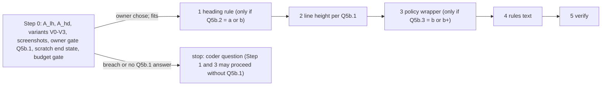

# Plan: Tailwind phase T5b, the typography decisions left by `base.css` (addendum)

Slug: `theme-evolution-tailwind-t5b`
Parent: `docs/plans/theme-evolution-tailwind.md` (umbrella) §12 (Phase T5 Steps: line height, element-level heading typography, the T4c policy rule), D6. Index: `docs/plans/theme-evolution-tailwind-t5-index.md`. Prerequisite: `docs/plans/theme-evolution-tailwind-t5a.md`.
Model: `docs/plans/theme-evolution-tailwind-t4c.md` (Revision 2.1) and its review.
Architect: Claude (for Junior Warner)
Date: 2026-10-23
Revision: 2.1. It addresses round 2 of `docs/reviews/theme-evolution-tailwind-t5b-review.md` (APPROVE WITH CHANGES: R10, R11, nits n1-n5; changelog below). Revision 2 addressed round 1 (R1-R9, N1-N10). T5a Revision 2 was written in the same round as T5b Revision 2 and already carries the corrected 60-character figure (T5a §5.10); this revision doesn't edit T5a.
Tier: 2. Three site-wide typography choices, each small in bytes and large in what the merchant sees. Every change in this plan is ⚑.
Builds on: T5a on staging #187953643616, with T5a's owner check 3 done (§13 Step 0 item 1).

**Gates.**

1. **Owner gate (Q5b.1).** Step 2 (line height) is committed only after the owner has chosen an option **in writing**, on Step 0's full-site screenshot pairs (now including the open states, R4). Umbrella §12 says T5's "full-site screenshot review [decides] the final line-height", so this plan doesn't let a recommendation stand in for that choice. Steps 1 and 3 follow the recommendations unless the owner says otherwise, and the owner reviews them on staging.
2. **Owner gate (Q5b.2), before live** (Revision 2, review R1). Coding may proceed on Q5b.2's recommendation, but T5b doesn't go live until the impl notes or the coder-questions file quote the owner's own answer to Q5b.2, verbatim and dated. Under the recommendation nothing changes on staging, so without this gate the question could close unanswered.
3. **Budget gate (§4.1).** Step 0 builds, in scratch, the end state of exactly the steps that will be committed before QA; T5b proceeds only if it fits both budgets. The Architect's recommendation, as in T4c and T5a; not an owner decision.

---

**Post-approval (2026-10-23):** umbrella edits applied, leftovers fixed (§9.2's C5b.8 row now matches §5.2's offender wording).

## Revision 2.1 changelog (review round 2)

**What did not change.** No step, criterion, decision or recommendation was added, removed or renumbered. Every edit is a scoping or wording fix.

| Review item | What changed | Sections |
|---|---|---|
| **R10** (required): Step 3 deleted T5a's policy-body `:empty` twin with nothing in its place | Option (a): the policy wrapper also carries **`data-rich-text`**, so T5a's surviving `[data-rich-text] :where(…):empty` rule (D5a.19) covers the policy body at 0 B; policy bodies are merchant HTML. §5.1's heading-rule comment no longer says the policy wrapper lacks the attribute. C5b.7(c) gains a check that every empty policy-body element T5a's Step 0 listed still computes `display: none`. Harnesses that count `[data-rich-text]` boxes now find one on the policy page | §5.1, §5.2, §5.6, C5b.7, §9.2 |
| **R11** (required): C5b.4(a)'s N1 clause failed under Q5b.1 (b) and (c) | The clause now exempts, under (b) or (c), the one D6 `html` rule that the same criterion requires; §9.2 says so | C5b.4, §9.2 |
| n1 | The flowchart's Step 3 node, §3.1's layout row and §5.2's heading name (b+) too | §3.1, §5, §5.2 |
| n2 | The header no longer says T5a's 60-character figure awaits T5a's review: T5a Revision 2 carries it | header |
| n3 | §9.2's C5b.7 row: on this store the discriminating width for a missing `w-full` is 320 (the privacy policy is long, so it fills 646.88 px at 1440 either way) | §9.2 |
| n4 | §5.2's 320 px bullet: with `w-full`, Shopify's container fills the 320 px wrapper, so any remaining offender is a Shopify descendant (a long word), or there is none | §5.2 |
| n5 | `SZ` adds the resolved `margin-left`/`margin-right` of auto-margined elements, and the harness records the scrollbar mode, so a classic scrollbar appearing on a page that grows past the viewport under 1.5 is recognized | §0, §10 |

## Revision 2 changelog (review round 1)

**What did not change.** No step was added or renumbered (Step 0 + Steps 1-5). No criterion was added, removed or renumbered (C5b.0-C5b.14). The recommendations stand: Q5b.1 (a), Q5b.2 (c), Q5b.3 (b). One option was added to Q5b.3 and is not recommended ((b+), R8).

| Review item | What changed | Sections |
|---|---|---|
| **R1** (required): the 9 headings aren't body font "by design" | Reworded everywhere: they are in the body font **for parity since T2 D2.8**, because Dawn's `var(--font-heading-family)` never resolved (the theme prints `--font-heading--family`); T2 handed the choice to T5. The recommendation (c) is now argued on its real merits (0 B, no restyling of Shopify or app headings, no restyling nobody has chosen). Q5b.2 needs an explicit, verbatim, dated owner answer before live (gate 2, C5b.6(d), §13 live gate) | gates, §1, §3.2, D5b.2, C5b.6, §10, §13, Q5b.2 |
| **R2** (required): the policy wrapper lacked `w-full` | The wrapper is `prose prose-tokens mx-auto w-full` (the page-center lesson, `docs/plans/theme-evolution-tailwind-t4c-page-center.md:18`, `sections/page.liquid:8`), here and in the live probe. Step 0 item 5 records the container's computed `margin`, `padding`, `max-width` and `width` on base and V3, and what sets its 325 px min-content at 320. **Precedence:** if the padding branch would raise `X_page` above base (5 ±1 at 320) or create a theme-markup offender, the Coder stops with a coder question; neither C5b.7(c) nor C5b.8 ships red. A fix the owner may approve (`wrap-break-word`) is named. C5b.7(c)'s width clause holds at every width, 320 included | §5.2, §5.6, C5b.7, §9.2, §13 Step 0 item 5, RB3 |
| **R3** (required): C5b.5's allowance sets were S0-only | `A_lh` and `A_hd` are measured on **every (page, state, width) C5b.5 compares** (T5a §4.3's states S0-S7 at 375 and 1440). An element Step 0 couldn't see (dynamic content) is allowed by **mechanism**: line height `normal` → 1.5 × its own font size ±0.01 px with no author `line-height`; heading font body → heading family on an element matching the rule. New Step 0 item: `NZ` from base loaded twice on the same matrix. The size-derived properties C5b.5 ignores are listed | §0, §4.2, C5b.5, §9.2, §13 Step 0 items 3, 4, 4a |
| **R4** (required): screenshots missed the open states | V0, V1, V2 and V2a screenshots add T5a's states S1-S6 at 375 and 1440 (drawer with the cart total, menu, accordion, tooltip with its title, consent overlay). A value the owner names under Q5b.1 (c) is rendered as **V1c** and shown before Step 2. V3 is limited to the policy page plus one control page | §4.2, §10 owner check 1, §13 Step 0 items 5-6, RB8 |
| **R5** (required): the budget figure and a late Step 2 | `P_endb` is built for exactly the steps committed before QA and rebuilt when Step 2 is added. New **late Step 2** path: Step 2 alone, `P_endb` rebuilt, named criteria re-run by QA, staging re-pushed, owner check 2 repeated for E5b.1, a fresh C5b.13 before live | §4.1, C5b.9, §13 "Late Step 2", RB1 |
| **R6** (required): the layout comment held `prose` | The comment now says "the typography plugin"; §5.2's claim is now true | §5.2 |
| **T5a review R6 (coupling)** | Step 3 deletes every rule whose selector starts with `.shopify-policy__body`, which covers T5a Revision 2's hover, transition and conditional `:empty` rules; `S_pol` and §5.5 follow | §0, §5.1, §5.5 |
| **R7** (required): the "any option" upper bound | +80 (the +40 padding exists only with Q5b.3 (b), which also deletes `S_pol`). Against Revision 1's T5a range the index's 58,748 becomes 58,708, as the review computed; T5a Revision 2 (written in the same round) moves T5a's own range, so the index now shows 59,002 = T5a Revision 2's high end 58,922 + 80. (b+) adds its measured cost on top, stated separately | §4.1, §5.5, §16, the index |
| **R8** (required): the policy title | Q5b.3 (b) and E5b.4 now say the policy title would be the only page title not set in `font-heading … uppercase`. The `prose-h1:` element variants are offered as (b+), **not recommended**: they conflict with `CLAUDE.md:198` ("Use plain `prose` only") and T4c's non-goal and C4c.4(d), so they need the owner's sign-off and a rules change; Step 0 renders V3h and measures the cost. "Weight 800" and the links' "500" render with the 700 and 400 faces | §5.2, E5b.4, Q5b.3, §10, §13 |
| **R9** (required): the convention wasn't written down | §5.4 adds rules text under Q5b.2 (c) (a heading without `font-heading` inherits the body font; no base rule) and under Q5b.1 (b) or (c) (where the root line height is set). C5b.14 checks every branch | §5.4, C5b.14 |
| N1 | C5b.4(a) also requires that no compiled rule other than Preflight's sets `line-height` on `html`, `:root` or `body`; §9.2's discrimination sentence corrected | C5b.4, §9.2 |
| N2 | T5a's link extension is 60 characters, not 59. With T5a Revision 2's hover and transition rules (T5a review R6) and its conditional policy-body `:empty` rule, `S_pol` = 396 to 491; Step 3 now deletes every rule whose selector starts with `.shopify-policy__body`, so its list follows T5a; §5.5 and the index updated | §0, §5.1, §5.5, §16, the index |
| N3 | Under Q5b.2 (a), the opt-outs commit **before** the rule (no-ops until it lands); reverting the rule commit alone is a clean rollback | §5.3, §12, §13 Step 1 |
| N4 | The wrapper uses one `if`/`else` around `content_for_layout`, with no dangling `div` | §5.2, §13 |
| N5 | The live probe's Q5b.3 control is the wrapper's computed `max-width` (646.88 px ±1), proving `prose` applies on live | §5.6 |
| N6 | C5b.7(c)'s "left edge" is the minimum `left` of the rects of the text-bearing elements under `.shopify-policy__title` and `.shopify-policy__body` | C5b.7 |
| N7 | The heading rule's comment says why `:not(.prose *)` names a plugin class | §5.1 |
| N8 | The coder-questions file writes each option's words next to its letter | §13 Step 0 item 6 |
| N9 | Owner answers are the owner's words, verbatim; a recommendation repeated by an agent doesn't count | gates, C5b.4(c), C5b.6(d), §13 |
| N10 | The logo wrapper (#5) may move its span by about a pixel under a rule; `A_hd` and the screenshots show it | §3.2 |

Rev 2 sweep: see §16 "Revision 2 checks".

---

## 0. Referent table

Tags as in T5a §0.

| Sym | What it measures | Units | Artifact | Extent or band | Value, method or threshold |
|---|---|---|---|---|---|
| `B_min`, `B_gz`, `M_gz` | CSS budget and gzip method | bytes | `assets/tailwind.css` | whole file | 60,000 / 12,000; `gzip -9 -c assets/tailwind.css \| wc -c` `[quoted]` `CLAUDE.md:70, 105` |
| `S_tw5a` | `assets/tailwind.css` after T5a | bytes | T5a's final commit | whole file | `[quoted]` T5a impl notes when they exist; T5a Revision 2 projects 58,662 to 58,922 / 11,174 to 11,369 `[provisional]` (T5a §5.10) |
| `P_endb` | **the gate figure**: the chosen T5b end state built in scratch | bytes | scratch copy | whole file | `[to be measured]` Step 0 item 7 |
| `LH_root` | `html` line height | keyword or px | rendered page | `html` | `normal` today (`src/tailwind.css`, the D6 rule `html { line-height: normal; }` `[measured]`). Preflight gives `1.5` `[quoted]` umbrella §3.2 |
| `LH_n` | used height of one line of 16 px body-font text at `normal` | px | a probe `<span>` with no classes, `display: inline-block`, one word | border box | `[to be measured]` Step 0 item 3. `normal` depends on the font's metrics (Work Sans by default, `config/settings_schema.json` `type_primary_font`) |
| `LH_15` | the same at `1.5` | px | same | border box | 24 `[derived]` (16 × 1.5) |
| `A_lh(p,s,w)` | **line-height affected set**: elements whose computed `line-height` changes when the compiled `html{line-height:normal}` rule is deleted in the page | list | T5a build, one load | every element; **every (page, state, width) C5b.5 compares** (Revision 2, R3) | method §4.2 |
| `D_h(p,s,w)` | document height change from that deletion | px | same | `document.documentElement.scrollHeight` | `[to be measured]` |
| `A_hd(p,s,w)` | **heading affected set**: elements whose computed `font-family` changes when the candidate heading rule is inserted in the page | list | T5a build, one load | every element; the same matrix as `A_lh` | method §4.2 |
| `NZ_b(p,s,w)` | noise set on T5a's final tree: (element, property) pairs that differ between two loads of the same build | list | base (T5a final), loaded twice | same matrix | method T5a §4.2 `NZ`, re-measured here (T5a's `NZ` was taken on a different base) |
| `SZ` | size-derived properties C5b.5 ignores when a line height or font changes box sizes | list | n/a | n/a | the rect (`getBoundingClientRect`), and the computed `height`, `block-size`, `width`, `inline-size`, `top`, `right`, `bottom`, `left` (resolved values of positioned elements), the resolved `margin-left` and `margin-right` of elements whose specified margin is `auto` (they change when a classic scrollbar narrows the body; review n5), `transform-origin`, `perspective-origin` `[proposed]`. The harness records the browser's scrollbar mode (overlay or classic) and, per load, whether the document scrolls vertically, so a shift caused by a scrollbar appearing is recognized as such |
| `H_plain` | theme headings with no font-family utility and a visible effect | **source lines** (a card title renders once per card, so rendered elements outnumber lines) | scanned Liquid | `<h1>`-`<h6>` tags and `<{{ heading_tag }}>` | **11 lines in 8 files** `[measured]` (ripgrep; 12 lines in 9 files minus the logo wrapper, §3.2) |
| `S_lh` | the D6 `html` rule, compiled | bytes | `assets/tailwind.css` | one rule | `html{line-height:normal}` = **24** `[derived]` |
| `S_hd` | the candidate heading rule, compiled | bytes | estimate | one rule | `:where(h1,h2,h3,h4,h5,h6):not(.prose *){font-family:var(--font-heading--family)}` = **80** `[derived]` (25 + 14 + 41 characters) |
| `S_pol` | the policy rules after T5a | bytes | `assets/tailwind.css` | every rule whose selector starts with `.shopify-policy__body` | T4c's 150 `[quoted]` T4c §0, plus T5a's 78 + 60 (the string `;text-underline-offset:.3rem;text-decoration-thickness:.1rem` is 60 characters, not 59, review N2) + 62 (hover thickness) + 46 (transition) (T5a Revision 2, its review R6), and T5a's conditional policy-body `:empty` rule (0 or 95, T5a D5a.19) `[derived]`: **396 to 491**. Step 0 item 2 re-measures it on T5a's committed file |
| `S_ph` | the (b+) `prose-h1:` element variants, compiled | bytes | scratch build | six variant rules | `[to be measured]` Step 0 item 5 (V3h). About 750 to 950 `[provisional]` (each compiles to a `:is(:where(h1):not(:where([class~=not-prose],…)))` selector of about 90 characters plus its declaration) |
| `M_ch` | `prose`'s `65ch` in px | px | T4c Step 0 | 16 px body font | **646.88** `[quoted]` T4c impl notes `:10` |
| `PT` | `request.page_type` on a policy page | string | Liquid | n/a | `policy` `[quoted]` shopify.dev `objects/request` (possible values include `policy` and `captcha`); Step 0 item 5 prints it in scratch before Step 3 depends on it |

Readings that are easy to confuse:

- `A_lh` and `A_hd` are **same-load** sets (one rule toggled in the page), like T5a's `TOG`, taken in every state the comparison uses, because content that exists only in a state (the drawer's line items, the tooltip, the accordion story, the consent overlay) is absent from an S0 load. The geometry consequences (`D_h`, moved elements) are recorded, not predicted element by element: a line-height change moves everything below the first affected line.
- `H_plain` is a **static** count of headings in theme Liquid. `A_hd` is the **rendered** set, which also contains Shopify and app headings and excludes headings a template doesn't render.

---

## 1. Problem statement and goals

T5a removes `base.css` at parity and leaves three typography choices that umbrella §12 assigned to T5, each of which changes what merchants see on many pages:

1. **Line height.** `html { line-height: normal }` (umbrella D6) was added in T0 so Preflight's `1.5` wouldn't change every page while Dawn's CSS still loaded. Every page was QA'd against `normal` since. The rule says "T5b decides" after T5a.
2. **A heading base rule.** Umbrella §12 planned "element-level typography (headings in `font-heading`)" in `@layer base`, which `base.css` used to block. Since then every converted heading that should use the heading font declares `font-heading` itself, and **11 heading lines in 8 files have no font class** (§3.2). They are in the body font **for parity, not by anyone's choice**: Dawn's `h1`-`h5` rule asks for `var(--font-heading-family)` (`assets/base.css:252-263`), but the theme prints `--font-heading--family` (`snippets/css-variables.liquid:21`), so the declaration never resolved and those headings inherited the body font. Each conversion kept that to keep its diff clean, and T2 handed the decision on: "Spotlight, material-info and card titles keep the body font (parity). Element-level heading typography for the whole site is T5's job" (`docs/plans/theme-evolution-tailwind-t2.md:328`, D2.8). T4c Q4c.7 keeps rich-text headings in the body font, which **is** a decision. A base rule would restyle the 11 unless the plan opts them out.
3. **Policy pages.** T4c kept a scoped parity rule (Q4c.3 (a)) and recommended `prose` through a layout wrapper "for T5" (Q4c.3 (c)). T5a extended the rule for exact parity.

### Goals

1. The owner chooses each on full-site screenshots (Step 0); the plan implements the choices.
2. Rich-text headings stay in the body font unless the owner decides otherwise (Q4c.7).
3. Policy links stay underlined and lists keep markers whatever option is chosen (WCAG 1.4.1, T4c Q4c.3).
4. Keep the gates: `check:css`, theme check at 0, schemas byte-identical, `H1` = 1, both budgets, no new overflow.
5. A read-only live probe before the live push, as in T5a.

---

## 2. Non-goals

- **No focus-ring change** (T5a Q5a.1 decided it).
- **No other type-scale change:** sizes, weights, letter spacing and `text-*` utilities stay as they are. No `prose` modifiers, except the policy wrapper's `prose-h1:` variants if the owner chooses Q5b.3 (b+). No change to the rich-text measure (Q4c.1).
- **No change to the page section's centering** (the page-center follow-up, `docs/plans/theme-evolution-tailwind-t4c-page-center.md`), even if policy pages end up looking different from pages.
- **No edits** to schemas, `config/*`, `templates/*.json`, `sections/*-group.json` or `locales/*`; no store content.

---

## 3. Current state (after T5a)

### 3.1 Files `[measured]` at `0783033`; T5a's edits shift some lines, so every step finds its text, not a line number

| File | Today | T5b change |
|---|---|---|
| `src/tailwind.css` | the D6 block in `@layer base`: comment (`:289-292`), `html { line-height: normal; … }` (`:293-295`), the cursor rule (`:296-299`); the policy rules (`:273-287`, extended by T5a §5.3) | Step 1 (if Q5b.2 adds a rule); Step 2; Step 3 (if Q5b.3 (b) or (b+)) |
| `layout/theme.liquid` | `{{ content_for_layout }}` (`:45` at `0783033`; `:44` after T5a deletes the `base.css` line) | Step 3 (if Q5b.3 (b) or (b+)) |
| 7 Liquid files (§3.2, §5.3) | headings without a font class | Step 1, only under Q5b.2 option (a) |
| `CLAUDE.md`, `AGENTS.md` | "Rich text" bullet (`CLAUDE.md:198`, `AGENTS.md:193`), the CSS architecture intro (`:193` / `:188`) | Step 4 |

### 3.2 Headings with no font-family utility (`H_plain`) `[measured]`

Ripgrep for heading tags in scanned Liquid, then the class strings read one by one:

| # | Element | Where | Renders on |
|---|---|---|---|
| 1-2 | `<h1>` balance, `<h2>` shop name | `templates/gift_card.liquid:24`, `:51` | gift card (no fixture; PXG) |
| 3 | product card title `<h3 class="m-0">` | `snippets/card-product.liquid:129` | related products on PDPs |
| 4 | material name `<h3 class="m-0 text-[1.6rem] font-semibold …">` | `snippets/material-info.liquid:32` | material info |
| 5 | the logo wrapper `<h2 class="m-0 leading-none">` | `sections/header.liquid:25` | every page. Its visible content is an `` or a `<span class="font-heading …">` (`:42`), so a base rule changes nothing visible `[derived]`, except that the `h2`'s own strut changes font and may move the span by about a pixel (review N10); `A_hd` and the screenshots show it |
| 6 | archive card title `<h2 class="mb-2 text-[1.25rem] font-semibold">` | `sections/main-material-archive.liquid:62` | the archive |
| 7 | tooltip title `<h3 class="mb-2 text-[1rem] font-semibold …">` | `sections/material-tooltip.liquid:27` | PDP tooltip |
| 8 | cart total `<h3 class="m-0 text-[1.1rem]">` | `sections/cart-drawer.liquid:66` | the drawer, with items |
| 9-11 | three card titles `<h2 class="m-0 text-[1rem] text-[#202223]">` | `sections/hello-world.liquid:20`, `:32`, `:44` | home |
| 12 | spotlight title `<{{ heading_tag }} class="m-0 text-[1.6rem] font-semibold text-foreground">` | `sections/material-spotlight.liquid:139` | 3p product |

That is 12 source lines in 9 files, of which #5 has no visible effect: **11 lines in 8 files** (`H_plain`). None of the 11 was put in the body font by a design decision: T2 to T4b kept Dawn's (accidental) body font for parity, and T2 D2.8 said the site-wide choice belongs to T5 (§1 item 2). Every other theme heading declares `font-heading`: 19 lines (18 found by the ripgrep `<h[1-6][ >]`, plus `sections/image-banner.liquid:384-385`, whose tag and class are on separate lines). Shopify's policy title (`.shopify-policy__title h1`) and any app or consent-banner heading would also change; `A_hd` lists them.

### 3.3 Policy pages after T5a

Chain `div.shopify-policy__container > div.shopify-policy__body > div.rte > div > ul/a`, 5 `ul`, 0 `ol`, 4 `a` on `/policies/privacy-policy`, no inline style; the only rendering policy `[quoted]` T4c impl notes `:37`. Looks: `disc`, inside markers, 32 px list padding, links underlined with Dawn's offset and thickness (T5a D5a.6). The title is Shopify's `<h1>`, in the body font at the inherited size (Preflight resets heading sizes; Dawn's sizes were invalid) `[derived]`. A 5 px overflow at 320 from the container is pre-existing `[quoted]` T4c QA.

---

## 4. The gates, the method and the decisions

### 4.1 Budget gate (Step 0 item 7)

In a scratch copy of HEAD (T5a's final tree): `npm ci`, apply the §5 edits of **exactly the steps that will be committed before QA**, with the options chosen (the owner's, or the recommendations), `npm run build:css`, measure `P_endb` (`wc -c`, `M_gz`), run `scripts/check-css-layers.mjs`. If Q5b.1 is unanswered when QA starts, `P_endb` is built **without** Step 2; when Step 2 is added later, `P_endb` is rebuilt with it (§13 "Late Step 2"). Proceed only if `P_endb` ≤ 60,000 and ≤ 12,000. Otherwise stop with the figures in `docs/plans/theme-evolution-tailwind-t5b-coder-questions.md`. The final committed file must equal the `P_endb` of the committed step set (C5b.9(b)). §5.5 estimates −515 to +80 B against `S_tw5a` over every option except (b+), which adds its measured `S_ph` `[provisional]`, so a breach would need T5a itself to have landed near the limit.

### 4.2 Methods

All in-page functions go in `docs/qa/harness/t5bc-lib.mjs` (§10), copied from `t5ac-lib.mjs`.

- **`A_lh`, in-page.** In the loaded `assets/tailwind.css`'s `@layer base` block, find style rules whose `selectorText` is exactly `html` and whose only declaration is `line-height: normal`. Exactly one, or the run is invalid. Inject a positive control `<span data-t5b-ctl>x</span>` at the end of `body`; its computed `line-height` must be `normal`. Snapshot (T5a §4.2's full snapshot), `deleteRule` that rule, finish new animations, wait two frames, snapshot. **Valid only if** the control now computes `24px`. `A_lh` = elements whose `line-height` differs; also record every element whose rect changed and `D_h`. Run it on **every (page, state, width) that C5b.5 compares**: T5a §4.3's pages at S0, and T5a's states S1-S7 at 375 and 1440, each reached as T5a §4.3 says before the toggle (Revision 2, R3).
- **Mechanism allowance** (for elements Step 0 can't have seen, such as a recommendation that loads only on one run). A `line-height` difference is allowed if base is `normal`, head is 1.5 × the element's own computed `font-size` ±0.01 px (or the Q5b.1 (c) value × `font-size`), so the element inherits the root value (an element with its own `leading-*`, `text-*` or `prose` line height doesn't read `normal` at base, so it can't pass this test by accident). A `font-family` difference is allowed if the element matches `:where(h1,h2,h3,h4,h5,h6):not(.prose *)`, carries neither `font-sans` nor `font-heading`, base is the body family and head the heading family.
- **`NZ_b`:** base (T5a's final tree) loaded twice on the same matrix, as T5a §4.2 defines `NZ`.
- **`A_hd`, in-page.** Inject a positive control `<h3 data-t5b-ctl>x</h3>` and a `prose` control `<div class="prose"><h3 data-t5b-ctl2>x</h3></div>` at the end of `body`. Append `<style>@layer base{:where(h1,h2,h3,h4,h5,h6):not(.prose *){font-family:var(--font-heading--family)}}</style>` to `head`; the `base` layer is already declared, so the rule joins it `[quoted]` CSS Cascade 5 (layer blocks with an existing name append to that layer). **Valid only if** control 1's `font-family` changes to `--font-heading--family`'s value and control 2's doesn't. `A_hd` = every element whose `font-family` changes, with its owner (theme, Shopify, app) and whether it is in `H_plain`. Same matrix as `A_lh`: the tooltip title (#7) exists only in S5 and the cart total (#8) only in S2.
- **Variant builds** in scratch, served one at a time on the private dev theme: **V0** (T5a HEAD), **V1** (the `html` rule deleted), **V1c** (only if the owner names another value under Q5b.1 (c): that value, rendered and shown **before** Step 2, Revision 2, R4), **V2** (the heading rule added, Q5b.2 option (b), so the owner sees the full effect), **V2a** (option (a): V2 plus the opt-outs of §5.3), **V3** (the policy wrapper, §5.2, and the policy rules removed), **V3h** (V3 plus the (b+) `prose-h1:` variants, §5.2, R8).
- **Screenshots** for the owner, full page, `reducedMotion: 'reduce'`, animations paused (T5a §4.2):
  - V0, V1, V1c, V2 and V2a: every page in T5a §4.3 and the proxies PXR, PXG and PXZ at S0, at 320, 375, 768, 1440 and 1920; **and** T5a's states S1-S6 at 375 and 1440 (the drawer empty and with an item, so the cart total shows; the open menu; the accordion with its story; the tooltip with its title; the consent overlay) (Revision 2, R4);
  - V3 and V3h: `/policies/privacy-policy` and one control page (`/pages/data-sharing-opt-out`) at the five widths. The wrapper renders nowhere else (C5b.7(b)), so the other pages would repeat V0.
  - Names `docs/qa/screenshots/t5b-<variant>-<page>-<state>-<width>.png` (gitignored), with a table per variant: page, state, width, `D_h`, the number of elements in `A_lh` or `A_hd`.

### 4.3 Decisions

| # | Decision | Question | Where |
|---|---|---|---|
| D5b.1 | **Line height: the owner chooses on V0/V1** (recommended: Preflight's `1.5`, by deleting the D6 rule) | **Q5b.1** ⚑ owner gate | §5.1 Step 2 |
| D5b.2 | **No heading base rule** (option (c)) is recommended, on its merits: 0 B, nothing restyled that nobody has chosen, and no Shopify or app heading changes font. It is **not** a claim that the 11 `H_plain` lines were designed in the body font: they are parity since T2 D2.8, and their font is the decision this question makes. The owner answers explicitly before live (gate 2) | **Q5b.2** ⚑ owner answer before live | §5.1 Step 1, §5.3 |
| D5b.3 | **If the owner adds a heading rule, it excludes `.prose` descendants** (`:not(.prose *)`), keeping Q4c.7, unless the owner explicitly adopts the heading font in rich text | **Q5b.2** | §5.1 Step 1 |
| D5b.4 | **Policy pages get `prose prose-tokens` through a `w-full` wrapper in `layout/theme.liquid`** when `request.page_type == 'policy'` (T4c Q4c.3 (c)); the scoped policy rules are deleted in the same commit. The title then takes `prose`'s `h1` style, so it is the one page title not in the heading font; the `prose-h1:` variants that would fix that are offered as (b+), not recommended (R8) | **Q5b.3** ⚑ | §5.1 Step 3, §5.2 |
| D5b.5 | **Rules text** on every branch: the root line height (whatever Q5b.1 chooses), the heading-font convention (whatever Q5b.2 chooses), and the "Rich text" bullet's policy clause (if D5b.4 ships) (Revision 2, R9) | none | §5.4 |
| D5b.6 | **The budget gate is the Architect's recommendation** | none | §4.1 |

### 4.4 Rejected alternatives

- **Line height on `body` instead of `html`.** Same inheritance for theme content; it would also leave `html`-level children of `head`-injected overlays at `normal`. No benefit.
- **Per-section `leading-*` utilities to keep `normal` in some places and `1.5` elsewhere.** Bytes and churn in 20+ files for a choice the owner can make globally.
- **A heading rule that sets weight and case too** (`font-bold uppercase`, the Oswald look). A larger redesign than umbrella §12 described; the owner can ask for it in a later plan.
- **`@apply prose` on `.shopify-policy__body`.** It would duplicate the plugin's whole rule set (about 12 KB; T4c §4.3).
- **Leaving policies on the scoped rule forever.** Option (a) of Q5b.3, offered, not rejected.
- **`prose-h1:` element variants on the policy wrapper by default.** They would give the policy title the template's `h1` look, but `CLAUDE.md:198` says "Use plain `prose` only", and T4c made "no `prose` modifiers, including element modifiers" a non-goal enforced by C4c.4(d) (no compiled `.prose-*` selector but `.prose-tokens`). So they are an owner option, (b+), with a rules change, not the recommendation.
- **A scoped `.shopify-policy__title h1 { … }` rule for the title.** It brings back the dependence on Shopify's class names that (b) removes.

---

## 5. Proposed design, file by file

**Conventions** as in T5a §5. After T5a, the bare `hidden` class works with display variants (`hidden md:flex`), but T5b adds no such pair.



Steps 1 and 3 don't depend on Q5b.1. If the owner hasn't answered Q5b.1 when they are ready, they may be committed and Step 2 waits (§13).

### 5.1 `src/tailwind.css` (Steps 1, 2, 3)

**Step 1 (only under Q5b.2 option (a) or (b)).** In `@layer base`, directly after the `body { font-family: …; }` rule (the one ending with `color: var(--color-foreground);`), insert:

```css
  /*
   * Headings use the heading font unless a utility says otherwise. Rich-text headings keep
   * the body font (docs/plans/theme-evolution-tailwind-t4c.md Q4c.7). The exclusion names
   * the typography plugin's .prose on purpose: the rule must follow exactly the boxes the
   * plugin styles, and .prose is what makes a box one of them.
   * See docs/plans/theme-evolution-tailwind-t5b.md D5b.2-D5b.3.
   */
  :where(h1, h2, h3, h4, h5, h6):not(.prose *) {
    font-family: var(--font-heading--family);
  }
```

- Specificity (0,1,0), from the `:not()` argument; `:where()` adds nothing `[quoted]` Selectors 4. Every `font-sans` or `font-heading` utility beats it (higher layer). Inside `prose`, nothing matches, so the plugin's inherited body font stays.
- **Only under option (d)** (the owner adopts the heading font in rich text, which reverses Q4c.7 and is the owner's call alone): drop `:not(.prose *)`.
- The heading font's `@font-face` is printed for its selected variant only (`snippets/css-variables.liquid:15`, `font_face`), weight 700 by default (Q8, `oswald_n7`). A heading that inherits weight 400 then renders with that 700 face, because font matching picks the nearest available weight `[quoted]` CSS Fonts 4 §5.2. So "Oswald at 400" isn't available; QA records the rendered weight.

**Step 2, by Q5b.1's answer.** In the D6 block:

- **(a) Preflight's `1.5` (recommended):** delete `html { line-height: normal; /* T5b decides: … */ }`, and replace the block's comment (`Browser defaults that Preflight removes but unclassed Dawn, Shopify and merchant markup still relies on (plan D6). Remove each in the phase noted.`) with `Kept from plan D6 permanently: Tailwind v4 buttons default to cursor: default.`
- **(b) Keep `normal`:** keep the rule; change its comment to `/* permanent (T5b Q5b.1): every page is designed against normal */`, and the block's comment to `Kept from plan D6 permanently.`
- **(c) Another value** the owner names (for example `1.4`): `html { line-height: <value>; /* T5b Q5b.1 */ }`, and the block comment as in (b).

**Step 3 (only under Q5b.3 option (b) or (b+)).** Delete the policy block: its comment (`Store policy pages (/policies/*) print Shopify's own markup …`) and **every rule whose selector starts with `.shopify-policy__body`**: T4c's `ul`, `ol` and `a` rules and T5a's `:is(ul, ol)` rule, its extended `a` rule (offset, thickness, transition) and its `a:hover` rule (T5a Revision 2, T5a review R6). Matching by prefix keeps the list right whatever T5a committed; C5b.7(a) checks that no such selector is left. This is the same commit as §5.2.

### 5.2 `layout/theme.liquid` (Step 3, only under Q5b.3 option (b) or (b+))

Replace the line `    {{ content_for_layout }}` with (one `if`/`else`, so no element opens under one condition and closes under another; review N4):

```liquid
    
      
      <div class="prose prose-tokens mx-auto w-full" data-rich-text data-policy-prose>{{ content_for_layout }}</div>
    
      {{ content_for_layout }}
    
```

- Both sides of the comparison are strings (`page_type` is "string from a set of values" `[quoted]`), so no type normalization is needed (T4b review R2's lesson).
- `data-policy-prose` is a hook for QA, with no CSS.
- **`data-rich-text`** (Revision 2.1, review R10). Policy bodies are merchant HTML, so the wrapper carries the same attribute as the theme's other rich-text boxes. T5a's `[data-rich-text] :where(div, a, ul, dl, section, article, h1, h2, h3, h4, h5, h6):empty { display: none }` (T5a D5a.19, Q5a.5) then covers the policy body at 0 B, replacing the `.shopify-policy__body` twin that §5.1 Step 3 deletes (if T5a committed it), so empty policy elements stay hidden instead of taking `prose`'s heading margins. Under Q5a.5's alternative (accept), T5a committed neither rule, and the attribute changes nothing. QA harnesses that count `[data-rich-text]` boxes now find one on the policy page.
- **`w-full` is required** (Revision 2, review R2). The wrapper is a flex item of the column `body` (`src/tailwind.css:180-185`), and an auto-margined flex item isn't stretched: it shrinks to fit its content. The page-center follow-up hit exactly this on the same shell ("`w-full` is required … a first attempt … no `w-full` … grew the opt-out page to the widget's 379 px on phones", `docs/plans/theme-evolution-tailwind-t4c-page-center.md:18`; the lesson is kept in `sections/page.liquid:8`). With `w-full` the wrapper is `min(M_ch, body width)` wide at every width `[derived]`, centered by `mx-auto` above 646.88 px. `w-full` and `mx-auto` are compiled `[measured]`, so 0 B.
- **The 320 px case.** Shopify's container is already 325 px wide at 320 (`div.shopify-policy__container l0 r325`, the pre-existing 5 px overflow, `docs/qa/evidence/t4cc-overflow-base.json` `[quoted]` review). With `w-full` the wrapper itself stays at 320, and the container, a block child, fills it; so any remaining offender is a Shopify descendant (the long word or element behind the 325 px), or there is none and `X_page` is 0 (review n4). Either way no theme markup is the offender. Step 0 item 5 records, on base and V3, the container's computed `margin`, `padding`, `max-width` and `width`, and the element or text node that sets its 325 px min-content.
- **The edge, and which criterion wins.** If the policy text's left edge (C5b.7(c)'s measurand) is less than `--page-margin` (15 px default, `snippets/css-variables.liquid:24`) at 320 or 375, the Coder tries `px-(--page-margin)` on the wrapper (it compiles from the layout, which is scanned) and re-measures. **If that raises `X_page` at 320 above base (5 ±1) or makes theme markup an overflow offender, the Coder stops with a coder question**: neither C5b.7(c) nor C5b.8 ships red, and the plan doesn't rank one over the other. A fix the owner may approve: `wrap-break-word` on the wrapper (not compiled today, about +42 B: `.wrap-break-word{overflow-wrap:break-word}`), which with a definite width would also let the container's long word wrap and could remove the pre-existing 5 px `[unverified]`.
- **The comment** names no utility: "typography plugin", "centered box" and "content" aren't utility names, and `w-full` appears in it only as it does in the class string beside it (review R6; the first revision's comment contained `prose`).
- **The title.** The policy `<h1>` is inside `prose`, so it takes the plugin's `h1` style: 2.25em, weight 800 (which renders with the body font's 700 face, the only bold face loaded, `snippets/css-variables.liquid:10-13`), in the body font. D5b.3's exclusion keeps it out of any heading rule. **It would be the only page title on the site not set in the heading font**: the 12 other theme `<h1>` lines all use `font-heading text-3xl leading-tight font-bold uppercase md:text-4xl` (review R8). The same face rule applies to `prose`'s weight-500 links, which render with the 400 face.
- **(b+), only on the owner's choice.** Append to the wrapper's class string `prose-h1:font-heading prose-h1:font-bold prose-h1:uppercase prose-h1:text-3xl prose-h1:leading-tight md:prose-h1:text-4xl`, which gives the title the template's string and leaves the body's headings in the body font. Cost `S_ph`, measured on V3h; whether these variants out-order the plugin's own `h1` rule is `[unverified]` and V3h checks it. It also needs `CLAUDE.md:198`'s "Use plain `prose` only" amended (Step 4).

### 5.3 Heading opt-outs (Step 1, only under Q5b.2 option (a))

Append `font-sans` (compiled `[measured]`) to the class string of each `H_plain` line except the gift card's two (#1-2), which the rule is meant to change. That is **9 lines in 7 files**: #3 `snippets/card-product.liquid:129`, #4 `snippets/material-info.liquid:32`, #6 `sections/main-material-archive.liquid:62`, #7 `sections/material-tooltip.liquid:27`, #8 `sections/cart-drawer.liquid:66`, #9-11 `sections/hello-world.liquid:20, 32, 44`, #12 `sections/material-spotlight.liquid:139`. One commit per file, **committed before the rule** (review N3): `.font-sans{font-family:var(--font-primary--family)}` changes nothing until the rule exists, so no intermediate commit restyles these headings, and reverting the rule's commit alone is a clean rollback. Under (a), Step 1 is therefore up to eight commits: seven opt-out files, then the rule. #5 (the logo wrapper) needs none.

### 5.4 `CLAUDE.md` and `AGENTS.md` (Step 4)

Identical edits; find each by its text.

Every branch writes one sentence for each question, so whatever is chosen is written where an agent reads it (Revision 2, review R9).

- **Line height**, appended to the CSS architecture intro paragraph (the one ending "Tailwind's whole scale is in rem.", `CLAUDE.md:193`, `AGENTS.md:188`):
  - Q5b.1 (a): " Body text uses Preflight's line height of 1.5; set `leading-*` where a component needs another."
  - Q5b.1 (b): " The root line height is `normal`, set on purpose in `src/tailwind.css` (`@layer base`), not Preflight's 1.5; set `leading-*` where a component needs another."
  - Q5b.1 (c): the same as (b), with the chosen value instead of `normal`.
  - **If Step 2 hasn't run** (Q5b.1 unanswered), this sentence waits with it (§13 "Late Step 2").
- **Headings**, appended to the "Use the theme tokens" bullet (`CLAUDE.md:197`, `AGENTS.md:192`):
  - Q5b.2 (c): " Headings have no base font rule: give every heading meant to use the heading font `font-heading`; a heading without it inherits the body font."
  - Q5b.2 (a) or (b): " Headings outside rich text default to `font-heading` (a base rule); add `font-sans` to keep one in the body font."
- **Policies, if Q5b.3 = (b) or (b+):** in the "Rich text" bullet (`CLAUDE.md:198`, `AGENTS.md:193`), replace "outside store policy pages (which keep a scoped rule in `src/tailwind.css`), no base rule underlines links or restores list markers any more" with "no base rule underlines links or restores list markers any more (store policy pages get `prose` from a wrapper in `layout/theme.liquid`)".
- **Only under (b+):** in the same bullet, replace "Use plain `prose` only:" with "Use plain `prose` only, apart from the policy wrapper's `prose-h1:` variants (owner decision, T5b Q5b.3):".

### 5.5 CSS budget per step `[provisional]`

| Step | Change | Δ minified | Δ gzip |
|---|---|---|---|
| 1 | (c) none (recommended) / (a), (b) `S_hd` | 0 / +80 | 0 / +35 to +50 |
| 2 | (a) delete `S_lh` (recommended) / (b) none / (c) a different value | −24 / 0 / about 0 | −5 to −10 / 0 / 0 |
| 3 | (b) delete `S_pol`; wrapper classes `prose`, `prose-tokens`, `mx-auto`, `w-full` compiled; `px-(--page-margin)` +0 to +40 if needed (recommended) / (b+) the same plus `S_ph` / (a) none | −491 to −356 / −491 + `S_ph` to −356 + `S_ph` / 0 | −95 to −160 / measured / 0 |
| **Net (recommended)** | | **−515 to −380** | **−100 to −170** |
| **Range over every option except (b+)** | | **−515 to +80** | **−170 to +50** |

- **The upper bound is +80** (Revision 2, review R7): the heading rule (+80) with Q5b.1 (b) (0) and Q5b.3 (a) (0). The padding's +40 exists only under (b), which also deletes `S_pol`, so the first revision's +120 added two things that can't coexist.
- **`S_pol` is 396 to 491** `[derived]`: T4c's 150, T5a §5.3's list rule (78) and link offset and thickness (60, review N2), and T5a Revision 2's hover thickness rule `.shopify-policy__body a:hover{text-decoration-thickness:.2rem}` (62) and link `;transition:text-decoration-thickness .1s ease` (46) (T5a review R6), plus T5a's policy-body `:empty` rule (95) only if T5a's Step 0 found an empty element there. Step 3 deletes every rule whose selector starts with `.shopify-policy__body`, so the figure follows whatever T5a commits.
- **(b+)** adds `S_ph` (about 750 to 950 `[provisional]`): with the rest recommended, at most −24 − 396 + 40 + 950 = +570, about 59,492 at T5a's high end (58,922) `[provisional]`, still inside both budgets; Step 0 measures it.

### 5.6 The read-only live probe (C5b.13)

As T5a §5.11, steps 1-4 (fresh non-preview login, theme id and role on every page, the same page set, discovery on every run with Step 0's containers added). Then, in the page, apply exactly the CSS T5b ships:

- Q5b.1 (a): delete live's compiled `html{line-height:normal}` rule (exactly one match by selector and declaration, as §4.2), with the `span` control;
- Q5b.2 (a) or (b): append the heading rule's `<style>@layer base{…}</style>`, with the two heading controls;
- Q5b.3 (b), on `/policies/privacy-policy` only: wrap `.shopify-policy__container` in a `<div class="prose prose-tokens mx-auto w-full" data-rich-text>` (live already compiles `prose`, `prose-tokens`, `mx-auto` and `w-full`), and disable the live policy rules in the CSSOM (every style rule whose selector starts with `.shopify-policy__body`). **Control** (review N5): the wrapper's computed `max-width` is 646.88 px ±1, which proves `prose` applies on live, not just that the element was inserted. Under (b+), the variants aren't compiled on live, so the probe can't apply them; it records that the title's look is checked on staging only.

Snapshot every element in every target before and after. **Valid only if** every applicable control flips. **Pass:** every difference inside a target is one that Step 0's staging measurement recorded for the same container. **Fail:** any other difference (any change in a live-only container), or a recorded container missing. A fail is a gate, as in T5a.

---

## 6. Affected files and modules

| Path | Action | Step |
|---|---|---|
| `src/tailwind.css` | heading rule (if (a) or (b)) | 1 |
| 7 Liquid files, 9 lines (§5.3) | `font-sans` opt-outs (if (a)) | 1 |
| `src/tailwind.css` | line height per Q5b.1; D6 comment | 2 |
| `layout/theme.liquid`, `src/tailwind.css` | policy wrapper; policy rules deleted (if (b) or (b+)) | 3 |
| `CLAUDE.md`, `AGENTS.md` | §5.4 | 4 |
| `assets/tailwind.css` | rebuilt with every step that changes classes or `src/` | 1-3 |
| `docs/plans/theme-evolution-tailwind-t5b-impl-notes.md`, `docs/qa/harness/t5bc-*.mjs`, `docs/qa/evidence/t5bc-*` | Coder | 5 |

**Not edited:** schemas, `config/*`, `templates/*.json`, `sections/*-group.json`, `locales/*`, `assets/*.js`, `scripts/*`, `package.json`.

---

## 7. Data model and API changes

| Change | Impact |
|---|---|
| `src/tailwind.css` | per the options: no D6 `html` rule; possibly a heading rule; no policy rules |
| `layout/theme.liquid` | a conditional wrapper on policy pages (if (b) or (b+)) |
| Hooks | `data-policy-prose` (no CSS) |
| Schemas, settings, option values, locale keys, snippet APIs | none |
| Theme check | 0 → 0 |

---

## 8. Expected diffs (Δ)

All ⚑ (owner check 2). "Base" is T5a's final tree on the dev theme at Step 0.

| ID | Where | Today | After | Cause |
|---|---|---|---|---|
| E5b.1 ⚑ | **every page**, every element in `A_lh` (text with no line-height of its own outside `prose`) | `normal` (`LH_n` px per 16 px line) | Q5b.1 (a): 24 px per 16 px line; taller blocks, everything below moves down by `D_h` (per page, Step 0) | D5b.1 |
| E5b.2 ⚑ | gift card `<h1>`/`<h2>` (PXG); Shopify's policy title (if Q5b.3 (a)); app headings | body font | under Q5b.2 (a): heading font. Under (c), recommended: unchanged | D5b.2 |
| E5b.3 ⚑ | the 9 `H_plain` lines other than the gift card's (each card title renders once per card) | body font | under Q5b.2 (b) only: heading font (home cards, product cards, archive cards, spotlight, tooltip, cart total) | D5b.2 |
| E5b.4 ⚑ | `/policies/privacy-policy` | 16 px, `normal`, inside markers with 32 px padding, Dawn link offset; title 16 px body font | under Q5b.3 (b): `prose` (16 px / 28 px, paragraph margins, outside markers at 30 % with the plugin's padding, links underlined at weight 500, which renders with the 400 face), measure `min(M_ch, body width)`, centered. The title becomes `prose`'s `h1`: 2.25em, weight 800 (rendered with the 700 face), **in the body font: the only page title on the site that isn't `font-heading … uppercase`** (R8). Under (b+): the title takes the template's `h1` string | D5b.4 |
| E5b.5 | every page | `S_tw5a` | `P_endb` | §5.5 |
| E5b.6 | everything else | | unchanged (the cross-build comparison, C5b.5) | |

---

## 9. Acceptance criteria

**Non-vacuity rule** as in T5a §9.

### 9.1 Criteria

| ID | Criterion | Method | Kind |
|---|---|---|---|
| C5b.0 | Build under test is committed | clean tree: `npm ci && npm run check:css` exits 0 | gate |
| C5b.1 | Gates per step | theme check 0 after every step and on HEAD; `npm run check` exits 0 | test |
| C5b.2 | Schemas round-trip | every `` block's `shasum` equals Step 0's | test |
| C5b.3 | Diff scope | `git diff --stat` lists only §6's files for the options chosen; Liquid word-diffs show only §5.2's wrapper and §5.3's `font-sans` tokens | test |
| C5b.4 | Line height is the owner's choice, by the mechanism | (a) Static: the compiled file contains `html{line-height:normal}` under Q5b.1 (b), the chosen value under (c), and no `html{line-height:` rule under (a); **and no compiled rule other than Preflight's `html,:host{…}` and, under (b) or (c), the one D6 `html` rule required above sets `line-height` on `html`, `:root` or `body`** (review N1; the exemption is Revision 2.1, review R11). (b) Rendered on `/`, `/password`, PXG and `/policies/privacy-policy`: `LH_root` is `normal`, the chosen value, or (under (a)) `24px` for the 16 px root. (c) The impl notes quote the owner's written answer **verbatim** (the owner's words, relayed by the orchestrator or written by the owner; a recommendation repeated by an agent doesn't count, review N9) with its date, and that date precedes Step 2's commit. If Step 2 hasn't run, C5b.4 is recorded "not run (gated)", not red | test (a), (b); guard (c) |
| C5b.5 | Nothing changes except the chosen effects | Cross-build comparison (T5a §4.2) of HEAD against base on **T5a §4.3's pages at S0 and its states S1-S7 at 375 and 1440**. Ignoring the `SZ` properties, every computed difference is one of: `line-height` on an element of Step 0's `A_lh` for that (page, state, width), or allowed by §4.2's line-height mechanism (Q5b.1 (a) or (c)); `font-family` on an element of `A_hd` minus the opted-out ones, or allowed by the heading mechanism (Q5b.2 (a) or (b)); or inside `[data-policy-prose]` (Q5b.3 (b) or (b+)). No other difference outside `NZ_b` (Revision 2, review R3) | test |
| C5b.6 | Heading rule mechanism; the owner's answer | **If no rule (recommended (c)):** the compiled `@layer base` has no rule setting `font-family` on `h1`-`h6`, and every heading's `font-family` on every page and state equals base. **If a rule:** on PXG, `h1` and `h2` compute the heading family; on PXR, every heading inside a `prose` wrapper computes the body family (Q4c.7 kept), at least 2 found; under (a), every element rendered from the 9 opted-out lines (§5.3) computes the body family, at least 1 per rendered line across T5a §4.3's pages and states (the tooltip title needs S5, the cart total S2) and PXP. Under (d), PXR's prose headings compute the heading family instead. **(d) Before live** (gate 2, review R1): the impl notes or the coder-questions file quote the owner's answer to Q5b.2 verbatim, with its date | test; guard (d). **Tells the exclusion from the inclusion** |
| C5b.7 | Policy wrapper (Q5b.3 (b) or (b+)) | (a) Static: `layout/theme.liquid` contains the §5.2 block once; the compiled file contains no selector starting with `.shopify-policy__body`. (b) Rendered: `[data-policy-prose]` count is 1 on `/policies/privacy-policy` and 0 on every other page in T5a §4.3 (both checked; a 0 on the policy page is red, not vacuous). (c) On the policy page at 320, 375 and 1440: every `ul` computes `list-style-type` `disc` and a non-zero `padding-inline-start`; every `a` computes `text-decoration-line` `underline` (at least 1 `ul` and 1 `a`); the wrapper's width is `min(M_ch, body width)` ±1 at every width, 320 included (review R2); the policy text's left edge ≥ `--page-margin` at 320 and 375, where the **left edge** is the minimum `left` of the rects of the elements under `.shopify-policy__title` and `.shopify-policy__body` that have a non-whitespace text node of their own (review N6). If (c)'s edge clause and C5b.8 can't both pass, the run stops with a coder question (§5.2) instead of shipping either red. **Empty elements** (Revision 2.1, review R10): the wrapper carries `data-rich-text`; and if T5a committed its `.shopify-policy__body` `:empty` rule (T5a D5a.19), every empty element T5a's Step 0 listed in the policy body computes `display: none` at 375 and 1440 (at least 1, since T5a commits that rule only when it found one; if T5a didn't commit it, this clause is recorded "not applicable"). (d) Under (b+): the title computes the heading family, `text-transform: uppercase` and weight 700, as the template's `h1` string does at that width. **Under (a):** T5a's C5a.15 still holds | test |
| C5b.8 | No overflow | T5a C5a.18's rule on T5a's §4.3 pages at T5a's `W_sw` widths | test |
| C5b.9 | CSS budget | (a) Gate: `P_endb` ≤ 60,000 / 12,000. (b) Final `S_tw` equals the `P_endb` built for **the step set actually committed** (without Step 2 if it hasn't run; rebuilt when it lands, review R5) | gate (a); budget guard (b) |
| C5b.10 | No incidental utilities added or lost | per-step selector-set diff both ways, as T5a C5a.21 | test |
| C5b.11 | Regression set | T5a C5a.22 through `t5bc-` copies | regression |
| C5b.12 | Headings and images | `H1` = 1 on every theme page, including the policy page (the wrapper adds no heading); theme heading order equals base; every theme `` has `width` and `height` | test (the wrapper is reachable) |
| C5b.13 | Live-only markup (pre-live gate, read-only) | §5.6, at Step 0 item 8 and immediately before `shopify theme push -e production`. Valid only with a fresh non-preview login, theme id and role on every page, and every applicable control flipping | gate (pre-live) |
| C5b.14 | Rules text | For every branch taken (§5.4): the line-height sentence (once Step 2 has run), the heading sentence and, under (b) or (b+), the policy sentence are each present once in `CLAUDE.md` and in `AGENTS.md`, identical in both; under (b) or (b+), ripgrep `keep a scoped rule` in both files prints nothing; under (b+), the "Use plain `prose` only" sentence carries the (b+) exception (review R9) | test |

### 9.2 Criteria sweep (all at once, both directions)

| ID | Red on | Reachable? | Caught upstream? | Green on a correct build? |
|---|---|---|---|---|
| C5b.0 | stale CSS | yes | no | yes |
| C5b.1 | a Liquid typo in the wrapper; a new offense | yes | no | yes |
| C5b.2 | a schema edit | yes | no | yes: no step touches one |
| C5b.3 | an extra edit; opt-outs added under (c) | yes | no | yes |
| C5b.4 | the wrong rule deleted; a `body { line-height }` rule added instead of deleting the `html` rule ((a)'s second clause, N1); the step committed before the owner answered | yes | no | yes on every branch: the second clause exempts the D6 `html` rule that (b) and (c) require (Revision 2 was red on a correct (b) or (c) build, review R11); (c) is a process guard, and "not run (gated)" is recorded, not red, when Step 2 waits |
| C5b.5 | an unintended change (for example the heading rule without `:not(.prose *)`, which changes prose headings outside `A_hd`) | yes | C5b.6 for that case | yes: the sets now cover every state compared, the mechanism allowance covers content Step 0 couldn't see, `SZ` covers box-size consequences and `NZ_b` is measured on this base. Revision 1 was red on a correct build in S2, S4, S5 and S6 (review R3) |
| C5b.6 | the exclusion dropped (prose headings in the heading font); opt-outs missing under (a); a rule present under (c); (d) live reached without the owner's answer | yes, each | no | yes, on whichever branch Q5b.2 chose; (d) is a process guard |
| C5b.7 | the wrapper on every page (a missing `if`); the old rules left (double styling); a wrapper that lost the underline; **`w-full` missing** (the wrapper shrinks to its content: on this store the width clause goes red at 320, where the content's min-content exceeds the viewport; at 1440 the long privacy policy fills 646.88 px either way, review n3); `data-rich-text` missing on the wrapper while T5a's policy `:empty` rule existed (empty elements reappear with `prose` margins, review R10) | yes | C5b.5 partly | yes. (b)'s two directions stop a vacuous pass; the edge-versus-overflow conflict stops with a question instead of a forced red (review R2); the empty-element clause is "not applicable" when T5a committed no policy `:empty` rule |
| C5b.8 | the wrapper widening the policy page at 320 (it would then be a theme offender) | yes | C5b.7(c) | yes: with `w-full` the wrapper is 320 wide and Shopify's container fills it, so any remaining offender is a Shopify descendant, or there is none (§5.2); C5a.18's rule allows either |
| C5b.9 | a breach; drift from scratch | yes | no | (a) gate; (b) budget guard, green when QA runs without Step 2 because `P_endb` is built for the committed steps (review R5) |
| C5b.10 | a comment word generating a utility | yes | no | yes |
| C5b.11 | a `src` change breaking the drawer or menu | low | no | yes |
| C5b.12 | a heading added by the wrapper's markup | low | C5b.3 | yes |
| C5b.13 | an app embed that inherits root line height or uses an `h*` the rule restyles | yes, **only on live** | no | yes; invalid runs are re-run |
| C5b.14 | a missing or diverging sentence, on any branch, including (c) and Q5b.1 (b) or (c), which Revision 1 left unwritten | yes | no | yes |

**Can the criteria tell the chosen design from the rejected one?** Line height by deleting the rule vs a `body` rule: C5b.4(a)'s second clause (Revision 1 claimed C5b.4(a) and C5b.3 did this; they didn't, review N1). Line height vs per-section utilities: C5b.3 (no Liquid edits under Step 2). Heading exclusion vs inclusion: C5b.6. A conditional `w-full` wrapper vs a global one, a shrink-to-fit one or `@apply`: C5b.7(b), C5b.7(c)'s width clause and C5b.9. (b) vs (b+): C5b.7(d) and C5b.10 (the `.prose-h1` selectors appear only under (b+)).

---

## 10. QA checklist

**Setup:** as T5a §10 (dev theme #187953938528, preview URL, cached session in `T5BC_STATE`, one password submission at most, never printed). **Harness:** `docs/qa/harness/t5bc-*.mjs`; `t5bc-lib.mjs` imports only `t0-lib.mjs` and copies from `t5ac-lib.mjs` (`loginState`, `newPage`, `seedCart`, `snapFn`, `diffFn`, `overflowFn2`, the page and state tables). New: `lhToggleFn`, `hdInsertFn`. Every load records the scrollbar mode and whether the document scrolls vertically (`SZ`, review n5).

| Script | Copied from | Does |
|---|---|---|
| `t5bc-lib.mjs` | `t5ac-lib.mjs` | helpers above |
| `t5bc-sets.mjs` | new | `A_lh`, `A_hd`, `D_h`, `LH_n` (Step 0 items 3-4) |
| `t5bc-variants.mjs` | `t5ac-proxy.mjs` | builds V1, V2, V2a, V3 in scratch; screenshots and the per-variant tables |
| `t5bc-cmp.mjs` | `t5ac-cmp.mjs` | C5b.5-C5b.7, C5b.12 |
| `t5bc-overflow.mjs`, `t5bc-regress.mjs` | T5a's | C5b.8, C5b.11 |
| `t5bc-liveprobe.mjs` | `t5ac-liveprobe.mjs` | C5b.13 (§5.6). Read-only |

**Pages and widths:** T5a §4.3's pages and states; widths 320, 375, 768, 1440, 1920 for the owner's screenshots, T5a's `W_sw` for C5b.8.

**Proxies:** T5a's PXR, PXG and PXZ, regenerated on T5b's tree (same rules: scratch only, never rebuilt, `shasum` equal to the build they stand for).

**Owner checks:**

1. **Before Step 2 (the Q5b.1 gate):** the V0/V1 screenshot pairs, including the states S1-S6 at 375 and 1440, and the `D_h` table; V1c before Step 2 if the owner named another value; V2, V2a, V3 and V3h for Q5b.2 and Q5b.3 (V3 and V3h show the policy title). The owner's answers go into `docs/plans/theme-evolution-tailwind-t5b-coder-questions.md` (or are quoted in the impl notes), **verbatim and dated**. Q5b.2 is answered here or at owner check 2, and **before live** in any case (gate 2).
2. **On staging #187953643616 after DevOps pushes T5b:** visual acceptance of E5b.1 to E5b.4 at 375 and 1440 on the storefront and in the theme editor preview (home, a product with related products and the tooltip open, the archive, the cart drawer with an item, the open mobile menu, a page, the policy page). Repeated for E5b.1 if Step 2 lands late (§13 "Late Step 2").
3. **Theme editor:** change the heading font and the body font in Theme settings (don't save) and check that the affected headings and text follow (both are `@theme inline` font variables, umbrella D7).

**Live gate:** owner check 2 passes; C5b.6(d) holds (the owner's Q5b.2 answer is quoted); C5b.13 valid pass immediately before the push; live's JSON pulled first.

---

## 11. Risks and edge cases

| # | Risk | Likelihood | Impact | Mitigation |
|---|---|---|---|---|
| RB1 | The owner doesn't answer Q5b.1 before QA | possible | Step 2 waits | Steps 1 and 3 can ship; T5b goes to QA without Step 2 (C5b.4 "not run (gated)", `P_endb` built without it); a later answer follows §13 "Late Step 2", which re-runs QA's criteria, re-pushes staging and repeats owner check 2 before live |
| RB2 | `1.5` breaks a fixed-height component (a badge, the cart count, a button) built against `normal` | possible | clipped or misaligned text | `A_lh` lists every affected element; components with their own `leading-*` or `text-*` line heights are unaffected; the owner judges V1; a fix is a `leading-*` utility in a new commit, recorded as a deviation |
| RB3 | The policy wrapper's edge at phone widths depends on Shopify's container CSS, and its 325 px min-content at 320 | likely | text at the viewport edge, or the padding fix widening the page | `w-full`; Step 0 item 5 records the container's box and the cause of its min-content; §5.2's padding branch stops with a coder question if it would raise `X_page` or create a theme offender |
| RB9 | Elements that exist only in a state (the drawer's lines, the tooltip, the accordion story, the consent overlay) change with the line height or heading rule | certain under Q5b.1 (a) | C5b.5 red on a correct build (Revision 1) | sets measured on every state compared; the mechanism allowance; screenshots of S1-S6 for the owner |
| RB4 | `request.page_type` doesn't return `policy` on this store | low | the wrapper never renders (C5b.7(b) red) | Step 0 item 5 prints it in scratch first |
| RB5 | A heading rule (if chosen) restyles app or consent-banner headings | likely under (a)/(b) | unintended font on Shopify UI | `A_hd` lists them by owner; C5b.13 on live |
| RB6 | Only the 700 face of the heading font is loaded | certain | headings under the rule render bold | §5.1 note; QA records the weight |
| RB7 | Live-only markup inherits root line height | possible | taller widget text | C5b.13 |
| RB8 | Cloudflare 429 on the screenshot runs (V0, V1, V2, V2a × about 20 pages × 5 widths, plus their states at 2 widths; V3 and V3h on 2 pages) | high without care | flaky runs | cached session; GETs only; one variant served at a time; V3 and V3h limited to the policy page and one control page (review R4) |

---

## 12. Rollback

| Scope | How |
|---|---|
| Live | Publish the pre-push backup theme (`.claude/agents/devops.md` § Rollback) |
| Step 1 | `git revert`, rebuild, stage, `check:css`. Independent of the other steps. Under (a) it is up to eight commits (seven opt-outs, then the rule): reverting the rule's commit alone restores today's look, because the opt-outs are no-ops without it (review N3) |
| Step 2 | `git revert` restores the D6 rule and comment. Independent |
| Step 3 | `git revert` restores the scoped policy rules and removes the wrapper together (one commit) |
| Step 4 | docs only |

---

## 13. Step-by-step implementation checklist for the Coder

Before every commit: `npm run build:css`, stage `assets/tailwind.css`, `npm run check:css` (exit 0), `npm run check` (exit 0), theme check 0, the selector-set diff and `S_tw` recorded. One step is one commit (Step 1's opt-outs: one commit per file). Impl notes: `docs/plans/theme-evolution-tailwind-t5b-impl-notes.md`.

**Expected theme-check offenses after each step: 0.** Step 3 adds one `if`/`else` with the `div` opened and closed inside the `if` branch (review N4), so `LiquidHTMLSyntaxError` and `UnclosedHTMLElement` have nothing to flag.

**Step 0 (no commits).**

1. **Preconditions.** T5a is on staging (its deploy note names its last commit); T5a's QA verdict is PASS or PASS WITH NITS; T5a's owner check 3 is recorded; this plan, the index and T5b's review are committed; `git status --porcelain` on the theme paths prints nothing. If any fails, stop.
2. Record the commit, `N_tc` (0), `S_tw5a`, `S_pol` (the bytes of every compiled rule whose selector starts with `.shopify-policy__body`), and the schema `shasum`s.
3. **`LH_n`** with the probe span, and **`A_lh`** and `D_h` (§4.2) on **every (page, state, width) C5b.5 compares**: T5a §4.3's pages and proxies at S0 at 375 and 1440 (and 320, 768, 1920 on `/`, a PDP, the archive and the policy page), and T5a's states S1-S7 at 375 and 1440 (Revision 2, review R3).
4. **`A_hd`** (§4.2) on the same matrix; mark each element's owner and whether it is in `H_plain`.
4a. **`NZ_b`**: base (T5a's final tree) loaded twice on the same matrix (review R3).
5. **Variants** V1, V2, V2a, V3 and V3h in scratch (§4.2); V1c when the owner names a Q5b.1 (c) value. On V3: print `{{ request.page_type }}` in a scratch-only comment on the policy page and confirm `policy` (else stop: RB4). On base and V3, at 320, 375 and 1440, record `.shopify-policy__container`'s computed `margin`, `padding`, `max-width` and `width`, the wrapper's width, the element or text node that sets the container's 325 px min-content at 320, and C5b.7(c)'s left edge (review R2). Apply §5.2's padding branch only as §5.2 allows; a conflict with C5b.8 stops here with a coder question. On V3h, record `S_ph` and whether the title takes the `prose-h1:` values. Take every screenshot set (§4.2: S0 at five widths, S1-S6 at 375 and 1440) and write the per-variant tables.
6. **Owner gate.** Write `docs/plans/theme-evolution-tailwind-t5b-coder-questions.md`: Q5b.1-Q5b.3 with the recommendations, the screenshot paths and the tables. **Write each option's words next to its letter** (for example "Q5b.3 (b), `prose` through a layout wrapper"), because the letters differ from T4c's Q4c.3 (review N8). Steps 1 and 3 may proceed on the recommendations; **Step 2 waits for the owner's written Q5b.1 answer**, and the live push waits for the owner's Q5b.2 answer (gate 2). Both answers are recorded verbatim, with their dates (review N9).
7. **Scratch end state and the budget gate** (§4.1) for **exactly the steps that will be committed before QA** (without Step 2 if Q5b.1 is unanswered); rebuilt when Step 2 is added.
8. **Live probe** (C5b.13, read-only) for the chosen options: discover, record, probe. A valid fail adds a covering change (a `leading-*` utility, an opt-out) to the scratch end state, or stops with a coder question.

**Step 1.** Only under Q5b.2 (a) or (b). Under (a), first §5.3's opt-outs (one commit per file), **then** §5.1 Step 1's rule (review N3); under (b), the rule alone. Check C5b.6 and C5b.5's `font-family` clause. Under (c) (recommended), no commit; record "not applicable".

**Step 2.** After the owner's written Q5b.1 answer: §5.1 Step 2 in the chosen form. Check C5b.4 and C5b.5's `line-height` clause.

**Step 3.** Only under Q5b.3 (b) or (b+): §5.2 and §5.1 Step 3 in one commit. Check C5b.7, C5b.8 and C5b.12.

**Step 4.** §5.4 for the options chosen (the line-height sentence only if Step 2 has run). Check C5b.14.

**Step 5. Verify.** Run C5b.0 to C5b.12 and C5b.14, and record Step 0 item 8's C5b.13 result. Record every §8 row as observed and every unlisted difference, and `P_endb` next to the final `S_tw`. Then stop; DevOps pushes staging after QA.

**Late Step 2** (the owner answers Q5b.1 after QA has run, or after staging; review R5):

1. Commit Step 2 alone (§5.1 Step 2), then its §5.4 line-height sentence as a Step 4 follow-up commit.
2. Rebuild `P_endb` for the new step set (§4.1) and re-check the budget gate.
3. Coder and QA re-run C5b.0, C5b.1, C5b.3, C5b.4, C5b.5 (its `line-height` clause on the full matrix), C5b.8, C5b.9, C5b.10, C5b.11 and C5b.14, and QA updates its report.
4. DevOps re-pushes staging; the owner repeats owner check 2 for E5b.1.
5. A fresh C5b.13 run, with Step 2's change applied, before the live push.

A T5b QA verdict reached without Step 2 never covers a later Step 2 on its own.

**Live push gate (DevOps):** owner check 2 passes (repeated after a late Step 2); C5b.6(d) holds (the owner's Q5b.2 answer is quoted verbatim and dated); C5b.13 gives a valid pass immediately before `shopify theme push -e production`; live's JSON is pulled first. T5b goes live only after T5a is live.

---

## 14. Edits outside this plan

- **Umbrella:** U-t5-5, U-t5-7 and U-t5-8 in the index concern T5b; none is applied here.
- **T4c:** none. Q4c.3 (c) and Q4c.7 are carried as written.
- **Operator:** no gift card, article or policy beyond privacy exists (T5a §14.3); the owner's screenshot review uses PXG and PXR for them.

---

## 15. Owner decisions and open questions

### 15.1 Prior owner decisions this plan applies

| Decision | Applied as |
|---|---|
| Q4c.7, rich-text headings in the body font | D5b.3: any heading rule excludes `prose`; option (d) is the owner's alone |
| Q4c.3, policy pages: (a) in T4c, (c) "recommended for T5" | Q5b.3, recommendation (b) = T4c's (c) |
| Q8, the heading font `oswald_n7` | §5.1's weight note |
| Q4c.1, the rich-text measure | `M_ch` on the policy wrapper, unchanged elsewhere |
| Q1, never publish staging | §10, §13 |

None is reversed. **Umbrella §12's "add element-level typography (headings in `font-heading`) to `@layer base`" is plan text, not an owner decision.** D5b.2 recommends against it, and U-t5-5 records the deviation for the owner to confirm or overrule.

### 15.2 Open questions, each with a recommendation

1. **⚑ Q5b.1: Line height** (E5b.1). **The owner's written choice is required** before Step 2 (umbrella §12).
   - **(a) Preflight's `1.5` (recommended).** Tailwind's default, the scale every utility was designed against; `prose` already uses 1.75, and body text at `normal` (`LH_n`, about 1.2 for most sans fonts `[provisional]`) reads tight next to it. Cost: every page's text rhythm changes, pages get taller by `D_h`. −24 B.
   - (b) Keep `normal` permanently. 0 B, no visible change; the rule becomes permanent and its comment says so.
   - (c) Another value the owner names, after seeing V1 (for example `1.4`). It is rendered as V1c and shown to the owner before Step 2 (review R4).
2. **⚑ Q5b.2: A heading base rule.** **The owner's own answer is required before live** (gate 2): under the recommendation nothing changes on staging, so this question can't be closed by silence.
   - **What is being decided.** 19 theme heading lines declare `font-heading`. The 11 `H_plain` lines (product and archive card titles, the cart total, the spotlight and tooltip titles, the three home cards, the gift card's two) are in the body font **for parity since T2, not by anyone's choice**: Dawn's heading rule asked for `var(--font-heading-family)`, a variable the theme never printed (it prints `--font-heading--family`), so they always inherited the body font, and T2 D2.8 left the site-wide choice to T5 (§1 item 2).
   - **(c) No rule (recommended).** 0 B; nothing on the site changes; no Shopify or app heading (the policy title, a consent banner, an app embed) changes font without anyone having looked at it. The cost is that the 11 stay in the body font by default rather than by choice; §5.4 writes down that a heading without `font-heading` inherits the body font, so future headings choose explicitly. If the owner prefers some of the 11 in the heading font, the cheaper route is `font-heading` on those lines, not a base rule.
   - (a) The rule plus `font-sans` opt-outs on 9 of the 11 lines (+80 B, 7 files; the gift card's two are left to change). Visible changes: the gift card's two headings and any Shopify or app heading become the heading font (E5b.2).
   - (b) The rule with no opt-outs (+80 B). All 11 `H_plain` lines become the heading font (E5b.2 and E5b.3): a redesign of cards and the cart total.
   - (d) Any of (a) or (b) **including** rich text: reverses Q4c.7, so only on the owner's explicit instruction. Not recommended.
   - Whichever applies, the rule excludes `.prose` descendants (D5b.3) unless (d).
3. **⚑ Q5b.3: Policy pages** (E5b.4).
   - **(b) `prose prose-tokens` through a `w-full` layout wrapper (recommended**, T4c's recommendation for T5). Policies then read like pages (paragraph spacing, list markers, underlined links), the scoped rules go (−396 to −491 B), and nothing in `src/tailwind.css` depends on Shopify's policy class names any more. Costs:
     - an `if`/`else` around `content_for_layout` in the layout every page renders (C5b.7(b) proves it renders only on policies);
     - a visible typography change;
     - **the policy title becomes the only page title on the site not set in the heading font** (review R8). It takes `prose`'s `h1` style: 2.25em, weight 800 (rendered with the body font's 700 face), body font, not uppercase. The 12 other theme `<h1>` lines are `font-heading text-3xl leading-tight font-bold uppercase md:text-4xl`. V3 shows it.
   - (b+) (b) plus `prose-h1:` element variants on the wrapper (§5.2), so the title matches the template's `h1` string. Measured as `S_ph` on V3h (about 750 to 950 B `[provisional]`). **Not recommended**, because it breaks the project rule "Use plain `prose` only" (`CLAUDE.md:198`) and T4c's no-modifiers non-goal, so it needs the owner's explicit sign-off and §5.4's rules exception. Choose it if a consistent title matters more than that rule.
   - (a) Keep T5a's scoped parity rule. 0 B, no visible change; the rule keeps depending on `.shopify-policy__body`. The title stays 16 px body font.

**Only Q5b.1 needs the owner before coding; Q5b.2 needs the owner before live.** The ⚑ items are reviewed on staging before live.

---

## 16. Self-check manifest

**Verified while writing (2026-10-23, theme files at `0783033`):**

- **Rules re-read:** `CLAUDE.md` on disk `:70`, `:105`, `:191-214` (intro `:193`, "Rich text" `:198`, "Use the theme tokens" `:197`); `AGENTS.md:188`, `:192-193` (ripgrep). `learn_shopify_api` (Liquid) was called once for T5; `search_docs_chunks` confirmed `request.page_type` includes `policy`.
- **Facts read:** `src/tailwind.css` in full (D6 block `:289-299`, policy block `:273-287`, `body` rules `:180-185` and `:245-249`); `layout/theme.liquid` in full (`:45`); every heading tag in scanned Liquid (ripgrep, 30 lines), with the class strings of the 12 without a font class read one by one; `snippets/css-variables.liquid:15`, `:21-22`, `:24`; the compiled `.font-sans` and `.font-heading` (present); T4c impl notes `:10`, `:37`; T4c §14.4 and Q4c.3, Q4c.7.
- **Arithmetic (Revision 1, corrected in Revision 2):** `S_lh` 4 + 1 + 11 + 1 + 6 + 1 = 24; `S_hd` 25 + 14 + 41 = 80; `S_pol` 150 + 78 + 60 + 62 + 46 = 396, plus 95 if T5a adds its policy-body `:empty` rule = 491 (Revision 1 said 150 + 137 = 287); `LH_15` 16 × 1.5 = 24; §5.5's sums (recommended −24 + 0 − 491..−396 + 0..40 = −515..−380; range up to +80 + 0 + 0 = +80, with Q5b.3 (a), which keeps `S_pol` and adds no padding; Revision 1's +120 added the padding's +40, which only exists under (b)); `H_plain`: 12 lines in 9 files (gift card 2, card-product 1, material-info 1, header 1, archive 1, tooltip 1, cart drawer 1, hello-world 3, spotlight 1), minus the header's logo wrapper = 11 lines in 8 files; opt-outs = 11 − 2 gift-card lines = 9 lines in 7 files; `font-heading` headings = 18 ripgrep lines + image-banner = 19. **Correction made while writing:** the first draft said "11 elements at 10 sites"; it mixed rendered elements with source lines, and every place that figure appeared (§0, §3.2, §3.1, §5.3, §6, Q5b.2) now uses lines and files.
- **Criteria sweep:** §9.2 covers C5b.0-C5b.14 at once, both directions. C5b.4(c) is a process guard; C5b.9(b) a budget guard; C5b.13 bites only on live.

**Revision 2 checks (2026-10-23, targeted `Edit`s, no rewrite of this file).**

- **Rules re-read before editing:** `CLAUDE.md` on disk `:193`, `:197`, `:198` (the "Use plain `prose` only" sentence that (b+) would amend), `:200` (incidental words in comments, R6), `:203`; `AGENTS.md:188`, `:192`, `:193`. Nothing outside `docs/plans/` is edited; nothing is committed.
- **Review read in full** (`docs/reviews/theme-evolution-tailwind-t5b-review.md`, 171 lines). R1-R9 and N1-N10 are all mapped in the changelog; none was declined.
- **Facts re-verified, not taken from the review:** `docs/plans/theme-evolution-tailwind-t2.md:328` (D2.8's parity sentence); `docs/plans/theme-evolution-tailwind-t4c-page-center.md:18` and `sections/page.liquid:8` (the `w-full` lesson); `snippets/css-variables.liquid:10-13` (body font: 400, 700, 700 italic, 400 italic faces) and `:21`; the compiled `.w-full{` and `.mx-auto{` (present) and `.wrap-break-word{` (absent). The 325 px container figure is `[quoted]` from the review's reading of `t4cc-overflow-base.json`, not re-read.
- **Arithmetic:** `.wrap-break-word{overflow-wrap:break-word}` 16 + 26 = 42; `.shopify-policy__body a:hover{text-decoration-thickness:.2rem}` 29 + 33 = 62; `;transition:text-decoration-thickness .1s ease` 1 + 11 + 34 = 46; the index rows: T5a Revision 2's 58,662 to 58,922 / 11,174 to 11,369 (T5a §5.10) plus §5.5's −515 to −380 / −170 to −100 gives 58,147 to 58,542 / 11,004 to 11,269 (recommended), and −515 to +80 / −170 to +50 gives 58,147 to 59,002 / 11,004 to 11,419 (every option except (b+)); §5.5's sums −24 − 491 + 0 = −515 and −24 − 396 + 40 = −380.
- **Superseded-term sweep.** Range: this whole file, prose first, then tables; the changelog quotes the old terms deliberately. Terms derived from this revision's diff: "by design", "on purpose", "+120", "−311", "−271", "287", "137", "59", "mx-auto\"" (the wrapper string without `w-full`), "prose styles them", "comment contains no single-word utility name", "two-`if`", "wrapper's own presence", "S0 only", "−287", "−247", "−65 to −100", "−100 to +50". **Result:** no survivor outside the changelog and this manifest, except deliberate uses: "on purpose" twice, about the `.prose` exclusion (§5.1's CSS comment) and a kept `normal` line height (§5.4), never about the headings; "59" only as "not 59"; `:273-287` as a line citation; "+120" in §5.5's sentence that explains why it was wrong. One stale cell fixed in §3.1 ("Step 3 (if Q5b.3 (b))" now also names (b+)).
- **Criteria:** no criterion added, removed or renumbered (C5b.0-C5b.14). §9.2's rows for C5b.4-C5b.9 and C5b.14 were re-checked in both directions; the discrimination sentence was corrected (N1).

**Revision 2.1 checks (2026-10-23, targeted `Edit`s).**

- **Read:** the review's "Round 2 (Revision 2)" section in full (R10, R11, n1-n5); T5a Revision 2's D5a.19 and §5.3 (the `[data-rich-text]` rule and its `.shopify-policy__body` twin) for R10's referent. `CLAUDE.md:203` re-read: `data-rich-text` is a styling attribute no script reads (T5a §5.3), so carrying it on the policy wrapper is allowed. No file outside `docs/plans/` edited; T5a not edited; nothing committed.
- **Sweep.** Range: this whole file, prose first, then tables. Terms from this revision's diff: "the policy wrapper hasn't it", "short policy", "still Shopify's container", "(only if Q5b.3 = b)", "Q5b.3 option (b))", the wrapper string without `data-rich-text`, "flagged for T5a's own review". No survivor outside the changelogs.
- **Bytes:** R10's fix adds one attribute in the layout and no CSS (0 B); `S_pol`, §5.5 and the index are unchanged.
- **Criteria:** none added or renumbered; C5b.4 and C5b.7 and their §9.2 rows re-checked both ways (C5b.4 now green on (b) and (c); C5b.7's new clause is red if the attribute is missing while T5a's twin existed, "not applicable" otherwise).

**Not checked (honest gaps):**

- Nothing was built or rendered: `LH_n`, `A_lh`, `A_hd`, `NZ_b`, `D_h`, `P_endb`, `S_ph`, the container's box and V3's wrapper geometry are Step 0 measurements.
- Whether the `prose-h1:` variants out-order the plugin's own `h1` rule (V3h checks it).
- Shopify's policy container CSS (cross-origin, unknown), so §5.2's padding branch is decided by measurement.
- Whether any app or consent-banner heading exists on dev, staging or live (`A_hd`, C5b.13).
- The Liquid in §5.2 wasn't run through `validate_theme`: it's planning text; the Coder runs `shopify theme check`.

## Sources

- [Liquid `request` object (`page_type`)](https://shopify.dev/docs/api/liquid/objects/request)
- [Tailwind CSS Preflight](https://tailwindcss.com/docs/preflight)
- [Tailwind CSS typography plugin](https://tailwindcss.com/docs/typography-plugin)
- [CSS Cascading and Inheritance Level 5: cascade layers](https://www.w3.org/TR/css-cascade-5/#layering)
- [Selectors Level 4: `:where()`, `:not()` specificity](https://www.w3.org/TR/selectors-4/#specificity-rules)
- [CSS Fonts Level 4: font matching](https://www.w3.org/TR/css-fonts-4/#font-matching-algorithm)
