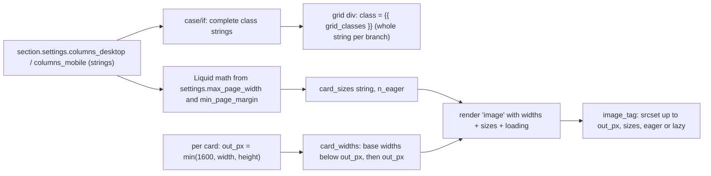

# Plan: Tailwind phase T6a, collection grid columns (owner request)

Slug: `theme-evolution-tailwind-t6a`
Index: `docs/plans/theme-evolution-tailwind-t6.md` (why T6 is split, order, shared T5 dependency). Input: `docs/backlog/t6-batch.md` "Owner requests".
Parent: `docs/plans/theme-evolution-tailwind.md` (umbrella). Format model: `docs/plans/theme-evolution-tailwind-t4c.md` (Revision 2.1) and its review.
Architect: Claude (for Junior Warner). Date: 2026-10-23. Revision: 2.1. It closes round 2 of `docs/reviews/theme-evolution-tailwind-t6a-review.md` (APPROVE WITH CHANGES: R2-1 to R2-3, nits N2-1 to N2-5; closeout below). Revision 2 addressed round 1 (R1-R8, nits N1-N13; changelog below).
Tier: 2. One section's schema gains two settings (merchant-visible in the theme editor), one snippet gains three optional parameters, about +160 to +210 B of CSS.

**Status: written before T5a landed; re-validate at Step 0.** Planned on HEAD `1f2a390` (T0-T4c live). T5 is split into T5a (retire `base.css` at parity) and T5b (typography, owner-gated on line height): `docs/plans/theme-evolution-tailwind-t5-index.md`, `-t5a.md`, `-t5b.md`, all under revision while this was written and read only for their scope and budget. Every figure T5a or T5b can move is tagged `[provisional: re-measure on T5's tree]` and Step 0 re-baselines it. **T5a must be on staging before Step 1**; T5b's position is option §3.3 (b) by default (§13 Step 0 item 1).

---

## Revision 2.1 closeout (review round 2)

**What did not change.** No design, code block, step, decision or criterion number changed. Every edit is owner, merchant or hand-off text, a budget figure, or a criterion's wording.

| Review item | What changed | Sections |
|---|---|---|
| **R2-1** (required): a T6a live push would carry T5a past its live gate | §10 gains a "Live order" note: T6a goes live only after T5a is live (T5a's live deploy note), or on a push whose deploy note records a valid T5a C5a.25 live-probe pass; under order (b) a later T5b live push carries T6a, which is fine once T6a's gate passed. Index §8 says the same for T6a and T6b | §10, index §8 |
| **R2-2** (required) ⚑: two Retina-pick figures were wrong | With `3` at 1440 DPR 2 the need is 869, below √(720 × 1080) ≈ 881.8, so the **720** file is picked; phones at DPR 2-3 pick **540-720** (DPR 3 need 813 < 881.8). Q6a.6 and E6a.1 corrected | §4.2 Q6a.6, §8 E6a.1 |
| **R2-3** (required): the Automatic clause was false with mobile `2` | `info.columns_desktop` now says "1 column below about 1120 px wide **with 1 mobile column**"; C6a.2(a) pins the new string | §5.5 |
| N2-1 | Budget figures from T5a Revision 2 §5.10: under order (b) the T6a end is ≤ **59,132 / 11,454**; under (a) ≤ 59,212 / 11,504, about 59,702 with T5b (b+); after T6b as well up to about 59,922 with (b+) | §0, §5.6, §11 RA9, index §4-§5 |
| N2-2 | C6a.14 checks the `img` of each **card at position** ≤ `n_eager` (an imageless card shifts image counts, not card positions) | C6a.14 |
| N2-3 | Q6a.1: with 20 products, `4`/`5` fill desktop but tablets (3 columns) leave one empty slot | §4.2 Q6a.1 |
| N2-4 | C6a.14's sweep row: reading `forloop.index` inside the inner loop yields 5, so every card is lazy when `n_eager` < 5 and none when it is 5 | §9.2 |
| N2-5 | D6a.10 now precedes D6a.11 | §4.1 |

Rev 2.1 sweep. Range: this whole file, prose first, then tables. Terms: "the 1080 file is picked", "540-1080", "1 column below about 1120 px wide (more", "58,958", "11,389", "1,042 / 611", "the first `n_eager` card `img`s", "none is lazy past card 5", "`4`/`5` fill." No survivor outside this closeout and the Revision 2 changelog.

## Revision 2 changelog (review round 1)

**What did not change.** The step list (Step 0, Steps 1-3, Step 4 verify) and the criterion numbers C6a.0-C6a.13 stay; one criterion is added (C6a.14). The setting ids, option values and defaults are unchanged.

| Review item | What changed | Sections |
|---|---|---|
| **R1** (required): the T5 deploy note won't exist | Step 0 item 1 requires `docs/qa/theme-evolution-tailwind-t5a-deploy.md` (#187953643616, an ancestor SHA) and T5a's QA verdict. New §3.3 gives T5b's two order options: (a) wait for T5b (blocked on the owner's line-height choice); **(b) run between T5a and T5b, no T5b commit in HEAD and no T5b Coder active from Step 0 to Step 4 (recommended)**. Status line and §3.2 cite T5a/T5b. The index's T6b paths are fixed too | status, §3.2, §3.3, §13 Step 0 item 1, index §3-§4 |
| **R2** ⚑: Retina desktop weight unmeasured; 1600 vs 1080 untested | Step 0 item 5 and QA record 1440 DPR 2: the first four cards' transfer, the page's image bytes before and after scrolling, and a Playwright LCP reading, base vs head. Q6a.6 states the Retina case (every 2-column card picks the 1600 file) and three options: (a) 1600 top, eager; (b) 1080 top; **(c) 1600 top, `loading="lazy"` after the first desktop row (recommended; applied, a disclosed scope change)**. C6a.7(a)'s exact descriptor set tells 1600 from 1080; new C6a.14 tests the lazy split | §2, §4.2 Q6a.6, §5.2-§5.4, §8 E6a.1, C6a.7, C6a.14, §13 Step 0 item 5 |
| **R3** ⚑: the empty slot stays on tablets | Q6a.1 and Q6a.5 say plainly that a 2-column band keeps one empty slot with 15 products, and that pagination by 20 and a changing catalog mean no setting guarantees full rows. **Recommended and applied: `md:grid-cols-3` for `3`-`5`** (about +60-70 B), which fills the tablet rows for 15 products; `2` keeps two on tablets. The class map, the track table and the `sizes` strings are updated | §4.1 D6a.3, §4.2 Q6a.1, Q6a.5, §5.2, §5.3, §5.6 |
| **R4**: info text false for Automatic and for `2` | Both info strings rewritten (Automatic is one column below about 1120 px; `2` applies from 768); C6a.2(a) pins them | §5.5 |
| **R5**: `naturalWidth` on a `srcset` image is density-corrected | `N_out` and C6a.7(c) are measured with a detached `new Image()` (only `src` set, read after `decode()`); reading sizes off the card `img` is forbidden; `N_out` is cross-checked with the printed `width` attribute | §0, C6a.7, §10, §13 Step 0 item 6 |
| **R6**: `R_pick` red when `N_out` sits between candidates | Option (a): each card's `widths` is the base widths below its output width, **plus the output width itself**, computed in Liquid from the image's own width and height (capped at 1600). C6a.7(a)'s set and `R_pick` follow | §5.2, §0, C6a.7, C6a.8 |
| **R7**: hand-off text | RA3 cites `.claude/agents/devops.md` deploy step 2 (a live push stops when a template differs) and gives the scoped pull `shopify theme pull --store=theme-evolution-os2.myshopify.com --live --only templates/collection.json`; the index §8 hand-off uses it | §11 RA3, index §8 |
| **R8**: "renders identically" overclaims | Goal 2, D6a.2 and Q6a.1 say "same layout (C6a.3); card images change (E6a.1, Q6a.6 ⚑)". The grid's whole class string is assigned per branch, so the default's grid `div` is **byte-identical**; C6a.3(a) is now a string equality | §1, §4, §5.2, C6a.3 |
| N1 | RA10 corrected: just above `bp2`/`bp3`, a 17 px band under-requests by about 2× | §11 |
| N2 | New RA12 (non-default browser font size); the rem-relative `sizes` string recorded as considered | §4.3, §11 |
| N3 | §4.3 and §9.2 use PXW's tested widths (521 and 306 rendered vs 660, 434 and 254 baked) | §4.3, §9.2 |
| N4 | `R_pick` arithmetic: geometric mean above DPR 1, never below the need at DPR ≤ 1; worst cases 0.816, 0.866, 0.822 | §0 |
| N5 | `sizes="auto"`: rejection reason narrowed to the eager first row (Shopify polyfills other browsers) | §4.3 |
| N6 | Step 0 item 8 expects the compiled form `@media (min-width:80rem)` | §13 Step 0 item 8 |
| N7 | Headroom from the T5 index's projections `[provisional]` (figures refreshed again in Revision 2.1, N2-1) | §0, §5.6, §11 RA9 |
| N8 | `N_img` (cards with an image) counted separately from `N_prod` | §0, C6a.3, C6a.6, C6a.7 |
| N9 | `labels` keys inserted alphabetically (between `background` and `foreground`) | §5.5 |
| N10 | Rollback's "Shopify ignores unknown settings" tagged `[unverified]` | §12 |
| N11 | Writing the chosen value into `templates/collection.json` in a plan-authorized follow-up commit is offered as Q6a.1 option (b); it needs the orchestrator's or owner's explicit go-ahead because the brief excluded template edits | §4.2 Q6a.1 |
| N12 | Proxy runs pass `--store=theme-evolution-os2.myshopify.com --theme=187953938528` with `--path` | §10 |
| N13 | `snippets/image.liquid`'s `@example` gains a `widths`/`sizes`/`loading` example | §5.4 |

**Rev 2 sweep.** Range: this whole file, prose first, then tables. Terms derived from the diff: "renders identically", "is today's markup", `t5-deploy.md`, "T5 must be on staging", "Tablets show 2 columns", "From 1024 px wide", `'360, 540, 720, 1080, 1600'` as a fixed per-card list, "`N_nat` itself", "loaded `src`'s `naturalWidth`", "silently", "+100 to +140" as the end total, "1,634 / 896", "820", "`width>=80rem` media block" (Step 0), "0.857", "lg:grid-cols-3" in the mapping. No survivor outside this changelog and §14's history line.

---

## 0. Referent table

Tags: `[measured]` read from a repo file during planning (HEAD `1f2a390`); `[derived]` computed from other rows, arithmetic shown; `[quoted]` taken from a named document, not re-measured; `[proposed]` a value this plan sets; `[provisional]` an estimate that Step 0 confirms (**no decision or criterion rests on one**); `[unverified]` a platform behavior the docs didn't settle, tested at Step 0 before anything depends on it; `[to be measured]`.

| Sym | What it measures | Units | Artifact | Extent or band | Value, method or threshold |
|---|---|---|---|---|---|
| `B_min`, `B_gz` | CSS budget | bytes | `assets/tailwind.css` | whole file | 60,000 minified, 12,000 `gzip -9` `[quoted]` `CLAUDE.md` `### Performance & Core Web Vitals` |
| `M_gz` | Gzip method for every total | n/a | shell | whole file | `gzip -9 -c assets/tailwind.css \| wc -c` (file argument, not stdin; stdin reads 13 B lower) `[quoted]` T4c §0 |
| `S_tw0` | Size at planning time | bytes | committed file at `1f2a390` | whole file | **58,366 / 11,104** `[quoted]` orchestrator brief (T4c's 58,308 / 11,082 `[quoted]` T4c impl notes, plus the page-center commit). `[provisional: re-measure on T5's tree]` |
| `S_T5` | Size on the tree T6a starts from (T5a, plus T5b if it shipped first) | bytes | committed file at Step 0 | whole file | `[to be measured]` Step 0 item 2. Projections `[quoted]` T5a Revision 2 §5.10 (via the round-2 review): T5a 58,662-58,922 / 11,174-11,369; T5b, every option but (b+), up to 59,002 / 11,419; T5b (b+) up to about 59,492 (N2-1) |
| `ΔS_a` | T6a's CSS growth | bytes | §5.6 | whole file | `xl:grid-fill` in a new `(min-width:80rem)` media block, about +100 to +140 / +30 to +60, plus `md:grid-cols-3` in the existing `(min-width:48rem)` block, about +60 to +70 / +15 to +25: **+160 to +210 minified, +45 to +85 gzip** `[provisional]` (no `.xl\:` and no `.md\:grid-cols-3` in `assets/tailwind.css` today `[measured]`). End under order (b), on T5a only: at most 58,922 + 210 = **59,132 / 11,454**; under order (a), on T5b: ≤ 59,212 / 11,504, or about 59,702 with (b+) `[derived]` |
| `P_a` | **The gate figure**: T6a's end state built in scratch | bytes | scratch copy with every §5 edit | whole file | `[to be measured]` Step 0 item 8 |
| `w` | Viewport width | CSS px | Playwright | `innerWidth` (no classic scrollbar in headless Chromium, so equal to `clientWidth`) | test widths in §10 |
| `P` | Page width | px | `settings.max_page_width` × 16 | n/a | **1440** (`90rem`, the schema default) or 1760 (`110rem`) `[measured]` `config/settings_schema.json:36-48` |
| `M` | Page margin | px | `settings.min_page_margin` | one side | **20** default, range 10-100 `[measured]` `config/settings_schema.json:52-58` |
| `E` | Horizontal edge around the card grid | px | page shell | both sides | `2M + 64` = **104** at defaults `[derived]`: the section grid's margins (`src/tailwind.css:251-257`) plus the shell's 32 px padding on each side (`sections/collection.liquid:8`) |
| `W_c(w)` | Content box of `[data-page-shell]` on `/collections/all` | px | rendered page | content box | `min(P, w) − E` `[derived]` from `src/tailwind.css:252-255`; at defaults 216 (320), 271 (375), 664 (768), 920 (1024), 1015 (1119), 1017 (1121), 1336 (1440 and 1920) `[quoted]` T4b §0 (`w − 104`, 1336 cap). `[provisional: re-measure on T5's tree]` |
| `G` | Grid gap | px | `gap-4` (`sections/collection.liquid:12`) | n/a | **16** `[measured]` |
| `T_min` | Automatic track minimum | px | `style="--grid-min: 31.25rem"` (`:12`) | n/a | **500** `[derived]` 31.25 × 16 |
| `k(opt, w)` | Number of grid tracks | count | `getComputedStyle(grid).gridTemplateColumns`, token count | the product grid element | Automatic: `max(1, floor((W_c + G) / (T_min + G)))` `[derived]` from `@utility grid-fill` (`src/tailwind.css:139-141`). Numbers: §5.3 table |
| `W_card(opt, w)` | Width of one card | px | the grid item (`div.flex.min-w-0`) | border box (the item has no padding or border, so border box = content box) | `(W_c − (k − 1) × G) / k` `[derived]`. Values: §5.3 |
| `S_eval` | The `sizes` value the browser applies | px | each card `img` | the first `sizes` entry whose media query matches at `w`, resolved as a CSS length | method: §10 `sizesEvalFn`. Threshold: `\|S_eval − W_card\| ≤ 2` |
| `N_nat` | Natural width of each fixture product's featured image | px | Shopify CDN original | per image | `[to be measured]` Step 0 item 5 |
| `N_out` | Width of the square crop output, `image_url: width: 1600, height: 1600, crop: 'center'` (the value `image_tag` filters `widths` against) | px | the file at the card's `src` URL | per image | **planned** `min(1600, image.width, image.height)` `[unverified]` (§5.2 computes it in Liquid as `out_px`). **Measured** at Step 0 item 6 by loading the `src` URL in a detached `new Image()` (only `src` set) and reading `naturalWidth` after `decode()`, cross-checked with the `width` attribute `image_tag` prints. **Never read off the card `img`:** with `w` descriptors its `naturalWidth` is density-corrected (file width ÷ candidate density), i.e. it equals `S_eval`, not the file (R5) |
| `R_pick` | Chosen candidate width ÷ needed device pixels | ratio | `img.currentSrc` `width=` parameter ÷ `min(W_card × DPR, N_out)` | first four cards | threshold **≥ 0.75**. Chromium's rule (recalled, `[unverified]`): at DPR ≤ 1 it never picks below the need; above 1 it may take the smaller neighbour when the need sits under the geometric mean of the two densities. Worst cases for this plan's widths `[derived]`: 360/540 and 720/1080 → √(2/3) = **0.816**, 540/720 → 0.866, 1080/1600 → 0.822; with the appended output width (§5.2) the smaller neighbour is a base width at least 2/3 of it, so the worst stays 0.816 (N4). Because the largest candidate always equals `N_out` (R6), the denominator is always reachable. Today's build at 1440 DPR 1: 400 / 660 = **0.61** `[derived]` |
| `N_prod` | Products on `/collections/all`, page 1 | count | rendered page | grid items | **15** `[quoted]` owner, `docs/backlog/t6-batch.md:7`; paginated by 20 (`:11`) `[measured]`. Step 0 re-counts |
| `N_img` | Cards that render an `img` (products with a featured image) | count | rendered page | card `img`s | `[to be measured]` Step 0 item 5; ≤ `N_prod` (a product without a featured image renders a card with no `img`, `sections/collection.liquid:15`) (N8) |
| `n_eager` | Cards per page that load eagerly | count | §5.2 | first cards in DOM order | the option's widest track count: `n` for a number, `k_cap` (2 or 3) for Automatic `[derived]` §5.3 |
| `N_tc` | `shopify theme check` offenses | count | working tree | whole theme | 0 `[quoted]` T4c QA. `[provisional: re-measure on T5's tree]` |

Readings that are easy to confuse:

- `W_c` is the **shell's content box**, not the viewport and not the section column. `W_card` is one **grid item**, not the image's natural size and not the `<a>` wrapper (which equals the item's width, `w-full`).
- `S_eval` is the **browser's applied `sizes` length**, not the `width` attribute (1600) and not the chosen candidate. `R_pick` is about the **candidate the browser downloaded**.
- "Today's layout" means **the geometry on T5's tree** measured at Step 0, not the T4c figures above. Throughout, **"T5's tree" means the tree Step 0 starts from:** T5a's shipped tree, plus T5b's if it shipped first (§3.3).

---

## 1. Problem statement and goals

`sections/collection.liquid:12` lays the product cards out with `grid-fill` and `--grid-min: 31.25rem`. At 1440 that fits two tracks of 660 px; below 1121 it fits one. With 15 products, the last row on `/collections/all` has one card and an empty slot "that reads like a missing image" (owner, 2026-10-23). The images are also requested at `width: 400` with no `sizes` (`:16-22`), so a 660 px card shows a 400 px file at 1440 (`R_pick` 0.61).

### Goals

1. A merchant setting for **desktop columns** and one for **mobile columns** on the collection section, each option mapped to complete Tailwind class strings (`CLAUDE.md` "Mobile layouts", "Complete class names only").
2. **The default reproduces today's layout exactly**, so `templates/collection.json` (`"settings": {}`, line 14) needs no edit: the grid `div` is byte-identical and the layout is the same (C6a.3), **but the card images change** (new `srcset`, `sizes`, `loading` and a 1600 px `src`; E6a.1, Q6a.6 ⚑). The page as a whole is not byte-identical, by design (R8).
3. Card images follow the column count: a `srcset` with enough widths and a `sizes` value that matches the rendered card at every viewport and at both page-width settings.
4. No other caller of `snippets/image.liquid` changes.
5. Fit both CSS budgets, decided by a scratch end-state build on T5's tree.

---

## 2. Non-goals

- **No `templates/*.json` edits.** The owner picks a value in the theme editor (Q6a.1).
- **No setting on `sections/search.liquid` or `sections/collections.liquid`** (D6a.6, D6a.7; Q6a.3, Q6a.4).
- No change to products per page (20), pagination, card markup other than the image call, or the title and price lines.
- No preload or `fetchpriority` for collection images. **Lazy loading changes only as Q6a.6 option (c)** (cards after the first desktop row); that is a disclosed scope addition (R2).
- No `CLAUDE.md` or `AGENTS.md` edit (T5 rewrites the "While `assets/base.css` still loads" block; T6a stays out of those files to avoid a merge with T5).
- Nothing from T6b (`docs/plans/theme-evolution-tailwind-t6b.md`).

---

## 3. Current state and the T5 dependency

### 3.1 Files `[measured]` (HEAD `1f2a390`)

| File | Lines | Today | T6a change |
|---|---|---|---|
| `sections/collection.liquid` | 41 | shell `flex flex-col gap-8 px-8 py-10 md:py-16` with `data-page-shell` (8); `` (11); grid `<div class="mb-0 grid grid-fill gap-4" style="--grid-min: 31.25rem">` (12); card `div.flex.min-w-0.flex-col.gap-3` (14); `render 'image'` with `width: 400, height: 400, crop: 'center'` (16-22); schema `"settings": []` (39) | two `` blocks, the grid's class attribute from one variable, a per-card widths block, the image call, two settings |
| `snippets/image.liquid` | 49 | LiquidDoc (1-28); `image_tag: class: 'block h-auto w-full'` (48) | three optional params (`widths`, `sizes`, `loading`), one branch |
| `locales/en.default.schema.json` | top-level `general` (2), `labels` (37-54), `options` (55-78), `sections` (79) | no `columns_*` key under `labels`, no `columns` under `options` | five new keys (§5.5) |
| `src/tailwind.css` | `@utility grid-fill` (139-141); `.shopify-section` grid (251-263) | | none |

Compiled today `[measured]` (`assets/tailwind.css`, one line): `.grid-cols-1`, `.grid-cols-2`, `.md\:grid-cols-2`, `.lg\:grid-cols-1` to `.lg\:grid-cols-6`. **Not compiled:** any `xl:` utility, `md:grid-cols-3`, `md:grid-fill`.

### 3.2 What T5a and T5b may change under T6a

From the T5 index and the scopes of `-t5a.md` and `-t5b.md` (read, not edited; both under revision, so Step 0 re-checks):

| T6a item | What T5a / T5b plan | Consequence for T6a | Handled by |
|---|---|---|---|
| Grid geometry (`W_c`, `k`, `W_card`) | **T5a** deletes `base.css`, including Dawn's `.grid { margin-bottom: 2rem }`; T5a keeps the grid's `mb-0` (T5a non-goal). **T5b** decides the root line height (`normal` vs `1.5`, owner-gated, Q5b.1) | widths don't move; card **heights** move if T5b ships | Step 0 item 4 re-measures; criteria compare with Step 0's measurements; §3.3 keeps the base fixed from Step 0 to Step 4 |
| CSS budget | T5a +63 to +262 B; T5b −311 to +120 B (T5 index) | headroom moves | Step 0 item 8 gate |
| Gates | **T5a** deletes `scripts/check-bare-hidden.mjs` and `check:hidden` (T5a D5a.16) and changes the layer statement to `properties, theme, base, components, utilities` | the per-commit gate list changes; `xl:grid-fill` and `md:grid-cols-3` sit in `utilities` either way | Step 0 item 2 records the `npm run` scripts; the gate is `npm run check` as T5a left it |
| Anchors | **T5a** deletes the Dawn card fallbacks in `snippets/css-variables.liquid` (31-72); the `--page-width` and `--page-margin` lines (23-24) stay | line numbers move | Step 0 item 3 re-reads every anchor by string |
| Theme check | either may change the count | `N_tc` baseline | Step 0 item 2 |

**Nothing in T6a is something T5a or T5b could fix**, so nothing here is "verify and drop".

### 3.3 T5b's position (R1): two order options

T5b is gated on the owner's written line-height choice (T5 index, Q5b.1 "**yes, before T5b Step 2**"), so it may wait a while.

- **(a) T6a waits for T5b on staging.** The cleanest baseline (final line height), but T6a then waits on an unrelated owner decision.
- **(b) T6a runs once T5a is on staging, between T5a and T5b. Recommended.** Conditions, checked at Step 0 item 1 and again before Step 4: no T5b commit is in HEAD past T5a's deploy SHA, and T5b's Coder isn't active from T6a's Step 0 to its Step 4. **Why both:** both phases rebuild `assets/tailwind.css` (index §3), and C6a.3 compares head with Step 0's base, so the base must not move under T6a. T6a's criteria are width-based except C6a.3(c)'s rects; T5b changes heights, which is exactly what would break C6a.3 mid-run. If T5b lands afterwards, T5b's own Step 0 absorbs T6a.

If T5b's commits are already in HEAD when T6a starts, that is option (a) by circumstance: Step 0 baselines on them and nothing else changes.

---

## 4. Decisions and owner questions

### 4.1 Decisions

| # | Decision | Question | Where |
|---|---|---|---|
| D6a.1 | **Two `select` settings**, `columns_desktop` (`auto`, `2`, `3`, `4`, `5`; default `auto`) and `columns_mobile` (`1`, `2`; default `1`). `select` returns a string (shopify.dev input settings: "When accessing the value of a select type setting, data is returned as a string" `[quoted]`), so every comparison is against a quoted string | Q6a.1, Q6a.2 | §5.1 |
| D6a.2 | **`auto` with mobile `1` keeps today's grid `div` byte for byte**: each branch assigns the grid's whole class string, and this one is `'mb-0 grid grid-fill gap-4'`, today's attribute; the inline style is unchanged. Same layout (C6a.3); **the card images change** (E6a.1, Q6a.6 ⚑) | Q6a.1 | §5.2 |
| D6a.3 | **`2` applies from `md` (768). `3`-`5` apply from `lg` (1024), with three columns on tablets (`md:grid-cols-3`, 768-1023)**, so 15 products fill every tablet row (R3). Phones follow `columns_mobile` | **Q6a.5** ⚑ | §5.2 |
| D6a.4 | **`auto` with mobile `2`** is `grid-cols-2 xl:grid-fill`: two columns until the automatic fit takes over at 1280. `md:` or `lg:` would drop to one column between 768 and 1120, then return to two (`k` table, §5.3) | none | §5.2 |
| D6a.5 | **`sizes` is computed in Liquid from `settings.max_page_width` and `settings.min_page_margin`**, the same values `snippets/css-variables.liquid:23-24` prints, so it stays exact under either page width and any margin | none | §5.3 |
| D6a.6 | **No setting on `sections/search.liquid`**: its 200 px minimum already gives six tracks at 1440, results mix products, pages and articles, and there is no complaint | **Q6a.3** | §4.3 |
| D6a.7 | **No change to `sections/collections.liquid`**: it already has `grid_item_width` (`collections--compact` / `collections--full`) and `grid_gap` (`:47-66`); a columns setting would duplicate them. Its option values are never renamed | **Q6a.4** | §4.3 |
| D6a.8 | **`snippets/image.liquid` gains optional `widths`, `sizes` and `loading`**; the new branch runs only when `widths` and `sizes` are both passed; otherwise it renders exactly today's `image_tag` call | none | §5.4 |
| D6a.9 | Card images: `image_url: width: 1600, height: 1600, crop: 'center'`. **Per card,** `widths` = the base widths `360, 540, 720, 1080, 1600` that are below the card's output width, **plus the output width itself** (`min(1600, image width, image height)`), so a 1024 px upload is served at 1024, not 720 (R6). Four to six widths per card (shopify.dev "Four to six widths are usually sufficient" `[quoted]`) | Q6a.6 ⚑ | §5.2 |
| D6a.10 | New schema strings go in the project's short namespaces (`labels.*`, `options.*`, new `info.*`), which keep keys within `CLAUDE.md`'s three levels, rather than Dawn's `sections.<name>.settings.*` | none | §5.5 |
| D6a.11 | **Cards after the first desktop row are `loading="lazy"`**; the first `n_eager` stay `loading="eager"` (shopify.dev grid guidance: the first visible images load eagerly, "All other non-visible images should use `loading=\"lazy\"`" `[quoted]` by the review). A disclosed scope addition, Q6a.6 option (c) | **Q6a.6** ⚑ | §5.2 |

### 4.2 Owner questions (the plan proceeds on the recommendation unless the owner says otherwise)

1. **Q6a.1 ⚑ Default and the value for live.** The default must be `auto`, so the saved template keeps **the same layout** (C6a.3); the card **images** still change (Q6a.6). After T6a is on staging, the owner picks a value.
   - **The empty slot, plainly (R3):** with 15 products, any band that shows **two** columns leaves one lone card: that is desktop `2` everywhere, and **phones with mobile `2`**. With this revision's tablet rule (D6a.3), `3`, `4` and `5` show three columns on tablets, so tablets fill too.
   - **Recommended for `/collections/all`: desktop `3`, mobile `1`.** Desktop 3 × 5 rows (435 px cards at 1440); tablets 3 × 5 rows (211-296 px cards); phones one column. `5` also fills desktop (3 rows, 254 px cards) and tablets; `4` leaves one empty slot on desktop (4 + 4 + 4 + 3).
   - **No setting guarantees full rows for long:** pagination is by 20 (`:11`), and the catalog changes. With 20 products, `3` leaves one empty slot (3 × 7 = 21); `4`/`5` fill desktop, but tablets (3 columns) leave one empty slot (N2-3).
   - **How the value reaches live.** (a) **The owner saves it in the live theme editor (recommended; no template edit, as the brief requires).** Live's `templates/collection.json` then differs from the repo, and `.claude/agents/devops.md` deploy step 2 stops every later live push until DevOps pulls that one file (scoped command in §11 RA3 and index §8). (b) A plan-authorized follow-up commit writes the chosen value into `templates/collection.json` after the owner answers in writing (review N11), so repo and live agree and the pull step disappears; C6a.3 runs before it. (b) needs the orchestrator's or owner's explicit go-ahead because the brief excluded template edits.
2. **Q6a.2 Options offered: `auto`, 2-5.** `lg:grid-cols-6` is compiled too, so 6 costs 0 bytes; at 1024 it gives 140 px cards. Recommended: stop at 5.
3. **Q6a.3 Search.** (a) **No setting (recommended, D6a.6).** (b) The same two settings on `sections/search.liquid` (its `auto` keeping `--grid-min: 12.5rem`): one more step, 0 to about 120 B of CSS, its own `sizes` block and criteria.
4. **Q6a.4 Collections list.** No change (recommended, D6a.7).
5. **Q6a.5 ⚑ Tablets (768-1023) for `3`-`5`.** (a) **Three columns (`md:grid-cols-3`), recommended and applied (R3):** it removes the owner's empty slot on tablets for 15 products; cards are 211 px at 768 and 296 px at 1023; about +60-70 B. (b) Two columns (Revision 1): 324-452 px cards, no new CSS, but 15 products leave one lone card on every tablet. `2` shows two columns on tablets under either choice.
6. **Q6a.6 ⚑ Sharper, heavier card images, and how many load at once (R2).** Today every card loads a 400 × 400 file, eagerly. With 1600 at the top of each card's widths:
   - at 1440 **DPR 1** a two-column card needs 660 px and picks the 720 file; at 375 DPR 2-3 a phone card needs 542-813 px and picks **540-720** (813 < √(720 × 1080) ≈ 881.8 `[derived]`; R2-2);
   - at 1440 **DPR 2** (a Retina desktop, the owner's likely device) a two-column card needs 1320 device px, and Chromium picks **1600** (√(1080 × 1600) ≈ 1314.5 < 1320 `[derived]`): **every** card on a two-column page is a 1600 × 1600 file, about 16 × today's pixels each, and 15-20 of them load at once. With `3`, the need is 869, below √(720 × 1080) ≈ 881.8, so the **720** file is picked (`R_pick` 0.83; R2-2).
   - Step 0 item 5 and QA measure it at 1440 DPR 2: the first four cards' transfer, the page's image bytes before and after scrolling, and a Playwright LCP reading, base vs head.

   Options:
   - (a) 1600 top, every card eager (Revision 1). Sharpest; heaviest.
   - (b) 1080 top (`image_url` width 1080; base widths `360, 540, 720, 1080`). Two-column cards on Retina get 1080 for a 1320 need (`R_pick` 0.82, still above C6a.8's 0.75); about 45 % of (a)'s pixels per card there. No change at three or more columns.
   - **(c) 1600 top, and cards after the first desktop row `loading="lazy"` (recommended and applied, D6a.11).** Sharp where it shows; only the first `n_eager` images compete with the page's first paint; the rest load as the shopper scrolls. A disclosed scope addition: lazy loading wasn't in the backlog item.

   The owner picks from the measured numbers on staging; switching (c) → (a) is deleting the `loading` argument, (c) → (b) is two literals.

### 4.3 Rejected alternatives

- **One `range` setting for columns.** A range returns a number; mapping it still needs one `when` per value, and a `range` invites `md:grid-cols-{{ n }}` (forbidden). `select` matches `CLAUDE.md`'s own example.
- **A default of `2` (or any number).** `2` gives two columns from 768; today's grid has one until 1121. Saved templates would change. C6a.3 is red on it.
- **Approximate `sizes` with the default geometry baked in** (Dawn's approach). Under PXW (`110rem`, margin 50) at 1920 the tested variants render 521 px (`auto`/`1`, `3`/`1`) and 306 px (`5`/`2`), while baked default strings say 660, 434 and 254. C6a.6's PXW clause is red on it; D6a.5 is the alternative it tells apart (N3).
- **`sizes="auto"`.** It applies only to `loading="lazy"` images (Shopify polyfills browsers without it, per shopify.dev, as the review notes), so it can't serve the eager first row, which may be the page's LCP. Using it for the lazy cards only would give two `sizes` mechanisms on one grid; the computed string serves both (N5).
- **A rem-relative `sizes` string** (`(min-width: 64rem)`, `calc((90rem - 40px - 6rem) / 3)`, page width printed straight from the setting). It would track a non-default browser font size (RA12) and drop the numeric-string math (RA2), but the margin is px and the `auto` breakpoints mix both units. Considered, not adopted (N2).
- **Unchanged images.** `R_pick` stays 0.61 at 1440, and a number of columns can't make the cards sharper. C6a.8 is red on it.

---

## 5. Proposed design, file by file

**Conventions.** Class strings are complete, quoted, single-line assigns. No bare `hidden`, no Dawn class names, no `!`, no `capture` for class strings (the `sizes` string isn't a class string). Inline `style` sets custom properties only (unchanged). New Liquid comments avoid single-word utility names (C6a.11 checks the compiled selector set). Markdown tables write the Liquid pipe as `\|`.



### 5.1 Schema (`sections/collection.liquid`, Step 2)

`"settings": []` (line 39) becomes:

```json
  "settings": [
    {
      "type": "select",
      "id": "columns_desktop",
      "label": "t:labels.columns_desktop",
      "info": "t:info.columns_desktop",
      "options": [
        { "value": "auto", "label": "t:options.columns.auto" },
        { "value": "2", "label": "2" },
        { "value": "3", "label": "3" },
        { "value": "4", "label": "4" },
        { "value": "5", "label": "5" }
      ],
      "default": "auto"
    },
    {
      "type": "select",
      "id": "columns_mobile",
      "label": "t:labels.columns_mobile",
      "info": "t:info.columns_mobile",
      "options": [
        { "value": "1", "label": "1" },
        { "value": "2", "label": "2" }
      ],
      "default": "1"
    }
  ]
```

`"name": "t:general.collection"` is unchanged. **No `presets`** are added: the section stays template-only. Numeric option labels are literal, as in `CLAUDE.md`'s "Mobile layouts" example.

### 5.2 Classes and the image call (`sections/collection.liquid`, Steps 2 and 3)

**Step 2**, inserted between the `` (line 6) and the shell `div` (line 8):

```liquid
{%- liquid
  # Each column option maps to one complete class string: the CSS build reads only literal class names.
  # Automatic with one phone column is the original attribute, byte for byte.
  case section.settings.columns_desktop
    when '2'
      if section.settings.columns_mobile == '2'
        assign grid_classes = 'mb-0 grid grid-cols-2 gap-4'
      else
        assign grid_classes = 'mb-0 grid grid-cols-1 md:grid-cols-2 gap-4'
      endif
    when '3'
      if section.settings.columns_mobile == '2'
        assign grid_classes = 'mb-0 grid grid-cols-2 md:grid-cols-3 gap-4'
      else
        assign grid_classes = 'mb-0 grid grid-cols-1 md:grid-cols-3 gap-4'
      endif
    when '4'
      if section.settings.columns_mobile == '2'
        assign grid_classes = 'mb-0 grid grid-cols-2 md:grid-cols-3 lg:grid-cols-4 gap-4'
      else
        assign grid_classes = 'mb-0 grid grid-cols-1 md:grid-cols-3 lg:grid-cols-4 gap-4'
      endif
    when '5'
      if section.settings.columns_mobile == '2'
        assign grid_classes = 'mb-0 grid grid-cols-2 md:grid-cols-3 lg:grid-cols-5 gap-4'
      else
        assign grid_classes = 'mb-0 grid grid-cols-1 md:grid-cols-3 lg:grid-cols-5 gap-4'
      endif
    else
      if section.settings.columns_mobile == '2'
        assign grid_classes = 'mb-0 grid grid-cols-2 xl:grid-fill gap-4'
      else
        assign grid_classes = 'mb-0 grid grid-fill gap-4'
      endif
  endcase
-%}
```

Line 12 becomes:

```liquid
    <div class="{{ grid_classes }}" style="--grid-min: 31.25rem">
```

- **Default** (`auto`, `1`): the rendered opening tag is `<div class="mb-0 grid grid-fill gap-4" style="--grid-min: 31.25rem">`, **byte-identical** to today's line 12 (R8). The rest of the page isn't: the card images change (Step 3).
- The `else` branch also catches an unknown or missing value, so a template saved before T6a renders today's grid.
- `--grid-min` stays on every variant; only `grid-fill` and `xl:grid-fill` read it.
- Ten literals, each complete and on one line (`CLAUDE.md` "Complete class names only"). `md:grid-cols-3` (R3) and `xl:grid-fill` are the two new utilities.

**Step 3**: the sizes block (§5.3) goes after Step 2's block. Inside the `for` loop, directly before the `` (line 15), insert the per-card widths and loading block, and lines 16-22 become the new call:

```liquid
          {%- liquid
            # Card widths: the base widths below this image's square output, then the output width itself, so no upload is under-served.
            assign out_px = product.featured_image.width | at_most: product.featured_image.height | at_most: 1600
            assign card_widths = ''
            for base_width in base_widths
              assign base_px = base_width | plus: 0
              if base_px < out_px
                assign card_widths = card_widths | append: base_width | append: ', '
              endif
            endfor
            assign card_widths = card_widths | append: out_px
            if forloop.index > n_eager
              assign card_loading = 'lazy'
            else
              assign card_loading = 'eager'
            endif
          -%}
```

```liquid
            
```

- `base_widths` is assigned once, in §5.3's block: `'360,540,720,1080,1600' | split: ','` (an array of strings). Comparing numbers (`base_px < out_px`) avoids the substring trap of `contains` on a string list ("72" is inside "720").
- `forloop.index` here is the `for product in collection.products` loop's: the new block sits outside the inner `for base_width` loop, which has closed by then.
- Examples `[derived]`: a 2048 × 2048 upload gives `360, 540, 720, 1080, 1600`; a 1024 × 1024 upload gives `360, 540, 720, 1024`; a 1200 × 900 upload gives `360, 540, 720, 900` (the square crop is 900, if Shopify crops that way `[unverified]`, Step 0 item 6).
- `1600` covers the widest card at DPR 2 at defaults (660 × 2 = 1320) and at DPR 1 under `110rem` with the default margin (`2`/`1` at 1920: (1656 − 16) / 2 = 820). `360` covers a two-column phone card at DPR 2 (127.5 × 2 = 255; 271 at DPR 1 picks 360).
- The `width`/`height` attributes become the output size (1600 × 1600, or smaller): still 1:1, so the reserved box doesn't change (`CLAUDE.md` CLS rule; C6a.7).
- `product.featured_image.width` and `.height` are numbers (`image` object), so `at_most` needs no conversion. `out_px` is printed into the string by `append`.

### 5.3 The `sizes` string (Step 3)

```liquid
{%- liquid
  # Image sizes hint: the rendered card width at each viewport, from the page width and margin that css-variables prints.
  # 64 is the shell's horizontal padding (both sides), 16 the gap; 500 is --grid-min (31.25rem) and 516 adds the gap.
  assign page_px = settings.max_page_width | default: '120rem' | remove: 'rem' | times: 16
  assign edge_px = settings.min_page_margin | default: 15 | times: 2 | plus: 64
  assign cap_px = page_px | minus: edge_px
  assign edge_px_2 = edge_px | plus: 16
  assign edge_px_3 = edge_px | plus: 32
  assign base_widths = '360,540,720,1080,1600' | split: ','

  if section.settings.columns_mobile == '2'
    assign mobile_sizes = 'calc((100vw - ' | append: edge_px_2 | append: 'px) / 2)'
  else
    assign mobile_sizes = 'calc(100vw - ' | append: edge_px | append: 'px)'
  endif

  case section.settings.columns_desktop
    when '2', '3', '4', '5'
      assign n = section.settings.columns_desktop | plus: 0
      assign gaps_px = n | minus: 1 | times: 16
      assign cap_card_px = cap_px | minus: gaps_px | divided_by: n
      assign edge_px_n = edge_px | plus: gaps_px
      assign n_eager = n
      if n > 2
        assign tablet_sizes = '(min-width: 768px) calc((100vw - ' | append: edge_px_3 | append: 'px) / 3), '
      else
        assign tablet_sizes = '(min-width: 768px) calc((100vw - ' | append: edge_px_2 | append: 'px) / 2), '
      endif
      assign card_sizes = '(min-width: ' | append: page_px | append: 'px) ' | append: cap_card_px | append: 'px, (min-width: 1024px) calc((100vw - ' | append: edge_px_n | append: 'px) / ' | append: n | append: '), ' | append: tablet_sizes | append: mobile_sizes
    else
      assign k_cap = cap_px | plus: 16 | divided_by: 516
      assign n_eager = k_cap
      assign cap_gaps_px = k_cap | minus: 1 | times: 16
      assign cap_card_px = cap_px | minus: cap_gaps_px | divided_by: k_cap
      assign card_sizes = '(min-width: ' | append: page_px | append: 'px) ' | append: cap_card_px | append: 'px, '
      if k_cap > 2
        assign bp3_px = edge_px | plus: 1532
        assign card_sizes = card_sizes | append: '(min-width: ' | append: bp3_px | append: 'px) calc((100vw - ' | append: edge_px_3 | append: 'px) / 3), '
      endif
      if section.settings.columns_mobile == '2'
        assign card_sizes = card_sizes | append: mobile_sizes
      else
        assign bp2_px = edge_px | plus: 1016
        assign card_sizes = card_sizes | append: '(min-width: ' | append: bp2_px | append: 'px) calc((100vw - ' | append: edge_px_2 | append: 'px) / 2), ' | append: mobile_sizes
      endif
  endcase
-%}
```

**Why each piece holds** `[derived]`:

- The `default:` fallbacks mirror `snippets/css-variables.liquid:23-24`, so `sizes` and the printed CSS agree even when a setting is nil.
- `"90" | times: 16` relies on Liquid converting a numeric string in math filters `[unverified]`; Step 0 item 7 reads the rendered strings.
- `k_cap` (tracks at the page-width cap in `auto`) is 2 or 3 for every allowed setting: the cap ranges from 1440 − 200 − 64 = 1176 (two tracks) to 1760 − 20 − 64 = 1676 (three). So `if k_cap > 2` covers every case, and the three-track breakpoint `E + 1532` is always ≤ `P`.
- `bp2` (`E + 1016`) is at most 1280 (margin 100), so in `auto` + mobile `2` the `xl:grid-fill` switch at 1280 never lands where the fit gives one track. That is why the `auto` + `2` string can fall straight through to `mobile_sizes`.
- Integer `divided_by` truncates the cap width by under 1 px (434.67 → 434), inside C6a.6's ±2.
- The tablet entry follows D6a.3: three columns for `3`-`5` (`md:grid-cols-3`), two for `2`.
- `n_eager` is the widest row the option can show (`n`, or `k_cap` for Automatic), so every card in the first row at any width loads eagerly; on narrower screens a few below-the-fold cards load eagerly too, which is the safe side.
- **Loop cost:** the per-card widths loop (§5.2) runs 5 times per card, at most 100 iterations per page (20 products), with no object lookups (`CLAUDE.md` "Loop efficiency").

**Expected tracks and card widths at defaults** (`E` 104, `P` 1440) `[derived]`:

| `columns_desktop` / `columns_mobile` | 375 | 767 | 768 | 1024 | 1119 | 1121 | 1279 | 1280 | 1440 | 1920 |
|---|---|---|---|---|---|---|---|---|---|---|
| `auto` / `1` (today) | 1: 271 | 1: 663 | 1: 664 | 1: 920 | 1: 1015 | 2: 500.5 | 2: 579.5 | 2: 580 | 2: 660 | 2: 660 |
| `auto` / `2` | 2: 127.5 | 2: 323.5 | 2: 324 | 2: 452 | 2: 499.5 | 2: 500.5 | 2: 579.5 | 2: 580 | 2: 660 | 2: 660 |
| `2` / `1` | 1: 271 | 1: 663 | 2: 324 | 2: 452 | 2: 499.5 | 2: 500.5 | 2: 579.5 | 2: 580 | 2: 660 | 2: 660 |
| `3` / `1` | 1: 271 | 1: 663 | 3: 210.7 | 3: 296 | 3: 327.7 | 3: 328.3 | 3: 381 | 3: 381.3 | 3: 434.7 | 3: 434.7 |
| `4` / `1` | 1: 271 | 1: 663 | 3: 210.7 | 4: 218 | 4: 241.8 | 4: 242.3 | 4: 281.8 | 4: 282 | 4: 322 | 4: 322 |
| `5` / `1` | 1: 271 | 1: 663 | 3: 210.7 | 5: 171.2 | 5: 190.2 | 5: 190.6 | 5: 222.2 | 5: 222.4 | 5: 254.4 | 5: 254.4 |

`N` / `2` equals `N` / `1` from 768 up and is `2: 127.5` at 375 and `2: 323.5` at 767. At 1023 (in C6a.6) `3`-`5` read `3: 295.7`. Arithmetic: `W_card = (W_c − (k − 1) × 16) / k` with `W_c = min(1440, w) − 104`; at 768 three tracks are (664 − 32) / 3 = 210.67.

**Expected `sizes` strings** (Step 0 item 7 compares the rendered ones) `[derived]`:

| Variant | `sizes` |
|---|---|
| `auto` / `1`, defaults | `(min-width: 1440px) 660px, (min-width: 1120px) calc((100vw - 120px) / 2), calc(100vw - 104px)` |
| `auto` / `2`, defaults | `(min-width: 1440px) 660px, calc((100vw - 120px) / 2)` |
| `2` / `1`, defaults | `(min-width: 1440px) 660px, (min-width: 1024px) calc((100vw - 120px) / 2), (min-width: 768px) calc((100vw - 120px) / 2), calc(100vw - 104px)` |
| `3` / `1`, defaults | `(min-width: 1440px) 434px, (min-width: 1024px) calc((100vw - 136px) / 3), (min-width: 768px) calc((100vw - 136px) / 3), calc(100vw - 104px)` |
| `5` / `2`, defaults | `(min-width: 1440px) 254px, (min-width: 1024px) calc((100vw - 168px) / 5), (min-width: 768px) calc((100vw - 136px) / 3), calc((100vw - 120px) / 2)` |
| `auto` / `1`, PXW (`110rem`, margin 50: `E` 164, `P` 1760, cap 1596, `k_cap` 3) | `(min-width: 1760px) 521px, (min-width: 1696px) calc((100vw - 196px) / 3), (min-width: 1180px) calc((100vw - 180px) / 2), calc(100vw - 164px)` |
| `3` / `1`, PXW | `(min-width: 1760px) 521px, (min-width: 1024px) calc((100vw - 196px) / 3), (min-width: 768px) calc((100vw - 196px) / 3), calc(100vw - 164px)` |
| `5` / `2`, PXW | `(min-width: 1760px) 306px, (min-width: 1024px) calc((100vw - 228px) / 5), (min-width: 768px) calc((100vw - 196px) / 3), calc((100vw - 180px) / 2)` |

### 5.4 `snippets/image.liquid` (Step 1)

Three LiquidDoc params, inserted after the `crop` param (line 15):

```liquid
  @param {string} [widths] - Comma-separated srcset widths for image_tag. Pass together with sizes
  @param {string} [sizes] - The sizes attribute for image_tag. Pass together with widths
  @param {string} [loading] - 'eager' or 'lazy'; used only with widths and sizes (default 'eager')
```

and one `@example` entry after the last one (N13):

```liquid
  
```

Line 48 becomes:

```liquid
  
    
    {{ image | image_url: width: width, height: height, crop: crop | image_tag: class: 'block h-auto w-full', widths: widths, sizes: sizes, loading: image_loading }}
  
    {{ image | image_url: width: width, height: height, crop: crop | image_tag: class: 'block h-auto w-full' }}
  
```

- The `else` line is today's line 48, unchanged, so the other three callers (`sections/search.liquid:41`, `sections/collections.liquid:23-28`, `sections/cart.liquid:25`) get the same `` (C6a.9). Only whitespace inside the wrapper changes.
- `widths` and `sizes` are required together, and `loading` is defaulted by an `assign` inside the branch (Liquid doesn't apply filters inside a filter's named argument, so the default can't sit in the `image_tag` call): `image_tag` with a nil argument is undocumented, so the plan never passes nil.
- shopify.dev: with `widths`, "your list replaces the defaults entirely. The set is then filtered to widths no larger than the width of the image_url output" `[quoted]` (`best-practices/performance/use-filter-chains`). Whether each candidate keeps the `height`/`crop` ratio is `[unverified]`; Step 0 item 6 loads every candidate.

### 5.5 `locales/en.default.schema.json` (Step 2)

- In `labels`, alphabetically between `"background"` (41) and `"foreground"` (42) (N9): `"columns_desktop": "Desktop columns",` and `"columns_mobile": "Mobile columns",`.
- In `options` (after the `"alignment"` object): `"columns": { "auto": "Automatic" },`.
- A new top-level object `"info"` directly before `"sections"` (line 79):

```json
  "info": {
    "columns_desktop": "Automatic fits as many columns of at least 500 px as there is room for, so 1 column below about 1120 px wide with 1 mobile column (more with a wider page margin). 2 shows 2 columns from 768 px wide. 3 to 5 show that many from 1024 px wide, and 3 columns from 768 px.",
    "columns_mobile": "Below 768 px wide. With Automatic desktop columns, 2 also applies up to 1280 px wide."
  },
```

Each sentence is checked against §5.3's track table `[derived]`: Automatic/1 is one track up to 1119 at defaults (the clause names "with 1 mobile column", because Automatic/2 shows two tracks below 1280; R2-3) (`bp2` = `E` + 1016, so 1120 at margin 20 and up to 1280 at margin 100); `2` is two tracks from 768; `3`-`5` are three tracks at 768-1023 and `n` from 1024; Automatic/2 is two tracks below 1280 (`xl:grid-fill`), and one phone column with Automatic/1 is the same as the automatic fit there (R4). Sentence case; no other key changes. The Coder confirms none of the five keys exists first (`rg -n '"columns_desktop"|"columns_mobile"|"info": \{' locales/en.default.schema.json` shows only Dawn's nested `sections.*` ones today, at 505, 515, 585, 646, 699, 1542, 1604 and others `[measured]`, none at top level or under `labels`).

### 5.6 CSS budget `[provisional]`

| Step | New CSS | Δ minified | Δ gzip |
|---|---|---|---|
| 1 | none | 0 | 0 |
| 2 | `xl:grid-fill` (+ its `(min-width:80rem)` media block) and `md:grid-cols-3` (in the existing `(min-width:48rem)` block). Every other class is compiled (§3.1) | +160 to +210 | +45 to +85 |
| 3 | none (`loading`, `srcset` and `sizes` are attributes) | 0 | 0 to +5 |
| **End** | `S_T5` + | **+160 to +210** | **+45 to +85** |

Against T5a Revision 2's high end (58,922 / 11,369) the end is at most **59,132 / 11,454** under order (b), leaving at least 868 / 546 for T6b's 0 to +220 / +70; under order (a) ≤ 59,212 / 11,504, or about 59,702 with T5b (b+), after which T6b could reach about 59,922 (78 B spare) `[provisional]` (N2-1). Only `P_a` decides (§13 Step 0 item 8).

---

## 6. Affected files and modules

| Path | Action | Step |
|---|---|---|
| `snippets/image.liquid` | three optional params, an `@example`, one branch | 1 |
| `sections/collection.liquid` | class mapping (ten literals), schema settings | 2 |
| `locales/en.default.schema.json` | five keys (explicitly called for by this plan; `CLAUDE.md` "What NOT to change" lists `locales/*.json` other than `en.default.json` as edit-only-if-the-plan-says-so; this is the default schema locale, precedent: umbrella §8.1) | 2 |
| `sections/collection.liquid` | sizes block, per-card widths and loading block, image call | 3 |
| `assets/tailwind.css` | rebuilt with Step 2 | 2 |
| `docs/plans/theme-evolution-tailwind-t6a-impl-notes.md`, `docs/qa/harness/t6ac-*.mjs`, `docs/qa/evidence/t6ac-*` | Coder | 4 |

**Not edited:** `templates/*`, `config/*`, `layout/*`, `src/tailwind.css`, `locales/en.default.json`, `sections/search.liquid`, `sections/collections.liquid`, `sections/cart.liquid`, every other file.

---

## 7. Data model and API changes

| Change | Impact |
|---|---|
| Section settings | `collection`: `columns_desktop` (select, default `auto`), `columns_mobile` (select, default `1`). Saved templates without them read the defaults |
| Option values | new; **never rename them** once shipped (`CLAUDE.md` "Settings to CSS") |
| Snippet API | `image`: optional `widths` and `sizes` (both or neither) and `loading` (only with them; default `eager`) |
| Schema locale | `labels.columns_desktop`, `labels.columns_mobile`, `options.columns.auto`, `info.columns_desktop`, `info.columns_mobile` |
| CSS | `xl:grid-fill`, `md:grid-cols-3` |

---

## 8. Expected diffs (Δ)

"Base" is Step 0's dev theme on T5's tree. ⚑ rows go to owner checks.

| ID | Where | Today | After | Cause |
|---|---|---|---|---|
| E6a.1 ⚑ | `/collections/all`, default settings | 400 px files for every card (`srcset` 352w, 400w; no `sizes`), all eager | same layout and a byte-identical grid `div` (C6a.3); **the card images change**: each picks from its own widths (up to its output width, at most 1600) by `sizes`: about 720 px at 1440 DPR 1, **1600 at 1440 DPR 2** for two-column pages (720 with `3`), 540-720 at 375 DPR 2-3 (R2-2). Cards after the first `n_eager` load lazily. More bytes per visible card, fewer at first paint for the rest; Step 0 and QA record the first four cards' transfer and the page's image bytes at 375 DPR 2, 1440 DPR 1 and 1440 DPR 2, before and after scrolling, plus LCP | D6a.9, D6a.11, Q6a.6 |
| E6a.2 ⚑ | theme editor, Collection section | no settings | "Desktop columns" (Automatic, 2-5) and "Mobile columns" (1, 2), with info text | D6a.1 |
| E6a.3 ⚑ | `/collections/all` with a non-default value | n/a | the §5.3 track table; `3`-`5` show three columns on tablets (R3) | D6a.3, D6a.4 |
| E6a.4 | every page | `S_T5` | `P_a` | §5.6 |
| E6a.5 | search, collections list, cart page | | unchanged (C6a.9) | D6a.8 |

---

## 9. Acceptance criteria

**Non-vacuity rule.** Every criterion that loops over elements first asserts the count it expects. **A zero count makes the run invalid, never a pass.** Every proxy page carries the variant in its URL (`?view=t6a-<d>-<m>`) and the harness reads `section.settings` back from the page (the grid's class tokens), so a stale CLI sync is an invalid run, not a false red.

### 9.1 Criteria

| ID | Criterion | Method | Kind |
|---|---|---|---|
| C6a.0 | The build under test is the committed build | clean tree: `npm ci && npm run check:css` exits 0 | gate |
| C6a.1 | Gates per step | `npm run check` (as T5a left it) exits 0 after every step; theme check offenses equal Step 0's `N_tc` after every step, recorded in the impl notes | test |
| C6a.2 | Schema and locale | (a) the parsed collection schema equals §5.1 exactly (ids, types, option values in order, defaults, labels, info; `name` unchanged; no `presets` or `blocks` key). (b) `shasum` of every other `` block in `sections/` and `blocks/` equals Step 0's. (c) every `t:` key in the collection schema resolves in `locales/en.default.schema.json`; a JSON diff of that file against Step 0 shows exactly the five §5.5 keys added and nothing removed or changed | test |
| C6a.3 | **Default parity** | Head default (the repo's `templates/collection.json`) vs Step 0 base, `/collections/all`, at 320, 375, 767, 768, 1023, 1024, 1119, 1121, 1279, 1280, 1440, 1920: (a) the grid `div`'s opening tag (its `class` and `style` attribute strings) **equals base's byte for byte** (R8); (b) `gridTemplateColumns` equals base's; (c) every card's rect (count = `N_prod`, ≥ 1) and every card `img`'s rect (count = `N_img`, N8) equal base ±1. Card image attributes are **expected to differ** (E6a.1) and aren't compared here | test |
| C6a.4 | **Every option applies** (PXC, 10 variants) | At 375, 767, 768, 1023, 1024, 1119, 1121, 1279, 1280, 1440, 1920: the grid's track count equals §5.3's `k`, and every card's width equals `W_card` ±1 computed with `W_c` taken from that run's shell content box (so a T5 geometry change can't make it red). Precheck per variant: the grid's class attribute equals §5.2's literal for the URL's variant, else invalid (CLI lag) | test |
| C6a.5 | Complete class names | (a) static: every `assign grid_classes` in `sections/collection.liquid` is a single-line quoted literal (ten of them); the grid's class attribute is exactly `{{ grid_classes }}`. (b) the compiled file contains `.grid-cols-1{`, `.grid-cols-2{`, `.md\:grid-cols-2{`, `.md\:grid-cols-3{` inside the `(min-width:48rem)` block, `.lg\:grid-cols-4{`, `.lg\:grid-cols-5{`, and `.xl\:grid-fill{` inside a `(min-width:80rem)` (or `width>=80rem`) block | **guard** (C6a.4 is the test: a missing class gives a wrong track count) |
| C6a.6 | **`sizes` matches the card** | (a) PXC, defaults, every variant, at 320, 375, 767, 768, 1023, 1024, 1119, 1121, 1439, 1440, 1920: for every card `img` (count = `N_img`, ≥ 1), `\|S_eval − W_r\| ≤ 2`, where `W_r` is **that card's rendered width in the same run** (not §5.3's derived figure, so a T5 geometry change can't make it red). (b) **PXW** (`110rem`, margin 50), variants `auto`/`1`, `3`/`1`, `5`/`2`, at 1024, 1200, 1440, 1700, 1759, 1760, 1920: the same. **PXW precheck:** the shell's computed `--page-width` is `110rem` and `--page-margin` `50px`, else invalid. (c) the rendered `sizes` strings for §5.3's eight listed variants equal the table character for character | test |
| C6a.7 | `srcset` and dimensions | Head default, every card `img` (count = `N_img`, ≥ 1): (a) its `srcset` descriptors are exactly `{x ∈ {360, 540, 720, 1080, 1600} : x < N_out} ∪ {N_out}` (R6), with `N_out` from Step 0 item 6; (b) `width` and `height` attributes are present, equal each other and equal `N_out`. (c) For the first card, every candidate URL is loaded in a **detached `new Image()`** (only `src` set; `naturalWidth`/`naturalHeight` read after `decode()`), and has `naturalWidth` equal to its descriptor ±1 and `naturalHeight` equal to `naturalWidth` ±1. **Never read off the card `img`** (density-corrected, R5). (d) **The 1600 top is pinned:** for every card whose image is larger than 1080 in both dimensions (Step 0 item 5), the largest descriptor is `min(1600, width, height)` and so above 1080; a build with option (b)'s 1080 top caps it at 1080 and is red. If no fixture is larger than 1080 in both dimensions, (d) is recorded "not distinguishable on these fixtures", not green | test |
| C6a.8 | **No upscaling** | Fresh contexts (empty cache) at DPR 1 and DPR 2, 375 and 1440, head default and PXC `4`/`2`: for the first four cards, `R_pick ≥ 0.75` (denominator `min(W_card × DPR, N_out)`, always reachable because `N_out` is the largest descriptor). **Base is red** at 1440 DPR 1 (0.61); Revision 1's fixed list is red for a 1024 px upload at 1440 DPR 2 (720 / 1024 = 0.70) | test |
| C6a.9 | Other callers unchanged | Base vs head: every `img` inside the image snippet's wrapper on `/search?q=snowboard` (≥ 1; 15 in T4a QA), `/collections` (≥ 1; 3) and `/cart` with one item (1) has an identical `outerHTML`, and its wrapper's rect is equal ±1, at 375 and 1440 | test |
| C6a.10 | No overflow | Head default and the ten PXC variants, at 320, 375, 768, 1024, 1440, 1920: `scrollWidth − innerWidth` = 0 | test |
| C6a.11 | No incidental utilities | Per step, the impl notes list the compiled selector set diff against the previous build, both ways. Step 1: none. Step 2: exactly `.xl\:grid-fill` and `.md\:grid-cols-3` added, nothing removed. Step 3: none | test |
| C6a.12 | Budget | (a) **Gate:** `P_a` ≤ 60,000 and ≤ 12,000 (`M_gz`). (b) the final committed file equals `P_a` in both figures; a difference is explained as a deviation | gate (a); budget guard (b) |
| C6a.13 | Headings, images, diff scope | `H1` = 1 on `/collections/all` (all variants); every card `img` has `width` and `height`; `git diff --word-diff <step0>..HEAD -- sections/collection.liquid snippets/image.liquid` shows only §5's insertions and replacements; `paginate collection.products by 20` and `render 'pagination'` are unchanged | test |
| C6a.14 | **Eager first row, lazy rest** (D6a.11, R2) | Head default and every PXC variant: for each **card** in DOM order, the `img` of a card at position ≤ `n_eager` has `loading="eager"` and the `img` of every later card `loading="lazy"`; a card without an image is counted by position and skipped (N2-2) (`n_eager` per §0: `n`, or 2 for Automatic at defaults; precheck: at least one card with an image after position `n_eager`, else the lazy half is invalid). **Recorded, not judged** (Q6a.6): at 1440 DPR 2 and 375 DPR 2 in a fresh context, the card image bytes transferred before any scroll and after scrolling to the bottom, and the Playwright LCP time, base vs head | test (attributes); record (bytes) |

### 9.2 Criteria sweep (all at once, both directions)

| ID | Red on (a reachable broken build) | Reachable? | Caught upstream? | Green on a correct build? |
|---|---|---|---|---|
| C6a.0 | a stale or watcher-built `assets/tailwind.css` | yes | no | yes |
| C6a.1 | a Liquid syntax slip in the new blocks; a missing `t:` key flagged by theme check | yes | no | yes: the baseline is Step 0's count, not 0, so a T5-era offense can't make it red |
| C6a.2 | a misspelled option value; `default: "2"`; `presets` added; a key typo in the locale file | yes, each | no | yes |
| C6a.3 | a numeric default; a two-variable class attribute (Revision 1's, with its double space: not byte-identical); a dropped `--grid-min` | yes | no | yes: the default literal is today's attribute (§5.2) |
| C6a.4 | `when 2` (number) instead of `'2'`: `case` never matches a string, every variant renders `auto` (red at 1024 for `3`-`5`); `md:grid-cols-2` kept for `3`-`5` (two tracks at 768 and 1023: red); `lg:` instead of `md:` for `2`; a class built from Liquid (no CSS: one track) | yes, each | no | yes, with `W_c` read from the run |
| C6a.5 | a `capture`d class string; `xl:grid-fill` or `md:grid-cols-3` missing from the build | yes | C6a.4 | **guard**: any build it catches is already red in C6a.4 |
| C6a.6 | no `sizes` (100vw: 1440 vs 660); Dawn-style baked defaults (PXW at 1920: 660, 434 and 254 baked vs 521 and 306 rendered, N3); a tablet entry still `/ 2` for `3`-`5` (768: 324 vs 211); `edge_px` missing the 64; `divided_by` applied before `minus` | yes, each | no | yes: §5.3's strings are within 1 px of `W_card` by construction. **It tells the computed `sizes` (D6a.5) from the rejected approximation** |
| C6a.7 | `crop`/`height` not carried into candidates (aspect ≠ 1); the output width not appended (a 1024 upload missing 1024); a 1080 top ((d)); `width` attribute missing; a harness reading `naturalWidth` off the card (density-corrected; forbidden by the method, R5) | yes: the carry is `[unverified]` | no | yes, if Step 0 item 6 holds; otherwise the plan stops before Step 3 |
| C6a.8 | Step 3 skipped (0.61); a list topping out at 720 (1440 DPR 2: 720 / 1320 = 0.55); Revision 1's fixed list with a 1024 upload (0.70) | yes | C6a.6 doesn't see a short list | yes: the derived worst case is 0.816, and the denominator never exceeds the largest descriptor |
| C6a.9 | the snippet passing `widths: nil` to every caller; the `else` line edited | yes | no | yes |
| C6a.10 | a long product title overflowing a 171 px card past the page | low (cards are `min-w-0`) | no | yes |
| C6a.11 | a comment word compiling a utility; an uncompiled class such as `md:grid-cols-4` slipping in | yes | C6a.12 if large | yes |
| C6a.12 | a breach | yes | no | gate |
| C6a.13 | an unplanned edit (pagination size changed) | yes | partly C6a.2 | yes |
| C6a.14 | every card eager (Revision 1, option (a)); `forloop.index` read inside the inner widths loop (it reads 5, the inner loop's last index, so every card is lazy when `n_eager` < 5 and none when it is 5: red either way; N2-4); `n_eager` fixed at 2 for `3`-`5` (the third card of the first row lazy) | yes, each | no | yes: `n_eager` comes from the same branch as the classes, and positions are cards, not images |

**Can the criteria tell the chosen design from the rejected ones?** Numeric default vs `auto`: C6a.3. String vs number comparison: C6a.4. Computed vs baked `sizes`: C6a.6(b). New images vs unchanged: C6a.8. `xl:` vs `md:` for `auto`/`2`: C6a.4 at 768 and 1024 (`md:grid-fill` gives one track at both). Three vs two tablet columns (R3): C6a.4 at 768/1023 and C6a.6's tablet entry. 1600 vs 1080 top (R2): C6a.7(d), subject to the fixtures. Appended output width vs fixed list (R6): C6a.7(a) and C6a.8. Lazy vs all eager: C6a.14.

---

## 10. QA checklist

**Setup.**

- `npm ci && npm run check:css` (C6a.0). Record `wc -c` and `M_gz` of `assets/tailwind.css`.
- `shopify theme dev` on the private development theme (#187953938528) only, one server at a time, base (Step 0 commit) and head. Use the printed `?preview_theme_id=` URL, not `127.0.0.1`.
- **Cloudflare 429** (T4a, T4b, T4c): log in once and cache the session in a scratch file named by `T6AC_STATE` (the cookie, never the password); at most one password submission per run; the password is read inside `t0-lib.mjs` and never printed or written. Image candidate loads (C6a.7) are limited to the first card.
- **CLI sync lag** (T4b deviation 6): after a scratch edit, wait until the page's grid tokens match the variant before measuring.
- **Harness:** `docs/qa/harness/t6ac-*.mjs`. `t6ac-lib.mjs` imports only `t0-lib.mjs`. It copies (doesn't import) from `t4cc-lib.mjs`: `loginState` (reading `T6AC_STATE`), `newPage`, `sleep`, `overflowFn2`. No `t6ac-` script imports another phase's library. (The brief's `t6c-*` prefix becomes `t6ac-`/`t6bc-` because T6 is split; index §2.)

| Script | Does |
|---|---|
| `t6ac-lib.mjs` | helpers above; `gridFn` (shell content box, grid opening tag, `gridTemplateColumns`, card and `img` rects, `img` attributes including `loading`); `sizesEvalFn` (below); `pickFn` (`currentSrc` `width=` parameter); `fileSizeFn(url)` (below); `bytesFn` (sums `transferSize` of card image `PerformanceResourceTiming` entries) |
| `t6ac-facts.mjs` | Step 0 items 4-7 |
| `t6ac-proxy.mjs` | writes PXC and PXW into a **scratch** copy (below); never touches the repo |
| `t6ac-grid.mjs` | C6a.3, C6a.4, C6a.10, C6a.13 (rendered half) |
| `t6ac-sizes.mjs` | C6a.6, C6a.7, C6a.8 |
| `t6ac-callers.mjs` | C6a.9 |
| `t6ac-shots.mjs` | screenshots for owner check 2 |

**`sizesEvalFn`** (in page): split `img.sizes` on top-level commas; for each entry, a leading `( … )` is the media condition, the rest the length; the first entry whose `matchMedia(media).matches` (or the last entry, which has none) is applied. Its length is resolved by appending a `position: fixed; left: 0; top: 0; height: 0; visibility: hidden` probe with `width: <length>` to `body`, reading `getBoundingClientRect().width`, and removing it.

**`fileSizeFn(url)`** (in page; R5): `const i = new Image(); i.src = url; await i.decode(); return [i.naturalWidth, i.naturalHeight]`. A detached image with only `src` reports the file's pixels. **Never read `naturalWidth` off a card `img`:** with `w` descriptors it is density-corrected (file width ÷ the candidate's density), so it reports `S_eval`, not the file. `N_out` is also cross-checked with the card's `width` attribute.

**Proxies** (scratch copies from `git archive` into the scratchpad, served with `shopify theme dev --path=<scratch> --store=theme-evolution-os2.myshopify.com --theme=187953938528` on the dev theme only (`-e` doesn't work with `--path`, `CLAUDE.md` DevOps; N12); **the repo's `templates/*.json` and `config/settings_data.json` are never edited**; the scratch copy is never rebuilt and its `assets/tailwind.css` must have head's `shasum`, else invalid):

| Variant | Change in the scratch copy |
|---|---|
| **PXC** | ten alternate templates `templates/collection.t6a-<d>-<m>.json` for `d` ∈ {auto, 2, 3, 4, 5}, `m` ∈ {1, 2}, each `{"sections": {"main": {"type": "collection", "settings": {"columns_desktop": "<d>", "columns_mobile": "<m>"}}}, "order": ["main"]}`, viewed at `/collections/all?view=t6a-<d>-<m>`. One server run covers all ten |
| **PXW**, run after PXC | PXC plus `config/settings_data.json` `{"current": {"max_page_width": "110rem", "min_page_margin": 50}}`. Afterwards restart `shopify theme dev` from the repo root and confirm the shell's `--page-width` reads `90rem` |

**Pages and widths.** As each criterion names them.

**Owner checks** (on staging #187953643616 after DevOps pushes T6a):

1. **Theme editor:** open the collection template; the Collection section shows "Desktop columns" (Automatic, 2, 3, 4, 5) and "Mobile columns" (1, 2) with their info text. Change each option once; the preview applies each (`CLAUDE.md` QA bullet). Discard without saving.
2. **Visual acceptance** of E6a.1 (sharper default images; the bytes and LCP readings at 1440 DPR 2) and E6a.3 (including three tablet columns for `3`-`5`) from `docs/qa/screenshots/t6a-{base,head}-<variant>-<width>.png` at 375, 768 and 1440, and on staging. Q6a.5 and Q6a.6 are judged here.
3. **Q6a.1:** the value for live and how it gets there (option (a) the live editor plus DevOps' scoped pull, or (b) a plan-authorized template commit).

**Live order (R2-1).** T6a starts once T5a is **on staging** (§3.3 (b)), but its live push (`shopify theme push -e production`) uploads the whole tree, including T5a's `base.css` unlink. So **T6a goes live only after T5a is live**: evidence is T5a's live deploy note, or a deploy note for the same push that records a valid T5a C5a.25 live-probe pass run immediately before it. Without that, a T6a push would take T5a to live past its own gate (`.claude/agents/devops.md` step 2 diffs only `templates/` and `sections/` JSON). In the other direction, under order (b) T5b's commits land on top of T6a, so a later T5b live push carries T6a; that is fine once T6a's own live gate has passed. Index §8 states the same for T6b.

**Record:** `S_tw` per step; theme check per step; every C6a result with method and evidence path; every §8 row as observed, and anything unlisted.

---

## 11. Risks, edge cases and open questions

| # | Risk | Likelihood | Impact | Mitigation |
|---|---|---|---|---|
| RA1 | `image_tag` doesn't keep the `height`/`crop` ratio in `widths` candidates | low `[unverified]` | non-square candidates | Step 0 item 6; if it fails, stop and write `docs/plans/theme-evolution-tailwind-t6a-coder-questions.md` (the alternative, `aspect-square object-cover` on the `img`, changes the snippet's contract and needs a plan revision) |
| RA2 | Liquid's string-to-number conversion in `times` | low `[unverified]` | wrong `sizes` | Step 0 item 7 compares the rendered strings with §5.3 |
| RA3 | The owner saves columns on live (Q6a.1 (a)); live's `templates/collection.json` then differs from the repo's `{}` | **likely** | **the next live push is blocked**: `.claude/agents/devops.md` deploy step 2 diffs live's `templates/` against the repo and stops on any difference in a file the feature's plan doesn't change. The real risk is someone "resolving" the diff the wrong way and pushing `{}` over the owner's choice | before the next live push, from the repo root: `shopify theme pull --store=theme-evolution-os2.myshopify.com --live --only templates/collection.json`, then commit that one file as pulled (keep Shopify's header). Never a full `shopify theme pull --live` (it would also pull `config/settings_data.json`). Index §8. Option (b) of Q6a.1 removes the step |
| RA4 | A later change to the shell padding, the gap or `--grid-min` makes `sizes` drift | medium over time | slightly wrong downloads | the §5.3 comment names each constant; C6a.6 re-runs in any plan that touches them |
| RA5 | Heavier default card images (E6a.1), most on Retina desktops (1600 px files on two-column pages) | certain | more bytes per visible card | lazy loading after the first row (D6a.11); Q6a.6 with the measured bytes and LCP; option (b) caps at 1080 |
| RA6 | Five columns at 1024 (171 px cards): long titles wrap to several lines | certain if chosen | taller rows | merchant's choice; C6a.10 guards the page |
| RA7 | T5 changes `W_c` or the section grid | low | the §5.3 numbers move | criteria read `W_c` from the run; Step 0 item 4 |
| RA8 | Cloudflare 429 | high without care | invalid runs | cached session; one login; a 429 makes a run invalid, not red |
| RA9 | `P_a` breaches a budget | low: the end is at most 59,132 / 11,454 under order (b) (868 / 546 spare), or about 59,702 under (a) with T5b (b+) `[provisional]` (N2-1) | T6a stops | Step 0 item 8; owner question |
| RA10 | Classic scrollbars (Windows, about 17 px): `100vw` includes the scrollbar while the tracks come from the layout width without it | certain there | mostly `sizes` over-states by at most 17 / k px (a slightly larger download). **But in a 17 px band just above `bp2` and `bp3`** (for example 1120-1136 at defaults) the media query matches while the grid still has the fewer tracks, so `sizes` under-states about 2× (500 vs 1004-1016 px) and that band gets a softer image (N1) | accepted: a narrow band, no layout effect; not tested (headless Chromium has no classic scrollbar) |
| RA11 | A merchant on `110rem` at a very wide screen picks `auto`: three columns appear at 1636+ (default margin) | certain, by design | none | today's behavior; `sizes` follows it (C6a.6(b)) |
| RA12 | A non-default browser font size (for example 20 px): breakpoints, `--grid-min`, the padding, the gap and `--page-width` are rem, but the `sizes` constants are px at 16 px (N2) | rare | mismatched bands (for example `3` at 1100 px shows two tracks while `sizes` says a third) | accepted: still better than today's 400 px files; the rem-relative alternative is recorded in §4.3 |

**Open questions:** Q6a.1-Q6a.6 (§4.2). None blocks Step 1.

---

## 12. Rollback

| Scope | How |
|---|---|
| Live | Publish the backup theme DevOps creates before the push (`.claude/agents/devops.md` § Rollback) |
| Step 3 (images) | `git revert`; independent of Step 2. Cards return to 400 px eager images |
| Step 2 (settings) | revert Step 3 first (it reads `columns_*`), then Step 2, `npm run build:css`, stage, `npm run check:css`. Values the owner saved stay in live's template JSON as unknown settings, which Shopify is expected to ignore `[unverified]` (N10); the grid returns to `auto` |
| Step 1 (snippet) | revert after Step 3; nothing else uses the new params |

---

## 13. Step-by-step implementation checklist for the Coder

Before every commit:

1. `npm run build:css`; stage `assets/tailwind.css` with the change.
2. `npm run check` (exit 0, as T5a left it) and `shopify theme check` (offenses = Step 0's `N_tc`).
3. The C6a.11 selector set diff and the step's `S_tw` (`wc -c`, `M_gz`) in the impl notes.

One step is one commit. Impl notes: `docs/plans/theme-evolution-tailwind-t6a-impl-notes.md`.

**Step 0: re-baseline on T5a's tree (and T5b's, if it shipped first), probes and the gate (no commits).**

1. **Preconditions.** If any fails, stop.
   - **T5a is on staging:** `docs/qa/theme-evolution-tailwind-t5a-deploy.md` exists and names #187953643616 and a SHA; that SHA is an ancestor of HEAD; `docs/qa/theme-evolution-tailwind-t5a-report.md` ends with `PASS` or `PASS WITH NITS`; `assets/base.css` doesn't exist and `rg -n "base.css" layout` prints nothing.
   - **T5b's position (§3.3).** Record which applies. **Option (b), the default:** `git log <T5a SHA>..HEAD` contains no T5b commit, and the orchestrator confirms no T5b Coder is active; re-check both before Step 4, and stop if either changed. **Option (a):** `docs/qa/theme-evolution-tailwind-t5b-deploy.md` names an ancestor SHA; baseline on it.
   - This plan, the index and their review are committed (no ` M`, no `??` for them).
   - `git status --porcelain -- layout sections blocks snippets templates locales assets src config scripts package.json package-lock.json` prints nothing.
2. Record the commit, `N_tc`, `S_T5` (`wc -c`, `M_gz`) and the `scripts` block of `package.json` (whether `check:hidden` still exists).
3. **Anchors.** Re-read by string, record the current line numbers, and stop with a coder question if one is missing: in `sections/collection.liquid` `data-page-shell`, `paginate collection.products by 20`, `style="--grid-min: 31.25rem"`, `{% render 'image',`, `"settings": []`; in `snippets/image.liquid` `image_tag: class: 'block h-auto w-full'`; in `src/tailwind.css` `@utility grid-fill` and `--content-width: min(`; in `snippets/css-variables.liquid` `--page-width:` and `--page-margin:`; in `locales/en.default.schema.json` `"labels": {`, `"options": {`, `"sections": {`.
4. **Base geometry** on `/collections/all` at C6a.3's widths: the shell's content box (`W_c`), the grid tokens, `gridTemplateColumns`, every card and `img` rect, `X_page`. If `W_c` differs from `min(1440, w) − 104` by more than 1 px, record the measured formula; C6a.4 and C6a.6 use the run's `W_c`, so nothing else changes.
5. **Fixtures and bytes.** `N_prod` and `N_img`; each featured image's natural size (`fileSizeFn` on the URL without `width`), and how many are larger than 1080 in both dimensions (C6a.7(d)). **Base bytes** (E6a.1, R2): in fresh contexts at 375 DPR 2, 1440 DPR 1 and **1440 DPR 2**: the first four cards' `transferSize`, the page's total card image bytes before any scroll and after scrolling to the bottom, and the Playwright LCP time (`PerformanceObserver` `largest-contentful-paint`).
6. **`image_tag` probe** (RA1, R5, R6): on a scratch copy with §5 applied, for every card: `N_out` via `fileSizeFn` on the card's `src` URL (a detached image, never the card `img`), compared with the printed `width` attribute and with §5.2's planned `out_px`; the `srcset` descriptors against C6a.7(a)'s expected set; for the first card, each candidate's file size via `fileSizeFn`. **Stop before Step 3** with a coder question if any candidate's aspect isn't 1 ±0.01, or if `N_out` differs from `out_px` by more than 1 (the square-crop assumption failed; RA1). Also record the head bytes and LCP at the three item 5 settings, for Q6a.6.
7. **`sizes` probe** (RA2): on the same scratch, PXC and PXW: each rendered `sizes` string vs §5.3's table. A mismatch is fixed in the scratch Liquid and recorded as a deviation before Step 3; the table in the impl notes becomes the reference for C6a.6(c).
8. **Scratch end-state build (the gate).** In a scratchpad copy of HEAD, `npm ci`, apply every §5 edit, `npm run build:css`, measure `P_a` (`wc -c`, `M_gz`), and record that `.xl\:grid-fill` sits in a `@media (min-width:80rem)` block (the compiled form today's build uses, e.g. `@media (min-width:48rem)`; N6) and `.md\:grid-cols-3` in the `(min-width:48rem)` block, both inside `@layer utilities`. **Fits both budgets: continue. Otherwise stop**, commit nothing, and write the figures to `docs/plans/theme-evolution-tailwind-t6a-coder-questions.md` for the owner (options: accept the breach with sign-off; drop `md:grid-cols-3` (Q6a.5 (b)); drop `auto`/`2`'s `xl:grid-fill` by making `auto` ignore the mobile setting; defer).
9. `shasum` of every `` block in `sections/` and `blocks/` (C6a.2(b)).
10. Base `img` `outerHTML` and wrapper rects on `/search?q=snowboard`, `/collections` and `/cart` with one item (C6a.9).
11. Base screenshots for owner check 2.

**Step 1.** `snippets/image.liquid` (§5.4). Check C6a.9 (nothing passes the params yet, so every caller is unchanged).

**Step 2.** `sections/collection.liquid` (§5.1, §5.2's Step 2 part) and `locales/en.default.schema.json` (§5.5), one commit (the schema's `t:` keys need the locale keys). Check C6a.2, C6a.3, C6a.4, C6a.5, C6a.10, C6a.11.

**Step 3.** `sections/collection.liquid` (§5.3, the per-card block and the image call). Check C6a.6, C6a.7, C6a.8, C6a.13, C6a.14.

**Step 4: Verify.** Re-check Step 0 item 1's T5b condition first. Run C6a.0-C6a.14 with the head proxies. For each criterion record the result, method and evidence path; record every §8 row as observed and anything unlisted; `P_a` next to the final `S_tw`. Then stop. Don't push; DevOps pushes staging after QA.

---

## 14. Self-check manifest

**Verified while writing (HEAD `1f2a390`, 2026-10-23):**

- Every `file:line` above was read in this session: `sections/collection.liquid` (8, 11, 12, 14, 16-22, 39; 41 lines), `snippets/image.liquid` (15, 48; 49 lines), `sections/search.liquid:35, 41`, `sections/collections.liquid:8-14, 19, 23-28, 47-66`, `sections/cart.liquid:25`, `src/tailwind.css:139-141, 251-263`, `snippets/css-variables.liquid:23-24`, `config/settings_schema.json:36-58`, `locales/en.default.schema.json:2, 37-54, 55-78, 79`, `templates/collection.json:14`, `docs/backlog/t6-batch.md:7`.
- Compiled classes checked by search in `assets/tailwind.css`: `.grid-cols-1`, `.grid-cols-2`, `.md\:grid-cols-2`, `.lg\:grid-cols-1`-`6` present; no `.xl\:`, no `md:grid-fill`, no `.md\:grid-cols-3`. Media blocks are printed `@media (min-width:48rem)`, `(min-width:64rem)`, `(min-width:87.5rem)` (Revision 2 search).
- `select` option counts: desktop 5 (`auto`, 2, 3, 4, 5), mobile 2 (1, 2); defaults are members. Ten `grid_classes` literals, one per (desktop, mobile) pair.
- Arithmetic recomputed: §5.3's `k` and `W_card` table (all 60 cells; Revision 2 changed the 768 cells for `3`-`5` to 210.7), the eight `sizes` strings (Revision 2 changed the tablet entries for `3`/`1`, `5`/`2` and both PXW numeric rows; PXW `3`/`1` at 768: (604 − 32) / 3 = 190.67 = (768 − 196) / 3), `k_cap` bounds (1176 → 2, 1676 → 3), `bp2` ≤ 1280, `R_pick` worst cases (0.816, 0.866, 0.822) and today's 0.61, the Retina pick (√(1080 × 1600) ≈ 1314.5 < 1320), option (b)'s pixel share ((1080 / 1600)² ≈ 0.46), the info-text claims against the track table, the empty-slot counts for 15 and 20 products.
- Criteria sweep §9.2 done for all fifteen criteria at once; C6a.5 is labelled a guard.
- Revision 2: `.claude/agents/devops.md` deploy steps 1-2 re-read (lines 40-58); the T5 index read for the split, the order and the budget projections; T5a read for Q5a.1, `check:hidden` and the layer statement (not edited).
- Revision 1 history: the T5 plan file was then absent (Glob for `docs/**/*t5*` returned nothing).

**Not checked:**

- Nothing was rendered or built: `S_tw0` is quoted from the brief, `ΔS_a` is an estimate, `N_tc` is quoted from T4c QA.
- `image_tag`'s candidate aspect with `height`/`crop` (RA1), Liquid's numeric-string math (RA2) and Chromium's candidate rule (`R_pick`'s 0.8) are `[unverified]`; Step 0 items 6-7 and the 0.75 threshold cover them.
- `W_c` on T5's tree.
- Whether the theme editor shows a 5-option select as a segmented control or a dropdown (shopify.dev: more than five options become a dropdown `[quoted]`; five is the boundary). Cosmetic.
