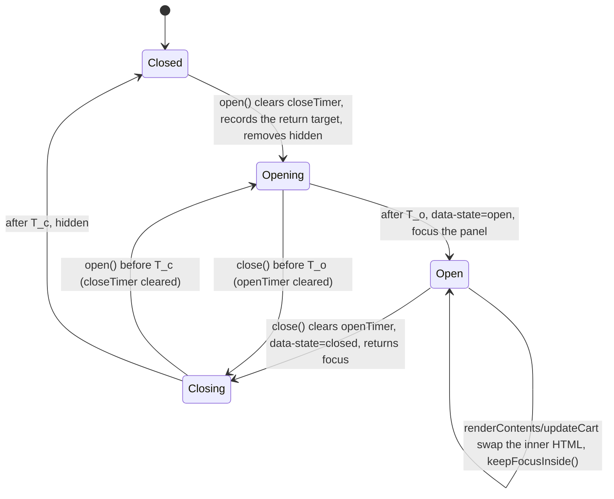

# Plan: Tailwind phase T6b, QA follow-ups (cart drawer, cart page, add-to-cart error, tooltip keyboard, banner preload, focus)

Slug: `theme-evolution-tailwind-t6b`
Index: `docs/plans/theme-evolution-tailwind-t6.md`. Input: `docs/backlog/t6-batch.md` "Follow-ups from QA reports".
Parent: `docs/plans/theme-evolution-tailwind.md`. Format model: `docs/plans/theme-evolution-tailwind-t4c.md` (Revision 2.1).
Architect: Claude (for Junior Warner). Date: 2026-10-23. Revision: 2.1. It closes round 2 of `docs/reviews/theme-evolution-tailwind-t6b-review.md` (APPROVE WITH CHANGES: RR2-1, RR2-2, nits RN1-RN5; closeout below). Revision 2 addressed round 1 (blocker B1, R1-R8, nits N1-N12; changelog below).
Tier: 2. JavaScript behavior in the cart drawer (on every page) and the tooltip script (on every page), small markup on three pages, a preload fix. No schema change.

**Status: written before T5a landed; re-validate at Step 0.** Planned on HEAD `1f2a390`. T5 is split into T5a (retire `base.css`, decide focus rings: Q5a.1) and T5b (typography; owner-gated line height): `docs/plans/theme-evolution-tailwind-t5-index.md`, `-t5a.md`, `-t5b.md`, read here for scope only. Two items (S5's focus ring, S7) may already be fixed by T5a and are **verified and dropped** at Step 0 if so (§3.2). **T5a must be on staging before Step 1; T5b is not required** (§3.3). T6b doesn't depend on T6a; if T6a lands first, Step 0 re-baselines on its tree (index §3).

---

## Revision 2.1 closeout (review round 2)

**What did not change.** No design, code block, step or decision changed; no criterion was added or renumbered. Every edit is QA or owner text, or an index figure.

| Review item | What changed | Sections |
|---|---|---|
| **RR2-1** (required): the editor pass claimed to test a stale instance it never creates | The "select and deselect the cart-drawer section" clause is gone from §10 and owner check 1; the editor pass keeps only open, Tab cycling and Escape return. New C6b.10 clause: open the drawer, `document.querySelector('cart-drawer').remove()` (it keeps `data-state="open"`), press Tab twice from a page control → `document.activeElement` changes on each press and no `pageerror`. Red without the `isConnected` guards (detached `focusables()` is `[]`, so Tab is swallowed). RB13 points to it | C6b.10, §9.2, §10, §11 RB13 |
| **RR2-2** (required): the index quoted T5a Revision 1's projection | Index §4 and §5 cite T5a Revision 2 §5.10 (58,662-58,922 / 11,174-11,369). Worst case after T5a + T6a + T6b: **≤ 59,352 / 11,524** with T6a Revision 2's +210 / +85 (the review's 59,282 / 11,499 used T6a Revision 1's +140 / +60); with T5b (any option but (b+)) ≤ 59,432 / 11,574; with T5b (b+) about 59,922. The T5 index's own line `:34` is stale; flagged to the orchestrator, not edited | index §4, §5 |
| RN1 | Every injected sentinel and probe span gets text ("Organic Cotton" for the trigger probe, "sentinel" for sentinels), so it has a real inline box and can't match T5a D5a.19's `[data-rich-text]` empty-element rule | §13 Step 0 item 4, C6b.14, C6b.16 |
| RN2 | Positive control for `FI`: `button[name="add"]` (`btn-primary` has its own `&:focus-visible` rule, `src/tailwind.css:91`) must read true on both trees, so an instrument stuck at false is caught too | §13 Step 0 item 4 |
| RN3 | E6b.4: in Firefox, letters in the number field give `badInput` and Checkout posts an empty `updates[]` value, the same as a cleared field posts today | §8 E6b.4 |
| RN4 | The validity rule reads "\|list\| + 1 candidates" (6 for `W5`'s margin run, 5 for `W4`'s) | §5.6, §13 Step 0 item 8 |
| RN5 | C6b.5 takes the "before" count after the page settles (`networkidle` plus 1 s); a listener whose `scriptId` isn't a theme script is recorded and excluded before a run is called red | C6b.5 |

Rev 2.1 sweep. Range: this whole file, prose first, then tables. Terms: "select and deselect", "stale instance", "\|W5\| + 1 = 6" as the only rule, "inject (in page, not in a file) a `<span tabindex=\"0\">`" without text. No survivor outside this closeout; RB13 keeps the phrase "a stale instance" as its risk description, which is correct, and its trigger no longer names the theme editor's section select.

## Revision 2 changelog (review round 1)

**What did not change.** Steps 0-8 keep their numbers and scope; criteria C6b.0-C6b.20 keep their numbers; one criterion is added (C6b.21). No decision is reversed; D6b.4 gains one line (R2) and D6b.9 gains the `:focus-visible` condition (R8).

| Review item | What changed | Sections |
|---|---|---|
| **B1** (blocker): `FI` counted the hello-world links' resting inset shadow | `FI(el)` is now a **difference**: the element's `outline-style`, `outline-width` and `box-shadow` are read at rest (focus on a sentinel) and while `:focus-visible` matches; true if the focused outline is visible, or the focused `box-shadow` differs from the resting one. Applied in Step 0 item 4(a)/(b), C6b.14(b) and C6b.16; the §9.2 row for C6b.16 is now reachable | §0, §13 Step 0 item 4, C6b.14, C6b.16, §9.2 |
| **R1**: T5 shipped as T5a and T5b | Step 0 item 1 requires `docs/qa/theme-evolution-tailwind-t5a-deploy.md` (#187953643616, ancestor SHA), T5a's QA verdict `PASS` or `PASS WITH NITS`, and records the Q5a.1 option that shipped. New §3.3: T5b not required; either order re-baselines. The `-t5.md` references and the index's (`:8`, `:32`) are fixed | status, §3.2, §3.3, §13 Step 0 item 1, index |
| **R2**: a failed add leaves a stale `activeElement` | The trigger click handler in `bindEvents()` calls `this.setActiveElement(newTrigger)` before `this.open()` (one line; also gives Safari a defined target). New **C6b.21**: on `F_3p`, a 422 add, then the header icon by keyboard, then Escape → focus on the icon | §4.1 D6b.4, §5.2, C6b.21 |
| **R3**: C6b.5 masked by Step 2's guard | C6b.5 counts `document`'s `keyup` and `keydown` listeners through CDP (`DOMDebugger.getEventListeners`) before and after three re-renders; the `close()` call counter stays as a Step 1 check | C6b.5, §13 Step 1 |
| **R4**: C6b.8(b) never detached the icon | C6b.8(b) changes the quantity once (one re-render, which clones the icon) between the icon open and Escape, and asserts the focused trigger `isConnected` | C6b.8 |
| **R5**: the preload margin width could be filtered out | The margin width is one that survives `image_url: width: 3840` (1780 for the default list, 2136 for ambient); a run whose `imagesrcset` has fewer than \|W5\| + 1 candidates is invalid. If the fixture images are too narrow for that, the threshold is measured in characters by padding `sizes` with inert entries. PXB has **two** images (two `Link` entries) | §5.6, §13 Step 0 item 8, §10 PXB |
| **R6**: C6b.14(h)'s Tab landed on the second trigger | (h) returns with Shift+Tab to the sentinel and asserts `#eco-tooltip-organic-cotton` isn't visible | C6b.14 |
| **R7**: C6b.14(d) ignored the header's Escape below 1024 | C6b.14 runs at 1440; at 375 (d) asserts only that no tooltip is visible and records `activeElement`. New E6b.11; RB1 extended | C6b.14, §8, §11 |
| **R8** ⚑: a clicked trigger kept its tooltip after mouse-out | `handleMouseOut` keeps the tooltip only while `trigger.matches(':focus-visible')` (option (a), recommended and applied); C6b.14(i) clicks, leaves, and expects it hidden | §4.1 D6b.9, §5.5, C6b.14 |
| N1 | `L_n`'s quoted value relabelled "9 `Link` entries, preconnects and UCP included" | §0 |
| N2 | C6b.4(b) and C6b.8(c) also red on base | C6b.4, C6b.8 |
| N3 | Two discrimination claims reworded "not distinguished in Chromium" | §9.2 |
| N4 | "type and `min` as in the drawer; `inputmode` added" | D6b.7, §5.3 |
| N5 | `type="number"` validation: Update shows the browser bubble for an invalid value (⚑ in E6b.4); **Checkout gets `formnovalidate`**, so a stray value can never block checkout; C6b.12 tests both | §5.3, E6b.4, C6b.12 |
| N6 | Focus restore also covers the remove link (no `id`): the host remembers `data-index` and the hook class | §5.2 |
| N7 | `if (!this.isConnected) return;` in both document handlers; one theme-editor preview pass in §10 | §5.1, §5.2, §10 |
| N8 | Real `/` clause: `W9` filtered by the natural widths Step 0 records | C6b.15 |
| N9 | Stop rule if `D_422` is empty or missing | §13 Step 0 item 7 |
| N10 | D6b.9 states why the trigger gets no `role` | D6b.9 |
| N11 | E6b.10 uses Step 0's `S_tw` | §8 |
| N12 | Q6b.4 cites T4a Q4a.6 | §4.2 |
| Review "alternatives" | Q6b.2 lists `inert` on the theme-owned wrappers as a middle option | §4.2 |

**Rev 2 sweep.** Range: this whole file, prose first, then tables. Terms derived from the diff: `t5-deploy.md`, `-t5.md`, "T5 must be on staging", "`box-shadow` isn't `none`", "as in the drawer (`:42-46`)", "W5 plus 3840", "`W5` plus `3840`", "Tab away", "T5 left", "`S_T5`", "9 on T3's tree", "focus moved synchronously", "keyup ordering vs keydown: C6b.8(c)". No survivor outside this changelog.

Item map (backlog line → step):

| # | Finding | Source | Step |
|---|---|---|---|
| S1 | Close-then-reopen race: `data-state="open"` with `hidden`, stuck scroll lock; plus the `keyup` listener added on every re-render | T4a QA nit 2 (`docs/qa/theme-evolution-tailwind-t4a-report.md:89`); T4a plan R1, R2 (`docs/plans/theme-evolution-tailwind-t4a.md:979-980`) | 1 |
| S2 | Drawer: no initial focus, no trap, no focus return | T4a QA nit 3 (`:90`); T4a plan R3 (`:981`), §14.3 item 2 (`:1118-1123`) | 2 |
| S3 | `/cart`: no line prices or total; quantity `type="text"`, no `inputmode` | T4a QA nit 5 (`:92`) | 3 |
| S4 | 422 add-to-cart shows no visible error | T4a QA nit 4 (`:91`) | 4 |
| S5 | Tooltip trigger not keyboard-accessible | T2 QA nit 1 (`docs/qa/theme-evolution-tailwind-t2-report.md:77`); T4a Q4a.9 (`docs/plans/theme-evolution-tailwind-t4a.md:1184`) | 5 |
| S6 | Image-banner preload `Link` header dropped with `widths` + `sizes` | T3 QA F1 (`docs/qa/theme-evolution-tailwind-t3-report.md:62-76`) | 6 |
| S7 | Hello-world card links: no outline on `:focus-visible` | T3 QA F2 (`:78-80`) | 7 (conditional) |

---

## 0. Referent table

Tags as in T6a §0 (`[measured]` at HEAD `1f2a390`, `[derived]`, `[quoted]`, `[proposed]`, `[provisional]`, `[unverified]`, `[to be measured]`).

| Sym | What it measures | Units | Artifact | Extent or band | Value, method or threshold |
|---|---|---|---|---|---|
| `B_min`, `B_gz`, `M_gz` | budget and gzip method | bytes | `assets/tailwind.css` | whole file | as T6a §0 `[quoted]` |
| `S_tw0` | size at planning time | bytes | committed file at `1f2a390` | whole file | 58,366 / 11,104 `[quoted]` brief. `[provisional: re-measure on T5's tree]` |
| `ΔS_b` | T6b's CSS growth | bytes | §5.8 | whole file | 0 to +220 minified, 0 to +70 gzip `[provisional]`: 0 if Step 0 item 4 finds a focus indicator already present; otherwise three `focus-visible:` utilities |
| `P_b` | **The gate figure**: T6b's end state built in scratch | bytes | scratch copy | whole file | `[to be measured]` Step 0 item 10 |
| `T_o` | delay before `data-state="open"` | ms | `open()` (`sections/cart-drawer.liquid:137-142`) | n/a | 10 `[measured]` |
| `T_c` | delay before `hidden` after close | ms | `close()` (`:144-149`) | n/a | 300 `[measured]`; the panel and overlay transitions are `duration-300` (`:4`, `:5`) |
| `F_wax`, `F_snow`, `F_3p` | product fixtures | URL | store | n/a | `/products/selling-plans-ski-wax`, `/products/the-complete-snowboard`, `/products/the-3p-fulfilled-snowboard` (add-to-cart returns 422) `[quoted]` `CLAUDE.md` Verification; T4a QA C4a.6 |
| `D_422` | the 422 response's `description` | text | `/cart/add` JSON on `F_3p` | n/a | `[to be measured]` Step 0 item 7 |
| `N_f(s)` | focusable controls in the open drawer, state `s` | count | `[role="dialog"]` subtree | displayed, not disabled, not `tabindex="-1"` | one item: **5** (close `:8`, title link `:34`, quantity `:42`, remove `:52`, checkout `:70`); two items: 8; empty: **2** (close, "Continue shopping" `:19`) `[derived]`. Step 0 item 6 records them |
| `FI(el)` | a visible focus indicator **caused by focus** (B1) | boolean | computed `outline-style`, `outline-width` and `box-shadow` of `el`, read twice: **at rest** (focus on a sentinel `tabindex="0"` element injected in page) and **focused** (reached by the Tab key, `el.matches(':focus-visible')` true, else the reading is invalid) | the element itself | true if the focused `outline-style` isn't `none` with `outline-width` ≥ 1px, **or** the focused `box-shadow` differs from the resting one. A box-shadow present in both states doesn't count (the hello-world links carry a permanent inset `shadow-[…]`, `sections/hello-world.liquid:26, 38, 50`). Chromium's UA `auto` outline counts |
| `L_n` | `rel=preload` entries in the document response's `Link` header | count | PXB (banner first) | the HTML response | T3 QA F1 saw **9 `Link` entries in total, preconnects and UCP included**, none `as=image` `[quoted]` (`t3-report.md:64`); the preload count was lower (N1). `[provisional: re-measure on T5's tree]` (T5a removes the `base.css` stylesheet) |
| `S_tw` | the size T6b starts from | bytes | committed file at Step 0 | whole file | `[to be measured]` Step 0 item 2 (T5a's tree, plus T5b and T6a if they shipped first) |
| `L_len(list)` | length of the banner image's `Link` entry | characters | PXB response header | one entry | `[to be measured]` Step 0 item 8 |
| `W9`, `W9a` | banner `widths` today | list | `sections/image-banner.liquid:10` and `:16` (ambient) | 9 values each | `375, 550, 750, 1100, 1500, 1780, 2000, 3000, 3840`; `450, 660, 900, 1320, 1800, 2136, 2400, 3600, 7680` `[measured]` |
| `W5`, `W5a`, `W4`, `W4a` | preload-branch lists | list | §5.6 | 5 or 4 values | `750, 1100, 1500, 2000, 3000`; `900, 1320, 1800, 2400, 3600`; fallback `750, 1100, 1500, 3000`; `900, 1320, 1800, 3600` `[proposed]` |
| `M_tt` | tooltip material names and handles | list | `sections/product.liquid:49, 52` | n/a | Mycelium Bio-Fabric, Organic Cotton, Recycled Polyester → `handleize` (`mycelium-bio-fabric`, `organic-cotton`, `recycled-polyester`) `[derived]` |
| `C_err` | error text color | color | `text-[#d32f2f]` (compiled; used by the drawer's remove link `:52`) | n/a | 4.98:1 on white, 3.24:1 on `#112233` `[quoted]` T4a QA nit 1 |
| `N_tc` | theme check offenses | count | working tree | whole theme | `[provisional: re-measure on T5's tree]` |

Readings that are easy to confuse:

- `FI` is about the **focused element's own** outline or box-shadow, and about the **change** focus causes, not the resting look; a focus ring drawn by an ancestor or a pseudo-element doesn't count (the product card's `after:` ring is a different mechanism and isn't touched).
- `L_n` counts **preload** entries; preconnects don't count against Shopify's cap of 10 (shopify.dev "Use preload resource hints sparingly" `[quoted]`).
- `N_f` counts controls **inside the panel** (`[role="dialog"]`), not the overlay or the host.
- **"T5's tree"** in the tags means the tree Step 0 starts from: T5a's shipped tree, plus T5b's and T6a's if they shipped first (§3.3).

---

## 1. Problem statement and goals

QA left seven non-blocking findings across T2-T4a (item map above). Each is pre-existing on base and small; together they are the accessibility and robustness debt on the cart, product and home pages.

### Goals

1. **S1** The drawer's final state always matches the last call (`open()` or `close()`), and Escape runs `close()` once however many re-renders happened.
2. **S2** Opening the drawer moves focus into it; Tab and Shift+Tab stay inside; closing returns focus to the control that opened it; a re-render while open keeps focus inside.
3. **S3** `/cart` shows each line's price and the cart total, and the quantity field brings up a numeric keyboard.
4. **S4** A failed add-to-cart shows Shopify's error text near the button and announces it.
5. **S5** Tooltip triggers are reachable with Tab, show their tooltip on focus with a visible focus indicator, and Escape dismisses the tooltip.
6. **S6** The first-position image banner's preload `Link` header is sent.
7. **S7** Hello-world card links show a focus indicator (after T5, possibly with no change).
8. Keep the Section Rendering API contract (`getSectionsToRender()`, `renderContents()`, `.join(',')`), fit both budgets, no schema change, theme check at Step 0's baseline.

---

## 2. Non-goals

- No native `<dialog>` rewrite of the drawer (Q6b.2). No `inert` on the page.
- No change to `assets/product-form.js` (S4 uses the hooks it already has) or to `getSectionsToRender()` and `updateLineItem()`.
- No cart-page taxes/shipping note, no compare-at line prices, no cart notes (Q6b.4).
- No hover-persistence fix for the tooltip (WCAG 1.4.13 "hoverable"), no fix for the description replace loop matching inside attributes (§11 RB8), no conversion of `EcoTooltip` to a custom element (Q6b.6).
- No change to `sections/material-spotlight.liquid`'s `preload_icon` (T2 QA C2.16 noted a similar symptom; index §6 lists it as a future item).
- No fix for the header menu's Escape handler, which focuses its toggle even when the menu is closed (`sections/header.liquid:163-167, 194-195`; §11 RB1).
- No `templates/*.json`, `config/*`, `layout/*`, `CLAUDE.md`, `AGENTS.md` or schema edit. No new locale keys.

---

## 3. Current state and the T5 dependency

### 3.1 Files `[measured]` (HEAD `1f2a390`)

| File | Today | T6b change |
|---|---|---|
| `sections/cart-drawer.liquid` (271 lines) | host `<cart-drawer class="group/drawer block" data-state="closed" hidden>` (2); panel `role="dialog" aria-modal="true"` (5); close button (8); busy overlay `data-cart-drawer-busy` (77); `<script>` 92-263: `bindEvents()` 100-135 with a document `keyup` listener at 132-134; `open()` 137-142; `close()` 144-149; `getSectionsToRender()` 151-162; `setActiveElement()` 164-166; `renderContents()` 168-197 (calls `bindEvents()` 195, `open()` 196); `updateLineItem()` 199-227 (`.join(',')` 205); `updateCart()` 229-257 (`bindEvents()` 237, `open()` 238) | Steps 1-2 |
| `sections/cart.liquid` (51) | form (19), `li` (22), title `<p>` (29), quantity `type="text"` (31), remove link (32), buttons (37-40) | Step 3 |
| `sections/product.liquid` (247) | description loop 49-55 with the trigger literal (53); `<product-form>` 92-105 with `` 93 | Steps 4-5 |
| `assets/product-form.js` (144) | `setActiveElement(document.activeElement)` (42); on `response.status`: `handleErrorMessage(response.description)` (56); `handleErrorMessage()` looks for `.product-form__error-message-wrapper` and `.product-form__error-message` and toggles `hidden` (113-126) | none |
| `assets/eco-tooltip.js` (122) | global `EcoTooltip` instance; `mouseover`/`mouseout` on `body` (9-12); `showTooltip()` async fetch of `/search?section_id=material-tooltip&q=<handle>` (32-77); tooltip appended to `body` (70) | Step 5 |
| `sections/image-banner.liquid` (824) | `widths` (10, 16); `is_preload` when `section.index == 1` (75-78); preload branches 269-281 and 313-325 pass `widths: widths` (279, 323) with `sizes` | Step 6 |
| `sections/hello-world.liquid` (67) | three `link_to` class strings (26, 38, 50) | Step 7 (conditional) |
| `layout/theme.liquid` | loads `base.css` (29) and `eco-tooltip.js` (37) on every page | none |

### 3.2 What T5a and T5b may change under T6b

From the T5 index and the scopes of `-t5a.md` and `-t5b.md` (read, not edited). **T5a** deletes `base.css`, decides focus rings (Q5a.1: (a) the browser default, recommended, or (b) a theme `:focus-visible` ring in `@layer base`), deletes `check:hidden` and changes the layer statement. **T5b** decides the root line height and two typography rules; none touches T6b's files.

| Item | What T5a / T5b change | Consequence | Handled by |
|---|---|---|---|
| **S7** hello-world focus | **T5a**: `base.css`'s `*:focus { outline: 0; box-shadow: none }` and its invalid `*:focus-visible` ring (`assets/base.css:715-724`) go; Q5a.1 (a) lets Chromium's UA `:focus-visible` outline return, (b) adds a theme ring. (Today the outline is `none` because `*:focus` wins and the `:focus-visible` value is invalid with a hex `--color-foreground`, T4c §5.2 `[derived]`; `base.css` sits in `@layer legacy`, so its `box-shadow: none` loses to the links' own shadow utility.) | **S7 is probably fixed by T5a** under either Q5a.1 option | Step 0 item 4 measures the corrected `FI` (B1); if true, S7 is **verified and dropped** (no Step 7 commit) |
| **S5** trigger focus ring | same | a `tabindex="0"` span may get a ring with no utility | Step 0 item 4 on an injected `tabindex="0"` span with the trigger's classes; the ring utilities are added in Step 5 only if `FI` is false |
| S2 panel focus ring | same | a programmatic focus after Enter matches `:focus-visible`, so under Q5a.1 (a) the UA ring, under (b) T5a's `@layer base` ring, would surround the whole panel | `focus-visible:outline-none` on the panel (compiled today; the utilities layer beats both) either way |
| S4 error wrapper | `.hidden { display: none !important }` goes; the wrapper uses the `hidden` **attribute**, which Tailwind's Preflight hides with `!important` in `@layer base` `[quoted]` Tailwind v4 Preflight; independent of `base.css` | none expected | C6b.13 reads the computed `display` |
| S4 spinner | **T5a**'s JS-toggled-class audit (umbrella §12 precondition 3) records how `product-form.js`'s `hidden` class on `.loading__spinner` keeps working | the add flow under test may change | Step 0 item 3 re-reads `sections/product.liquid` around `loading__spinner`; C6b.10 regression flows |
| S6 preload | **T5a**: the `base.css` stylesheet entry leaves the `Link` header | `L_n` drops by one, more room under the cap | Step 0 item 8 re-measures |
| All | **T5b**: `html { line-height: normal }` may become `1.5`; **T5a**: the layer statement loses `legacy`/`shims` and `check:hidden` goes | heights, gates | Step 0 items 2-3; criteria compare with Step 0 |

### 3.3 T5b's position (R1)

**T5b is not required.** What T6b depends on is T5a (`base.css` gone, Q5a.1 decided, `check:hidden` removed, the new layer statement). T5b waits on the owner's written line-height choice (T5 index, Q5b.1 "**yes, before T5b Step 2**").

- If T5b's commits are already in HEAD at Step 0, Step 0 baselines on them.
- If T5b lands after T6b, T5b's own Step 0 absorbs T6b.
- T6b and T5b aren't implemented at the same time (both rebuild `assets/tailwind.css`, and T6b's base readings must stay put from Step 0 to Step 8): Step 0 item 1 records that no T5b Coder is active and no T5b commit is in HEAD past the recorded base, and Step 8 re-checks it.

---

## 4. Decisions and owner questions

### 4.1 Decisions

| # | Decision | Question | Where |
|---|---|---|---|
| D6b.1 | **S1: track both timers and clear the other in `open()` and `close()`**; document listeners are added once, in the constructor | none | §5.1 |
| D6b.2 | **S2: a JavaScript focus trap in `AjaxCartDrawer`**, not a native `<dialog>` | Q6b.2 | §5.2 |
| D6b.3 | **Initial focus goes to the panel** (`[role="dialog"]`, `tabindex="-1"`), as Dawn's drawer does, so screen readers announce "Cart, dialog"; Tab then reaches the close button | Q6b.1 | §5.2 |
| D6b.4 | **Focus returns** to the element `product-form.js` passed (`setActiveElement`, `assets/product-form.js:42`), else to the element focused at open, else to the live `[data-cart-drawer-trigger]` (re-renders clone the header icon, `:101-110`). **The header icon's click handler passes itself** (`this.setActiveElement(newTrigger)` before `this.open()`, R2): `product-form.js` sets `activeElement` before its fetch and nothing consumes it after a 422 or a network error, so without this a later icon open would return focus to the old Add to cart button | none | §5.2 |
| D6b.5 | **Re-render while open keeps focus inside**: the host remembers the last focused control (`focusin` on the host, which survives `innerHTML` swaps): its `id`, or for the remove link its `data-index` (N6), and refocuses the same control in the new markup, else the panel | none | §5.2 |
| D6b.6 | **S3: line price `item.final_line_price \| money` and total `cart.total_price \| money_with_currency`**, labelled with the existing `sections.cart.headings.total` key, as the drawer shows them (`:36`, `:66-67`) | Q6b.4 ⚑ | §5.3 |
| D6b.7 | **S3: quantity `type="number" inputmode="numeric" min="0"`**: `type` and `min` as in the drawer (`:42-46`, which has no `inputmode`); `inputmode` added (N4). **Checkout gets `formnovalidate`** so an invalid quantity can block Update (with the browser's message) but never checkout (N5) | Q6b.3 ⚑ | §5.3 |
| D6b.8 | **S4: markup only.** A hidden `role="alert"` paragraph with the two class hooks `product-form.js` already queries, inside `<product-form>` above the form. Those class names carry no CSS once `base.css` is gone (`assets/section-main-product.css:153` styles one of them but isn't loaded `[measured]`) | Q6b.5 ⚑ | §5.4 |
| D6b.9 | **S5: extend the existing `EcoTooltip` class** with `focusin`/`focusout` and an Escape handler; `tabindex="0"` on the trigger literal; `role="tooltip"`, an `id` and `aria-describedby`; a stale-fetch guard. **On mouse-out the tooltip stays only while the trigger matches `:focus-visible`** (R8 option (a)), so keyboard users keep it and a mouse click doesn't make it stick. **No `role` on the trigger** (T4a Q4a.9 mentioned "a role", N10): it does nothing on activation, so `button` would promise an action; a focusable generic span that carries `aria-describedby` is what the tooltip pattern needs | Q6b.6 | §5.5 |
| D6b.10 | **S6: a shorter `preload_widths` list for the preload branches only**, chosen at Step 0 by a measured margin rule (§5.6) | Q6b.7 | §5.6 |
| D6b.11 | **S7: conditional.** Add `focus-visible:` outline utilities to the three links only if Step 0 measures `FI` (focused vs resting) false on T5a's tree | none | §5.7 |

### 4.2 Owner questions (the plan proceeds on the recommendation unless the owner says otherwise)

1. **Q6b.1 Drawer initial focus.** (a) **The panel (recommended, D6b.3).** (b) The close button: a visible ring on open for keyboard users, but screen readers announce "Close cart, button" before the dialog's content.
2. **Q6b.2 Native `<dialog>` with `showModal()`** (T4a review N10): built-in inert background and Escape, but it moves the drawer to the top layer, replaces the `data-state`/`hidden` mechanism T4a built and its CSS, and widens the diff on a script that runs on every page. **Recommended: not in T6b**; a later plan if wanted. A middle option (review): `inert` on the theme-owned page wrappers only (header group, `main`, footer group) while open, which gives screen readers a real modal without touching Shopify's preview bar or app embeds; about ten more lines, not applied.
3. **Q6b.3 ⚑ Cart quantity field.** (a) **`type="number"` with `inputmode="numeric"` (recommended)**: `type` matches the drawer and the product page; desktop browsers show spin buttons; a value such as `-1` or `1.5` makes Update show the browser's validation message instead of posting (Checkout is exempt, `formnovalidate`). (b) `type="text" inputmode="numeric" pattern="[0-9]*"`: no visual change, but `pattern` validates on submit too, so it needs the same `formnovalidate`.
4. **Q6b.4 ⚑ Cart page totals.** T4a recommended a separate cart-page feature plan for prices and a total (T4a Q4a.6); the owner put this narrower item in the T6 batch, so it isn't a reversal (N12). (a) **Line price and "Total" only (recommended)**, as in the drawer. (b) Also Dawn's "Taxes, discounts and shipping calculated at checkout" line (existing `sections.cart.taxes_*` keys, chosen by `cart.taxes_included` and `cart.duties_included`; the `_html` variants carry an unclassed link that would need `[&_a]:underline`).
5. **Q6b.5 ⚑ Error message look.** Above the Add to cart button (Dawn's place), `text-sm` in `#d32f2f`. On a dark palette it is 3.24:1 (T4a nit 1). Alternative: `text-foreground` with a red icon, about +100 B.
6. **Q6b.6 Tooltip script.** (a) **Extend `EcoTooltip` in place (recommended)**: it is an existing class instance, not a global function; the diff stays small. (b) Convert it to a namespaced custom element (`theme-evolution-eco-tooltip`), per `CLAUDE.md`'s Web Components rule for new interactive components: a larger rewrite with the same behavior.
7. **Q6b.7 Preload widths.** Five widths (`W5`) if Step 0's margin rule allows, else four (`W4`), **only when the banner is the first section**. Against `W9`, `W5` drops 375, 550, 1780 and 3840 `[derived]`: a full-width banner on a 375 px phone at DPR 1 downloads 750 instead of 375; a need of 1501-1780 px gets 2000 instead of 1780; a 4K screen gets 3000 instead of 3840. The common cases (750 at 375 DPR 2, 1500 at 1440 DPR 1, 3000 at 1440 DPR 2) are unchanged. `W4` also drops 2000, so 1501-3000 px needs get 3000. Recommended: accept.

### 4.3 Rejected alternatives

- **S1 by a `transitionend` listener** instead of timers: the panel's transition can be interrupted or skipped (`motion-reduce` isn't applied here, but a hidden tab never fires it), so a timer still needs a fallback. Clearing the timers is the two-line fix T4a named.
- **S2 by setting `inert` on every `body` child except the drawer section:** robust for screen readers, but it also hits Shopify's preview bar and app embeds outside the theme's control. The JS trap plus `aria-modal="true"` (already set, `:5`) is the smaller change.
- **S4 by editing `product-form.js`** to use a `data-` hook: the file is Dawn's and shared; the existing class hooks work and carry no CSS.
- **S6 by dropping `sizes`** from the preload branch: T3 QA showed the header then appears, but without `sizes` the browser assumes `100vw`, so half-width banners download about twice the pixels. **S6 by a `<link rel="preload">` in the HTML:** the preload scanner already finds the `img`; only the header gives Early Hints (shopify.dev `image_tag` `preload` `[quoted]`).
- **S7 without measuring T5a's tree first:** it would duplicate whatever ring T5a ships.

---

## 5. Proposed design, file by file

**Conventions.** As T6a §5: complete class names, no bare `hidden` class, no `!`, inline `style` only for custom properties (T6b adds none). JavaScript comments explain why. JS hooks are `data-` attributes or the existing namespaced classes; T6b adds or removes no utility class from JS. Selectors in JS never use Tailwind class names.



### 5.1 `sections/cart-drawer.liquid`, Step 1 (S1)

In the constructor, after `this.drawer = this;` and before `this.bindEvents();`:

```js
        this.openTimer = null;
        this.closeTimer = null;
        // Why: bindEvents() runs again after every re-render, so document listeners are added here, once.
        this.onDocumentKeyup = this.onDocumentKeyup.bind(this);
        document.addEventListener('keyup', this.onDocumentKeyup);
```

In `bindEvents()`, delete lines 132-134 (the `document.addEventListener('keyup', …)` block). Add the method:

```js
      onDocumentKeyup(e) {
        // Why: a document listener outlives its element; a replaced drawer (theme editor) must stay inert.
        if (!this.isConnected) return;
        if (e.code === 'Escape') this.close();
      }
```

`open()` and `close()` become:

```js
      open() {
        // Why: a close() still in flight would otherwise set hidden after this open (T4a QA nit 2).
        clearTimeout(this.closeTimer);
        clearTimeout(this.openTimer);
        this.drawer.hidden = false;
        this.openTimer = setTimeout(() => {
          this.drawer.dataset.state = 'open';
        }, 10);
      }

      close() {
        clearTimeout(this.openTimer);
        clearTimeout(this.closeTimer);
        this.drawer.dataset.state = 'closed';
        this.closeTimer = setTimeout(() => {
          this.drawer.hidden = true;
        }, 300);
      }
```

Escape still calls `close()` in every state, as today; Step 2 adds the open-state guard.

### 5.2 `sections/cart-drawer.liquid`, Step 2 (S2)

**Markup.** The panel (line 5) gains `tabindex="-1"` and, at the end of its class string, `focus-visible:outline-none` (compiled today `[measured]`): the panel is a container, and its focus is only a starting point.

**Script.** In the constructor, after Step 1's lines:

```js
        this.returnFocusTo = null;
        this.lastFocused = { id: '', removeIndex: '' };
        this.onDocumentKeydown = this.onDocumentKeydown.bind(this);
        document.addEventListener('keydown', this.onDocumentKeydown);
        // Why: the host survives every innerHTML swap, so it remembers which control had focus.
        this.addEventListener('focusin', (e) => {
          const target = e.target;
          const isRemove = target.classList.contains('cart-drawer__item-remove');
          this.lastFocused = { id: target.id || '', removeIndex: isRemove ? target.dataset.index || '' : '' };
        });
```

In `bindEvents()`, the header trigger's click handler (`:106-109`) gains one line before `this.open();` (R2):

```js
          newTrigger.addEventListener('click', (e) => {
            e.preventDefault();
            // Why: product-form sets activeElement before its fetch and a 422 never consumes it; the icon must win.
            this.setActiveElement(newTrigger);
            this.open();
          });
```

`.cart-drawer__item-remove` is the existing namespaced JS hook (`:52`, `:125`), not a utility class.

New and changed methods:

```js
      get panel() {
        return this.querySelector('[role="dialog"]');
      }

      isOpen() {
        return this.drawer.dataset.state === 'open';
      }

      focusables() {
        const panel = this.panel;
        if (!panel) return [];
        const selector = 'a[href], button:not([disabled]), input:not([disabled]):not([type="hidden"]), select:not([disabled]), textarea:not([disabled]), [tabindex]:not([tabindex="-1"])';
        return [...panel.querySelectorAll(selector)].filter(
          (el) => el.getClientRects().length > 0 && getComputedStyle(el).visibility !== 'hidden'
        );
      }

      onDocumentKeyup(e) {
        if (!this.isConnected) return;
        if (e.code === 'Escape' && this.isOpen()) this.close();
      }

      onDocumentKeydown(e) {
        // Why: a detached drawer that still reads "open" would otherwise swallow every Tab on the page (N7).
        if (!this.isConnected) return;
        if (e.key !== 'Tab' || !this.isOpen()) return;
        const panel = this.panel;
        if (!panel) return;
        const items = this.focusables();
        if (items.length === 0) {
          e.preventDefault();
          panel.focus({ preventScroll: true });
          return;
        }
        const first = items[0];
        const last = items[items.length - 1];
        const active = document.activeElement;
        const inside = panel.contains(active);
        if (e.shiftKey && (!inside || active === first || active === panel)) {
          e.preventDefault();
          last.focus();
        } else if (!e.shiftKey && (!inside || active === last)) {
          e.preventDefault();
          first.focus();
        }
      }

      open() {
        clearTimeout(this.closeTimer);
        clearTimeout(this.openTimer);
        const wasOpen = this.isOpen() && !this.drawer.hidden;
        if (!wasOpen) {
          // Why: product-form passes the add button; otherwise whatever had focus opened the drawer.
          this.returnFocusTo = this.activeElement || document.activeElement;
          this.activeElement = null;
        }
        this.drawer.hidden = false;
        this.openTimer = setTimeout(() => {
          this.drawer.dataset.state = 'open';
          if (!wasOpen && this.panel) this.panel.focus({ preventScroll: true });
        }, 10);
      }

      close() {
        clearTimeout(this.openTimer);
        clearTimeout(this.closeTimer);
        const wasOpen = this.isOpen();
        this.drawer.dataset.state = 'closed';
        this.closeTimer = setTimeout(() => {
          this.drawer.hidden = true;
        }, 300);
        if (wasOpen) this.returnFocus();
      }

      returnFocus() {
        let target = this.returnFocusTo;
        this.returnFocusTo = null;
        // Why: bindEvents() replaces the header icon with a clone, so a stored trigger can be detached.
        if (!target || !target.isConnected || target === document.body) {
          target = document.querySelector('[data-cart-drawer-trigger]');
        }
        if (target) target.focus();
      }

      keepFocusInside() {
        if (!this.isOpen() || this.contains(document.activeElement)) return;
        const { id, removeIndex } = this.lastFocused;
        let target = id ? document.getElementById(id) : null;
        if (!target && removeIndex) {
          target = this.querySelector('.cart-drawer__item-remove[data-index="' + removeIndex + '"]');
        }
        if (target && this.contains(target)) {
          target.focus();
        } else if (this.panel) {
          this.panel.focus({ preventScroll: true });
        }
      }
```

In `renderContents()`, after `this.open();` (line 196), and in `updateCart()`, after `this.open();` (line 238), add `this.keepFocusInside();`. When the drawer was closed (an add from the product page), `isOpen()` is still false at that moment (the state flips after `T_o`), so `keepFocusInside()` returns and `open()`'s timer sets the initial focus.

**Unchanged:** `getSectionsToRender()` (151-162), `setActiveElement()`, `updateLineItem()` with `.join(',')` (205), the `customElements.define` guard, every `data-` hook, the scroll-lock `<style>` (84-90).

**Ordering with the header's Escape** `[measured]` `sections/header.liquid:142, 163-167, 194-195`: the header menu's `keydown` handler focuses its toggle on every Escape. The drawer acts on `keyup`, which fires after every `keydown` listener, so its `returnFocus()` runs last. C6b.8 reads focus after `keyup`.

### 5.3 `sections/cart.liquid`, Step 3 (S3)

After the title `<p>` (line 29):

```liquid
              <p data-cart-line-price>{{ item.final_line_price | money }}</p>
```

Line 31's input attributes `type="text"` become `type="number" inputmode="numeric" min="0"`; everything else on the line stays. (`type` and `min` match the drawer's field, `:42-46`, which has no `inputmode`; N4.)

The Checkout button (line 39) gains `formnovalidate`: `<button type="submit" name="checkout" class="btn-primary" formnovalidate>`. **Why** (N5): a number field adds constraint validation, so a typed `-1` or `1.5` would otherwise stop **both** submit buttons with a browser message; today's text field posts anything. Update keeps validation (the message explains the problem); Checkout always posts, as today.

Before the buttons `div` (line 37), inside the form:

```liquid
      <div class="flex items-center justify-between gap-3">
        <p class="font-semibold">{{ 'sections.cart.headings.total' | t }}</p>
        <p class="text-[1.25rem] font-bold" data-cart-total>{{ cart.total_price | money_with_currency }}</p>
      </div>
```

- No new heading (`<p>`, not `<h2>`), so the page keeps one `<h1>` and its order.
- Every class is compiled today `[measured]` (`flex`, `items-center`, `justify-between`, `gap-3`, `font-semibold`, `text-[1.25rem]`, `font-bold`). The `data-` attributes are test hooks with no CSS.
- `sections.cart.headings.total` exists ("Total", `locales/en.default.json:176`) `[measured]`.

### 5.4 `sections/product.liquid`, Step 4 (S4)

Inside `<product-form>` (line 92), before `` (93):

```liquid
              
              <p class="product-form__error-message-wrapper mb-3 text-sm text-[#d32f2f]" role="alert" hidden>
                <span class="product-form__error-message"></span>
              </p>
```

- `handleErrorMessage(response.description)` removes `hidden` and sets the span's text; the next submit calls `handleErrorMessage()` with no argument, which hides it again (`assets/product-form.js:25, 56, 113-126`).
- The `hidden` attribute is hidden by Preflight's `[hidden]` rule (`!important` in `@layer base`), so no display utility is needed or allowed here.
- Classes compiled today: `mb-3`, `text-sm`, `text-[#d32f2f]` `[measured]`.

### 5.5 `sections/product.liquid` and `assets/eco-tooltip.js`, Step 5 (S5)

**Trigger literal (line 53).** Insert ` tabindex="0"` after the class attribute's closing quote, so the literal reads `'<span class="eco-tooltip-trigger … hover:decoration-solid" tabindex="0" data-material-handle="'`. **If Step 0 item 4(b) found `FI` false** (the corrected, focused-vs-resting definition) on the injected span, also append ` focus-visible:outline-2 focus-visible:outline-offset-2 focus-visible:outline-current` to the class list inside the literal (complete names in a scanned file, so they compile).

**`assets/eco-tooltip.js`:**

```js
  constructor() {
    this.tooltips = new Map();
    this.cache = new Map();
    this.debounceTimer = null;
    this.activeTrigger = null;
    this.init();
  }

  init() {
    document.body.addEventListener('mouseover', this.handleMouseOver.bind(this));
    document.body.addEventListener('mouseout', this.handleMouseOut.bind(this));
    // Why: keyboard users reach triggers with Tab (WCAG 2.1.1) and dismiss the tooltip with Escape (1.4.13).
    document.body.addEventListener('focusin', this.handleFocusIn.bind(this));
    document.body.addEventListener('focusout', this.handleFocusOut.bind(this));
    document.addEventListener('keydown', this.handleKeydown.bind(this));
  }

  handleMouseOver(event) {
    const trigger = event.target.closest('.eco-tooltip-trigger');
    if (!trigger) return;
    clearTimeout(this.debounceTimer);
    this.debounceTimer = setTimeout(() => {
      this.activeTrigger = trigger;
      this.showTooltip(trigger);
    }, 100);
  }

  handleMouseOut(event) {
    const trigger = event.target.closest('.eco-tooltip-trigger');
    if (!trigger) return;
    clearTimeout(this.debounceTimer);
    // Why: a keyboard-focused trigger keeps its tooltip when the pointer leaves; a mouse click doesn't make it stick.
    if (document.activeElement === trigger && trigger.matches(':focus-visible')) return;
    if (this.activeTrigger === trigger) this.activeTrigger = null;
    this.hideTooltip(trigger);
  }

  handleFocusIn(event) {
    const trigger = event.target.closest('.eco-tooltip-trigger');
    if (!trigger) return;
    clearTimeout(this.debounceTimer);
    this.activeTrigger = trigger;
    this.showTooltip(trigger);
  }

  handleFocusOut(event) {
    const trigger = event.target.closest('.eco-tooltip-trigger');
    if (!trigger) return;
    if (this.activeTrigger === trigger) this.activeTrigger = null;
    this.hideTooltip(trigger);
  }

  handleKeydown(event) {
    if (event.key !== 'Escape') return;
    this.activeTrigger = null;
    this.tooltips.forEach((tooltip) => tooltip.classList.remove('is-visible'));
  }
```

In `showTooltip(trigger)`:

- In the cached branch (39-43) and before the final show (75-76), add `if (this.activeTrigger !== trigger) return;` first. **Why:** the fetch is async; without the guard a tooltip whose trigger lost focus or hover during the fetch appears afterwards and stays.
- Before each `tooltip.classList.add('is-visible')`, add `trigger.setAttribute('aria-describedby', tooltip.id);`.

`createTooltipElement(content)` becomes `createTooltipElement(content, materialHandle)`, and after `tooltip.classList.add('eco-tooltip');` it sets `tooltip.id = 'eco-tooltip-' + materialHandle;` and `tooltip.setAttribute('role', 'tooltip');`. The call at line 68 passes `materialHandle`. Nothing else changes; `is-visible` stays the only class JS toggles (its CSS is in `sections/product.liquid:117-145`, `@layer components`).

**Known limit:** the first focus on a trigger fetches the tooltip, so a screen reader may read the trigger before `aria-describedby` exists; later focuses carry it. Recorded under E6b.7.

### 5.6 `sections/image-banner.liquid`, Step 6 (S6)

After line 10:

```liquid
  # Shopify omits an image's preload Link header once its imagesrcset and imagesizes get long (T3 QA F1), so the preloaded banner image uses a shorter set.
  assign preload_widths = '750, 1100, 1500, 2000, 3000'
```

In the `ambient` branch, after line 16: `assign preload_widths = '900, 1320, 1800, 2400, 3600'`. In both preload branches, `widths: widths` (279, 323) becomes `widths: preload_widths`. The non-preload branches keep `widths` (9 values).

The `img` and its `Link` entry use the same `image_tag` call, so `srcset` and `imagesrcset` stay identical (shopify.dev: the header's `imagesrcset` and `imagesizes` "match the srcset and sizes attribute of the tag" `[quoted]`); C6b.15(b) checks it.

**The margin rule (Step 0 item 8; R5).** T3 QA found 9 widths + `sizes` drop the entry and 4 widths + `sizes` keep it, and the cause looks like total length `[unverified]`.

- **PXB holds two images** (`image` and `image_2` set, `stack_images_on_mobile` false, so `sizes` = `50vw`; `templates/index.json:43-44` `[quoted]` the review), so the response carries **two** banner entries, measured together and each on its own.
- **The margin width must survive the filter.** Both preload branches call `image_url: width: 3840` (`:272`, `:316`), so any width above the file's natural width is dropped from `srcset` and `imagesrcset` (T6a §5.4's shopify.dev quote). The margin list is therefore `W5` plus a width **inside** it: `W6` = `750, 1100, 1500, 1780, 2000, 3000` (default) and `W6a` = `900, 1320, 1800, 2136, 2400, 3600` (ambient; 7680 would always be filtered). **A margin run is valid only if the emitted `imagesrcset` has \|list\| + 1 candidates**: 6 for `W5`'s margin run (and 5 for `W5` itself), 5 for `W4`'s margin run (and 4 for `W4`) (RN4); fewer makes it invalid, never a pass.
- **If a fixture image is too narrow** for that (natural width below 3000, or 3600 for ambient), the threshold is measured in characters instead: on `W5`, prepend inert entries to `sizes` in the scratch copy (`(min-width: 99999px) 1px, ` repeated) until the entry disappears; the largest present `L_len` is the threshold estimate `L_max`. `W5` then passes if `L_len(W5)` plus one candidate URL's length (measured from its `srcset`) ≤ `L_max`.
- **Choose `W5`** if the six-candidate run keeps both entries (or the character test passes); **otherwise `W4`** under the same rule (with `W4` plus 1780 / 2136); **otherwise stop** with a coder question. The chosen lists replace §5.6's literals if they differ, recorded as a deviation.

### 5.7 `sections/hello-world.liquid`, Step 7 (S7, conditional)

**Only if Step 0 item 4(a) found `FI` false** (focused vs resting, B1) on the hello-world links on T5a's tree: append ` focus-visible:outline-2 focus-visible:outline-offset-2 focus-visible:outline-current` to each of the three `link_to` class strings (26, 38, 50). If `FI` was true, Step 7 makes no commit: S7 is recorded "fixed by T5a, verified" with the evidence and the Q5a.1 option that shipped, and C6b.16 runs as a check. **The links' permanent inset shadow doesn't count** as an indicator: it is the same at rest and focused.

### 5.8 CSS budget `[provisional]`

| Step | New CSS | Δ minified | Δ gzip |
|---|---|---|---|
| 1-4, 6 | none (every class is compiled) | 0 | 0 |
| 5 | three `focus-visible:` utilities, only if `FI` false | 0 or +150 to +220 | 0 or +40 to +70 |
| 7 | the same three (compiled by Step 5 if it added them) | 0 (or the Step 5 figure if Step 5 didn't add them) | |
| **End** | | **0 to +220** | **0 to +70** |

---

## 6. Affected files and modules

| Path | Action | Step |
|---|---|---|
| `sections/cart-drawer.liquid` | timers, once-only listener | 1 |
| `sections/cart-drawer.liquid` | panel `tabindex` and class; focus methods; the icon handler's `setActiveElement` line | 2 |
| `sections/cart.liquid` | line price, total, quantity attributes, `formnovalidate` on Checkout | 3 |
| `sections/product.liquid` | error paragraph | 4 |
| `sections/product.liquid`, `assets/eco-tooltip.js` | trigger `tabindex` (+ ring utilities if needed); focus and Escape handling. One commit: neither half works alone | 5 |
| `sections/image-banner.liquid` | `preload_widths` | 6 |
| `sections/hello-world.liquid` | ring utilities, conditional | 7 |
| `assets/tailwind.css` | rebuilt with Steps 2, 5, 7 | |
| `docs/plans/theme-evolution-tailwind-t6b-impl-notes.md`, `docs/qa/harness/t6bc-*.mjs`, `docs/qa/evidence/t6bc-*` | Coder | 8 |

**Not edited:** `assets/product-form.js`, `assets/cart-drawer.js` (not loaded by the theme drawer), `layout/*`, `config/*`, `templates/*`, `locales/*`, `src/tailwind.css`, every schema.

---

## 7. Data model and API changes

| Change | Impact |
|---|---|
| Schemas, settings, locale keys | none (C6b.2) |
| `AjaxCartDrawer` | new methods `onDocumentKeyup`, `onDocumentKeydown`, `focusables`, `isOpen`, `returnFocus`, `keepFocusInside`, getter `panel`; fields `openTimer`, `closeTimer`, `returnFocusTo`, `lastFocused`; the header icon's click handler calls `setActiveElement()`. `getSectionsToRender()`, `renderContents()` (one added call), `setActiveElement()` and `updateLineItem()` keep their contracts |
| `EcoTooltip` | `focusin`/`focusout`/`keydown` handlers, `activeTrigger`; tooltip `id` `eco-tooltip-<handle>` and `role="tooltip"`; trigger `aria-describedby` |
| Markup hooks | `data-cart-line-price`, `data-cart-total` (test hooks, no CSS); `.product-form__error-message-wrapper` / `.product-form__error-message` (JS hooks for `product-form.js`, no CSS) |
| Theme check | Step 0's `N_tc` → same |

---

## 8. Expected diffs (Δ)

"Base" is Step 0's dev theme. ⚑ rows go to owner checks.

| ID | Where | Today | After | Cause |
|---|---|---|---|---|
| E6b.1 ⚑ | drawer, keyboard | focus stays behind the drawer | focus moves to the panel on open; Tab cycles inside; Escape, the close button and the overlay return focus to the opener | S2 |
| E6b.2 | drawer, fast toggles | `close(); open()` within 300 ms leaves it invisible and scroll-locked | the last call wins | S1 |
| E6b.3 ⚑ | `/cart` | title, quantity, remove link per line; no total | adds each line's price under the title and a "Total" row above the buttons | S3, Q6b.4 |
| E6b.4 ⚑ | `/cart` quantity field | text field; Update and Checkout post whatever is typed | number field (spin buttons on desktop, numeric keypad on phones). A value such as `-1` or `1.5` now makes **Update** show the browser's validation message and not post; **Checkout** still posts (`formnovalidate`, N5). In Firefox, letters typed in the field give `badInput`, and Checkout posts an empty `updates[]` value, the same as a cleared field posts today (RN3) | S3, Q6b.3 |
| E6b.5 ⚑ | `/products/the-3p-fulfilled-snowboard` after Add to cart | nothing visible | Shopify's message (`D_422`) in red above the button, announced as an alert; it clears on the next attempt | S4, Q6b.5 |
| E6b.6 | product pages with no error | | no visible change (the paragraph is hidden) | S4 |
| E6b.7 ⚑ | descriptions containing a material name (PXP only; no fixture has one) | trigger not focusable | Tab reaches it, its tooltip shows with a focus indicator; Escape hides it. The first focus may announce before the description link exists. A mouse **click** now also focuses the trigger and shows the tooltip; moving the mouse away hides it, as today (R8) | S5 |
| E6b.8 | first-position image banner (PXB) | no image preload header | one `as=image` preload entry per banner image | S6 |
| E6b.9 ⚑ (only if Step 7 runs) | home, hello-world card links | no focus indicator | a 2 px outline in the link color, 2 px offset | S7 |
| E6b.10 | every page | `S_tw` (Step 0 item 2) | `P_b` | §5.8 |
| E6b.11 | below 1024 px, Escape on a focused tooltip trigger | n/a (triggers weren't focusable) | the tooltip hides, and focus moves to the header menu toggle: the header's pre-existing Escape handler focuses its toggle on every Escape (RB1, index §6 item 7). Above 1024 the toggle is `lg:hidden` and focus stays on the trigger (R7) | S5, RB1 |

---

## 9. Acceptance criteria

**Non-vacuity rule.** Every loop asserts its expected count first; **zero makes the run invalid**. Keyboard criteria use real key presses (`page.keyboard.press`), never `element.focus()`, except where a criterion says so. Every focus reading is taken after the last key event's handlers have run (wait 400 ms, longer than `T_c`). A Cloudflare 429 on any request makes the run invalid.

### 9.1 Criteria

| ID | Criterion | Method | Kind |
|---|---|---|---|
| C6b.0 | The build under test is the committed build | clean tree: `npm ci && npm run check:css` exits 0 | gate |
| C6b.1 | Gates per step | `npm run check` exits 0; theme check offenses equal Step 0's `N_tc` after every step | test |
| C6b.2 | No schema or locale change | `shasum` of every `` block equals Step 0's; `git diff <step0>..HEAD -- locales config templates layout` is empty | test |
| C6b.3 | Diff scope and the SRA contract | (a) `getSectionsToRender()` and `updateLineItem()` are byte-identical to Step 0 (extracted by brace matching); `renderContents()` and `updateCart()` differ only by one added `this.keepFocusInside();` line each; `.join(',')` appears in `sections/cart-drawer.liquid` and `assets/product-form.js` as at Step 0. (b) `git diff <step0>..HEAD -- assets/product-form.js` is empty. (c) `rg -n '{%-?\s*include' sections snippets blocks layout templates` prints nothing. (d) per Liquid file, `git diff --word-diff` shows only §5's insertions | test |
| C6b.4 | **S1 race, both orders** | On `F_wax` with one item in the cart, drawer closed, at 1440 and 375, in page: (a) `d.open(); await 400ms; d.close(); setTimeout(() => d.open(), 50); await 800ms` → `hidden` false, `data-state` `open`, `body` `overflow` `hidden`, panel right edge = viewport ±1. (b) `d.open(); setTimeout(() => d.close(), 5); await 800ms` → `hidden` true, `data-state` `closed`, `body` `overflow` `visible`. **Base is red on (a)** (T4a QA nit 2) **and on (b)** (the open timer fires at 10 ms after the close at 5 ms, leaving `data-state="open"` with `hidden`; N2) | test |
| C6b.5 | **S1 listener once** (R3) | After the page settles (`networkidle`, then 1 s; RN5), through CDP (`Runtime.evaluate('document')`, then `DOMDebugger.getEventListeners` on its `objectId`), count `document`'s `keyup` and `keydown` listeners, recording each listener's `scriptId`; a listener added during the run by a non-theme script (its `scriptId` resolves to a Shopify or app URL) is recorded and excluded before the run is called red; call `drawer.updateCart()` three times, awaiting each re-render (each ends in `bindEvents()` and `open()`, `:237-238`; GET section requests only, no `/cart/change`); count again → **both counts are unchanged**. Other scripts' document listeners (the header's, the tooltip's) are in both counts, so only per-render additions show. **Base is red** (`keyup` +3). **Step 1 check only:** a `close()` call counter after the three re-renders and one Escape reads 1 (base 4); after Step 2 the open-state guard would mask duplicates, so the counter isn't part of the final verification | test |
| C6b.6 | **S2 initial focus** | (a) `F_wax` at 1440 and 375: Tab until `button[name="add"]` is focused (assert it), press Enter → within `T_o` + 400 ms of `data-state="open"`, `document.activeElement` is `cart-drawer [role="dialog"]`. (b) the same with the header icon: Tab to `[data-cart-drawer-trigger]`, Enter. **Base is red** (focus stays on the button or icon) | test |
| C6b.7 | **S2 trap** | From (a)'s state (one item; then two items; then empty after removing both): assert `N_f` equals Step 0's count (≥ 2). Press Tab `N_f + 1` times, recording `document.activeElement` after each: every reading is inside `[role="dialog"]`, readings 1..`N_f` are distinct, and reading `N_f + 1` equals reading 1. From reading 1, Shift+Tab → reading `N_f`. **Base is red** (focus reaches page controls) | test |
| C6b.8 | **S2 focus return** | (a) opened by Add to cart (keyboard): Escape → `activeElement` is `button[name="add"]`; reopen, Enter on the close button → the same; at 1440 only, reopen, mouse click at (10, 400) on the overlay → the same. (b) opened by the header icon (Enter), **then one quantity change** (the input's value to 2 and `change`, one `/cart/change`; wait until `aria-busy` clears; the re-render's `bindEvents()` replaces the icon with a clone, `:101-105`), then Escape → `activeElement` matches `[data-cart-drawer-trigger]` and `isConnected` is true. A build that returns to the stored node leaves focus on `body` (R4). (c) at 375, (a)'s Escape case: the final `activeElement` isn't the header menu toggle. **Base is red** on (a), (b) and (c) (on base the toggle keeps focus; N2) | test |
| C6b.9 | **S2 re-render keeps focus inside** | Drawer open with one item (wax), quantity input `#Drawer-quantity-1` focused by Tab. (a) In page, set its value to 2 and dispatch `change` while it keeps focus; after `aria-busy` clears → `activeElement.id` is `Drawer-quantity-1`. (b) Tab to the remove link, press Enter → after the re-render (empty state) `activeElement` is inside `[role="dialog"]`. **Base is red** (`body`) | test |
| C6b.10 | Drawer regression set | T4a C4a.5 and C4a.6 flows through a `t6bc-` copy (closed state, add, Escape, icon, overlay at 1440 and 430, close button, busy overlay, update, remove to empty, 3p 422 with the drawer staying closed) at 1440 and 375; plus: the focused panel's computed `outline-style` is `none`. **Detach clause** (N7, RR2-1), at 1440: open the drawer; run `document.querySelector('cart-drawer').remove()` (the removed element keeps `data-state="open"`); focus a page control (`button[name="add"]`) and press Tab twice → `document.activeElement` changes on each press, and no `pageerror` occurs. Red without the `isConnected` guards: the detached instance's `focusables()` returns `[]` (detached nodes have no rects), so `onDocumentKeydown` calls `preventDefault()` and Tab is swallowed | regression; the detach clause is a test |
| C6b.11 | **S3 prices and total** | `/cart` with wax and the snowboard (seeded through the product form): `li` count 2; each `li` has one `[data-cart-line-price]` whose text equals the hidden drawer's line price text for the same index (`#CartDrawer-CartItems [data-cart-drawer-item]`, same `money` filter, same page); `[data-cart-total]` text equals the drawer footer total. After setting line 1 to 2 and pressing Update: line 1's price equals the drawer's new line 1 price and differs from before. **Base is red** (no hook) | test |
| C6b.12 | **S3 field and layout** | each quantity input has `type` `number`, `inputmode` `numeric`, `min` `0`; the Checkout button has `formnovalidate`. **Validation (N5):** with line 1 set to `-1`, clicking Update leaves the URL at `/cart`, sends no `POST /cart`, and the input's `validity.valid` is false; clicking Checkout sends `POST /cart` with `checkout` in the body (the harness aborts that request by route, so nothing reaches checkout); `H1` = 1 and no other heading inside the cart section; `scrollWidth − innerWidth` = 0 at 320, 375, 768, 1440, 1920 with two items; Update and Checkout keep T4a C4a.10's geometry (48 px high, right edge `w − 52`) | test |
| C6b.13 | **S4 visible error** | `F_3p` at 1440 and 375: click Add to cart; capture the `/cart/add` response JSON; within 2 s, `.product-form__error-message-wrapper` has no `hidden`, computed `display` isn't `none`, height > 0, `role` `alert`, text equals the JSON `description` (trimmed), color `rgb(211, 47, 47)`; the drawer stays `data-state="closed"`; the button has no `aria-disabled`. Second click with `/cart/add` delayed 1 s by route: mid-request the wrapper has `hidden`; afterwards it shows again. `F_wax`: the wrapper keeps `hidden` before, during and after a successful add. **Base is red** (no wrapper) | test |
| C6b.14 | **S5 tooltip keyboard** (PXP, **at 1440**; R7) | Triggers in the fixture ≥ 2. (a) each has `tabIndex` 0. (b) focus an in-page sentinel (`<span tabindex="0">sentinel</span>`, with text (RN1), injected directly before the description's `[data-rich-text]` wrapper, not in any file; it is also the resting reading for `FI`), then one Tab reaches the first trigger; `FI(trigger)` (focused vs resting, B1) is true. (c) within 2 s, exactly one `div.eco-tooltip.is-visible`, `role` `tooltip`, its `id` equals the trigger's `aria-describedby`, its top ≥ the trigger's bottom. (d) Escape → no `.eco-tooltip.is-visible`; `activeElement` is still the trigger. (e) Tab → the second trigger's tooltip is visible and the first's isn't. (f) Tab out of the description → none visible within 300 ms. (g) mouse: `hover()` a trigger, 300 ms → visible; move away → hidden (T4c C4c.10's hover clause). (h) **stale fetch** (R6): fresh page, the tooltip route delayed 800 ms; focus the sentinel, Tab to the first trigger, and **Shift+Tab back to the sentinel** within 50 ms; at 1.5 s `#eco-tooltip-organic-cotton` (if created) doesn't have `is-visible`, and no tooltip is visible. (i) **click then leave** (R8): fresh page, `click()` the first trigger (it becomes focused without `:focus-visible`), move the mouse off it, wait 300 ms → no tooltip visible. **At 375:** (a)-(c) and (e)-(i) as above; (d) asserts only that no tooltip is visible after Escape and records `activeElement` (E6b.11). **Base is red** on (a); a build without the guard is red on (h); a build keeping the tooltip for any focused trigger is red on (i) | test |
| C6b.15 | **S6 preload header** (PXB, PXB-amb) | Banner first, at 1440 and 375, fresh context: (a) the document response's `Link` header has exactly one `rel=preload; as=image` entry per banner `img` (count ≥ 1); (b) each entry's `imagesrcset` candidate set (URL without scheme, `&amp;` decoded, plus descriptor) equals that `img`'s `srcset` set, and `imagesizes` equals its `sizes`; (c) `L_n` ≤ 10; (d) at DPR 1, `performance.getEntriesByType('resource')` holds exactly one request per banner image file (path without query). **Real `/`** (banner at index 2): no `as=image` entry for the banner, and its `srcset` candidates are `W9` filtered to widths ≤ each image's natural width as Step 0 item 8 recorded (N8). **Base is red** on (a) | test |
| C6b.16 | **S7 focus indicator** | `/` at 1440: focus a sentinel (`<span tabindex="0">sentinel</span>`) injected before the cards (resting reading), then Tab to each of the three hello-world links (count 3): `FI` (focused vs resting, B1) true for each, whether Step 7 ran or T5a already provided it | test if Step 7 runs; **guard** otherwise (see §9.2) |
| C6b.21 | **S2 return after a failed add** (R2) | `F_3p` at 1440: Tab to `button[name="add"]`, Enter; the 422 arrives and the error shows (C6b.13). Then focus `[data-cart-drawer-trigger]` (`locator.focus()`, allowed here) and press Enter; the drawer opens; press Escape → `activeElement` matches `[data-cart-drawer-trigger]`. A build without the icon's `setActiveElement()` line returns focus to the Add to cart button (red). Base has no focus return at all (red) | test |
| C6b.17 | No incidental utilities | per step, the compiled selector set diff both ways: Steps 1-4 and 6: none; Step 5: none, or exactly the three `focus-visible:` selectors if Step 0 item 4 required them; Step 7: none | test |
| C6b.18 | Budget | (a) **Gate:** `P_b` ≤ 60,000 and ≤ 12,000 (`M_gz`). (b) the final file equals `P_b` | gate (a); budget guard (b) |
| C6b.19 | Overflow and headings on touched pages | `scrollWidth − innerWidth` = 0 at 320, 375, 768, 1440 on `F_3p` with the error shown, `F_wax`, PXP with a tooltip shown, `/`; `H1` = 1 on each | test |
| C6b.20 | Console | across every flow above: no `pageerror`, no theme console error; the only 4xx is the expected 422 on `F_3p` | test |

### 9.2 Criteria sweep (all at once, both directions)

| ID | Red on (a reachable broken build) | Reachable? | Caught upstream? | Green on a correct build? |
|---|---|---|---|---|
| C6b.0 | stale CSS | yes | no | yes |
| C6b.1 | a Liquid slip in the cart or product markup | yes | no | yes (baseline is Step 0's count) |
| C6b.2 | an accidental schema or locale edit | yes | no | yes: T6b has none |
| C6b.3 | `.join(',')` dropped while refactoring; `getSectionsToRender()` edited; `product-form.js` touched | yes, each | no | yes |
| C6b.4 | only one timer cleared (order (b) or (a) red) | yes | no | yes; base red on both |
| C6b.5 | the `keyup` listener left in `bindEvents()`; Step 2's `keydown` listener added per render | yes, each; **visible at the final state** because it counts listeners, not calls (R3) | no | yes; base red |
| C6b.6 | no initial focus at all | yes | no | yes: the timer runs after `hidden` is removed. A synchronous focus before the host shows is **not distinguished in Chromium** (it focuses a just-unhidden element synchronously; N3) |
| C6b.7 | trap missing; `focusables()` including the hidden busy spinner or a `tabindex="-1"` element (count ≠ Step 0's) | yes | no | yes |
| C6b.8 | return to a detached header icon (no `isConnected` fallback: focus on `body` after (b)'s re-render, R4); no return at all | yes, each: (b)'s quantity change makes the clone happen | no | yes: `keyup` runs after every `keydown`. A drawer `keydown` handler would also run after the header's (registered first), so `keyup` vs `keydown` is **not distinguished** by (c) (N3); `keyup` stays the safer choice |
| C6b.9 | no `keepFocusInside()` (focus on `body` after the swap) | yes | no | yes |
| C6b.10 | a Step 1-2 change breaking open, add, update or remove; **the `isConnected` guards missing** (detach clause: Tab swallowed) | partly; the detach clause yes | C6b.4-C6b.9 (not the detach case) | yes |
| C6b.11 | Step 3 skipped; `item.price` instead of `item.final_line_price` (two units of wax: half the drawer's figure) | yes | no | yes: both sides use the same filter on the same page |
| C6b.12 | `type="number"` without `inputmode`; Checkout without `formnovalidate` (a `-1` blocks it: red); a new `<h2>`; the total row overflowing at 320 | yes | no | yes |
| C6b.13 | Step 4 skipped; the wrapper outside `<product-form>` (`this.querySelector` misses it); a `flex` utility on the wrapper fighting `hidden` | yes, each | no | yes |
| C6b.14 | `tabindex` without the JS (no tooltip on focus: (c) red); JS without `tabindex` ((a) red); no stale guard ((h) red); no Escape ((d) red); Revision 1's "any focused trigger keeps it" ((i) red) | yes, each | no | yes: at 1440 the header toggle is `lg:hidden`, so Escape can't move focus; (h) returns to the sentinel, so the second trigger is never focused (R6) |
| C6b.15 | Step 6 skipped (no entry); `preload_widths` on the non-preload branch (real `/` loses widths: red); a list over the length limit | yes | no | yes, under Step 0's margin rule; the real-`/` clause compares with the filtered `W9` (N8) |
| C6b.16 | a build with no focus-caused change on the links (the pre-T5a tree, T3 QA F2's state: outline `none` and the same inset shadow focused and at rest), with Step 7 skipped; a later `outline-none` on the links | **only if** T5a ships no ring (both Q5a.1 options give one) or is reverted. Under Revision 1's `FI` this red was unreachable on any build (B1); with the corrected `FI` the instrument reads false on the pre-T5a tree | no | yes on either branch. Labelled a **guard** when Step 7 is skipped, a **test** when it runs |
| C6b.21 | the icon handler without `setActiveElement()` (focus returns to the stale Add to cart button) | yes: `F_3p`'s 422 leaves `activeElement` set (`product-form.js:42`) | no | yes |
| C6b.17 | a comment word compiling a utility | yes | C6b.18 if large | yes |
| C6b.18 | a breach | yes | no | gate |
| C6b.19 | the error text or tooltip overflowing at 320 | low | no | yes |
| C6b.20 | a typo in the new JS (`pageerror`) | yes | partly C6b.4-C6b.9 | yes |

**Can the criteria tell the chosen design from the rejected ones?** Two timers cleared vs one: C6b.4 (a) and (b). Return to the live trigger vs the stored node: C6b.8(b) (with its re-render). The icon passing itself vs a stale opener: C6b.21. `keyup` vs `keydown` for Escape: **not distinguished** (N3). Shorter preload list only in the preload branch vs everywhere: C6b.15's real-`/` clause. `:focus-visible` mouse-out rule vs "any focus": C6b.14(i). Conditional S7: C6b.16 holds on both branches, and C6b.17 tells whether utilities were added.

---

## 10. QA checklist

**Setup.**

- `npm ci && npm run check:css` (C6b.0); record `wc -c` and `M_gz`.
- `shopify theme dev` on the private dev theme (#187953938528) only, one server at a time; the printed `?preview_theme_id=` URL; viewport height 812 or more.
- **Cloudflare 429:** one login, session cached in a scratch file named by `T6BC_STATE` (never the password, which `t0-lib.mjs` reads and never prints); seed carts through the product form (the Ajax `.js` endpoints are rate-limited, T4a QA "Method"); a fresh context per cart state; quantity changes `fill()` then `blur()` except where C6b.9 says otherwise; at most three `/cart/change` calls per context.
- **Harness:** `docs/qa/harness/t6bc-*.mjs`. `t6bc-lib.mjs` imports only `t0-lib.mjs` and copies (doesn't import) `loginState` (with `T6BC_STATE`), `newPage`, `sleep`, `seedCart`, `overflowFn2` from `t4cc-lib.mjs`.

| Script | Does |
|---|---|
| `t6bc-lib.mjs` | helpers; `fiFn(el, sentinel)` (§0 `FI`: reads `outline-style`, `outline-width`, `box-shadow` with focus on the sentinel, then after the Tab that focuses `el`, checking `el.matches(':focus-visible')`, and returns the focused-vs-resting difference); `focusTrail(page, n, shift)` (presses and records `activeElement` descriptors); `docListeners(page)` (CDP `DOMDebugger.getEventListeners` on `document`, counts by type) |
| `t6bc-facts.mjs` | Step 0 items 4-7 |
| `t6bc-drawer.mjs` | C6b.4-C6b.10, C6b.21 |
| `t6bc-cartpage.mjs` | C6b.11, C6b.12 |
| `t6bc-error.mjs` | C6b.13 |
| `t6bc-tooltip.mjs` | C6b.14 (PXP) |
| `t6bc-preload.mjs` | Step 0 item 8 experiments; C6b.15 (reads the document response headers with `page.waitForResponse` on the navigation) |
| `t6bc-focus.mjs` | C6b.16 |
| `t6bc-regress.mjs` | C6b.19, C6b.20, screenshots |

**Theme editor pass** (`CLAUDE.md` QA bullet): open the home page and a product in the theme editor preview of the dev theme; open the drawer from the header icon, Tab through it (focus stays inside), Escape (focus returns). Record the result; the owner repeats it on staging. (Selecting a section in the editor doesn't re-render it, and `cart-drawer` has no settings, so the editor can't create a detached instance; C6b.10's detach clause tests that case in page, RR2-1.)

**Proxies** (scratch `git archive` copies served with `shopify theme dev --path=<scratch> --store=theme-evolution-os2.myshopify.com --theme=187953938528` on the dev theme only (`-e` doesn't work with `--path`); never rebuilt, `assets/tailwind.css` `shasum` equal to head's or invalid; **the repo's templates and settings are never edited**):

| Variant | Change in the scratch copy |
|---|---|
| **PXP** | `sections/product.liquid`: `assign description_with_tooltips = product.description` becomes `assign description_with_tooltips = '<p>Made with Organic Cotton and <strong>Recycled Polyester</strong>, sewn by hand.</p>'`. Viewed on `F_3p` (visual only) |
| **PXB** | `templates/index.json`: `order` with the image-banner section moved first (T3 QA's "proxy C6"); everything else unchanged. The banner has **two** images (`image`, `image_2`; `sizes` `50vw`), so two entries are expected (R5) |
| **PXB-amb** | PXB plus the banner's `image_behavior` set to `ambient` |
| **PXB-exp** (Step 0 only) | PXB with the preload branches' `widths` replaced by each list Step 0 item 8 tests, one run per list; for the character test, also the preload branches' `sizes` prefixed with inert entries (§5.6) |

**Owner checks** (on staging after DevOps pushes T6b):

1. **Keyboard drawer** on `F_wax`: Tab to Add to cart, Enter; focus is in the drawer; Tab cycles; Escape returns to the button. Optional: VoiceOver announces the cart dialog. Repeat open, Tab cycling and Escape once in the theme editor preview.
2. ⚑ E6b.5: the 422 message on `F_3p` (look and wording).
3. ⚑ E6b.3, E6b.4: `/cart` with two items at 375 and 1440, including the validation message when a quantity is `-1` and Update is pressed.
4. ⚑ E6b.7 and E6b.11 from QA's PXP screenshots (no store product contains a material name).
5. ⚑ E6b.9 (only if Step 7 ran), or T5a's ring on the hello-world links.

**Record:** `S_tw` per step; theme check per step; every C6b result with method and evidence; every §8 row as observed and anything unlisted; the Step 0 item 4 and item 8 decisions.

---

## 11. Risks, edge cases and open questions

| # | Risk | Likelihood | Impact | Mitigation |
|---|---|---|---|---|
| RB1 | The header menu's Escape handler focuses its toggle on every Escape (pre-existing, `sections/header.liquid:163-167, 194-195`; the toggle is `lg:hidden`, so below 1024) | certain below 1024 | without care, Escape from the drawer ends on the hamburger; **and Escape on a focused tooltip trigger moves focus to the hamburger** (the tooltip still hides; E6b.11, R7) | the drawer acts on `keyup`, after it (§5.2); C6b.8(c). The tooltip case is accepted and recorded; C6b.14 asserts focus only at 1440. The header bug itself is listed for a future plan (index §6 item 7), which would fix both |
| RB2 | Safari doesn't focus buttons or links on click, so `returnFocusTo` can be `body` | certain in Safari | after a mouse add, focus returns to the header icon instead of the button; after a mouse click on the icon, to the icon (it passes itself, R2) | D6b.4's fallback; criteria run in Chromium; owner check 1 is Chromium or Safari |
| RB3 | Screen readers differ on announcing a `role="alert"` that is unhidden and filled at once | possible | the 422 message isn't read in some readers | `product-form.js` unhides first, then sets the text (`:121-124`), the order most readers announce; owner check 2 optional with VoiceOver |
| RB4 | T5a changes the add button's spinner or `product-form.js` hooks | low | C6b.10/C6b.13 flows differ | Step 0 item 3 |
| RB5 | The preload limit is length-based, and longer merchant file names lengthen every URL in the entry | medium | the header can still drop for a long name | Step 0's one-URL margin with a width that survives the filter (R5); recorded with `L_len` |
| RB6 | The home banner preloads two images (PXB); with `L_n` near 10 the second can be dropped | low after T5a | one hero image not preloaded | C6b.15(a) expects two entries, (c) records `L_n`; shopify.dev advises at most two preloads |
| RB7 | A material name inside a link in merchant HTML: a focusable span inside a link | low | two tab stops on one link | accepted; no fixture |
| RB8 | The description loop replaces material names inside attribute values too (pre-existing) | low | broken markup for such descriptions, with or without `tabindex` | not in scope; index §6 |
| RB9 | An app injects a control into the drawer that `focusables()` doesn't match | low | Tab skips it while open | the selector covers standard controls; recorded |
| RB10 | `focusin` bubbling from the tooltip script and the drawer's host listener interfere | low | none expected (different targets) | C6b.14 and C6b.9 run on pages with both scripts |
| RB11 | Cloudflare 429 on `/cart/change` | medium | invalid runs | ≤ 3 changes per context; a 429 is invalid, not red |
| RB12 | T5a's Q5a.1 ring (UA default or theme ring) would ring the drawer panel | certain under either option | a ring around the panel on keyboard open | `focus-visible:outline-none` on the panel (§5.2), C6b.10 |
| RB13 | A `cart-drawer` element is replaced or removed while open (a future section setting the editor re-renders, or another script) and its document listeners outlive it | unlikely (the section has no settings) | a stale instance swallowing every Tab on the page | `if (!this.isConnected) return;` in both document handlers (N7); C6b.10's detach clause (RR2-1) |

**Open questions:** Q6b.1-Q6b.7 (§4.2). None blocks Step 1.

---

## 12. Rollback

| Scope | How |
|---|---|
| Live | Publish the backup theme DevOps creates before the push |
| Step 2 | `git revert`; Step 1 stays (independent). Revert Step 2 before Step 1 if both go |
| Step 1 | revert after Step 2 |
| Steps 3, 4, 6, 7 | independent; `git revert` each |
| Step 5 | revert as one commit (the span and the script go together) |

After any revert that changes classes: `npm run build:css`, stage, `npm run check:css`.

---

## 13. Step-by-step implementation checklist for the Coder

Before every commit: `npm run build:css` and stage `assets/tailwind.css`; `npm run check` exits 0; `shopify theme check` equals Step 0's `N_tc`; the C6b.17 selector diff and `S_tw` in the impl notes. One step, one commit. Impl notes: `docs/plans/theme-evolution-tailwind-t6b-impl-notes.md`.

**Step 0: re-baseline, probes and the gate (no commits).**

1. **Preconditions** (stop if any fails):
   - **T5a on staging:** `docs/qa/theme-evolution-tailwind-t5a-deploy.md` names #187953643616 and a SHA that is an ancestor of HEAD; `docs/qa/theme-evolution-tailwind-t5a-report.md` ends with `PASS` or `PASS WITH NITS`; `assets/base.css` gone. **Record the Q5a.1 option that shipped** ((a) browser default or (b) theme ring), from T5a's impl notes or deploy note.
   - **T5b (§3.3):** not required. Record whether its commits are in HEAD; if so, baseline on them. Record that no T5b Coder is active (orchestrator), and re-check before Step 8.
   - This plan, the index and their review committed; the protected-paths `git status --porcelain` (T6a §13 item 1) prints nothing. If T6a's commits are in HEAD, record its final `S_tw` as the base.
2. Record the commit, `N_tc`, `S_tw` (`wc -c`, `M_gz`) and the `package.json` scripts.
3. **Anchors** by string, with current line numbers; stop with a coder question if one is missing: in `sections/cart-drawer.liquid` `role="dialog" aria-modal="true"`, `document.addEventListener('keyup'`, `open() {`, `close() {`, `getSectionsToRender() {`, `renderContents(parsedState) {`, `updateCart() {`, `.join(',')`; in `sections/cart.liquid` `type="text" name="updates[]"`, `class="flex flex-wrap justify-end gap-3"`; in `sections/product.liquid` `<product-form>`, `{% form 'product', product`, `loading__spinner`, `assign trigger_span = '<span class="eco-tooltip-trigger`; in `assets/eco-tooltip.js` `init() {`, `createTooltipElement(content)`; in `assets/product-form.js` `.product-form__error-message-wrapper`; in `sections/image-banner.liquid` `assign widths = '375, 550`, `assign widths = '450, 660`, `widths: widths,` (four occurrences); in `sections/hello-world.liquid` the three `link_to:` lines.
4. **Focus indicators (decides S5's utilities and Step 7).** On T5a's tree, with `FI` as §0 defines it (focused vs resting, B1): (a) `/` at 1440: inject a sentinel `<span tabindex="0">sentinel</span>` before the hello-world cards (in page, not in a file), focus it and record each link's resting `outline-style`, `outline-width` and `box-shadow`; then Tab to each link and record the same while `:focus-visible` matches; compute `FI`. (b) On `F_3p` at 1440, inject a sentinel (`<span tabindex="0">sentinel</span>`, before the description) and a `<span tabindex="0">Organic Cotton</span>` with the trigger literal's exact classes into the description (text gives each a real inline box and keeps it clear of T5a D5a.19's `[data-rich-text]` empty-element rule; RN1); the same two readings; compute `FI`. **Positive control** (RN2): on the same page, `FI(button[name="add"])` must read true (`btn-primary`'s own `&:focus-visible` outline, `src/tailwind.css:91`); if it reads false, the instrument is stuck and the run is invalid. **(a) true: S7 is verified and dropped (Step 7 makes no commit). (b) true: Step 5 adds `tabindex` only.** Each false reading adds the three utilities in its step. **Instrument check:** on a `git archive` copy of the pre-T5a tree (`0783033`), (a) must read **false** (T3 QA F2's state) and the positive control **true**; otherwise the instrument is broken and the run is invalid.
5. **Header Escape** at 375 and 1440: focus `body`, press Escape, record `activeElement` (RB1).
6. **Drawer base readings** (red evidence): C6b.4-C6b.9's base results; `N_f` for one item, two items and empty, with each control's descriptor.
7. **422:** one add on `F_3p`: status and the JSON `description` (`D_422`). **If `description` is empty, `null` or missing** (N9), `handleErrorMessage(undefined)` would hide the wrapper and S4 would show nothing: stop Step 4 and write a coder question (a fallback message needs a `product-form.js` change or a locale key, outside this plan).
8. **Preload experiment** on PXB-exp (and its ambient twin), per §5.6's margin rule: first the banner images' natural widths (two images); then for `W9`, the first 6, 7 and 8 values of `W9`, `W5`, `W6` (`W5` + 1780), `W4` and `W4` + 1780 (ambient: `W9a`, `W5a`, `W6a` = `W5a` + 2136, `W4a`, `W4a` + 2136): whether each of the two `as=image` entries is present, `L_len`, the number of candidates in each `imagesrcset` (or `srcset` when absent), and `L_n`. **A margin run with fewer than \|list\| + 1 candidates is invalid** (6 for `W5`, 5 for `W4`; R5, RN4); then run the character test (padded `sizes`). Apply the rule and record the chosen lists.
9. `shasum` of every schema block (C6b.2); the extracted method bodies for C6b.3(a).
10. **Scratch end-state build (the gate).** Every §5 edit, with item 4's and item 8's choices, in a scratchpad copy of HEAD; `npm ci`, `npm run build:css`, `P_b` (`wc -c`, `M_gz`). **Fits both budgets: continue. Otherwise stop**, commit nothing, and write `docs/plans/theme-evolution-tailwind-t6b-coder-questions.md` for the owner (the only CSS T6b can add is the focus utilities; the options are sign-off or a lighter ring such as `focus-visible:underline`).
11. Base screenshots: `F_wax` and `F_3p` buy area, `/cart` with two items, the drawer open, `/` hello-world, at 375 and 1440.

**Step 1.** `sections/cart-drawer.liquid` §5.1. Check C6b.4, C6b.5 (listener counts **and** the Step 1-only `close()` call counter), C6b.10.

**Step 2.** `sections/cart-drawer.liquid` §5.2. Check C6b.3, C6b.5 (listener counts), C6b.6-C6b.10, C6b.21.

**Step 3.** `sections/cart.liquid` §5.3. Check C6b.11, C6b.12.

**Step 4.** `sections/product.liquid` §5.4. Check C6b.13.

**Step 5.** `sections/product.liquid` line 53 and `assets/eco-tooltip.js` §5.5 (with item 4(b)'s choice). Check C6b.14.

**Step 6.** `sections/image-banner.liquid` §5.6 with item 8's lists. Check C6b.15.

**Step 7.** Only if item 4(a) was false: `sections/hello-world.liquid` §5.7. Check C6b.16 either way.

**Step 8: Verify.** Re-check Step 0 item 1's T5b condition, then run C6b.0-C6b.21 with the head proxies, and the §10 theme editor pass; record each result with method and evidence; every §8 row; `P_b` next to the final `S_tw`. Stop. Don't push.

---

## 14. Self-check manifest

**Verified while writing (HEAD `1f2a390`, 2026-10-23):**

- Every `file:line` cited was read in this session: `sections/cart-drawer.liquid` (2, 4, 5, 8, 19, 34, 36, 42-46, 52, 66-67, 70, 77, 84-90, 92-263 and the method ranges in §3.1), `sections/cart.liquid` (19-40), `sections/product.liquid` (9, 47-57, 53, 90-106, 117-145), `assets/product-form.js` (18, 25, 39, 42, 49-64, 113-126), `assets/eco-tooltip.js` (whole file, 122 lines), `sections/image-banner.liquid` (10, 12-23, 24-27, 75-78, 269-294, 313-338), `sections/hello-world.liquid` (26, 38, 50), `sections/header.liquid` (92-96, 121-202), `layout/theme.liquid` (28-29, 37), `assets/base.css` (8-10, 715-724), `assets/section-main-product.css:153`, `locales/en.default.json:17-27, 154-185`; the QA and plan lines in the item map.
- Compiled classes checked by search in `assets/tailwind.css`: `focus-visible:outline-none`, `mb-3`, `text-sm`, `text-[#d32f2f]`, `flex-wrap`, `items-center`, `items-start`, `justify-between`, `gap-3`, `font-semibold`, `font-bold`, `text-[1.25rem]`, `text-[1.1rem]` present; `focus-visible:outline-2` and `outline-offset-2` absent.
- `N_f` derived from the drawer markup (5 / 8 / 2).
- The criteria sweep §9.2 covers all twenty-two criteria at once; each base-red claim names the base behavior it rests on (T4a QA nits 2-5, T3 QA F1, T2 QA nit 1). C6b.16 is labelled a guard when Step 7 doesn't run.
- Revision 2: the hello-world links' permanent `shadow-[inset…]` re-read (`sections/hello-world.liquid:26, 38, 50`), which is why `FI` is now a difference (B1); the header trigger's click handler (`sections/cart-drawer.liquid:106-109`) and the `product-form.js:42` ordering behind R2; the two `image_url: width: 3840` calls (`sections/image-banner.liquid:272, 316`) behind R5; the T5 index (split, order, budget, Q5a.1) and T5a's Q5a.1 options (read, not edited).

**Not checked:**

- Nothing was run: `S_tw0` is quoted, `ΔS_b` estimated, `N_tc` unknown on T5a's tree.
- The preload length hypothesis (`[unverified]`; Step 0 item 8), Preflight's `[hidden]` `!important` on T5a's tree (C6b.13 reads it), and whether T5a already provides focus rings (Step 0 item 4).
- `templates/index.json:43-44` (two banner images) is quoted from the review, not re-read.
- Chromium's `:focus-visible` heuristic for a mouse-focused `tabindex="0"` span (C6b.14(i) assumes it doesn't match, as Chromium does for elements that don't take text input).
- Screen-reader output (RB3) and Safari focus behavior (RB2).
- Whether the material-tooltip section returns content for the PXP handles (T4c C4c.10 saw a visible tooltip on PXP, so it renders something `[quoted]` T4c impl notes).
