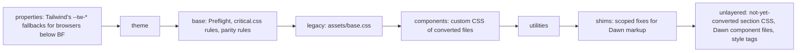
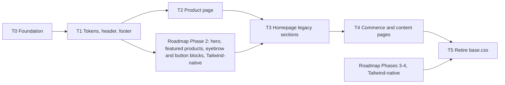

# Plan: Theme Evolution: adopt Tailwind CSS

Slug: `theme-evolution-tailwind` (umbrella plan; each phase ships under its own slug `theme-evolution-tailwind-t0` … `-t5`)
Architect: Claude (for Junior Warner)
Date: 2026-10-22
Revision: 2 (addresses `docs/reviews/theme-evolution-tailwind-review.md`, round 1, verdict APPROVE WITH CHANGES, and the owner's answers of 2026-10-22)
Tier: 3 (cross-cutting; changes the CSS architecture of every page)

---

## Revision 2 changelog

Every review item is mapped to the sections it changed. "Adopted" means the reviewer's fix was applied as written; "adopted with a variant" means the intent was applied by a different mechanism, and the reason is given.

| Review item | Disposition | Sections changed |
|---|---|---|
| F1 (BLOCKER) `templates/gift_card.liquid:10` loads `critical.css` | Adopted. Gift card gets the same two edits as the layouts, its own expected diff (E14), and a static check plus an optional rendered check in C0.7 | §4.1, §4.2, D5, §7.1, §7.5, §7.7 (E14), C0.7, §17.5, §18 Step 4 |
| F2 Step 4 grep red on the `footer.liquid:130` comment | Adopted: match the quoted asset reference `'critical.css'` | §18 Step 4, C0.7 |
| F3 `check:css` compares with HEAD | Adopted: compare with the index. R3 now says build, stage, check. Byte-identical-watch claim removed; commits use `build:css` output, never watch output | D2, §7.2, R1, R3, §17.5 (C0.1), §18 Step 9 |
| F4 inline layer statement must name every compiled layer | Adopted, using the orchestrator's measurement (Tailwind 4.3.3 emits `properties`). Statement is now `@layer properties, theme, base, legacy, components, utilities, shims;`. The gate is a permanent script run by `check:css`, not a one-off Step 3 reading | §0, §3.2, D4, §7.2, new §7.2a, §7.3, §7.5, R8, §12, C0.2, new C0.18, §17.5, §18 Step 3 |
| F5 Preflight effects missing; dump can't see them | Adopted. Line-height: parity rule (`html { line-height: normal }`), tested by new C0.17. Links, form-control backgrounds, placeholders, iframe/embed, tables, `h6`: expected diffs E7 to E13, each with a fallback parity rule if the owner rejects it. Dump widened | D6, §7.3, §7.7, C0.12, C0.17, §18 Steps 0 and 7, §20 Q9 |
| F6 `B_rb` filter selects nothing | Adopted with a variant: entries are matched against the `href`s of `<link rel="stylesheet">` in the DOM instead of filtering on `initiatorType` (preloads sent as Link headers or Early Hints may not report `initiatorType === 'link'`), and the method goes red if it matches no entry or a zero-size entry. A breach means owner sign-off, not FAIL | §0 (`B_rb`), D12, C0.10, §17.5 |
| F7 R11 Text example renames option values | Adopted: `text--title`/`text--subtitle`/`text--normal`, default `text--title`, mapped in the `case` | R11 |
| F8 R8 codifies `` + `@layer` before the spike | Adopted: Step 8 writes one of two pre-written bullets depending on the Step 6 result. The MUST is limited to new CSS and files being converted | D11, §8.3, R8, §18 Steps 6 and 8 |
| F9 bare-`hidden` guard misses assigned and single-quoted strings | Adopted with a variant: the guard is now a small Node script (`npm run check:hidden`) that scans every single- and double-quoted string in `layout`, `sections`, `blocks`, `snippets` and `templates`, because a PCRE carrying both quote types can't be put readably into `package.json` or `CLAUDE.md`. `capture`-built class strings are banned by rule. `small-hide`, `medium-hide`, `large-up-hide`, `visually-hidden` added to the ban list | new §7.2a, R3, R8, C1.5, §17.5, §18 Step 8 |
| F10 T1 Δ column errors | Adopted: copyright +0.4px; `text-xs`/`text-sm` line-height changes stated per row; shop-name fallback 16 → 24px and uppercase; badge padding 6.4 → 6px | §8.3, §8.4 |
| F11 T5 precondition ignores JS-toggled classes | Adopted both ways: the JS-toggled-class audit is part of the T5 precondition, and T5 now needs an addendum (the reviewer's Q6 caveat, folded in per the owner's instruction) | §6, §12 |
| F12 bug report goes stale; E1 needs explicit acceptance | Adopted: a post-deploy step appends a dated pointer to `docs/bugs/mobile-horizontal-overflow.md`; the owner's acceptance of E1 is recorded under Q2 | D9, §7.7 (E1), §16 (risk 17), §18 T0 Step 10, §20 Q2 |
| Required change 13 (Q1 blocks T0; Q4/Q8 shape R8) | Resolved: all eight questions were answered on 2026-10-22, before T0. §20 is now an owner-decisions record | §20 |
| Open-question verdicts Q1-Q8 | Folded in: Q1 + N6 (never publish staging), Q2 + F12, Q3 (keep `image-banner`'s `color_scheme` as a documented no-op), Q4 (answered before T0, so R8 is written once), Q5, Q6 + F11 (T5 addendum), Q7 (check `prose` against the budget), Q8 (no `settings_data.json` seeding needed; Coder confirms `oswald_n7`) | D9, D10, D13, D14, §6, §8.1, §10, §11, §12, §20 |
| N1 `preload: true` redundant | Adopted for the rule text (R6 no longer mandates it) and the D12 rationale. The layouts keep `preload: true` for parity with `critical.css` | D12, R6 |
| N2 `!important` reverses layer order | Adopted (text) | D4 |
| N3 incidental utilities from plain words | Noted as a risk with the optional `@source not inline(…)` remedy | §16 risk 13 |
| N4 platform-specific optional dependencies | Adopted: recorded in impl notes; `npm ci --ignore-scripts` tried | §18 Step 1 |
| N5 password submit button becomes bare text | Adopted: named in E5 | §7.7 |
| N6 staging theme must never be published | Adopted | D13, R5, §14 |
| N7 T1 tokens named in rules written in T0 | Adopted: marked "(from T1)" | R8, R11 |
| N8 roadmap still prescribes `color-{{ setting }}` | Not applied here: it would edit another plan, which is outside this revision's brief. Flagged in the hand-off as a follow-up for the roadmap's next revision; D14 states the requirement | D14 |
| N9 `card-product` renders on collection and search | Adopted | §6, §9 |
| N10 never put a merchant token in `@theme inline` | Adopted | R8 |
| N11 `shopify.theme.toml:4` comment contradicts `CLAUDE.md:21` | Out of scope; listed as a separate cleanup | §2 |
| Reviewer's note: moving `critical.css` into `base` makes conflicting `base.css` rules win | Adopted (one sentence) | D4 |
| F5 bullet "`border-collapse` on … the `specs-table` snippet" | Disagreed on the referent: `snippets/specs-table.liquid` renders `<div>`s, not a table (lines 26-33 `[measured]`). The only theme `<table>` is `sections/cart.liquid:13`. E12 cites that instead | §7.7 (E12) |

Orchestrator measurements of 2026-10-22 (Tailwind 4.3.3 scratch build, `assets/base.css` byte count, theme-check baseline, `critical.css` references) replace the memory-based claims in Revision 1 and in the review. They are tagged `[measured: orchestrator]`.

---

## 0. Referent table

Every figure in this plan cites a row here. Tags: `[measured]` (read from a file in this repo during planning), `[measured: orchestrator]` (measured by the orchestrator on 2026-10-22 and passed to the Architect; not re-run by the Architect), `[quoted]` (taken from a named source, not re-measured), `[proposed]` (a budget or default this plan sets), `[to be measured]` (the Coder or QA measures it in the step named).

| Sym | What it measures | Units | Artifact | Extent or band | Value, method or threshold |
|---|---|---|---|---|---|
| `R_root` | Computed root font size | px | Live theme #138872651872, any page | `html` element | 16 `[quoted]` from `docs/bugs/mobile-horizontal-overflow.md` hypothesis 2 (measured there on 2026-10-22). Method: `getComputedStyle(document.documentElement).fontSize` |
| `U_dawn` | Root size that Dawn-derived CSS assumes | px | `assets/base.css` design intent | n/a | 10 `[quoted]` from the same bug report (Dawn sets `html { font-size: 62.5% }`; this theme does not) |
| `L_base` | Line count of `assets/base.css` | lines | `assets/base.css` at HEAD | whole file | 3,597 `[measured]` (ripgrep line count) |
| `K_base` | Byte size of `assets/base.css` | bytes | same | whole file, uncompressed | 80,382 `[measured: orchestrator]` (`wc -c`). T0 Step 0 re-records it |
| `W_icon` | Width of one header icon box | px | Live theme, 375px viewport | the `.header__icon` box, not the SVG inside it | 70 `[quoted]` from the bug report; equals `4.4rem × R_root` from `sections/header.liquid:154` `[measured]` |
| `P_btn` | `padding-left` of a Dawn `.button` | px | Homepage, image-banner | first `a.button` inside `.banner__buttons` | `3rem × R_root` = 48 expected from `assets/base.css:1218` `[measured source]`; actual baseline `[to be measured]` in T0 Step 0 |
| `S_tw` | Size of the compiled `assets/tailwind.css` | bytes | the committed file | whole file | `wc -c assets/tailwind.css` (minified) and `gzip -9 -c assets/tailwind.css \| wc -c` (gzip). Budgets in §5 D12 `[proposed]` |
| `B_rb` | Render-blocking CSS transferred | bytes, **compressed** (`encodedBodySize` is the on-the-wire body, not the file size) | One page load, fresh Playwright context (empty cache), after `load` | every stylesheet the DOM links with `<link rel="stylesheet">` in `<head>` (theme assets and the `` bundle from `content_for_header`); not inline `<style>` | Method in §17.2 C0.10: collect the absolute `href` of each `link[rel="stylesheet"]`; sum `encodedBodySize` of the `performance.getEntriesByType('resource')` entries whose `name` equals one of them (first entry per URL). **Invalid measurement** (stop and report, don't compare) if any `href` has no entry or an entry with `encodedBodySize === 0` (cross-origin without `Timing-Allow-Origin`, or served from cache). Baseline `B_rb0` per page `[to be measured]` in T0 Step 0. From T2, phases budget the whole-document measure instead and record `B_rb` for continuity (D12, §17.4, amended 2026-10-22/23) |
| `N_tc` | `shopify theme check` offenses | count | repo working tree | whole theme | 2 `[measured: orchestrator]` (`TranslationKeyExists` in `cart-drawer.liquid`, `UnusedAssign` in `card-product.liquid`, per CLAUDE.md `### QA`). Re-recorded in T0 Step 0 |
| `X_hdr` | Header overflow past the viewport | px | Any page, at viewport width w | `.theme-evolution-header-wrapper` and every descendant | `max(el.getBoundingClientRect().right) − innerWidth`. Pass: ≤ 0 |
| `X_page` | Page horizontal overflow | px | Any page, at viewport width w | `document.documentElement` | `scrollWidth − innerWidth`. Pass: = 0 |
| `H1` | Number of `<h1>` elements | count | Any page, rendered | whole document | `document.querySelectorAll('h1').length`. Pass: = 1 |
| `V_tw` | Tailwind CSS version to install | semver | npm registry | `dist-tags.latest` | 4.3.3 `[measured: orchestrator]` (`npm view tailwindcss dist-tags.latest`); release date 2026-07-16 `[quoted]` (GitHub releases) |
| `S_sample` | Size of a scratch Tailwind 4.3.3 build | bytes | orchestrator's scratch folder, not this repo | whole output: Preflight + theme variables + 7 utilities | 7.4 KB, built in 14 ms `[measured: orchestrator]`. A floor for the fixed cost of `S_tw`, **not** a measurement of this theme |
| `LH_root` | Computed line-height of `<html>` | keyword or px | Any page, rendered | `document.documentElement` | Today `normal` (browser default; every `base.css` body-level `line-height` uses the undefined `--font-body-scale` and is invalid, per the review F5 `[quoted]`). Preflight sets `1.5` (24px at `R_root`) `[measured: orchestrator]`. T0 target: `normal` (C0.17) |
| `BF` | Tailwind v4 browser floor | versions | Tailwind docs | n/a | Chrome 111, Safari 16.4, Firefox 128 `[quoted]` (tailwindcss.com/docs/compatibility) |
| `BP_theme` | Current mobile/desktop switch | px | `sections/header.liquid:277,285`, `sections/footer.liquid:241` | media queries | ≤749 mobile / ≥750 desktop `[measured]` |
| `BP_md` | Tailwind `md` breakpoint | px | Tailwind default theme | n/a | 48rem = 768 at `R_root` `[quoted]` (Tailwind defaults; Coder confirms in `node_modules/tailwindcss/theme.css` in T0) |

Readings that are easy to confuse, stated once: `W_icon` is the icon's **box**, not its SVG (the SVG is 2rem = 32px inside it); `B_rb` counts **stylesheets loaded by `<link>`**, not inline `<style>` blocks, and in **compressed** bytes, while `S_tw` and `K_base` are **uncompressed file** bytes (`S_tw` also has a gzip figure); `S_sample` is a **scratch build**, not this theme's output.

---

## 1. Problem statement and goals

The owner wants the theme to look like the Ride reference (`docs/designs/ride-theme-ecommerce-website-homepage-template-v2.png`: dark ground, lime accent, condensed uppercase headings, generous spacing) and has decided to get there with Tailwind CSS. Today the theme's styling is three layers that don't agree with each other:

1. **Skeleton-theme base.** `assets/critical.css` (a reset plus the `.shopify-section` grid) and `snippets/css-variables.liquid`. These assume a 16px root and are fine.
2. **Dawn transplant.** `assets/base.css` (`L_base` lines, `K_base`) plus about 60 Dawn component files in `assets/`. These assume `U_dawn` = 10px rem, and they reference roughly a dozen Dawn variables that this theme never defines (`--font-heading-scale`, `--font-body-scale`, `--color-link`, `--grid-mobile-horizontal-spacing`, `--spacing-sections-mobile`, `--media-radius` and more; a search of `assets/`, `snippets/`, `sections/`, `layout/`, `config/` and `blocks/` found none of them defined `[measured]`). Every declaration that uses one of them is invalid at computed-value time.
3. **Shipped custom sections** (header, footer, material spotlight). Each carries a large hand-written ``, authored against the 16px root.

The result is the open High bug `docs/bugs/mobile-horizontal-overflow.md`, and a lot of hand-written CSS per feature. Tailwind replaces layers 2 and 3 with one utility system and one token set mapped to merchant settings.

### Goals

1. Install the latest stable Tailwind (`V_tw`) with a reproducible build that works with `shopify theme dev`, staging pushes and `shopify theme push -e production`.
2. Full adoption as decided by the owner: Preflight on, no prefix, `assets/base.css` retired by the last phase.
3. Merchant settings (global colors, fonts, page width, input radius, and every section setting) keep working live in the theme editor, through CSS custom properties mapped into Tailwind's `@theme`.
4. Ship in phases. Each phase is deployable to live on its own and has its own QA checkpoint.
5. Rewrite the CSS and asset rules in `CLAUDE.md` and `AGENTS.md` to Tailwind standards (exact text in §13), keeping every non-CSS rule.
6. Keep the quality gates: `N_tc` unchanged, schemas round-trip in the editor, `H1` = 1 on every page, Core Web Vitals rules (hero preload, explicit image dimensions), and a CSS size budget (D12).
7. Set up the remaining homepage roadmap (`docs/plans/theme-evolution-homepage-phases.md` Phases 2 to 4) to be built natively in Tailwind.

---

## 2. Non-goals

- **Not fixing `mobile-horizontal-overflow` in T0.** The owner said not to fix it yet. §5 D9 explains how the overhaul affects it; the owner decided (Q2) that T1 closes the header half and T3 the banner half. T0 changes its measurements as a side effect (E1), which the owner accepted explicitly on 2026-10-22 (§20 Q2).
- **Not adding a `color_scheme_group`.** `config/settings_schema.json` has no `color_scheme` entries `[measured: orchestrator]`. The header and footer plans rejected color schemes for the same reason. Owner decision Q5: per-section `color` settings mapped to CSS variables.
- **Not fixing the `shopify.theme.toml:4` comment** that contradicts `CLAUDE.md` `## Deploy targets` (review N11). This plan leaves `shopify.theme.toml` alone; that comment needs its own small cleanup.
- **Not editing `config/settings_data.json` or any `templates/*.json` / `sections/*-group.json`** in any phase. No phase needs it (§6).
- **Not building roadmap features** (hero, featured products, editorial, split content, CTA banner, product highlight). They keep their own slugs and plans; this plan makes them Tailwind-native (D14).
- **Not changing the live push command.** It stays `shopify theme push -e production`. A build check runs before it, not instead of it.
- **Not adding a JavaScript bundler.** Tailwind's CLI compiles CSS only. JS stays in ``/`<script>` per the existing rules.
- **Not re-theming with new copy or new sections.** "Prettier" in this plan means tokens, typography and the conversion of existing sections; the visible redesign of the homepage comes from the roadmap features.

---

## 3. Verified facts (2026-10-22)

### 3.1 Is there official Tailwind support for Shopify themes?

No. Re-checked as the brief asked:

- The Tailwind Labs announcement (2026-09-09) says the open-source projects stay MIT-licensed and are maintained with Shopify's support. It says nothing about themes, Liquid or the CLI `[quoted]`.
- A search of shopify.dev through the Shopify Dev MCP (`search_docs_chunks`, query "Tailwind CSS in Shopify themes build step theme CLI") returned only the generic CLI, CI/CD and Skeleton tutorials. No Tailwind page, no CLI build hook `[measured]`.
- Horizon ships no Tailwind and no build step; community Horizon/Tailwind repos are third-party `[quoted]` (learnshopify.dev; github.com/Shopify/horizon).

So this plan uses a local build step. D1 keeps the build behind `npm` scripts so it can be swapped for an official mechanism later without touching Liquid.

### 3.2 Tailwind version and requirements

| Item | Value | Tag |
|---|---|---|
| Latest stable | 4.3.3 (`V_tw`). The v4.3 line is the supported one; v4.2 support has ended; v3.4 is supported to 2027-02-28 | version `[measured: orchestrator]`; lifecycle `[quoted]` |
| Packages | `tailwindcss` + `@tailwindcss/cli` (v4 moved the CLI to its own package; build is `@tailwindcss/cli -i <in> -o <out>`). A standalone binary exists for non-Node setups | `[measured: orchestrator]` (both installed at 4.3.3 and built) |
| Module resolution | The CLI resolves `@import "tailwindcss"` relative to the **input file's directory**; the build failed until `node_modules` was resolvable from there. So `package.json` and `node_modules/` live at the repo root, with `src/tailwind.css` beneath it (§7.1). Don't move either | `[measured: orchestrator]` |
| Build speed | 14 ms for the scratch sample (`S_sample`) | `[measured: orchestrator]` |
| Config format | CSS-first: `@import "tailwindcss"`, `@theme`, `@theme inline`, `@source`, `@utility`, `@plugin`. No `tailwind.config.js` needed | `[quoted]` |
| Source detection | Plain-text scan. With `@import "tailwindcss" source(none);` and `@source "../sections";`, every utility used in a `class` attribute was emitted (`flex`, `hidden`, `md:flex`, `shadow-lg`, `rotate-3`, `text-5xl`), **and so was `tracking-widest`, which appeared only as a `` select option value**. `@source not` excludes; `@source inline("…")` safelists | detection `[measured: orchestrator]`; `@source not`/`inline()` `[quoted]` |
| Class names | Must appear complete in source. Built-up names (`grid-cols-{{ n }}`) produce no CSS | `[quoted]` |
| Variable shorthand | `bg-(--my-color)` = `bg-[var(--my-color)]` | `[quoted]` |
| Cascade layers | The compiled file emits, in this order: (1) `@layer properties;` as the **first statement in the file**; (2) `@layer theme, base, components, utilities;`; (3) the blocks `@layer properties {…}`, `@layer theme {…}`, `@layer base {…}`, `@layer utilities {…}`. The `properties` block is a single `@supports ((-webkit-hyphens: none) and (not (margin-trim: inline))) or ((-moz-orient: inline) and (not (color:rgb(from red r g b))))` block that sets `--tw-*` custom properties (`--tw-shadow`, `--tw-ring-shadow`, `--tw-tracking`, …) on `*, ::before, ::after, ::backdrop`. That condition only matches Safari < 16.4 and Firefox < 128, below `BF`. A layer missing from the inline statement is appended **last**, i.e. strongest; there it would override utilities that set those variables in those browsers. Hence `properties` comes first in this plan's statement (D4) | `[measured: orchestrator]` |
| Preflight | Confirmed in the 4.3.3 output: `html, :host { line-height: 1.5; …; font-family: var(--default-font-family, …) }`; `color: inherit` (4 occurrences); `text-decoration: inherit` on links (2 occurrences); `[hidden]:where(:not([hidden="until-found"])) { display: none !important }`-style hiding. From the docs and the review, not yet read from the file: the universal `box-sizing/margin/padding/border` reset; images/SVG/video `display: block`; `iframe, embed, object, audio` `display: block`; headings `font-size/weight: inherit`; lists unstyled; form controls `font: inherit; border-radius: 0; background-color: transparent`; `::placeholder` color; tables `border-collapse: collapse` | first group `[measured: orchestrator]`; second group `[quoted]` (the Coder records the real rules from `node_modules/tailwindcss/preflight.css` in T0 Step 2) |
| v4 behavior changes | Buttons use `cursor: default`; default border color is `currentColor` | `[quoted]` (upgrade guide) |
| Watch in background | Plain `--watch` exits when stdin closes; `--watch=always` keeps watching | `[quoted]` (tailwindcss PR #9966) |
| Browser floor | `BF` | `[quoted]` |

The browser floor is compatible with what the theme already uses: the header and footer depend on `color-mix()` (Safari 16.2+) and `critical.css` on `:has()`.

---

## 4. Current-state inventory

### 4.1 How CSS loads today

`layout/theme.liquid`:

| Line | What | Notes |
|---|---|---|
| 5 | `` | `` with `@font-face` for the primary font and `:root` vars (`snippets/css-variables.liquid:8-68`) |
| 13-18 | Primary font preconnect + preload | unchanged by this plan |
| 21 | `critical.css` via `stylesheet_tag: preload: true` | unlayered |
| 22 | `base.css` | unlayered, Dawn |
| 23 | `eco-tooltip.css` | unlayered, custom (material tooltip) |
| 33 | `{{ content_for_header }}` | Shopify injects the bundled `` CSS here |

`layout/password.liquid:8` loads `critical.css` only. **The password page has no `base.css` today** `[measured]`.

`templates/gift_card.liquid` uses `` (line 1) and has its own `<head>` (5-25): `` (7), `critical.css` via `stylesheet_tag: preload: true` (10), `meta-tags` (13), a `` (15-22: `main { text-align: center }`, `main img { display: unset }`) and `content_for_header` (24). **No `base.css` either** `[measured]`. Revision 1 missed this file (review F1). The full list of `critical.css` references is `layout/theme.liquid:21`, `layout/password.liquid:8`, `templates/gift_card.liquid:10`, plus the word in a CSS comment at `sections/footer.liquid:130` `[measured]`, matching the orchestrator's list.

### 4.2 Stylesheet mechanisms by file `[measured]` (ripgrep for `stylesheet`, `style`, `<style`, `stylesheet_tag`; Revision 2 adds `templates/gift_card.liquid`, which Revision 1's sweep missed: `stylesheet_tag` at 10, `` at 15-22)

| Mechanism | Files |
|---|---|
| `` | `sections/header.liquid:115`, `sections/footer.liquid:123`, `sections/material-spotlight.liquid:165`, `sections/product.liquid:111`, `sections/search.liquid:53`, `sections/collection.liquid:35`, `sections/collections.liquid:41`, `sections/custom-section.liquid:27`, `sections/hello-world.liquid:55`, `sections/material-recommendations.liquid:21`, `blocks/text.liquid:16`, `blocks/group.liquid:25`, `snippets/image.liquid:51` |
| `` | `templates/gift_card.liquid:15`, `snippets/css-variables.liquid:8`, `sections/header.liquid:105`, `sections/footer.liquid:116`, `sections/material-spotlight.liquid:38`, `sections/related-products.liquid:9`, `sections/material-recommendations.liquid:7`, `sections/main-material-archive.liquid:15`, `sections/image-banner.liquid:11,33`, `snippets/trust-badge.liquid:5`, `snippets/specs-table.liquid:1` |
| `<style>` | `snippets/sustainability-rating.liquid:46`, `snippets/cart-intelligence-banner.liquid:21`, `snippets/material-info.liquid:18,161`, `snippets/card-product.liquid:66,200,610`, `sections/cart-drawer.liquid:80`, `sections/collections.liquid:10`, `sections/main-material-archive.liquid:234` |
| `critical.css` via `stylesheet_tag` | `layout/theme.liquid:21`, `layout/password.liquid:8`, `templates/gift_card.liquid:10` |
| Dawn asset CSS via `stylesheet_tag` | `sections/related-products.liquid:1-3,6` (`component-card`, `component-price`, `section-related-products`, `mask-blobs`), `sections/image-banner.liquid:8` (`section-image-banner`), `snippets/card-product.liquid:33-38` (`component-rating`, `component-volume-pricing`, `component-price`, `quick-order-list`, `quantity-popover`) |

All of it is unlayered today.

### 4.3 `assets/base.css` facts that drive the design

| Fact | Lines | Consequence |
|---|---|---|
| Uses undefined Dawn variables (`--font-heading-scale`, `--font-heading-family`, `--color-link`, `--buttons-*`, `--grid-*`) | e.g. 250-268, 296-306, 879-898, 1188-1228 | Those declarations are invalid at computed-value time and behave as `unset`, **but they still win the cascade**. E.g. `h1 { font-size: calc(var(--font-heading-scale) * 3rem) }` (296-306) makes every `h1` inherit its font size. A Tailwind `text-5xl` on an `h1` would lose to it while `base.css` is unlayered. |
| Literal-rem rules are 1.6× too large (`U_dawn` vs `R_root`) | e.g. `.page-width` padding 79-83; `.button` padding 1218; `.header__icon` 4.4rem 2555-2560 | This is the bug's root cause 2 |
| Class names that are also Tailwind utilities | `.isolate` 144-147 (`position: relative; z-index: 0`), `.hidden` 194-196 (`display: none !important`), `.overflow-hidden` 215-217, `.uppercase` 460-462, `.grid` 879-898 (`display: flex; flex-wrap: wrap; margin-bottom: 2rem; padding: 0; list-style: none; column-gap/row-gap: undefined vars`) | Collisions; see D11 |
| Global `:empty` hiding | 468-482 (`a, ul, dl, div, section, article, p, h1-h6 :empty { display: none }`) | Hid the sustainability bars once (`docs/plans/material-spotlight-impl-notes.md:148`) |
| Header rules that fight the shipped header | `.header__icon:not(.header__icon--summary), .header__icon span { display: flex }` 2519-2524; `.section-header.shopify-section-group-header-group { z-index: 3 }` 2313-2315; `.header__icon--cart { margin-right: -1.2rem }` 2562-2565 | Bug hypothesis 1; header z-index is 3, not the 10 that `sections/header.liquid:117-121` asks for |
| No bare element resets for `button`, `input`, `ul`, `a` `[measured]` (ripgrep `^\s*(button|input|select|textarea|ul|ol|li|a)\s*[,{]` found none) | n/a | Unclassed buttons and lists use browser defaults today, so Preflight will visibly change them (D6) |
| No `@charset` or `@import`; one relative `url('./sparkle.gif')` at 3448 | n/a | The file can be wrapped in a layer block in place (D4) |

### 4.4 Shipped custom work

| File | Lines | CSS today | Relevant detail |
|---|---|---|---|
| `sections/header.liquid` | 436 | `` 105-113 (`--logo-width`, `--header-bg`, `--header-text`), `` 115-291, `<script>` 293-374 (`ThemeEvolutionHeaderMenu`), schema 376-435 | Colors are two `color` settings, not a color scheme. Logo sits in an `<h2>` (21). JS hooks: `.theme-evolution-header-menu__toggle`, `.theme-evolution-header-menu__panel`, `[data-label-open]`. Cart icon class `header__icon--cart` (89) is a Section Rendering API hook used by `sections/cart-drawer.liquid:294,377,378` |
| `sections/footer.liquid` | 345 | `` 116-121, `` 123-259, schema 261-344 | Wrapper spans the section grid with `grid-column: 1 / -1` (132). Uses Dawn's `.rte` class (38) |
| `sections/material-spotlight.liquid` | 355 | `` 38-49 (per-section padding), `` 165-256, schema 258-354 | `color-{{ color_scheme }}` (81) and `rgb(var(--color-background))` (175) do nothing: no scheme classes exist and `--color-background` is a hex value. Uses Dawn's `.page-width` (82) and `.rte` (147) |
| `snippets/sustainability-rating.liquid` | 131 | `<style>` 46-106 | Bars are `<span>`s with explicit `display: block` because of `div:empty` |

### 4.5 Merchant-controlled global settings (`config/settings_schema.json`) `[measured]`

| Setting id | Line | Exposed as | Used by |
|---|---|---|---|
| `type_primary_font` | 19 | `--font-primary--family/style/weight` | `critical.css:76` |
| `max_page_width` | 30 | `--page-width` (`90rem` / `110rem`, i.e. 1440 / 1760px at `R_root`) | `critical.css:96` |
| `min_page_margin` | 46 | `--page-margin` (px) | `critical.css:96-99` |
| `background_color` | 61 | `--color-background` (hex) | `critical.css:38,43,77` |
| `foreground_color` | 67 | `--color-foreground` (hex) | `critical.css:44,78` |
| `input_corner_radius` | 73 | `--style-border-radius-inputs` (px) | `critical.css:34` |
| `enable_cart_drawer` | 88 | n/a (behavior) | `sections/header.liquid:90` |

There is no heading font, no accent color and no color scheme group.

### 4.6 Tooling and deploy files

| File | State |
|---|---|
| `package.json` | absent |
| `package-lock.json` | empty `packages: {}` |
| `shopify.theme.toml` | `production` env (14-19): `live = true`, `allow-live`, `nodelete`, `ignore = ["config/settings_data.json"]`. Unchanged by this plan |
| `.shopifyignore` | ignores `AGENTS.md`, `DESIGN.md`, `*.txt`, `.git/*`, `node_modules/*`, `docs/*` (18-24) |
| `.gitignore` | `node_modules/` already ignored (10) |
| `.theme-check.yml` | `extends: theme-check:recommended` only |
| `.claude/agents/devops.md` | gates 16-21 (gate 3 at 20: clean working tree); refuses to overwrite an existing `<slug>-staging` theme (25); push commands 56-58 |

### 4.7 The mobile overflow bug, as it relates to this plan

From `docs/bugs/mobile-horizontal-overflow.md`: two overflows. (a) Header icons: three `W_icon` boxes in a no-wrap row, and the menu toggle shows both its icons because `base.css:2519-2524` (specificity 0,1,1) beats `sections/header.liquid:235-237` (0,1,0). (b) Homepage banner buttons: `min-width: 22rem` in `assets/section-image-banner.css` renders at 352px.

---

## 5. Approach and decisions

### D1. Build tool: Tailwind CLI 4.3.3 through npm, versions pinned exactly

`tailwindcss` and `@tailwindcss/cli` at the same exact version (`V_tw`), plus `concurrently` to run the watcher next to `shopify theme dev`. Pinned exactly (`--save-exact`) and locked in `package-lock.json`, because the compiled file is committed (D2) and must be byte-reproducible.

If `npm view tailwindcss version` shows a newer **patch** (4.3.x) at implementation time, use it for both packages and record it in the impl notes. A newer **minor** (4.4+) needs its release notes checked for changes to Preflight, `@theme` or `@source` first, and gets recorded as a deviation.

Rejected: the standalone binary (works, but the repo already has `package-lock.json` and npm pins versions better than a downloaded binary); Vite or PostCSS (a bundler for one CSS file); Tailwind v3.4 (owner wants the latest; v3 also needs a JS config); the browser build `@tailwindcss/browser` (compiles in the visitor's browser at runtime: a JS cost and a flash of unstyled content; not meant for production).

### D2. Commit the compiled `assets/tailwind.css`

`shopify theme push` uploads files as they are, so the compiled file has to exist before every push. Two options:

| | Commit the compiled file (chosen) | Build at deploy time, gitignore the output |
|---|---|---|
| Fresh clone → push | Works | Pushes without `tailwind.css`. On a new staging theme the site is unstyled. On live, `nodelete = true` keeps the **old** `tailwind.css`: stale CSS, silently |
| DevOps gate 3 (clean tree) | Still meaningful: a stale build shows up as a modified file | Can't see the CSS at all |
| Backups and rollbacks | `git revert` restores the CSS with the markup that needs it | Revert also needs a rebuild |
| Shopify GitHub integration (if ever used) | Works; it syncs repo files with no build step | Impossible |
| Cost | Diff noise; merge conflicts in a generated file | none of those |

The costs are handled by rule: `npm run check:css` rebuilds and fails when the file in the git index (staged, or committed on a clean tree) differs from a fresh build, or is untracked (§7.2); the file that gets committed always comes from `npm run build:css`, never from the watcher, because a long-running watch session may keep rules for classes it saw earlier (review F3); and conflicts are resolved by rebuilding, never by hand-merging (R3 in §13).

### D3. One source file, explicit source detection

`src/tailwind.css` is the only Tailwind input. It uses `@import "tailwindcss" source(none)` and lists the theme folders with `@source`. Automatic detection would scan `docs/` (plans quote hundreds of class names), `CLAUDE.md` and `AGENTS.md` (which will quote `max-md:hidden` and other examples) and inflate the output. T0 criterion C0.9 checks this mechanism directly.

Scanned: `layout/`, `sections/`, `blocks/`, `snippets/`, `templates/*.liquid`. `` JSON is inside the `.liquid` files, so class strings in schema option values are found too (the orchestrator's 4.3.3 sample emitted `tracking-widest` from a schema option value alone `[measured: orchestrator]`). `assets/*.js` is not scanned: Dawn's JS doesn't use utilities, and the rule in §13 R9 says a JS file that toggles utility classes must be added with `@source`.

### D4. Cascade layers, and containing `base.css` in a `legacy` layer

Tailwind puts everything in layers. **Unlayered CSS beats every layer regardless of specificity.** Left alone, `base.css`, `critical.css`, Dawn component files, every `` and every snippet `<style>` would beat Tailwind utilities. Concretely: `critical.css:4-7` `* { margin: 0 }` would beat every `mt-*`, and `base.css:296-306` would beat `text-5xl` on an `h1`.

The fixed order, from lowest to highest precedence:



- `properties` sits **lowest**. Tailwind 4.3.3 declares it first in its own output (§3.2 `[measured: orchestrator]`), so placing it first matches Tailwind's intent. If the inline statement left it out, the browser would append it after `shims`, making it the strongest layer (review F4). Its rules only apply below `BF`, so this is about correctness, not a visible change in supported browsers.
- `legacy` sits **above** `base`, so Dawn's class rules still beat Preflight's resets: Dawn-styled pages keep their look (C0.5 checks `P_btn`).
- `legacy` sits **below** `components` and `utilities`, so converted markup wins over Dawn (C0.4).
- `shims` sits above utilities for the few places where a utility would break Dawn markup (D11).
- The order is declared by an inline `<style>@layer properties, theme, base, legacy, components, utilities, shims;</style>` as the **first element of `<head>`** in both layouts and in `templates/gift_card.liquid`. The first declaration in document order fixes the order, whatever order the stylesheets download in. `src/tailwind.css` repeats the statement as documentation only.
- **Every layer the compiled file declares must be in that statement.** `scripts/check-css-layers.mjs` (§7.2a), run by `npm run check:css`, fails the build check if `assets/tailwind.css` declares a layer the statement doesn't list, or if any of the three files lacks the exact statement. This is permanent, so a future Tailwind upgrade that adds a layer is caught at the next `check:css`, not in production.
- `assets/base.css` is wrapped in place: `@layer legacy {` added as line 1 and `}` as the last line. It keeps loading from its own `<link>` and only where it loads today (not on the password or gift card pages).
- **Normal versus `!important` declarations** (review N2). "Unlayered beats every layer" and "a higher layer beats a lower one" hold for normal declarations. For `!important` declarations the order reverses: `!important` in `legacy` beats `!important` in unlayered CSS and in higher layers. That is the mechanism behind the `.hidden` trap in D11. The reviewer searched every `!important` in `assets/`, `sections/` and `snippets/` and found no pair where an unlayered `!important` fights a `base.css` `!important` on the same element and property `[quoted]`, so no behavior change is expected from the reversal.
- **`critical.css` rules now lose to `base.css`.** Moving them into `base` puts them below `legacy`, so any conflicting `base.css` rule wins regardless of specificity. The reviewer found one such flip, `base.css:351-356` (`h6` margins) beating `:is(…):first-child`, and judged it negligible `[quoted]`; the Step 0/7 dump would show any other.

Rejected: importing `base.css` into the Tailwind bundle with `@import "../assets/base.css" layer(legacy)`. That would put Dawn CSS on the password page for the first time and make every Tailwind rebuild reprocess 3,597 lines. Also rejected: a `<style>@import url(...) layer(legacy)</style>` in the layout, which adds a serial request the preload scanner may not find.

**Side effect, disclosed:** once `base.css` is layered, every unlayered rule (section ``, Dawn component files, `eco-tooltip.css`) beats it, where today specificity and source order decide. Two flips are known from the inventory (E1, E2 in §7); the rest are found by the computed-style diff in T0 Step 0 and Step 7.

### D5. Fold `critical.css` into `src/tailwind.css` and delete it

`critical.css` is unlayered, so it must move into a layer anyway. Its rules go into `@layer base` after Preflight, verbatim except lines 4-7 (`* { box-sizing; margin: 0 }`), which Preflight already covers. The compiled `assets/tailwind.css` then becomes the one always-on stylesheet, loaded with `stylesheet_tag: preload: true` exactly where `critical.css` was: `layout/theme.liquid`, `layout/password.liquid` **and `templates/gift_card.liquid`** (review F1). Request count per page is unchanged (−1 `critical.css`, +1 `tailwind.css`).

### D6. Browser-default parity rules for Preflight

Preflight removes browser defaults that unclassed Dawn, Shopify and merchant markup still relies on. T0 adds a small `@layer base` block so T0 doesn't break content it can't yet restyle:

| Rule | Why | Removed in |
|---|---|---|
| `html { line-height: normal }` | Preflight's `html { line-height: 1.5 }` `[measured: orchestrator]` would change the line box of **every** text element on **every** page that has no valid line-height of its own (`LH_root`). That is site-wide, and would also swamp the Step 7 diff so that real E6 flips get lost in it. Header, footer and material spotlight were authored and QA'd against `normal`. Tested by C0.17 | T5, when `base.css` goes and element typography moves into `@layer base` (with T5's full-site screenshot review) |
| `ul:not([class]), ol:not([class])` get `padding-inline-start: 1.5em` and disc/decimal markers | `{{ page.content }}` (`sections/page.liquid:10`) and `{{ article.content }}` (`sections/article.liquid:18`) are not wrapped in `.rte`; merchant lists would lose bullets | T4, when rich text gets `prose` (owner decision Q7) |
| `a:not([class]) { text-decoration-line: underline }` | Preflight makes links inherit color with no underline; links in merchant content would become invisible | T4 |
| Text inputs, `select`, `textarea`: `border-width: 1px` (color is `currentColor` in v4) | The password form (`sections/password.liquid`) has no `base.css` today and would lose its field border | T4 (password section) |
| `button:not(:disabled), [role="button"]:not(:disabled) { cursor: pointer }` | v4 default is `cursor: default` `[quoted]` | kept permanently (upgrade-guide recommendation) |

Everything else Preflight changes is an expected diff, listed in §7.7 and reviewed by QA. **How each Preflight effect the review raised (F5) was decided:** a parity rule where the change is site-wide and would fight already-QA'd custom sections (line-height); an expected diff where restoring the browser default would fight the design direction or make every converted element add an override (link color and underline, E7/E8: the T1 mapping in §8.3/§8.4 relies on links inheriting color), or where the effect is narrow (E9 to E13). Each expected diff in §7.7 has a fallback parity rule written out, so if the owner rejects one at the C0.12 gate the Coder adds that rule without a replan (§20 Q9).

### D7. Theme tokens: merchant settings → `@theme`

| Utility family | Tailwind variable | Runtime source | Mechanism |
|---|---|---|---|
| `bg-background`, `text-background`, … | `--color-background` | `background_color` via `css-variables` | **Same-name override.** `@theme { --color-background: #ffffff }` emits a default in the `theme` layer; `css-variables` prints `--color-background` on `:root` unlayered, which wins. Utilities compile to `var(--color-background)`, so the editor value applies |
| `text-foreground`, `border-foreground`, … | `--color-foreground` | `foreground_color` | same; default `#333333` = schema default |
| `font-sans` (and Preflight's `html` font) | `--font-sans` | `--font-primary--family` | `@theme inline { --font-sans: var(--font-primary--family) }` |
| `max-w-page` | `--container-page` | `--page-width` | `@theme inline` |
| `rounded-input` | `--radius-input` | `--style-border-radius-inputs` | `@theme inline` |
| page margin | n/a | `--page-margin` | use `px-(--page-margin)` |
| T1: `bg-accent`, `text-accent-foreground` | `--color-accent`, `--color-accent-foreground` | new settings `accent_color`, `accent_foreground_color` | same-name override |
| T1: `font-heading` | `--font-heading` | new setting `type_heading_font` → `--font-heading--family` | `@theme inline` |

Tailwind's default palette stays available. The rules (§13 R8) say to use the tokens for anything merchant-themable; raw palette colors are for neutral details only.

### D8. Settings-driven classes and inline custom properties

- **Single-value settings** (colors, ranges, image focal points): set a custom property on the element with an inline `style` attribute and consume it with the shorthand, e.g. `style="--section-pt: {{ section.settings.padding_top }}px"` and `pt-(--section-pt)`. This replaces most `` blocks. The current rule "no inline `style` attributes" becomes "inline `style` may only set custom properties". The current `CLAUDE.md` schema example already does this (`style="--gap: …"`), so the rule is being made consistent rather than loosened.
- **Multi-property choices** (`select`, `checkbox`): keep **semantic option values** and map them to complete class strings with Liquid `case`/`if`. Using class strings as option values would tie saved merchant data to class names, so a later utility rename would orphan saved values.
- **Existing schemas keep their option values.** Conversions map the old values (e.g. `group--vertical`) to utilities; they never rename a value.
- **Editor live updates:** section settings re-render the section, so inline custom properties update. Global color settings in `css-variables`'s `` update live, which Shopify documents for color settings inside `style` tags.

### D9. Root font size stays 16px; how the overhaul affects the overflow bug

Tailwind's scale assumes a 16px root (`--spacing: 0.25rem` = 4px). `R_root` is already 16px. **Never set `html { font-size: 62.5% }`**: it would shrink every Tailwind size and every already-QA'd custom section. §13 R8 writes this down.

| Bug part | Cause | Effect of this plan | Where it gets resolved |
|---|---|---|---|
| Header close icon visible | `base.css:2519-2524` beats `header.liquid:235-237` | **T0 changes it as a side effect:** once `base.css` is in `legacy`, the unlayered header rule wins and the close icon hides (E1). The toggle loses about 32px. Only a deliberate shim could preserve the bug, so this is unavoidable; the owner accepted it explicitly (§20 Q2) | T0 (incidentally) |
| Header icons 70px | `header.liquid:154` `4.4rem` authored against `U_dawn` | Not affected by T0 | **T1**: header converted with 44px (`size-11`) icon boxes (owner decision Q2) |
| Cart icon `margin-right: -1.2rem` | `base.css:2562-2565` | Stops applying in T1 when the converted header drops Dawn class names | T1 |
| Banner buttons `min-width: 22rem` | `assets/section-image-banner.css` against `U_dawn` | Not affected until the banner is converted | **T3** |
| Every other literal-rem Dawn size | `U_dawn` vs `R_root` | Removed file by file as sections convert; gone entirely when `base.css` and the Dawn component files are deleted | **T5** |

So retiring `base.css` does resolve the rem mismatch, but by removing the 10px-rem CSS, not by changing the root. The header half is closed in T1 because T1 rewrites that markup anyway; fixing it separately first would be work thrown away a phase later. The owner confirmed this sequencing on 2026-10-22 (Q2), so no separate `fix-mobile-horizontal-overflow` plan is needed.

QA re-measures `X_hdr` and `X_page` at 320, 375, 390 and 430 in T0 and records them in the T0 report (informational, no threshold in T0). Because that bug report is the permanent register the eventual investigator reads, a dated pointer to the new numbers is appended to `docs/bugs/mobile-horizontal-overflow.md` under `## Actual behavior` after T0 deploys (§18 T0 Step 10; review F12).

### D10. Breakpoints: Tailwind defaults

Use Tailwind's default breakpoints (`BP_md` = 768px). The current theme switches at `BP_theme` (750px). Between 750 and 767px, converted sections show their mobile layout while not-yet-converted Dawn sections show desktop. QA viewports (375, 1440) are unaffected. Overriding `--breakpoint-md: 750px` would keep the two in step but departs from the Tailwind standard the owner asked for. **Owner decision Q4 (2026-10-22): Tailwind defaults.** It was answered before T0, so the R8 sentence on breakpoints is written once, in T0 Step 8.

### D11. Coexistence conflicts while `base.css` loads (T0 to T4)

| Conflict | What happens | Handling |
|---|---|---|
| `box-sizing` | Preflight and `critical.css` both set `border-box` on `*` | no conflict |
| Headings | Preflight: `font-size/weight: inherit`. `base.css` h1-h5 sizes are invalid-but-winning in `legacy`, which already inherit | No change on Dawn pages. On the password page `h1` loses its browser 2em bold (E5). Converted markup sizes headings with utilities, which beat `legacy` |
| Lists | Preflight removes markers and padding | D6 parity for unclassed lists; classed Dawn lists keep `base.css` styling (`legacy` > `base`) |
| Buttons | Preflight: transparent background, no border, no padding; `cursor: default` | Dawn `.button` keeps its styles (`legacy` > `base`, C0.5). Unclassed buttons lose browser chrome (E3). Cursor parity in D6 |
| Images | Preflight `display: block`, `max-width: 100%`, `height: auto`; `critical.css` did the same | none |
| `[hidden]` attribute | Preflight hides it with `!important` | Matches current behavior. JS `hidden` toggling keeps working |
| `.hidden` class | `base.css:194-196` `display: none !important` in `legacy`. Important declarations in a lower layer beat normal ones in a higher layer | **`hidden md:flex` never shows while `base.css` loads.** Rule: don't put the bare `hidden` class on an element that must ever be shown; variant-prefixed forms (`max-md:hidden`, `md:hidden`, `group-aria-expanded:hidden`) are safe because the token isn't `hidden`. Guard: `npm run check:hidden` (§7.2a), which scans every quoted string, so class strings built with `assign` or passed as `class: '…'` are covered (review F9). The same trap applies to Dawn's `.small-hide` (`max-width: 749px`), `.medium-hide` (750-989px) and `.large-up-hide` (≥ 990px), all `display: none !important` (`base.css:430-446` `[measured]`), and to `.visually-hidden`'s `position: absolute !important` (`base.css:198-208` `[measured]`). R8 bans them on Tailwind markup |
| `.grid` class | Dawn `.grid` (879-898) is flex-wrap with `margin-bottom: 2rem`. Tailwind's generated `.grid { display: grid }` (utilities) beats it on **Dawn** markup too, because class selectors are global | `shims` layer: `.product-grid.grid { display: flex }` keeps `sections/related-products.liquid:35` working until T2. On Tailwind markup, the Dawn `margin-bottom: 2rem` still leaks; add `mb-*` where it matters (`.grid:last-child` gets 0 already) |
| `.isolate` class | Dawn adds `position: relative; z-index: 0` to Tailwind's `isolation: isolate` | Prefer `relative z-0` where isolation is needed; documented in R8 |
| `div:empty { display: none }` and siblings (468-482) | Still applies to empty Tailwind elements that have no display utility | Give intentionally empty elements an explicit display utility, or use `<span>`. Utilities beat `legacy` |
| Dawn class names on converted markup (`header__icon`, `page-width`, `rte`, `button`, `h1`-`h5` classes) | Legacy rules keep matching them | Converted markup drops Dawn class names. JS hooks that are project-namespaced (`theme-evolution-…`) may stay but carry no CSS |
| Unlayered CSS of not-yet-converted files | Beats utilities | Converted files put any custom CSS inside `@layer components`. T0 Step 6 tests whether Shopify's `` bundler keeps `@layer` blocks; R8's wording depends on the result (review F8). Files that are **not** being converted keep their CSS unlayered: wrapping it would move it below every other unlayered rule (Dawn component files, other sections' CSS) and flip the cascade |
| App embeds and Shopify-injected UI (dynamic checkout buttons, the Supercycle app embed on live, policy pages) | Preflight resets their light-DOM buttons, borders and lists | QA review gate C0.13 in every phase |

### D12. Performance budget and render-blocking CSS

- One render-blocking Tailwind stylesheet, loaded in `<head>` with `stylesheet_tag`. Never async-loaded, so there is no flash of unstyled content. Never inlined (it would defeat caching on every page view).
- **On `preload: true`** (review N1): Shopify already sends Early Hints for render-blocking stylesheets in `<head>`, advises against preloading them, and caps preload Link headers at 10, dropping image preloads first `[quoted]` (Shopify docs, via the review). The layouts keep `preload: true` on `tailwind.css` only for parity with the `critical.css` tag it replaces (T1's heading-font preload brings the count to about 3, well under the cap). R6 doesn't make it a rule, and no other stylesheet gets it.
- Sections stop adding `stylesheet_tag`s; each conversion removes the Dawn files it used. **Amended 2026-10-22 (review CF1, with `docs/plans/theme-evolution-tailwind-t2.md` D2.1):** this does *not* make `B_rb` fall phase by phase. The Dawn files the conversions remove are mostly body-level section `stylesheet_tag`s, which `B_rb` (head only) doesn't count, while `tailwind.css`, a head link, grows each phase. T1 already shipped at 1.157 × `B_rb0`. From T2 on, each addendum budgets the whole-document measure (`B_doc`) and proves removals with `N_dawn`; `B_rb` is recorded for continuity. T5 still compares `B_rb` with `B_rb0`, because removing `base.css` is a head change.
- Budgets `[proposed]`, sized from `S_sample`: the scratch build of Preflight, theme variables and 7 utilities was 7.4 KB `[measured: orchestrator]`, so the fixed cost is roughly a third of the T0 limit. T0 adds the `critical.css` rules (about 2 KB unminified), the D6 parity rules and the shim, plus utilities generated from words in Dawn Liquid (§16 risk 13; count unknown until Step 3). The real T0 figure comes from Step 3's measurement:
  - `S_tw` ≤ 25,000 bytes minified and ≤ 12,000 bytes gzip (`gzip -9`) at the end of T0.
  - `S_tw` ≤ 60,000 bytes minified **and** ≤ 12,000 bytes gzip at the end of every later phase.
  - `B_rb(home)` and `B_rb(product)` ≤ 1.15 × `B_rb0` at the end of T0 and T1 (coexistence allowance); from T2 to T4 the whole-document budget replaces it (see the amended bullet above, §17.4 and `docs/plans/theme-evolution-tailwind-t2.md` D2.1; amended 2026-10-23, T2 review R5); `< B_rb0` at the end of T5. `B_rb` is compressed bytes; `B_rb0` on `/` is dominated by compressed `base.css`, so the reviewer estimates a correct T0 may land close to the 1.15 line `[quoted, unmeasured]`.
- **What a breach means:** a budget breach on a build that otherwise passes is **not** a FAIL. QA records the figure and the cause in the report, and the owner signs off or asks for a reduction (same rule as R6). A breach caused by a defect (unminified output, docs scanned, a stylesheet linked twice) is a FAIL through the criterion that catches the defect (C0.1, C0.9, C0.10's link count).
- Core Web Vitals rules are unchanged: above-the-fold hero images use `image_tag: preload: true` (plus `fetchpriority: 'high'` as the roadmap specifies), and every ``/`<iframe>` has `width`/`height`. T1 adds a preload for the new heading font (it is the LCP text font for the roadmap hero), guarded like the primary font preload so system fonts aren't preloaded.

### D13. Staging target

**Owner decision Q1 (2026-10-22): reuse theme #187953643616** (currently named `theme-evolution-footer-staging`) as the long-lived staging theme for every T-phase. A new theme per phase would add six themes to a store that already accumulates one backup theme per live deploy.

- **Identified by ID.** Every rule text in §13 and §14 names the theme by its ID, the stable identifier. Names are labels only.
- **Rename, recommended, done once by DevOps in T0** before the first T-phase push: `shopify theme rename --store=theme-evolution-os2.myshopify.com --theme=187953643616 --name="theme-evolution-tailwind-staging"`. The current name says "footer", which invites someone to treat it as disposable or to push footer work to it. If the CLI rejects the command, rename it in admin (Online Store → Themes → … → Rename) and record that in the deploy note. The ID doesn't change either way.
- **Never published** (review N6). The staging theme receives the repo's `config/settings_data.json` on every push, so publishing it would repeat the 2026-10-22 settings overwrite on live. R5 and §14 say so explicitly, next to the existing "Publish … the unpublished theme" guidance that would otherwise make it look legitimate.

This needs an exception in `.claude/agents/devops.md`, which today refuses to overwrite an existing `<slug>-staging` theme. The exact text is in §14. The push is `shopify theme push --store=theme-evolution-os2.myshopify.com --theme=187953643616` (unpublished, so no `--allow-live`; `--store` is explicit, as in every other DevOps command that names a theme). It uploads `config/settings_data.json` to the staging theme, which is acceptable there and keeps staging close to the repo.

### D14. Sequencing with the homepage roadmap



- T0 then T1 come first. After T1 the tokens exist, so roadmap features are built Tailwind-native with no hand-written CSS from day one.
- `theme-evolution-hero` and `theme-evolution-featured-products` can start right after T1, in parallel with T2. Deploys stay serialized (one approved slug at a time).
- Roadmap plans written after T0 must say "Tailwind-native per CLAUDE.md `### CSS architecture`" and build `blocks/eyebrow.liquid` and `blocks/button.liquid` with token utilities (`bg-accent text-accent-foreground font-heading`, available from T1). The roadmap's `color_scheme` settings don't exist in this theme. **Owner decision Q5 (2026-10-22):** sections use per-section `color` settings mapped to CSS custom properties (the header/footer pattern), with no color-scheme group.
- `docs/plans/theme-evolution-homepage-phases.md` still prescribes `color-{{ setting }}` classes and lists `color_scheme` settings (review N8). Both conflict with R8 and Q5. This revision doesn't edit that plan (outside its brief); the hand-off flags it so the roadmap gets a one-line pointer under its Standing Coder directives before the hero plan is written.
- The roadmap's "Standing Coder directives" (social URLs, `text`/`richtext` defaults) still apply unchanged.
- The roadmap hero will render an `<h1>`. The homepage's current `<h1>` comes from `sections/hello-world.liquid:8`, so the hero plan has to deal with that (`H1` = 1). That is the hero plan's job, not this plan's, and it may need a `templates/index.json` change the hero plan must call out.

### Alternatives rejected (summary)

| Alternative | Why rejected |
|---|---|
| Wait for official Shopify Tailwind support | None exists or is announced (§3.1). D1's npm scripts can be swapped later |
| `tw:` prefix | Owner decision: no prefix. Collisions are handled by layers plus one shim (D11) |
| Preflight off, or scoped to converted sections | Owner decision: on |
| Big-bang conversion | Every page changes at once with no QA checkpoint |
| Gitignored build output | D2 |
| `html { font-size: 62.5% }` | D9 |
| Class strings as `select` option values | D8 |
| Bundling `base.css` into the Tailwind output | D4 |

---

## 6. Phases

| Phase | Slug | Converts | Pages most affected | Needs its own addendum plan before `/implement`? |
|---|---|---|---|---|
| T0 | `theme-evolution-tailwind-t0` | Nothing visually. Build pipeline, layers, Preflight, `critical.css` folded in, rules rewritten | All (passively) | No: §7 and §18 are complete |
| T1 | `theme-evolution-tailwind-t1` | Tokens (new global settings), `sections/header.liquid`, `sections/footer.liquid`, the cart-icon hook in `sections/cart-drawer.liquid` | All (global chrome) | No: §8 and §18 are complete |
| T2 | `theme-evolution-tailwind-t2` | Product page: `sections/product.liquid`, `sections/material-spotlight.liquid`, `snippets/sustainability-rating.liquid`, `sections/related-products.liquid`, `snippets/card-product.liquid` and its snippets, `sections/custom-section.liquid` (also on the homepage), `sections/material-tooltip.liquid`, `assets/eco-tooltip.css` | Product; also collection and search, because `snippets/card-product.liquid` renders there (review N9); also home (`custom-section`) | **Yes** |
| T3 | `theme-evolution-tailwind-t3` | Homepage legacy sections: `sections/hello-world.liquid`, `sections/image-banner.liquid`, `blocks/text.liquid`, `blocks/group.liquid` | Home | **Yes** |
| T4 | `theme-evolution-tailwind-t4` | Cart, cart drawer, collection(s), search, page, blog, article, 404, password, gift card, materials archive, material recommendations; rich-text styling | Everything else | **Yes** |
| T5 | `theme-evolution-tailwind-t5` | Removes `base.css`, unused Dawn CSS, the `legacy`/`shims` layers, parity rules and the coexistence rules | All | **Yes** (Revision 2; review F11 and the reviewer's Q6 caveat), plus the strict precondition in §12 |

Addenda are needed for T2 to T4 because those files are Dawn-derived and large (`snippets/card-product.liquid` alone has three `<style>` blocks and five `stylesheet_tag`s), and a class-by-class mapping for them can't be written responsibly from this umbrella plan. T5 needs one because its blast radius is every page and roughly 60 Dawn CSS files, and because `assets/*.js` toggles classes that only `base.css` defines (§12). Each addendum is a short plan at `docs/plans/theme-evolution-tailwind-tN.md` with the same mapping-table format as §8.3 and §8.4, and goes through `/review-plan`. **Owner decision Q6 (2026-10-22): accepted** for T2 to T4; T5's addendum is the reviewer's caveat folded in under the owner's "go with the recommendations" instruction, and is disclosed here as a scope addition.

No phase edits `config/settings_data.json`, `templates/*.json` or `sections/*-group.json`. T1 edits `config/settings_schema.json` (schema, not merchant data); new settings take their defaults.

---

## 7. Phase T0: Foundation

**Intent:** no deliberate visual change. Visual diffs come only from Preflight and the layer side effects, and every one must be on the expected list below or get owner sign-off.

### 7.1 Files

| Path | Action |
|---|---|
| `package.json` | Create (§7.2) |
| `package-lock.json` | Populated by `npm install` |
| `src/tailwind.css` | Create (§7.3) |
| `scripts/check-css-layers.mjs` | Create (§7.2a): layer-statement gate, run by `check:css` |
| `scripts/check-bare-hidden.mjs` | Create (§7.2a): bare-`hidden` guard, `npm run check:hidden` |
| `assets/tailwind.css` | Generated by `npm run build:css`, committed |
| `assets/base.css` | Wrap in `@layer legacy { … }` (two-line edit, §7.4) |
| `assets/critical.css` | Delete (contents moved to `src/tailwind.css`) |
| `layout/theme.liquid` | Layer statement first in `<head>`; replace the `critical.css` link (§7.5) |
| `layout/password.liquid` | Same (§7.5) |
| `templates/gift_card.liquid` | Same two edits (§7.5; review F1). Nothing else in the file changes: its `` (15-22) stays for T4 |
| `.shopifyignore` | Append build inputs and scripts (§7.6) |
| `.theme-check.yml` | Ignore `node_modules/**`, `src/**` and `scripts/**` (§7.6) |
| `.gitignore` | **No change.** `node_modules/` is already ignored (line 10). `src/`, `scripts/` and `assets/tailwind.css` must stay tracked |
| `shopify.theme.toml` | **No change** |
| `CLAUDE.md`, `AGENTS.md` | Apply §13 |
| `.claude/agents/devops.md` | Apply §14 |

### 7.2 `package.json`

```json
{
  "name": "theme-evolution-os2",
  "private": true,
  "description": "Build tooling for the theme-evolution-os2 Shopify theme (Tailwind CSS). See docs/plans/theme-evolution-tailwind.md.",
  "engines": {
    "node": ">=20.1"
  },
  "scripts": {
    "build:css": "tailwindcss -i ./src/tailwind.css -o ./assets/tailwind.css --minify",
    "watch:css": "tailwindcss -i ./src/tailwind.css -o ./assets/tailwind.css --minify --watch=always",
    "dev": "concurrently --kill-others --names css,theme \"npm:watch:css\" \"shopify theme dev\"",
    "check:css": "npm run build:css && node scripts/check-css-layers.mjs && git ls-files --error-unmatch assets/tailwind.css && git diff --exit-code -- assets/tailwind.css",
    "check:hidden": "node scripts/check-bare-hidden.mjs",
    "check": "npm run check:css && npm run check:hidden && shopify theme check"
  },
  "devDependencies": {}
}
```

`devDependencies` are filled by `npm install --save-dev --save-exact tailwindcss@4.3.3 @tailwindcss/cli@4.3.3 concurrently` (D1). `package.json` and `node_modules/` must be at the repo root: the CLI resolves `@import "tailwindcss"` from the input file's directory upward (§3.2 `[measured: orchestrator]`). Notes:

- `tailwindcss` in scripts is the bin from `@tailwindcss/cli`; confirm with `npx tailwindcss --help`, which should list `--watch` with an `always` option.
- `watch:css` is for the dev loop only. Its output is **not** what gets committed: a long-running watcher may keep rules for classes it saw earlier in the session (review F3). Before committing, run `npm run build:css`, which starts fresh.
- `check:css` compares the fresh build with the **git index** (`git diff` with no commit argument), not with `HEAD` (review F3). So it passes after `build:css` + `git add assets/tailwind.css` and before the commit, and on a clean tree (where index = `HEAD`, which is what QA and DevOps run on) it behaves exactly like a comparison with `HEAD`. `ls-files --error-unmatch` fails on an untracked file, which `git diff` alone would ignore.
- `check:css` also runs the layer gate (§7.2a) after the build, so a compiled file that declares a layer the inline statement doesn't name fails the same command every agent already runs.
- `engines.node` is `>=20.1` `[proposed]`: `scripts/check-bare-hidden.mjs` uses `readdirSync(…, { recursive: true })`, added in Node 20.1. The Coder checks the `engines` field of the installed `tailwindcss` and `@tailwindcss/cli` and raises it if they require more.

### 7.2a Check scripts

Two small Node scripts (no dependencies). They replace a one-off Step 3 reading (review F4) and an unreadable shell regex (review F9) with checks that every agent runs the same way. Both print what they found and exit 1 on a failure.

`scripts/check-css-layers.mjs`:

```js
// Why: CSS cascade-layer order is fixed by the first declaration. Any layer that
// assets/tailwind.css declares but the inline <style> statement doesn't name is
// appended last, i.e. it becomes the strongest layer. See
// docs/plans/theme-evolution-tailwind.md D4.
import { readFileSync } from 'node:fs';

// Keep in step with the inline <style> in the files below. Phase T5 removes legacy and shims.
const EXPECTED_LAYERS = ['properties', 'theme', 'base', 'legacy', 'components', 'utilities', 'shims'];
const FILES_WITH_LAYER_STATEMENT = [
  'layout/theme.liquid',
  'layout/password.liquid',
  'templates/gift_card.liquid',
];

function declaredLayerNames(css) {
  const names = new Set();
  for (const match of css.matchAll(/@layer\s+([^;{]+)[;{]/g)) {
    for (const name of match[1].split(',')) {
      names.add(name.trim());
    }
  }
  return names;
}

const problems = [];

for (const name of declaredLayerNames(readFileSync('assets/tailwind.css', 'utf8'))) {
  if (!EXPECTED_LAYERS.includes(name)) {
    problems.push(`assets/tailwind.css declares layer "${name}", which the inline statement does not list.`);
  }
}

const expectedTag = `<style>@layer ${EXPECTED_LAYERS.join(', ')};</style>`;
for (const file of FILES_WITH_LAYER_STATEMENT) {
  if (!readFileSync(file, 'utf8').includes(expectedTag)) {
    problems.push(`${file} does not contain ${expectedTag}`);
  }
}

for (const problem of problems) {
  console.error(problem);
}
process.exit(problems.length > 0 ? 1 : 0);
```

`scripts/check-bare-hidden.mjs`:

```js
// Why: while assets/base.css loads, Dawn's `.hidden { display: none !important }`
// beats every utility, so `hidden md:flex` never shows. This finds the bare `hidden`
// class next to a variant-prefixed display utility in any quoted string, which covers
// class="…", class: '…' and assign x = '…'. Delete in phase T5.
// See docs/plans/theme-evolution-tailwind.md D11.
import { readFileSync, readdirSync } from 'node:fs';
import { join } from 'node:path';

const SCANNED_FOLDERS = ['layout', 'sections', 'blocks', 'snippets', 'templates'];
const QUOTED_STRING = /"[^"\n]*"|'[^'\n]*'/g;
// `hidden` as its own token: not `md:hidden`, `sr-hidden` or `[hidden]`.
const BARE_HIDDEN = /(?<![\w:[-])hidden(?![\w:-])/;
// Any variant (md:, aria-expanded:, [&.open]:, …) followed by a display value.
const VARIANT_DISPLAY =
  /[^\s"']+:(?:flex|block|grid|inline-flex|inline-block|inline-grid|inline-table|inline|table|contents|flow-root|list-item)(?![\w-])/;

function liquidFilesIn(folder) {
  return readdirSync(folder, { recursive: true })
    .filter((name) => name.endsWith('.liquid'))
    .map((name) => join(folder, name));
}

const findings = [];

for (const file of SCANNED_FOLDERS.flatMap(liquidFilesIn)) {
  const lines = readFileSync(file, 'utf8').split('\n');
  lines.forEach((line, index) => {
    for (const [quoted] of line.matchAll(QUOTED_STRING)) {
      if (BARE_HIDDEN.test(quoted) && VARIANT_DISPLAY.test(quoted)) {
        findings.push(`${file}:${index + 1}: ${quoted}`);
      }
    }
  });
}

for (const finding of findings) {
  console.error(finding);
}
process.exit(findings.length > 0 ? 1 : 0);
```

Known limits, stated so nobody over-trusts them:

- `check-css-layers` checks **names**, not order within Tailwind's own statement; the inline statement decides order anyway. It reads only `assets/tailwind.css`; a `@layer` written into a `` is governed by R8, not by this script.
- `check-bare-hidden` tests each quoted string on its own, and only strings on one line. It does **not** catch `hidden` and the display variant split across two strings (`assign x = 'hidden'` then `class="{{ x }} md:flex"`) or built with `capture`. R8 therefore requires a visibility pair to sit in one quoted string and bans building class strings with `capture`. That is a rule backed by review, not by the script.
- Both run from the repo root (every `npm run` does).

### 7.3 `src/tailwind.css` (complete T0 content)

```css
/*
 * Source for assets/tailwind.css. Build: npm run build:css. Never edit the output.
 * The layer order below is also declared by the first <style> in both layouts and in
 * templates/gift_card.liquid; that inline statement is the one that fixes it.
 * `properties` is a layer Tailwind itself emits; it must stay listed (and first) or it
 * becomes the strongest layer. scripts/check-css-layers.mjs enforces this.
 * See docs/plans/theme-evolution-tailwind.md D4.
 */
@layer properties, theme, base, legacy, components, utilities, shims;

@import "tailwindcss" source(none);

/*
 * Scan theme markup only. Automatic detection would also read docs/, CLAUDE.md and
 * AGENTS.md, which quote class names, and inflate the output.
 * Add an assets/*.js file here only if it adds or removes utility classes.
 */
@source "../layout";
@source "../sections";
@source "../blocks";
@source "../snippets";
@source "../templates/*.liquid";

/*
 * Merchant settings printed on :root by snippets/css-variables.liquid. That block is
 * unlayered, so it overrides these theme-layer defaults and utilities follow the
 * theme editor. Defaults match config/settings_schema.json.
 */
@theme {
  --color-background: #ffffff;
  --color-foreground: #333333;
}

/* Settings whose runtime names differ from Tailwind's namespaces. */
@theme inline {
  --font-sans: var(--font-primary--family);
  --container-page: var(--page-width);
  --radius-input: var(--style-border-radius-inputs);
}

@layer base {
  /*
   * Moved from assets/critical.css (deleted in T0), verbatim except its universal
   * box-sizing/margin reset, which Preflight already applies.
   */
  body {
    display: flex;
    flex-direction: column;
    margin: 0;
    min-height: 100svh;
  }

  html:has(dialog[scroll-lock][open], details[scroll-lock][open]) {
    overflow: hidden;
  }

  img,
  picture,
  video,
  canvas,
  svg {
    display: block;
    max-width: 100%;
    height: auto;
  }

  input,
  textarea,
  select {
    font: inherit;
    border-radius: var(--style-border-radius-inputs);
  }

  select {
    background-color: var(--color-background);
    color: currentcolor;
  }

  dialog {
    background-color: var(--color-background);
    color: var(--color-foreground);
  }

  p {
    text-wrap: pretty;
  }
  p,
  h1,
  h2,
  h3,
  h4,
  h5,
  h6 {
    overflow-wrap: break-word;
  }

  p:empty {
    display: none;
  }

  :is(p, h1, h2, h3, h4, h5, h6):first-child,
  :empty:first-child + :where(p, h1, h2, h3, h4, h5, h6) {
    margin-block-start: 0;
  }

  :is(p, h1, h2, h3, h4, h5, h6):last-child,
  :where(p, h1, h2, h3, h4, h5, h6) + :has(+ :empty:last-child) {
    margin-block-end: 0;
  }

  body {
    font-family: var(--font-primary--family);
    background-color: var(--color-background);
    color: var(--color-foreground);
  }

  .shopify-section {
    --content-width: min(
      calc(var(--page-width) - var(--page-margin) * 2),
      calc(100% - var(--page-margin) * 2)
    );
    --content-margin: minmax(var(--page-margin), 1fr);
    --content-grid: var(--content-margin) var(--content-width) var(--content-margin);

    position: relative;
    grid-template-columns: var(--content-grid);
    display: grid;
    width: 100%;
  }

  .shopify-section > * {
    grid-column: 2;
  }

  .shopify-section > .full-width {
    grid-column: 1 / -1;
  }

  /*
   * Browser defaults that Preflight removes but unclassed Dawn, Shopify and merchant
   * markup still relies on (plan D6). Remove each in the phase noted.
   */
  html {
    line-height: normal; /* T5: Preflight sets 1.5; every page was built against normal */
  }
  ul:not([class]),
  ol:not([class]) {
    padding-inline-start: 1.5em; /* T4 */
  }
  ul:not([class]) {
    list-style: disc; /* T4 */
  }
  ol:not([class]) {
    list-style: decimal; /* T4 */
  }
  a:not([class]) {
    text-decoration-line: underline; /* T4 */
  }
  input:where(:not([type="checkbox"], [type="radio"], [type="hidden"])),
  select,
  textarea {
    border-width: 1px; /* T4 */
  }
  button:not(:disabled),
  [role="button"]:not(:disabled) {
    cursor: pointer; /* permanent: v4 buttons default to cursor: default */
  }
}

@layer shims {
  /*
   * sections/related-products.liquid uses Dawn's flex-wrap .grid (assets/base.css).
   * Tailwind's grid utility would turn it into CSS grid. Delete in T2.
   */
  .product-grid.grid {
    display: flex;
  }
}
```

### 7.4 `assets/base.css`

Insert before line 1:

```css
/* Dawn legacy CSS, contained in a cascade layer below Tailwind utilities (docs/plans/theme-evolution-tailwind.md D4). Retired in T5. */
@layer legacy {
```

Append after the last line (currently line 3597): `}`

No other change. Re-indenting is not required and would make the diff unreadable.

### 7.5 Layouts

`layout/theme.liquid`, `<head>`: make the layer statement the first child, before ``:

```liquid
  <head>
     Fixes the cascade-layer order before any stylesheet; keep it first. See docs/plans/theme-evolution-tailwind.md D4. 
    <style>@layer properties, theme, base, legacy, components, utilities, shims;</style>

    
    
```

Replace lines 20-21 (`` and the `critical.css` tag) with:

```liquid
    
    {{ 'tailwind.css' | asset_url | stylesheet_tag: preload: true }}
```

Lines 22-23 (`base.css`, `eco-tooltip.css`) stay as they are, after `tailwind.css`.

`layout/password.liquid`: the same two edits (layer `<style>` first in `<head>`; lines 7-8, the `critical.css` comment and tag, → `tailwind.css` with `preload: true`). Password keeps not loading `base.css`.

`templates/gift_card.liquid` (review F1): the same two edits. The layer `<style>` (with its comment) goes first in `<head>`, before line 6 (``); lines 9-10 (the `critical.css` comment and tag) become the two `tailwind.css` lines above. Nothing else changes: the gift card keeps not loading `base.css`, and its `` (15-22) stays unlayered, so `main img { display: unset }` still beats Preflight's `img { display: block }` and the card images stay inline as today (E14). The statement must be byte-identical to the layouts' (`scripts/check-css-layers.mjs` checks all three files).

### 7.6 Ignore files

Append to `.shopifyignore`:

```
# Tailwind build inputs and check scripts (docs/plans/theme-evolution-tailwind.md).
# Only the compiled assets/tailwind.css is theme content.
src/*
scripts/*
package.json
package-lock.json
```

`.theme-check.yml`:

```yaml
extends: theme-check:recommended
ignore:
  - node_modules/**
  - src/**
  - scripts/**
```

If `shopify theme check` rejects the `ignore` key, revert `.theme-check.yml` (it's defensive only) and record that in the impl notes.

### 7.7 Expected visual diffs in T0

E6 keeps its Revision 1 meaning (the catch-all) so that references to it stay valid; the expected diffs added in Revision 2 (review F5, F1) are E7 to E14. Each of E7 to E13 has a **fallback** parity rule: if the owner rejects that diff at the C0.12 gate, the Coder adds the rule to the D6 block in `src/tailwind.css` (with the removal phase as a comment) and re-runs Step 7, with no replan.

| ID | Where | Change | Cause | Fallback if rejected |
|---|---|---|---|---|
| E1 | Header at < 750px | Menu toggle shows only the hamburger; the close (✕) icon is hidden while the menu is closed. `X_hdr` shrinks (about 32px). **Accepted by the owner on 2026-10-22** (§20 Q2) | `sections/header.liquid:235-237` (unlayered) now beats `base.css:2519-2524` (`legacy`) | none (accepted) |
| E2 | Header section | `z-index` becomes 10 (was 3). Cart drawer is `z-index: 1000` (`sections/cart-drawer.liquid:93`), so it still covers the header | `header.liquid:117-121` now beats `base.css:2313-2315` | n/a |
| E3 | Unclassed `<button>`s, including the header menu toggle (it has classes, but no background rule matches it) | Lose the browser's grey background, border, padding and border-radius (radius becomes 0) | Preflight | n/a (Dawn `.button` is unaffected, C0.5) |
| E4 | Merchant rich text (pages, articles, product description) | Lists keep bullets; unclassed links keep their underline (D6). Link color per E7 | Preflight + D6 | n/a |
| E5 | Password page | `<h1>` loses the browser's 2em bold; form field border becomes 1px `currentColor`; **the submit button becomes bare text** (transparent, no border, no padding; E3 on a page with no `base.css`). It still works (C0.11). Line-height unchanged (D6 parity) | Preflight + D6; the password page has no `base.css` | T4 restyles the password section |
| E6 | Anything not in E1-E5 or E7-E14 | **Not expected.** QA lists it; the owner accepts it or it becomes a fix in T0 | computed-style diff, Step 7 | case by case |
| E7 | **Every page: links** without a valid class-level `color` | Inherit the surrounding text color instead of the browser's link blue / visited purple. Many Dawn link color rules already compute to `inherit` today because they use undefined or hex-incompatible variables (e.g. `rgb(var(--color-foreground))` where the variable is a hex value), so the visible change is limited to links with no color rule at all; the widened dump records which | Preflight `a { color: inherit }` `[measured: orchestrator]` | `a:not([class]) { color: revert; }` (classed links would need per-file fixes, listed by QA) |
| E8 | **Every page: classed links** without a `text-decoration` rule | Lose the browser underline. Unclassed links keep it (D6) | Preflight `a { text-decoration: inherit }` `[measured: orchestrator]` | `a { text-decoration-line: underline; }`, then the header/footer/spotlight links that set `none` still win (unlayered) |
| E9 | Text inputs and textareas | Background becomes transparent (the page background shows through; white with the current settings, so invisible until the background color changes). `select` keeps `--color-background` (moved `critical.css` rule). Radius stays `--style-border-radius-inputs` (moved `critical.css` rule wins over Preflight's `0`) | Preflight form-control reset | `input, textarea { background-color: Field; }` |
| E10 | Inputs with placeholders | Placeholder text becomes 50% of the text color, fully opaque | Preflight `::placeholder` `[quoted]` | `::placeholder { color: GrayText; }` |
| E11 | `iframe`, `embed`, `object`, `audio` in merchant content, `media_tag`/`external_video_tag` output and app markup (no literal `<iframe>` exists in theme Liquid `[measured]`) | `display: block` instead of inline: an embed no longer sits on a text baseline, so the few px of descender gap below it disappear | Preflight (`critical.css` only covered `img, picture, video, canvas, svg`) `[quoted]` | `:where(iframe, embed, object, audio) { display: inline; }` |
| E12 | Tables: `sections/cart.liquid:13` (the only `<table>` in theme Liquid `[measured]`) and merchant rich text | `border-collapse: collapse` (the default 2px cell spacing disappears) | Preflight `[quoted]` | `table { border-collapse: separate; }` |
| E13 | `<h6>` in merchant rich text (none in theme Liquid `[measured]`) | Loses the browser's 0.67em bold; inherits size and weight (`base.css` sizes h1-h5 only) | Preflight headings reset `[quoted]` | `h6 { font-size: 0.67em; font-weight: bold; }` |
| E14 | Gift card page (`templates/gift_card.liquid`; review F1) | Like E5: `<h1>` (balance) and `<h2>` (shop name) lose the browser's size and bold. Images stay inline because the template's own unlayered `main img { display: unset }` (19-21) beats Preflight. The Apple Wallet link (61) contains only an image, so its underline (D6) is not visible | Preflight; the gift card page has no `base.css` | T4 restyles the gift card template |

---

## 8. Phase T1: Tokens, header, footer

### 8.1 New global settings (`config/settings_schema.json`)

Append to the `t:general.typography` group, after `type_primary_font`:

```json
{
  "type": "font_picker",
  "id": "type_heading_font",
  "default": "oswald_n7",
  "label": "t:general.heading_font"
}
```

**Owner decision Q8 (2026-10-22): approved** as written: Oswald bold heading font, accent sampled from the design, accent text `#111111`.

`oswald_n7` exists in Shopify's font library `[quoted]` (shopify.dev fonts list: Oswald `oswald_n2` … `oswald_n7`). The reviewer couldn't confirm it, so the Coder confirms it when adding the setting: `shopify theme check` passes and the theme editor shows Oswald Bold as the default. If the handle is rejected, stop and write a coder-questions file rather than picking another font. Oswald has no italics, so `css-variables` loads only the regular face for it.

No `config/settings_data.json` seeding is needed: Shopify falls back to the schema `default` for keys missing from the saved data, and `font_picker` requires a `default`, which this setting has (review, Q8 verdict `[quoted]`).

Append to the `t:general.colors` group, after `input_corner_radius` (existing order unchanged):

```json
{
  "type": "color",
  "id": "accent_color",
  "default": "<sampled>",
  "label": "t:labels.accent"
},
{
  "type": "color",
  "id": "accent_foreground_color",
  "default": "#111111",
  "label": "t:labels.accent_foreground"
}
```

`<sampled>`: the Coder samples the fill color of the "FIND YOUR BOARD" button in `docs/designs/ride-theme-ecommerce-website-homepage-template-v2.png` (the `-v2` file; an older `ride-theme-ecommerce-website-homepage-template.png` also exists in `docs/designs/` `[measured]`; don't sample that one) (an opaque pixel inside the button, not its edge) and uses that hex in all three places it appears (here, `css-variables` fallback, `src/tailwind.css` default). Recorded in the impl notes. Not guessed in this plan.

`locales/en.default.schema.json`: add `general.heading_font` = "Heading font", `labels.accent` = "Accent color", `labels.accent_foreground` = "Text on accent color". The Coder confirms these keys don't already exist.

**Owner action, not code:** the dark Ride look needs the owner to set `background_color` and `foreground_color` in the theme editor. Changing schema defaults doesn't touch saved values, and this plan doesn't edit `settings_data.json`.

### 8.2 Token wiring

`snippets/css-variables.liquid`, inside the existing ``:

- after the primary `font_face` lines: `{{ settings.type_heading_font | font_face: font_display: 'swap' }}`
- in `:root`: `--font-heading--family: {{ settings.type_heading_font.family }}, {{ settings.type_heading_font.fallback_families }};`, `--font-heading--weight: {{ settings.type_heading_font.weight }};`, `--color-accent: {{ settings.accent_color | default: '<sampled>' }};`, `--color-accent-foreground: {{ settings.accent_foreground_color | default: '#111111' }};`

`layout/theme.liquid`: after the primary font preload (13-18), the same block for `settings.type_heading_font` (skip when `.system?`).

`src/tailwind.css`: add `--color-accent: <sampled>; --color-accent-foreground: #111111;` to `@theme`, and `--font-heading: var(--font-heading--family);` to `@theme inline`.

### 8.3 `sections/header.liquid` conversion

Rules for this conversion:

- Schema (376-435) is byte-identical after the change (C1.2).
- `` (105-113) is replaced by an inline `style` with custom properties on the wrapper: `--header-bg`, `--header-text`, `--logo-width`.
- `` (115-291) shrinks to the one rule that targets markup the section doesn't render (Shopify's section wrapper). Which form depends on the T0 Step 6 result recorded in `docs/plans/theme-evolution-tailwind-t0-impl-notes.md` (review F8):
  - **Step 6 result A** (the bundled stylesheet keeps the `@layer components` block):
    ```liquid
    
      @layer components {
        .section-header {
          position: sticky;
          top: 0;
          z-index: 10;
        }
      }
    
    ```
  - **Step 6 result B** (the block is stripped or altered): delete the `` and put `<style>@layer components{.section-header{position:sticky;top:0;z-index:10}}</style>` at the top of the section's markup, outside any Liquid logic.
- Dawn class names (`header__icon`, `header__icons`, `header__menu`, `header__title`, `header__logo*`, `h2`, `visually-hidden`, `header__cart-count`) are removed from the markup. The project-namespaced JS hooks (`theme-evolution-header-menu__toggle`, `theme-evolution-header-menu__panel`, `[data-label-open]`) stay, with no CSS on them. The `<script>` (293-374) is unchanged.
- The cart icon's Section Rendering API hook changes from the class `header__icon--cart` to the attribute `data-header-cart-icon`, in `header.liquid` (89) and in all three selectors in `sections/cart-drawer.liquid` (294, 377, 378: `'.header__icon--cart'` → `'[data-header-cart-icon]'`). This stops `base.css:2562-2565` from applying a negative margin and keeps JS hooks off Dawn class names.
- No bare `hidden` class anywhere in the file (D11).

Mapping (current CSS at `R_root` → utilities). "Δ" is the intended change. In Tailwind v4, `text-xs` and `text-sm` set **line-height as well as font size** (16px and 20px at `R_root` `[quoted]`; the Coder confirms both in `node_modules/tailwindcss/theme.css`). Elements in these sections have no line-height rule today, so they use `normal` (kept by the D6 parity rule); where a row adds `text-xs`/`text-sm`, its box height changes too, and the Δ says so (review F10). The old `normal` value is font-dependent and is recorded by the T1 baseline dump.

| Element | Current rule (line) | Utilities | Δ |
|---|---|---|---|
| wrapper `div` | 122-129 | `relative bg-(--header-bg) text-(--header-text)` + `style="--header-bg: …; --header-text: …; --logo-width: {{ section.settings.logo_width }}px"` | none |
| announcement bar | 200-209 | `border-b border-current/8 px-8 py-2 text-center`; text `m-0 text-xs tracking-[0.05em]` | font size 12.8 → 12px (−0.8px); line-height `normal` → 16px, so the bar's height changes |
| `<header>` | 132-140 | `flex h-16 items-center justify-between px-8` | none |
| `header a` | 141-145 | `relative no-underline` on each link (color inherits via Preflight) | none |
| logo `h2` | 169-172 | `m-0 leading-none` | none |
| logo link | 173-181 | `flex h-full w-(--logo-width) max-w-[40vw] items-center overflow-hidden` | none |
| logo `img` | 182-188 | `image_tag: class: 'block size-full object-contain object-left'` | none |
| shop-name fallback `span.h2` | 38 | `font-heading text-2xl uppercase` | font size **16 → 24px** (today Dawn's `.h2` size uses the undefined `--font-heading-scale` and inherits 16px), line-height 32px, **uppercase** (was as typed), heading font. Only visible when no logo image is set |
| desktop menu `div` | 158-168, 277-280 | `flex items-center gap-6 max-md:hidden` | switch moves 750 → 768 (D10) |
| menu links | 191-197 | `text-sm font-semibold uppercase tracking-[0.1em]` | font size 13.6 → 14px (+0.4px); line-height `normal` → 20px |
| icons group | 158-165 | `flex items-center` | none |
| each icon link/button | 150-157 | `flex size-11 items-center justify-center text-inherit [&_svg]:size-6` | **box 70.4 → 44px; SVG 32 → 24px** (owner decision Q2) |
| mobile toggle element `<theme-evolution-header-menu>` | 232-234, 281-283 | `flex md:hidden` | switch 750 → 768 |
| toggle `button` | 54-59 | add `group` | none |
| open icon `span` | 65, 238-240 | `inline-flex group-aria-expanded:hidden` | none |
| close icon `span` | 66, 235-237, 241-243 | `inline-flex group-aria-[expanded=false]:hidden` | none |
| label `span` | 60-64 | `sr-only` | none |
| panel | 244-259, 285-290 | `absolute inset-x-0 top-full flex flex-col gap-4 border-t border-current/8 bg-(--header-bg) px-8 py-6 text-(--header-text) md:hidden` (the `hidden` **attribute** stays; Preflight's `[hidden]` rule hides it) | none |
| panel links | 260-263 | `no-underline` + the menu-link typography above | as menu links (+0.4px font size; line-height `normal` → 20px) |
| cart count badge | 212-229 | `absolute top-2.5 right-2.5 h-[1.4rem] min-w-[1.4rem] rounded-full bg-(--header-text) px-1.5 text-center text-[0.7rem] leading-[1.4rem] font-bold text-(--header-bg)` (the `hidden` **attribute** stays) | offset 9.6 → 10px; horizontal padding 6.4 → 6px (`px-1.5`) |

The owner approved the 44px icon boxes (Q2), so the Revision 1 fallback (`size-[4.4rem] [&_svg]:size-8`) is withdrawn.

`border-current/8` relies on v4 opacity modifiers for `currentColor` compiling to `color-mix()`. The Coder confirms this in the compiled CSS; if not, use `border-[color-mix(in_srgb,currentColor_8%,transparent)]`.

### 8.4 `sections/footer.liquid` conversion

Same rules: schema (261-344) byte-identical; `` (116-121) → inline custom properties `--footer-bg`, `--footer-text`; `` (123-259) deleted entirely; the `rte` class (38) removed.

| Element | Current rule (line) | Utilities | Δ |
|---|---|---|---|
| wrapper | 125-133 | `col-span-full bg-(--footer-bg) text-(--footer-text)` + inline vars | none |
| `<footer>` | 134-136, 242-244 | `px-6 pt-12 pb-6 md:px-8 md:pt-16 md:pb-8` | switch 750 → 768 |
| links | 137-143 | each link `no-underline hover:underline`; copyright paragraph `[&_a]:no-underline [&_a:hover]:underline` (Liquid-generated `<a>`s have no class and would otherwise get the D6 underline) | none |
| columns | 146-155, 245-249 | `mb-0 grid grid-cols-1 gap-8 pb-8 md:grid-cols-[2fr_1fr_1fr] md:gap-12 md:pb-12` (`mb-0` cancels Dawn's `.grid` margin, D11) | none |
| about text | 158-168, 255-257 | `max-w-none text-sm/[1.6] md:max-w-lg [&_p]:mb-3 [&_p:last-child]:mb-0` | font size 14.4 → 14px (−0.4px); line-height stays 1.6 (the `/[1.6]` modifier overrides `text-sm`'s 20px) |
| menu `ul` | 171-178 | `flex flex-col gap-3` | none |
| menu link | 179-183 | `text-sm uppercase tracking-[0.08em]` | font size 14.4 → 14px (−0.4px); line-height `normal` → 20px |
| social `ul` | 186-193 | `flex items-center gap-4` | none |
| social link | 194-201 | `inline-flex size-10 items-center justify-center [&_svg]:size-5.5 [&_svg]:fill-current` | SVG 22.4 → 22px |
| bottom bar | 209-217, 250-254 | `flex flex-col items-center gap-4 border-t border-current/8 pt-8 text-center md:flex-row md:flex-wrap md:justify-between md:text-left` | switch 750 → 768 |
| copyright | 218-222 | `m-0 text-sm opacity-85` | font size 13.6 → 14px (**+0.4px**; Revision 1 said −0.2px, which was wrong); line-height `normal` → 20px |
| payment `ul` | 223-231 | `flex flex-wrap items-center gap-2`; `li` `inline-flex`; `[&_svg]:h-6.5 [&_svg]:w-auto` | SVG 25.6 → 26px |

---

## 9. Phase T2: Product page (addendum required)

Scope: `sections/product.liquid` (its `` at 111), `sections/material-spotlight.liquid`, `snippets/sustainability-rating.liquid`, `sections/related-products.liquid` (and its four `stylesheet_tag`s), `snippets/card-product.liquid`, `snippets/price.liquid`, `snippets/unit-price.liquid`, `snippets/quantity-input.liquid`, `snippets/loading-spinner.liquid`, `sections/custom-section.liquid` with `snippets/specs-table.liquid`, `snippets/trust-badge.liquid`, `snippets/material-info.liquid`, `sections/material-tooltip.liquid`, `assets/eco-tooltip.css` (converted, then its `<link>` removed from `layout/theme.liquid:23`).

The addendum must include: a mapping table per file (§8.3 format); schemas byte-identical, including the no-op `color_scheme` settings of material spotlight and `sections/related-products.liquid` (140 `[measured]`) (kept so saved data round-trips; documented as a no-op); removal of the `.product-grid.grid` shim; the hero-style icon keeps `preload`/`fetchpriority`; every `` keeps `width`/`height`; sustainability bars keep an explicit display utility (D11); the add-to-cart → drawer → header count flow is retested; and **QA pages beyond the product page**: `snippets/card-product.liquid` also renders on `/collections/all` and `/search?q=snowboard`, and `sections/custom-section.liquid` on `/` (review N9).

---

## 10. Phase T3: Homepage legacy sections (addendum required)

Scope: `sections/hello-world.liquid`, `sections/image-banner.liquid` (drop `section-image-banner.css`; schema byte-identical so `templates/index.json`'s saved settings still apply), `blocks/text.liquid` and `blocks/group.liquid` (map existing option values per D8; never rename them).

Acceptance includes the bug's banner half: `X_page` = 0 on `/` at 320, 375, 390 and 430, and every `.banner` button's right edge ≤ `innerWidth`. With T1 done, that closes `mobile-horizontal-overflow` completely (owner decision Q2).

**Owner decision Q3 (2026-10-22): convert `image-banner` in place**, keeping its saved homepage settings. Its schema already has a `color_scheme` setting with no scheme group behind it (`sections/image-banner.liquid:328-329`, `"type": "color_scheme"`, consumed as `color-{{ section.settings.color_scheme }}` at 126 `[measured]`); the addendum keeps it byte-identical and documents it as a no-op, like material spotlight's (review, Q3 verdict).

---

## 11. Phase T4: Commerce and content pages (addendum required)

Scope: `sections/cart.liquid`, `sections/cart-drawer.liquid` (its `<style>` at 80; the Section Rendering API methods `getSectionsToRender()`/`renderContents()` stay), `snippets/cart-intelligence-banner.liquid`, `sections/collection.liquid`, `sections/collections.liquid`, `sections/search.liquid`, `sections/page.liquid`, `sections/blog.liquid`, `sections/article.liquid`, `sections/404.liquid`, `sections/password.liquid`, `templates/gift_card.liquid`, `sections/main-material-archive.liquid`, `sections/material-recommendations.liquid`, `snippets/image.liquid`, `templates/product.api.liquid` if it renders markup.

Loading spinner (owner decision, 2026-10-22): T2's cleanup deleted the orphaned Dawn `snippets/loading-spinner.liquid`, `snippets/progress-bar.liquid`, `snippets/quantity-input.liquid` and `assets/loading-spinner.svg` (their look depended on `base.css`). Where T4 needs a spinner (cart drawer and cart page line updates), add a Tailwind `spinner` snippet built from the inline SVG on the Add to cart button in `sections/product.liquid` (`animate-spin`, `stroke-current`), with a size parameter, and have the Add to cart button render it. Don't restore the Dawn files.

Rich text: wrap `page.content`, `article.content`, product descriptions and `richtext` settings in a styled container. **Owner decision Q7 (2026-10-22):** the official `@tailwindcss/typography` plugin (`@plugin "@tailwindcss/typography";`, class `prose`), pinned exactly like the other packages. The T4 addendum measures the `prose` output against the 60,000 / 12,000-byte budget (D12) before committing to it (review, Q7 verdict). When every rich-text output is wrapped, the list/link parity rules in D6 are deleted.

---

## 12. Phase T5: Retire `base.css`

**T5 needs its own addendum** (`docs/plans/theme-evolution-tailwind-t5.md`, reviewed like T2 to T4; §6). It must contain the audit below and a file-by-file deletion list.

**Precondition (mechanical, all three):**

1. For every `assets/*.css` file other than `tailwind.css`, `rg -n "'<name>.css'" layout sections blocks snippets templates` returns nothing except `base.css` in `layout/theme.liquid`.
2. Every `.liquid` file has been converted in T1 to T4 or by a roadmap plan.
3. **JS-toggled classes** (review F11). `assets/*.js` adds, removes and toggles classes that only `base.css` defines, e.g. `hidden` relying on `!important` (product-form, facets, quick-add, quick-order-list, share, search-form, localization-form), `overflow-hidden-mobile`, `overflow-hidden-tablet`, `focused`, `scroll-trigger--offscreen` `[quoted]` from the review. The addendum lists every class name passed to `classList.add/remove/toggle/replace`, `className` or `setAttribute('class', …)` in every `assets/*.js` file that is still loaded, and for each one that `base.css` defines records one of: a replacement rule exists (where), the JS is no longer loaded, or the class is unused. Any class with none of the three blocks T5. Deleting `base.css` otherwise silently removes those styles (for example the localization panel's mobile scroll lock).

Steps: remove the `base.css` link from `layout/theme.liquid`; delete `assets/base.css` and every unreferenced Dawn `assets/*.css`; change the layer statement in both layouts, in `templates/gift_card.liquid`, in `src/tailwind.css` and in `EXPECTED_LAYERS` of `scripts/check-css-layers.mjs` to `@layer properties, theme, base, components, utilities;` (or whatever list the then-current Tailwind emits, plus nothing else); delete the `shims` block; delete the remaining D6 parity rules except the cursor rule (including the `html { line-height: normal }` rule, with T5's full-site screenshot review deciding the final line-height); remove the Dawn card fallbacks from `snippets/css-variables.liquid` (25-66) after `rg` confirms no consumer; delete `scripts/check-bare-hidden.mjs`, the `check:hidden` script and its use in `check`, and the "While `assets/base.css` still loads" block and the bare-`hidden` guard bullet from `CLAUDE.md` and `AGENTS.md`; add element-level typography (headings in `font-heading`) to `@layer base`, which now works because nothing in `legacy` overrides it.

Live has `nodelete = true`, so deleted files stay on the live theme as unused orphans. Harmless, and helpful if a file-level rollback is needed.

---

## 13. `CLAUDE.md` and `AGENTS.md` replacement text

Apply each block to `CLAUDE.md` at the anchor given, then to `AGENTS.md` at the anchor in the right-hand column. The files differ in places (`AGENTS.md`'s `### QA` has no theme-check baseline bullet; its Verification step 3 is shorter); those differences are preserved. Every non-CSS rule (Liquid, block-first architecture, SEO, translations, Core Web Vitals, "What NOT to change") is kept. Nothing in Tailwind requires changing them; the additions below only touch build, CSS and the CSS-adjacent part of JS.

| Block | CLAUDE.md anchor | AGENTS.md anchor | Change |
|---|---|---|---|
| R1 | `## Run locally` (5-14) | same (5-14) | replace section body |
| R2 | `## Deploy targets`, after the "Live pushes" bullet (21) | same (21) | insert bullet |
| R2b | `## Verification` step 1 (30) | same (30) | append sentence |
| R3 | `### Coder` (54-57) | `### Coder` (50-53) | append bullets |
| R4 | `### QA` (59-65) | `### QA` (55-60) | append bullets |
| R5 | `### DevOps` (67-73) | `### DevOps` (62-68) | replace the "Staging deploy" bullet; insert "Build gate" after it |
| R6 | `### Performance & Core Web Vitals`, "Asset location" bullet (95) | same (90) | replace bullet; add two bullets after it |
| R7 | `#### assets` (166-169) | `#### assets` (161-164) | replace body |
| R8 | `### CSS Performance & Architecture Directives` (181-188) | same (176-183) | replace heading and body |
| R9 | `### JavaScript Performance & Integration Directives` (190-196) | same (185-191) | append bullet |
| R10 | `### Good practices` under the schema tag section (220-297, up to `## Liquid`) | same (215-292) | replace subsection |
| R11 | `## Examples per kind of asset` (1289-end) | same (1284-end) | replace section |
| R12 | `## What NOT to change` list (77-82) | same (72-77) | append bullet |

### R1. `## Run locally` (body)

```markdown
- **Install:** `npm ci` (Node 20+). This installs the pinned Tailwind CSS CLI. Shopify CLI is installed separately.
- **Dev server:** `npm run dev`, which runs the Tailwind watcher (`npm run watch:css`) and `shopify theme dev` together. `shopify theme dev` syncs the working tree to a private
  **development** theme, never the live theme (`shopify.theme.toml` deliberately
  sets no default theme). Prints a `?preview_theme_id=<id>` preview URL on startup. If the combined command misbehaves in your terminal, run `npm run watch:css` and `shopify theme dev` in two terminals.
- **Build CSS:** `npm run build:css` compiles `src/tailwind.css` to `assets/tailwind.css`. `npm run check:css` rebuilds, checks the cascade-layer statement (`scripts/check-css-layers.mjs`), and fails if `assets/tailwind.css` is untracked or differs from the version in the git index (what you staged, or what is committed on a clean tree).
- **Lint / theme check:** `shopify theme check`. `npm run check` runs `check:css`, `check:hidden` (the bare-`hidden` guard, `scripts/check-bare-hidden.mjs`) and theme check.
- **Pull live theme:** `shopify theme pull --live`
- **Push to unpublished theme:** `npm run check:css && shopify theme push --unpublished --theme="<name>-staging"`
```

### R2. `## Deploy targets` (insert after the "Live pushes" bullet)

```markdown
  - **Build before every push.** `shopify theme push` uploads files as they are, so `assets/tailwind.css` must be current before any push (dev, staging or live). It is committed: run `npm ci && npm run check:css` first and don't push if it fails. The live command itself stays `shopify theme push -e production`.
```

### R2b. `## Verification`, step 1 (append to the end of the step)

```markdown
 Also confirm the page's `<link>` to `tailwind.css` returns 200.
```

### R3. `### Coder` (append)

```markdown
- Keep `npm run watch:css` (or `npm run dev`) running while editing Liquid. Before each commit: run `npm run build:css` (a fresh build; never commit the watcher's output, which can keep rules for classes you removed), stage `assets/tailwind.css` with the change that produced it, then run `npm run check:css`. It must exit 0. On a merge conflict in `assets/tailwind.css`, never hand-merge: take either side, then rerun `npm run build:css` and stage the result.
- Follow `### CSS architecture (Tailwind CSS v4)` below. Until `assets/base.css` is retired, `npm run check:hidden` must exit 0 before you commit. It flags the bare `hidden` class next to a variant-prefixed display utility (`hidden md:flex`) in any quoted string under `layout`, `sections`, `blocks`, `snippets` and `templates`.
```

### R4. `### QA` (append)

```markdown
- Before testing, run `npm ci && npm run check:css`. A failure is a blocker: the CSS under test isn't the committed CSS.
- Record the size of `assets/tailwind.css` (`wc -c` and `gzip -9 -c assets/tailwind.css | wc -c`) and compare it with the CSS budget under `### Performance & Core Web Vitals`.
- For every converted section, open it in the theme editor and change each `select`, `checkbox`, `range` and `color` setting at least once. Each option must visibly apply; one that doesn't usually means a class name was built from Liquid and never generated.
```

### R5. `### DevOps` (replace the "Staging deploy" bullet; insert the second bullet after it)

```markdown
- **Staging deploy:** `shopify theme push --unpublished --theme="<feature-slug>-staging"`. Exception: `theme-evolution-tailwind-*` phases push to the long-lived unpublished staging theme #187953643616 (see `.claude/agents/devops.md`). **Never publish #187953643616:** it receives the repo's `config/settings_data.json` on every push, so publishing it would overwrite live's settings and app embeds. The "Publish" bullet below doesn't apply to it.
- **Build gate:** run `npm ci && npm run check:css` before any push and refuse to push if it fails. Never rebuild and push a file that isn't committed.
```

### R6. `### Performance & Core Web Vitals` (replace the "Asset location" bullet; add two bullets after it)

```markdown
- **Asset location (hard rule):** `assets/` holds the compiled `tailwind.css`, static files needed on every page (icons, fonts, global JavaScript) and legacy Dawn CSS awaiting retirement. Never add a new CSS file to `assets/`: style with Tailwind utilities (see `### CSS architecture (Tailwind CSS v4)`). Component JavaScript lives inside the relevant `sections/`, `blocks/` or `snippets/` file using `` (or `<script>` where the JS rules below require).
- **Render-blocking CSS:** the layouts load `assets/tailwind.css` with `stylesheet_tag` in `<head>` as the one always-on stylesheet. Sections, blocks and snippets never add `stylesheet_tag`s. Don't add `preload: true` to any other stylesheet: Shopify already sends Early Hints for render-blocking `<head>` stylesheets and caps preload Link headers at 10, dropping image preloads first. (The layouts' `preload: true` on `tailwind.css` is kept only for parity with the `critical.css` tag it replaced.)
- **CSS budget:** `assets/tailwind.css` stays at or under 60,000 bytes minified and 12,000 bytes gzipped (`gzip -9`). A change that exceeds it needs the owner's sign-off in its plan or QA report; a breach alone is not a QA failure.
```

### R7. `#### assets` (body)

```markdown
- Contains static files referenced via the `asset_url` filter: icons, images, fonts, global JavaScript, and the compiled `tailwind.css`
- `tailwind.css` is generated from `src/tailwind.css` by `npm run build:css`; never edit it by hand. Legacy Dawn CSS files remain here only until they are retired (`docs/plans/theme-evolution-tailwind.md`); don't add new CSS files
```

### R8. CSS directives (replace the heading `### CSS Performance & Architecture Directives` and its body)

**Conditional on T0 Step 6** (review F8). The block below contains two alternative `` bullets, marked `[IF STEP 6 = A]` and `[IF STEP 6 = B]`. Step 8 writes **only** the one matching the result recorded in the T0 impl notes, and drops the marker text. Everything else in the block is unconditional. The Coder doesn't write either bullet before Step 6 has run.

```markdown
### CSS architecture (Tailwind CSS v4)

This theme is styled with Tailwind CSS v4 (version pinned in `package.json`; design in `docs/plans/theme-evolution-tailwind.md`). Preflight is on, there is no class prefix, and the root font size is the browser default 16px. Never set `html { font-size: 62.5% }` or any other root size: Tailwind's whole scale is in rem.

- **Utilities first.** Style markup with Tailwind utility classes in the Liquid file that renders it. Write custom CSS only for what utilities can't express (keyframes, complex pseudo-elements, markup you can't add classes to, such as Shopify's section wrapper).
- **One source, one output.** `src/tailwind.css` is the only Tailwind source: tokens (`@theme`), base element styles (`@layer base`) and custom utilities (`@utility`). No section-specific CSS there. `npm run build:css` compiles it to `assets/tailwind.css`. Commit the output with the change that produced it.
- **Use the theme tokens.** Merchant-controlled values are CSS custom properties printed by `snippets/css-variables.liquid` and mapped in `src/tailwind.css`: `bg-background`, `text-foreground`, `font-sans`, `max-w-page`, `rounded-input`, `px-(--page-margin)`, and, from phase T1, `bg-accent`, `text-accent-foreground` and `font-heading`. Don't hardcode hex colors or font stacks for anything a merchant can theme; Tailwind's palette is for neutral details only.
- **Merchant colors go in plain `@theme`, never `@theme inline`.** A color the merchant sets keeps the same variable name as its Tailwind token (`--color-background`), so the value printed by `css-variables` overrides the default and the theme editor updates live. `@theme inline` bakes the default into every utility and breaks that. Use `@theme inline` only to point a Tailwind name at a differently named runtime variable (`--font-sans: var(--font-primary--family)`).
- **Complete class names only.** Tailwind finds classes by scanning `layout/`, `sections/`, `blocks/`, `snippets/` and `templates/*.liquid` as plain text. A class built from Liquid (`md:grid-cols-{{ n }}`) produces no CSS. Map settings to complete class strings with `case`/`if`, assigning each as a single-line quoted string (`assign x = '…'`). Don't build class strings with `capture`.
- **Settings to CSS.** Single-value settings (colors, ranges): set a custom property with an inline `style` attribute and consume it with the variable shorthand, e.g. `style="--section-pt: {{ section.settings.padding_top }}px"` with `pt-(--section-pt)`. Inline `style` attributes may ONLY set custom properties (`--name: value`); a property declaration such as `style="color: red"` is forbidden. Multi-property choices: keep semantic `select` option values and map them to class strings in Liquid. Never rename an existing option value; that orphans saved merchant settings.
- **Cascade layers (do not reorder).** The order is `properties, theme, base, legacy, components, utilities, shims`, declared by the first `<style>` in `<head>` in both layouts and in `templates/gift_card.liquid`. `properties` is emitted by Tailwind itself and must stay listed first. `npm run check:css` fails if the compiled CSS declares a layer this statement doesn't list. Unlayered CSS beats every utility, so **new** CSS, and CSS in a file you are converting under a phase or roadmap plan, MUST sit inside `@layer components { … }`. Don't wrap the existing unlayered CSS of a file you aren't converting: that moves it below every other unlayered rule and changes the cascade.
- **Where custom CSS goes:**
  - [IF STEP 6 = A] ``: static CSS for a section or block, wrapped in `@layer components { }`. Only in `sections/` and `blocks/`, never nested inside Liquid logic (`if`, `for`).
  - [IF STEP 6 = B] ``: don't use it for new CSS. Shopify's stylesheet bundler doesn't keep `@layer` blocks, so its rules would land unlayered and beat every utility. Put static custom CSS in a `<style>@layer components{ … }</style>` in the section or block's markup, outside Liquid logic. Existing `` tags in files you aren't converting stay as they are.
  - ``: only CSS that needs Liquid and can't be an inline custom property (e.g. `@font-face` from `font_face`). Only in `sections/` and `snippets/css-variables.liquid`, never inside Liquid logic.
  - `<style>`: snippets, or CSS that must be rendered conditionally; wrap the contents in `@layer components { }`.
- **Mobile first.** Unprefixed utilities apply to mobile; add `sm:`/`md:`/`lg:` for larger screens. Breakpoints are Tailwind's defaults (`md` = 768px).
- **While `assets/base.css` still loads** (until phase T5 of `docs/plans/theme-evolution-tailwind.md`):
  - Never put the bare `hidden` class on an element that must ever be shown (e.g. `hidden md:flex`). `base.css` defines `.hidden { display: none !important }`, which beats every utility. Use `max-md:hidden`, `md:hidden` or `group-aria-expanded:hidden`; prefixed forms are safe. Keep an element's visibility classes (the `hidden`-type class and its display counterpart) in **one** quoted string, so `npm run check:hidden` can see them together.
  - Don't use Dawn's other forced-hiding classes on Tailwind markup either: `small-hide`, `medium-hide` and `large-up-hide` are `display: none !important` at Dawn's breakpoints (749/750-989/990px), and `visually-hidden` sets `position: absolute !important`. Use `max-md:hidden`-style utilities and `sr-only`.
  - Give intentionally empty elements (bars, spacers) an explicit display utility (`block`, `flex`) or use a `<span>`: `base.css` hides `div:empty`.
  - An element with the `grid` utility also gets Dawn's `margin-bottom: 2rem`; add `mb-*` where it matters. `isolate` also gets `position: relative; z-index: 0`; prefer `relative z-0`.
  - Don't put Dawn class names (`page-width`, `rte`, `button`, `header__*`, `h1`-`h5`, `visually-hidden`, …) on Tailwind-styled markup; their legacy rules keep matching. Use `sr-only` instead of `visually-hidden`.
```

### R9. `### JavaScript Performance & Integration Directives` (append)

```markdown
- **Toggle state, not styles.** Change state with attributes (`aria-expanded`, `data-state`, `hidden`) and style it with variants (`aria-expanded:rotate-180`, `data-[state=open]:flex`, `group-aria-expanded:hidden`). If JS must add or remove a utility class, the complete class name must appear in a scanned file. Files in `assets/` are not scanned unless `src/tailwind.css` lists them with `@source`.
- **JS hooks are not styling hooks.** Select elements from JS by a namespaced class or a `data-` attribute that carries no CSS (e.g. `data-header-cart-icon`), so restyling never breaks behavior.
```

### R10. Schema `### Good practices` (replace the subsection, from `### Good practices` up to `## Liquid`)

````markdown
### Good practices

When defining the `` tag on sections and blocks, follow these guidelines to use the values:

**Single property settings**: For settings that correspond to a single CSS value, set a CSS custom property inline and consume it with Tailwind's variable shorthand:
```liquid
<div class="flex gap-(--gap)" style="--gap: {{ block.settings.gap }}px">
  Example
</div>


{
  "settings": [{
    "type": "range",
    "label": "gap",
    "id": "gap",
    "min": 0,
    "max": 100,
    "unit": "px",
    "default": 0
  }]
}

```

**Multiple property settings**: For settings that control several CSS properties, keep semantic option values and map them to complete Tailwind class strings in Liquid. Never build a class name from a setting value, and never rename an existing option value:
```liquid


<div class="{{ layout_classes }}">
  Example
</div>


{
  "settings": [{
    "type": "select",
    "id": "layout",
    "label": "layout",
    "options": [
      { "value": "full", "label": "t:options.full" },
      { "value": "narrow", "label": "t:options.narrow" }
    ],
    "default": "full"
  }]
}

```

#### Mobile layouts

If you need to create a mobile layout and you want the merchant to be able to select one or two columns, use a select input and map each value to a complete class:

```liquid


<div class="grid {{ mobile_columns }} md:grid-cols-4">…</div>


{
  "settings": [{
    "type": "select",
    "id": "columns_mobile",
    "label": "Columns on mobile",
    "options": [
      { "value": "1", "label": "1" },
      { "value": "2", "label": "2" }
    ],
    "default": "1"
  }]
}

```
````

### R11. `## Examples per kind of asset` (replace the section)

````markdown
## Examples per kind of asset

### `snippet`

```liquid

  Renders a responsive image that might be wrapped in a link.

  When `width`, `height` and `crop` are provided, the image will be rendered
  with a fixed aspect ratio.

  Serves as an example of how to use the `image_url` filter and `image_tag` filter
  as well as how you can use LiquidDoc to document your code.

  @param {image} image - The image to be rendered
  @param {string} [url] - An optional destination URL for the image
  @param {string} [css_class] - Optional Tailwind classes added to the image wrapper
  @param {number} [width] - The highest resolution width of the image to be rendered
  @param {number} [height] - The highest resolution height of the image to be rendered
  @param {string} [crop] - The crop position of the image

  @example
  
  
  




<{{ wrapper }}
  class="relative block w-full overflow-hidden {{ css_class }}"
  
    href="{{ url }}"
  
>
  {{ image | image_url: width: width, height: height, crop: crop | image_tag: class: 'block h-auto w-full' }}
</{{ wrapper }}>


  function doSomething() {
    // example
  }
  doSomething()

```

### `block`

#### Text

The option values below (`text--title`, `text--subtitle`, `text--normal`) are unchanged from the pre-Tailwind version of this block: saved merchant settings use them, so they are mapped to utilities, never renamed. `font-heading` exists from phase T1.

```liquid

  Renders a text block.

  @example
  




<div class="{{ style_classes }} {{ align_classes }}" {{ block.shopify_attributes }}>
  {{ block.settings.text }}
</div>


{
  "name": "t:general.text",
  "settings": [
    {
      "type": "text",
      "id": "text",
      "label": "t:labels.text",
      "default": "Text"
    },
    {
      "type": "select",
      "id": "text_style",
      "label": "t:labels.text_style",
      "options": [
        { "value": "text--title", "label": "t:options.text_style.title" },
        { "value": "text--subtitle", "label": "t:options.text_style.subtitle" },
        { "value": "text--normal", "label": "t:options.text_style.normal" }
      ],
      "default": "text--title"
    },
    {
      "type": "text_alignment",
      "id": "alignment",
      "label": "t:labels.alignment",
      "default": "left"
    }
  ],
  "presets": [{ "name": "t:general.text" }]
}

```

#### Group

The option values below are unchanged from the pre-Tailwind version of this example: existing values are mapped to utilities, never renamed.

```liquid

  Renders a group of blocks with configurable layout direction, gap and
  alignment.

  All settings apply to only one dimension to reduce configuration complexity.

  This component is a wrapper concerned only with rendering its children in
  the specified layout direction with appropriate padding and alignment.

  @example
  




<div
  class="flex w-full flex-nowrap overflow-hidden {{ layout_classes }}"
  style="--padding: {{ block.settings.padding }}px"
  {{ block.shopify_attributes }}
>
  
</div>


{
  "name": "t:general.group",
  "blocks": [{ "type": "@theme" }],
  "settings": [
    {
      "type": "select",
      "id": "layout_direction",
      "label": "t:labels.layout_direction",
      "default": "group--vertical",
      "options": [
        { "value": "group--horizontal", "label": "t:options.direction.horizontal" },
        { "value": "group--vertical", "label": "t:options.direction.vertical" }
      ]
    },
    {
      "visible_if": "{{ block.settings.layout_direction == 'group--vertical' }}",
      "type": "select",
      "id": "alignment",
      "label": "t:labels.alignment",
      "default": "flex-start",
      "options": [
        { "value": "flex-start", "label": "t:options.alignment.left" },
        { "value": "center", "label": "t:options.alignment.center" },
        { "value": "flex-end", "label": "t:options.alignment.right" }
      ]
    },
    {
      "type": "range",
      "id": "padding",
      "label": "t:labels.padding",
      "default": 0,
      "min": 0,
      "max": 200,
      "step": 2,
      "unit": "px"
    }
  ],
  "presets": [
    {
      "name": "t:general.column",
      "category": "t:general.layout",
      "settings": {
        "layout_direction": "group--vertical",
        "alignment": "flex-start",
        "padding": 0
      }
    },
    {
      "name": "t:general.row",
      "category": "t:general.layout",
      "settings": {
        "layout_direction": "group--horizontal",
        "padding": 0
      }
    }
  ]
}

```

### `section`

```liquid
<div class="full-width relative z-0 overflow-hidden">
  
    <div class="absolute inset-0 -z-10">
      {{ section.settings.background_image | image_url: width: 2000 | image_tag: class: 'size-full object-cover' }}
    </div>
  

  <div class="grid grid-cols-(--content-grid) *:col-start-2">
    
  </div>
</div>


{
  "name": "t:general.custom_section",
  "blocks": [{ "type": "@theme" }],
  "settings": [
    {
      "type": "image_picker",
      "id": "background_image",
      "label": "t:labels.background"
    }
  ],
  "presets": [
    {
      "name": "t:general.custom_section"
    }
  ]
}

```
````

### R12. `## What NOT to change` (append)

```markdown
- **`assets/tailwind.css`**: generated by `npm run build:css` from `src/tailwind.css`. Edit the source and rebuild; never edit the output.
```

---

## 14. `.claude/agents/devops.md` changes

1. **`## Gates`**: add after gate 4:
   ```markdown
   5. `npm ci` then `npm run check:css` exits 0. A failure means `assets/tailwind.css` is stale or untracked, or the cascade-layer statement doesn't match the compiled CSS: refuse and report. Never rebuild and push a file that isn't committed.
   ```
2. **`## Choose the target`**: append to the Staging bullet:
   ```markdown
     Exception: for `theme-evolution-tailwind-*` slugs, staging is the long-lived unpublished theme #187953643616 (identify it by this ID; its name is only a label). Run `shopify theme list --store=theme-evolution-os2.myshopify.com` first and confirm #187953643616 exists with role `unpublished`; if it is missing or not unpublished, stop. Then push with `shopify theme push --store=theme-evolution-os2.myshopify.com --theme=187953643616` (no `--allow-live`). Overwriting this theme is expected. **Never publish #187953643616**, and never suggest publishing it in a deploy note: it receives the repo's `config/settings_data.json` on every push, so publishing it would overwrite live's settings and app embeds. Live deploys for these slugs still use `shopify theme push -e production`.
     One-time step, on the first `theme-evolution-tailwind-*` deploy (T0) only: rename the theme so its label matches its use, `shopify theme rename --store=theme-evolution-os2.myshopify.com --theme=187953643616 --name="theme-evolution-tailwind-staging"`. If the CLI rejects it, ask the operator to rename it in admin and record that in the deploy note. Skip this if `theme list` already shows that name.
   ```
3. **`## Deploy procedure`, step 3**: prefix both commands with the build gate in prose: "After gate 5 has passed, from the repo root:". The commands themselves don't change.
4. **`## Verification procedure`, step 2**: append: "Also confirm the page links `tailwind.css` and that the asset URL returns 200."
5. **`## Shopify CLI notes`**: change the `.shopifyignore` bullet to list `src/*`, `scripts/*`, `package.json` and `package-lock.json` as well.

---

## 15. Data model and API changes

| Change | Phase | Merchant impact |
|---|---|---|
| New global settings `type_heading_font`, `accent_color`, `accent_foreground_color` in `config/settings_schema.json` | T1 | Appear in Theme settings with defaults; no saved data changes |
| New CSS custom properties `--font-heading--family`, `--font-heading--weight`, `--color-accent`, `--color-accent-foreground` | T1 | none |
| Section Rendering API hook: `.header__icon--cart` → `[data-header-cart-icon]` (header markup and three selectors in `cart-drawer.liquid`) | T1 | none if both files ship together (C1.3) |
| Section/block schemas | all | Byte-identical in every conversion (C1.2 and the addenda) |
| `config/settings_data.json`, `templates/*.json`, `sections/*-group.json` | none | not edited |
| New locale keys (schema file only) | T1 | `general.heading_font`, `labels.accent`, `labels.accent_foreground` |

---

## 16. Risks

| # | Risk | Likelihood | Impact | Mitigation |
|---|---|---|---|---|
| 1 | Unlayered CSS silently beats utilities | High without D4 | Utilities "don't work" | D4 layers; R8 rule; C0.4 |
| 2 | `hidden md:flex` never shows while `base.css` loads | High | Missing UI on desktop | R8 rule; `npm run check:hidden` (any quoted string, including `assign` and `class: '…'`); C1.5. Residual: a pair split across two strings or built with `capture` isn't seen, so R8 bans both |
| 3 | Tailwind's `grid` breaks Dawn `.grid` markup | Certain without shim | Related products stack in one column | `shims` layer; C0.6 |
| 4 | Preflight strips styles from Shopify-injected UI and app embeds (dynamic checkout, Supercycle embed) | Medium | Broken-looking checkout buttons or widgets | C0.13 review gate every phase; fix in `@layer base` or `components` |
| 5 | Stale or uncommitted compiled CSS pushed; with `nodelete` the old file survives on live | Medium | Wrong styling on live | D2; `check:css` in Coder, QA and DevOps gates |
| 6 | Class names built from Liquid aren't generated | Medium | A setting appears to do nothing | R8 rule; R4 QA step that exercises every option |
| 7 | T0 cascade flips beyond E1/E2, or Preflight effects beyond E3-E14 | Medium | Unplanned visual changes | widened computed-style diff (Step 0 vs Step 7); E6 owner sign-off |
| 8 | Shopify's `` bundler mangles `@layer` blocks | Low | T1 sticky header rule lost; R8 would prescribe a broken pattern | T0 Step 6 spike; R8 and §8.3 both have a pre-written result-B form |
| 8b | A Tailwind layer missing from the inline statement becomes the strongest layer (today `properties`; any layer a future upgrade adds) | Certain without the fix; impact limited to browsers below `BF` for `properties` | Utilities that set `--tw-*` variables lose in old browsers; an unknown future layer could override everything | `properties` first in the statement (D4); `scripts/check-css-layers.mjs` in every `check:css`; C0.2, C0.18 |
| 9 | `concurrently` + interactive `shopify theme dev` (TTY prompts, shortcuts) misbehave | Medium | Annoying dev loop | Two-terminal fallback documented in R1 |
| 10 | Merge conflicts in `assets/tailwind.css` | Medium | Broken file if hand-merged | R3: rebuild, never merge |
| 11 | Store theme limit (20 themes `[quoted from memory; verify in admin]`) as backups accumulate | Medium over 6 phases | DevOps backup step fails | D13 reuses one staging theme; owner prunes old backups between phases |
| 12 | Someone "fixes" the rem bug with `62.5%` | Low | Every Tailwind size shrinks | R8 rule; D9 |
| 13 | Utilities generated from incidental words in Dawn Liquid (no prefix + plain-text scan): `container` (e.g. a comment in `material-spotlight.liquid:8`), `fixed` (an `image-banner` option value), `table`, `border` … (review N3; examples `[quoted]`) | Medium | Size growth; and those utilities apply to app-embed or merchant `custom_liquid` markup that uses the same class names | D12 budgets; C0.13 review gate; optionally `@source not inline("container")` (and similar) for utilities the theme will never use, recorded as a deviation; `@source not` for a specific Dawn file if needed |
| 14 | Version drift between machines | Low | Non-reproducible output | Exact pins + lockfile; `npm ci` |
| 15 | Section Rendering API hook renamed in one file only | Medium | Cart count stops updating | Both files in the same T1 commit; C1.3 |
| 16 | Breakpoint mismatch 750-767px during coexistence | Certain, minor | Mixed layouts in an 18px band | D10; owner decision Q4 (accepted until T5) |
| 17 | The bug's measurements change in T0 | Certain | Bug report out of date | D9; QA records new numbers in the T0 report; a dated pointer is appended to the bug report after the T0 deploy (§18 T0 Step 10) |
| 18 | Platform-specific optional dependencies of `@tailwindcss/oxide` and `lightningcss`: a lockfile made on one OS can make `npm ci` fail on another (review N4) | Low (all agents run on this Mac) | `npm ci` fails on a new machine or CI | Recorded in the T0 impl notes; Step 1 tries `npm ci --ignore-scripts`; if a second platform is ever added, regenerate the lockfile there and record it |

---

## 17. QA checklist and acceptance criteria

### 17.1 Pages and viewports (every phase)

Viewports: 1440×900 and 375×667 (plus 320, 390, 430 where an overflow criterion says so). Use the `shopify theme dev` preview URL, then staging (#187953643616) after DevOps pushes.

| Page | URL | Notes |
|---|---|---|
| Home | `/` | banner buttons, hello-world `<h1>` |
| Product, Material Spotlight | `/products/the-3p-fulfilled-snowboard` | visual only (add to cart returns 422) |
| Product, multi-variant + selling plans + add to cart | `/products/selling-plans-ski-wax` | Spotlight absent (negative test); cart drawer flow |
| Product, clean multi-variant | `/products/the-complete-snowboard` | |
| Collection | `/collections/all` | |
| Cart | `/cart` | with one item from the add-to-cart test |
| Search | `/search?q=snowboard` | |
| 404 | `/pages/tailwind-qa-missing` | any non-existent path |
| Password | `/password` | new browser context without the password cookie |
| Gift card | the URL of any issued gift card (admin → Products → Gift cards → a card → its customer-facing link) | **optional**: the dev store may have none, and QA must not issue one just for this. Without it, C0.7's static checks and C0.18 cover the file |
| Materials page | the page using `page.materials`; get its URL from admin, don't guess | |
| Theme editor | Online Store → Themes → Customize (on the dev or staging theme) | |

### 17.2 T0 acceptance criteria

| ID | Criterion | Method | Kind |
|---|---|---|---|
| C0.1 | Build is reproducible and committed | On a clean tree: `npm ci && npm run check:css` exits 0 | test |
| C0.2 | Layer order is declared first | In the page: `document.styleSheets[0].cssRules[0]` is a `CSSLayerStatementRule` whose `nameList` is exactly `properties, theme, base, legacy, components, utilities, shims`, on home and password (and the gift card page if a URL is available) | test |
| C0.3 | `base.css` is contained | The `base.css` stylesheet has exactly one top-level rule, a `CSSLayerBlockRule` named `legacy` | test |
| C0.4 | Utilities beat legacy (the mechanism) | Precondition: `grep -cF '.grid{display:grid}' assets/tailwind.css` ≥ 1. Then on `/`: append `<div id="tw-probe" class="grid">x</div>` to `body`; `getComputedStyle(probe).display === 'grid'` | test |
| C0.5 | Legacy beats Preflight | `P_btn` on `/` equals the Step 0 baseline | test |
| C0.6 | Shim keeps Dawn's grid | On the product page whose related products rendered at baseline (Step 0 picks it): `.product-grid` computed `display === 'flex'`, and the same number of cards per row at 1440 as baseline | test |
| C0.7 | `critical.css` is gone | (a) No resource request for `critical.css` on `/` or `/password`; `tailwind.css` requested on both. (b) Static, covers the gift card (review F1): `rg -n "'critical.css'" layout sections snippets blocks templates` prints nothing (the quoted form, so the comment at `sections/footer.liquid:130` doesn't match; review F2), and `rg -c "'tailwind.css'" layout/theme.liquid layout/password.liquid templates/gift_card.liquid` reports 1 for each file. (c) If a gift card URL is available, repeat (a) on it | test |
| C0.8 | Theme check unchanged | `shopify theme check` offenses = `N_tc` measured in Step 0, same files and checks | test |
| C0.9 | Source detection is explicit | `grep -cF 'max-md\:hidden' assets/tailwind.css` = 0 (the token appears in `CLAUDE.md` and this plan but in no Liquid file in T0) | test, T0 only |
| C0.10 | Size budget | `S_tw` ≤ 25,000 bytes minified and ≤ 12,000 gzip; `B_rb(home)` and `B_rb(product)` ≤ 1.15 × `B_rb0`, measured by the `B_rb` method in §0. **Validity first:** on each page the number of `link[rel="stylesheet"]` in `<head>` equals the Step 0 count (one `critical.css` replaced by one `tailwind.css`), every one of them matched a resource entry, and none has `encodedBodySize === 0`; otherwise the measurement is invalid and QA reports it instead of comparing. A breach on a valid measurement is recorded for owner sign-off (D12), not a FAIL | budget guard, with a validity check that can go red |
| C0.11 | Password form usable | On `/password`: the password `input` has computed `border-top-width` ≥ 1px; submitting the password from `docs/dev-fixtures.md` logs in | test |
| C0.12 | Every visual diff is expected | Widened computed-style diff (Step 0 vs Step 7, property list in §18 Step 0) and screenshots: each difference maps to E1-E5 or E7-E14, or is listed as E6 for owner sign-off. The owner accepts or rejects E7-E13 here (§20 Q9); a rejected one gets its fallback rule from §7.7 and Step 7 is re-run | review gate |
| C0.13 | Shopify/app UI intact | Dynamic checkout button on the selling-plans product, the cart drawer and (on live, after deploy) the Supercycle app embed look as at baseline | review gate |
| C0.14 | `H1` = 1 on every page in 17.1 | `querySelectorAll('h1').length` | guard (T0 changes no markup) |
| C0.15 | No new console errors | Playwright console log vs baseline | guard |
| C0.16 | Dev loop works | With `npm run dev` (or the two-terminal fallback) running, adding a utility class to a section updates the preview after a refresh | manual |
| C0.17 | Line-height parity (`LH_root`) | On `/` and `/password`: `getComputedStyle(document.documentElement).lineHeight === 'normal'` | test |
| C0.18 | Layer gate works both ways | `node scripts/check-css-layers.mjs` exits 0 on the T0 tree. Then, temporarily, delete `properties, ` from the inline statement in `templates/gift_card.liquid`: the script exits 1 and names that file. Revert. Then, temporarily, append `@layer probe { .tw-layer-probe { color: red; } }` to `src/tailwind.css` and run `npm run build:css`: the script exits 1 and names layer `probe`. Revert, rebuild, and it exits 0 again. Record all four runs | test |
| C0.19 | Hidden guard works both ways | `npm run check:hidden` exits 0 on the T0 tree. Then, temporarily, create `snippets/tw-guard-probe.liquid` with four lines: `<div class="hidden md:flex"></div>`, ``, `` and `<div class="max-md:hidden md:flex"></div>`. The script exits 1 with exactly 3 findings (lines 1-3, not 4). Delete the probe, then rebuild (`npm run build:css`) before C0.1 and C0.9 are run, so the probe's classes can't reach the output | test |

### 17.3 T1 acceptance criteria

| ID | Criterion | Method | Kind |
|---|---|---|---|
| C1.1 | Header fits | `X_hdr` ≤ 0 at 320, 375, 390, 430 on `/products/the-3p-fulfilled-snowboard` (menu closed and open). `X_page` recorded for information | test |
| C1.2 | Schemas round-trip | The `` JSON of header and footer is byte-identical to pre-T1 (`git diff` shows no change inside ``); each setting changed once in the editor, saved, reloaded, and persisted | test |
| C1.3 | Cart hook works | On `/products/selling-plans-ski-wax`: add to cart → drawer opens → header count shows 1 without reload; change quantity in the drawer → count updates | test |
| C1.4 | Mobile menu behavior unchanged | Open/close, Escape, outside click, focus moves into the panel and back, label text swaps (the header plan's QA list) | test |
| C1.5 | No bare `hidden` with responsive display | `npm run check:hidden` exits 0 | test |
| C1.6 | Geometry matches the mapping | Computed width, height, padding, font size and position of header and footer elements at 1440 and 375 are within ±1px of pre-T1, except the Δ rows in §8.3/§8.4 | test |
| C1.7 | Editor live updates | Changing `header_background`, `footer_text`, `accent_color`, `background_color` and `type_heading_font` updates the preview | test |
| C1.8 | New settings render defaults | Theme settings show the three new settings with their defaults; `config/settings_data.json` unchanged in git | test |
| C1.9 | C0.1, C0.8, C0.10 (60,000 / 12,000 budgets), C0.13, C0.14, C0.15 still hold | as in T0 | regression |

### 17.4 T2 to T5

Each addendum defines its file-level criteria. These apply in every phase: C0.1 (which includes the layer gate), C0.2, C0.8, C0.13, C0.14, C0.15, C1.5 (T1 to T4), C0.17 (T1 to T4); the 60,000/12,000 size budget; for T2 to T4, the whole-document stylesheet budget each addendum defines (T2: `B_doc` ≤ `B_doc0` and `N_dawn` = 0, `docs/plans/theme-evolution-tailwind-t2.md` §0, D2.1), which replaces the head-only `B_rb` ≤ 1.15 × `B_rb0` (amended 2026-10-22, review CF1); T5: `B_rb` < `B_rb0`; schemas byte-identical; every converted section's settings exercised in the editor (R4). T3 adds the banner overflow criterion (§10). T5 adds: no `<link>` to any CSS except `tailwind.css`; `R_root` still 16px; C0.2 with T5's shorter layer list; the JS-class audit in §12; full-site screenshot review.

### 17.5 Criteria sweep (T0 and T1)

For each criterion: the broken build that turns it red, whether that build is reachable given the rest of the plan, and whether an earlier criterion already catches it. Each was also checked to be green on a correct build.

| ID | Red on | Reachable? | Caught upstream? | Green on a correct build? |
|---|---|---|---|---|
| C0.1 | Stale output committed; watcher output with leftover rules committed (differs from the fresh build); file never `git add`ed; a compiled layer missing from the inline statement (via the layer gate) | Yes (common slips) | no | Yes. On a clean tree the index equals `HEAD`, so the Revision 1 false red (a correct pre-commit tree failing against `HEAD`, review F3) can't occur |
| C0.2 | `<style>` missing, placed after the `<link>`s, or still the Revision 1 six-name list without `properties` | Yes | C0.18 catches the third statically | Yes |
| C0.3 | `base.css` wrap forgotten or closed early | Yes | no | Yes |
| C0.4 | `base.css` unlayered, or `legacy` declared after `utilities` | Yes | C0.3 catches the first, not the second | Yes, given the precondition. Without the precondition a missing `.grid` utility would make it falsely red; the grep guards that |
| C0.5 | `legacy` declared before `base` (Preflight wins and padding becomes 0) | Yes (easy order mistake) | no | Yes, if baseline `P_btn` ≠ 0. Step 0 confirms it; if the banner has no button, Step 0 picks another `base.css` padding rule and records it |
| C0.6 | Shim missing | Yes | no | Yes. Depends on related products rendering on the chosen product; Step 0 picks one where they do |
| C0.7 | Old `critical.css` link left in a layout; `templates/gift_card.liquid` left untouched (the Revision 1 gap, review F1): part (b) prints line 10 and reports 0 `tailwind.css` tags for that file | Yes | C0.8 probably too (`MissingAsset`), not guaranteed | Yes. Part (b) uses the quoted form, so the `footer.liquid:130` comment can't make a correct build red (review F2) |
| C0.8 | New offense (e.g. LiquidDoc, unknown filter) | Yes | no | Yes |
| C0.9 | `source(none)` dropped (auto-detection reads `CLAUDE.md`) | Yes | C0.10 only if the bloat crosses the budget, which isn't guaranteed | Yes in T0; **retired after T0** because T1 legitimately uses `max-md:hidden` |
| C0.10 | Size half: unminified output; docs scanned. Validity half: a stylesheet linked twice or not replaced; a method that matches nothing (the Revision 1 `endsWith('.css')` filter, review F6) | Partly (C0.1 catches unminified first; C0.7 catches a leftover `critical.css`) | yes, partly | Yes. **Labelled a budget guard**: a breach on a valid measurement goes to owner sign-off, so a correct T0 near the 1.15 line isn't failed on a proposed number |
| C0.11 | Parity rule for inputs missing | Yes | no | Yes |
| C0.12 | Any unplanned flip, including Preflight effects the Revision 1 dump couldn't see (line-height, decoration, radius, list markers, …) | Yes | C0.17 catches the line-height one mechanically | Review gate, not a pass/fail test |
| C0.13 | Preflight damage to injected UI | Yes | no | Review gate |
| C0.14 | Not reachable in T0 (no markup changes) | **No** | n/a | **Labelled a guard** |
| C0.15 | Layout edit breaks a script tag | Unlikely | no | Guard |
| C0.16 | Wrong paths in `watch:css`; watcher exits under `concurrently` | Yes | no | Manual |
| C0.17 | `html { line-height: normal }` parity rule missing, or placed where Preflight's `1.5` still wins (computed value `24px`) | Yes | no | Yes: with the rule after Preflight in `@layer base`, the computed value is the keyword `normal` |
| C0.18 | Inline statement without `properties` (in any of the 3 files); a compiled layer the statement doesn't name | Yes (the Revision 1 statement is exactly this build) | C0.2 catches the first in the browser for 2 of the 3 files | Yes; the four-run procedure proves both directions |
| C0.19 | Guard that only reads `class="…"` (the Revision 1 regex misses lines 2 and 3 of the probe); guard that flags prefixed forms (line 4) | Yes | no | Yes, on HEAD: no Liquid file contains a variant-prefixed display token today `[measured]`, so the guard can't fire on the T0 tree |
| C1.1 | Icons kept at 70px; close icon visible; Dawn class kept on the cart link (−19.2px margin) | Yes | no | Yes. Element-scoped, so unrelated product-page content can't turn it red |
| C1.2 | Schema edited | Yes | no | Yes |
| C1.3 | Hook renamed in one file only | Yes | no | Yes |
| C1.4 | `group` class missing (icons never swap); panel `flex` without the `hidden` attribute | Yes | no | Yes |
| C1.5 | `hidden md:flex` used in `class="…"`, `class: '…'` or `assign x = '…'` | Yes | C0.19 proves the guard can see all three | Yes (prefixed forms don't match). Not red on a pair split across two strings or built with `capture`; R8 bans both, so that build is a rule violation found in review, not by C1.5 |
| C1.6 | Mapping typo (wrong spacing step) | Yes | no | Yes, given the explicit Δ list |
| C1.7 | Hardcoded color instead of `bg-(--header-bg)`; token missing from `@theme` | Yes | no | Yes |
| C1.8 | Settings added inside the wrong group, or `settings_data.json` edited | Yes | no | Yes |

**Distinguishing the chosen design from the rejected one:** C0.4 is the test that separates "`base.css` in a layer below utilities" (D4) from leaving it unlayered: the probe is `grid` only under D4. C0.5 separates the chosen order (`base` < `legacy`) from the tempting `legacy` < `base`. C0.9 separates explicit `@source` (D3) from automatic detection. C0.1 separates the committed-artifact model (D2) from build-at-deploy, which by definition has no tracked file. C0.18 and C0.2 separate the Revision 2 statement (`properties` first) from the Revision 1 six-name statement, which passes every other criterion. C0.17 separates the line-height parity choice (D6) from accepting Preflight's 1.5 as an expected diff.

---

## 18. Implementation checklist for the Coder

One `/implement` run per phase. Impl notes go to `docs/plans/theme-evolution-tailwind-tN-impl-notes.md`. QA, approval and deploy artifacts use the phase slug (`docs/qa/theme-evolution-tailwind-t0-report.md`, `….approved`, `…-deploy.md`).

### T0

**Step 0: Baseline (before any edit).**
1. `shopify theme check`; record `N_tc` and the offense list.
2. Start `shopify theme dev`; on the pages in §17.1 at 1440 and 375, save screenshots and a computed-style dump. For every element under `body`, record a selector path plus these computed properties (widened in Revision 2 so Preflight's effects are visible, review F5): `display, position, z-index, margin, padding, width, height, font-family, font-size, font-weight, line-height, letter-spacing, text-transform, text-decoration-line, color, background-color, opacity, border-width, border-style, border-radius, border-collapse, box-shadow, vertical-align, list-style-type, cursor`. For `::before` and `::after` also record `content` and `display`; for `li` elements, `::marker` `content`; for `input` and `textarea`, `::placeholder` `color`. Also record `LH_root` on every page. Keep it in the scratchpad or `docs/qa/screenshots/` (gitignored).
3. Record `P_btn` on `/` (if the banner has no `.button`, pick another element whose `padding-left` comes from `base.css` and record which).
4. Pick the product page whose related products render; record `.product-grid` display and cards per row.
5. Record, for `/` and `/products/the-3p-fulfilled-snowboard`: `B_rb0` by the §0 method (including its validity checks) and the number of `link[rel="stylesheet"]` in `<head>`. Record `X_hdr` and `X_page` at 320/375/390/430, and `wc -c assets/base.css` (expected `K_base`).

**Step 1: Tooling.** Create `package.json` (§7.2) at the repo root. Run `npm install --save-dev --save-exact tailwindcss@4.3.3 @tailwindcss/cli@4.3.3 concurrently`. Check `npm view tailwindcss dist-tags.latest` (D1 rule for newer versions; `V_tw` was 4.3.3 on 2026-10-22). Check `engines` of the installed packages. Run `npx tailwindcss --help` and confirm `--watch=always`. Then delete `node_modules/` and run `npm ci --ignore-scripts`; if the build still works, record that install scripts aren't needed. Record in the impl notes that `@tailwindcss/oxide` and `lightningcss` use platform-specific optional dependencies and the lockfile was made on macOS (§16 risk 18; review N4).

**Step 2: Source and scripts.** Create `src/tailwind.css` (§7.3) and the two scripts (§7.2a). Read `node_modules/tailwindcss/preflight.css` and record in the impl notes the actual rules for `html` line-height, links, headings, lists, form controls, `::placeholder`, `iframe`/`embed`/`object`/`audio`, tables and `[hidden]`; flag any difference from §3.2, D6, D11 and E7-E13. Confirm `BP_md`, and the `text-xs`/`text-sm` line-heights used in §8.3/§8.4, in `node_modules/tailwindcss/theme.css`.

**Step 3: Build and layer gate.** `npm run build:css`. Record `S_tw` (minified and gzip). List every layer name the output declares (statements and blocks) in the impl notes; it must be a subset of `properties, theme, base, legacy, components, utilities, shims`. **This is a gate** (review F4): if Tailwind emits a name not in that list, stop, add it to the inline statement in the position Tailwind gives it, to `src/tailwind.css`, to `EXPECTED_LAYERS`, to C0.2 and to R8, and record the deviation. `node scripts/check-css-layers.mjs` will fail until the layouts are edited in Step 4; run it after Step 4.

**Step 4: Layers and layouts.** Wrap `assets/base.css` (§7.4). Edit both layouts **and `templates/gift_card.liquid`** (§7.5). Delete `assets/critical.css`. Then: `rg -n "'critical.css'" layout sections snippets blocks templates` must print nothing (the quoted asset reference, not the bare word, so the comment at `sections/footer.liquid:130` doesn't trip it; review F2; T1 removes that comment). `node scripts/check-css-layers.mjs` must exit 0.

**Step 5: Ignore files.** §7.6. Run `shopify theme check`; it must equal Step 0.

**Step 6: `` + `@layer` spike.** Temporarily add `@layer components { .tw-spike { outline: 1px solid red; } }` inside an existing `` (e.g. `sections/footer.liquid`), check on the dev theme that Shopify's bundled stylesheet still contains the `@layer components` block with the rule inside it, record the result as **A** (kept) or **B** (stripped or altered) with the bundled CSS excerpt, then **revert the change**. The result decides R8's `` bullet (Step 8) and the form of T1's sticky-header rule (§8.3).

**Step 7: Verify.** Repeat the Step 0 dump and screenshots; classify every difference as E1-E5, E7-E14 or E6. Run C0.1-C0.19 and record results in the impl notes (C0.19's probe before the final C0.1 and C0.9 runs, as C0.19 says).

**Step 8: Rules.** Apply §13 to `CLAUDE.md` and `AGENTS.md` and §14 to `.claude/agents/devops.md`. In R8, write only the `` bullet matching the Step 6 result and drop the `[IF STEP 6 = …]` markers (review F8). Then run `npm run build:css` and `npm run check:css` again (the rules files aren't scanned, so the output must not change; if it does, `source(none)` isn't working), and `npm run check:hidden`.

**Step 9: Commits.** (a) tooling + `scripts/` + `src/` + compiled output + `base.css` wrap + both layouts + gift card template + `critical.css` deletion, as **one** commit (Revision 1 split this in two; Revision 2 merges it because the layer gate in `check:css` needs the inline statements, so a tooling-only commit could never pass `check:css`); (b) ignore files; (c) rules documents. Before each commit: `npm run build:css`, stage everything for that commit including `assets/tailwind.css`, then `npm run check:css` must exit 0 (it compares with the index; review F3).

**Step 10: After the T0 deploy (DevOps, or the operator if DevOps isn't run).** Append to `docs/bugs/mobile-horizontal-overflow.md`, at the end of `## Actual behavior`, a dated note: "2026-MM-DD: after `theme-evolution-tailwind-t0` (E1), the menu toggle no longer shows the close icon, so the header overflow figures above are out of date. Re-measured `X_hdr`/`X_page` at 320/375/390/430: see `docs/qa/theme-evolution-tailwind-t0-report.md`. The header half is resolved in T1, the banner half in T3." Commit it by explicit path with the deploy audit trail (review F12).

### T1

1. Baseline: computed-style dump of header and footer at 1440 and 375; `X_hdr` at 320/375/390/430.
2. Settings and locales (§8.1); sample the accent color and record it.
3. Token wiring (§8.2); rebuild.
4. Header (§8.3) and the `cart-drawer.liquid` selectors in **one commit**, with the rebuilt CSS.
5. Footer (§8.4), with the rebuilt CSS.
6. `shopify theme check` = `N_tc`; `npm run check:hidden` exits 0; `npm run build:css`, stage, `npm run check:css` exits 0.
7. Run C1.1-C1.9; record results and every Δ in the impl notes.

---

## 19. Rollback

| Scope | How |
|---|---|
| Live, any phase | Publish the store-side backup theme DevOps created before the push (`.claude/agents/devops.md` § Rollback). Restores files and settings exactly |
| Live, files only | DevOps's file-level re-push of the local backup with `--ignore=config/settings_data.json` |
| Code | `git revert` the phase's commits. The compiled CSS is committed, so the revert restores the matching CSS. Then `npm ci && npm run check:css` |
| T0 specifically | Reverting brings back `assets/critical.css` and the old layouts. On live, `critical.css` was never deleted (`nodelete`), so even a partial rollback finds it |
| T1 settings | The three new settings disappear from the editor on revert; values saved for them stay in live's `settings_data.json`, unused and harmless |
| Abandoning Tailwind after T0 | Revert T0. Nothing in T0 changes merchant data |

---

## 20. Owner decisions and open questions

### 20.1 Owner decisions (2026-10-22)

The owner answered Revision 1's eight questions on 2026-10-22: "reuse it, go with the recommendations for all questions." Each is recorded with the reviewer's caveat folded in and where it took effect. All were answered **before T0**, which resolves review required change 13: Q1 no longer blocks T0, and Q4 and Q8 are settled before T0 Step 8 writes R8, so `CLAUDE.md` and `AGENTS.md` are edited once.

| Q | Question (Revision 1) | Decision | Reviewer caveat folded in | Took effect in |
|---|---|---|---|---|
| Q1 | Staging theme | Reuse unpublished theme **#187953643616** (currently `theme-evolution-footer-staging`) for every T-phase, referenced by ID. Rename to `theme-evolution-tailwind-staging` as a one-time DevOps step in T0 (recommended; ID unchanged) | N6: never publish it (it carries the repo's `settings_data.json`) | D13, R5, §14 |
| Q2 | Overflow bug timing | T1 uses 44px (`size-11`) header icon boxes and closes the header half of `mobile-horizontal-overflow`; T3 closes the banner half. **The owner explicitly accepts E1**: T0 hides the stray close icon as an unavoidable side effect of layering `base.css`, which partly changes the bug ahead of the "don't fix yet" instruction (only a deliberate shim could preserve it) | F12: accept E1 explicitly, not just disclose it; keep the bug report current | D9, §7.7 E1, §8.3, §10, §18 T0 Step 10 |
| Q3 | `image-banner` | Convert in place in T3, keeping its saved settings | Keep its `color_scheme` setting as a documented no-op | §10 |
| Q4 | Breakpoints | Tailwind defaults (`md` = 768px) | Answered before T0, so R8 is written once | D10, R8 |
| Q5 | Color schemes | Per-section `color` settings mapped to CSS custom properties; no color-scheme group | Adding a group would need `settings_data.json` seeding | §2, D14 |
| Q6 | Phase addenda | Accepted for T2, T3 and T4 | Consider one for T5 too (F11): **adopted**, so T5 also gets an addendum. Disclosed as a scope addition | §6, §12 |
| Q7 | Rich text | `@tailwindcss/typography` (`prose`) in T4 | Check `prose` output against the 60,000 / 12,000 budget in the T4 addendum | §11 |
| Q8 | New global settings | Approved: `type_heading_font` default Oswald bold (`oswald_n7`), `accent_color` default sampled from the design, `accent_foreground_color` `#111111` | No `settings_data.json` seeding needed; Coder confirms `oswald_n7` | §8.1 |

### 20.2 Open questions (new in Revision 2)

9. **Preflight's expected diffs (non-blocking for `/implement`; answered at the T0 QA gate, C0.12).** Revision 2 treats seven Preflight effects as expected diffs rather than restoring browser defaults: link color inherits (E7), classed links lose the default underline (E8), transparent input backgrounds (E9), placeholder color (E10), block-level embeds (E11), collapsed table borders (E12), unstyled `h6` (E13). Recommended: accept all seven, because restoring them would fight the Ride direction and make every converted element add overrides. Line-height is **not** on this list: it is kept at today's value by a parity rule (D6). If you reject any, QA marks it and the Coder adds that row's fallback rule from §7.7 without a replan.

No other question is open. Two follow-ups are outside this plan and were flagged to the operator rather than asked here: the roadmap plan's `color-{{ setting }}` pointer (review N8, D14) and the `shopify.theme.toml:4` comment (review N11, §2).

---

## 21. Self-check manifest

**Verified:**
- Every `file:line` citation in §4, §7, §8 and §13 was re-read during planning: `layout/theme.liquid` (5, 13-18, 21-23, 33), `layout/password.liquid:8`, `assets/critical.css` (4-7, 9-14, 94-117), `assets/base.css` (79-83, 144-147, 194-196, 198-208, 215-217, 250-268, 296-306, 448-466, 468-482, 879-898, 1211-1228 with padding at 1218, 2313-2315, 2519-2524, 2555-2565, 3448), `snippets/css-variables.liquid` (8-68, 25-66), `sections/header.liquid` (21, 38, 54-66, 89, 105-113, 115-291, 117-121, 150-157, 154, 235-243, 277-290, 293-374, 376-435), `sections/footer.liquid` (38, 116-121, 123-259, 132, 146-155, 241, 261-344), `sections/material-spotlight.liquid` (38-49, 81-82, 147, 165-256, 175, 258-354), `snippets/sustainability-rating.liquid:46-106`, `sections/cart-drawer.liquid` (80, 93, 294, 377-378), `sections/related-products.liquid` (1-3, 6, 25, 35), `sections/image-banner.liquid` (8, 130, 142), `sections/hello-world.liquid:8`, `sections/page.liquid:10`, `sections/article.liquid:18`, `config/settings_schema.json` (19, 30, 46, 61, 67, 73, 88), `shopify.theme.toml` (14-19), `.shopifyignore` (18-24), `.gitignore:10`, `.claude/agents/devops.md` (16-21, 20, 25, 56-58, 136-140), and the `CLAUDE.md`/`AGENTS.md` anchors in §13.
- `L_base` measured with a ripgrep line count. The undefined-variable claim was checked by searching for definitions of `--font-heading-scale`, `--font-body-scale`, `--color-link`, `--spacing-sections-mobile`, `--grid-mobile-horizontal-spacing` and `--media-radius` (none found).
- Utility-name collisions: searched `assets/*.css` for class selectors equal to common Tailwind utilities (found `.grid`, `.hidden`, `.isolate`, `.overflow-hidden`, `.uppercase`) and Liquid `class` attributes for the same tokens (found `grid` and `isolate` in `related-products.liquid`; `hidden` in `loading-spinner`, `progress-bar`, `card-product`, `product`, where the meaning is the same).
- `oswald_n7` exists in Shopify's font library (shopify.dev).
- Tailwind version, CLI package, `source(none)`/`@source`, the `(--var)` shorthand, `--watch=always`, browser floor and the v4 cursor/border changes: from the sources listed below.
- The token `max-md:hidden` (C0.9) appears in no Liquid file today (no Tailwind classes exist in the theme yet).
- No `range` or `select` settings are introduced; the only new settings are one `font_picker` and two `color`s, so there are no option values or step counts to recompute.
- Criteria sweep: §17.5, both directions, all T0 and T1 criteria at once. C0.14 and C0.15 are labelled guards, C0.10 a budget guard, C0.12/C0.13 review gates.

**Revision 2 re-check (2026-10-22).** The Revision 1 list above stands for the citations it names; these were added or re-checked for Revision 2:

- Rules re-read before editing: `CLAUDE.md` and `AGENTS.md` (project root), `.claude/agents/devops.md`. All §13 anchors re-verified against the current files: `## Run locally` 5-14 (both), "Live pushes" bullet `CLAUDE.md:21`, Verification step 1 `:30`, `### Coder` 54-57 / 50-53, `### QA` 59-65 / 55-60, `### DevOps` 67-73 / 62-68, Asset location bullet 95 / 90, `#### assets` 166-169 / 161-164, CSS directives 181-188 / 176-183, JS directives 190-196 / 185-191, `### Good practices` 220 / 215 (up to `## Liquid` at 299 / 294), `## Examples per kind of asset` 1289 / 1284, `## What NOT to change` 77-82 / 72-77. `learn_shopify_api` (liquid) called once.
- New citations, each re-read when written: `templates/gift_card.liquid` (1, 5-25, 6, 7, 9-10, 13, 15-22, 19-21, 24, 30, 56, 61); `layout/password.liquid` (7-8); `layout/theme.liquid` (20-21); `sections/footer.liquid` (130, 159-160, 180, 218-222); `sections/header.liquid` (196, 207, 212-229 with padding at 218); `blocks/text.liquid` (44-48: values `text--title`, `text--subtitle`, `text--normal`, default `text--title`); `assets/base.css` (198-208 `visually-hidden`, 430-446 `small-hide`/`medium-hide`/`large-up-hide`, 250-268); `sections/image-banner.liquid` (126, 328-329); `sections/related-products.liquid` (35, 125-137, 140); `sections/cart.liquid:13`; `snippets/specs-table.liquid` (26-33, divs not a table); `sections/password.liquid` (8, 23, 25); `docs/bugs/mobile-horizontal-overflow.md` (`## Actual behavior` at 23); `docs/designs/` (both Ride PNGs exist).
- `critical.css` references: ripgrep over `layout`, `sections`, `snippets`, `blocks`, `templates`, `assets`, `config` returns exactly the four lines the orchestrator listed (three tags plus the `footer.liquid:130` comment). C0.7(b)'s quoted pattern matches only the three tags.
- Bare-`hidden` guard precondition: ripgrep for a variant-prefixed display token (`[^\s"':]+:(flex|block|grid|inline-flex|inline-block|inline-grid|inline-table|inline|table|contents|flow-root|list-item)\b`) over every Liquid file in the five scanned folders returns **no matches**. That pattern is looser than the script's, so `check-bare-hidden.mjs` cannot fire on the T0 tree (C0.19 green half). The red half was reasoned on the four probe lines, not executed.
- Orchestrator facts adopted and tagged `[measured: orchestrator]`: `V_tw` 4.3.3, the `properties` layer and its `@supports` condition, Preflight line-height/link/`[hidden]` rules, schema-value class detection, module resolution, 14 ms build, `S_sample` 7.4 KB, `K_base` 80,382 bytes, `N_tc` 2, no `color_scheme` in `settings_schema.json`.
- No `range` or `select` setting values were introduced or changed in Revision 2. The one select touched (R11 Text) now uses the three values measured in `blocks/text.liquid`.
- Superseded-figure sweep, **range: the whole file, lines 1 to the end; prose first, then tables.** Terms derived from this revision's own diff: the six-name layer list, `HEAD` in `check:css`, `endsWith('.css')`, "byte-identical" watch output, the bare `"critical.css"` grep, `−0.2px`, `80 KB`, "R3 guard"/"regex guard", "E1-E5" without E7-E14, "C0.1-C0.16", the R11 values `title`/`subtitle`/`normal`, "asks the owner", "if the owner approves/declines". Every remaining hit is either the changelog or a sentence that names the Revision 1 value as superseded. One exception, deliberately kept: the §21 Revision 1 list above still says what Revision 1 verified; its "Not checked" items are replaced below.
- Criteria sweep re-run for every T0 and T1 criterion at once (§17.5), including the new C0.17, C0.18, C0.19 and the changed C0.1, C0.2, C0.7, C0.10, C0.12, C1.5. Each names its red build, its reachability and its upstream catch; each was checked green on a correct build. C0.18 and C0.17 are the two that separate a Revision 2 choice from the rejected alternative.
- Internal consistency of the rule texts: the layer list is identical in D4, §7.3, §7.5, `EXPECTED_LAYERS` in §7.2a, R8, C0.2 and (shortened) §12. The `check:css` definition in §7.2 matches R1, R3, R5, §14 gate 5 and C0.1. The staging theme is named by ID in D13, R5, §14 and §17.1. R8's `` bullet and §8.3's sticky-header rule both branch on the same Step 6 result.

**Not checked (honest gaps, Revision 2):**
- Neither script in §7.2a was executed. The regexes and Node APIs (`String.prototype.matchAll`, `readdirSync(…, { recursive: true })`, lookbehind) were checked by reading only. C0.18 and C0.19 exist so the Coder proves both directions on the first run.
- The `B_rb` method's assumption that Shopify serves theme assets and the `` bundle same-origin (so `encodedBodySize` is non-zero) is not verified; C0.10's validity check turns a wrong assumption into a reported invalid measurement rather than a silent pass.
- Whether `getComputedStyle(…).lineHeight` returns the keyword `normal` in the Playwright browser (C0.17): standard behavior, not run here.
- `shopify theme rename` exists in Shopify CLI 4.8.x: from memory; §14 gives the admin fallback.
- E7 to E13 are predictions from Preflight's documented rules; the widened dump is what confirms them. Their fallback rules weren't tested.
- Whether Preflight sets `vertical-align: middle` alongside `display: block` on embeds, and its exact `::placeholder` color, are `[quoted]`; T0 Step 2 records the real file.
- Everything in Revision 1's gaps not resolved above still stands: the `` + `@layer` behavior (T0 Step 6), `.theme-check.yml` `ignore` (Step 5), `border-current/8` (T1), `concurrently` with `shopify theme dev` (C0.16), the 20-theme limit, the unsampled accent hex, `oswald_n7` (Coder confirms in T1), and that the §13 Liquid examples weren't run through a validator (documentation text; the Coder validates the real files with `shopify theme check`).
- The 25,000 / 60,000 / 12,000-byte limits and the 1.15 ratio remain proposals. `S_sample` puts the fixed cost near 7.4 KB, but this theme's figure comes from T0 Step 3.
- Resolved since Revision 1: `K_base` and `N_tc` are now orchestrator measurements; Preflight's line-height, link and `[hidden]` rules are measured; the layer list is measured.

---

## Sources

- [Tailwind Labs is joining Shopify](https://tailwindcss.com/blog/tailwind-is-joining-shopify)
- [Tailwind CSS v4.3 release post](https://tailwindcss.com/blog/tailwindcss-v4-3)
- [tailwindcss releases (v4.3.3)](https://github.com/tailwindlabs/tailwindcss/releases/tag/v4.3.3)
- [Tailwind CLI installation](https://tailwindcss.com/docs/installation/tailwind-cli)
- [Detecting classes in source files](https://tailwindcss.com/docs/detecting-classes-in-source-files)
- [Theme variables (`@theme`, `inline`, `static`)](https://tailwindcss.com/docs/theme)
- [Adding custom styles (variable shorthand)](https://tailwindcss.com/docs/adding-custom-styles)
- [Preflight](https://tailwindcss.com/docs/preflight)
- [Compatibility (browser support)](https://tailwindcss.com/docs/compatibility)
- [Upgrade guide (cursor, border color, CLI package)](https://tailwindcss.com/docs/upgrade-guide)
- [`--watch=always` (PR #9966)](https://github.com/tailwindlabs/tailwindcss/pull/9966)
- [Tailwind version lifecycle (VersionLog)](https://versionlog.com/tailwind-css/)
- [Shopify acquired Tailwind: what changes for Shopify developers (third-party)](https://learnshopify.dev/blog/shopify-acquires-tailwind)
- [Shopify Horizon repository](https://github.com/Shopify/horizon)
- [Shopify CLI for themes](https://shopify.dev/docs/storefronts/themes/tools/cli)
- [Shopify font library](https://shopify.dev/docs/storefronts/themes/architecture/settings/fonts)
